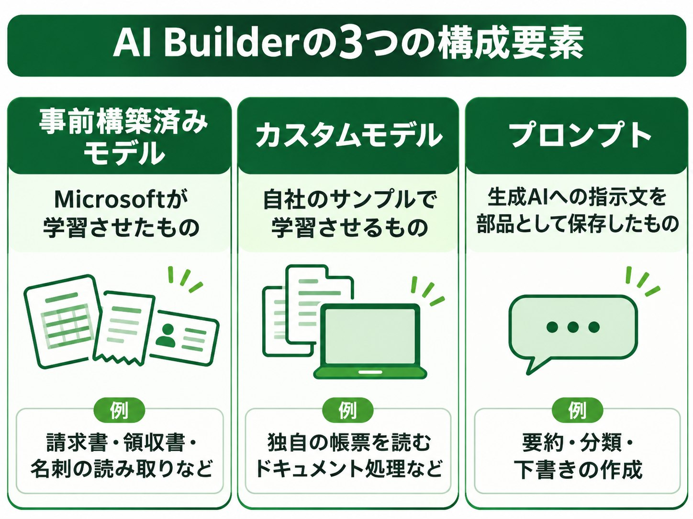
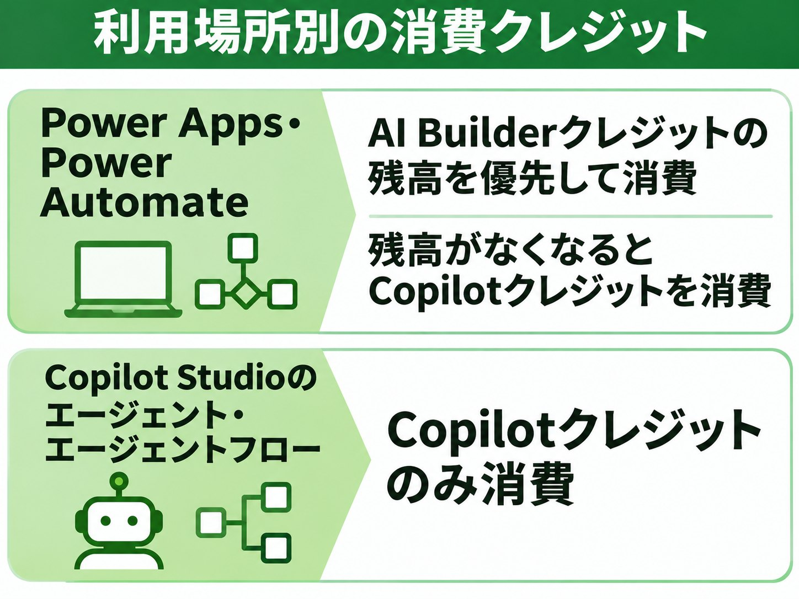
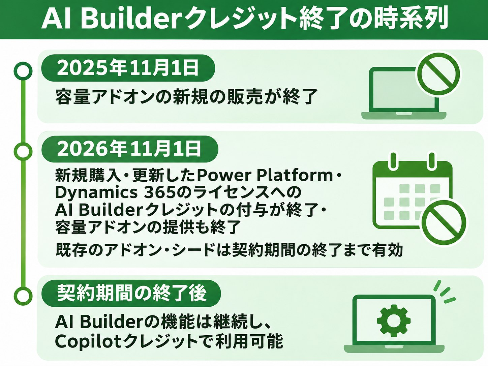
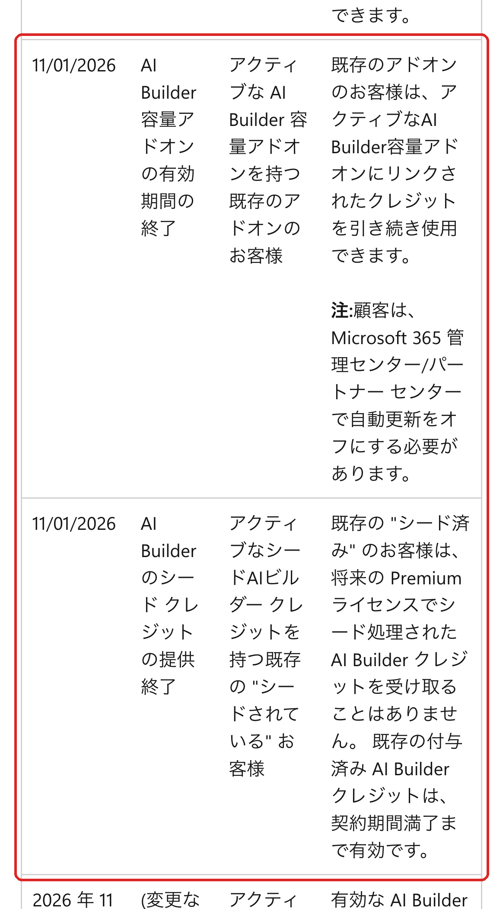

AI Builderは、Power AppsやPower Automateのアプリとフローに、請求書の読み取りや文章の分類などのAIを組み込むMicrosoftの機能です。新しく使い始める会社は2026年11月の時点ではCopilotクレジットで支払います。

Premiumライセンスに付くAI Builderクレジットと、AI Builderの容量アドオンは、2026年11月1日を境に新しく手に入らなくなりました。この記事ではできることとCopilot Studioとのつながり、料金の目安、入れる前に社内で決めることを、Microsoft Learnの説明に沿って解説します。

:::takeaways
- **請求書・領収書・名刺の読み取り、文章の分類や要約を、コードを書かずにフローやアプリへ組み込める**
- **新しく始める会社はCopilotクレジットで払う**。請求書1ページは8クレジットで、月500枚なら4,000クレジット
- **AI BuilderクレジットはPower AppsとPower Automateでだけ先に減り、Copilot Studioの中では使えない**
:::

## AI Builderとは？何ができる？

**AI BuilderはMicrosoftが用意した学習済みのAIをそのまま使うか、自社の書類やデータで学習させたAIを作って、Power Platformの業務に組み込む機能です。** 使うにはDataverseのあるPower Platformの環境が必要で、Microsoft 365のライセンスだけでは使えません。Power AppsかPower Automateにサインインし、左の「…その他」から「AI ハブ」を開くと、AIモデルとプロンプトの一覧が出ます。

<figure class="post-figure post-figure--zu"></figure>

AI Builderの中身は大きく3つに分かれます。

- **事前構築済みモデル**: Microsoftが学習させたもの。請求書・領収書・名刺・パスポートの読み取り、テキスト認識（OCR）、感情分析、言語検出など
- **カスタムモデル**: 自社のサンプルで学習させるもの。独自の帳票を読むドキュメント処理、写真から物を数える物体検出、過去のデータから結果を当てる予測など
- **プロンプト**: 生成AIへの指示文を部品として保存し、フローやアプリから呼ぶもの。要約・分類・下書きの作成に使う

業務とモデルの組み合わせは、Learnの「AIモデルとビジネスシナリオ」に一覧があります。Learnの一覧から、経理と問い合わせの業務に当てはめると次のとおりです。

| 業務 | 使うもの | 日本の環境 |
|---|---|---|
| 請求書の読み取り | 請求書処理（事前構築済み） | 一般提供・日本語に対応 |
| 経費精算の領収書 | 領収書処理（事前構築済み） | 一般提供・日本語に対応 |
| 自社独自の申込書 | ドキュメント処理（カスタム） | 一般提供 |
| 日本語の問い合わせの分類 | プロンプト | 生成AIは米国でホスト（データ移動の許可が必要な場合あり） |

**日本語の問い合わせを「請求」「解約」「不具合」のように分けたいなら、プロンプトで組むのが現実的です。** 事前構築済みのカテゴリ分類は、対応言語の一覧が英語・中国語（簡体字）・フランス語・ドイツ語・ポルトガル語・イタリア語・スペイン語で、日本語が載っていません。プロンプトなら分ける先の名前と判断の基準を日本語で書けるうえ、用意された関数のAIClassifyも同じ料金で使えます。

プロンプトの既定のモデルはGPT-4.1 miniです。GPT-4.1やGPT-5、AnthropicのClaudeなども選べます。Claudeは実験段階の扱いで、Microsoftの外でホストされる点に注意が必要です。モデルによって料金の区分が基本・標準・プレミアムと変わります。

試すなら、まず請求書か領収書の事前構築済みモデルに、自社に届く実物を数枚読ませてみるのがおすすめです。AIモデルのページでのテストはクレジットを使いません。

## Copilot Studioとどうつながる？

**同じ請求書の読み取りでも、Power Automateのフローで動かすか、Copilot Studioのエージェントから動かすかで、減るクレジットが変わります。** AI Builderで作ったモデルとプロンプトは、Power Apps・Power Automate・Copilot Studioの3つから呼べます。

<figure class="post-figure post-figure--zu"></figure>

Power Automateのクラウドフローでは、メールに付いた請求書を受け取ったら読み取り、結果をSharePointのリストやExcel、Dataverseに書き込む、という流れを組みます。Power Appsならスマホで撮った領収書をその場で読み取る画面を作り、Teamsに置いて社員に配れます。

Copilot Studioでは、エージェントのトピックやツールの中でプロンプトを使ったり、エージェントフローの中で請求書処理などのモデルを動かしたりできます。**エージェントとエージェントフローは、Copilotクレジットしか使えません。** 今あるPower Automateのクラウドフローをエージェントフローに変えると、その中のプロンプトとモデルもCopilotクレジットだけで動くようになります。

社員がTeamsで「この請求書を処理して」と話しかける形にしたいならCopilot Studio、決まった受付箱に届いたものを毎回同じように処理するだけならPower Automateが向いています。エージェントの作り方は別の記事にまとめました。

:::linkcard
url: /media/copilot-studio-agent/
title: 【2026年11月】Copilot Studioのエージェント作成手順｜Teams公開とビルダーの使い分け
desc: Copilot Studioでエージェントを作り、SharePointのナレッジを入れてTeamsに公開するまでの手順を解説しています。
:::

## AI Builderの料金はいくら？

**AI Builderに月額の定価は無く、使った分だけCopilotクレジットかAI Builderクレジットが減る仕組みです。** 加えて、フローやアプリを動かすPower AutomateやPower Appsのライセンスも必要です。

Power AppsとPower Automateでは、テナントにAI Builderクレジットが残っていればそちらが先に減り、無くなるとCopilotクレジットに切り替わります。**両方とも無い環境ではAI Builderのアクションが止まります。** フローは「EntitlementNotAvailable」や「QuotaExceeded」のエラーで失敗し、フローの編集画面には「この環境のすべてのAI Builder クレジットが使用されました」と出ます。Copilot Studioの中で使う分は、最初からCopilotクレジットです。

主な機能が1回にどれだけ使うかは、Learnの「ライセンスの概要」の表で決まっています。よく使うものを抜き出すと次のとおりです。

| 機能 | 単位 | Copilotクレジット |
|---|---|---|
| 請求書・領収書・身分証の読み取り | 1ページ | 8 |
| カスタムのドキュメント処理 | 1ページ | 8 |
| テキスト認識（OCR） | 1ページ | 0.1 |
| プロンプト（基本のモデル） | 1,000トークン | 0.1 |

プロンプトは標準のモデルにすると1,000トークンあたり1.5、プレミアムのモデルでは10に上がります。分類や要約は基本のモデルで足りることが多いので、精度に困ってから上の区分を試すのが無駄の少ない順番です。

**請求書を月500枚（各1ページ）読むなら、8×500で月4,000クレジットです。** 従量課金なら1クレジット0.01ドル（円の単価は1.5823円）で、月6,300円ほど。容量パックは1パック月29,985円で25,000クレジットなので、この量なら従量課金のほうが安く、パックが得になるのは月およそ1万9,000クレジットを超えてからです。容量パックの余りは翌月に繰り越されません。

Copilotクレジットの払い方（容量パック・従量課金・事前購入）と、エージェント全体の減り方は、Copilot Studioの料金の記事で解説しています。

:::linkcard
url: /media/copilot-studio/
title: 【2026年10月】Copilot Studioの料金を解説｜M365 Copilotの範囲・作れる人
desc: Copilotクレジットの3つの払い方と、エージェントの動きごとの減り方を解説しています。
:::

### Power Automate Premiumは必要か

**AI Builderを使うPower Automateのフローに、Power Automate Premiumが必要かどうかは、Learnの2つのページで書き方が分かれています。** 「ライセンスの概要」では名刺リーダーを含むAI Builderのアクションをプレミアム コネクタとし、使うフローはプレミアム フローでPremiumのライセンスが必要、という書き方です。一方で「ライセンスとAI Builder クレジット」は、フローにAI Builderのアクションを追加してもプレミアム フローにはならない、と書いています。英語版も同じ食い違いです。

Power Appsの側は、2つのページとも、アプリにAI Builderを追加するとPremiumのアプリになり、Premiumのライセンスが必要、と一致しています。Power Automate Premiumは日本の価格ページで1ユーザー月2,248円（年払い、税抜）です。**フローを使う人の分のライセンスを見積もりに入れるかは、契約の窓口のMicrosoftの担当かライセンスのパートナーに確認するのが確実です。**

Power Automateのライセンスのページも、Premiumで使える機能にAI Builderを挙げています。見積もりはPremiumを入れた側で組み、窓口に確認するのが確実です（[Power Automateのライセンスの種類](https://learn.microsoft.com/en-us/power-platform/admin/power-automate-licensing/types)）。

## 2026年11月に何が変わった？

**2026年11月1日から、新しく買ったり更新したりしたPower PlatformとDynamics 365のライセンスには、AI Builderクレジットが付かなくなりました。** AI Builderの機能そのものは終わらず、Copilotクレジットで引き続き使えます。

<figure class="post-figure post-figure--zu"></figure>

Microsoftが段階的な終了を発表したのは2025年10月です。AI Builderクレジットの入手先は2つあり、終わり方が違います。

- **AI Builderの容量アドオン（1つ100万クレジット）**: 2025年11月1日に新規の販売が終わり、持っている会社だけが2026年11月1日まで更新・追加できた。その日で提供が終わり、Microsoft 365管理センターかパートナーセンターで自動更新を切るよう案内されている。今あるアドオンは契約が切れるまで使える
- **Premiumライセンスに付くクレジット（シード）**: Power Automate Premiumは1ライセンス月5,000、Power Apps Premiumは500など。2026年11月1日より前に買うか更新したライセンスは、その契約期間の終わりまで毎月付く。それ以降の新規と更新には付かない

<figure class="post-figure"><figcaption>Microsoft Learn『AI Builder クレジットの期間終了』の予定表（2026年11月12日）</figcaption></figure>

AI Builderの30日の試用版も廃止されました。Power Automate自体の30日試用版は、価格ページに今も載っています。

**AI BuilderクレジットはCopilotクレジットに自動では置き換わらず、換算の率もありません。** シードやアドオンが残っている間は、Power AppsとPower Automateで先にそれが減り、尽きた所でCopilotクレジットに移ります。逆に言えば、**更新のタイミングでシードが消えた月から、同じフローの費用がCopilotクレジットの請求として見え始めます。**

今の状態で次にやることは会社の立場で分かれます。

- **これから新しく使う**: 最初から従量課金か容量パックを環境に割り当てる。AI Builderクレジットの購入は考えなくてよい
- **シードやアドオンで動いているフローがある**: 管理センターで今月の消費量を見て、契約の更新日にCopilotクレジットの従量課金か容量パックを用意する

## AI Builderの使い方

**請求書の読み取りなら、事前構築済みモデルを選んでフローに入れるだけで、学習もサンプルの準備も不要です。** メールに届いた請求書のPDFを読んでSharePointのリストに書き込む流れは、次の5つの手順で組めます。

### ① AIハブで請求書処理を選ぶ

Power Automateにサインインし、左の「…その他」から「AI ハブ」、「AI モデル」の順に開きます。一覧から請求書処理の事前構築済みモデルを選ぶところが出発点です。

### ② 自社の請求書でテストする

選んだモデルの画面で、自社に届いた請求書を数枚読ませます。**テストはクレジットを使わないので、取引先ごとの形を一通り試せます。** ファイルはJPEG・PNG・PDFで20MBまで、PDFは先頭の2,000ページまでが読み取りの対象です。

### ③ フローで使う

モデルの画面から「フローで使う」を選ぶと、クラウドフローの作成画面に移ります。

### ④ トリガーを決める

「新しいメールが届いたとき」などをトリガーにし、添付ファイルを請求書処理のアクションに渡せば、読み取りが自動で始まる流れです。

### ⑤ 読み取った項目を書き込む

読み取れる項目は請求書番号（InvoiceId）・請求日（InvoiceDate）・支払期限（DueDate）・取引先名（VendorName）・合計（InvoiceTotal）・税額（TotalTax）・明細（Items）などです。これをSharePointのリストやExcelの行に割り当てます。項目ごとに信頼度のスコアが返るため、**スコアが低いときだけ担当者にTeamsで確認を回す分岐を入れておく**と、読み違いがそのまま経理に流れません。

自社独自の申込書を読ませるなら、カスタムのドキュメント処理でサンプルに項目を付けて学習させます。学習もテストもクレジットを使わず、本番のフローで動かしたときから減ります。

## AI Builderを使うメリット

**Microsoft 365とPower Platformをすでに使っている会社なら、新しいシステムを入れずにAIを業務の流れに組み込める点が一番の利点です。**

### コードを書かずに組める

学習済みのモデルを選び、フローの部品としてつなぐだけで動きます。業務を知っている担当が自分で作って修正できるため、開発の依頼を待つ時間がかかりません。

### 社内のデータの置き場とつながる

読み取った結果をSharePoint・Excel・Dataverse・Teamsへそのまま流せます。データは自社のPower Platformの環境の中で扱われます。読み取りなどのモデルは環境をホストする地域のデータセンターに置かれる仕様です。プロンプトは例外で、日本の環境では生成AIを米国でホストする扱いのため、管理センターで「リージョン間でデータを移動する」の許可が必要になる場合があります。

### 管理センターで使う量を絞れる

Power Platform管理センターでは、クレジットを環境ごとに割り当てられます。割り当てていない環境で使わせない設定もあるため、**どの部署がどれだけAIを使っているかを、環境単位で把握して止められます。**

## AI Builderのデメリットと注意点

**AI Builderは費用と精度の読み違いが起きやすく、契約の形が変わった直後の今は特に、月の途中で止まる事故に気を付けたい場面です。**

### 月の途中で止まることがある

使用量は毎月1日にリセットされ、余りは繰り越されません。消費量の計算は理想では毎日ですが、5日以上遅れることがあります。**AI Builderクレジットを割り当てた環境で上限を超えても、テナントに残っているAI Builderクレジットには自動で切り替わりません。Copilotクレジットも使えない環境では、その環境のフローだけが止まる動きです。従量課金を環境に紐づけておけば、容量を超えた分は後払いで受けられます。** 請求書の締め日のように量が月末に集まる業務は、ふだんの月の最大量で容量を用意しておく必要があります。

### 機能と日本語の対応が地域で違う

日本の地域では請求書・領収書・名刺・パスポートなどの身分証の読み取りとテキスト認識が一般提供です。身分証はパスポートと米国の運転免許証などが対象です。一方で契約書の読み取りや画像の説明はプレビューで、本番の業務には勧められていません。テキストの翻訳とエンティティ抽出の事前構築済みモデルは、日本の地域の表で提供が無い扱いです。

### 結果が毎回同じとは限らない

読み取りと生成AIの結果には揺れがあり、手書きや印影が重なった書類では読み違いも起きます。**金額や支払先のように間違えると困る項目は、人が確認する手順をフローの中に残しておきます。**

## 入れる前に決めること

**AI Builderを本番の業務に入れる前に、次の5つを社内で決めておくと、費用と停止の事故を避けられます。**

1. **対象の業務と月の件数**: 請求書なら月何枚・何ページか。費用はページ数で決まる
2. **どこで動かすか**: Power Automateのフローか、Copilot Studioのエージェントか。減るクレジットと必要なライセンスが変わる
3. **クレジットの払い方と割り当て先**: 容量パックか従量課金か。どの環境にいくつ割り当てるか
4. **作れる人の範囲**: プロンプトやモデルを作れるのは、環境のシステム管理者・システムカスタマイザー・環境作成者などのセキュリティロールを持つ人。誰に渡すかを決める
5. **人が確認する所**: 信頼度が低いとき、金額が大きいときに誰が見るか

まずは1つの業務・1つの環境で1か月動かし、管理センターの消費量と実際の処理件数を照らし合わせると、全社に広げるときの見積もりが確かになります。nitoでは会社でAIエージェントを入れるときの業務の選定から構築・運用までを[AIエージェントの構築支援](/ai-agent/)として受けています。

## まとめ

- **これから請求書や領収書の読み取りを自動化したい**: 事前構築済みモデルを自社の書類でテストし、従量課金か容量パックを1つの環境に割り当てて小さく始める
- **日本語の問い合わせを分類したい**: 事前構築済みの分類ではなく、プロンプトで分ける先と基準を書く
- **Premiumライセンスのクレジットで動かしている**: 契約の更新日を確認し、シードが消える月からのCopilotクレジットの費用を見積もる
- **社員がTeamsで話しかけて処理させたい**: Copilot Studioのエージェントから呼ぶ形にし、Copilotクレジットだけで費用を組む

## よくある質問

### AI Builderは無料で使えますか？

モデルの学習と、AIモデルのページやプロンプトビルダーでのテストは無料です。本番のアプリやフロー、エージェントで動かすとクレジットが減ります。AI Builderの試用版は廃止されています。

### AI BuilderはMicrosoft 365に含まれる？

含まれません。DataverseのあるPower Platformの環境と、AI Builderクレジットか Copilotクレジットの容量が必要です。アプリで使うならPower AppsのPremiumのライセンスも必要です。フローは公式の2ページで書き方が分かれます。

### AI Builderのアドオンはまだ買えますか？

新しく使う会社は2025年11月1日から購入できません。持っていた会社の更新と追加も2026年11月1日までで、今はCopilotクレジットを買う形です。

### AI Builderクレジットは移行されますか？

自動では変わらず、換算の率もありません。残っているAI Builderクレジットを先に使い、無くなるとCopilotクレジットが減ります。

### AI Builderのクレジットは翌月に繰り越せますか？

繰り越せません。使用量は毎月1日にリセットされ、月内に使わなかった分は消えます。

### AI Builderは日本語の請求書を読めますか？

読めます。請求書処理の事前構築済みモデルは日本語（日本）に対応していて、日本の地域で一般提供されています。

### AI Builderでエージェントを作れますか？

エージェントそのものを作るのはCopilot Studioです。AI Builderのプロンプトやモデルは、そのエージェントのトピックやエージェントフローの中で部品として使えます。

### AI BuilderとAzureはどう使い分けますか？

Power AppsやPower Automateの中で完結する読み取りや分類はAI Builder、独自の学習やコードからの細かい制御が必要ならAzure側のサービスが向いています。プロンプトではMicrosoft Foundryでホストした自社のモデルを使う設定もあります。

## 出典

- [AI Builder の概要](https://learn.microsoft.com/ja-jp/ai-builder/overview)（Microsoft Learn、2026年1月14日更新）
- [AI モデルとビジネス シナリオ](https://learn.microsoft.com/ja-jp/ai-builder/model-types)（Microsoft Learn）
- [ライセンスの概要](https://learn.microsoft.com/ja-jp/ai-builder/administer-licensing)（Microsoft Learn、2026年9月24日更新。課金レートの表）
- [ライセンスと Copilot クレジット](https://learn.microsoft.com/ja-jp/ai-builder/message-management)（Microsoft Learn）
- [ライセンスと AI Builder クレジット](https://learn.microsoft.com/ja-jp/ai-builder/credit-management)（Microsoft Learn）
- [Power Automate のライセンスの種類](https://learn.microsoft.com/en-us/power-platform/admin/power-automate-licensing/types)（Microsoft Learn）
- [リージョン別の Copilot 機能の可用性](https://learn.microsoft.com/ja-jp/power-platform/admin/geographical-availability-copilot)（Microsoft Learn）
- [AI Builder クレジットの期間終了](https://learn.microsoft.com/ja-jp/ai-builder/endofaibcredits)（Microsoft Learn、2026年10月2日更新）
- [End of AI Builder credits](https://learn.microsoft.com/en-us/ai-builder/endofaibcredits)（同じページの英語版）
- [請求書処理事前構築済み AI モデル](https://learn.microsoft.com/ja-jp/ai-builder/prebuilt-invoice-processing)（Microsoft Learn）
- [カテゴリ分類の事前構築済みモデル](https://learn.microsoft.com/ja-jp/ai-builder/prebuilt-category-classification)（Microsoft Learn）
- [モデルのバージョンと設定を変更する](https://learn.microsoft.com/ja-jp/ai-builder/prompt-modelsettings)（Microsoft Learn、2026年8月5日更新）
- [リージョン別の機能の可用性](https://learn.microsoft.com/ja-jp/ai-builder/availability-region)（Microsoft Learn）
- [Power Automate の価格](https://www.microsoft.com/ja-jp/power-platform/products/power-automate/pricing)（Microsoft、2026年11月12日に閲覧）
- [Microsoft Copilot Studio プランと価格](https://www.microsoft.com/ja-jp/microsoft-365-copilot/pricing/copilot-studio)（Microsoft、2026年11月12日に閲覧）
