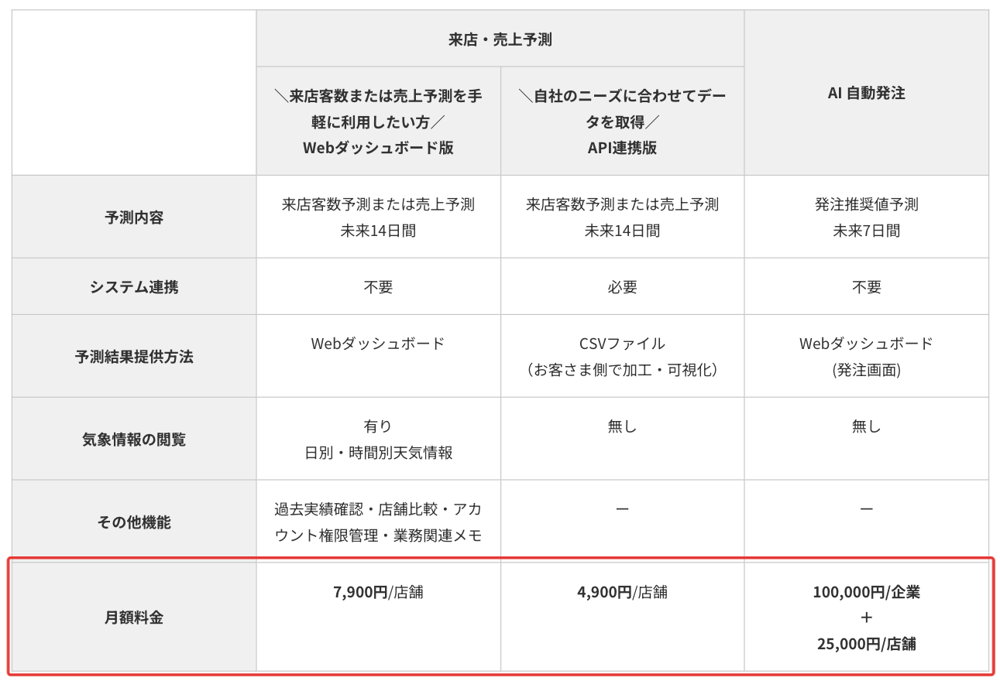

需要予測AIは、販売や出荷の実績・在庫・天気などのデータから先の売れる数を計算し、発注や生産の数を提案するツールです。選ぶ基準は自社の業種に合った型かどうかと、今の発注・在庫のシステムとつながるかの2つです。食品スーパーや飲食はサキミルとsinops-CLOUD、アパレルはVestory、製造業はUMWELTやFOREMASTが候補になります。

この記事では公式サイトで対象と料金の扱いを確認できた8つを、3つの型に分けて比べます。必要なデータの量、ExcelやChatGPTで足りるか、費用と導入の進め方まで扱います。

:::takeaways
- **製品は業種特化のパッケージ・汎用の予測ツール・個別構築の3つの型に分かれる**。発注まで自動にしたい店舗は業種特化、品目の多い製造業は汎用か個別構築が候補
- **料金を公開しているのはサキミルなど一部だけ**。ほかは個別見積もりなので、自社データで精度を確認する検証の有無で絞る
- **最低でも1年分の季節を含む実績が必要**。日付・品番・数量の3つがそろっていれば始められる製品もある
:::

## 需要予測AIとは？何ができる？

需要予測AIは過去の実績から需要が動く規則を機械学習で見つけ、先の販売数・出荷数・来店客数を出すツールです。自社の販売実績・在庫・価格や販促の履歴に、気象やカレンダーなどの外部データを組み合わせて学習します。予測と実績のずれを次の学習に戻すため、使い続けるほど自社のデータに合っていきます。

できることは製品で差があり、予測の数字を出すだけのものから、**発注数の提案や自動発注まで引き受けるもの**まであります。比べるときは予測の結果を誰がどの画面で使うのかを先に決めておくと、必要な機能が絞れます。

### 統計の予測やExcelと何が違う？

移動平均や指数平滑のような統計の予測は、過去の売上の動きを延ばして先を出す方法です。Excelでも同じ計算はできますが、商品が数千を超えたり、天気や特売の影響まで入れたりすると、手作業での更新が追いつかなくなります。**需要予測AIは多くの要因を同時に学習し、品目・店舗ごとの予測を自動で出し直す点が違います。**

## 需要予測AIを導入するメリットは？

効果が出やすいのは欠品と過剰在庫の削減で、そこに予測と発注の作業時間の短縮が加わります。担当者の経験に頼っていた判断を、同じ手順で回せるようになる点も大きな利点です。

### 欠品と過剰在庫を同時に減らせる

人の予測は「欠品させたくない」という気持ちから多めに発注しがちです。AIは品目ごとに必要な数を出すため、売れ筋の欠品と売れ残りの両方を減らす方向に働きます。シノプスは日配品の自動発注で、廃棄・値引ロスを15%削減したとしています（複数社の導入事例の平均）。**数字はその会社の品目と条件での結果なので、自社の今の廃棄率と欠品率を記録してから比べる必要があります。**

### 予測と発注の作業時間が減る

複数のシステムからデータを集めてExcelで集計する作業がなくなるため、担当者は提案された数を確認して修正するだけで済みます。sinops-CLOUDの日配品では、1,500SKU程度で発注業務が1日30分程度になったというのが同社の説明です。IBMは解説の中で、Idaho Forest Groupが予測にかかる時間を80時間超から15時間未満にした例を紹介しています。

:::linkcard
url: /media/ai-efficiency-cases/
title: AI業務効率化の事例10選
desc: 業務別の削減時間を対象の人数・時期・実績か見込みかの条件つきで解説しています。
:::

### 担当者が替わっても同じ手順で回せる

ベテランの頭の中にあった判断の基準が、学習したデータと設定として残るため、担当者が異動しても、新しい担当者が同じ予測をもとに発注できるのが利点です。Prediction OneやAirlakeのように、どの項目が予測に効いたかを示す製品なら、社内で予測の根拠を説明しやすくなります。

## 需要予測AIのデメリットは？

注意したいのはデータの量、予測が外れる場面、精度が出るまでの検証の3つです。どれも導入前に把握しておけば対処できます。

### データが少ないと精度が出ない

AIは過去の実績から規則を学ぶため、季節の動きを1回も含まないデータでは季節の変動を予測できません。創業して1年未満の事業や、発売したばかりの商品は精度が出にくくなります。**欠損や入力の誤りが多いデータも精度を下げるため、まず今あるデータの期間と抜けを確認する必要があります。**

### 予測は外れる前提で運用する

感染症の流行や大きな災害のように、過去に例のない出来事は学習のしようがありません。予測する期間が先になるほど、外れる幅も大きくなります。AIの数字はあくまで提案として扱い、安全在庫を持つ・大きく外れたときに人が修正する、という手順を最初に決めておくと運用が止まりません。

### 精度が出るまで検証と調整が続く

導入した直後から高い精度が出るとは限らず、外部データの追加や設定の見直しを重ねて精度を上げていきます。AI CROSSもよくある質問で、必ず一定の精度が出るわけではないとして、既存の予測方法と比べる検証を勧めています。**導入前に自社データで精度を確認できる製品を優先すると、この手戻りを小さくできます。**

## 需要予測AIツールの比較8選

業種の業務に合わせて作られたパッケージ・業種を問わずに使う予測ツール・自社に合わせて組む個別構築の順に8製品を並べました（各社の公式サイトで2026年11月28日に確認）。

| サービス | 型 | 主な対象 | 予測に使うデータ（公式の記載） |
|---|---|---|---|
| サキミル | 業種特化 | 飲食・小売の店舗 | 店舗の実績・人流・気象 |
| sinops-CLOUD | 業種特化 | 食品スーパーなど流通業 | POSの販売・在庫・特売の実績 |
| Vestory | 業種特化 | アパレル・ファッション小売 | 販売・在庫・値下げ履歴・天気 |
| Prediction One | 汎用 | 業種を問わない | 自社の表形式のデータ |
| UMWELT | 汎用 | 製造業・飲食など | 日付・品番や店名・数量 |
| Deep Predictor | 汎用 | 製造業・卸売業 | 自社データと気象・カレンダー |
| Airlake | 個別構築 | 卸売・小売・製造など | 自社データと外部データ |
| FOREMAST | 個別構築 | 食品製造・外食・流通 | 出荷実績と気象などの要因 |

| サービス | 発注・在庫システムとの連携 | 料金（公式の表示） | 試用・検証 |
|---|---|---|---|
| サキミル | API連携版・自動発注は専用画面 | 1店舗月4,900円から（税抜） | 記載なし |
| sinops-CLOUD | 自動発注まで同じ製品 | 記載なし | 導入相談は無料 |
| Vestory | EC・POS・基幹と標準連携 | 個別見積もり | 導入前の精度検証 |
| Prediction One | クラウド版でAPI | 法人は問い合わせ | 14日の無料体験版 |
| UMWELT | M・LプランでAPI・SFTP | プランごとに案内 | 事例にトライアル |
| Deep Predictor | 基幹・ERPとAPI連携 | 個別見積もり | 業務効果検証（任意） |
| Airlake | 自動発注は追加のカスタマイズ | Forecastingは月5万円から | 記載なし |
| FOREMAST | データ連携の機能を選んで導入 | 記載なし | 記載なし |

**料金を比べる前に、予測だけで足りるのか、発注数の算出や自動発注まで必要なのかを決めておくと、同じ条件で見積もりを取れます。**次は各社の条件を確認してください。

### ① サキミル

[サキミル](https://www.softbank.jp/business/service/iot/sakimiru/)はソフトバンクの飲食・小売向けの需要予測サービスです。店舗の実績データに、携帯電話の基地局から得た商圏の人流統計と気象データを組み合わせ、店舗ごとの来店客数か売上を14日先まで予測します。料金は税抜で、Webダッシュボード版が1店舗月7,900円、API連携版が1店舗月4,900円、初期費用は1店舗3,000円です。AI自動発注は1企業月100,000円と1店舗月25,000円で、発注推奨値を7日先まで出します。バローホールディングスの事例では、平均93%の客数予測を実現したとしています。

<figure class="post-figure"><figcaption>サキミルの料金の表示（2026年11月28日）</figcaption></figure>

### ② sinops-CLOUD

[sinops-CLOUD](https://www.cloud.sinops.jp/)はシノプスの流通業向けの需要予測型自動発注サービスで、1店舗・1機能から導入できます。POSデータをもとに1時間ごとの在庫を把握し、乳製品・パン・豆腐のような賞味期限の短い日配品、グロサリー、惣菜の発注数を自動で出します。客数予測は45日先まで出せて、予測精度94.7%以上と掲げています。最低発注数や発注単位も設定できるため、少量ずつの発注を防げます。食品メーカー向けには別にsinops-CLOUD Mがあります。料金は公開しておらず、導入の相談は無料です。

<figure class="post-figure"><figcaption>sinops-CLOUD 日配の導入効果の表示（2026年11月28日）</figcaption></figure>

### ③ Vestory

[Vestory](https://vestory.jp/)はハイクリが提供する、アパレル・ファッション小売向けの発注最適化AIです。販売実績・在庫・商品特性・値下げ履歴・天気などを学習し、どの商品をいつ何個追加発注するかを提示します。消化が遅れた品番には値引きやチャネル間の在庫移動を提案し、仕入れ予算（OTB）の管理もできます。ZOZOTOWN・楽天・Amazon・自社ECを横断して扱え、ECモール・POS・基幹システムと標準で連携します。最短5日で導入でき、導入前に実データで精度を検証する流れがあります。

### ④ Prediction One

[Prediction One](https://predictionone.sony.biz/)はソニーネットワークコミュニケーションズのノーコードの予測分析ツールで、需要予測に限らず使えます。用途の例に出荷数予測による生産計画や、来店予測による仕入れ量の決定を挙げています。データの各項目が予測にどれだけ影響したかを示すため、結果の説明にも使えるのが特長です。社外にデータを出したくない会社は、Windowsに入れるデスクトップ版も選べる点が違いです。法人の料金は問い合わせで、個人利用プランは年217,800円から（税込）です。無料体験版は14日間使えます。

### ⑤ UMWELT

[UMWELT](https://www.tryeting.jp/umwelt/)はトライエッティングのノーコードAIで、利用の9割以上が需要予測と在庫管理です。日付・品番や店名・数量のデータがあれば、品番ごとに日・週・月の需要を予測でき、安全在庫の計算も入っています。プランはS・M・Lの3つで、APIやSFTPでのシステム連携はMとLで使えます。精度検証からシステム連携までを専門のチームが支援するサポートパックもあります。調味料メーカーのフンドーキン醬油は約1,000品目の予測を一部の工場から始め、ユーザー数や利用回数で追加料金がかからない点を決め手に挙げた事例です。

### ⑥ Deep Predictor

[Deep Predictor](https://aicross.co.jp/deep-predictor/)はAI CROSSの予測サービスで、同社は製造業・卸売業に強く、数十万SKUまで扱えるという説明です。気象・カレンダー・人口統計などの外部データを自動で取り込み、販売量・出荷量・発注量を予測します。基幹システムやERPとAPIでつなげ、発注量の自動算出はオプションで追加します。料金は初期費用と伴走支援を含む月額の組み合わせで、金額は予測の対象とデータ量による個別の見積もりです。本格導入の前に、自社データで精度と想定の費用対効果を確認する業務効果検証を任意で受けられます。

### ⑦ Airlake（DATAFLUCT）

[Airlake](https://datafluct.com/ai-service/ai-models/)はDATAFLUCTのAIサービスで、オーダーメイドの予測・最適化モデルを開発します。入口のAirlake Forecastingは月5万円からで、自動発注や配送の最適化を組み込むプランに広げられる設計です。天候や販促がどれだけ予測に効いたかを数値で示す機能と、安全在庫やリードタイムを条件に入れた最適化の機能があります。アース製薬では需要予測の本番運用を始め、伊藤忠食品とは受注数予測の実証を終えました。

### ⑧ FOREMAST

[FOREMAST](https://www.canon-its.co.jp/products/foremast/)はキヤノンITソリューションズの需要予測・需給計画のシステムです。需要予測・在庫補充計画・データ連携など5つの機能のまとまりから必要なものを選び、足りない機能は追加で開発します。複数の予測モデルから直近で最も精度の高いものを自動で選び、気温のような要因で予測を補正できます。大手食品製造業向け・倉庫が1つの会社向け・外食業向けのテンプレートがあり、外食向けはメニューの予測を食材の量に展開します。料金は公開されておらず、カタログは資料請求で取り寄せます。

## 業種別にどの型が向いている？

店舗の発注を毎日回すのか品目の多い出荷や生産の計画を立てるのかで、向いている型が分かれます。店舗は業種特化のパッケージ、製造業は汎用の予測ツールか個別構築が向いています。

### 食品スーパー・飲食

**日配品や惣菜の毎日の発注まで任せたいなら、発注の機能を持つsinops-CLOUDかサキミルのAI自動発注が候補です。**来店客数の予測からシフトや仕込みの量を決めるだけなら、サキミルの来店・売上予測が1店舗から使える製品です。店舗のシフトをAIで組む製品は[シフト作成AIツールの比較](/media/ai-shift-scheduling-comparison/)にまとめました。

### 製造業・卸

品目が多く出荷先や拠点が分かれる製造業は、Deep PredictorやUMWELTのように品目ごとの出荷予測を自動で出す汎用の型が候補です。複数の倉庫の補充計画や、食品の出荷期限まで含めた需給計画を1つの仕組みにしたいなら、FOREMASTのようにテンプレートと追加開発を組み合わせる個別構築が向いています。

### アパレル・EC

サイズや色ごとに売れ方が違い、売り切る時期も決まっているアパレルは、追加発注と在庫の消化を扱うVestoryが合っています。複数のECモールで売っている会社は、モールとの標準連携があるかを先に確認してください。

## 需要予測AIに必要なデータは？

日付・品番（または店舗）・数量がそろった販売か出荷の実績が最低限必要です。UMWELTはこの3項目があれば品番ごとの予測ができるとしています。**季節の動きを学ぶには最低でも1年分、できれば数年分の実績があると精度が上がります。**

そのうえで在庫・価格・特売や販促の履歴を加えると、需要の動きの理由まで学習できます。気象や人流のような外部データは、サキミルやDeep Predictorのように製品側で用意するものもあるため、自社で集める必要があるかを見積もりの前に確認してください。UMWELTの事例では調味料メーカーが基幹システムと受発注システムのデータだけで良い精度が出たと話しています。

## Excelや生成AIで足りる？

品目が数十ほどで、季節の動きが毎年同じなら、Excelの予測関数でも足ります。品目が多い、天気や特売で売れ方が変わる、予測を毎日出し直したい、のどれかに当てはまるなら専用のツールのほうが手間が少なくなります。

### Excelの予測関数でできること

ExcelのFORECAST.ETS関数は、指数平滑法を使って過去の値から先の売上や在庫量を予測でき、季節の周期も自動で見つけてくれる関数です。ただし1つの系列の延長なので、天気や特売のような要因は入りません。品目ごとに式を組んで更新する作業も人の手で残ります。

### ChatGPTでできること

ChatGPTはExcelやCSVのファイルを読み込み、Pythonで集計や統計の分析をして、表やグラフを作れます。OpenAIのヘルプは結果を信頼する前に生成されたコード・出力・前提を確認するよう求めています。**専用のツールは同じデータから同じ手順で予測し誤差を計測できますが、生成AIは指示のたびに計算の方法を組むため、方法と前提を毎回人が確認する必要がある点が違いです。**生成AIは予測の数字を出すより、予測の結果の要約や社内向けの説明資料づくりのほうが使いどころです。

## 需要予測AIの費用と導入期間は？

費用は予測の範囲が予測だけか発注までかで大きく変わります。料金を公開している製品で計算すると、食品スーパー10店舗でサキミルのAI自動発注を使う場合、月額は1企業100,000円と10店舗分の250,000円で月350,000円、初期費用は1,030,000円です（税抜）。

予測だけなら費用は下がり、Airlake Forecastingは月5万円から、Prediction Oneの個人利用プランは年217,800円からです（税込）。ほかの製品は予測の対象・データ量・連携の範囲で個別に見積もるため、**複数社に同じ条件を伝えて見積もりを取る必要があります。**導入期間はVestoryが最短5日としている一方、システム連携や追加開発を伴う製品は検証から本番まで数か月を見込むことになります。

外部の会社に予測モデルの開発から頼む場合の費用と会社の選び方は、[AI開発会社の比較](/media/ai-dev-companies/)にまとめています。

## 導入はどう進める？

導入は今の数字の記録・データの準備・自社データでの検証・一部での本番運用の順で進む流れです。検証で既存の予測より精度が上がるかを確認してから広げるのが安全です。

1. 今の欠品率・廃棄や値引きの額・予測と発注にかけている時間を記録する
2. 予測したい対象（品目・店舗・期間）と、予測の結果を誰がどう使うかを決める
3. 日付・品番・数量の実績を最低1年分そろえ、欠損と入力の誤りを確認する
4. 型を決めて2〜3社に同じ条件で相談し、自社データでの検証を依頼する
5. 1店舗か1工場で本番に使い、予測と実績のずれを見ながら対象を広げる

検証の結果は、予測と実績のずれを平均した誤差の指標と、在庫や欠品がどれだけ変わるかの両方で比べると判断しやすくなります。

:::linkcard
url: /media/ai-agent-introduction/
title: AIエージェント導入の進め方と費用
desc: 自社で作るか頼むかの判断と国内の事例を解説しています。
:::

## 予測を発注や在庫の作業につなぐには？

予測の数字を発注・在庫の移動・販促の作業まで自動でつなぎたい場合は、製品の自動発注の機能を使うか、AIエージェントで流れを組む方法になります。発注まで1つの製品で回せるのはsinops-CLOUDやサキミルのAI自動発注、Vestoryで、別々のシステムをつなぐならAPIかCSVで予測の結果を受け渡せるかを先に確認します。

:::linkcard
url: /media/ai-agent-build/
title: AIエージェントの作り方を解説
desc: ノーコード・既製の基盤・コードの3通りの作り方と作る前に決めることを解説しています。
:::

## まとめ

- **日配品や惣菜を扱う食品スーパー・飲食**: 発注まで任せるならsinops-CLOUDかサキミルのAI自動発注、来店予測だけならサキミルを1店舗から
- **品目の多い製造業・卸**: 出荷予測はDeep PredictorやUMWELT、拠点をまたぐ需給計画まで組むならFOREMASTやAirlake
- **アパレル・EC**: 追加発注と在庫の消化を扱うVestoryを、モールとの連携と導入前の精度検証で確認する
- **品目が少なく季節の動きが単純な会社**: ExcelのFORECAST.ETS関数から始め、手作業の更新が負担になった時点で専用のツールに切り替える

## よくある質問

### サキミルは何店舗から使えますか？

1店舗から使えます。来店・売上予測のAPI連携版は1店舗月4,900円、Webダッシュボード版は1店舗月7,900円で、初期費用は1店舗3,000円です（いずれも税抜）。

### Prediction Oneは無料で試せますか？

試せます。無料体験版は利用開始から14日間で、有料版に自動で切り替わることはありません。個人利用プランの案内では無料体験版で使えるのはサンプルデータのみとしています。

### sinops-CLOUDは日配品に対応していますか？

対応しています。乳製品・パン・豆腐のような賞味期限の短い日配品の需要予測と発注を自動で行い、当日の発注推奨値や前日閉店時の在庫を自動で計算します。

### UMWELTを使うにはどんなデータが必要ですか？

日付・品番や店名・数量のデータがあれば、品番ごとに日・週・月の需要予測ができます。基幹システムや外部サービスとの連携、BIツールでの可視化にも対応しています。

### Vestoryはどのくらいで導入できますか？

最短5日で導入できるとしています。導入前には秘密保持契約を結んだうえで実データを渡し、AIモデルの精度を検証して結果の報告を受ける進め方です。

### ChatGPTで需要予測はできますか？

ExcelやCSVを読み込ませれば、Pythonで計算した予測の表やグラフを作れる点は確かです。ただし計算の方法を毎回組むため、生成されたコードと前提を人が確認する必要があり、品目の多い予測を毎日出し直す用途には専用のツールのほうが合う形です。

## 出典

- ソフトバンク「[AI需要予測サービス サキミル](https://www.softbank.jp/business/service/iot/sakimiru/)」（料金・導入事例）
- シノプス「[sinops-CLOUD](https://www.cloud.sinops.jp/)」「[日配](https://www.cloud.sinops.jp/product/daily/)」
- ハイクリ「[Vestory](https://vestory.jp/)」（機能・連携・料金体系・導入前の精度検証）
- ソニーネットワークコミュニケーションズ「[Prediction One](https://predictionone.sony.biz/)」「[個人利用プラン](https://predictionone.sony.biz/about/personal-use/)」
- トライエッティング「[UMWELT](https://www.tryeting.jp/umwelt/)」「[料金・サポート](https://www.tryeting.jp/umwelt/fee-support/)」
- AI CROSS「[Deep Predictor](https://aicross.co.jp/deep-predictor/)」「[料金・オプション](https://aicross.co.jp/deep-predictor/price/)」「[需要予測のアルゴリズムとは？](https://aicross.co.jp/deep-predictor/blog/blog-691/)」
- DATAFLUCT「[Airlake AI models](https://datafluct.com/ai-service/ai-models/)」「[予測AIのケーススタディ](https://datafluct.com/casestudies/predictive-ai/)」
- キヤノンITソリューションズ「[需要予測・需給計画ソリューション FOREMAST](https://www.canon-its.co.jp/products/foremast/)」
- IBM「[AI需要予測とは](https://www.ibm.com/jp-ja/think/topics/ai-demand-forecasting)」
- OpenAI ヘルプ「[ChatGPT によるデータ分析](https://help.openai.com/ja-jp/articles/8437071-data-analysis-with-chatgpt)」
- Microsoft サポート「[FORECAST.ETS 関数](https://support.microsoft.com/ja-jp/office/forecast-ets-%E9%96%A2%E6%95%B0-15389b8b-677e-4fbd-bd95-21d464333f41)」
- 各社の公式サイトは2026年11月28日に確認
