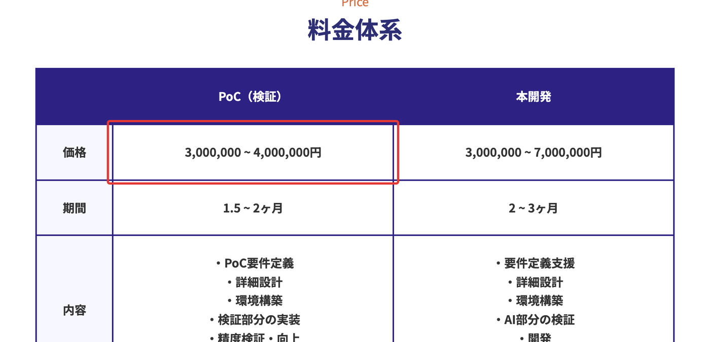

AI開発会社は、**開発対象が画像認識や需要予測などの機械学習か、生成AIを使った業務の仕組みか、AIエージェントかで得意分野が分かれます**。依頼先は開発対象を決めてから、その分野の事例がある会社に絞って比べるのが近道です。

この記事は株式会社nitoが書いています。選定基準は、公式サイトで受託開発の範囲と料金の公開状況を確認できたことです。その8社を開発対象の3つに分けて比べます。費用の目安と計算例・依頼するメリットとデメリット・PoC（試作と検証）から本番運用までの流れも扱います。nitoもAIエージェントの構築支援をしているため一覧に含めました。

:::takeaways
- 依頼先は開発対象で分かれる。機械学習・生成AIの業務の仕組み・AIエージェントのどれかを先に決める
- 料金を公式に出している会社は少ない。WEELの目安ではPoCと本開発の合計が600万〜1,100万円
- 見るべきはPoCの後に本番まで作れるか、精度の確認方法、作った後に誰が修正するか
:::

## AI開発会社とは？何を頼める？

AI開発会社とは**業務の課題に合わせてAIを組み込んだシステムを設計から運用まで請け負う会社**です。既製のAIツールを売るだけの会社とは違い、自社のデータや業務の流れに合わせて作ります。

依頼できる範囲は課題の整理・要件定義・データの準備・PoC・本開発・既存システムとの連携・運用と保守までです。会社によって得意な工程が違い、構想の整理から入る会社もあれば、要件が決まった後の開発を中心に受ける会社もあります。

作り方は大きく3つに分かれます。ゼロから作るフルスクラッチ、既存のAIモデルや基盤を自社のデータに合わせて作り込む形、既製のパッケージをそのまま入れる形です。**フルスクラッチほど費用と期間がかかり、自社の業務に合わせられる幅も広がります**。

AIの部分だけでなく画面・権限・社内システムとのつなぎ込みまで作れるかで、本番で使えるかが決まります。AI開発会社と一般のシステム開発会社の境目はあいまいなので、事例でどこまで作ったかを確認するのが確実です。

## AI開発会社は開発対象でどう選ぶ？

**最初に決めるのは会社ではなく開発対象です**。同じAI開発でも、機械学習のモデルを作る仕事と、生成AIを業務に組み込む仕事、AIに業務を進めさせる仕事では、必要な技術も事例も違います。

| 開発対象 | 代表的な用途 | 依頼先を選ぶ基準 |
|---|---|---|
| 機械学習（画像認識・予測・最適化） | 外観検査・需要予測・シフトや配車の最適化 | 自社の業界と同じデータの事例があるか |
| 生成AIの業務の仕組み | 社内文書を検索して答えるAI（RAG）・文書の自動作成 | 精度の確認方法と社内データの扱い |
| AIエージェント | 議事録からの入力・受注処理など業務の自動化 | 任せる範囲・権限・記録の設計 |

開発対象が決まらない段階なら、業務の棚卸しや構想の整理から受ける会社に相談します。そのうえで、次の4点を確認すると候補を絞れます。

### 既存のサービスで足りないか

ChatGPTやCopilotの法人プラン、Difyのようなノーコードのツールで足りる用途も少なくありません。**使う人が少ない、試す期間が短い、社内の資料を細かく扱わない場合は、作り込むより早く安く済みます**。相談の場で「既存のサービスでは足りませんか」と聞き、足りる場面と足りない場面を答えてくれる会社が信頼できます。

社内の問い合わせ対応に絞るなら、製品と自社で組む方法の比較が先に役立ちます。

:::linkcard
url: /media/internal-chatbot/
title: 社内チャットボットの選び方
desc: 製品を買うか自社の契約で組むかを費用とRAGの仕組みから解説しています
:::

### PoCの後に本番まで作れるか

AIは試してみないと精度が分からないため、多くの会社がPoCから始めます。よくある失敗は、試作は作れても本番のシステムにできずに止まる形です。**AI以外の業務システムも作っているか、試作から本番まで何か月かかったかを事例で確認します**。

### 精度をどう確かめるか

生成AIの回答も機械学習の判定も、100%正しくはなりません。どんな質問やデータで、何を合格とするかをPoCの前に決める会社を選びます。合格の基準が無いままPoCを始めると、動いたが次に進んでよいか判断できない、で終わります。

### 保守とデータの置き場所

AIは業務やデータが変わるたびに修正が必要です。**納品後に誰が修正し、月にいくらかかるかを契約の前に確認します**。社内の資料を読ませるなら、データをクラウドと社内サーバーのどちらに置くか、部署ごとに見せる範囲を分けるかも設計の段階で決めます。ISMS（ISO/IEC 27001）などの認証の有無も比べる材料になります。

## おすすめのAI開発会社8選

この記事の選定基準は、各社の公式サイトで受託開発の範囲・事例・料金の公開状況・サービスを今も提供しているかを確認できたことです。その8社を開発対象の3つに分け、分類の中は公式サイトの記載が多い順に並べました。**8社ともPoCから本番の運用まで支援すると公式に書いているため、比べるのは得意な開発対象と料金の出し方です**。

| 会社 | 主な開発対象 | 料金の公開 |
|---|---|---|
| Laboro.AI | 最適化・画像・予測のカスタムAI | 個別見積もり（初回相談と概算提案は原則無料） |
| フツパー | 製造業の画像認識・行動分析・最適化 | 記載なし |
| ブレインパッド | 需要予測・生産計画などのデータ活用 | 記載なし |
| WEEL | 生成AIのシステム・AIエージェント | PoC 300万〜400万円・本開発 300万〜700万円（目安） |
| Archaic | 用途特化の生成AI・RAG | 記載なし |
| エクサウィザーズ | 生成AIアプリの開発運用基盤・AIエージェント | 個別見積もり（ヒアリング後に提示） |
| AVILEN | 業務を自動化するAIエージェント | 記載なし |
| nito | 業務に組み込むAIエージェント | 個別見積もり（業務の棚卸し後に提示） |

「記載なし」はサービスのページに金額が書かれていないという意味です。料金を公開していないことと、高い・安いは関係ありません。

### 機械学習の開発に強い会社

画像認識・需要予測・最適化など、自社のデータで判定や予測をするAIを作りたい場合の候補です。

- **Laboro.AI**: パッケージ型のAIでは対応しにくい個社特有の課題を、オーダーメイドの「カスタムAI」で解決する会社です。製造・建設などの最適化領域と、AIエージェント・生成AI領域を中心に、400を超えるAIプロジェクトの実績を公開しています。FAQではPoCは2か月〜、本開発は1か月〜が目安とし、納品型のため月額のライセンス費は原則かからないと説明しています。
- **フツパー**: 受託開発サービス「カスタムHutzper AI」で、テーマ選定から現場への実装まで製造業の課題に詳しいチームが伴走します。画像認識・行動分析・数理最適化に加え、PLCやカメラとの接続、光学設計・治具設計まで社内で対応するのが特徴です。工場の設備にAIを直接組み込むエッジ実装も扱います。
- **ブレインパッド**: データ分析の専門人材によるプロフェッショナル・サービスで、戦略立案から基盤構築、内製化を見据えた人材育成まで支援します。小売・物流・製造・金融など業界別の支援と、生産計画や実験計画の最適化のソリューションを持っています。

### 生成AIの業務システムに強い会社

社内の文書を読ませて答えるAI（RAG）や、文書の作成・要約を業務に組み込みたい場合の候補です。

- **WEEL**: 生成AIを使ったシステム開発とAIエージェント開発を、構想の整理から運用まで支援します。公式に料金の目安を載せており、PoCは300万〜400万円（1.5〜2か月）、本開発は300万〜700万円（2〜3か月）です。PoCのソースコードも納品し、開発のノウハウを共有して内製化に応える方針を掲げています。
- **Archaic**: 広告・製造・医療・金融など100件を超える生成AIソリューションの実績があり、生成AIと画像処理・数理最適化などを組み合わせた用途特化型のシステムを作ります。クラウドとオンプレミス（社内のサーバー）の両方に対応する点も特徴です。大手保険会社の事例では、代理店向けのFAQのAIエージェントで問い合わせ件数を約50%減らしたと公開しています。
- **エクサウィザーズ**: 企業向けのAIサービス開発運用基盤「exaBase Studio」を持ち、RAGを運用しながら改善するテンプレート「RAGOps」を用意しています。AX推進支援の中でAIエージェントの構築支援も受けており、料金は企業規模・対象人数・支援範囲によってヒアリング後に見積もる形です。

RAGの作り方と費用の内訳は、別の記事で部品ごとに整理しています。

:::linkcard
url: /media/rag-build/
title: RAG構築の作り方と費用
desc: RAGの作り方3通りと手順・費用・自社で作るか外注かを解説しています
:::

### AIエージェントの開発会社

AIエージェントは、AIが手順を考えて社内システムへの入力やメールの下書きまで進める仕組みです。**答えを返すだけのAIと違い、AIの操作が社内外のデータに残るため、任せる範囲・権限・操作の記録を先に決められる会社を選びます**。

- **AVILEN**: 業務プロセスを丸ごと自動化するAIエージェントを、既存の基幹システムを入れ替えずに連携させて作ります。事例には、FAXの注文書を読み取って基幹システムに入力する受発注業務の自動化や、商談の議事録をSFAに登録する自動化があります。開発アドバイザリーで社内の開発チームの自走も支援します。
- **nito**（この記事はnitoが書いています）: 業務に合わせたAIエージェントの構築支援です。無料の業務棚卸し（オンライン30分から）で反復業務に優先順位をつけ、優先度の高い業務でデモを作ってから導入を決められます。対外送信・契約・支払い・公開のような取り消せない操作は人が承認する設計にし、構築後は月1回の運用アドバイザリーで次に任せる業務を決めます。

AIエージェントの導入の段取りと費用の型は、導入の進め方の記事にまとめています。

:::linkcard
url: /media/ai-agent-introduction/
title: AIエージェント導入の進め方と費用
desc: 導入の4段階と費用の型・自社で作るか頼むかの判断を解説しています
:::

## AI開発の費用はいくら？

**AI開発の費用は、PoCと本開発を合わせて数百万円から1,000万円を超える規模になることが多く、開発対象と連携先の数で変わります**。公式に料金の目安を出している会社は少ないため、目安を公開している会社の数字で計算すると予算の見当がつきます。

<figure class="post-figure"><figcaption>WEELの公式サイトの料金体系（2026年11月18日）</figcaption></figure>

### PoCと本開発の計算例

WEELの公式の目安で、PoCから本開発まで進めた場合を計算します（試算）。PoCが300万〜400万円、本開発が300万〜700万円なので、**合計は600万〜1,100万円、期間は3.5〜5か月ほど**です。ここに運用中のクラウドやAIのAPIの利用料、保守の費用が加わります。

金額はどれも目安で、要件に合わせて個別に見積もると公式に書かれています。PoCで効果が見込めないと判断すれば、本開発の費用はかかりません。**最初からPoCと本開発を分けて契約すると、効果を見てから次の投資を決められます**。

### 契約の形

契約の形は作業した時間に対して払う準委任と、完成を約束する請負の2つが一般的です。精度が試すまで分からないPoCは準委任、作るものが決まった本開発は請負、と分ける会社もあります。どちらの形かで、完成しなかったときの扱いが変わります。

### 見積もりを比べるときに確認すること

複数社の見積もりは合計額だけでは比べられません。次の項目をそろえてから並べます。

- 工程ごとの人数と期間の内訳
- 社内データの整理や個人情報を伏せる作業が入っているか
- PoCから本開発に進む条件
- 納品後の保守の範囲と月額
- クラウドやAIのAPIの利用料をどちらが払うか
- 作ったソースコードやモデルの権利がどちらに残るか

費用の一部は国や自治体の補助金で下げられる場合があります。対象になる制度と条件は補助金の記事で整理しています。

:::linkcard
url: /media/ai-subsidy/
title: 生成AIに使える補助金5選
desc: AIエージェントの開発の委託に使える制度と対象外の経費を解説しています
:::

## AI開発会社に依頼するメリットは？

**社内にAIの開発者がいなくても、専門のチームで短い期間に試せることが一番のメリットです**。主なメリットは次の3つです。

### 採用を待たずに始められる

AIのエンジニアやデータサイエンティストは採用も育成も時間がかかります。開発会社には分析・開発・インフラの担当がそろっているため、契約後すぐにPoCに入れます。WEELは開発から検証まで最短1〜2か月としています。

### 業務に合わせて作れる

既製のAIツールは導入が早い一方、自社の業務やデータの形に合わないことがあります。開発会社に頼めば、自社のデータでモデルを調整し、既存の業務システムに組み込むことも可能です。**画面や操作を業務の流れに合わせられるため、現場で使われやすくなります**。

### AIを使うべきでない所も分かる

経験のある会社はAIで解く業務とAIでなくてよい業務を分けて提案します。フツパーはテーマ設計の段階で投資対効果を試算し、Laboro.AIは開発の前の構想段階からアドバイザリーで支援しています。社内だけで考えるより、投資する業務を絞りやすくなります。

## AI開発会社に依頼するデメリットは？

**費用がかかり、社内に知見が残りにくく、依頼先に頼り続ける形になりやすいのがデメリットです**。それぞれに対策があります。

### 費用と期間がかかる

作り込みの開発は既製のツールの月額より桁が大きくなります。対策として有効なのは、対象の業務を1つに絞って小さく始める進め方です。PoCで効果を確認し、本開発に進むかを段階ごとに決めます。

### 社内に知見が残りにくい

開発を任せきりにすると、仕組みを理解している人が社内にいなくなります。**ソースコードと設計の資料を受け取れるか、内製化の支援があるかを契約の前に確認します**。WEELはソースコードの公開とレクチャー、AVILENは開発アドバイザリーで社内チームの自走を支援しています。

### 依頼先に頼り続けることになる

AIは使い始めた後も、データや業務の変化に合わせた修正が続きます。修正を毎回依頼すると、費用も時間も依頼先次第です。保守の範囲と費用、担当者が替わったときの引き継ぎの方法まで、最初に決めておく必要があります。

## AI開発会社に依頼する流れは？

**依頼は課題の整理・会社の選定・PoC・本開発・運用の5段階で進めます**。各段階で社内が決めることを先に把握しておくと、提案と見積もりを比べやすくなります。

1. **課題の整理**: AIで解きたい業務、減らしたい時間や目指す精度、使えるデータ、予算と時期をまとめる
2. **会社の選定**: 開発対象に合う3社ほどに同じ内容を渡し、提案と見積もりを比べる
3. **PoC**: 小さな範囲で試作し、事前に決めた合格の基準で本開発に進むかを判断する
4. **本開発**: 画面・権限・既存システムとの連携まで作り、受け入れの確認をする
5. **運用と改善**: 使われ方と精度を見て、データの差し替えや機能の追加を続ける

開発会社に任せられる工程が多くても、**どの業務を任せるか、何を合格とするか、AIに承認なしでさせない操作は何かは自社で決めます**。ここを依頼先に預けると、納品後に誰も判断できなくなります。データは渡せる資料と渡せない資料を最初に分けておくと、見積もりの精度も上がります。

## まとめ

- 画像認識や需要予測を作りたいなら、自社の業界と同じデータの事例を持つ機械学習の会社から探す
- 社内文書を読ませるAIなら、精度の確認方法とデータの置き場所を具体的に答える生成AIの会社を選ぶ
- 業務を自動化したいなら、任せる範囲・権限・記録を先に設計するAIエージェントの会社に相談する
- 予算は、公開されている目安でPoCと本開発を合わせて600万〜1,100万円ほどを見込み、PoCで効果を確認してから次に進む
- どの会社でも、作った後に誰が修正するかと費用を契約の前に決める

## よくある質問

### AI開発会社とAIコンサル会社のどちらに先に相談しますか？

何にAIを使うかが決まっていなければ、構想の整理から受けるコンサル会社か、棚卸しから入る開発会社に相談します。対象の業務と目的が決まっているなら、開発会社に直接相談して進められます。Laboro.AIやブレインパッドのように、開発の前のアドバイザリーを持つ開発会社もあります。

### AI開発会社にPoCだけを依頼できますか？

できます。Laboro.AIはPoCから始められるとFAQで答えており、WEELもPoCを料金表に分けて載せています。依頼する前に、PoCで何が分かれば本開発に進むかを決めておきます。

### AI開発の期間はどれくらいかかりますか？

公開されている目安ではPoCが1.5〜3か月、本開発が1〜3か月ほどです。Laboro.AIはPoCを2か月〜、本開発を1か月〜、WEELはPoCを1.5〜2か月、本開発を2〜3か月としています。データの準備に時間がかかると延びます。

### AI開発会社に払う月額費用はかかりますか？

会社と契約の形によります。Laboro.AIは納品型のため月額のライセンス費は原則かからず、クラウドの利用料などの実費は依頼する側の負担です。保守や運用の支援を頼む場合は、別に月額の費用がかかるのが一般的です。

### 社内のデータを外に出さずにAIを開発できますか？

オンプレミスや国内サーバーに対応する会社なら可能です。Archaicはクラウドとオンプレミスの両方に対応し、AVILENはAIエージェントの国内サーバー限定の運用も相談できるとしています。扱うデータに外に出せない情報があるかを、最初の相談で伝えます。

### 小さな会社でもAIエージェントの開発を依頼できますか？

依頼できます。対象を1つの業務に絞れば、PoCや構築の範囲も小さくなります。nitoは無料の業務棚卸しから始め、デモを見てから導入するかを決める進め方です。

### AI開発を外注すると社内に知見は残りますか？

契約の内容しだいです。ソースコードと設計資料の受け取り、開発中の勉強会やOJTを契約に入れると、社内に知見を残せます。WEELはノウハウとソースコードの公開、AVILENは開発アドバイザリーでの自走支援を掲げています。

## 出典

各社の情報は2026年11月18日に公式サイトで確認しました。

- [カスタムAI開発（Laboro.AI）](https://laboro.ai/service/)・[よくある質問（Laboro.AI）](https://laboro.ai/faq/)
- [受託開発サービス「カスタムHutzper AI」（フツパー）](https://hutzper.com/hutzper-ai/)
- [プロフェッショナル・サービス（ブレインパッド）](https://www.brainpad.co.jp/services/professionals/)
- [AI開発・AIエージェント開発（WEEL）](https://weel.co.jp/company/service/ai-development-agents/)
- [生成AIソリューション（Archaic）](https://archaic.co.jp/service/generation-ai/)
- [exaBase Studio（エクサウィザーズ）](https://exawizards.com/exabase/studio/)・[AX推進支援（エクサウィザーズ）](https://exawizards.com/ax-solution/)
- [AIソリューション開発（AVILEN）](https://avilen.co.jp/dev/solution/)・[AVILEN AIエージェント](https://avilen.co.jp/dev/ai-agent/)
- [AIエージェント構築支援（nito）](/ai-agent/)
