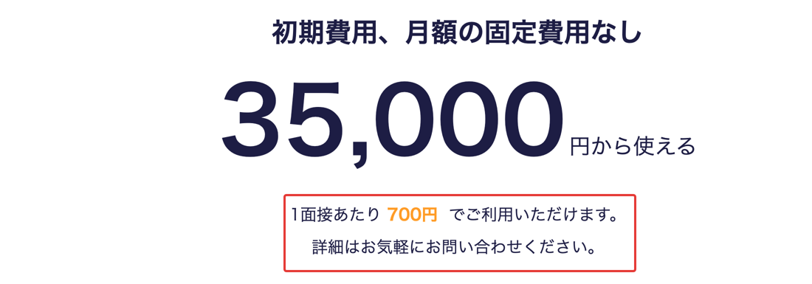

AI面接サービスは、採用の場面によって向く型と料金の桁が分かれます。新卒の一次選考なら評価の枠組みを持つ対話型、アルバイト・パートの大量採用なら1件700〜1,000円の従量制か月額の定額制、中途なら深掘りの内容と評価の根拠を確認できるものが候補です。

この記事では主な10サービスを3つの場面に分け、各社の公式に書かれた面接の型・最低料金・人が見られる評価の中身を比べます。nitoはAI面接を提供しておらず、比較に自社は入れていません。費用の目安と導入の流れ、候補者への伝え方まで扱います。

:::takeaways
- **場面を決めてから選ぶ**。新卒の一次選考・アルバイトの大量採用・中途で、向く型と料金の体系が違う
- **公表された金額は1件700円から月額7.5万円の定額まで幅がある**。年間の面接件数で総額を出して比べる
- **合否はAIに任せず人が決める**。候補者には、AIを使うことと最終判断は人が行うことを案内文で伝える
:::

## AI面接とは？どんな種類がある？

AI面接は候補者がAIの質問に答え、AIが回答を記録・分析して評価のレポートを作るサービスです。**合否を決めるのは人で、AIが担うのは一次選考の面接の実施と判断の材料づくりまでです。**候補者は送られたURLから都合のよい時間に受けられるため、面接官と日程を合わせる必要がありません。

同じ「AI面接」でも、AIがどこまで担うかで3つの型に分かれます。

| 型 | AIが担うこと | 向く使い方 |
|---|---|---|
| AIが質問する型（対話型） | 質問・深掘り・評価レポート | 一次面接そのものを任せる |
| 録画を評価する型 | 録画した回答の分析・要約 | 書類選考の前後で人柄を確認する |
| 人の面接を分析する型 | 人が行った面接の記録・分析 | 面接官ごとの評価のずれを抑える |

**一次面接の工数を減らしたいなら、AIが質問する型か録画を評価する型を選びます。**人の面接を分析する型は面接の回数そのものを減らさないため、評価の統一が目的の場合に向いています。声や表情まで分析するサービスもあり、分析の範囲は候補者に説明すべき事項です。

## AI面接のメリットは？

最大のメリットは応募が多い時期でも一次面接を待たせずに進められることです。評価の観点の統一と、面接の記録が残ることも導入の理由になります。

### 夜間や休日の応募にもすぐ面接できる

AIが面接官を務めるため、候補者は深夜や週末でも受けられます。SHaiN・MiAI・PeopleX AI面接・AI RECOMENなどは24時間365日の受検を公式に掲げており、MiAIは応募から30秒で面接を始められるとしています。**店舗の担当者が接客で応募に応じられない時間帯も、選考が止まりません。**在職中で日中に時間を取りにくい中途の候補者にとっても同じです。

### 全員を同じ質問と評価項目で見られる

あらかじめ決めた質問と評価項目で全員を面接するため、面接官による聞き方や評価の違いが出にくくなります。厚生労働省も、面接では職務に必要な適性・能力を見る観点から質問項目と評価基準をあらかじめ決めておくよう求めています。**AI面接を入れる準備はそのまま自社の面接の評価基準を文書にする作業です。**

### 録画と文字起こしで二次面接に引き継げる

多くのサービスは面接を録画し、文字起こしと要約、評価項目ごとの点数を残します。二次面接の担当者は録画を全部見なくても、要約と点数から確認したい発言に絞って読めるのが利点です。**面接官のメモ頼みの申し送りが、同じ形式の記録に変わります。**

## AI面接のデメリットは？

主なデメリットは3つあります。候補者の受け止めが分かれること、評価の基準を自社で決める手間がかかること、AIの評価をそのまま合否に使えないことです。

### 候補者の受け止めが分かれる

学生の間でも、AI面接への印象は分かれています。レバレジーズが2026年5月に27〜29年卒の学生328人に行った調査では、AI面接の印象がポジティブな人は34.7%、ネガティブな人は11.6%でした。ネガティブな理由は「自分の熱意や人柄が正確に伝わらなそう」が47.4%、「面接官のリアクションがないため、手応えが分からず話しづらい」が44.7%です。

Preferred Networksが2026年9月に27年卒の就活生308人に行った調査では、AI面接を受けた108人のうち選考結果に納得した人が51.0%、納得していない人が40.7%でした。どちらもAI面接を提供する会社の調査です。**受けた人の4割が納得していないため、評価の観点や最終判断を誰が行うかを先に伝えることが辞退を防ぐ前提になります。**

### 評価の基準を自社で決める必要がある

AIは設定された質問と評価項目の範囲で面接するため、どんな回答を高く評価するかを決めていないと、現場が納得しない結果が返ります。用意された評価モデルから選ぶサービスでも、自社の求める人物像とずれていないかの確認は必要です。**導入の前に、人事と現場の面接官で評価項目を言葉にする時間を見込んでおきます。**

### AIの評価だけで合否を決められない

総務省と経済産業省のAI事業者ガイドライン（第1.2版）の別添は、人材採用のような重要な意思決定でAIの判断をそのまま用いることや、人がAIの判断を過度に信頼して確認を怠る自動化バイアスを懸念点に挙げています。採用でAIを使ったサービスが、求職者への説明が不明瞭だったことなどから廃止された事例も紹介されています。**AIのスコアは一次選考の判断材料にとどめ、迷う候補者は録画と文字起こしを人が見て決める運用が必要です。**

## 採用の場面別のAI面接サービス比較10選

採用の場面ごとに、公式で面接の型か料金を確認できた10サービスを並べました（順位なし）。料金はすべて各社公式の表示で、税別です。どのサービスも夜間・休日の受検を前提に作られているため、時間帯は表に入れていません。

### 新卒の一次選考に向く4サービス

新卒は短い期間にエントリーが集中するため、評価の枠組みを持つ対話型が候補になります。

| サービス | 面接の型 | 最低料金 | 人が見られる中身 |
|---|---|---|---|
| SHaiN | AIが質問（7項目） | 1件5,000円 | 動画・回答の文字化・18項目の点数 |
| AI面接官（VARIETAS） | AIがESをもとに深掘り | 資料請求で案内 | 約15分でレポート |
| TG-WEB mee | AIが行動事実を深掘り | 公式に金額の記載なし | 評価結果・文字起こし |
| harutaka AI面接 | AIが質問（設計は専任担当） | 初期費用＋月額（問い合わせ） | 結果をATSで一元管理 |

- **SHaiN**（タレントアンドアセスメント）: 評価レポート1件ごとの料金で、標準プランは1件5,000円。年間10件以上から使え、所要時間は30〜40分。アルバイト向けのプランもあります
- **AI面接官**（VARIETAS）: エントリーシートの内容と面接中の回答を合わせて評価し、実施後約15分でレポートを作ります。評価項目の重みを変えて総合得点を再計算でき、候補者へのフィードバックにも対応します
- **TG-WEB mee**（ヒューマネージ）: 過去の行動事実を深掘りしてコンピテンシーを見る形です。同社の採用管理システムi-webと連携し、最低利用件数や期間の制限は基本的に設けていないとしています
- **harutaka AI面接**（ZENKIGEN）: 評価軸・質問・深掘りの流れを専任担当者が企業ごとに設計します。合否は人が行い、個人情報をAIの学習に使わないと明記しています

### アルバイト・パートの大量採用に向く4サービス

応募から連絡までの速さが離脱に直結するため、1件あたりの単価が低いか、件数で料金が変わらないものが候補になります。

| サービス | 面接の型 | 最低料金 | 人が見られる中身 |
|---|---|---|---|
| AI RECOMEN | アバターが質問し回答を録画 | 1件700円（固定費なし） | 録画・要約・評価理由の文 |
| ITSUMEN | 録画面接＋AI面接の追加 | 月19,800円＋AI月10,000円 | 録画（90日保存） |
| Our AI面接 | アバターと対話 | 月75,000円からの定額 | 動画とAIレポート |
| MiAI | AIが対話で深掘り | 1件1,000円から | 録画・議事録・項目ごとの点数 |

<figure class="post-figure"><figcaption>AI RECOMENの料金（2026年11月25日）</figcaption></figure>

- **AI RECOMEN**（アイエンター）: 初期費用と月額の固定費がなく、1面接700円です。評価基準を最大5つまで設定でき、AIが付けた点数の理由を文章で表示します
- **ITSUMEN**（マルジュ）: 録画面接のツールに、月額のAI面接オプションを追加する形です。最小のプランは月20件の面接完了までで、最低契約期間は6か月。料金は面接を完了した件数で数えます
- **Our AI面接**（JetB）: 面接の回数にかかわらず月額が一定の定額制で、契約期間は1年です。AIのレポートは追加料金なしです
- **MiAI**（プロップス）: 1面接1,000円からで、初期費用と月額は公式に記載がありません。回答を終えるボタンを候補者が押す方式で、考えている途中に次の質問へ進まない設計です

### 中途採用に向く2サービス

中途は職種ごとに見る点が違うため、質問を職種別に設計でき、評価の根拠を発言まで追えるものが候補になります。

| サービス | 面接の型 | 最低料金 | 人が見られる中身 |
|---|---|---|---|
| Career Gate | AIが質問し深掘り | 初期10万円＋月44,980円＋従量 | 録画・要約・適合度と根拠 |
| PeopleX AI面接 | AIが対話で深掘り | 初期＋月額＋従量（問い合わせ） | 録画・文字起こし・根拠の発言 |

- **Career Gate**（パソナ）: 年契約で月44,980円、月契約で月49,980円に、評価レポート1件ごとの従量（100回まで1,000円、101回からは900円、501回からは800円）が加わります。推奨の質問と評価軸があらかじめ設定されており、評価軸が固まっていない会社でも始められます
- **PeopleX AI面接**（PeopleX）: 約150種類の質問から選べ、評価項目と重みを自社で設計できます。評価とその根拠になった発言をレポートで確認でき、英語とベトナム語の面接にも対応します

**表の料金は最低の入口なので、自社の年間の面接件数を決めてから2〜3社に見積もりを依頼するのが確実です。**

## AI面接サービスの選び方は？

面接の型・料金の体系・評価の根拠・データの扱いの4つを、この順に確認すると選びやすくなります。

### 選考のどの段階に置くかで型を決める

一次面接を置き換えるならAIが質問する型、書類選考の前に人柄を見たいなら録画を評価する型が適した選択です。どの段階に置くかで、候補者に送る案内文と必要な機能が変わります。**まず、AI面接を置く段階を1つに決めます。**

### 年間の面接件数で料金の体系を選ぶ

件数が月によって大きく変わるなら1件ごとの従量制、毎月の件数が多く読めるなら定額制が有利です。SHaiNの年間10件以上、ITSUMENの最低6か月、Our AI面接の1年契約のように、最低の件数や契約期間もサービスで違います。**解約の条件と、使わなかった月に固定費がかかるかも見積もりの段階で確認します。**

### 評価の根拠を発言まで確認できるか

点数だけが返るサービスでは、二次面接の担当者や候補者に評価の理由を説明できません。AI RECOMENの評価理由の表示、PeopleX AI面接の根拠となる発言、Career Gateの適合度の根拠のように、**点数と発言をたどれるかは、AIの評価を人が確認する運用の前提です。**項目の名前と点数の付け方まで自社で書けるかを聞くと、各社の差が見えます。

### 採用管理システムとの連携とデータの扱い

採用管理システム（ATS）と連携できれば、面接の案内や結果の転記の手間が減ります。harutaka AI面接は主要なATSとの連携を掲げ、Career GateはCSVでの出力に対応し、API連携は今後の予定です。**面接の録画には顔と声が含まれるため、保存期間・削除の時期・閲覧できる担当者・AIの学習に使うかの4点は、社内の承認の前に提供元に確認しておく必要があります。**

## AI面接の費用はいくら？

費用は初期費用・月額の固定費・面接1件ごとの従量の組み合わせで決まります。

| 料金の体系 | 例（公式の表示・税別） | 向く採用 |
|---|---|---|
| 1件ごとの従量 | AI RECOMEN 1件700円／MiAI 1件1,000円から | 件数が月で変わる |
| 月額の定額 | Our AI面接 月75,000円から | 件数が毎月多い |
| 固定費＋従量 | Career Gate 初期10万円＋月44,980円＋1件800〜1,000円 | 件数が読める・設計の支援も必要 |

たとえばアルバイトの面接が月50件なら、AI RECOMENは700円×50件で月35,000円、SHaiNのアルバイトプランは1,000円×50件で月50,000円です。ITSUMENはライトプラン月29,800円にAI面接オプション月20,000円を加えて月49,800円、Our AI面接は件数にかかわらず月75,000円からです。**月の件数が増えるほど定額制の割高感は小さくなるため、繁忙期の件数で比べておく必要があります。**

## AI面接の導入はどう進める？

1つの職種か拠点で試してから広げるのが導入の基本です。候補者への伝え方も、案内文を作る段階で決めておきましょう。

1. **目的と置く段階を決める**: 工数の削減か評価の統一かと、書類選考の前か一次面接の代わりかを決める
2. **評価項目と質問を作る**: 職務に必要な適性・能力に関係のない事項を聞いていないか点検する
3. **社内のメンバーで受けてみる**: 無料の試用で、返ってくる評価が現場の感覚と合うかと、受けやすさを確認する
   - 各社の試し方: AI RECOMENは1週間程度のトライアル、SHaiNは件数と期間に制限のある無料トライアル、Career GateとMiAIは無料の体験
4. **候補者への案内文を作る**: AIが面接を行うこと、所要時間と推奨の環境、最終判断は人が行うこと、受けられないときの連絡先を書く
5. **一部で始めて数字を見る**: 受検率・選考の通過率・応募から面接までの日数・辞退率を導入前と比べる

**案内文に書く4点は、調査で多かった「どのように評価されているか不透明」という不安に答える内容です。**AI面接を受けられない事情がある候補者のために、人の面接に振り替える経路も用意しておきます。

## 既製のAI面接で足りない選考の流れは？

応募の受付から書類の確認、AI面接、社内の評価会議の資料づくりまでを自社の評価軸で一続きに動かしたい場合は、既製のAI面接サービスと採用管理システムだけでは届かないことがあります。そうした選考の流れはAIエージェントとして組む方法があります。

:::linkcard
url: /media/ai-agent-build/
title: AIエージェントの作り方を解説
desc: ノーコード・既製の基盤・コードの3通りの作り方と、作る前に決めることを解説しています。
:::

## まとめ

- 新卒の一次選考なら、SHaiN・AI面接官（VARIETAS）・TG-WEB mee・harutaka AI面接のように評価の枠組みや設計の支援があるものが向いている
- アルバイト・パートの大量採用なら、AI RECOMENやMiAIの1件ごとの従量制か、Our AI面接・ITSUMENの月額制を月の件数で比べる
- 中途なら、Career GateやPeopleX AI面接のように評価の根拠を発言まで確認できるものを候補にする
- どのサービスでも、合否は人が決め、候補者にはAIを使うことと評価の扱いを先に伝える

## よくある質問

### AI面接の結果だけで不合格にしてもよいですか？

おすすめしません。Career Gateは合否そのものを判定するサービスではないと明記し、harutaka AI面接も合否判断は必ず人が行うとしています。AI事業者ガイドラインの別添も、採用でAIの判断をそのまま用いることを懸念点に挙げています。

### SHaiNは何件から使えますか？

プランを問わず、年間10件以上の利用から申し込めます。料金は評価レポート1件ごとで、標準プランが5,000円、アルバイトプランが1,000円（税別）です。後払いを選ぶと、受検者管理システムの利用料が年60万円かかります。

### AI RECOMENに月額の費用はかかりますか？

初期費用と月額の固定費はなく、1面接700円です。公式では35,000円から使えると案内しており、面接の回数分を購入する形です。

### AI面接の所要時間はどのくらいですか？

サービスと設問の数で変わります。SHaiNは標準プランで30〜40分、アルバイトプランで5〜10分、TG-WEB meeは設問の数に応じて約30〜60分が目安です。アルバイトの採用で短い構成を選ぶと途中の離脱を抑えやすくなります。

### 面接の録画はAIの学習に使われますか？

サービスによって違います。harutaka AI面接は個人情報をAIの学習に使わないと明記し、TG-WEB meeは受検者を特定できる形で学習に使うことはないとしています。ほかのサービスでは契約の前に提供元への確認が必要です。

### 採用人数が少なくてもAI面接を入れる意味はありますか？

採用人数より、応募の数と対応できる担当者の数で判断します。応募が特定の時期に集中する、担当者が1人しかいない、といった状況なら効果が出やすくなります。1件ごとの従量制であれば、少ない件数から試すことも可能です。

## 出典

- SHaiN「[料金体系](https://shain-ai.jp/fee)」（2026年11月25日取得）
- AI RECOMEN「[料金](https://service.recomen.ai/fee)」「[機能紹介](https://service.recomen.ai/features)」（2026年11月25日取得）
- MiAI「[AI面接 MiAI](https://lp.miai-app.com/)」（2026年11月25日取得）
- Our AI面接「[公式サイト](https://ai-mensetsu.jp/)」、JetB「[AI面接サービス厳選15選](https://jetb.co.jp/ai-interview-service)」（月額の金額、2026年11月25日取得）
- マルジュ「[ITSUMEN AI面接](https://www.maru.jp/itsumen_ai-interview/)」（2026年11月25日取得）
- パソナ「[Career Gate](https://www.pasona.co.jp/clients/service/xtech/careergate/)」（2026年11月25日取得）
- PeopleX「[PeopleX AI面接](https://peoplex.jp/ai-interview/)」（2026年11月25日取得）
- ZENKIGEN「[harutaka AI面接](https://harutaka.jp/ai-interview)」（2026年11月25日取得）
- ヒューマネージ「[TG-WEB mee](https://www.humanage.co.jp/tg-web-mee/)」（2026年11月25日取得）
- VARIETAS「[AI面接官](https://ai-interview.online/)」（2026年11月25日取得）
- マイナビニュース「[学生の8割が書類選考に不安、生成AI普及で文章の均一化を懸念 - レバレジーズ調査](https://news.mynavi.jp/article/20260527-4510634/)」（2026年5月27日）
- Preferred Networks「[就職活動におけるAI面接の実態調査 速報](https://prtimes.jp/main/html/rd/p/000000035.000156310.html)」（2026年9月30日）
- 厚生労働省「[公正な採用選考の基本](https://www.mhlw.go.jp/stf/seisakunitsuite/bunya/koyou_roudou/koyou/newpage_56780.html)」
- 総務省・経済産業省「[AI事業者ガイドライン（第1.2版）](https://www.soumu.go.jp/main_sosiki/kenkyu/ai_network/02ryutsu20_04000019.html)」別添（2026年3月31日公表）
