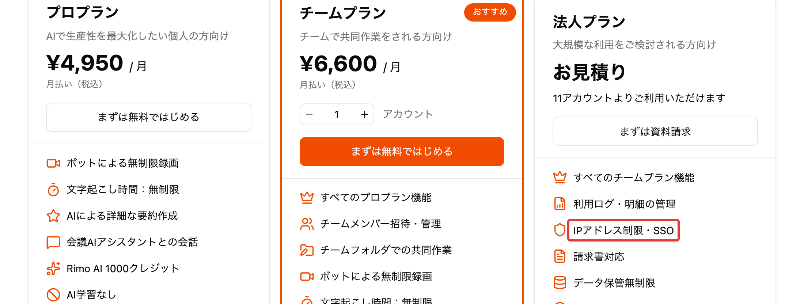
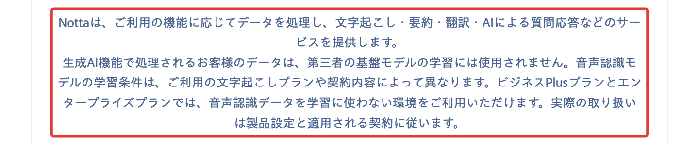

AI議事録ツールは、社内の会議がどこで開かれているかで候補を絞ると早く決まります。Web会議が中心ならTeams・Zoom・Meetと連携する製品、会議室の対面が多いならスマホや専用端末で録音できる製品、外にデータを出せない会議ならPCの中で処理が終わる製品が向いています。

この記事では会社で入れる前提で9製品を比べ、料金の単位とセキュリティの確認項目、試し方と導入の流れまで扱います。

:::takeaways
- **最初に決めるのは製品名でなく、議事録を取りたい会議の形（Web会議・対面・両方）**
- **料金はアカウント数・文字起こし時間・同時接続数・端末と単位が違う**ので、自社の人数と会議の時間で当てはめる
- **情シスに出す確認はAI学習・保存場所・SSOの3点から**。各社の公式に記載がある
:::

## AI議事録ツールとは？何ができる？

AI議事録ツールは会議の音声を文字に起こし、要約や決定事項・ToDoの下書きまでを作るサービスです。**会議のあとに録音を聞き直して清書する時間を、AIの下書きを人が確認する時間に置き換えます。**

多くの製品に共通する機能は次の4つです。

- 文字起こし（リアルタイムか、録音ファイルの取り込み）
- 話者の識別（誰が話したかで区切る）
- 要約と決定事項・ToDoの抽出
- 共有と検索（URLでの共有、過去の議事録の横断検索）

差が出るのは機能の有無より、**どこで録音するか（会議の形）と、データをどこに置き誰が管理するか**です。比較の軸もこの2つから組み立てます。

## AI議事録ツールの選び方は会議の形から

選び方の1つ目は議事録を取りたい会議がWeb会議か対面か、両方かを数えることです。**9製品の公式の記載を並べると、録音の入口はWeb会議の連携・PCでの録音・スマホ・専用端末・PCの中で完結の5通りに分かれ、製品ごとに持つ入口が違います。**

### 会議の形で録音の入口が変わる

録音の入口は製品ごとに次のように違います。

- **Web会議の連携・ボット**: Teams・Zoom・Meetの会議に記録役として入る、または連携して取り込む
- **PCのブラウザやアプリでの録音**: 会議ツールを問わずPCに流れる音声を拾う。ボットを会議に入れない製品もある
- **スマホアプリ**: 会議室の机にスマホを置いて録る
- **専用端末**: レコーダーを置く・身に着けて録る。PCやスマホを持ち込めない場面向け
- **PCの中で完結**: インターネットにつながずに文字起こしから要約まで行う

Web会議と会議室の会議が半々の会社は、1つの製品で両方の入口を持つものを選ぶと、議事録の置き場所が1か所にまとまります。

### 料金の単位を自社の数で当てはめる

料金はアカウントごとの月額、チームで分け合う文字起こし時間、同時に使うPCの数、端末の購入と、製品ごとに単位が違います。**議事録を書く人の数と、月の会議の時間の2つを先に出しておく**と、見積もりの比較がしやすくなります。

### データの扱いを情シスと先に確認する

会議には顧客名や人事の話が入るものです。AIの学習に使われるか、データをどこに保存するか、SSOで社内のアカウントとつなげるかは、製品を絞る前に情報システムの担当と確認しておくと、選んだ後の差し戻しを防げます。

### 精度は自社の会議の音声で比べる

文字起こしの精度はマイク・話す人数・専門用語の量で大きく変わります。**公式の精度の数字は条件が違うため横に並べて比べられません。** たとえばNottaは認識率98.86%以上と公式に書いていますが、条件は整然とした発言の会議で、収音が難しいと精度が下がると断っています。自社の会議の音声を同じ条件で読ませて比べるのがトライアルです。

## おすすめのAI議事録ツール比較9選

ここでは専用の製品7つと、会議ツールに付いている2つを、2026年11月20日に各社の公式ページで確認した内容で並べます。専用の製品を先に、会議ツールの付属機能を最後に置いています。

| 製品 | 対応する会議の形（公式の記載） | 料金（公式の表示） | データの扱い（公式の記載） |
|---|---|---|---|
| Rimo | Web会議の連携・スマホアプリ | プラン月4,950円（税込・月払い）、法人は見積もり | AI学習なし・国内保管・SSO（法人） |
| Notta | Web会議の連携・アプリ・PC | 年払い月1,185円〜（税込） | 東京リージョン・SSO（エンタープライズ） |
| Otolio | Web会議・対面（マイク・Bot・アプリ） | 見積もり（初期費用＋AIクレジット・人数無制限） | 国内保管・ISO27001・SSOはオプション |
| LINE WORKS AiNote | Web会議の録音（Zoom・Teams・Webex・Meet・LINE WORKS） | チーム月19,800円（年額契約・税抜）・人数無制限 | 学習利用なし・保管5年・ISO27001・SSOあり |
| AutoMemo | PC・スマホ・専用端末 | 月1時間まで無料・シェア（時間の枠）19,800円〜 | 音声をAIの学習に使わない |
| PLAUD | 専用端末・PCアプリ | 端末27,500円〜（税込）＋無料〜 | SOC 2・GDPR準拠と記載 |
| ScribeAssist | PCで対面・Web会議の音声 | 個別見積もり（同時接続数） | PCの中で処理（一部の要約を除く） |
| Teams（Copilot） | Teamsの会議 | Microsoft 365 Copilotの契約またはTeams Premium | Microsoft 365の管理に従う |
| Meet（Gemini） | Meetの会議・対面の利用方法あり | 対象のWorkspaceエディション | 主催者のドライブに保存 |

全製品とも文字起こし・要約・共有はできるため、表には差が出る列だけを置いています。

### Rimo

Rimoは2026年9月30日に「Rimo Voice」から名前を変えた国内の議事録ツールです。**Teams・Zoom・Google Meet・Webexと連携し、会議室ではモバイルアプリで録音できる**ため、Web会議と対面の両方を1か所で管理できます。

料金はプロプランが月4,950円、チームプランが1アカウント月6,600円（いずれも税込・月払い）で、11アカウント以上は法人プランの見積もりです。法人プランにはIPアドレス制限・SSO・利用ログが付きます。ISO27001とISO27017の認証を持ち、データのAI学習なし・日本国内での保管を公式に掲げている点は、情シスに説明しやすい材料になります。

<figure class="post-figure"><figcaption>Rimoの料金ページ（2026年11月20日）</figcaption></figure>

### Notta

Nottaは無料プランから始められ、有料のプランも年払いで1アカウント月1,185円からと公開されている製品です。**Zoom・Teams・Google Meet・Webexの文字起こしに加え、アプリやPCでの録音にも対応します。**

会社で使うなら、営業への問い合わせで案内されるビジネスPlusとは別に、ビジネスプラン（年払いで1アカウント月2,508円・税込）が基準で、文字起こし時間が無制限になり、Web会議の録画やCRM・Zapierなどとの連携、IPアドレス制限が加わります。SAML SSOはエンタープライズです。データはAWSの東京リージョンに保存されます。**生成AIの処理データは第三者の基盤モデルの学習に使われない一方、音声認識エンジンの学習にはデータの一部が使われ、これを提供しないのは、営業への問い合わせで案内されるビジネスPlusとエンタープライズ**と公式で説明されているので、プランを選ぶときの確認点になります。

<figure class="post-figure"><figcaption>NottaのTrust Center（2026年11月20日）</figcaption></figure>

### Otolio（旧スマート書記）

Otolioは公式に「対面の会議もWeb会議も」と書き、**マイク・Bot・ファイル取り込み・モバイルアプリの4つの入口から音声を取り込める**製品です。録音から文字起こしを話者ごとに整理し、要約・決定事項・ToDoの下書きまで作ります。料金は初期費用とAIクレジット（使う量の枠）の組み合わせで、人数では決まらないため、アカウントは全社員に配れます。金額は会議の量を聞いたうえでの見積もりです。データは東京リージョンを基本に国内で保管し、ISO27001を取得しています。SAML認証とIPアドレス制限はオプションです。

### LINE WORKS AiNote

LINE WORKS AiNoteは、**Zoom・Teams・Webex・Meet・LINE WORKSのWeb会議の録音に対応する**製品で、料金が公式に出ています。チームプランは月19,800円（年額契約・税抜。月間契約は22,000円）で、月6,000分（100時間）の文字起こし時間を全員で分け合い、利用人数は無制限です。

データは学習に利用されず、保管は5年です。ISO27001・27017・27018・27701の認証とSOC2/SOC3の報告書を持ち、SSOにも対応しています。人数が多く1人あたりの会議が少ない会社は、AutoMemoのシェアプランと並べて比べる製品です。

### AutoMemo

AutoMemoはソースネクストの製品で、**PCのブラウザ・スマホアプリ・専用端末の3通りで録音でき、組み合わせて使えます**。PCではZoom・Teams・Google Meetの会議をボットを入れずに録音でき、専用端末は内蔵メモリの範囲でオフラインでも録れます。

月1時間までは無料で、チームや会社で文字起こし時間を分け合うシェアプランは19,800円からです。シェアプランは文字起こし時間の枠を買って分け合う形（シリアル登録から1年間有効）で、アカウント数が無制限なので、**議事録を書く人が多く1人あたりの会議が少ない会社に向いています**。音声データがAIの学習に使われないこと、会社としてISO27001を取得していることが公式に書かれています。1回の録音は1言語に限られる点は、海外拠点との会議が多い会社の確認点です。

### PLAUD

PLAUDはカード型や身に着ける型のAIボイスレコーダーで、**会議室・外出先・通話を端末で録るのが主な使い方**です。端末は税込27,500円から30,800円で、文字起こしは無料のStarterで月300分、プロは年16,800円で月1,200分、無制限は年40,000円となっています。

PC向けのPlaud Desktop（ベータ）は会議ボットなしでオンライン会議を記録できますが、使えるのは端末を持っている人だけです。SOC 2・GDPR・HIPAAへの準拠を公式に掲げています。営業や現場で人ごとに端末を配る形になるため、**会社で入れるときは端末代を人数分見込む**必要があります。

### AmiVoice ScribeAssist

ScribeAssistはアドバンスト・メディアのソフトで、**PCの中で録音から文字起こし・要約まで行い、インターネットにつながなくても使えます**（一部の要約方式はネット接続が必要）。会議室ではPCにつないだマイクで、Web会議はPCで再生される音声を文字にする形で、Meet・Teams・Zoom・Webexに対応します。

料金は同時接続数に応じた定額の個別見積もりで、初期費用は無料、14日間のトライアルは問い合わせで受けられます。LGWANの環境で使える点から、自治体や機密の多い会議を持つ会社が候補にしやすい製品です。

## TeamsやMeetの付属機能で足りる？

**社内の会議がTeamsかMeetにそろっているなら、まず付属の機能を試すのが近道です。** 追加の契約や情シスの審査が少なく済みます。

Microsoft 365 CopilotではTeamsの会議の要約と文字起こし、アクションアイテムの記録ができます。会議の要約アプリの一覧に出るのは過去30日の会議です。文字起こしを残さない設定で作った要約は、既定で120日後に期限が切れます（管理者が変更可能）。長く残すなら別の場所への書き出しが無難です（[Microsoft 365 Copilotの使い方](/media/copilot-guide/)）。

Google Meetの自動メモ生成は、15分から8時間の会議でGeminiがメモをGoogleドキュメントに作り、主催者のドライブに保存します。日本語に対応し、管理者は参加者に明示的な同意を求める設定もできます。使えるのは対象のWorkspaceエディションで、Business Starterでは使えません。対面の会議も、PCやスマホのMeetから同じようにメモを残せます。

一方で、Zoomなど会議ツールをまたいで議事録を1か所に集めたい、社内用語の辞書を育てたい会社は、専用のツールが向いています。

:::linkcard
url: /media/copilot-vs-gemini/
title: CopilotとGeminiの違い｜会社に入れるならどっち？料金・データ・管理
desc: Microsoft 365 CopilotとGoogle WorkspaceのGeminiを、料金・会議の機能・管理の設定で比べて解説しています。
:::

## AI議事録ツールの料金はいくら？

公開されている料金では1アカウントあたり月1,000円台から6,000円台が中心で、法人向けの管理機能が付くプランは見積もりになる製品が多くあります。**比べるときは月額の数字より、何に対して払うのか（人・時間・PC・端末）を先にそろえます。**

| 料金の単位 | 製品の例 | 向いている使い方 |
|---|---|---|
| アカウントごと | Rimo・Notta | 議事録を書く人が決まっている |
| 時間を分け合う | AutoMemoのシェアプラン・LINE WORKS AiNote | 使う人は多いが1人の会議は少ない |
| 使う量で契約（人数は無制限） | Otolio | 全社員にアカウントを配りたい |
| 同時接続数ごと | ScribeAssist | 会議室のPCなど決まった端末で使う |
| 端末の購入＋年額（無料のStarterあり） | PLAUD | 外出先や現場で人ごとに録る |

計算の例を1つ挙げると、議事録を書く担当が5人の部署なら、Nottaのビジネス（年払い）は月12,540円、Rimoのチームプラン（月払い）は月33,000円です。支払いの周期のほか、AI学習の条件も違います（Nottaのビジネスは音声認識エンジンの学習に一部使われ、Rimoのチームは学習なし）。見積もりでは同じ条件にそろえて比べます。費用の釣り合いは**月に議事録の清書にかけている時間がどれだけ減るか**で見ると判断しやすくなります。

## 法人で入れる前に確認するセキュリティ

会社で入れる前に情シスと確認するのは、AIの学習に使われるか、データの保存場所、アカウントの管理の3点です。どれも各社の公式に答えがあるので、契約前に書面やセキュリティの資料で確認します。

| 確認項目 | 何を見るか | 公式の記載の例 |
|---|---|---|
| AIの学習 | 音声や文字起こしが学習に使われるか、プランで変わるか | RimoはAI学習なし、Nottaはプランで異なる |
| 保存場所と期間 | 国内か、いつ・どう消せるか | Rimoは国内保管、NottaはAWS東京リージョン |
| アカウントの管理 | SSO・IP制限・監査ログ・共有範囲 | Rimoは法人プラン、Nottaはエンタープライズ |

PCの中で処理するScribeAssistのように、そもそもクラウドに音声を置かない選び方もあります。**機密の多い会議だけ別の製品にする場合は、どの会議をどちらで録るかを社内の決まりとして文書にしておく**と、運用の混乱を防げます。

## 無料で試す方法

社内でいちばん聞き取りにくい会議の音声を数本用意し、同じ音声を候補の製品にかけて比べるのが試し方の基本です。無料の範囲は製品で違います。

- **Notta**: フリープランは月120分（1回3分まで）。プレミアムの3日間無料トライアルは、終了後に年間プランで自動更新されるため、続けないなら期間内に解約する
- **AutoMemo**: 月1時間まで無料、初月無料
- **PLAUD**: 端末の購入後、無料のStarterで月300分
- **ScribeAssist**: 14日間のトライアルを問い合わせで申し込む
- **Rimo**: 7日間のトライアルがありクレジットカード登録は不要（法人環境は問い合わせ）
- **Otolio**: 法人向けに14日間の無料トライアル（自動で課金されない）

**確認するのは文字起こしの誤りの量より、清書にかかる時間です。** 固有名詞を単語登録したあとの結果も見ておくと、導入後の手間を見積もれます。

## AI議事録ツール導入のメリット

### 会議中のメモ取りがなくなる

記録をツールに任せると、進行役や書記も議論に加われるのが利点です。録音と文字が結び付くため、聞き逃した所は該当の発言から再生して確認できます。

### 議事録が早く配れて探せる

会議の直後に下書きができるので、欠席した人への共有が当日中に済みます。過去の議事録を言葉で探せるため、いつ何が決まったかを確認する時間も減るはずです。

## AI議事録ツール導入の注意点

### 録音の同意を取る

社外の人が入る会議では録音と文字起こしをすることを最初に伝えます。PLAUDのように録音前の同意を公式に求めている製品もあり、Meetでは管理者が参加者の同意を必須にできます。社内でも、人事や評価の会議を録るかどうかは決まりにしておくと安心です。

### 録音の環境で結果が変わる

雑音の多い部屋や、マイクから遠い席の発言は文字になりにくいものです。会議室には全員の声が届く位置にマイクを置き、同時に話さない進め方にするだけでも修正が減ります。

### AIの下書きは人が確認する

要約は発言の意図や条件を落とすことがあるため、そのままでは使えません。**金額・期限・担当者・決定事項は、元の音声や資料と照らしてから正式な議事録にします。** どこまで直せば合格かを先に決めておくと、確認に時間をかけすぎずに済みます。

## AI議事録ツール導入の流れ

会社で入れるときは利用部門・情シス・決裁者の3者で進めると、手戻りの少ない形です。

1. 利用部門が対象の会議を洗い出す（形・月の時間・議事録を書く人の数）
2. 情シスがセキュリティの確認項目を決め、候補を2〜3製品に絞る
3. 同じ会議の音声でトライアルを行い、清書の時間を比べる
4. 決裁者が料金の単位と年間の費用で判断する
5. 1つの部署で始め、録音の同意や置き場所の決まりを整えてから広げる

製品を分けると、アカウントごと・時間ごとの契約が二重になります。**本番で使う製品は原則1つに絞り、分けるなら会議の種類で線を引くのが無難です。**

## 議事録の後の作業まで自動にするには

AI議事録ツールが作るのは議事録の下書きまでで、要約を関係者に配る、ToDoをタスク管理に登録する、商談の内容をCRMに書き写すといった作業は人の手に残ります。連携の機能がある製品でも、社内の決まった書式や宛先に合わせるには設定や運用の工夫が必要です。

会議の後の作業を社内のツールをつないで動くAIエージェントに任せる方法もあります。議事録から決定事項を拾い、担当者ごとのタスクを作り、CRMの該当の取引に記録するところまでを、社内の確認を挟む形で組み立てられます。

:::linkcard
url: /media/ai-agent-build/
title: AIエージェントの作り方を解説｜3つの作り方・5つの型・作る前に決める2つのこと
desc: ノーコード・既製の基盤・コードの3通りでAIエージェントを作る方法と、作る前に決めることを解説しています。
:::

## まとめ

- Teams・Meetの会議だけを議事録にしたいなら、Microsoft 365 CopilotかGeminiの付属機能をまず試す
- Web会議と会議室の対面が半々なら、RimoかNotta・Otolioのように両方の入口を持つ製品から選ぶ
- 使う人が多く1人の会議が少ないなら、時間を分け合うAutoMemoのシェアプランかLINE WORKS AiNote、使う量で契約して人数を絞らないOtolioが候補になる
- 外出先や現場で録るならPLAUDの端末、外にデータを出せない会議ならScribeAssistが向いている
- どの製品でも、情シスとAI学習・保存場所・SSOを確認し、同じ音声のトライアルで清書の時間を比べてから決める

## よくある質問

### AI議事録ツールは法人で無料のまま使えますか？

NottaのフリープランやAutoMemoの無料枠はありますが、時間や1回の長さに上限があり、SSOや利用ログなどの管理機能は有料のプランです。会社の会議で続けて使うなら、有料のプランを前提に比べるのが現実的です。

### TeamsのCopilotがあれば専用ツールは不要ですか？

会議がTeamsで完結し、会議室の対面を議事録にしないなら、まずCopilotで足ります。ほかの会議ツールや対面の会議も同じ場所で管理したい、社内用語を登録して精度を上げたい場合は専用のツールが向いています。

### Meetの自動メモ生成は日本語に対応していますか？

対応しています。15分から8時間の会議が対象です。対象のWorkspaceエディションが必要で、Business Starterでは使えません。

### Nottaの音声データはAIの学習に使われますか？

生成AIの処理データは第三者の基盤モデルの学習に使われません。音声認識エンジンの学習には一部のデータが使われ、営業への問い合わせで案内されるビジネスPlusとエンタープライズのプランではこれを提供しないと公式に説明されています。

### 会議室の対面の会議でも使えるAI議事録ツールはどれですか？

Rimo・Nottaはアプリで、Otolioはマイクやアプリで、AutoMemoはPC・スマホ・専用端末で、PLAUDは専用端末で録音できます。ScribeAssistはPCにつないだマイクで文字にする形です。

### オフラインで使えるAI議事録ツールはありますか？

ScribeAssistはPCの中で録音から要約まで行うスタンドアローン型で、ネットにつながなくても使えます。一部の要約方式だけネット接続が必要です。

### AI議事録ツールの精度はどう比べればよいですか？

公式の精度の数字は条件が違うため並べて比べられません。社内の聞き取りにくい会議の音声をトライアルで同じように読ませ、清書にかかる時間で比べてください。

### 英語の会議もAI議事録ツールで記録できますか？

多くの製品が複数の言語に対応しています。対応言語の数はRimoが60以上、ScribeAssistが約99言語と公式に書かれています。AutoMemoは1回の録音で1言語なので、言語が混ざる会議では分けて設定しましょう。

## 出典

- [Rimo 料金・セキュリティ](https://rimo.app/pricing)（2026年11月20日確認）
- [Notta 料金プラン](https://www.notta.ai/pricing)・[Notta Trust Center](https://www.notta.ai/security)（2026年11月20日確認）
- [Otolio 料金](https://www.smartshoki.com/pricing/)・[Otolio セキュリティ](https://www.smartshoki.com/security/)（2026年11月20日確認）
- [LINE WORKS AiNote](https://line-works.com/ainote/)（2026年11月20日確認）
- [AutoMemo 公式サイト](https://automemo.com/)（2026年11月20日確認）
- [Plaud 公式サイト](https://jp.plaud.ai/)（2026年11月20日確認）
- [AmiVoice ScribeAssist](https://www.advanced-media.co.jp/products/service/scribeassist)（2026年11月20日確認）
- [Google Meet ヘルプ「自動メモ生成」](https://support.google.com/meet/answer/14754931?hl=ja)・[Meetのメモ（対面の会議）](https://support.google.com/meet/answer/17020724?hl=ja)（2026年11月20日確認）
- [Teams 会議の要約アプリ](https://support.microsoft.com/ja-jp/teams/meetings/meeting-recap-app-teams)・[文字起こしを残さない要約の期限](https://learn.microsoft.com/microsoftteams/intelligent-recap-without-saving-transcripts)（2026年11月20日確認）
