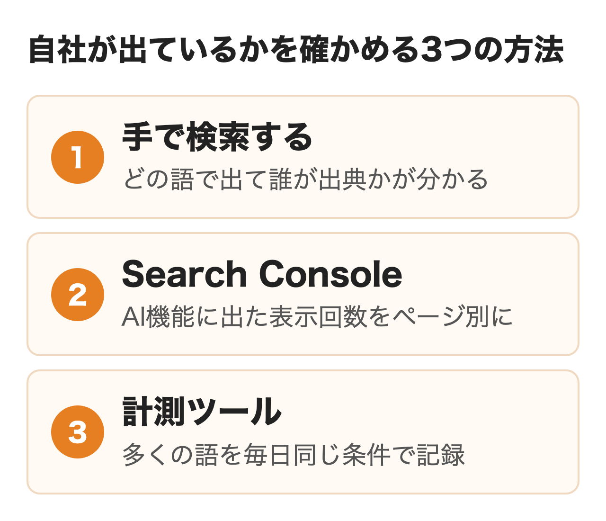
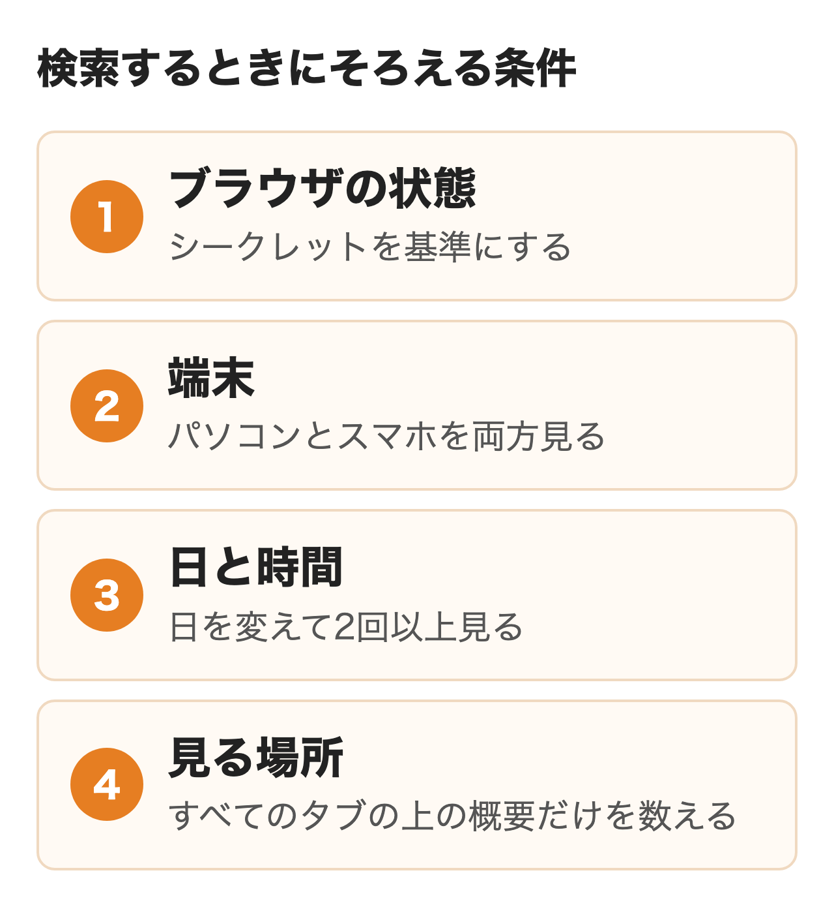
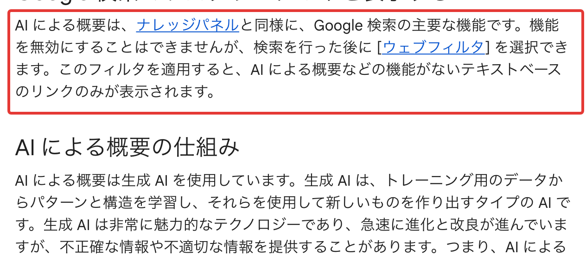
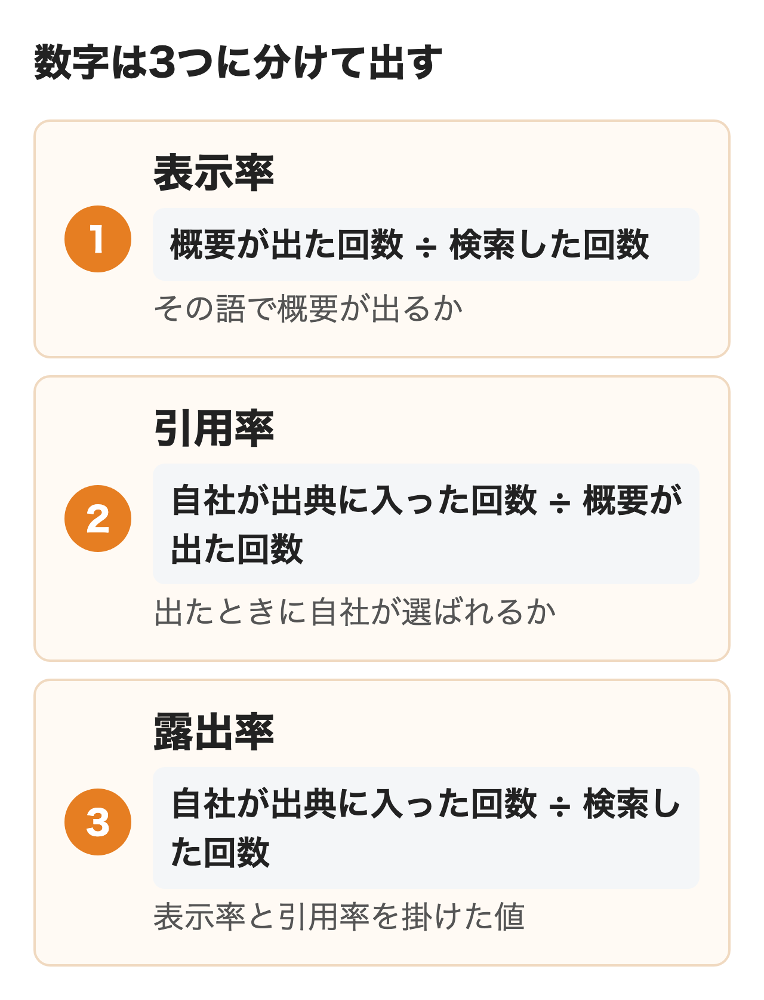

Googleの説明では、AIによる概要（AI Overview）は通常の検索結果に付加価値があるとシステムが判断した検索でだけ表示されます。2026年6月の発表によると、月に25億人以上が使う機能です。

自社が狙う語で概要が出るのか、出たときに自社のページが出典に入るのかは、Search Consoleの数字だけでは分かりません。手で検索して確かめる手順と、それを表示率・引用率として数字にする方法、Search Consoleとツールで分かる範囲をまとめました。

:::takeaways
- 概要が出るか（表示）と自社が出典に入るか（引用）は**別の率として数える**
- 語は20本ほど選び、**端末と日を変えて同じ条件で繰り返し検索**して回数で割る
- Search Consoleで分かるのは**AI機能に出た表示回数まで**で、どの語で出たかは手で確かめる
:::

## AI Overviewの自社サイト表示チェックとは

社内で「うちはAIによる概要に出ているのか」と聞かれたとき、答えは2つに分かれます。1つは狙っている語でそもそも概要が出るかどうか、もう1つは概要が出たときに自社のページが出典のリンクに入っているかどうかです。**この2つを分けずに「出ている・出ていない」で報告すると、競合だけが出典に並んでいる状態を見逃します。**

概要が出る語で自社が選ばれていないなら、直す対象はページの中身や順位です。概要がほとんど出ない語なら、AIによる概要より通常の検索結果の方が先に見る場所になります。どちらなのかで次の手が変わるため、チェックは表示と引用を別々に記録します。

<figure class="post-figure"></figure>

確かめる方法は手での検索、Search Console、計測ツールの3つです。語ごとに誰が出典に入ったかまで分かるのは、手での検索とツールだけになります。Search Consoleは公式の数字ですが、どの語で出たかは出ません。

## 手で検索して確かめる手順

費用をかけずに今日始められるのが手での確認です。20語なら1回の確認は30分前後で終わり、AIが自社や競合をどう説明しているかという文面まで読めるのはこの方法だけです。

### 確かめる語を20本選ぶ

**語は思いつきで選ばず、売上に近い順に20本ほど決めて固定します。**途中で語を入れ替えると、先月と比べられなくなるためです。選ぶ元は次の4つが使えます。

- Search Consoleでクリックが多い語の上位
- 「〇〇とは」「〇〇 やり方」のような説明を求める語
- 「〇〇 比較」「〇〇 おすすめ」のような比べる語
- 社名やサービス名での検索

語の型によって概要の出やすさは違います。VicMe社の記事は情報を探す語で65〜75%、比較の語で45〜60%、購入や申し込みの語で5〜15%という目安を挙げていますが、元の調査は確かめられませんでした。購入の語や社名の語ばかりだと概要がほとんど出ないので、型を混ぜて選ぶと全体の傾向がつかめます。

### 条件をそろえて検索する

同じ語でも、検索するたびに同じ画面が出るとは限りません。Search Consoleのヘルプは検索結果の掲載順位について、検索履歴や場所などの多くの変数で平均と違う場合があると書いています。AIによる概要とAIモードは使うモデルや手法が違う場合があり、回答とリンクにも違いが出るとGoogleは説明しています。

<figure class="post-figure"></figure>

**そろえる条件は、ブラウザの状態・端末・日と時間・見る場所の4つです。**基準にするのはシークレットウィンドウで、閲覧履歴とログインの影響を外した画面になります。ふだんのブラウザで確かめ続けると、自社のサイトをよく開く担当者の画面だけ出やすく見えることがあり、Uravation社も失敗例に挙げました。

ただし実際の見込み客の多くはログインしたまま検索しています。シークレットの結果を基準の数字にしつつ、ふだんのブラウザでの結果も別の列に残しておくと、両者の差が大きい語に気づけます。端末はパソコンとスマホの両方を見て、日を変えて2回以上確かめるのがおすすめです。言語と国を固定したいときは、検索のURLに `hl=ja&gl=jp` を付ける方法をUravation社が挙げています。

見る場所の取り違えにも注意が必要です。Googleの検索ヘルプによると、検索したあとに［ウェブ］のフィルタを選ぶと、AIによる概要のない文字のリンクだけの結果になります。確かめるのは［すべて］の結果の上に出る概要で、別の画面で会話するAIモードとは分けて数えます。

<figure class="post-figure"><figcaption>Google 検索ヘルプのAIによる概要のページ（2026年11月5日）</figcaption></figure>

### 出典の一覧で自社を探す

概要が出たら、本文の横や下に並ぶ出典のリンクを開き、自社のドメインがあるかを探します。リンクが折りたたまれている場合は、すべて表示を押してから数えるのが確実です。1回の検索で残す項目は次のとおりです。

| 列 | 書くこと |
|---|---|
| 日時・端末・ブラウザの状態 | 例: 11/5 10時・スマホ・シークレット |
| 語 | 固定した20語のどれか |
| 概要 | 出た／出ない |
| 自社 | 出典に入った／入らない |
| 入ったページと位置 | 自社のURLと出典の何番目か |
| 競合 | 出典に入った他社のドメイン |
| 回答の要旨 | 自社や競合がどう説明されたか |

位置は記録しますが、良し悪しの判断には使いません。Gyro-n社は自社の計測画面について、出典の表示順は順位や評価を示すものではないと注記しています。

## 表示率と引用率の出し方

手で集めた記録は、そのまま並べるより率にした方が社内で比べやすくなります。**表示率という言葉は概要が出た割合と自社が出典に入った割合の両方の意味で使われることがあるため、社内では名前を分けて定義しておきます。**

<figure class="post-figure"></figure>

### 3つの率の意味

表示率は、その語のまとまりで概要がどれだけ出るかを表します。引用率は概要が出たときに自社が選ばれる割合を指します。露出率は検索全体のうち自社が出典に入った割合で、表示率と引用率を掛けた値です。

下がったときの原因が違うので、分けておく意味があります。表示率が下がったなら、Googleが概要を出す語が変わった可能性があり、自社のページを直しても戻りません。引用率が下がったなら、概要は出ているのに他社が選ばれているので、出典に入った競合のページと自社のページを比べる段階です。

### 例として20語を4回ずつ見た場合

20語をパソコンとスマホで1回ずつ、日を変えて2日見ると、検索は80回になります。次の表は計算の形を見せるために作った例で、実測の数字ではありません。

| 条件 | 検索 | 概要が出た | 自社が出典 | 表示率 | 引用率 | 露出率 |
|---|---|---|---|---|---|---|
| パソコン・シークレット | 40回 | 22回 | 6回 | 55% | 27% | 15% |
| スマホ・シークレット | 40回 | 24回 | 5回 | 60% | 21% | 13% |
| 合計 | 80回 | 46回 | 11回 | 58% | 24% | 14% |

80回だと1回の差で1.25ポイント動くので、**前月と2〜3ポイント違うだけで良くなった・悪くなったと判断しない**方が安全です。語ごとの率は回数が少なすぎるため、4回のうち何回入ったかで「毎回入る」「ときどき入る」「入らない」の3つに分けて見ます。ときどき入る語はページを少し直せば毎回入る側に動く候補になります。

### 条件ごとの差を読む

合計の数字のほかに、端末・ブラウザの状態・日で分けた率も出しておきます。パソコンとスマホで引用率が大きく違う語は、どちらか一方だけで確かめていると判断を誤りかねません。シークレットとふだんのブラウザで差が大きい語は、担当者の画面での印象と見込み客の画面がずれている可能性がある語です。

比べる語のまとまりも決めておくと、報告が読みやすくなります。説明を求める語・比べる語・社名の語のように型で分けると、比べる語で引用率が低いといった形で、どのページから直すかまで話が進みます。

## Search Consoleで分かること・分からないこと

Search Consoleは無料で使える公式の数字ですが、手での確認の代わりにはなりません。2026年11月5日に取得したGoogleのヘルプと検索セントラルの記述で分かる範囲を並べました。

| 知りたいこと | Search Consoleで | 根拠 |
|---|---|---|
| AI機能に自社が出た表示回数 | 生成AIのレポートでページ・国・デバイス・日付ごとに見られる | 生成 AI パフォーマンス レポートのヘルプ |
| 通常のレポートとの関係 | AI機能の分は通常の検索パフォーマンスのウェブに含まれる | AI 機能とウェブサイト |
| AIによる概要の中の順位 | 概要全体で1つの掲載順位。中のリンクは同じ順位 | 表示回数、掲載順位、クリック数とは |
| どの語で概要に出たか | 生成AIのレポートに検索語の分け方は無い | 生成 AI パフォーマンス レポートのヘルプ |
| AIによる概要とAIモードの内訳 | 生成AIのレポートは両方を合わせた表示回数 | 同上 |

**生成AIのレポートはどのページがAI機能に使われているかを見つける道具で、語ごとの表示率や引用率は出せません。**2026年8月31日に全サイトに提供されたレポートで、開き方や月次の報告の作り方は[サーチコンソールでAIモード・AIによる概要の表示を見る方法](/media/gsc-ai-mode/)にまとめています。

数字を読むときの注意は2つです。1つはデータの欠けで、Search Consoleのデータの異常のページには、2026年8月13日〜17日にロギングのエラーで生成AIのレポートの表示回数が少なく出たとあります。この期間をまたぐ比較は割り引いて読む必要があります。

もう1つはページ別の表示で `#:~:text=` が付いたURLの行です。Uravation社は2026年9月の自社サイトで、ページ別の表示回数の約37%がこの形のURLで、クリックはほぼ0だったと書いています。同社は強調スニペットなども同じ形を使うのでAIによる概要だけとは限らないとし、自社の観測で公式の説明ではないと断っています。上の表のヘルプと検索セントラルのAI機能のページを探した範囲では、この形のURLの扱いを書いた箇所は見つけられませんでした。ページ別に合計するときは `#` の付いた行を分けて集計すると数字が膨らみません。

GA4でも、AIによる概要からのクリックだけを取り出すことはできません。概要のリンクはGoogle検索の結果ページから開かれるため、通常の自然検索と同じ参照元に入ります。ChatGPTなど別のサービスからの流入の見方は[AI検索対策の効果の測り方](/media/ai-search-measurement/)で扱っています。

順位が高いのにクリック率が低い語は、手で確かめる語の候補になります。ただしクリック率が下がった理由が概要なのか、タイトルや季節なのかはSearch Consoleだけでは決められません。

## AI Overviewをチェックできるツール

語が増えてくると、手での確認は回らなくなります。2026年11月5日に各社の公式ページで確かめた範囲で、AIによる概要に関わる機能を並べました。

| ツール | 概要が出るか | 自社が出典か | 公式ページにある主な点 |
|---|---|---|---|
| Gyro-n SEO | 語ごとに見られる | アイコンで区別 | パソコンとスマホ・概要の文の記録・時系列のグラフ。月500〜16,800円（税別）の4段 |
| Semrush | 見られる | Position Trackingで絞り込める | 出典に入ると1位として記録。概要を含む順位と含まない順位を切り替えられる |
| Ahrefs Rank Tracker | 19種の検索結果の要素に含む | 公式ページに明記なし | パソコンとスマホ、国から郵便番号までの位置、要素の日々の動き |
| yoriaiSEO | サイト単位で調べる | 言及・引用回数を出す | 2026年3月26日にAI検索機能を追加。月30,000円（税抜）から |
| Otterly.AI | 見られる | 見られる | ChatGPT・Perplexity・Copilotと同時に測る。月29ドルで15問から |
| AIOチェッカー（ディーボ） | 見られる | 参照リンクを表示 | 無料のツール |

Gyro-n SEOの料金表の機能の欄にAIによる概要の計測の行は無く、製品ページでは3か月の無料トライアルを案内しています。Semrushの1位として記録する扱いは、通常の検索の順位とは別の数字です。社内で順位の推移を見るときは、概要を含めた順位か含めない順位かを決めてから比べます。

手からツールに切り替える目安は、Uravation社が数十件以下なら手動、AI検索パートナーズは追いたい語が20個以上を挙げています。**ツールに替えても、売上に近い数本の語は手で開いて回答の文面を読む方がおすすめです。**ツールは出典に入ったかを記録しますが、自社がどう説明されたかまでは読み取りにくいためです。ChatGPTなどを含めた料金と製品の比べ方は[GEO対策ツール・AIO対策ツール10製品の比較](/media/geo-aio-tools/)で扱っています。

## 社内への報告と数字の使い方

毎月の報告で確かな数字と推定を分けて書いておくと、後で数字の意味を問われても説明がぶれません。

| 報告する数字 | 元のデータ | 確かさ |
|---|---|---|
| 20語の表示率・引用率・露出率 | 手での記録かツール | 見た時点の事実。回によって動く |
| AI機能での表示回数とページの上位 | Search Consoleの生成AIのレポート | Googleの数字 |
| 出典に入った競合 | 手での記録かツール | 見た時点の事実 |
| 流入や問い合わせへの影響 | Search ConsoleとGA4の突き合わせ | 推定。概要だけが原因とは言えない |

頻度の目安は20語の記録を月に1回、売上に近い数本は週に1回くらいで、そこから始めると続けやすいはずです。誰が記録し、誰が読むかも決めておきます。担当者が替わったときに条件がずれると、前の月と比べられなくなるためです。

20語のうち一度も出典に入らないなら、先に確かめることがあります。Search Consoleの検索の生成 AI 設定でサイトが除外になっていないか、ページがインデックスに登録されていてスニペットの表示を止めていないかの2点です。Googleが挙げる条件と直し方は[AI Overview（AIによる概要）対策とは](/media/cited-by-ai-overviews/)、進め方の全体は[AIO対策とは](/media/aio-taisaku/)にまとめました。

語のリストづくりから、AIによる概要とChatGPTなどの回答を同じ質問で定期的に測る作業まで外に任せたい場合は、nitoの[AI検索対策（LLMO）の支援](/llmo/)でも相談を受けています。

## まとめ

- **まず現状を知りたい**: 20語を決め、シークレットでパソコンとスマホを2日見て、表示率・引用率・露出率を出す
- **経営に毎月出したい**: 手での露出率とSearch Consoleの生成AIの表示回数を並べ、確かな数字と推定を分けて書く
- **語が多い・競合と比べたい**: ツールに切り替え、売上に近い数本の語だけは手で回答の文面を読む
- **一度も出典に入らない**: 生成AIの設定の除外・インデックス・スニペットの3つを先に確かめる

## よくある質問

### Q. GoogleのAI Overviewに自社サイトが出ているかを無料で確かめられますか？

確かめられます。シークレットウィンドウで狙う語を検索し、概要の出典に自社のドメインがあるかを見る方法は費用がかかりません。Search Consoleの生成AIのレポートも無料で、AI機能に出た表示回数をページごとに見られます。

### Q. AI Overviewの表示率と引用率は何が違いますか？

表示率はその語で概要が出た割合、引用率は概要が出たときに自社が出典に入った割合です。表示率が下がるのは概要を出す語が変わったとき、引用率が下がるのは他社が選ばれたときで、打つ手が違うため分けて数えます。

### Q. Search ConsoleでAI Overviewに出た検索語は分かりますか？

分かりません。生成AIのレポートの分け方はページ・国・デバイス・日付で、検索語はありません。どの語で概要に出たかは手で検索するか、語ごとに記録するツールで確かめます。

### Q. AI Overviewのチェックはシークレットモードでするべきですか？

基準の数字はシークレットで取るのがおすすめです。閲覧履歴とログインの影響を外せるため、月ごとの比較がしやすくなります。ふだんのブラウザでの結果も別の列に残すと、見込み客の画面との差に気づけます。

### Q. AI Overviewはパソコンとスマホで結果が違いますか？

違うことがあるため、両方を記録するのがおすすめです。Search Consoleの生成AIのレポートもデバイス別に表示回数を出すため、自社のサイトでどちらに多く出ているかは数字で確かめられます。

### Q. AI Overviewの計測ツールは何を基準に選べばよいですか？

見たい語の数、出典に自社が入ったかまで記録できるか、パソコンとスマホや地域を選べるかの3点で比べるのがおすすめです。ChatGPTなども同時に測りたいなら、複数のAIに対応する製品が候補です。

### Q. AI Overviewに自社が一度も引用されないときは何を確かめますか？

Search Consoleの検索の生成 AI 設定でサイトを除外していないか、ページがインデックスに登録されているか、スニペットの表示を止める設定が入っていないかを確かめます。そのうえで、狙う語で概要が出ているかを表示率で見ます。

## 出典

- Google 検索セントラル「[AI 機能とウェブサイト](https://developers.google.com/search/docs/appearance/ai-features?hl=ja)」（2026年11月5日取得）
- Search Console ヘルプ「[生成 AI パフォーマンス レポート（検索）](https://support.google.com/webmasters/answer/16984139?hl=ja)」（同）
- Search Console ヘルプ「[表示回数、掲載順位、クリック数とは](https://support.google.com/webmasters/answer/7042828?hl=ja)」（同）
- Search Console ヘルプ「[Search Console のデータの異常](https://support.google.com/webmasters/answer/6211453?hl=ja)」（同）
- Search Console ヘルプ「[検索の生成 AI 設定](https://support.google.com/webmasters/answer/16908024?hl=ja)」（同）
- Google 検索ヘルプ「[Google 検索の AI による概要で、情報をすばやく簡単に見つける](https://support.google.com/websearch/answer/14901683?hl=ja)」（同）
- Google Search Central ブログ「[Search Console に検索の生成 AI のパフォーマンス レポートを導入](https://developers.google.com/search/blog/2026/06/gen-ai-performance-reports)」2026年6月3日（同）
- Google「[New opportunities, control and insights for website owners](https://blog.google/products-and-platforms/products/search/new-controls-website-owners/)」2026年6月3日・8月31日更新（同）
- Gyro-n「[AI Overview 計測ツールならGyro-n SEO](https://www.gyro-n.com/seo/aio/)」「[料金プラン](https://www.gyro-n.com/seo/price/)」（同）
- Semrush「[SERP Features: AI Overview](https://www.semrush.com/kb/1435-ai-overview)」（同）
- Ahrefs「[Rank Tracker](https://ahrefs.com/rank-tracker)」（同）
- yoriai「[AI Overviewの計測ツールならyoriaiSEO](https://yori-ai.com/ai_overview_keisoku_tool/)」（同）
- OtterlyAI「[Pricing](https://otterly.ai/pricing)」（同）
- ディーボ「[AIOチェッカー](https://devo.jp/free-seo-tools/aio-check-tool/)」（同）
- Uravation「[AI Overviewの計測方法](https://uravation.com/llmo/ai-overview-hyoji-check-measurement/)」「[AI Overview対策（AIO対策）のやり方](https://uravation.com/llmo/aio-taisaku/)」（同）
- VicMe「[AI Overviewに自社サイトが表示されるかチェックする方法](https://vicme.jp/media/aio-complete-manual/)」（同）
- AI検索パートナーズ「[AI Overview確認ツールおすすめ9選](https://ai-search.techsuite.co.jp/13461/)」（同）
