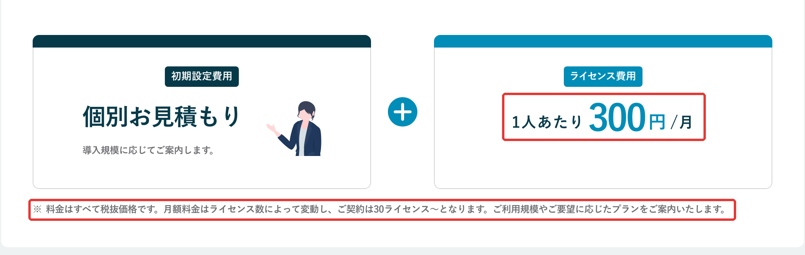
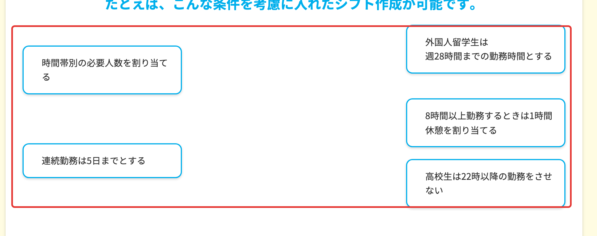

シフト作成AIは、スタッフの希望と勤務の条件を登録しておくと、シフトのたたき台を自動で作るツールです。選ぶ基準は自社の条件を登録できるかと、勤怠や給与のデータとつながるかの2つです。勤怠と給与まで同じ製品で回したいならfreeeやTeamSpiritのような勤怠・労務の一部の型、夜勤や配置基準が細かい病院・介護施設ならシフト専用の型が向いています。

この記事では公式サイトで料金と条件を確認できた5つを取り上げます。ChatGPTなどの生成AIとExcelでどこまで作れるか、業種別の向き不向き、費用と導入の流れまで扱います。

:::takeaways
- **製品は勤怠・労務の一部とシフト専用の2つの型に分かれる**。生成AIと表計算で自作する方法もあるが、労働時間の決まりを守る仕組みは無い
- **自動作成は基本料金に入っていない製品が多い**。らくしふとoplusはオプション、お助けマンとTeamSpiritは料金に含めて表示している
- **夜勤のある病院・介護施設は、夜勤明けや有資格者の配置を条件にできるかを無料期間で試す**
:::

## シフト作成AIとは？何ができる？

シフト作成AIは希望の回収から、条件に合うたたき台の作成、違反の警告までをまとめて引き受けるツールです。スタッフはスマホやLINEから希望を出し、管理者は時間帯ごとの必要人数・資格・連続勤務の上限といった条件を先に登録します。**ボタンを押すと条件を満たす組み合わせが出てくるので、管理者は人が足りない枠とぶつかる箇所だけを修正すれば済みます。**

できることは製品で差があり、大きく3つの段階に分かれます。希望の回収と共有だけを自動にするもの、条件を登録してたたき台を作るもの、法令や社内ルールの違反まで確定前に警告するものです。比べるときはどの段階まで自動になるかを先に確認しておくと、料金の差も読みやすくなります。

### ChatGPTに頼むのと何が違う？

専用のツールは登録した条件を毎回同じように守って計算します。ChatGPTのような生成AIは指示の文章から表を作れますが、条件を守ったかどうかは出てきた表を人が確認しなければ分かりません。シフトの自動作成と開発を請け負うNITI Technologyも、生成AIには資格要件や勤務時間の違反を構造的に防ぐ仕組みがないとして、割当を任せる用途には向かないとしています。**少人数で条件が単純なら生成AIでも下書きは作れますが、夜勤や資格の条件がある職場は専用のツールが前提になります。**

## シフト作成をAIに任せるメリットは？

いちばん大きいのは毎月のたたき台づくりにかかる時間が減ることです。そのうえで、法令や社内ルールの確認漏れが減り、シフトを組める人が1人に偏る状態も解消しやすくなります。

### たたき台づくりの時間が減る

条件をすべて満たす組み合わせを探す作業は、人数と条件が増えるほど時間がかかります。TeamSpiritはAIシフトエージェントの公式ページで、シフト作成の工数を月20〜30時間削減と掲げています（同社調べ）。らくしふの導入事例ではnana's green teaを運営する七葉がシフト作成時間を25%削減（同社の事例の実績）し、ゴディバ ジャパンはシフト作成業務を半分以下にしました。**どれもその会社の条件での数字なので、自社の効果は今のシフト作成に何時間かけているかを記録してから比べるのが確実です。**

:::linkcard
url: /media/ai-efficiency-cases/
title: AI業務効率化の事例10選
desc: 業務別の削減時間を対象の人数・時期・実績か見込みかの条件つきで解説しています。
:::

### 法令と社内ルールの確認漏れを防ぐ

連続勤務の日数や、勤務の終わりから次の勤務までの間隔を、目視で1人ずつ確認する作業は、担当者の負担が大きい部分です。TeamSpiritは確定前に、守らなければならない項目をエラー、注意したい項目を警告の2段階で出します。勤務シフト作成お助けマンも、満たせなかった条件をアラートで知らせます。**高校生の22時以降の勤務や、留学生の週28時間の上限のように、守らないと会社の責任になる条件ほど自動で確認する効果があります。**

### シフトを組める人の偏りを解消する

どのスタッフとどのスタッフを同じ日に入れないかといった判断は、担当者の頭の中にしかない場合が少なくありません。条件をツールに登録すると判断の基準が文章として残るため、担当者が休んだり異動したりしても、別の人が同じ品質で組めます。

## シフト作成AIのデメリットは？

弱いのは最初の条件の登録・例外の判断・希望の回収の3つです。どれも導入前に担当と手順を決めておけば対処できます。

### 最初の条件の登録に手間がかかる

AIが出す案の質は登録した条件の正確さで決まります。必ず守る条件と、できれば満たしたい条件を分けずに登録すると、使えない案が出てしまいます。freeeは導入まで平均1〜2か月かかるとしており、専任の担当が初期設定を支援します。**導入前に、今の担当者が守っている決まりを紙に書き出しておく必要があります。**

### 急な欠員や例外は人が判断する

当日の欠勤による組み替えや、36協定の特別条項を使うかどうかの判断は、最終的に管理者が行います。AIが作るのはあくまで案で、どの製品も作成後に人が修正できる前提です。**AIに任せる範囲と人が決める範囲の境目を、導入時に決めておくと運用が止まりません。**

### 希望が集まらないと効果が出ない

スタッフが期限までに希望を出さないと、AIは空いている枠を前提に組めません。LINEで提出できるらくしふや、スタッフ向けアプリと連携する製品は、未提出者への通知も自動にできます。紙や口頭で集めている職場は、まず提出の方法を1つにそろえるところから始めることになります。

## シフト作成AIツールの比較5選

5つは勤怠・労務の製品の一部として提供されるものと、シフト作成専用のものに分かれます。ここでは公式サイトで条件と料金を確認できた5つを、勤怠・労務の一部、シフト専用の順に並べました（2026年11月27日時点）。

| サービス | 型 | 登録できる条件（公式の記載） | 勤怠・給与との連携 |
|---|---|---|---|
| freee AIシフト管理 | 勤怠・労務の一部 | 配置基準・従業員ごとの勤務可能時間 | freee人事労務とAPI連携 |
| TeamSpirit AIシフトエージェント | 勤怠・労務の一部 | 資格・相性・連続勤務・店舗ルール | TeamSpirit勤怠と同じデータ |
| らくしふ | シフト専用 | 役割別の人数・連勤禁止・夜勤明け | 勤怠システムと連携・CSV |
| oplus | シフト専用 | 出勤間隔・連勤アラート・夜勤 | 自社の勤怠プラン・CSV |
| 勤務シフト作成お助けマン | シフト専用 | 夜勤の記号・週の上限時間・連続勤務 | CSVで勤怠・給与へ |

| サービス | 自動作成の料金（公式の表示） | 無料の試用 |
|---|---|---|
| freee AIシフト管理 | 1IDあたり300円（年払い） | 記載なし |
| TeamSpirit AIシフトエージェント | 1人月300円・30ライセンスから（税抜） | 個別に相談 |
| らくしふ | 基本月6,000円＋自動作成はオプション | 記載なし |
| oplus | オプション1ユーザー月300円（年額） | 無料トライアルあり |
| 勤務シフト作成お助けマン | 1か所月6,000円から（税別） | 2か月無料 |

**1人あたりの金額だけで比べると、自動作成がオプションで別にかかる製品や、最低の契約数がある製品を見落とします。**次は自社の型を決め、各社の条件を確認してください。

### ① freee AIシフト管理

freee人事労務を使っている会社が、シフトから勤怠までをつなぐための製品です。スタッフはスマホのアプリから希望を出し、AIが施設・事業所・ユニットごとの情報をもとにシフトを自動作成します。公式ページは業界の配置基準にも対応するとし、「未成年者は22時以降勤務させない」のような従業員ごとの勤務可能時間も設定できます。確定したシフトはfreee人事労務の勤怠に画面の操作だけで渡せて、ほかの勤怠システムにはデータを出力して取り込みます。料金は年払いで1IDあたり300円です。

### ② TeamSpirit AIシフトエージェント

条件を普段の文章で登録できる点が特徴です。「土日は正社員1名以上」「遅番の翌日は早番禁止」のような店舗のルールをテキストで指示し、薬剤師・登録販売者などの資格や、新人とベテランを組ませる相性も従業員ごとに登録します。作成後は仮公開で内容を確認してから正式に公開する流れです。TeamSpirit勤怠と同じデータで動き、給与計算などとの外部連携は今後の予定とされています。料金はライセンスが1人月300円（税抜）で、契約は30ライセンスから、初期設定は個別見積もりです。シフト作成の対象は1グループ100名までです。

<figure class="post-figure"><figcaption>TeamSpirit AIシフトエージェントの価格の表示（2026年11月27日）</figcaption></figure>

### ③ らくしふ

LINEで希望の回収と共有ができる、店舗向けのシフト専用ツールです。自動作成は2つのタイプがあり、ピークとオフの時間帯があるアルバイト中心の職場向けと、24時間体制で役職ごとの配置数や夜勤明けへの配慮が必要な職場向けに分かれます。時間単位の必要人数・役割別の条件・連勤禁止と、その優先順位も設定できます。料金は年払いで基本月6,000円（20名まで、21名から1名ごとに月300円）、初期費用は1店舗10,000円です。自動作成は勤怠管理などと並ぶオプションで、オプションは1ユーザー月100円から（年払い・税抜）ですが、自動作成のタイプで機能と料金が変わるため資料で確認する必要があります。介護・医療向けは別の案内があります。

### ④ oplus

無料から始められるシフト管理に、自動作成をオプションで加える製品です。基本のスタンダードプランは100ユーザーまで0円で、シフトの提出・確定やCSV出力が使えますが、自動作成は含まれません。自動作成のオプションは1ユーザー月300円（年額払い、月額払いは375円）で、夜勤のような日をまたぐシフト、次の出勤までの間隔、連勤アラートに対応します。出勤日数の均等化や、上級者を先に割り当てて新人を後に回す段階的な割り当ても設定できます。打刻と集計は自社のPro＋勤怠プラン（1ユーザー月200円・年額）の範囲です。

### ⑤ 勤務シフト作成お助けマン

JRシステムが提供し、夜勤のある職場向けのDayと、勤務時間を割り当てるTimeの2種類があります。Dayは早番・遅番・夜勤などの記号で組む2交代・3交代の職場向けで、病院・介護施設・工場・ホテルのフロントを挙げています。Timeは飲食・小売・サービス業向けで、「外国人留学生は週28時間まで」「高校生は22時以降の勤務をさせない」「連続勤務は5日まで」といった条件を守りながら時間を調整します。料金は1か所あたり、Dayが50名まで月12,000円、Timeが20名まで月6,000円です（税別、スマホ利用はDayがオプション、Timeは標準）。2か月の無料トライアルで全機能を試せます。

<figure class="post-figure"><figcaption>勤務シフト作成お助けマン Timeで設定できる条件の例（2026年11月27日）</figcaption></figure>

## 業種別にどの型が向いている？

業種で効いてくるのは時間単位で組むか、夜勤を含む1日単位で組むかの違いです。飲食・小売は時間単位、病院と介護施設は夜勤の記号と配置の条件が中心になります。

### 飲食店・コンビニ・小売

アルバイトが多く、時間帯ごとの必要人数と高校生・留学生の勤務時間の上限が主な条件になります。LINEで希望を集めたい店舗はらくしふ、まず無料で回収と共有を始めたい店舗はoplusが向いています。ドラッグストアのように薬剤師・登録販売者の配置が必要な店舗は、資格の条件を登録できるTeamSpiritが候補です。お助けマンのTimeは約230店舗・7,000名のシフト表を自動作成した導入事例があり、多店舗の会社でも使われている製品です。

### 病院・看護

早番・遅番・夜勤の2交代や3交代で組み、夜勤の回数や連続、有資格者の配置が条件になります。夜勤の記号で組むお助けマンのDayは病院を利用場面に挙げ、総合病院の導入事例も公開しています。らくしふにも24時間体制向けの自動作成のタイプがあり、候補は1つではありません。**病棟ごとの夜勤の決まりは病院ごとに違うため、実際の1か月分の条件を無料期間に登録して試す必要があります。**

### 介護施設

24時間の交替勤務に加えて、人員配置基準を満たすことが条件になります。freeeは業界の配置基準と施設・ユニットごとの作成を掲げ、らくしふも人員配置基準への配慮と夜勤明けの条件を挙げています。お助けマンのDayも、介護施設の導入事例が公開済みです。どの製品でも基準を満たしているかの最終確認は施設の管理者が担う前提です。

## 無料や生成AIとExcelで足りる？

スタッフが10人前後で、夜勤や資格の条件が無い職場なら、無料のツールや生成AIで下書きを作る方法でも足ります。条件が増える職場は違反を自動で警告する専用のツールのほうが確認の手間が少なくなります。

### ChatGPT・Gemini・Copilotでできること

3つとも表計算のデータをもとに表や集計を作れるAIです。ChatGPTはExcelやCSVのファイルを読み込み、Pythonで計算して表を作れますが、公式のヘルプは結果を信頼する前に、生成されたコード・出力・前提を確認するよう求めています。Googleスプレッドシートの Geminiはテーブルの作成と最適化のタスクに対応し、対象のGoogle WorkspaceかGoogle AIのプランが必要です。Excelの Copilotはブックを直接編集でき、Microsoft 365の対象のライセンスが前提になります。**名前の代わりにスタッフのIDを使えば、個人情報を渡さずに組み合わせを頼めます。**会社のアカウントで使うかどうかは、[Copilotの使い方](/media/copilot-guide/)でライセンスの違いを確認してください。

### 人が確認する労働時間の決まり

生成AIで作った表は次の決まりを守っているかを人が1つずつ確認します。厚生労働省は原則として1日8時間・週40時間を超えて働かせないこと、6時間を超える日は45分以上・8時間を超える日は1時間以上の休憩、毎週1日か4週間で4日以上の休日を定めています。満18歳未満は労働基準法で原則として午後10時から午前5時までの深夜に働かせることができません。勤務の終わりから次の勤務までの休息を取る勤務間インターバルは、事業主の努力義務です。**この確認を毎月続ける手間が、専用のツールの月額より大きくなった時点が切り替えの目安になります。**

## シフト作成AIの費用はいくら？

費用は1人あたりの月額と、自動作成のオプション、初期費用の3つで決まります。スタッフ30人の店舗1つで公式の表示から計算すると、freee・TeamSpiritと、oplusの自動作成のオプション、お助けマンのTimeはどれも月9,000円です。らくしふは基本料金だけで月9,000円になり、ここに自動作成のオプションと初期費用10,000円が加わります。

ただしTeamSpiritは30ライセンスからの契約で初期設定は個別見積もり、oplusは勤怠まで使うとプランの料金が別にかかります。**比べるときは自動作成・勤怠・スマホ利用がそれぞれどの料金に入っているかを1社ずつ書き出してください。**製品を使わずに外部へ頼む方法もあり、NITI Technologyはシフト作成の代行と自動生成の開発を合わせて、最初の3か月で150万〜400万円程度としています。

## シフト作成AIの導入はどう進める？

導入は条件の整理・試用・切り替えの順で進めます。freeeは平均1〜2か月で稼働するとしています。条件の多い病院や複数店舗の会社は、試用の期間を長めに見込んでおくと安全です。

1. 今のシフト作成に毎月何時間かけているかを記録する
2. 必ず守る条件と、できれば満たしたい条件を書き出す
3. 型（勤怠・労務の一部かシフト専用か）を決め、2〜3製品の資料を取り寄せる
4. 無料期間に実際の1か月分の希望と条件を登録し、今のシフトと見比べる
5. 1店舗か1病棟で本番に使い、修正した箇所を条件に戻してから広げる

TeamSpiritのように仮公開で確認してから正式に公開できる製品なら、4と5の間で現場の意見を集めやすくなります。

:::linkcard
url: /media/ai-agent-introduction/
title: AIエージェント導入の進め方と費用
desc: 自社で作るか頼むかの判断と国内の事例を解説しています。
:::

## 勤怠や人件費の集計までつなぐには？

シフトの結果を勤怠の実績・発注・人件費の集計までつなぎたい場合は、製品同士の連携か、AIエージェントで流れを組む方法になります。同じ会社の勤怠製品があるならfreeeやTeamSpiritのように同じデータで動く型が手間が少なく、別々の製品をつなぐならCSVかAPIで受け渡しできるかを先に確認します。

:::linkcard
url: /media/ai-agent-build/
title: AIエージェントの作り方を解説
desc: ノーコード・既製の基盤・コードの3通りの作り方と作る前に決めることを解説しています。
:::

## まとめ

- **勤怠や給与までfreeeかTeamSpiritを使っている会社**: 同じ会社のシフト作成AIを選ぶと二重入力が無くなる
- **アルバイト中心の飲食店・コンビニ・小売**: LINEで回収するなららくしふ、無料で始めるならoplus、多店舗ならお助けマンのTimeも候補
- **夜勤のある病院・介護施設**: お助けマンのDayやらくしふの24時間体制向けを、1か月分の実際の条件で試してから決める
- **10人前後で条件が単純な職場**: 生成AIと表計算の下書きでも足りるが、労働時間の決まりは人が毎月確認する

## よくある質問

### AIが作ったシフトは後から修正できますか？

できます。freeeは自由に修正できるとしており、TeamSpiritは仮公開で確認してから正式に公開する流れです。どの製品もAIの案を人が手直しする前提で作られています。

### oplusは無料で自動作成まで使えますか？

使えません。無料のスタンダードプランは100ユーザーまでシフトの提出・管理・確定に使えますが、自動作成は1ユーザー月300円（年額払い）のオプションです。

### 勤務シフト作成お助けマンは夜勤のある病院で使えますか？

使えます。早番・遅番・夜勤などの記号で組むDayが、病院や介護施設の2交代・3交代を対象にしています。料金は1か所50名まで月12,000円（税別）で、無料トライアルは2か月です。

### 高校生のアルバイトの深夜勤務を自動で避けられますか？

お助けマンのTimeは「高校生は22時以降の勤務をさせない」条件を設定でき、freeeも未成年者の22時以降の勤務を避ける設定ができます。満18歳未満の深夜業は労働基準法で原則として禁止です。

## 出典

- freee「[freee AIシフト管理](https://www.freee.co.jp/ai-shift-management/)」（料金・よくある質問）
- チームスピリット「[TeamSpirit AIシフトエージェント](https://www.teamspirit.com/ai-shift-agent)」（機能・価格・よくある質問）
- らくしふ「[シフト自動作成](https://rakushifu.jp/function/ai-gen/)」「[料金について](https://rakushifu.jp/price/)」
- oplus「[料金プラン](https://www.opluswork.com/plan)」「[自動シフト作成機能](https://www.opluswork.com/aishift)」
- JRシステム「[勤務シフト作成お助けマン](https://www.otasukeman.jp/)」「[料金](https://www.otasukeman.jp/price)」
- NITI Technology「[シフト自動生成AIの開発とシフト作成代行](https://nititech.jp/services/shift-scheduling/)」
- OpenAI ヘルプ「[ChatGPT によるデータ分析](https://help.openai.com/ja-jp/articles/8437071-data-analysis-with-chatgpt)」
- Google ドキュメント エディタ ヘルプ「[Gemini in Google スプレッドシートを活用する](https://support.google.com/docs/answer/14218565?hl=ja)」
- Microsoft サポート「[Excel の Copilot の使用を開始する](https://support.microsoft.com/ja-JP/Excel/copilot/get-started-with-copilot-in-excel)」
- 厚生労働省「[労働時間・休日](https://www.mhlw.go.jp/stf/seisakunitsuite/bunya/koyou_roudou/roudoukijun/roudouzikan/index.html)」「[勤務間インターバル制度](https://work-holiday.mhlw.go.jp/interval/)」
- e-Gov 法令検索「[労働基準法](https://laws.e-gov.go.jp/law/322AC0000000049)」（第61条 深夜業）
