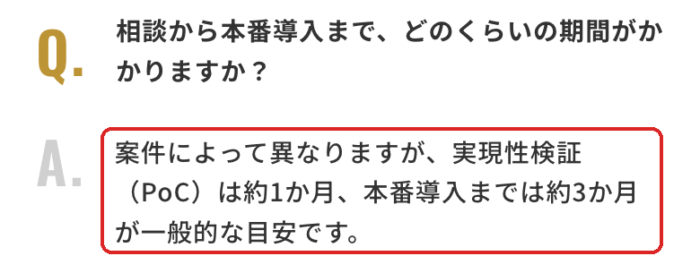

外観検査AIはカメラで撮った製品の画像を学習して良否を判定する仕組みで、良品のばらつきや曖昧なキズのようにルールで線を引きにくい検査に向いています。**製品選びはカメラや照明まで任せるかどうかと、良品の画像だけで学習できるかの2点で絞れます**。

この記事では主要9製品をカメラ・装置込み／ソフト／クラウドで学習の3つの型に分け、良品だけで学習できるか・必要な画像の枚数・PoCの期間と費用・料金を各社の公式サイトで比較します。導入の流れと、AIに向かない検査も扱います。

:::takeaways
- 料金を金額で公開しているのは9製品のうちTDSE Eye（月10万円から）だけ。ほかは金額の記載なし（見積もり・個別提案）
- 公開されている期間の目安は、PoCが約1〜3か月、本番の稼働まではさらに数か月
- 良品だけで学習できる製品でも、精度の評価には不良品の画像が必要
:::

## 外観検査AIとは？ルールベースと何が違う？

外観検査AIは良品と不良品の画像から判定の基準を学習し、新しい画像の良否を判定する検査の仕組みです。従来の画像検査（ルールベース）は面積や色の濃さに人が閾値を決めて判定するため、良品にばらつきがある製品や、人が見れば分かる程度の曖昧なキズは苦手でした。**線を引きにくい検査を学習した画像の特徴で判定できる点が、ルールベースとの最大の違いです**。

| 項目 | ルールベースの画像検査 | 外観検査AI |
|---|---|---|
| 判定の作り方 | 人が数値の閾値を決める | 画像から学習する |
| 得意な検査 | 寸法など数値で決まる検査 | 曖昧なキズ・複雑な形状・ばらつきのある製品 |
| NGの根拠 | 数値で示せる | 数値で示しにくい |

キーエンスはAIが得意な例に、接着剤の塗布後の検査や金属部品の打痕を挙げています。逆にパナソニックはWisSightの説明で、高精度な寸法計測や100%の精度が求められる検査を不得意としています。**自社の不良が数値で決まるものか、人の感覚で判定しているものかを分けるところから始めます**。

### 良品学習と不良品学習はどう違う？

学習方式は良品と不良品の両方の画像で学習する不良品学習（教師あり学習）と、良品の画像だけでいつもの状態を学習し、外れたものを異常とする良品学習に分かれます。不良品学習は欠陥の種類の分類に強い一方、めったに出ない不良の画像集めに時間がかかります。良品学習は不良品が少ない時期でも始められますが、良品のばらつきが大きい製品では過検出（良品を不良と判定すること）が増えやすい点に注意が必要です。

**良品だけで学習できる製品でも、精度の評価には不良品の画像が必要です**。TDSE Eyeも、定量的な精度評価には異常画像が必要と明記しています。

## 外観検査AIを導入するメリットは？

大きいのは検査基準の統一、人の工数の削減、既存の検査機の過検出の削減の3つです。事例の数字はそれぞれの現場の条件でのものです。

### 検査員による判定のばらつきがなくなる

目視検査は検査員の経験や疲れで判定が変わり、人によって合否が分かれることがあります。**AIは学習した基準で毎回同じように判定するため、熟練者の基準をラインや拠点をまたいで統一できます**。

### 検査にかかる人の工数が減る

PhoxterはAI画像検査で目視検査員4名分を省人化した事例を公開しています。NTTドコモソリューションズのコラムが紹介する大手建設会社の例では、鉄筋継手の検査が1か所5分程度から20〜30秒になりました。

### 既存の検査機の過検出を減らせる

ルールベースの検査機は流出を避けようと閾値を厳しくしがちで、良品まで不良と判定する過検出が増えるのが課題です。パナソニックの事例では既存の検査機がNGとした画像をAIで再判定し、廃棄のロスと人の見直しの工数を減らしています。**検査機を入れ替えずに、NG画像の二次判定だけをAIに任せる始め方もあります**。

## 外観検査AIの注意点は？

気を付けたいのは精度が100%にはならないこと、撮像の出来で精度が決まること、導入後も再学習が続くことの3つです。

### 精度は100%にならない

AIは学習した画像に無い状況の判断が苦手で、キーエンスも100%の精度で判別できるという期待を誤解としています。不良の流出が許されない製品では、境界に近い製品だけ人が見直す運用を前提に計画する必要があります。

### カメラと照明で精度が決まる

欠陥が画像にはっきり写らなければ、AIは学習できません。キーエンスの解説では位置補正と前処理をかけると1,000枚必要だった学習枚数が20枚で済んだ例を挙げています。**PoCで精度が出ないときは、モデルより先に撮像条件を見直す必要があります**。

### 再学習と運用の担当が必要

新しい不良や品種の追加、照明の劣化で精度は落ちるため、誤検出の画像を集めて再学習する作業は導入後も続きます。現場の担当者が追加学習できる製品も多いので、誰が担うかを契約の前に決めておくことが大切です。

## 外観検査AI製品の3つの型

製品はカメラや照明まで含めて提供するもの、PCに入れるソフト、クラウドで学習するものの3つの型に分かれます。**既存のカメラや検査機があるか、画像を社外に出せるかで、合う型が決まります**。

### カメラ・装置込みの型

カメラ・照明の選定から、不良品の排出機構やPLC（設備の制御装置）との連携までを1社が担う型です。新しく検査工程を作る場合や、社内に画像処理の担当者がいない場合に向いています。

### ソフトの型

自社のPCやサーバーで学習と判定を行う型で、画像を社外に出さずに済みます。カメラや検査機がすでにある工場に向いています。

### クラウドで学習する型

モデルをクラウドで作り、判定は工場のPCで動かす型です。**GPUを積んだPCなしで始められる一方、学習の段階では画像をクラウドに上げるため、社内の規程との照合が必要です**。

## 外観検査AIのおすすめ比較9選

2026年11月26日に各社の公式サイトで提供を確認できた9製品を、型ごとに並べました。選んだ基準は製品ページで機能や条件を確認できることです。カタログから注文する型の「インライン非破壊検査装置（外部不良検査）」のような装置は入れていません。AWSのAmazon Lookout for Visionは2025年10月31日に提供が終了したため、対象外です。書かれていない項目は「記載なし」とします。

| 製品（提供元） | 型 | 良品だけで学習 | 必要な画像の目安 |
|---|---|---|---|
| VSシリーズ（キーエンス） | 装置込み | 可（良品学習AI） | 数十枚〜（同社の解説） |
| メキキバイト（フツパー） | 装置込み | 記載なし | 記載なし |
| StellaController 2.0（Phoxter） | 装置込み | 可（AI良品学習） | 良品100枚〜・不良品20枚〜 |
| AI外観検査ソリューション（アプライド） | 装置込み | 記載なし | 10枚程度〜（領域検出） |
| WisSight（パナソニック デジタル） | ソフト | 記載なし | 記載なし |
| Phoenix Vision / Eye（VRAIN Solution） | ソフト | 可（良品学習） | 記載なし |
| AdaInspector Cloud（アダコテック） | クラウドで学習 | 可（不良品も少量） | 良品100〜300枚程度 |
| TDSE Eye（TDSE） | クラウドで学習 | 可（評価には異常画像も） | 正常画像 数枚〜数百枚 |
| Deeptector（NTTドコモソリューションズ） | クラウド版・インストール版 | 可（正例判定型） | 記載なし |

| 製品 | PoC・検証（公式の記載） | 料金（公式の記載） |
|---|---|---|
| VSシリーズ | テスト機の無料貸出し・ラボでの画作りは無償 | 見積もり |
| メキキバイト | 個別に相談 | 買い切りか年間契約を個別提案 |
| StellaController 2.0 | 約1か月（無償か有償かは内容次第） | 記載なし |
| アプライド | PoCの後にオフライン検査キット | 記載なし |
| WisSight | 評価2週間〜1か月・PoC 1〜3か月 | 記載なし |
| Phoenix Vision / Eye | 無料の検証テスト | 記載なし |
| AdaInspector Cloud | 記載なし | 記載なし |
| TDSE Eye | 精度検証は無償 | 月10万円から（税の表記なし） |
| Deeptector | 見積もり後に契約してトライアル | 年額または初期費用＋月額（金額は問い合わせ） |

**料金を金額で載せているのはTDSE Eyeだけで、PoCの期間を数字で出しているのもPhoxterとパナソニックだけです（Deeptectorは提供までの期間として1〜2週間程度を示しています）**。比較の段階では候補を2〜3社に絞り、同じ不良品のサンプルで検証を依頼して精度と見積もりを並べるのが現実的です。

### ① VSシリーズ（キーエンス）

**VSシリーズ**: 不良品学習AI・良品学習AI・ルールベースを組み合わせて使えるスマートカメラ型のビジョンシステムで、レンズを交換せずに視野とピントを合わせる光学ズームを備えます。テスト機の無料貸出しと、画像処理ラボでのAI向けの画作りを無償で提供しています。

### ② メキキバイト（フツパー）

**メキキバイト**: 光学設計から搬送の整列機構、排除機構とPLCの連携までを一括で担うサービスです。管理ツールのHutzper Insightで導入企業が自分でモデルを追加でき、不織布の検査で見落としを95%減らした事例があります。

### ③ StellaController 2.0

**StellaController 2.0**: PhoxterのAIとルールベースを1台で使える画像処理コントローラーです。良品と不良品のフォルダに画像を入れるだけで学習でき、不良箇所を囲む作業（アノテーション）は必要ありません。東京・大阪・名古屋・福岡のラボで実物を使ったPoCができます。

<figure class="post-figure"><figcaption>PhoxterのFAQの導入期間の目安（2026年11月26日）</figcaption></figure>

### ④ AI外観検査ソリューション（アプライド）

**AI外観検査ソリューション**: ノーコードのAI開発ツールMENOUに、撮像キット・照明・検査用PCを組み合わせて提供します。PoCの後、まずオフライン検査キットで目視検査を置き換え、インラインの自動化に広げる段階的な進め方です。

### ⑤ WisSight（パナソニック デジタル）

**WisSight**: 現場の担当者がGUIでAIモデルを作れるソフトで、物体検出・不良分類・不良領域抽出・座標検知の4種類から選べます。1ライセンスでモデルを何個でも作れ、疑似的な不良画像の生成やPLCとの連携にも対応します。

### ⑥ Phoenix Vision / Eye

**Phoenix Vision / Eye**: VRAIN Solutionの製品で、Phoenix Visionで学習と検証、Phoenix Eyeで判定を行います。分類・検出・領域抽出・良品学習の4方式を組み合わせられ、既存の検査システムへの後付けにも対応します。

### ⑦ AdaInspector Cloud（アダコテック）

**AdaInspector Cloud**: クラウドで良品学習のモデルを作り、ダウンロードしてオフラインの検査に使うツールです。GPUを積まない一般的なPCで始められ、判定は1枚200〜300ミリ秒（5Mピクセル・Core i7での参考値）です。

### ⑧ TDSE Eye（TDSE）

**TDSE Eye**: 正常画像だけで異常検知のAIを作るSaaS型のサービスで、価格はタクトタイムで変わり、買取も選べます。判定はGPU不要のWindows 10のPCでオフライン実行できますが、画像は長辺384ピクセルに縮小されるため、微細な欠陥は検証で確認が必要です。

<figure class="post-figure"><figcaption>TDSE Eyeの料金と精度検証の表示（2026年11月26日）</figcaption></figure>

### ⑨ Deeptector（NTTドコモソリューションズ）

**Deeptector**: 良品だけを学習する正例判定型を含む複数の判定パターンを持つ画像認識AIです。画像を社外に出したくない場合はインストール版、初期投資を抑えたい場合はクラウド版を選べ、提供までの期間はインストール版が1〜2週間程度とされています。

## 外観検査AIの選び方は？

型・学習方式・画像の扱い・ラインへのつなぎ方の順に決めると、候補が絞れます。**最初に決めるのは製品名ではなく、カメラと照明を自社で用意できるかどうかです**。

### カメラと照明を誰が用意するか

ラインに新しく検査工程を作るなら、向いているのはカメラ・装置込みの型です。既存のカメラや検査機の画像にAIの判定を追加したいなら、ソフトの型か後付けできる製品を選びます。

### 不良品の画像がどれだけ集まるか

不良品の画像が十分にあり、種類まで分けたいなら不良品学習が使えます。不良がめったに出ないなら、候補は良品学習に対応した製品です。**どちらでも、検証の前に何を不良とするかの基準を品質保証の担当と書き出しておくと、ベンダーとの認識のずれを防げます**。

### 画像を社外に出せるか

画像を社外のクラウドに置けないなら、クラウドで学習する型（AdaInspector Cloud・TDSE Eye）とDeeptectorのクラウド版は外れます。候補はソフトの型、Deeptectorのインストール版、カメラ・装置込みの型で、装置込みの型はどこで学習するかを、検証の前に確認しておきたいところです。取引先との契約や社内の規程で画像の持ち出しに制限がないかは、PoCの前に確認しておく必要があります。

### 判定の速さと排除までつなぐか

ラインの速度（タクトタイム）に判定が間に合うか、NG品を取り除く排出機構やPLCまでつなぐかで、必要な構成が変わります。目視の検査台を置き換える段階なら、ラインに組み込まないオフラインの検査から始める方法もあります。

## 外観検査AIの費用とPoCの期間は？

公式に金額を載せている製品はTDSE Eyeだけで、ほかは対象と構成を聞いたうえでの見積もりです。Phoxterは「PoCは約1か月、本番導入までは約3か月」、パナソニックは導入ステップとして「AI評価・プランニング」2週間〜1か月、「PoC」1〜3か月、「本番の開発・導入」3〜6か月と期間の目安を公開しています。

費用はPhoxterの解説記事がPoCを数十万円〜数百万円程度、構築・実装を数百万円〜数千万円とし、NTTドコモソリューションズのコラムはソフトのみの小規模なシステムの初期費用を20万〜80万円、大規模なシステムを2,000万〜3,000万円以上、クラウド型の月額を10万〜100万円程度としています。**どれも各社が示した目安で、税の表記はなく、カメラ・照明・排出機構をどこまで含むかで金額が大きく変わります**。見積もりの比較ではPoCの費用が本番の契約で差し引かれるか、再学習やサポートが月額に含まれるかまで確認が必要です。

### 補助金は使える？

カメラや装置を含むAI外観検査には、中小企業省力化投資補助金（一般型）が候補になります。対象は現場に合わせて設計する設備やシステムで、汎用の設備やパッケージソフトを単体で入れるだけの計画は対象外です。補助率は中小企業で1/2（小規模事業者は2/3）、補助上限は従業員数に応じて750万円〜8,000万円。第9回は2026年12月1日10時に申請の受付が始まり、12月24日17時が締切。たとえば税抜1,000万円の検査システムで採択され、補助率1/2が適用されれば補助は500万円です。ただし補助金の支払いは事業が終わった後の精算で、交付決定より前に契約した分と消費税は対象になりません。ものづくり補助金は公式サイトで公募の終了が告知され、新規の受付は新事業進出・ものづくり商業サービス補助金に移っています。こちらは新製品や新事業が前提で、検査設備を入れるだけの計画は当てはまりにくいでしょう。

:::linkcard
url: /media/ai-subsidy/
title: 生成AIに使える補助金5選｜ChatGPT・Claudeは対象？締切と対象外
desc: 省力化投資補助金を含むAI導入に使える補助金の対象経費と締切を解説しています。
:::

## 外観検査AIの導入の流れ

導入は要件の決定から運用での再学習まで、5段階で進みます。

1. **検査の要件を決める**: 検出したい不良と判定基準、ラインの速度、排出機構やPLCとの連携の有無を書き出す
2. **画像を集める**: 学習用の画像と、精度を評価するための良品・不良品の画像を用意する
3. **PoCで精度を確認する**: 実物のサンプルで撮像条件を決め、見逃しと過検出の割合を確認する
4. **ラインに組み込む**: カメラ・照明を固定し、実際のライン速度で受け入れのテストをする
5. **運用しながら再学習する**: 誤検出の画像と新しい不良を集めて再学習し、閾値を調整する

**PoCは実験室で終わらせず、現場の照明・振動・粉じんの影響まで含めて評価することが大切です**。検証と本番で撮像の環境が変わると、検証で出た精度が本番で再現しないためです。

## 外観検査AIが向かない検査は？

高い精度の寸法計測と、画像に写らない不良は、AIだけで置き換えるのに向きません。寸法のように数値で合否が決まる検査はルールベースの方が根拠を示せるため、VSシリーズやStellaController 2.0のようにAIとルールベースを1台で併用できる製品があります。内部の割れのようにカメラに写らない不良は、X線など別の検査を検討することになります。

## 検査の結果を日報や不良の集計につなぐには

判定結果が専用の管理画面に残る製品があり、不良の傾向をグラフで見られる製品もあります。その先の日報へのまとめ、品質会議の資料の集計、不良が増えた工程への連絡、部材の発注への反映は、検査AIの外側の業務です。これらを人の手で回している場合は、検査結果を読み取って次の作業まで進めるAIエージェントを組む方法があります。

:::linkcard
url: /media/ai-agent-build/
title: AIエージェントの作り方を解説｜3つの作り方・5つの型・作る前に決める2つのこと
desc: 業務の流れをAIエージェントで組むときの作り方と型を解説しています。
:::

## まとめ

- 新しく検査工程を作るなら、カメラ・装置込みの型（VSシリーズ・メキキバイト・StellaController 2.0・アプライド）から2〜3社に検証を依頼
- 既存の検査機があり画像を社外に出せないなら、ソフトの型（WisSight・Phoenix Vision / Eye）かDeeptectorのインストール版
- 不良品の画像が集まらないなら、良品学習に対応した製品（StellaController 2.0・AdaInspector Cloud・TDSE Eyeなど）
- 月額で小さく試したいなら、料金を公開しているTDSE Eyeが比較の起点
- どの型でも、PoCの前に不良の基準と評価用の不良品画像を用意する

## よくある質問

### 外観検査AIは不良品の画像がなくても始められますか？

良品学習に対応した製品なら良品の画像だけでモデルを作れ、TDSE Eyeは数枚〜数百枚の正常画像が目安です。ただし精度の評価には不良品の画像が必要なので、過去のサンプルは残しておきます。

### キーエンスのVSシリーズは良品学習に対応していますか？

対応しています。不良品学習AI・良品学習AI・ルールベースを組み合わせて使えます。価格は問い合わせ制で、テスト機の無料貸出しもある製品です。

### TDSE Eyeの料金はいくらですか？

公式サイトの表示は月10万円からです。価格はタクトタイムで変わる体系で、買取もでき、精度検証は無償です。

### Phoxterの製品は何枚の画像で学習できますか？

StellaController 2.0の製品ページでは、良品画像100枚・不良品画像20枚からとしています。不良画像を作るDefectMakerも標準で載っています。

### WisSightは導入までどれくらいかかりますか？

公式の導入ステップではAI評価・プランニングが2週間〜1か月、PoCが1〜3か月、本番の開発・導入が3〜6か月です。

### Deeptectorは画像を社外に出さずに使えますか？

インストール版なら自社の環境で学習と判定ができます。GPUを積んだサーバーとDockerの環境は自社で用意し、料金は年額のライセンスです。

### AI外観検査の導入に補助金は使えますか？

カメラや装置を含む検査システムなら、中小企業省力化投資補助金（一般型）が候補です。第9回の申請受付は2026年12月1日に始まり、締切は12月24日17時。汎用設備やパッケージソフトの単体導入は対象外です。

### AI外観検査とルールベースの画像検査は併用できますか？

併用できます。VSシリーズやStellaController 2.0などは1台で両方を組み合わせられ、寸法はルールベース、曖昧なキズはAIのように検査項目ごとに使い分けられます。

## 出典

製品の情報と補助金の状態は、2026年11月26日に各社・各事務局の公式サイトで確認しました。

- キーエンス「[VSシリーズ](https://www.keyence.co.jp/products/vision/vision-sys/vs/)」「[AI外観検査](https://www.keyence.co.jp/ss/products/vision/visionbasics/use/ai-inspection.jsp)」
- フツパー「[メキキバイト](https://hutzper.com/mekiki-baito/)」
- Phoxter「[StellaController 2.0](https://www.phoxter.co.jp/visual-inspection/products)」「[よくある質問](https://www.phoxter.co.jp/visual-inspection/faq)」「[AI外観検査の基礎知識](https://www.phoxter.co.jp/useful/visual-inspection-basic-knowledge)」
- アプライド「[AI外観検査ソリューション](https://ai-visual-inspection.applied-g.jp/)」
- パナソニック デジタル「[WisSight](https://www.panasonic.com/jp/business/its/ai/machine-vision.html)」
- VRAIN Solution「[Phoenix Vision](https://vrain.co.jp/phoenix-vision/)」「[AI外観検査](https://vrain.co.jp/visual-inspection/)」
- アダコテック「[AdaInspector](https://adacotech.co.jp/adainspector/)」「[外観検査AIの種類と比較](https://adacotech.co.jp/blog/ai-inspection-methods-comparison/)」
- TDSE「[TDSE Eye](https://www.eye.tdse.jp/)」
- NTTドコモソリューションズ「[Deeptector](https://www.docomosolutions.co.jp/deeptector/)」「[外観検査AIソフト導入事例](https://www.docomosolutions.co.jp/column/ai/visual-inspection-ai-software-guide/)」
- 中小企業省力化投資補助金事務局「[一般型](https://shoryokuka.smrj.go.jp/ippan/)」
- ものづくり補助金事務局「[公式ホームページ](https://portal.monodukuri-hojo.jp/)」
