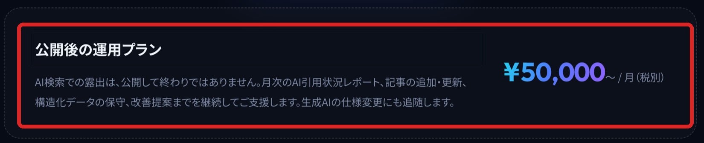

AIO対策まで頼めるホームページ制作会社は、**今のサイトに足すか作り直すか**と、**公開後にAIの回答を計測し続けるか**の2点で選ぶと迷いません。「AI検索対応」と書く制作会社は増えていますが、既存サイトへの対応と公開後の計測は会社ごとに分かれます。

この記事は株式会社nitoが書いています。nitoはAI検索対策の会社で、ホームページの制作会社ではないため、6社の比較とは分けて後半に載せました。6社は各社の公式サイトで2026年11月21日に確認した内容で比べています。

:::takeaways
- 制作会社のAIO対策は**新規制作に組み込む・既存サイトに足す・公開後に計測する**の3つで範囲が分かれる
- GoogleはAIによる概要のための特別な最適化は不要としている。**構造化データを入れたかより、強み・料金・実績を原稿に書くか**を見る
- 公式の料金は月額制のパックの月1万4,300円から、作り直しの200万円以上まで幅がある。**制作費と公開後の月額を分けて**比べる
:::

## AIO対策に強いホームページ制作会社6選

AIO対策（AI検索対策）を制作サービスとして公式に打ち出しているホームページ制作会社のうち、料金と範囲を公式で確認できた6社を比べます。既存サイトへの追加対策まで公式に書いている会社を先に並べました。

- **クーミル株式会社**: AIで言及されたいテーマから逆算してサイトマップを設計し、原稿・デザイン・WordPressの構築・構造化データまで一気通貫で受ける東京の制作会社
- **株式会社ソシオラ**: AI検索対策を設計段階から組み込む制作で、全ページに構造化データを実装。公開後は質問文ごとのAIの引用状況を月次で計測する
- **株式会社ピースカンパニー**: SEOとAI検索最適化を標準に含めた制作。新規制作は構造化データの実装が追加料金なし、既存サイトへの後付けは5万円から
- **AtoZ Design**: LLMO・AIO対策に特化したホームページ制作。制作は22万円から（AIO対策込みの会社サイトは55万円から）、自分で作る人の伴走や内製化のサポートも選べる
- **NOREN**: 設計済みの骨組みに自社の情報を反映するセミオーダー式。FAQや実績の情報設計を含め、最短5営業日から1ヶ月ほどで公開する
- **NTT東日本 デジタルリード AI検索対策パック**: Wixで作るホームページとAIにも参照されやすいコンテンツ制作を月額でまとめたパック。制作料金は0円

| 会社 | 既存サイトへの追加対策 | 公開後のAIの計測 |
|---|---|---|
| クーミル | AIO分析＋基礎対策（50万円〜）・LLMO基盤整備・サイト構造最適化（30万円〜） | AIの回答での言及・流入・問い合わせを確認 |
| ソシオラ | LLMOコンサル＆実行支援（月8万円〜・他社制作のサイトも可） | 質問文ごとの引用状況とCVを月次で計測 |
| ピースカンパニー | 構造化データの後付け（5万円〜） | 検索順位とChatGPT・Gemini・Perplexityでの出方を計測 |
| AtoZ Design | LLMO・AIO対策コンサルティング（初期分析・設計11万円＋月5.5万円〜・税込） | AIでの名前の出方と、GA4でAIからのアクセスと問い合わせの数を確認 |
| NOREN | 記載なし（作り直しの旧URLの転送はオプション） | 記載なし |
| NTT東日本 | 記載なし | AI検索からのアクセス分析 |

NTT東日本のパックだけWixで、ほかの5社はWordPressで作ります。

「記載なし」は公式のサービスページで見つけられなかった項目で、対応していないという意味ではありません。

### この記事の選定基準

載せたのはAIO・LLMO・AI検索対策をホームページ制作のサービスとして公式サイトに打ち出し、料金と範囲を公式で確認できた制作会社です。「AI検索対策 ホームページ制作」で検索したときに上に出る制作会社のサービスページから選びました。

制作会社に限らずAIO対策の依頼先を広く比べたい場合は、支援会社20社の比較が参考になります。

:::linkcard
url: /media/aio-taisaku-companies/
title: AIO対策会社おすすめ20選・比較表と費用・選び方
desc: AIO対策会社20社を支援範囲で分け、費用の目安と選び方を解説しています。
:::

## AIO対策を含むホームページ制作の費用は？

公式の料金は**月額制のパックなら月1万4,300円から、10ページ前後の制作は10万〜60万円から、ブランドの設計から作り直すと200万円から**が目安です。どの会社も「〜から」の表記で、ページ数や記事の本数、撮影の有無で変わります。

| 会社 | 制作の料金（公式の表記） | 公開後の月額（公式の表記） |
|---|---|---|
| クーミル | 基礎対策50万円〜・リニューアル100万円〜・フルリニューアル200万円〜 | LLMOコンサルティング運用代行20万円〜（LLMO対策のページ） |
| ソシオラ | 10万円〜（1〜10ページ）・60万円〜（10〜30ページ）・200万円〜（税別） | 運用プラン5万円〜（税別） |
| ピースカンパニー | 会社サイト（5〜10ページ）30万円〜 | 管理・更新プラン1万5,000円〜 |
| AtoZ Design | 22万円〜（3ページの個人向け）・33万円〜（会社向け10ページ〜）・55万円〜（LLMO対応・10ページ）（税込） | 丸投げ運用3万3,000円（制作を依頼した会社に限る） |
| NOREN | ベーシック49.5万円・プロ71.5万円（税込） | 月額なし（保守は月2万2,000円〜の任意のオプション） |
| NTT東日本 | 制作料金0円（登録料5,500円） | 1万4,300円〜（税込・1年単位） |

<figure class="post-figure"><figcaption>ソシオラの公開後の運用プラン（2026年11月21日）</figcaption></figure>

金額を並べるときは、**制作費に何が入り、公開後の月額で何が続くか**を分けて見ます。たとえばソシオラは60万円からのプランに公開後3か月の露出モニタリングを含め、その後は月5万円からの運用プランで計測と記事の追加を続ける形です。

読者に近い例で言うと、10ページ前後の会社サイトをAIO対策込みで作り直すなら、公式の表記でおおむね10万〜60万円からです（ソシオラは1〜10ページで10万円から、AtoZ Designは会社向けの10ページからで33万円から）。そこに公開後の計測や記事の追加を月額で足すかどうかで、1年の総額が変わります。

:::linkcard
url: /media/llmo-cost/
title: LLMO・AIO対策の費用相場はいくら？月額の目安と依頼先の選び方
desc: LLMO・AIO対策の月額の目安を、支援の型ごとに解説しています。
:::

## 作り直すか今のサイトに足すか

**サイトの構成や見た目に不満がなければ今のサイトに足す、古くて作り直す予定があるなら制作会社に設計から任せる**のが分かれ目です。AIO対策は作り直さなくても始められ、ソシオラも公式のFAQで、既存サイトのままで直せる範囲と作り直したほうが早い範囲を診断で切り分けると説明しています。

作り直す場合は制作会社がサイトマップと原稿の段階から手を入れられます。クーミルは「どのような質問で、どのような企業として言及されたいか」から逆算してサイトマップを設計し、サービスページを中心に置くと説明しています。今のサイトを残すなら、構造化データの後付けやページの追加が中心です。ピースカンパニーの後付けは5万円から、クーミルの基礎対策は50万円から、LLMO基盤整備・サイト構造最適化は30万円からです。

制作会社とAIO対策の会社の違いは、サイトそのものを作れるかです。AIO対策の会社は計測と何を書くかの方針を出し、実装は社内か制作会社が受け持つことが多くなります。どちらに頼んでも、**狙う質問で今AIにどう説明されているか**を先に知っておくと、作り直しの範囲を決めやすくなります。

## AIO対策に強いホームページ制作会社の選び方

選ぶときは公式の記載で差が出る3つを確認します。構造化データの実装やFAQの整備は多くの会社が同じように書いているので、そこでは差がつきにくいでしょう。

| 基準 | 契約前に聞く質問 |
|---|---|
| 既存サイトへの対応 | 今のサイトのままで、どこまでの対策を受けられますか？ |
| 公開後の計測 | どの質問文を、どのAIに、どの頻度で聞いて報告しますか？ |
| 原稿の制作 | 強み・料金・実績の原稿は誰が書きますか？ |

### 既存サイトのまま進められるか

今のサイトを残す可能性があるなら、既存サイトへの追加対策を公式の料金に載せている会社が向いています。6社ではソシオラ（月8万円から・他社が作ったサイトにも対応）、クーミル（50万円から）、ピースカンパニー（5万円から）、AtoZ Design（初期分析・設計11万円と月5.5万円から）が書いています。

### 公開後にAIの回答を計測するか

公開した時点では狙う質問で自社が挙がるかは分かりません。**どの質問文をどのAIにどの頻度で聞いて報告するか**を契約前に聞いておくと、公開後に何を直すかの判断材料が残ります。ソシオラは数十〜百パターンの質問文を各AIに定期的に投げて記録すると書いています。

問い合わせまで数えるかも確認したい点です。AIでの言及が増えても、問い合わせにつながらなければ売上は変わりません。クーミル・ソシオラ・AtoZ DesignはAIの回答とあわせて流入や問い合わせ（CV）を確認すると公式に書いています。

### 強み・料金・実績を原稿にするか

Googleの公式ガイドによると、AIによる概要とAIモードに表示されるための追加の要件はなく、特別な最適化も必要ありません。構造化データはページに見えている文と一致させることが求められ、入れたから表示されるものではありません。llms.txtのようなAI向けのテキストファイルの作成も、Google検索では不要な戦術として公式の最適化ガイドに挙がっています。

そのため差が出るのは、**何の会社か・誰向けか・料金・実績を、原稿として誰が書くか**です。6社とも原稿を制作の工程に入れていて、差は下書きまでか最終稿までかです。クーミルは原稿の制作、ソシオラはAIO記事の設計と執筆、ピースカンパニーは質問に一文で答える原稿と実績ページ、AtoZ Designは見出しを質問に・本文をその答えにした記事や事例、NTT東日本はAIにも参照されやすいコンテンツの制作を含めます。NORENは下書き原稿案までで、最終版のライティングは11万円〜のオプションです。構造化データがAI検索でどこまで効くかは、公式の文で確かめた範囲を別の記事にまとめています。

:::linkcard
url: /media/structured-data-ai-search/
title: 構造化データはAI検索に必要？公式で確かめた効く範囲と入れ方
desc: 構造化データがAI検索に必要かを、Googleなどの公式の文をもとに解説しています。
:::

## 各社の特徴

ここからは6社を公式の記載から同じ形で並べました。順は上の比較表と同じです。

### 1. クーミル株式会社

クーミルはAI検索で言及されたいテーマから逆算してサイト全体を設計する東京の制作会社です。調査・戦略・サイトマップ・原稿・デザイン・コーディング・WordPressの構築・構造化データまで一気通貫で受け、公開後はAIの回答での言及状況・流入・問い合わせを確認して改善を続けます。

**戦略の提案を受けてもサイトに反映できなかった経験がある会社**に向いています。

### 2. 株式会社ソシオラ

ソシオラはAI検索対策を後付けせず設計段階から組み込むホームページ制作を打ち出しています。初回無料のAI検索露出診断でChatGPT・Gemini・Perplexity・Copilotに想定の質問を投げ、競合が引用されている状況まで報告する流れです。全ページへのJSON-LDの実装、llms.txtとrobots.txtの整備、表示速度の改善までを制作の工程に入れています。

リニューアル向けの60万円からのプランにはWordPressの構築とAIO記事3本が入り、他社が作ったサイトもLLMOコンサル＆実行支援（月8万円から）で直せるため、**作り直すか決めきれていない会社**に向いています。

### 3. 株式会社ピースカンパニー

ピースカンパニーは佐賀県の制作会社で、SEOとAI検索最適化（LLMO・GEO・AIO）に標準で対応したホームページ制作を全国からオンラインで受けています。業種と地域の組み合わせでAIへの質問を洗い出し、質問に一文で答える原稿とFAQ、会社・サービス・FAQ・実績の構造化データを手書きで実装する進め方です。

構造化データの実装は追加料金なしで、既存サイトへの後付けも5万円からのため、**費用を抑えて今のサイトから始めたい会社**に向いています。

### 4. AtoZ Design

AtoZ Designは岡山を拠点に、LLMO・AIO対策に特化したホームページ制作とコンサルティングを全国で受けています。制作は22万円から（税込）で、お店向け・会社向けなど用途別の料金を公式に載せています。22万円は3ページの個人向けプランで、会社向けは10ページから33万円、LLMO対応のホームページ制作は10ページで55万円からです。

自分でAIを使ってホームページを作る人を伴走する形（初期11万円、先着10名のモニター価格）や、月5万5,000円の内製化サポートも選択肢です。**社内で更新を続けたい会社**に向いています。

### 5. NOREN

NORENは設計済みのサイト構成とページ構成に自社の情報を反映し、デザインを個別に調整するセミオーダー式のホームページ制作です。何の会社か・誰向けか・強み・実績・FAQを整理する情報設計を重視し、FAQなどの構造化データとE-E-A-Tを意識した構成を独自の型に入れています。

ページ数は無制限で分割払いにも対応し、公開後の月額はありません。最短5営業日から1ヶ月ほどで公開できるため、**短い期間で定型の会社サイトを持ちたい会社**に向いています。

### 6. NTT東日本 デジタルリード AI検索対策パック

NTT東日本のデジタルリード AI検索対策パックは、ホームページ制作とAIにも参照されやすいコンテンツ制作を月額でまとめたサービスです。運用はNTTタウンページ社が受け持ち、サービス内容・対応エリア・料金・FAQの整理、iタウンページへの掲載、Googleビジネスプロフィールの登録代行も含むパックです。

契約は1年単位で、月額に月1回の修正とAI検索からのアクセス分析が入ります。**制作費をかけずに小さく始めたい会社**に向いています。

## 記事の制作と公開後の運用まで任せるなら

制作会社を決める前に、狙う質問で今AIにどう説明されているかを測ると、作り直しの範囲と原稿に書く中身が決まります。強みの文章化と記事の制作、公開後の運用を受け持つAI検索対策の会社として、ここでは書き手のnitoを載せました。

### 株式会社nito

[株式会社nito](/aio/)は、**AI検索対策で、問い合わせや購入につながるまで実行する**会社です。ヒアリングで自社の強みを文章にまとめ、サイトの改善の指示書と記事の制作から公開後の運用まで支援します。ホームページの制作会社ではないため、サイトの構築と実装は制作会社か社内が受け持ちます。

- **実際のチャット画面で毎日計測する。** ChatGPTやGemini、GoogleのAIモードなど主要なAIの回答と引用元を記録しています（記録した回答は3万件以上。2026年11月時点）
- **他社が挙がる理由を回答の本文から抜き出す。** AIが他社をすすめるときに使った理由のうち、自社のサイトに書かれていないものを、原稿に書く中身の候補にします
- **改善の方針と記事の制作、公開後の運用まで。** 制作会社と組む場合も、公開後に同じ質問で測り続け、問い合わせフォームで「AIで知った」人の数まで数えます

| 支援先 | 成果 |
|---|---|
| SaaS企業 | 取り組み3ヶ月で、AIでの言及率が10%から45%に。AI経由のコンバージョンは5ヶ月で約6.7倍 |
| 士業 | AIでの言及率が0%から20%に。新しいページは公開3日でAIの回答の引用元に |

成果は事業・体制・市場によって変わるため、どの質問でどこまで狙えるかは、無料の現状分析のあとにお伝えしています。

- 作り直しの前に、どの質問で他社に負けているかを知りたい会社
- 公開後の効果を、言及率だけでなく問い合わせの数で見たい会社

nitoでは狙いたい質問をChatGPT・Gemini・AIモードなどに実際に聞き、名前が挙がるか、どう紹介されるか、代わりにどの会社が挙がっているかをまとめた[現状分析レポート](/aio/)を無料でお出ししています。

## 依頼する前に社内でそろえること

どの制作会社に頼む場合も、次の4つを先にそろえると最初の提案が自社に合ったものになります。

1. **有効な問い合わせの数え方。** 営業の電話や勧誘を除いて、何を1件と数えるか。今の月の件数も
2. **管理画面の権限。** サイトの更新、Googleビジネスプロフィール、Googleアナリティクス、サーチコンソールの4つを、誰が持っているか
3. **問い合わせフォームの「知ったきっかけ」欄。** AIで知った人を数えるために、選択肢にAIを足せるか
4. **自社にしかない情報と、書いてほしくない訴求。** 料金の考え方、実績の数字、お客様の業種と、避けたい言い方

社内の人と権限の整え方は、AI検索対策の始め方の記事でも段階ごとにまとめました。

:::linkcard
url: /media/ai-search-first-steps/
title: AI検索対策は何から始める？企業が取り組むべき5ステップ
desc: AI検索対策を始める順番を、社内の準備から5つの段階で解説しています。
:::

## まとめ

- 作り直す予定があるなら、原稿から公開後の計測まで受けるクーミルかソシオラ
- 今のサイトを残すなら、既存サイトへの追加対策を公式に出しているソシオラ・ピースカンパニー・クーミル・AtoZ Design
- 制作費を抑えて小さく始めるなら、月額制のNTT東日本のパックか、3ページの個人向けが22万円からのAtoZ Design
- 短い期間で定型の会社サイトを持つなら、セミオーダー式のNOREN
- どの質問で負けているかを先に知りたい、記事の制作と公開後の運用まで任せたいなら、nito

## よくある質問

### AIO対策はホームページを作り直さないとできませんか？

作り直さなくても頼めます。AtoZ Designは公式のFAQで、今のホームページを活かしてページの構成や文章、構造化データを整え、初期分析・設計11万円と月5.5万円からの継続サポートで進めると説明しています。ソシオラは既存サイトの構造で直せる範囲と、作り直したほうが早い範囲を無料の診断で切り分ける流れです。ページを足しにくい作りなら作り直しをすすめる会社もあるため、診断の結果で決めるのが確実です。

### ホームページ制作会社はAIでの表示を保証しますか？

保証はされません。クーミル・NTT東日本・AtoZ Design・NORENが、公式にAIへの表示は保証できないと書いています。AtoZ Designは「AIの答えは聞くたびに変わる」ため、数字とAIでの紹介のされ方を定期的に確かめるとしています。保証を約束する会社には何を根拠にしているかを聞いてください。

### AIO対策の効果は公開後どのくらいで見えますか？

会社と質問によって変わります。ソシオラは公開後およそ1〜3か月で変化が見え始めるケースが多いと公式に書いています。AtoZ Designはサイトの状態や業種、競合で変わるとして、決まった期間は示していません。nitoの支援では新しいページが公開3日でAIの回答の引用元に入った例も、3ヶ月かけて言及率が上がった例もありました。

### AIO対策とLLMO対策は違いますか？

多くの会社は同じ取り組みの呼び方として使っています。AtoZ Designのように、2つを分けて説明する会社もあります。制作会社に限らず依頼先を比べたい場合は、「[AIO対策会社おすすめ20選](/media/aio-taisaku-companies/)」にまとめました。

### AIO対策とSEO対策は同じ制作会社に頼めますか？

頼めます。6社ともSEOとAIO対策を同じ制作の工程で扱うと書いており、Googleも、SEOのベストプラクティスはAIによる概要とAIモードでも有効としています。報告で何を測るかは契約前に確認しておくと安心です。

### 地方の会社でも東京以外の制作会社に頼めますか？

頼めます。ソシオラ・ピースカンパニー・AtoZ Designは全国からの依頼をオンラインで受けると書いています。対面はソシオラが東京・神奈川・埼玉・千葉、ピースカンパニーが佐賀県と九州の近県、AtoZ Designが岡山県内です。

### 構造化データを入れればAIに表示されますか？

入れるだけで表示されるものではありません。Googleは特別な最適化は不要とし、構造化データはページの文と一致させるよう求めています。

### llms.txtはホームページ制作のときに置くべきですか？

制作の費用をかけて急ぐ項目ではありません。Googleの最適化ガイドは、llms.txtなどAI向けのテキストファイルの作成を、不要な戦術として挙げています。一方でソシオラのように、制作の工程にllms.txtの整備を入れる会社もあります。置くかどうかの決め方は「[llms.txtとは？意味ないと言われる理由・書き方・置くかの決め方](/media/llms-txt-structured-data/)」で解説しています。

## 出典

- 各社の公式サイトのサービスのページ（2026年11月21日確認）: [クーミル AI検索に強いホームページ制作](https://coomil.co.jp/service/aio-website/)・[ソシオラ AI検索対策×ホームページ制作](https://sociola.co.jp/ai-search-web/)・[ピースカンパニー AI検索対策に強いホームページ制作](https://piececompany.com/web-design/)・AtoZ Design の[ホームページ制作](https://atoz-design.jp/service/web/)と[LLMO対策](https://atoz-design.jp/service/aio/)（料金はどちらのサービスページにも掲載）・[NOREN AI検索に強いホームページ制作](https://noren-world.com/solution/ai-search/)・[NTT東日本 デジタルリード AI検索対策パック](https://business.ntt-east.co.jp/service/hpsupport/homepage-sakusei.html)
- Google 検索セントラル「[AI 機能とウェブサイト](https://developers.google.com/search/docs/appearance/ai-features?hl=ja)」（AIによる概要とAIモードに表示されるための追加の要件と最適化について）
- Google 検索セントラル「[Google 検索の生成 AI 機能向けにウェブサイトを最適化する](https://developers.google.com/search/docs/fundamentals/ai-optimization-guide?hl=ja)」（llms.txtなどAI向けのテキストファイルの作成についての記載）
