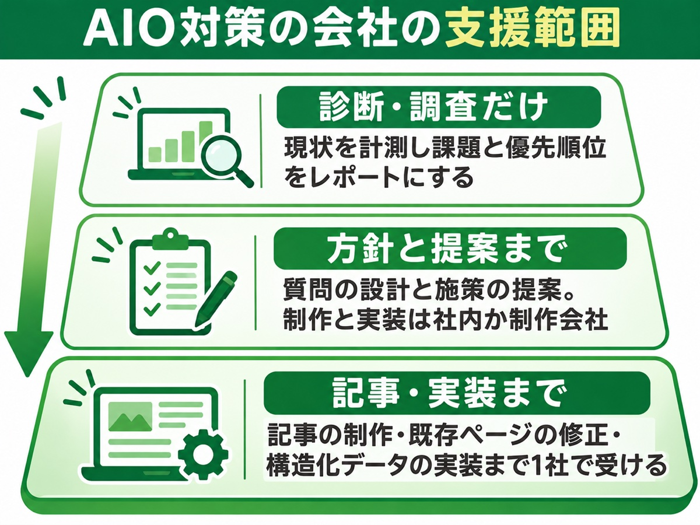
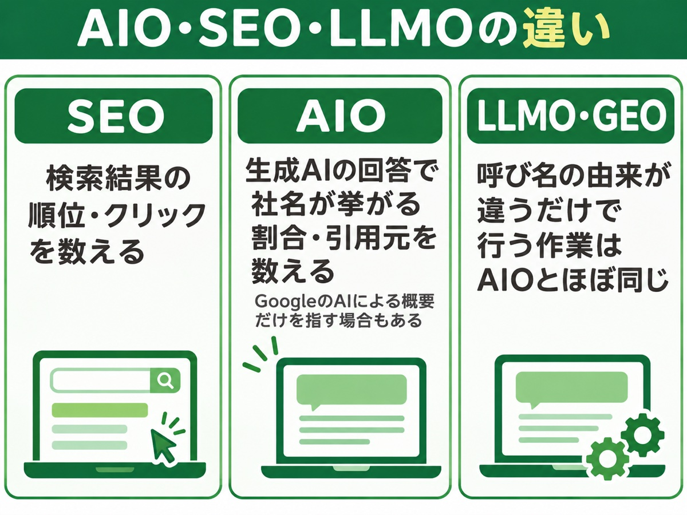

AIO対策の会社は、診断だけを受けるのか、記事の制作やサイトへの実装まで任せるのかで選ぶと迷いません。**社内に書く人や更新する人がいなければ実装まで受ける会社、いれば方針と計測に強い会社、まず数字を見たいなら計測ツールが向いています。**

この記事は株式会社nitoが書いています。AIO対策を支援する当事者なので1番目に自社を置き、ほかの19社は各社の公式サイトで確認した内容で比べました。

:::takeaways
- AIO対策の会社は**記事や実装まで・方針と提案まで・計測ツール**の3つに分かれる
- 選ぶときは**記事や実装まで頼めるか・計測の条件・問い合わせや購入まで数えるか**を見る
- 公開されている料金は計測ツールが月5万円前後から、伴走のコンサルティングが月20万円前後から。**6ヶ月の総額**で比べる
:::

## AIO対策会社おすすめ20選の比較表

並びは記事や実装まで受ける会社、方針と提案が中心の会社、計測ツールを軸にする会社の順です。料金は公式サイトに載っている表記だけを書き、記載が無いものは「公式に記載なし」としています。

| 会社 | 頼める範囲 | 特徴 | 料金（公式の表記） |
|---|---|---|---|
| 株式会社nito | 計測から記事の制作・公開後の運用まで | 問い合わせや購入につながるまで、計測・分析・記事の制作と修正を毎日続ける | 無料の現状分析のあと見積もり |
| 株式会社ニュートラルワークス | 調査から外部対策・サイト実装まで | 社内の制作チームが実装。AI経由の流入と問い合わせを定点で計測 | 30万円（税別）〜、契約6ヶ月〜 |
| TechSuite株式会社 | 調査から制作・実装・測定まで | 7つのAIサービスを対象に計測 | 初期包括調査40万円〜、月額40万円〜 |
| 株式会社ジオコード | 戦略からサイトへの実装まで | 自社エンジニアがCMSの編集や構造化データを実装 | AIO・LLMOを含む組み合わせの例（スタンダードプラン）月30万円〜 |
| 株式会社CINC | 戦略から制作・外部メディア施策まで | 自社ツールで回答と引用元を取得。AI経由の流入とCVも支援の項目 | コンサルは個別見積もり。実行代行のAIsearchmap BPOは月19万8,000円（税別） |
| ナイル株式会社 | 戦略から施策の実装支援まで | 引用件数と生成AI経由の流入・問い合わせや購入（CV）を報告 | SEOとセット月60万円〜、LLMO単体月30万円〜 |
| バクリ株式会社 | サイトの改修と外部への露出まで | 社内で回せるようにする内製化が前提 | 月30万円〜（3ヶ月〜） |
| 株式会社メディアグロース | 記事の執筆と被リンクの獲得まで | 月額に記事の執筆が入り、1か月から契約できる。診断でAI流入とCVの状況も見る | 月20万円〜（1か月〜） |
| 株式会社PLAN-B | 調査から記事の制作まで | 最初に生成AIでの見え方を調査で数値にする。AI経由のセッションとCVも可視化 | 調査90万円〜（初月）、コンサル月70万円〜、記事1本8万円〜 |
| 株式会社シード | 運用の丸投げからスポットまで | AIOをGoogleのAIによる概要の意味で扱う | 公式に記載なし（契約は基本6ヶ月〜） |
| QUEUE株式会社 | 戦略から制作・改善運用まで | 無料の現状分析診断がある | 公式に記載なし |
| 株式会社デジタルアイデンティティ | 診断から記事の制作・サイトの改修まで | 参照元まで追う自社ツール「Forté.AI LLMO Analytics」 | ミニマム月額約60万円〜、最低6ヶ月〜 |
| クーミル株式会社 | 分析から制作・実装の代行まで | 社内のWeb制作チームが、足りない施策だけ代行。指名検索・参照流入・問い合わせも確認 | 診断15万円〜、運用代行20万円〜（一例） |
| 株式会社ウィルゲート | 戦略から改善の実施・実装支援まで | 成果が見込める会社にだけ提案する6ヶ月のパッケージ。問い合わせの手前の行動も見る | 月45万円〜（6ヶ月のパッケージ） |
| 株式会社LANY | 戦略設計と効果検証（制作は別途） | 約1ヶ月で戦略、2ヶ月目から実装と検証。LLM経由の流入とCVもモニタリング | 資料で案内 |
| 株式会社Speee | 方針と実装の要件定義まで | 独自の指標で1位に推される割合まで計測。GA4でAI経由の流入とCVも把握 | 公式に記載なし |
| 株式会社Hakuhodo DY ONE | 診断とコンサルティング（実装はグループ会社と連携） | 研究組織と調査会社との協業 | 公式に記載なし |
| 株式会社メディアリーチ | 計測と施策の提示（実行はオプション） | 自社ツールで毎日計測 | サービスページは見積もり（DolphinX AIOの導入が前提）。自社の比較記事では診断30万円〜・月30万円 |
| 株式会社アドカル | 単発の診断と改善の提案 | 1回の診断から始められる。GA4のAI流入と問い合わせの変化も定点観測 | 診断20万円、継続の支援月20万円〜 |
| 株式会社Faber Company | 計測ツールが中心（コンサルティングも別にあり） | AI検索からの流入と問い合わせや購入（CV）も見られる | ミエルカGEO月4万9,800円（税抜）〜、初期費用別 |

公開されている金額はどれも最小構成のものです。比べるときは対象のAI・質問の数・制作の本数をそろえて見積もりを取ります。

### この記事の選定基準

載せたのはAIO・LLMO・AI検索対策を公式サイトでサービスとして案内している会社です。そのうえで、主要なAIに「AIO対策の会社でおすすめを教えて」と聞いた回答によく名前が挙がる会社と、AIO対策の会社を比べた記事で繰り返し取り上げられている会社から19社を選びました。料金と実績は2026年11月14日〜20日に公式サイトで確認したものです。

## 自社に合うAIO対策会社はどのタイプ？

社内に記事を書く人とサイトを更新する人がいるかで、合う会社のタイプが決まります。

<figure class="post-figure post-figure--zu"></figure>

| こんな会社なら | 合うタイプ | この記事の会社の例 |
|---|---|---|
| 社内に記事を書く人がいない | 記事の制作と運用まで受ける会社 | nito・メディアグロース |
| サイトを更新する人もいない | サイトへの実装まで受ける会社 | ニュートラルワークス・TechSuite・ジオコード・デジタルアイデンティティ・クーミル |
| SEOをすでに頼んでいて、AIでの見え方も同じ会社に見てほしい | SEOとセットで受ける会社 | ナイル・ジオコード・メディアグロース |
| 制作の体制はあり、方針と優先順位を外から持ち込みたい | 方針と提案が中心の会社 | LANY・Speee・Hakuhodo DY ONE・メディアリーチ |
| まず1回、今の見え方と課題を知りたい | 単発の診断を受ける会社 | クーミル（15万円〜）・アドカル（20万円）・QUEUE（無料）・シード（無料のレポート） |
| 社内の担当者が数字を見ながら直したい | 計測ツール | Faber Company（ミエルカGEO） |

**方針と提案が中心の会社に頼む場合は、実行支援のオプションまで含めて見積もりを取ります。** レポートを受け取っても、ページを書く人がいなければAIの回答は変わりません。

## AIO対策会社20社の特徴

### 1. 株式会社nito

**[株式会社nito](/aio/)**: AIO対策（AI検索対策）で、問い合わせや購入につながるまで実行する会社です。ヒアリングで自社の強みを文章にまとめ（強みの言語化）、サイトの改善と記事の制作から公開後の運用まで受け持ちます。ChatGPTやGeminiなど主要なAIの実際の回答を毎晩読み、何を書きどこを直すかを決めます。計測は利用者と同じチャット画面で行い、記録した回答は3万件を超えました（2026年11月時点）。

お客様にお願いするのはヒアリング・公開前の確認・実装の3点だけです。SaaS企業の支援では取り組み3ヶ月で、ある質問でのAIの言及率が10%から45%に上がり、AI経由のコンバージョンは5ヶ月で約6.7倍になりました。士業ではある質問での言及率が0%から20%になり、新しいページが公開3日でAIの回答の引用元に入っています。

- 社内に記事を書く人がおらず、計測から制作まで窓口を1つにしたい会社
- 言及率のレポートより、問い合わせや購入の数で効果を見たい会社

### 2. 株式会社ニュートラルワークス

**株式会社ニュートラルワークス**: 調査・戦略から内部対策・外部対策・サイトの実装までを、社内の制作チームで一貫して受ける会社です。費用は30万円（税別）から、契約期間は6ヶ月からと公式に載せています。

計測するのは質問ごとの掲載・引用と指名検索（社名を入れた検索）、AI経由の流入や問い合わせで、毎月1回の定例会で次の施策を決めます。成果は約束できないと明記したうえで、早ければ1か月程度で成果が出る場合もあると案内しています。**制作会社を別に立てずにサイトの改修までまとめて任せたい会社**の候補です。

### 3. TechSuite株式会社

**TechSuite株式会社**: AI検索対策のサービス「AI検索パートナーズ」で、調査・戦略・制作・実装・測定までを自社で行う会社です。料金は初期包括調査が40万円から（単月）、月額コンサルティングが月40万円からと公式に載せています。

ChatGPTやGoogleのAIによる概要など7つのAIサービスを対象にし、記事・ページの制作から技術的な実装まで受けます。引用の増加が数字で確認できるまでの目安は3〜6ヶ月です。300社超のAIコンテンツ制作の実績があり、社内で運用できるようにする内製化支援も選べます。

### 4. 株式会社ジオコード

**株式会社ジオコード**: SEOとAIO・LLMOの施策を、戦略の策定からサイトへの反映・実装まで一貫して行う会社です。自社のエンジニアがCMSの編集やHTMLの修正、構造化データの実装まで受けます。

料金はプランの組み合わせで決まります。公式のSEOのページに載っている月30万円からの料金は、AIO・LLMOを含む組み合わせの例（スタンダードプラン）です。UI/UXの改善も扱うため、**問い合わせまでの導線を含めて窓口を1つにしたい会社**の候補になります。

### 5. 株式会社CINC

**株式会社CINC**: 自社のツールで主要な生成AIの回答と引用元を集め、戦略から制作・外部メディア施策・効果検証まで支援する会社です。AI検索最適化の支援は70社以上、コンサルティングとツールの提供は1,600社超と公式に載せています。

分析ツール「AIsearchmap」を持ち、施策の実行を代行するプランもあります。公開している事例には施策以外の要因も影響している可能性があるとの注記を付けています。料金はコンサルティングが個別の見積もりで、実行代行のAIsearchmap BPOは月19万8,000円（税別）です。AI経由の流入とCVも支援の項目です。**施策の根拠をデータで示しながら社内の承認を取りたい会社**に向いています。

### 6. ナイル株式会社

**ナイル株式会社**: 創業以来17年超のSEO研究と累計2,000社以上の支援実績を土台に、SEOとLLMOを組み合わせて支援する会社です。AIによる概要やChatGPTでの自社・競合の引用件数と、生成AI経由の流入・問い合わせや購入（CV）をレポートします。

料金はSEOコンサルティングとセットで月60万円から、すでに自社でSEOに取り組む会社向けのLLMO単体で月30万円からです。自社の問い合わせではAIでナイルを知った人が検索エンジンの次に多いと公表しています（2026年5〜9月）。**SEOとAIO対策を同じ会社にまとめたい会社**の候補になります。

### 7. バクリ株式会社

**バクリ株式会社**: 社内でAIO・LLMO対策を回せるようにする内製化を前提に支援する会社です。1ヶ月目に競合の分析と対策する質問を決め、2ヶ月目以降に自社サイトの改修と外部への露出づくりを並走しながら、ノウハウを社内へ移します。

社内には海外の論文や動きを調べる研究の組織もあり、AI検索の変化を追う体制です。料金は月30万円からで契約は3ヶ月から、単月の診断プランも用意しています。**いずれは社内でAIO対策を回したい会社**に向いています。

### 8. 株式会社メディアグロース

**株式会社メディアグロース**: SEOとLLMOの支援に特化し、書籍『LLMO対策の教科書』を出している会社です。LLMOコンサルティングは月20万円からで、契約期間は1か月からと短く始められます。

月額のプランに比較記事の見出しの改善や文章の執筆、被リンクの獲得まで入り、記事の制作代行と被リンク獲得の代行は単体のサービスとしても頼めます。診断の範囲はAI流入とCVの状況までです。毎月20社限定で無料の診断も受け付けています。**月20万円前後の予算で、記事の制作まで含めて始めたい会社**の候補です。

### 9. 株式会社PLAN-B

**株式会社PLAN-B**: SEO・PR・SNS・広告を組み合わせ、AIに自社が勧められる状態を目指す会社です。最初に「生成AIブランド認識調査」で、AIが自社と競合をどう説明しているかを数値にします。

公式の料金は調査が90万円から（初月）、SEO/LLMOコンサルティングが2ヶ月目以降に月70万円から、記事は1本8万円からです。AI経由のセッション数とCV数も可視化します。効果を見る期間として勧めているのは6〜12ヶ月の取り組みです。**SEOだけでなくPRや広告もまとめてAIでの見え方を作りたい会社**に向いています。

### 10. 株式会社シード

**株式会社シード**: AIOをGoogleのAIによる概要の意味で使い、AIによる概要への掲載を中心にLLMO対策・SEO対策まで支援する会社です。運用の丸投げからスポットの相談まで受け、AIO現状診断レポートを無料で出しています。

コンテンツの制作やプレスリリース記事の制作も施策の一部です。契約は基本6ヶ月からで、効果は一般的に3〜6ヶ月で現れ始めると案内しています。**まずGoogle検索のAIによる概要に載ることを優先したい会社**に向いています。

### 11. QUEUE株式会社

**QUEUE株式会社**: AI検索対策のサービス「umoren.ai」で、戦略設計からコンテンツ制作・改善運用までを伴走する会社です。公式に載っている導入企業は150社以上です。

AIが推薦の根拠に使いやすい一次情報のコンテンツを作る方針です。無料の現状分析診断があり、料金は問い合わせで案内しています。**AIで競合ばかりが挙がる理由を、まず無料で知りたい会社**の最初の相談先になります。

### 12. 株式会社デジタルアイデンティティ

**株式会社デジタルアイデンティティ**: SEOとLLMOの両方の観点からサイトを診断し、戦略とKPIの設計から記事の作成、内部構造の改善やコンテンツの改修までを段階的に実行する会社です。社内にSEOのライターがいて、広告やLP、UI/UXの改善も同じ会社で頼めます。

自社ツール「Forté.AI LLMO Analytics」で、AIが回答を作るときに参照したページまで特定し、なぜ自社が選ばれないのかの要因を出す方針です。料金はミニマム月額約60万円から、契約は最低6ヶ月からで、簡易の調査は無料で受けられます。SEO対策は15年以上・1,000社超に提供しています。**広告やサイトの改善までまとめて、AIに選ばれない理由から直したい会社**の候補です。

### 13. クーミル株式会社

**クーミル株式会社**: SEOのコンサルタントとWeb制作のチームが組み、サイトの改修・ページの制作・構造化データ・記事の制作までを行う会社です。社内でできる施策は実行の方法を案内し、手が足りない施策だけクーミルが代行する進め方です。

料金は一例として、LLMO・AIO診断が15万円から、基盤整備とサイト構造の最適化が30万円から、運用代行のコンサルティングが20万円からと公式に載せています。ChatGPT・Gemini・AIによる概要での言及と引用に加えて、検索順位・指名検索・問い合わせまでを定期的に確認する進め方です。**社内でできる所は自分たちで進め、足りない所だけ外に頼みたい会社**に向いています。

### 14. 株式会社ウィルゲート

**株式会社ウィルゲート**: 累計8,000社を超える取引実績を持つSEOの会社で、AIO・LLMO対策を6ヶ月のパッケージで提供しています。現状の分析と診断、戦略の策定、ページやコンテンツの改善の実施、モニタリングの環境づくりまでを一貫して受け、実装を制作会社が行う3社での進行もできます。

料金は月45万円からの見積もりです。導入の前に成果の見込みを調べ、見込みが出せると判断した会社にだけ提案すると案内しています。見る数字はAI検索での引用数、社名を入れた検索での見え方、問い合わせの手前の行動です。**成果の見込みを先に確かめてから、半年かけて取り組みたい会社**の候補になります。

### 15. 株式会社LANY

**株式会社LANY**: SEOの知見をもとに、AI上での現在地の分析から戦略・ロードマップの策定、効果検証まで伴走する会社です。公式に載っている支援実績は300社以上です。

約1ヶ月の戦略設計で勝ち筋を決め、2ヶ月目以降に優先施策の実装と効果検証を進めます。コンサルティングの範囲は施策の要件定義・ディレクション・効果検証で、コンテンツ制作やサイト改修は依頼側か制作会社が担います。別料金の実行支援や、制作会社を交えた3社での進行も選択肢です。LLM経由の流入数やコンバージョン数も続けてモニタリングし、料金はサービス資料で案内しています。公開事例では3か月で生成AIからの推奨率が59%から85%になりました。**制作の体制がすでにあり、方針と優先順位を外から持ち込みたい会社**に向いています。

### 16. 株式会社Speee

**株式会社Speee**: 3,500社以上のSEO支援の実績を持ち、AI検索対策を「AEOコンサルティング」として提供する会社です。独自の指標「AI Visibility Score®」で、ChatGPT・Gemini・AIモードごとの言及率や1位で推される割合、平均の掲載順位を計測します。

修正方針や構造化データの実装要件までを決め、制作と実装は依頼する側の体制に合わせて進め方を提案します。自社メディアではメーカーのECサイトでChatGPTに1位で推される割合が14.1%から46.0%になった例を載せています。料金は公式に記載がありません。GA4でAI経由の流入とCV数も把握します。**AIの中で何番目に推されているかまで数字で追いたい会社**の候補です。

### 17. 株式会社Hakuhodo DY ONE

**株式会社Hakuhodo DY ONE**: 2025年3月に提供を始めた、生成AIに特化した診断・コンサルティングのサービスを持つ会社です。GEO・LLMO・AEOなどの類似サービスをまとめてAIOと呼んでいます。

進め方は2段階で、初期フェーズで現状分析・課題抽出・施策の起案を行い、運用フェーズで実装支援とモニタリングを続けます。主要な生成AIで自社と競合がどう引用されているかに加え、事実に基づかない生成（ハルシネーション）の有無も確認します。サイトの実装はグループの博報堂アイ・スタジオと連携して行い、料金は公式に記載がありません。**広告やブランドの施策とあわせて、AIでの見え方を管理したい会社**の候補になります。

### 18. 株式会社メディアリーチ

**株式会社メディアリーチ**: 自社開発の計測ツール「DolphinX AIO」の導入を前提に、専任の担当が毎月伴走するLLMO・AIOコンサルティングの会社です。2026年4月末で117社超に提供したと載せています。

ChatGPTやGeminiなどでの推薦率・引用率を毎日計測し、「おすすめの〇〇を教えて」のような質問文を20〜40件設計します。コンサルティングの範囲は施策の提示とレビューまでで、記事の制作や外部メディアへの掲載の打診は実行代行のオプションです。契約期間の縛りはなく、自社の問い合わせのきっかけの20%が生成AI経由になったと公表しています。料金はサービスページでは見積もりで、同社の比較記事では診断を1回30万円から、月次のコンサルティングを月30万円と載せています。DolphinX AIOの料金は別の案内です。**数字を見ながら社内で施策を回したい会社**に向いています。

### 19. 株式会社アドカル

**株式会社アドカル**: 単発の診断から始められる会社です。LLMO診断は20万円で、ChatGPTやGemini、AIによる概要での現状と、改善の優先順位を整理します。

継続の支援は月20万円からで、定例会と月次レポートに加え、記事構成の設計、既存ページの改善提案、FAQの追加、サービスページの訴求の整理まで受けます。GA4でのAI流入や問い合わせの変化も定点観測の対象です。**まず1回の診断で課題を見てから、続けるかを決めたい会社**に向いています。

### 20. 株式会社Faber Company

**株式会社Faber Company**: AI検索の計測ツール「ミエルカGEO」を出している会社です。単一サイトのプランは月4万9,800円（税抜）、複数サイトのプランは月9万9,800円（税抜）で、別に初期費用がかかります。

ChatGPTやGeminiなどで自社がどう見えているかに加え、AI検索から来た人の流入と問い合わせや購入（CV）をサービス別に見られます。土台のミエルカSEOは1,900社以上に導入済みで、GEO対策のコンサルティングも別のサービスです。**月数万円から自社の見え方を数字にしたい会社**の候補になります。

## 失敗しないAIO対策会社の選び方

AIO対策の会社は成果の数え方・計測の条件・作業の担当・ほかの会社との役割・6ヶ月の総額の5つを契約前に確認すると失敗が減ります。

- **成果の数え方を先に決める。** どの質問で挙がると問い合わせや購入につながるかを決め、フォームで「何で知ったか」を聞いて数える会社を選びます。AI経由の流入や問い合わせ・CVまで見ると公式に書いているのは、この記事ではnito・ナイル・LANY・PLAN-B・CINC・Speee・アドカル・メディアグロース・クーミル・ウィルゲート・ニュートラルワークス・Faber Companyの12社です。
- **改善率の計測条件を聞く。** どのAIに・どの質問を・何回聞いた数字かを言えない会社は、契約後の報告も確認できません。
- **作業の担当を書面にする。** 記事・既存ページの修正・構造化データの実装を誰が行うか、見積もりの段階で書面にしてもらうのが条件です。
- **ほかの会社との役割を分ける。** すでに別の会社にSEOやサイトの運用を頼んでいるなら、役割を分けられるかを確認します。
- **6ヶ月の総額で比べる。** 月額だけでなく、初期費用と制作費を足した総額で比べます。成果報酬の契約の考え方は[成果報酬型のLLMO対策とは](/media/performance-based-llmo/)にまとめました。

### 契約前に聞く質問

| 質問 | 答えで分かること |
|---|---|
| 何が増えたら成果としますか？ | 言及率で止まるか、問い合わせまで数えるか |
| どのAIにどの質問をどの頻度で聞きますか？ | 計測の条件を言えるか |
| 記事の制作と既存ページの修正は誰が行いますか？ | 提案で終わるか、実行まで入るか |
| 月額に含まれない費用はありますか？ | 初期費用・制作費・ツール費の有無 |
| 最低契約期間と解約の条件は？ | 効果が出ないときに抜けられるか |
| 作った記事やデータの権利はどちらに残りますか？ | 解約後も使えるか |

:::linkcard
url: /media/ai-search-measurement/
title: AI検索対策の効果はどう測る？GA4でAI経由の流入を見る方法【2026年最新版】
desc: AI検索対策の効果を、GA4でAI経由の流入から見る方法を解説しています。
:::

## AIO対策を会社に頼む費用の目安は？

公式サイトに金額を出している会社では、計測ツールが月5万円前後から、伴走のコンサルティングが月20万円前後からです。記事の制作やサイトへの実装は、範囲によって別に見積もる会社が多くあります。**実行を頼む範囲・対象のAIと質問の数・SEOとセットかどうかで金額は変わります。**

| 頼む範囲 | 公式の金額の例 |
|---|---|
| 計測ツール | ミエルカGEO 月4万9,800円（税抜）〜、初期費用別（Faber Company） |
| 診断・調査を単発で | LLMO・AIO診断 15万円〜（クーミル）、LLMO診断 20万円（アドカル）、初期包括調査 40万円〜（TechSuite）、生成AIブランド認識調査 90万円〜（PLAN-B） |
| 伴走のコンサルティング | 月20万円〜（メディアグロース・アドカル）、LLMO単体 月30万円〜（ナイル）、月40万円〜（TechSuite）、月45万円〜（ウィルゲート）、月70万円〜（PLAN-B） |
| 調査から実装まで | 30万円（税別）〜・契約6ヶ月〜（ニュートラルワークス）、月30万円〜・3ヶ月〜（バクリ）、月約60万円〜・6ヶ月〜（デジタルアイデンティティ）、実行代行のAIsearchmap BPO 月19万8,000円（税別、CINC） |
| SEOとセット | 月60万円〜（ナイル） |

最低契約期間がある場合は総額で比べます。月額が30万円なら6ヶ月で180万円、60万円なら360万円です。質問を決める・事実や数字を出す・ページを更新するといった作業を社内で持てるほど、頼む範囲を絞って費用を抑えられます。

:::linkcard
url: /media/llmo-cost/
title: LLMO・AIO対策の費用相場はいくら？月額の目安と失敗しない依頼先の選び方
desc: LLMO・AIO対策の月額の内訳と、見積もりの見方を解説しています。
:::

## AIO対策の会社とは？SEO・LLMOとの違い

AIO対策の会社はChatGPTやGeminiなど主要なAIの回答で自社が紹介・引用されるように、調査から施策まで支援する会社です。多くはSEOの支援から始まった会社で、同じサービスをLLMO対策・GEO対策・AI検索対策と呼ぶ会社もあります。

<figure class="post-figure post-figure--zu"></figure>

### AIOには2つの意味がある

AIOはAI Optimization（AI最適化）の略として、生成AIの回答全般への対策を指すことが多い言葉です。一方でGoogleのAI Overviews（日本語の画面ではAIによる概要）の略として使われる場面もあり、シードのサービスページは「AIO対策（Google AI Overview）」と書いています。**提案を受けたら、どのAIを対象にした対策なのかを最初に確認してください。** AIによる概要だけに絞った条件は[AI Overview（AIによる概要）対策とは](/media/cited-by-ai-overviews/)で扱っています。

### SEO・LLMO・GEOとの違い

呼び名の由来は違っても、会社が実際に行う作業はほぼ同じです。違いが出るのは成果として何を数えるかで、AIO・LLMO・GEOは検索順位ではなくAIの回答の中身を見ます。

| 呼び名 | 主な対象 | 成果として数えるもの |
|---|---|---|
| SEO | Googleなどの検索結果 | 検索順位・クリック・サイトからの問い合わせ |
| AIO | 生成AIの回答全般。GoogleのAIによる概要だけを指す場合もある | 回答で社名が挙がる割合・引用元に入るか・紹介の中身 |
| LLMO・GEO | ChatGPTなどの対話型AIと、生成AIを使った検索 | AIOと同じ |

Googleは公式ガイドで、生成AI向けの最適化もGoogle検索の観点では「SEO であることに変わりはありません」と書いています。**AIによる概要やAIモードは、検索の仕組みで集めたページを回答の材料にします。** 呼び名の成り立ちは[GEO対策とは？](/media/geo-taisaku/)にまとめました。

### 会社に頼める支援内容

支援は次の6つの作業に分けられます。会社による違いが出る所も並べました。

| 支援内容 | 中身 | 会社による違い |
|---|---|---|
| 現状の診断 | 狙う質問を主要なAIに聞き、自社と競合の挙がり方・引用元・誤った情報を調べる | 無料の簡易診断から、質問を数十件設計する有料の調査まで |
| 方針と質問の設計 | どの質問で挙がりたいかを決め、優先順位と目標を置く | 目標を言及率（AIの回答に社名が出る割合）に置くか、問い合わせまで置くか |
| 記事・ページの制作 | 比較・料金・事例・FAQなど、AIが紹介の根拠にできる情報を書く | 制作まで受けるか、制作は依頼側か |
| 既存ページの修正と技術対応 | サービスページの書き直し、構造化データ、クローラーの設定 | 修正の指示書までか、サイトへの実装までか |
| 社外の情報 | 比較サイトへの掲載、プレスリリース、業界メディアへの寄稿 | 月額に含むか、オプションか、扱わないか |
| 計測と改善 | 同じ質問で定期的に計測し、次に修正する箇所を決める | 計測の頻度・対象のAI・レポートの形式 |

:::linkcard
url: /media/aio-taisaku/
title: AIO対策とは？やり方の5手順と公式の情報・費用・効果の測り方
desc: AIO対策の意味と、会社が進める5つの手順を解説しています。
:::

:::linkcard
url: /media/llmo-companies/
title: LLMO対策の会社おすすめ20選・比較表と費用相場・選び方
desc: LLMO対策の会社20社を、比較表と費用相場、選び方で解説しています。
:::

## 依頼する前に決めておくこと

提案の中身を左右するのは依頼する側が最初に渡せる情報です。次の2つを社内で決めてから相談すると、最初の提案から自社に合った見積もりになります。

### AIに挙がりたい質問

顧客が商談の最初に口にする悩みや、比べるときの言い方を5〜10個書き出します。**新しい顧客につながるのは社名を入れない質問（「〇〇の会社でおすすめは？」の種類）で挙がるかどうかです。**

### 社内の担当と権限

事実や数字を出す人、ページを更新する人、Search ConsoleやGoogleビジネスプロフィールの権限を持つ人を決めます。サイトの更新を制作会社に頼んでいるなら、その会社に話を通す段取りも先に決めておくと安心です。

:::linkcard
url: /media/llmo-inhouse-vs-outsource/
title: AI検索対策は内製と外注どちらがいい？自社でできる範囲と頼るべき範囲
desc: AI検索対策のうち社内でできる作業と外に頼む作業の分け方を解説しています。
:::

:::linkcard
url: /media/ai-search-companies/
title: AI検索対策の会社おすすめ10選・選び方と費用を比較
desc: AI検索対策の会社10社を、選び方と費用で比べています。
:::

## まとめ

- 社内に記事を書く人とサイトを更新する人がいるかで、実装まで受ける会社か、方針と計測の会社かを決める
- 1社で決めず、対象のAI・質問・制作の範囲をそろえて2〜3社から見積もりを取る
- 月額ではなく、初期費用と制作費を足した6ヶ月の総額で比べる
- 目標・計測の条件・作業の担当は、契約前に書面で確認する

## よくある質問

### AIO対策の会社とLLMO対策の会社は違いますか？

ほとんどの場合、同じ支援を別の呼び名で出しているだけです。ただしAIOをGoogleのAIによる概要だけの意味で使う会社もあるため、対象のAIを確認してください。

### AIO対策を会社に頼むと費用はいくらかかりますか？

公式に金額を出している会社では、計測ツールが月5万円前後から、伴走のコンサルティングが月20万円前後からです。記事の制作や実装は範囲によって別に見積もる会社が多くあります。多くの会社は個別の見積もりで、最低契約期間は3〜6ヶ月が中心です。

### AIO対策の効果はどれくらいで出ますか？

各社の案内では3〜6ヶ月が目安とされることが多く、早ければ1か月程度という会社もあります。PLAN-Bは6〜12ヶ月の取り組みを勧めています。nitoの支援先では新しく公開したページが3日後にAIの回答の引用元に入った例がありました。

### 小さな会社でもAIO対策会社に頼めますか？

頼めます。メディアグロースは月20万円・1か月単位、アドカルは単発の診断が20万円です。無料の診断を案内している会社もあるので、まず診断で自社と競合の差を見てから、月額の支援に進むかを決められます。

### SEO対策の会社に頼めばAIO対策もできますか？

SEOの会社の多くがAIO対策をメニューに加えており、SEOの土台はそのまま生きます。ただしAIの回答で社名が挙がったかを計測して報告する体制は会社ごとに違うため、計測の条件を確認してください。

### AIO対策は自社だけでもできますか？

質問を決めてAIに聞き、記録し、自社の事実をページに追加する作業は社内でもできます。複数のAIを続けて計測する仕組みや、記事を継続して作る人手が足りない部分を外に頼むのが現実的です。

### AIO対策の会社は成果を保証してくれますか？

保証はできないと考えてください。AIの回答は質問のされ方や時期、参照されるページで変わり、外から確実には動かせません。保証の代わりに、計測の条件と改善の進め方を具体的に説明できるかで比べます。

### llms.txtや構造化データはAIO対策に必要ですか？

Google検索については必要ありません。Googleの公式ガイドは、Google検索はllms.txtを使わず、生成AI検索に構造化データは必要ないと書いています。ほかのAIでの扱いと置くかの判断は[llms.txtとは](/media/llms-txt-structured-data/)で扱っています。

### 業種に合ったAIO対策会社はどう選べばいいですか？

業種が違えば、AIに聞かれる質問もAIが読みに行くページも同じではありません。業種が決まっていれば、業種ごとに同じ基準で比べた記事から読むと絞りやすくなります。

- [BtoB SaaS企業におすすめのAIO対策会社](/media/saas-aio-companies/)
- [製造業におすすめのAIO対策会社](/media/manufacturing-aio-companies/)
- [不動産売買・仲介会社におすすめのAIO対策会社](/media/real-estate-aio-companies/)
- [結婚相談所におすすめのAIO対策会社](/media/marriage-agency-aio-companies/)
- [介護施設・老人ホーム向けのAIO対策会社](/media/kaigo-aio-companies/)
- [クリニック・病院向けのAIO対策会社](/media/clinic-aio-companies/)
- [ホテル・旅館向けのAIO対策会社](/media/hotel-aio-companies/)
- [EC（通販）のAIO対策会社](/media/ec-aio-companies/)

地域で絞るなら、[大阪のAIO対策・LLMO対策会社おすすめ9選](/media/osaka-aio-companies/)で大阪に拠点のある会社を比べています。東京に拠点のある会社は[東京のLLMO対策・AIO対策会社おすすめ9選](/media/tokyo-aio-companies/)で比べています。

### 無料診断だけで十分ですか？

無料診断で分かるのはいくつかの質問での今の挙がり方までです。どの質問を狙い、どのページに何を追加するかまで決めるには、質問を設計した有料の調査か継続の支援が必要です。

## 出典

- Google 検索セントラル「[Google 検索の生成 AI 機能向けにウェブサイトを最適化する](https://developers.google.com/search/docs/fundamentals/ai-optimization-guide?hl=ja)」（2026年11月14日確認）
- 各社の公式サイトのサービスページ（2026年11月14日〜20日確認）: [nito AI検索対策](/aio/)・[ニュートラルワークス LLMO対策](https://n-works.link/ai-sarch-optimization)・[AI検索パートナーズ](https://ai-search.techsuite.co.jp/)・[ジオコード SEO・AIO・LLMO](https://www.geo-code.co.jp/seo/)・[CINC AI検索最適化コンサルティング](https://www.cinc-j.co.jp/service/analytics/geoconsulting/)・[ナイル LLMOコンサルティング](https://www.seohacks.net/service/llmo-consulting/)・[バクリ AIO対策・LLMOコンサルティング](https://www.bakuri.co.jp/service/ai-countermeasures_llmo-consulting/)・[メディアグロース LLMO対策](https://media-growth.co.jp/llmo-service/)・[PLAN-B LLMOコンサルティング](https://www.plan-b.co.jp/solution/seo/llmo-consulting/)・[シード AIO対策](https://www.seedinc.jp/aio/)・[umoren.ai](https://umoren.ai/)・[デジタルアイデンティティ LLMO/AIO対策](https://digitalidentity.co.jp/service/seo/aio/)・[同 LLMO調査サービス](https://digitalidentity.co.jp/service/forte-ai/llmo-dco/)・[クーミル LLMO・AIO対策コンサルティング](https://coomil.co.jp/service/aio/)・[ウィルゲート AIO・LLMO対策コンサルティング](https://www.willgate.co.jp/promonista/servicelist/aio/)・[LANY LLMOコンサルティング](https://www.lany.co.jp/service/digitalmarketing/llmo)・[Speee AEOコンサルティング](https://webanalytics.speee.jp/aeo/)・[Hakuhodo DY ONE AIOコンサルティング](https://www.hakuhodody-one.co.jp/service/marketing/full-funnel/owned-media/aio/)・[メディアリーチ LLMOコンサルティング](https://mediareach.co.jp/seo-consulting/llmo-service)・[アドカル LLMOコンサルティング](https://genai.adcal-inc.com/llmo)・[ミエルカGEO](https://mieru-ca.com/geo/)
- メディアリーチの診断と月額の料金: [LLMO対策会社おすすめ19社比較](https://mediareach.co.jp/blog/llmo-company)（メディアリーチ）
- Speeeの事例の数字: [LLMOコンサル・AIOコンサル おすすめ14選](https://webanalytics.speee.jp/media/article/llmo-consulting-vendor/)（Speee Marketing Insights）
- AIの回答の記録: nitoが2026年11月11日〜14日に主要なAIへ「AIO対策の会社でおすすめを教えて」と聞いた回答
