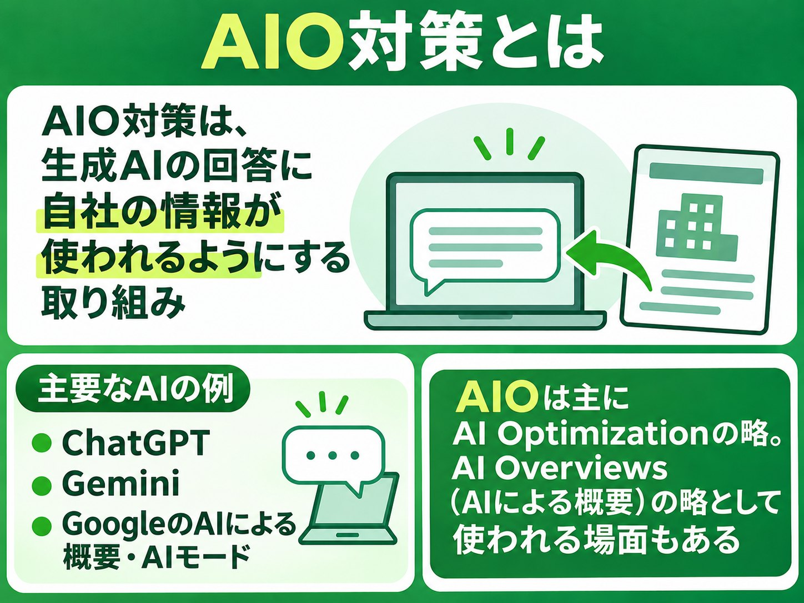
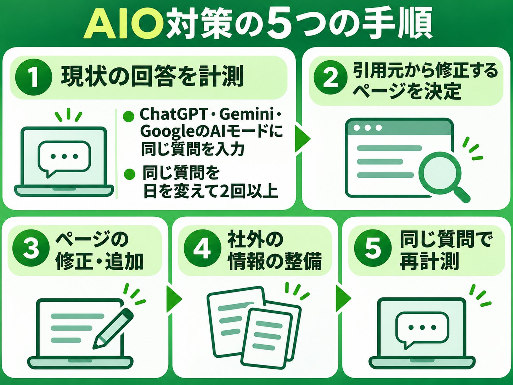
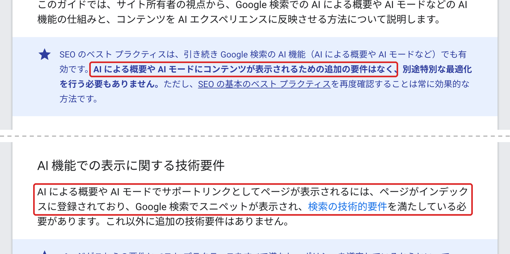
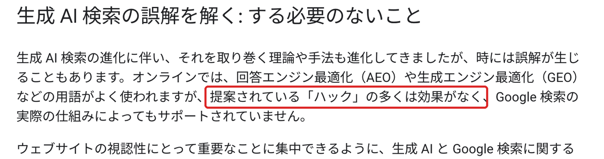
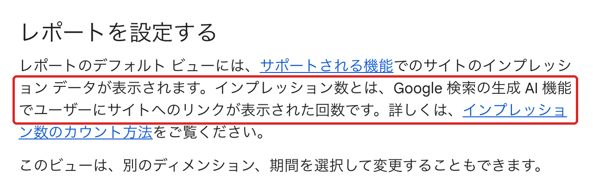
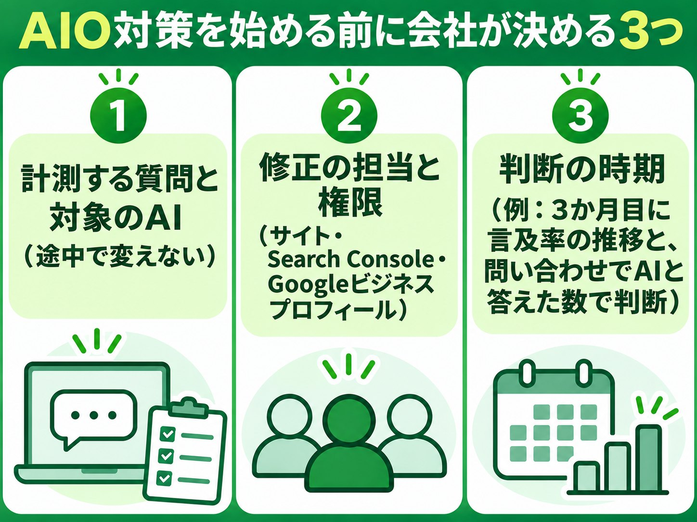

AIO対策のやり方は5つの手順で、現状の回答の計測から始めて同じ質問での再計測で一巡します。LLMO対策・GEO対策と呼ばれる取り組みも中身は同じなので、呼び名が違っても進める順番は変わりません。

社内でAIO対策を任された方や、支援会社から提案を受けた方に向けた記事です。手順ごとに確認することと完了の目安をチェックリストにし、公式の記述と照らした効果のない施策・費用の目安・効果の計測方法までまとめます。

:::takeaways
- AIO対策・LLMO対策・GEO対策は呼び名が違うだけで、**進める手順は同じ**
- 手順は**現状の回答の計測・修正するページの決定・ページの修正・社外の情報の整備・再計測**の5つ。手順ごとに完了の目安を決めておくと途中で止まりにくい
- Googleは公式ガイドで、**Google検索ではllms.txt・文章の細切れ・AI向けの書き換え・生成AI検索のための構造化データは不要**としている
:::

## AIO対策とは？LLMO対策と何が違う？

**AIO対策はChatGPTやGemini、GoogleのAIによる概要・AIモードなど利用者の多い主要なAIの回答で、自社が候補に挙がり、紹介の中身が正しく、自社のページが引用元に付くようにする取り組みです。**

<figure class="post-figure post-figure--zu"></figure>

AIOはAI Optimizationの略として使われることが多く、LLMO（Large Language Model Optimization）やGEO（生成エンジン最適化）も同じ取り組みを指す呼び名です。**LLMO対策のやり方を探している場合も、この記事の5つの手順がそのまま当てはまります。** 呼び名ごとの由来は[GEO対策とは？LLMO・AIOとの違い](/media/geo-taisaku/)に書きました。

ただし「AIO」は、GoogleのAI Overviews（日本語の画面ではAIによる概要）の略として使われる場面もあります。提案書でAIOという言葉を見たら、対象がAIによる概要だけなのか、ChatGPTやGeminiも含むのかを最初に確認するのがおすすめです。AIによる概要だけに絞った公式の条件は[AI Overview（AIによる概要）対策とは](/media/cited-by-ai-overviews/)にまとめています。

Googleは生成AI機能向けの最適化ガイドで、AEO・GEOと呼ばれる作業もGoogle検索の観点では「SEO であることに変わりはありません」と書いています。**AIO対策は今のSEOをやめて始めるものではなく、SEOの上に計測と確認を加える取り組みです。**

## AIO対策のやり方5つの手順

**施策を選ぶ前に現状の回答を計測し、引用元を読んで修正するページを決めると、着手する順番が決まります。** FAQ・一次情報・構造化データ・社外の言及と挙がる施策は幅が広いものの、どれが自社に必要かは計測するまで分かりません。

<figure class="post-figure post-figure--zu"></figure>

### ① 現状の回答を計測する

**最初の手順は見込み客がAIに聞きそうな質問を20〜30問決め、主要なAIの現状の回答を記録することです。** 社名を入れない質問（「生産管理システムを比べたい。費用はどれくらい？」のような種類）と、社名を入れた質問（「〇〇社の評判は？」）は分けて扱います。新しい顧客につながるのは社名を入れない質問で候補に挙がるかどうかです。質問の材料は商談の記録や問い合わせのフォームの文面、失注の理由に多く残っています。

質問が決まったら、ChatGPT・Gemini・GoogleのAIモードに同じ質問を入力し、AIによる概要は同じ質問をGoogleで検索して出方を見ます。同じ質問でも聞くたびに答えが変わるので、1つの質問を日を変えて2回以上聞くのが前提です。記録は次のような形になります（架空の例です）。

| 質問 | AI | 自社の扱い | 引用元 |
|---|---|---|---|
| 生産管理システムを比べたい | ChatGPT | 出ない | 比較サイトA・競合B社の製品ページ |
| 生産管理システムを比べたい | AIモード | 3番目・安さが売り（2年前の料金） | 自社の古い料金ページ |
| 〇〇社の評判は？ | AIによる概要 | 出る・事例が少ないと紹介 | 口コミサイトC |

質問ごとに自社が出たかを数える公式のツールは、Google・OpenAI・Perplexityにはありません。Search Consoleの生成AIパフォーマンスレポートも、内訳はページ・国・日付・デバイスで検索語は入っていません。Bing Webmaster ToolsのAI Performance（2026年2月にプレビュー公開）は、Copilotなどで自社のページが引用された数と、AIが情報を取りに行った語句の標本までを出します。**質問ごとの出方は手で聞くか計測ツールで記録するしかありません。**

**質問の一覧と、日を変えた2回分の記録がそろえば①は完了です。** 計測ツールは回答の数え方が製品ごとに違うため、選ぶ前に比べておくと後で数字の意味に迷いません。

:::linkcard
url: /media/geo-aio-tools/
title: 【2026年10月】GEO対策ツール・AIO対策ツール10製品の比較 料金・対応AI・無料トライアル
desc: 計測ツール10製品の料金・対応するAI・数え方の違いを解説しています。
:::

### ② 引用元から修正するページを決める

**記録した引用元のURLを種類ごとに数えると、自社サイトを修正すべき質問と、社外で対応すべき質問に分かれます。** ChatGPTの検索・Perplexity・AIによる概要・AIモードは回答にリンクを付けるため、AIが何を材料にしたかが分かる仕組みです。

| 引用元の種類 | 読み取れること | 次の対応 |
|---|---|---|
| 自社のページ | 材料には使われている | 紹介が古い・誤っているならそのページを修正（③） |
| 競合の自社サイト | 比べる材料が競合にしかない | 同じ質問に答えるページを自社にも追加（③） |
| 比較サイト・まとめ記事 | 第三者の一覧から候補を選んでいる | 掲載の有無と情報の正誤を確認（④） |
| 口コミ・掲示板・動画 | 利用者の声が材料になっている | 口コミとGoogleビジネスプロフィールを見直す（④） |
| 引用元が付かない | モデルの知識だけで答えている | すぐには動かしにくい。ほかの質問を優先 |

Googleの最適化ガイドによると、AIによる概要やAIモードは元の質問に関連する複数の検索（クエリ ファンアウト）を同時に行って結果を集めます。**狙った質問そのものではなく周りの質問で拾われたページが引用元に付くこともあるため、引用元のページがどの質問に答えているかまで読みます。**

質問ごとに、自社ページの修正・社外での対応・後回しのどれにするかが決まれば②は完了です。

### ③ ページを修正・追加する

**修正するのは②で自社が材料に使われていなかった質問や、古い紹介のもとになっていた自社のページです。** 会社のサイトで修正することが多いのは、次の5種類のページになります。

- 会社概要: 社名の表記・所在地・設立年・事業の範囲
- サービスページ: 誰向けか、できることとできないこと、料金の決まり方、導入までの期間
- 比較のページ: ほかの選択肢との違いと、条件ごとにどちらが向くか
- よくある質問: 商談で最初に聞かれることと、その答え
- 事例: 課題と取り組みと結果の数字

**事実と数字は社内の資料や実績の記録から一次情報で書きます。** 営業資料にはあるのにサイトに無い情報が、最も早く追加できる材料です。Googleのガイドは誰でも書ける一般論（ガイドの例は「初めて住宅を購入する人向けの 7 つのヒント」）より、独自の専門的な見解や経験に基づく内容を勧めています。

Googleの「AI 機能とウェブサイト」のページには、AIによる概要とAIモードに出るための「追加の要件はなく」、インデックスに登録されてスニペットが表示されることが条件だと書かれています。同じページは構造化データをページに表示されるテキストと一致させることも挙げています。

<figure class="post-figure"><figcaption>AI 機能とウェブサイト（Google 検索セントラル、2026年10月30日）</figcaption></figure>

技術面の確認もこの手順の一部です。1つ目はSearch Consoleの検索の生成AI設定（［設定］>［検索の生成 AI］）で、2026年8月31日から全サイトで選べるようになりました。既定は含める設定で、除外を選んだサイトはAIによる概要・AIモードなどの生成AI機能に出ません。変更の反映は通常数日以内で、この設定は検索順位のシグナルにはならないとヘルプに書かれています。

2つ目はAIのクローラーです。OpenAIの説明ではrobots.txtでOAI-SearchBotを止めたサイトはChatGPTの検索の回答に出ません（ナビゲーション用のリンクとしては出ることがあります）。学習用のGPTBotだけを止め、OAI-SearchBotは許可して検索には出る、という分け方も可能です。PerplexityBotは検索結果にサイトを出してリンクするためのクローラーで、AIの基盤モデルの学習用の収集には使わないとPerplexityは説明しています。**robots.txtで許可していても、CDNやホスティングの設定で止まっていることがあります。** 確認の手順は[ChatGPT検索で引用元に出る条件](/media/chatgpt-search-citation/)に書きました。

修正したページが公開され、生成AI設定とクローラーの許可を確認し終えたら③は完了です。

### ④ 社外の情報を整備する

**②で比較サイトや口コミが引用元に多かった質問は、自社サイトではなく社外の情報で対応します。**

GoogleのガイドはGoogleビジネスプロフィールやMerchant Centerを使うと「AI の回答と Google 検索のその他の検索結果の両方で商品やサービスが表示されやすくなります」と書いています。店舗や事務所を持つ会社なら、プロフィールを最新にしておくのが公式に沿った対応です。整備の手順は[GoogleビジネスプロフィールのAI対策](/media/gbp-ai-search/)にまとめました。

「サイテーションを増やせばAIに推薦される」という説明もありますが、同じガイドはウェブ全体で不自然な言及を集めることは「実際にはそれほど役に立ちません」と書いています。**社外で対応するなら、言及を作りにいくより、載っている情報の誤りを修正し、第三者が書ける事実（事例・受賞・取材）を出すほうを優先します。** 社外での語られ方は[サイテーションとは](/media/citation-for-ai/)で扱っています。

プロフィールを最新にし、引用元のページにある誤りの修正依頼を出し終えたら④は完了です。

### ⑤ 同じ質問で再計測する

**修正の後は①と同じ質問・同じAI・同じ回数で再計測し、修正した日と箇所と並べて比べます。** 一度に何ページも修正すると何に効果があったか分からなくなるため、修正の記録は日付つきで残しておきます。計測の間隔は月に1回が目安です。

反映までの時間は対応の種類で違います。robots.txtの変更は、OpenAIが約24時間、Perplexityが最大24時間で反映されると公式に書いています。ページの修正はGoogleならインデックスが更新されてからで、日数の目安は公式にありません。nitoの支援先では新しく公開したページが3日後にAIの回答の引用元に入った例がありました。

再計測の結果を修正の記録と並べ、翌月に修正する質問を決めたら1周が終わります。

## AIO対策のチェックリスト

**5つの手順で確認する項目を、確認する場所と完了の目安とあわせて1つの表にしました。**

| 手順 | 確認すること | 確認する場所 | 完了の目安 |
|---|---|---|---|
| ① 計測 | 社名を入れない質問と入れた質問を分けて20〜30問 | 商談の記録・問い合わせの文面・失注の理由 | 質問の一覧ができた |
| ① 計測 | 主要なAIの回答を日を変えて2回以上記録 | ChatGPT・Gemini・AIモード・Google検索 | 全質問の記録が2回分そろった |
| ② 引用元 | 引用元のURLを種類別に数える | ①の記録表 | 質問ごとに修正・社外・後回しが決まった |
| ③ 修正 | 会社概要・サービス・比較・FAQ・事例に一次の事実と数字があるか | 自社サイト・営業資料 | 修正したページを公開した |
| ③ 修正 | 検索の生成AI設定が除外になっていないか | Search Console の設定 | 含めるになっている |
| ③ 修正 | OAI-SearchBot・PerplexityBotを止めていないか | robots.txt・CDN・ホスティング | どちらも許可されている |
| ④ 社外 | 店舗・事務所・商品の情報が最新か | Googleビジネスプロフィール・Merchant Center | 最新の情報に更新した |
| ④ 社外 | 引用元の比較サイト・名簿の情報に誤りがないか | ②で多かった第三者のページ | 誤りの修正を依頼した |
| ⑤ 再計測 | ①と同じ質問・AI・回数で記録 | ①の記録表 | 修正の記録と並べた |
| ⑤ 再計測 | AIでの表示回数とAI経由の問い合わせ | 生成AIパフォーマンスレポート・問い合わせのフォーム | 月1回の記録が残っている |

①と②の行を飛ばしてページの修正から始めると、修正後に何が変わったかを比べる元の記録がありません。**チェックリストは上の行から順に進め、③の技術面の2行だけは①と並行して確認してかまいません。** 自社サイトの状態を観点別に点検する方法は、次の記事にまとめています。

:::linkcard
url: /media/llmo-self-check/
title: LLMO診断は自分でできる｜自社サイトのセルフチェックリスト
desc: AIに読まれる状態か・実際にAIに出るかなど4つの観点のセルフチェックを解説しています。
:::

## 公式の記述とよく見る説明

**提案や記事でよく見る説明のうち、Google検索については公式が否定しているものがあります。** 主なものを公式の文書の記述と並べました。

| よく見る説明 | 公式の記述 | 書いてある場所 |
|---|---|---|
| AIO・GEOはSEOとは別の新しい施策 | Google検索の観点ではSEOであることに変わりはない | Googleの最適化ガイド |
| llms.txtを置くとAIに読まれる | Google検索はllms.txtを使わない。ほかのサービスのために置くのは問題ない | 同上 |
| AIのために文章を細かく区切る | コンテンツを細かく分割する必要はない | 同上 |
| 質問の言い換えごとにページを作る | 操作が主な目的なら、大量生成されたコンテンツの不正使用に当たる | 同上 |
| 構造化データがAI対策に欠かせない | 生成AI検索には必要ない。リッチリザルトのためSEOの一部として使うことは勧めている | 同上 |
| AIのボットを全部止めても影響はない | OAI-SearchBotを止めるとChatGPTの検索の回答に出ない | OpenAIのクローラーの説明 |
| 上位表示や引用を保証できる | 外部のツールはGoogle内部のランキングやAIのシステムにアクセスできない | Googleの最適化ガイド |

<figure class="post-figure"><figcaption>Google 検索の生成 AI 機能向けにウェブサイトを最適化する（Google 検索セントラル、2026年10月30日）</figcaption></figure>

Googleのガイドが扱うのはGoogle検索の生成AI機能だけで、ChatGPTやPerplexityについては何が効果を持つかを両社とも細かく書いていません。**ほかのAIに効果があるかどうかは、⑤の再計測で自社の質問を使って確認します。**

:::linkcard
url: /media/llms-txt-structured-data/
title: 【2026年10月】llms.txtとは？意味ないと言われる理由・書き方・置くかの決め方
desc: llms.txtを置くかどうかの判断と書き方を解説しています。
:::

## 効果のない施策とリスクのある施策

**公式の記述と照らすと、次の施策は費用をかけても成果につながりにくいか、Googleのポリシーに触れるおそれがあります。**

- 狙う質問の言い換えごとに、薄いページを量産する
- AIにだけ読ませるつもりで、人に見えない文字を置く
- llms.txtや構造化データの設置だけで終える
- 業者に頼んで、社外の言及や口コミを作らせる
- 「AIで必ず紹介される」「Google公認」とうたう業者に任せる

人に見えない文字はGoogleのスパムに関するポリシーが定める隠しテキストそのものです。保証をうたう業者については、Googleのサードパーティの SEO に関するガイダンスが、公式のガイドと照らして評価するよう求めています。

## AIO対策の費用はいくら？

**外部に依頼する場合、公式サイトに料金を載せている支援会社11社の継続支援の月額は、最低額が月20万〜70万円です。** 最も多いのは月30万円からで、単発の診断は15万〜40万円からあります。どれも「〜から」の最低額で、上限は見積もりで決まります。最低契約期間が6か月の会社もあり、月30万円（税別）から・最低6か月なら総額は180万円（税別）からです。

自社でやる場合に必要なのは、お金より人の時間と権限です。20問を主要なAIに日を変えて2回以上聞くと、1回の計測で100件を超える回答を読んで引用元を記録することになります。そのうえで、サイトを修正する権限とGoogleビジネスプロフィールを更新する権限が担当にあるかどうかが、進む速さを左右する条件です。

**見積もりを比べるときは金額より先に①〜⑤のどこまでが含まれるかを確認します。** ③の作業が修正箇所と書き方の指示までか、実装までかは会社ごとに違います。社内と外部の分け方は[内製と外注どちらがいい？](/media/llmo-inhouse-vs-outsource/)で扱っています。

依頼先の候補と比べ方は[AIO対策会社おすすめ20選](/media/aio-taisaku-companies/)にまとめました。11社の金額と費用が変わる要因は、次の記事で詳しく解説しています。

:::linkcard
url: /media/llmo-cost/
title: 【2026年11月】AIO対策の費用相場はいくら？LLMO対策の月額の目安と依頼先の選び方
desc: 支援会社11社の公式の料金と、見積もりで確認すべき点を解説しています。
:::

## 効果の計測方法

**効果はAIの回答・Googleの数字・問い合わせの3つの層で見ます。** 1つ目の回答そのものは①の質問で社名が出た割合（言及率）・紹介の中身が正しいか・自社のページが引用元に付いたかを並べます。

2つ目はGoogleの数字です。Search Consoleの生成AIパフォーマンスレポートは2026年8月31日に全サイトに提供され、AIによる概要とAIモードで自社へのリンクが表示された回数をページごとに出します。表示が少ないサイトや、生成AI機能から除外しているサイトでは、レポート自体が出ないこともあります。見方は[サーチコンソールでAIモード・AIによる概要の表示を見る方法](/media/gsc-ai-mode/)にあります。

<figure class="post-figure"><figcaption>生成 AI パフォーマンス レポート（検索）（Search Console ヘルプ、2026年10月30日）</figcaption></figure>

3つ目は問い合わせです。AIの回答で社名を知った人がリンクを押さずにあとで社名を検索して来ると、GA4ではAIから来たと記録されません。**nitoが支援するSaaS企業では、同じ期間のGA4でAI経由として記録された会員登録は全体の0.007%で、会員登録時のアンケートでは26.7%がAI検索で知った・比べたと答えていました。** 問い合わせのフォームや商談の最初に何で知ったかを聞き、AIと答えた数まで数えるのが確実な方法です。GA4での見方は[AI検索対策の効果はどう測る？](/media/ai-search-measurement/)にまとめています。

:::linkcard
url: /media/llmo-effect/
title: 【2026年11月】LLMO対策に効果はある？3つの段階と期間の目安・費用対効果
desc: 効果が表れる3つの段階と、期間の目安・費用に見合うかの判断を解説しています。
:::

## 会社が決めること

**AIO対策は担当1人の作業に見えても、決める人は社内に何人も必要です。** 始める前に次の3つを決め、よくある失敗を避けると途中で止まりにくくなります。

<figure class="post-figure post-figure--zu"></figure>

### 計測する質問と修正の担当

質問の案を作るのはマーケ担当で、実際の商談の質問に近いかを見るのは営業です。質問と対象のAIを途中で入れ替えると前の月と比べられなくなるので、最初に固定します。**サイトの更新・Search Console・Googleビジネスプロフィールの権限を誰が持つかを始める前に決めておかないと、②で修正する場所が分かっても③で止まります。**

### 判断の時期

たとえば3か月目に、言及率の推移と問い合わせのうちAIと答えた数を並べて、続けるか変えるかを決めます。

### 失敗しやすい例

- 計測せずに記事を量産し、どの質問に効果があったのか分からない
- 言及率だけを目標にして、問い合わせにつながったかを見ない
- 1回聞いた結果で良し悪しを決め、翌月に逆の結果が出て社内の説明が崩れる

## まとめ

- 何から始めるか決まっていない場合: 質問を20〜30問決めて、①の現状の回答の記録から始める
- 提案書にAIO・LLMO・GEOと書いてある場合: 呼び名ではなく、対象のAIと①〜⑤のどこまでが含まれるかを確認する
- 自社が回答に出ない場合: 引用元の種類を見て、自社ページの修正か社外の対応かを決める
- llms.txtや構造化データを勧められた場合: Google検索には不要なので、①〜⑤の後に回してよい
- 効果を社内に説明する場合: 言及率の推移と、問い合わせでAIと答えた数を月単位で並べる

## よくある質問

### Q. LLMO対策のやり方はAIO対策と違いますか？

違いはありません。LLMO対策もAIO対策も、主要なAIの回答に自社が正しく挙がるようにする取り組みの呼び名で、現状の回答の計測から再計測までの5つの手順で進めます。AIによる概要だけを指してAIO対策と呼ぶ場合もあるため、提案では対象のAIを確認してください。

### Q. AIO対策のチェックリストで最初に確認することは何ですか？

順番としては①の現状の回答の記録が最初です。それと並行して、Search Consoleの検索の生成AI設定が除外になっていないかと、robots.txtとCDNでOAI-SearchBot・PerplexityBotを止めていないかを確認するのがおすすめです。どちらかで止まっていると、ページを修正してもそのAIの回答には出ません。

### Q. AIO対策の効果はどれくらいで出ますか？

公式に期間の目安はありません。ページの修正はインデックスが更新されてから反映されます。nitoの支援先の実測では、新しいページが公開3日で引用元に入った例と、取り組みから3か月で言及率が10%から45%になった例があります。

### Q. llms.txtや構造化データはAIO対策に必要ですか？

Google検索については必要ありません。Googleの公式ガイドは、Google検索はllms.txtを使わず、生成AI検索に構造化データは必要ないと書いています。ChatGPTやPerplexityでのllms.txtの扱いは、両社の公式ページに書かれていません。

## 出典

- Google 検索セントラル「[Google 検索の生成 AI 機能向けにウェブサイトを最適化する](https://developers.google.com/search/docs/fundamentals/ai-optimization-guide?hl=ja)」2026年10月30日更新（2026年11月26日取得）
- Google 検索セントラル「[AI 機能とウェブサイト](https://developers.google.com/search/docs/appearance/ai-features?hl=ja)」2025年12月31日更新（同）
- Search Console ヘルプ「[生成 AI パフォーマンス レポート（検索）](https://support.google.com/webmasters/answer/16984139?hl=ja)」（同）
- Search Console ヘルプ「[検索の生成 AI 設定](https://support.google.com/webmasters/answer/16908024?hl=ja)」（同）
- Microsoft Bing Webmaster Blog「[Introducing AI Performance in Bing Webmaster Tools Public Preview](https://blogs.bing.com/webmaster/February-2026/Introducing-AI-Performance-in-Bing-Webmaster-Tools-Public-Preview)」2026年2月10日（同）
- OpenAI「[Overview of OpenAI Crawlers](https://developers.openai.com/api/docs/bots)」（同）
- Perplexity「[Perplexity Crawlers](https://docs.perplexity.ai/guides/bots)」（同）
- Perplexity Help Center「[How does Perplexity work?](https://www.perplexity.ai/help-center/en/articles/10352895-how-does-perplexity-work)」（同）
- Google 検索セントラル「[Google 検索のスパムに関するポリシー](https://developers.google.com/search/docs/essentials/spam-policies?hl=ja)」（2026年10月30日取得）
- Google 検索セントラル「[サードパーティの SEO ツール、サービス、アドバイスの使用に関する Google 検索のガイダンス](https://developers.google.com/search/docs/fundamentals/third-party-seo?hl=ja)」（同）
- 支援会社11社の料金: [AIO対策の費用相場はいくら？](/media/llmo-cost/)（2026年11月25日確認）
