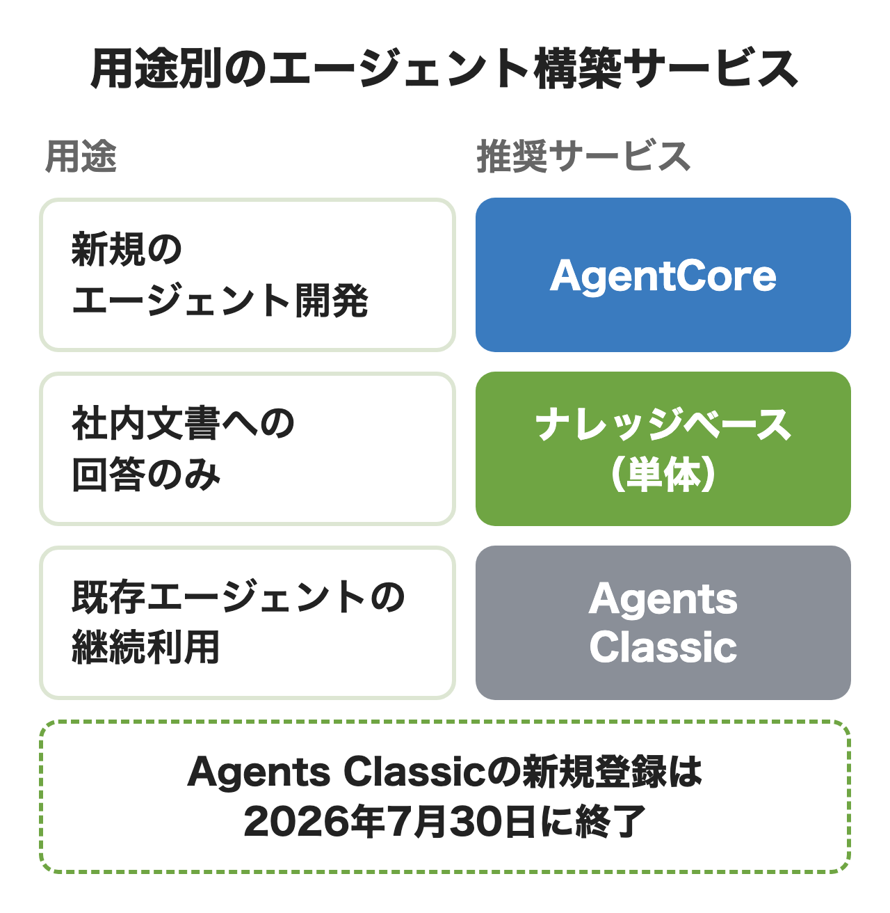
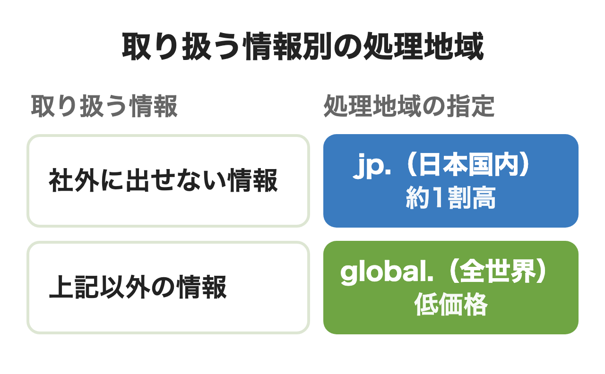
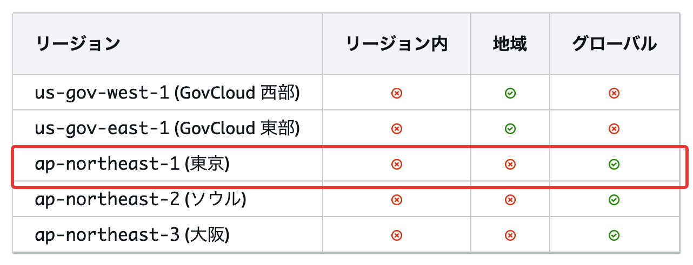

Amazon Bedrockは、AWSの上で複数の会社のAIモデルを1つの窓口から呼び出し、社内文書の検索やエージェントまで組める基盤です。世界で10万を超える組織が使っています。

2026年7月30日には旧来のエージェント機能が新規の受付を止め、似た機能を求める会社にはAgentCoreが案内されています。この記事ではできることと料金、東京でClaudeを使うときの条件、AgentCoreとの違い、始め方を公式の料金ページとドキュメントで確かめました。

:::takeaways
- **Amazon BedrockはAIモデルと周りの部品をAWSの請求でまとめて使う基盤**。モデルは100種類以上、エージェントはAgentCoreで組む
- **料金は使ったトークンの数で決まり、東京から日本に限って呼ぶとGlobalより約1割高い**。月6,000件の社内の問い合わせの試算でClaude Sonnet 5（global.）は月66ドル
- **東京でClaudeを使うならモデルごとの提供地域を先に見る**。Sonnet 5.5には日本に限る呼び方がまだ無い
:::

## Amazon Bedrockとは

### 何をするサービスか

Amazon Bedrockは自社のシステムからAPIでAIモデルを呼ぶための基盤です。2023年9月に一般提供が始まり、サーバーやGPUはAWSが管理するので、呼び出す量に応じて払うだけで済みます。複数の会社のモデルを同じ書き方で呼べるうえ、社内文書を検索させるナレッジベース、入出力を絞るガードレール、エージェントを動かすAgentCoreまでが同じAWSの請求に載ります。**モデルを1社に決め打ちせず、AWSの権限・ログ・請求の中で切り替えられる点が、会社で使うときのいちばんの違いです。**

すでにAWSでS3やLambdaを使っている会社なら、文書の置き場所や業務の処理とそのままつなげます。

### SageMakerとの違い

同じAWSのAmazon SageMakerは、機械学習のモデルを自分で作り、学習させ、配備するためのサービスです。Bedrockは各社が作った学習済みのモデルを呼ぶのが基本で、自社のデータで調整する機能も持っています。**自社データで一からモデルを学習させる予定が無いなら、Bedrockから始めるのが近道です。**

## Amazon Bedrockで使えるモデル

### 提供元と主なモデル

料金ページに並ぶ提供元はAnthropic・OpenAI・Amazon・Google・Meta・Mistral AI・xAIなど19社です。2026年に入ってOpenAIはGPT-5.4からGPT-6.1 Terra（10月26日）まで、xAIはGrok 4.3からGrok 4.7（9月28日）までが加わりました。

| 用途 | 候補になる主なモデル |
|---|---|
| 込み入った判断・長い作業 | Claude Opus 5.5・Claude Fable 5.1・GPT-6 Astra |
| 社内の問い合わせ・要約 | Claude Sonnet 5.5・Claude Sonnet 5 |
| 大量の分類・抽出 | Claude Haiku 5.5・Amazon Nova 2 Lite |
| 画像・動画の生成 | Stability AI（Stable Image Ultraなど）・Luma AI Ray2 |

**まずはSonnetの系統とHaiku 5.5に同じ質問を送り、答えの質と使ったトークンの数を並べて比べるのがおすすめです。**

### 提供が終わるときの決まり

Bedrockのモデルには、提供中・終了予定（Legacy）・終了（EOL）の3つの状態があります。2026年9月7日以降に出たモデルは、終了の前に原則6か月の予告期間を置きます。予告期間に入ると新しい利用者は使えなくなり、終了日を過ぎると呼び出しが失敗します。新しいモデルへの切り替えは自動では起きません。

モデルカードの終了の最短日（EOL no sooner than）は公開の1年後で、Opus 5.5なら2027年9月22日です。**本番の仕組みでは1年ごとにモデルを乗り換える作業を最初から予定に入れておくのが無難です。**

## Amazon Bedrockでできること

### ナレッジベースで社内文書に答える

社内の規程やマニュアルを根拠に答えさせる仕組み（RAG）は、ナレッジベースで作ります。2026年3月2日からは保存・索引・検索の土台をBedrockが管理するマネージド型が加わりました。S3・SharePoint・Confluenceなどから文書を取り込み、読み取りと検索用の変換、結果の並べ替えまでを自動で行います。

従来の型ではベクトルデータベースや埋め込みのモデルを自分で選びます。作り方の比較は[RAG構築とは](/media/rag-build/)にあります。

### ガードレールで入出力を絞る

ガードレールは質問と答えの両方を検査する部品です。有害な内容のフィルター、扱わない話題の指定、個人情報の検出と伏せ字、禁止語、答えが参照文書に基づいているかの確認などを組み合わせます。製品ページは有害な内容を最大88%遮断できます。

**ガードレールはモデルを替えても同じ設定を使えるため、社内ルールを1か所で決めておけます。**

### AgentCoreでエージェントを動かす

AgentCoreはAIエージェントを本番で動かすための実行環境と部品の集まりです。旧来のAgentsとの違いと合わせた詳しい説明は次の節です。

## BedrockとAgentCoreの違い

AgentCoreはBedrockの中でエージェントを動かす部品の集まりで、モデルを呼ぶBedrock本体とは料金も別に数えます。

AgentCoreの中身は、エージェントを1回のAPI呼び出しで定義して動かすHarness、隔離された環境で動かすRuntime、会話をまたいで覚えるMemory、社内のAPIやLambdaをMCPのツールに変えるGateway、利用者の権限で外部につなぐIdentityなどです。ツールの呼び出しをルールで止めるPolicy、動きを追うObservability、品質を測るEvaluationsもあります。主なフレームワークに対応し、Bedrockの外のモデルとも組めます。

### 旧Agents（Agents Classic）との関係

2023年11月に始まったAmazon Bedrock Agentsは、今はAgents Classicという名前になっています。2026年7月30日から新しい利用者は登録できなくなりました。すでに使っている会社はそのまま使い続けられ、似た機能を求める会社にはAgentCoreが案内されています。

| | AgentCore | Agents Classic | ナレッジベース |
|---|---|---|---|
| 役割 | エージェントの実行と運用の部品 | 画面で組むエージェント | 社内文書の検索 |
| 作り方 | コードか1回のAPI呼び出し | コンソールで設定 | コンソールかAPI |
| モデル | Bedrockの外のモデルも可 | Bedrockのモデル | Bedrockのモデル |
| 新規の利用 | できる | できない | できる |

### どれを選ぶか

<figure class="post-figure"></figure>

**これから作るならAgentCoreを選び、社内文書に答えるだけならナレッジベースを単体で使うのが基本です。**社内システムの更新や申請の代行のように複数の手順を進めさせるときは、AgentCoreが向いています。

AgentCoreの主な部品は東京リージョンで使えます。ただし決済（payments）とWeb Answerは東京で使えません。Web Searchのツールは東京でも使え、1,000回7ドルです。エージェントの設計は[AIエージェントの作り方](/media/ai-agent-build/)にまとめています。

## Amazon Bedrockの料金

### 料金の決まり方

文章のモデルは入力と出力のトークン数に単価をかけて数えます。単価はモデルごとに違い、さらに呼び出すリージョンと、処理する場所を限るかどうかで変わります。ナレッジベースやガードレールなどの部品は、保存量や回数に応じた別の料金です。**ClaudeやGPTのようにAWS Marketplaceで売られるモデルは、請求もAWS Marketplace経由になり、Cost Explorerでは提供元の名前で表示され、Amazon Bedrockの行には含まれません。**

### 4つの階層とバッチ

呼び出すたびに4つの階層から選べます。

| 階層 | 中身 | 向く処理 |
|---|---|---|
| Standard | 既定の従量課金 | ふだんの問い合わせや要約 |
| Priority | 割増で優先して処理 | 顧客が待つ画面 |
| Flex | 割引で処理を待てる | 評価や夜間の要約 |
| Reserved | 1か月か3か月で処理量を予約 | 止められない基幹の処理 |

別にバッチ推論があり、対応するモデルはオンデマンドの半額です。ただしバッチは完了が保証されません。**Claudeの5.5の世代は、モデルカードではStandardだけの対応です。**

### 地域を限ると約1割高い

東京から呼ぶとき処理する場所の決め方は3つあります。東京だけで処理するIn-Region、日本の中（東京と大阪）で振り分けるGeo、世界に振り分けるGlobalです。Globalは標準料金より約10%安く、地域を限る呼び方には10%の割増があります。振り分けの転送料はかからず、料金は呼び出し元のリージョンの単価で数えます。

<figure class="post-figure"></figure>

**社外に出せない情報を扱うならjp.を付けた日本の中の呼び方、そうでなければglobal.を付けた安い呼び方、と用途ごとに分けられます。**

### 主なモデルの単価

東京のリージョンから呼んだときの単価です。100万トークンあたりの米ドルで、Standardの階層の値です。

| モデル | Global（入力/出力） | 地域を限る（入力/出力） |
|---|---|---|
| Claude Opus 5.5 | 4 / 20 | 4.4 / 22 |
| Claude Sonnet 5 | 2 / 10 | 東京からは呼べない（global.だけ） |
| Claude Sonnet 4.6 | 3 / 15 | 3.3 / 16.5 |
| Claude Haiku 5.5 | 0.1 / 0.5 | 0.11 / 0.55 |
| Amazon Nova 2 Lite | 0.36 / 3.01 | 0.396 / 3.311 |

Claude Sonnet 5.5は、料金ページの東京の欄が空いています（米国東部からのGlobalは入力2ドル・出力10ドル）。Claude Fable 5.1はGlobalだけで入力10ドル・出力50ドルです。**Globalの単価はAnthropicが直接売るClaude APIの単価と同じです。**単価と割引の仕組みは[Claude APIの料金](/media/claude-api-pricing/)で詳しく扱いました。

### 部品の料金

| 部品 | 単価 |
|---|---|
| ナレッジベース（マネージド）の保存 | 元データ1GBあたり月5ドル |
| ナレッジベースの検索 | 1,000回1ドル（エージェント型は1,000回4ドル＋内部の検索代） |
| ガードレールの内容フィルター | 1,000テキスト単位0.15ドル |
| AgentCore Runtime（v1） | 1vCPU時間0.0895ドル・1GB時間0.00945ドル（v2は1vCPU時間0.1276ドル・1GB時間0.0169ドル） |
| AgentCore Gateway | 1,000回の呼び出しで0.005ドル |

ガードレールの1テキスト単位は1,000文字までです。**AgentCore Memoryの短期の記憶は、取り込み1GBあたり1ドルに加え、読み出し1GBあたり0.2ドル・保存1GB月0.1ドルがかかります。**

### 月額の試算

社内の問い合わせに1日300件、月20日で6,000件答える仕組みを想定しました（試算）。1件に入力3,000トークン、出力500トークンを使うとして、月に入力1,800万トークン・出力300万トークンです。円は2026年11月6日の仲値、1ドル157.77円で換算しています。

| モデル | 日本に限る | Global |
|---|---|---|
| Claude Opus 5.5 | 145.2ドル（約2.3万円） | 132ドル（約2.1万円） |
| Claude Sonnet 5 | 東京からは呼べない | 66ドル（約1.0万円） |
| Claude Haiku 5.5 | 3.63ドル（約570円） | 3.3ドル（約520円） |
| Amazon Nova 2 Lite | 17.06ドル（約2,700円） | 15.51ドル（約2,400円） |

**金額の差を生むのはモデルの選び方で、地域を限るかどうかの差は1割にとどまります。**

### 無料で試せる範囲

AWSの新しい利用者は最大200米ドル分のクレジットを受け取れます。クレジットの対象と期限はAWSの無料利用枠のページで確かめてください。

## ClaudeをBedrockで使う条件

### 東京で使えるClaudeのモデル

同じClaudeでも、モデルごとに東京から呼べる方法が違います。モデルカードの地域の表を3つ確かめました。

| モデル | 東京からの呼び方 | Bedrockでの公開日 |
|---|---|---|
| Claude Opus 5.5 | jp.とglobal. | 2026年9月22日 |
| Claude Sonnet 5.5 | global.だけ | 2026年9月28日 |
| Claude Haiku 5.5 | jp.とglobal. | 2026年10月7日 |

<figure class="post-figure"><figcaption>Amazon BedrockのClaude Sonnet 5.5のモデルカード（2026年11月9日）</figcaption></figure>

**Sonnet 5.5を日本の中だけで処理させる呼び方は、まだありません。**社内の規程で日本国外での処理を避けたい会社は、Opus 5.5かHaiku 5.5、またはSonnet 4.6を選ぶことになります。jp.を付けた呼び方は東京と大阪の2か所で処理されます。

### 初回の利用目的フォーム

ほとんどのモデルは正しいIAMの権限があれば最初から使える状態です。「モデルアクセス」の画面から申請する手順は、今は米国の政府向けリージョン（GovCloud）だけです。ただしAnthropicのモデルは、初めて使う前に会社名・ウェブサイト・用途を書くフォームを1回出す必要があります。

出した後に保留の状態になることがあり、その間の呼び出しは拒否されます。Opus 5.5・Sonnet 5.5・Haiku 5.5はコンソールで条件を確かめるよう案内されています。

### Bedrockで使えないClaudeの機能

Bedrock経由のClaudeで使えない主な機能は次のとおりです。

- コード実行・Web検索・Web取得・advisorなどAnthropic側で動くツール
- Agent Skills・MCPコネクタ・programmatic tool calling・Claude Managed Agents
- Files APIとURLで渡す画像・文書、Message Batches API

自動のプロンプトキャッシュも、AWSのモデルカードでは対応外です。

**Web検索させたいエージェントなら、AgentCoreのWeb Searchか自前の検索ツールを組み合わせることになります。**

### Claude Platform on AWSとの違い

AWSの請求でClaudeを使う道はBedrockだけではありません。Claude Platform on AWSはAnthropicが運営するClaude APIをAWSの認証と請求で使う経路で、新しい機能が同じ日に届くことが多いとされます。

**データをAWSの境界の中に置き、ナレッジベースやガードレールと組むならBedrock、Claudeの最新の機能をすぐ使いたいならPlatform on AWSが向いています。**契約の経路ごとの違いは[Claudeの法人契約](/media/claude-corporate-contract/)にまとめています。

## Amazon Bedrockの始め方

1. **AWSアカウントと権限を用意する**: 管理者がIAMでBedrockの権限を付ける。AnthropicやOpenAIのモデルにはAWS Marketplaceの購読の権限も要る（Meta・Mistral AI・xAIなどは不要）
2. **リージョンを東京にする**: コンソールの右上でアジアパシフィック（東京）を選び、検索窓に「Bedrock」と入れて開く
3. **モデルカタログからプレイグラウンドで試す**: モデルを選んで開き、チャットの画面で質問を送る
4. **APIキーかIAMロールでSDKから呼ぶ**: Converse APIならモデルを替えても同じ書き方で呼べる
5. **本番の呼び方を決める**: モデルIDの頭にjp.かglobal.を付け、データの扱いと単価のどちらを優先するかを決める

プレイグラウンドでは回答の下に入力と出力のトークン数が出ます。この数を控えておくと、上の試算に自社の数字を入れられます。

## 会社で使うときに決めること

### データの扱い

Bedrockはモデルの学習のためにデータを保存したり使ったりしません。モデルの提供元はBedrockが運用するアカウントに入れず、プロンプトや答えを見られません。一方でGlobalの呼び方では日本の外で処理されることがあります。**社外秘の情報を流す仕組みは、jp.の呼び方とログの保存先を最初に決めておくのが安全です。**

### 権限と費用の管理

利用規約を法務が読む前に使われたくないなら、組織のSCPで先に呼び出しを止め、読み終えてから許可する順番がユーザーガイドで勧められています。部門ごとの費用はIAMのタグで分けて集計できます。

### 請求と契約の窓口

支払いはAWSの請求書にまとまり、AnthropicやOpenAIのモデルの代金はAWS Marketplace経由で、同じAWSの請求書に載ります。Claudeの販売代理の扱いは[Claudeの法人契約](/media/claude-corporate-contract/)に書いたとおりです。

どの業務にどの部品で組むかを決めきれない場合は、nitoの[AIエージェント構築支援](/ai-agent/)で要件の整理から相談できます。

## まとめ

- **社内文書に答えるボットを作るなら**、マネージド型のナレッジベースとSonnetの系統から始める。月6,000件でもモデルと検索で月100ドル前後
- **複数の手順を進めるエージェントを作るなら**、AgentCoreを選ぶ。旧Agentsは新規に使えない
- **日本の外での処理を避けたいなら**、jp.で呼べるモデルを選ぶ。Sonnet 5.5はまだglobal.だけ
- **Claudeの最新の機能が要るなら**、Bedrockで使えない機能を先に確かめ、Claude Platform on AWSと比べる

## よくある質問

### Amazon Bedrockは無料で使えますか？

使った分だけ払う従量課金です。AWSの新しい利用者は最大200米ドル分のクレジットを受け取れます。

### Amazon BedrockのClaudeは東京で使える？

使えます。Opus 5.5とHaiku 5.5は日本の中に限るjp.でも呼べますが、Sonnet 5.5は東京からはglobal.だけです。

### Bedrock Agentsは今から使えますか？

新しく登録はできません。2026年7月30日にAgents Classicとして新規の受付を終え、すでに使っている会社だけが使い続けられる状態です。これから作るならAgentCoreです。

### BedrockとClaude APIで料金は違う？

Globalで呼べば、Claude Sonnet 5.5やOpus 5.5の単価はClaude APIと同じです。jp.のように地域を限ると1割高くなります。

### Amazon Bedrockのデータは学習に使われる？

使われません。Bedrockはモデルの学習のためにデータを保存・使用しません。

### Amazon BedrockでGPTは使えますか？

使えます。GPT-6 Astra・GPT-6 Sol・GPT-6 Luna・GPT-6.1 Terra・GPT-5.6の3モデルなどを東京からglobal.で呼べます。GPT-6.1 Solは今は米国のリージョンだけです。

### BedrockでClaude Codeは使えますか？

使えます。Bedrockの認証で動かせ、代金はBedrockで使ったトークンの分です。

## 出典

- AWS「[Amazon Bedrock](https://aws.amazon.com/jp/bedrock/)」「[Amazon Bedrock の料金](https://aws.amazon.com/jp/bedrock/pricing/)」「[Amazon Bedrock AgentCore pricing](https://aws.amazon.com/bedrock/agentcore/pricing/)」（2026年11月9日取得）
- Amazon Bedrock ユーザーガイド「[Overview](https://docs.aws.amazon.com/bedrock/latest/userguide/what-is-bedrock.html)」「[Cross-Region inference](https://docs.aws.amazon.com/bedrock/latest/userguide/cross-region-inference.html)」「[Model lifecycle](https://docs.aws.amazon.com/bedrock/latest/userguide/model-lifecycle.html)」「[Document history](https://docs.aws.amazon.com/bedrock/latest/userguide/doc-history.html)」
- Amazon Bedrock モデルカード「[Claude Opus 5.5](https://docs.aws.amazon.com/bedrock/latest/userguide/model-card-anthropic-claude-opus-5-5.html)」「[Claude Sonnet 5.5](https://docs.aws.amazon.com/bedrock/latest/userguide/model-card-anthropic-claude-sonnet-5-5.html)」
- Anthropic「[Claude in Amazon Bedrock](https://platform.claude.com/docs/en/build-with-claude/claude-in-amazon-bedrock)」「[Claude on AWS](https://claude.com/ja/partners/claude-on-aws)」
- 三菱UFJリサーチ＆コンサルティング「[外国為替相場](https://www.murc-kawasesouba.jp/fx/index.php)」（2026年11月6日の公示相場）
