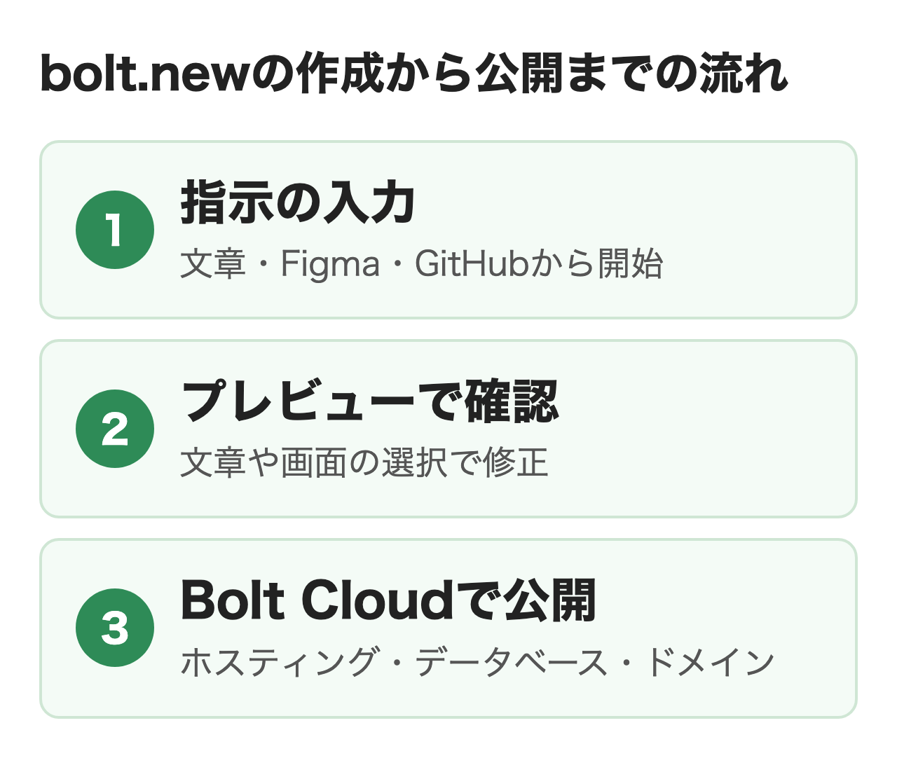
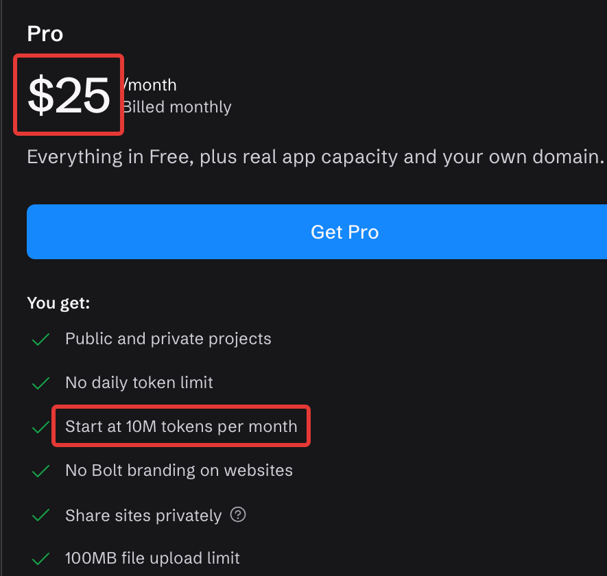
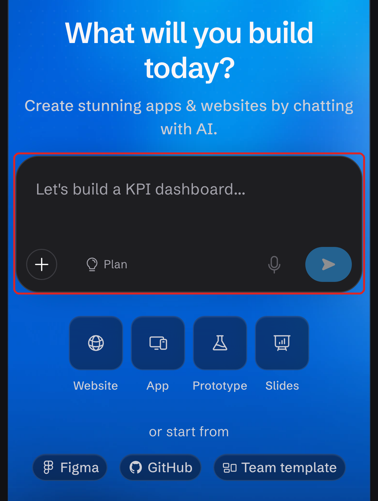
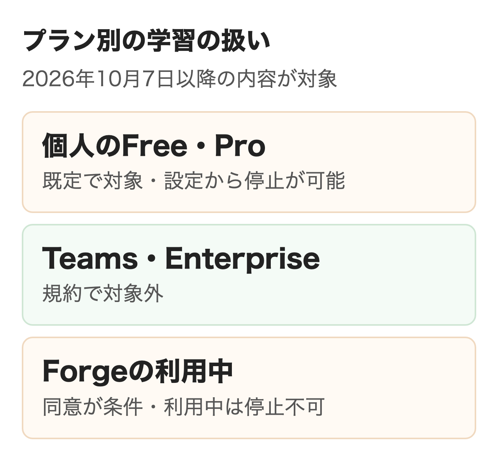

bolt.new（ボルト）は、作りたいサイトやアプリを文章で伝えるとAIがコードを書き、データベースやログインの用意から公開まで済ませるStackBlitz社のサービスです。料金はAIの作業量を表すトークンで決まり、無料プランは月100万トークン、有料のProは月$25で月1,000万トークンからです。

この記事ではできること・料金の見積もり方・始め方に加えて、社内ツールに使う前に決めておく公開範囲・データの置き場所・学習の扱いを公式の情報で整理します。個人のアカウントは2026年10月7日から、入力やコードが既定で学習などに使われる設定になりました。

:::takeaways
- **料金はトークン量で決まる**。Proは月$25（月1,000万トークン）から、Teamsは1人月$30から（月払い）
- 個人のアカウントの内容は**2026年10月7日から既定で学習の対象**。設定のModel trainingで止められ、Teams・Enterpriseのワークスペースは対象外
- 非公開での公開・独自ドメイン・Supabaseは有料プランから。データの置き先は**プロジェクトを作る時点で選ぶ**
:::

## bolt.newとは？何ができる？

**bolt.newはブラウザの中で会話しながらWebサイト・Webアプリ・スマホアプリを作り、組み込みのBolt Cloudで公開とデータベースまで済ませるAIのアプリ開発サービスです。**運営はブラウザでNode.jsを動かすWebContainersを開発したStackBlitz社で、2024年10月に公開されました。ソフトのインストールや開発環境の準備は不要で、アカウントやプロジェクトの管理はStackBlitzと共通です。

<figure class="post-figure"></figure>

プログラミングの経験は問いません。開発者向けにはコードを直接編集できるCode viewもあり、事業部が試作し、開発者が仕上げる分担にも向いています。

### 作れるもの

作れるものは大きく4つに分かれます。

- Webサイト: ランディングページ・会社のサイト・ECサイトなど
- Webアプリ: 案件管理・顧客管理・予約・社内の申請など、ログインとデータベースを伴うもの
- スマホアプリ: 最初の指示に「mobile app」と書くとExpoの形で作り、ストアへの提出まで進められる
- スライド: Bolt Slidesで発表資料を作り、PDFで書き出せる

ただし土台はJavaScript系に限られ、バックエンドはNode.jsだけです。**PHPやPythonで動く既存の社内システムをそのまま作り直す用途には向きません。**外からBoltを操作する公開のAPIやCLIもまだありません。

始め方は文章での指示のほか、Figmaのデザイン、Google Stitchのデザイン、GitHubのリポジトリ、Lovableのプロジェクト、公式のテンプレートから選べます。デザイン部門の画面案や、別のサービスで作った試作を出発点にできるのは、会社で使うときの利点です。

### 選べるエージェント

作業を担うAIは用途別のエージェントから選びます。Standardは速くトークンの消費が少ない標準のもので、全プランが対象です。Maxは大きなコードや複雑な機能に向けて深く考えるもので、有料プランから使えます。裏で動くモデルはBoltが自動で選ぶため、利用者がモデル名を選ぶ必要はありません。

オープンソースのモデルで動く3つ目のBolt Forgeは、2026年9月14日から10月14日までの試験提供でした。Proへの付属は10月14日で終わり、月$9のLiteに期限までに入った人だけが使い続けています。**Forgeは入力やコードを学習に使うことへの同意が条件で、TeamsとEnterpriseでは使えません。**また2026年8月3日に旧エージェント（v1）と相談用のDiscussion Modeが終わり、コードを変えずに相談する機能はPlan Modeに移りました。

## bolt.newの料金はいくら？

**料金はプランとトークン量で決まり、無料のFree、月$25からのPro、1人月$30からのTeams、個別見積もりのEnterpriseの4つです。**金額はドル建てで、年払いにすると最大28%安くなります。

| プラン | 月額（月払い） | トークン | 会社で効く違い |
|---|---|---|---|
| Free | $0 | 1日30万・月100万 | 公開は誰でも見られる形だけ。サイトにBoltの表示 |
| Pro | $25から | 月1,000万から | 非公開での公開・独自ドメイン・Supabase・Max |
| Teams | 1人$30から | メンバーごとに付与 | 一括請求・管理者による制御・組織内での共有 |
| Enterprise | 個別 | 個別 | SSO・監査ログ・SLA・データ保持の方針 |

<figure class="post-figure"><figcaption>bolt.newの料金ページ（2026年11月14日）</figcaption></figure>

Proは月のトークンを増やすほど月額が上がる段の形です。公式のヘルプの例では月$50で2,600万、月$100で5,500万トークンになり、段を上げるほど1トークンあたりは安くなります。年払いは1年分を先に払う形で、Proの1,000万トークンの段は年$216（月$18相当）です。

Teamsは1人分ずつの契約です。**トークンはメンバーごとに付き、ほかの人と分け合えません。**有料の契約を付けないメンバーもプロジェクトは見られますが、AIに指示は出せません。

### トークンの考え方

トークンはAIが読む・考える・書く作業の量で、**消費の大半はプロジェクトのファイルを読む分です。**そのためアプリが大きくなるほど、同じ1回の指示でも減り方が大きくなります。公式の入門ガイドではログインとお気に入りの保存がある小さなアプリを最初に作る指示で約20万、題名を1つ変える指示で約7万トークンを使っていました。

一方で、トークンを使わない操作もあります。公開ボタンでの公開、版の履歴からの復元、Code viewでの直接の編集、有料プランのセキュリティ監査です。同じことをAIに頼むとトークンが減るため、ボタンでできることはボタンで行うのが基本になります。

### 見積もりの例

5人の部署でTeamsを月払いで契約すると、月額は$150です。1人に月1,000万トークンが付く段なら、題名の変更くらいの小さな修正（約7万）で1人あたり月140回ほどの計算になります。**ただしアプリが育つと1回の消費が増えるため、最初の1か月は管理者が消費を見て段を決め直す前提で始めるのが安全です。**管理者はメンバーごとの消費を画面で確認でき、30日から2年までの利用量をCSVで書き出せます。

まずはFreeで小さなアプリを1つ作り、1回の指示で減る量を確認してから段を決めるのがおすすめです。

### 繰り越し・支払い・公開の上限

有料プランの使い残しは付与から2か月まで有効です。古いものから先に減り、解約するとその請求期間の終わりで残りも使えなくなります（期限内に再契約すれば戻ります）。Freeは繰り越しがなく、1日30万の上限は毎日、月100万は毎月1日に戻ります。

途中で足りなくなったら上の段に上げるのが基本で、差額だけを払い、増えた分のトークンがすぐ付きます。下げる変更は次の請求日からで、年払いは年次の更新日まで変わりません。トークンの買い足しは月払いの最上位のProか年払いのProでだけでき、買い足した分は無期限です。

支払いはクレジットカードかデビットカードだけで、PayPalや銀行振込は使えません。**契約の料金は返金されず、使ったトークンも返りません。**2026年11月1日からはStripeのLinkが請求を扱い、地域によっては付加価値税などが加わります。決済の画面で現地の通貨を選べることもあり、ドル以外で払うと為替で毎月の額が変わります。請求書と領収書はStripeの画面から取り出せ、会社名などの請求先の登録はTeamsとEnterpriseが対象です。

公開したサイトの通信量にも上限があり、アカウント全体で分け合います。Freeは月10GB・33万3,333リクエストで、超えるとその月はサイトが止まり、上限も増やせません。有料プランは月30GB・100万リクエストで、超えた分は管理者が決めた上限額まで従量で追加できます。公式の目安はFreeで月1万〜1.5万訪問、有料で月10万訪問以上です。

## bolt.newの始め方と使い方

**ブラウザでbolt.newを開き、作りたいものを書いて送れば始められます。**登録はGoogle・GitHub・メールのどれかで、クレジットカードは不要です。画面は英語ですが、指示は日本語で書けます。

<figure class="post-figure"><figcaption>bolt.newのトップ画面（2026年11月14日）</figcaption></figure>

1. [bolt.new](https://bolt.new/)を開き、入力欄に作りたいものを書く（例: 社員が備品の貸し出しを申請し、総務が承認する社内アプリ。メールでログインする）
2. 「Build now」を押し、Google・GitHub・メールのどれかで登録する
3. 数分待つと、プレビューで動くアプリを試せる（データベースが必要な機能があると時間がかかる）
4. 修正したい所は文章で指示するか、Selectで画面の要素を選んで指示する。文字や色はプレビューの上で直接編集できる
5. 右上の「Publish」を押し、もう一度「Publish」を押すと、約1分で`bolt.host`のアドレスに公開される
6. 公開後の変更は自動では反映されず、Publishメニューの「Update」を押した時点で反映される

PCではChromeなどChromium系のブラウザが推奨で、SafariではCode viewが読み取りだけになります。スマホのブラウザでも指示・プレビュー・公開はできますが、Code viewとデータベースの画面はPCでしか開けません。

### 上級編: Plan Modeで先に決める

入力欄の「Plan」を押してから指示すると、コードを書かずに作り方を相談できます。**コードを書かないぶんトークンの消費が少なく、データベースがあれば中身を読んで答えますが、変更はしません。**方針が決まったら回答の下の「Implement this plan」で実装へ移る流れです。社内ツールなら、画面の数・権限・保存する項目をPlan Modeで先に固めてから作り始めると、手戻りが減ります。

### 上級編: 公開前のセキュリティ監査

有料プランではPublishメニューの「Run security audit」でプロジェクト全体を点検できます。**ほかの利用者のデータが見えないか、ログインが必要な画面が守られているか、鍵やパスワードがコードに残っていないかを確認し、直せるものはBoltが修正します。**監査も修正もトークンを使わず、実行は1日30回までです。AIに「監査して」と頼むとトークンが減るため、このボタンを使うのが基本です。

## 会社で使う前に決めること

**事業部が試作を始める前に、プランと人数・トークンの上限・公開範囲・データの置き場所・学習・権限の6つを、情報システムの担当と事業部で決めておきます。**とくに学習の設定は個人のアカウントで作り始めると既定のまま進んでしまうため、最初に確認が必要です。

| 決めること | 公式の条件 | 決め方の例 |
|---|---|---|
| プランと人数 | Teamsは1人ずつ契約。契約のないメンバーは閲覧だけ | 試作は数人のTeamsで始め、使う人だけ契約 |
| トークンの上限 | トークンはメンバーごと。管理者が消費を確認できる | 最初の1か月の消費を見て段を決める |
| 公開範囲 | 非公開は有料プラン。チームは公開か非公開に固定できる | 社内ツールは「Private only」に固定 |
| データの置き場所 | Bolt DatabaseかSupabase（有料）。作成時に選ぶ | 自社でデータベースを管理するならSupabaseで始める |
| 学習の扱い | 個人は既定で対象。Teams・Enterpriseは対象外 | 業務はTeamsで行い、個人での利用は設定を確認 |
| 権限と連携 | 役割はAdminとMember。GitHubなどとの連携を止められる | 社外の協力者の招待は既定のオフのまま |

### 公開範囲と認証

Freeで公開したサイトは誰でも見られ、検索エンジンにも載ります。**有料プランでは非公開でも公開でき、招待したメールアドレスか、指定した会社のドメインのメールアドレスを持つ人だけが開けます。**チームのメンバーは非公開のサイトも既定で閲覧でき、管理者は全プロジェクトを「Private only」か「Public only」に固定できます。独自ドメインを付けたサイトは公開でしか出せない点には注意が必要です。

作ったアプリの利用者のログインには、メールとGoogleのログインが使えます。一方でBolt自体に会社のSSOでログインできるのはEnterpriseだけです。運営元は第三者による監査報告のSOC 2 Type IIを取得しており、報告書はEnterpriseの窓口に請求します。

### データの置き場所

アプリのデータは組み込みのBolt Databaseか、自社で契約するSupabaseに置きます。Bolt Databaseは作れる数に上限がなく、必要になるとBoltが自動で作る仕組みです。**Supabaseは有料プランでプロジェクトを作るときに選ぶもので、Bolt DatabaseからSupabaseへは移せますが、逆の移行手段はありません。**2026年10月30日以降に作られた表は既定で非公開になり、アプリに明示した権限がないと読み書きできません。

利用の少ない状態が6日以上続くとBolt Databaseは一時停止しますが、Bolt hostingで公開中のプロジェクトは停止の対象外です。公開先をNetlifyにした場合、データベースやバックエンドはNetlifyに置けません。データを置く国や地域を選ぶ設定はヘルプに載っておらず、プライバシーポリシーには米国を含む国外で処理・保存されることがあると書かれています。地域の指定が必要な業務なら、契約前にEnterpriseの窓口へ確認するのが確実です。

### 学習の扱い

<figure class="post-figure"></figure>

**2026年10月7日から、個人のアカウントでBoltに入れた指示・生成されたコード・エラーと修正の記録・プロジェクトのファイルは、StackBlitzのAIの学習と、匿名化したデータの第三者への提供（対価を受け取る場合を含む）に使われることがあります。**設定は既定でオンで、EU・英国・スイスのアカウントだけ既定でオフです。対象は10月7日以降に作った内容とAIに送った内容で、それより前の内容は含まれません。

止めるにはアカウント設定のModel trainingをオフにするか、privacy@stackblitz.comに連絡します。どのプランでも無料で、受付から15日以内に反映されますが、それまでに済んだ学習や提供済みのデータは戻りません。**TeamsとEnterpriseのワークスペースは、規約上この利用の対象外です。**ただしForgeを使っている間は、その内容の利用を止められません。

Boltが指示を渡すAIの事業者は、応答を作るためだけに受け取り、自社の学習に使うことは契約で禁じられています。業務のデータを入れるなら、作業の場をTeamsのワークスペースに限り、管理者が個人のワークスペースへの持ち出しを禁じる設定（Personal account restriction）をオンにする運用が考えられます。

### コードの権利と持ち出し

**Boltで作ったコードは利用者のもので、商用を含む合法な目的に使えると公式は明記しています。**以前は商用利用をTeams以上に限る説明もありましたが、今のヘルプにプランによる制限はありません。ただし規約では、同じか似た出力がほかの利用者にも出ることがあり、出力は人が確認してから使う前提とされています。

コードはGitHubと同期でき、変更のたびに自動で保存されます。同期はmainブランチに固定で、ほかのブランチには切り替えられません。プロジェクトはダウンロードでも持ち出せます。**チームを削除すると中のプロジェクトはすべて消えるため、解約や整理の前にGitHubへの同期かダウンロードを済ませておきます。**

## bolt.newを使うメリットは？

**作るところから公開・データベース・ドメインまでが1つの画面で済み、ほかのサービスを契約せずに社内へ見せる段階まで進められます。**

### 公開までが1か所で済む

Bolt Cloudにホスティング・データベース・ドメインの管理がまとまっていて、公開に別のアカウントは不要です。決済はStripe、メールの送信は外部の配信サービスをつなぐ形で、必要な分だけ追加します。

### 準備なしで誰でも始められる

インストールが不要で、WindowsでもMacでも同じように動き、スマホのブラウザからも指示・プレビュー・公開ができます。開発者はCode viewでコードを直接修正できるため、事業部の試作を開発者が引き継ぎやすくなっています。

### 公開前の確認が手厚い

有料プランのセキュリティ監査はトークンを使わず、データの見え方・ログイン・鍵の扱いを確認して修正します。版の履歴からトークンを使わずに前の状態へ戻せるため、失敗した試作もやり直しやすいでしょう。

## bolt.newのデメリットと注意点は？

**JavaScript以外の言語に対応していないこと、トークンの減り方がアプリの大きさで変わること、規約や料金の変更が速いことは、会社で使う前に知っておく必要があります。**

### 使える技術が限られる

バックエンドはNode.jsだけで、PHPやPythonは使えません。公開のAPIもないため、社内の仕組みからBoltを自動で動かすこともできません。

### 月の費用を読みにくい

同じ指示でも、プロジェクトが大きいほどトークンを多く使います。エラーの自動修正を何度も押すとその都度減るため、直らないときは押し続けず、Plan Modeで原因を相談するよう公式も勧めています。

### 規約と仕様の変更が速い

2026年だけでも、旧エージェントの終了（8月）、Forgeの試験提供（9〜10月）、学習への利用の開始（10月）、請求のLinkへの移行（11月）がありました。**契約の前と、その後も定期的に、料金ページと規約を確認し直す運用が必要です。**

## Lovable・Replit・Cursorとどう使い分ける？

**Bolt・Lovable・Replitは会話でアプリを作って公開まで進める型で、Cursorは開発者がコードを書き進める型です。**前の3つのどれにするかは始め方と会社として管理したい範囲で選びます。

| サービス | 作り方 | 向いている用途 |
|---|---|---|
| Bolt | ブラウザで会話して作り、Bolt Cloudで公開とデータベースまで | Figma・GitHub・Lovableから始める試作、サイトやスライド |
| Lovable | 会話で作り、組み込みのバックエンドと公開まで | 社内ツールや顧客向けWebアプリの試作と公開 |
| Replit | 会話のAgentとコードの画面を同じプロジェクトで使う | Webアプリやスマホアプリを作って運用まで |
| Cursor | 開発者のエディタの中でAIがコードを書く | 既存のコードの開発と保守 |

BoltはLovableのプロジェクトを取り込め、LovableもBoltなどで作ったコードを取り込めるため、試作を別のサービスに移して続けることも可能です。Replitは[Replitとは？Agentの料金・使い方](/media/replit-guide/)、Cursorは[Cursorの料金と使い方](/media/cursor-guide/)で解説しています。

:::linkcard
url: /media/lovable-guide/
title: Lovable（ラバブル）とは？料金は月$25から、会社で使う前に何を決める？
desc: Lovableの料金とクレジット、公開範囲・データの置き場所・学習の扱いを解説しています。
:::

## まとめ

- 個人で試すなら、Freeで小さなアプリを1つ作り、1回の指示で減るトークンを確認する
- 部署で試作するなら、Teamsで使う人だけ契約し、公開を「Private only」に固定する
- 個人のProで業務のデータを扱うなら、Model trainingをオフにしてから使い始める
- 監査ログ・会社のSSO・データの地域の指定が必要なら、Enterpriseに相談する

どの場合も、データの置き先（Bolt DatabaseかSupabase）はプロジェクトを作る前に決めておくと、後の移行で困りません。社内の業務に合わせたAIエージェントの設計から相談したい場合は、[nitoのAIエージェント構築支援](/ai-agent/)も検討してください。

## よくある質問

### bolt.newは無料で使えますか？

使えます。Freeプランは1日30万・月100万トークンまでで、クレジットカードの登録も不要です。公開もできますが、サイトにはBoltの表示が付き、独自ドメインと非公開での公開は使えません。

### bolt.newは日本語で使えますか？

画面は英語ですが、指示は日本語で書けます。アプリの表示を日本語にすることも可能です。

### bolt.newで作ったアプリは商用で使えますか？

使えます。公式はBoltで作ったコードは利用者のもので、商用を含む合法な目的に使えるとしています。プランによる制限は書かれていません。

### bolt.newは入力した内容をAIの学習に使いますか？

個人のアカウントでは2026年10月7日以降の内容が既定で学習と匿名化したデータの提供の対象です。アカウント設定のModel trainingで止められ、TeamsとEnterpriseのワークスペースは対象外です。

### bolt.newの料金は返金できますか？

できません。規約で返金しないとされ、使ったトークンも返りません。解約しても、その請求期間の終わりまでは使えます。

### bolt.newでスマホアプリは作れますか？

作れます。最初の指示に「mobile app」と書くと、Expoの形で作り始めます。ストアへの提出もExpoとつないで進める形です。

### bolt.newとStackBlitzは何が違いますか？

StackBlitzはbolt.newを運営する会社で、ブラウザで開発環境を動かすWebContainersの開発元です。アカウントの管理はStackBlitzと共通で、メールアドレスの変更などはStackBlitz側で行います。

### bolt.newは日本円で支払えますか？

2026年11月1日から請求を扱うLinkでは、決済の画面に現地の通貨が出ることがあります。表示されなければドルで払う形で、ドル以外を選ぶと為替で毎月の額が変わります。

## 出典

料金・仕様・規約は2026年11月14日に公式のページで確認しました。

- [Pricing](https://bolt.new/pricing)（Bolt）
- [Billing](https://support.bolt.new/account/billing)・[Tokens](https://support.bolt.new/account/tokens)・[Corporate and commercial](https://support.bolt.new/account/corporate-commercial)（Bolt ヘルプ）
- [Bolt QuickStart guide](https://support.bolt.new/get-started/quickstart)（Bolt ヘルプ）
- [Bolt Cloud hosting plans](https://support.bolt.new/bolt-cloud/hosting/plans)・[Publish your project to a live website](https://support.bolt.new/bolt-cloud/hosting/publish)（Bolt ヘルプ）
- [Supabase for databases](https://support.bolt.new/integrations/supabase)・[GitHub for version control](https://support.bolt.new/integrations/git)（Bolt ヘルプ）
- [Check your project's security](https://support.bolt.new/building/security)（Bolt ヘルプ）
- [Team settings](https://support.bolt.new/settings/team-settings)・[Account settings](https://support.bolt.new/settings/account-settings)（Bolt ヘルプ）
- [Bolt Forge](https://support.bolt.new/account/bolt-forge)・[Release notes](https://support.bolt.new/release-notes)（Bolt ヘルプ）
- [Privacy Policy](https://stackblitz.com/privacy-policy)・[Terms of Service](https://stackblitz.com/terms-of-service)（StackBlitz。2026年9月22日更新、既存のアカウントには10月7日から適用）
