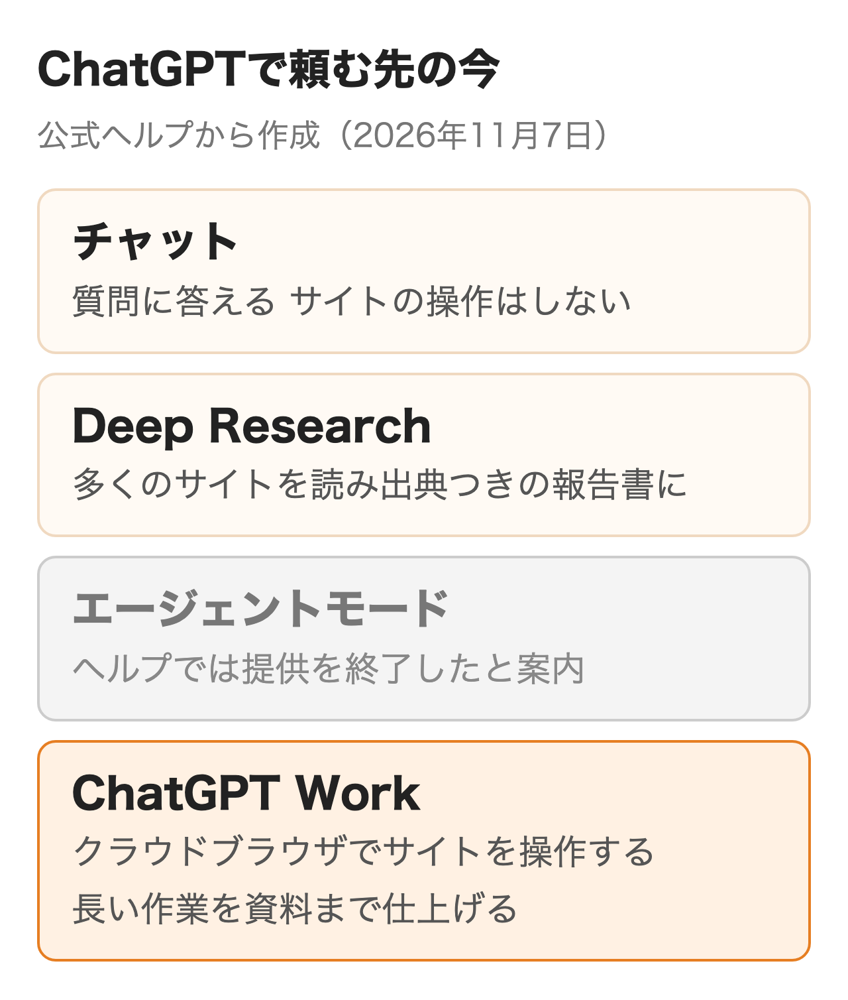

ChatGPTのエージェントモードは2025年7月17日に始まった機能で、今の公式ヘルプでは提供を終了したと書かれています。ChatGPTが自分の仮想コンピューターでサイトを開き、調べものから資料づくりまでを続けて行う機能でした。

入力欄に `/agent` と打っても以前のように動かず、どこで同じことを頼めばよいか迷う人もいるはずです。この記事ではエージェントモードが何をする機能だったか、代わりにChatGPT Workでどう頼むか、Deep Researchとどう使い分けるかを、2026年11月7日時点の公式ヘルプで説明します。

:::takeaways
- エージェントモードは**公式ヘルプで提供終了と案内**。終了の日付は書かれていない
- サイトを開いて操作する作業は、今は**ChatGPT Workのクラウドブラウザ**で頼む。無料版とGoは対象外
- 答えが文章で足りるなら**Deep Research**。サイトの操作や資料づくりまで要るならWork
:::

## ChatGPTのエージェントモードとは

エージェントモードは**ChatGPTが自分の仮想コンピューターを使い、サイトの操作・情報の整理・ファイルの作成までを1つの依頼の中で進める機能でした**。チャットの入力欄のツールメニューから選ぶか、`/agent` と打って始めます。

OpenAIの発表では別々の機能だったOperatorのウェブサイトを操作する力と、deep researchの情報をまとめる力、ChatGPTの会話の力を1つにしたものと説明されています。仮想コンピューターには画面を見てクリックや入力をするビジュアルブラウザー、ページの文字を速く読むテキストブラウザー、コマンドを動かすターミナル、APIへの直接のアクセスが入っていて、作業に合わせて使い分けていました。

<figure class="post-figure"></figure>

発表に載っていた例は「カレンダーを確認して、最近のニュースに基づき今後のクライアントとの会議について説明してほしい」「競合他社3社を分析してスライドショーを作成してほしい」のような依頼です。通常のチャットとの違いは次のとおりでした。

| 観点 | 通常のチャット | エージェントモード |
|---|---|---|
| 返すもの | 文章の回答 | 調べた結果に加え、スライドや表などのファイル |
| サイトの扱い | 検索して読む | 開いてクリック・入力・絞り込みまで行う |
| 途中の関わり方 | 次の質問を送る | 進み具合を見ながら割り込む・止める・引き継ぐ |
| 人の確認 | なし | 購入や送信のような結果に影響する操作の前に許可を求める |

提供していた当時の上限はPlusが月40回、Proが月400回、BusinessとEnterpriseが月40回でした。発表の時点ではProに当日から、PlusとTeam（今のBusiness）に数日のうちに、EnterpriseとEduに数週間のうちに配られています。

性能の数字も発表に出ていました。見つけにくい情報を探すBrowseCompで68.9%とdeep researchを17.4ポイント上回り、表計算のSpreadsheetBenchでは.xlsxを直接編集できる環境で45.54%と、ExcelのCopilotの20.00%を上回りました（いずれも2025年7月時点のOpenAIの測定で、人の71.33%には届いていません）。**スライドの機能は発表時にベータで、書式や仕上がりが粗くなることがあると公式も書いていました**。

## エージェントモードは今どうなったか

ChatGPTのヘルプにある「ChatGPT エージェント」の記事は、冒頭の概要の節で**「ChatGPT エージェントは提供を終了しました」**と案内しています。続けて、時間のかかる複数の手順の作業や完成した成果物にはChatGPT Workを、ブラウザを使う作業にはクラウドブラウザの使い方の記事を見るよう書かれています。

同じ記事の下には `/agent` での始め方や月40回・400回の上限が今も残っていますが、これは提供していた当時の説明です。**終了の日付はヘルプに書かれていないため、いつ使えなくなったかは公式からは言い切れません**。OpenAIのコミュニティには、2026年8月8日にエージェントモードが消えたという利用者の投稿があります。

この1年の流れを並べると、何が残り何が入れ替わったかが分かります。

| 時期 | できごと |
|---|---|
| 2025年7月17日 | エージェントモードを発表。Operatorの研究プレビューは数週間後に終了と告知 |
| 2026年6月4日 | Lockdown Modeを全てのログインユーザーに提供。オンにするとエージェントモードも止まる |
| 2026年7月9日 | ChatGPT Workを追加。同じ日にブラウザーのAtlasを8月9日で止めると告知 |
| 2026年8月25日 | Workのブラウザでログインが要るサイトも扱えるように（PlusとPro） |
| 2026年11月7日時点 | ヘルプの概要に提供終了と記載。料金ページの表にはWorkの行があり、エージェントモードの行は無い |

Operatorも単体では使えません。ヘルプにはオペレーターの機能はエージェントモードに統合され、オペレーターのサイトにはアクセスできなくなったと書かれています。**発表から1年ほどの間に書かれた解説記事は、`/agent` やAtlasを今の入口として紹介していることがあるので、読むときは日付を見る必要があります**。

## 代わりにChatGPT Workで頼む手順

エージェントモードでしていた、サイトを開いて操作する作業は、今はChatGPT Workで頼みます。Workにはクラウド上の別のコンピューターで動く専用のブラウザがあり、公開されたサイトやログインが要るサイトで、ページを読み、ボタンを押し、フォームに入力できます。ヘルプの手順は次のとおりです。

1. ウェブかスマホのアプリでChatGPTを開き、Workでタスクを始める
2. 欲しい結果を書く。開いてほしいサイト・細かい情報・条件も入れる
3. ChatGPTに求められたら、サイトへのアクセスを承認する
4. ログインが要るサイトでは安全なログインフォームに入力し、2要素認証も済ませる
5. 会話で進み具合を見て、確認を求められたら中身を見て答える
6. 結果を使う前に、その中身と情報源を確かめる

**クラウドブラウザを別に選ぶ必要はありません**。使うかどうかはChatGPTが決め、つないだアプリやプラグインで直接済む作業ならそちらを使うこともあります。ウェブかスマホで始めたタスクは、会話を離れたりパソコンを閉じたりした後も続き、入力・ログイン・確認が要る所で止まって待ちます。

クラウドブラウザを使えるのは、対応地域の有料プランのWorkからで、無料版とGoは対象外です。段階的に配っている最中のため、会社のワークスペースの権限によっても使えるかどうかが変わります。Workを使えるプランと上限は[ChatGPT Workのプランの記事](/media/chatgpt-work-plans/)にまとめました。

ヘルプが挙げる頼み方の例には、レストランの空席の確認や業者への見積もりの依頼、予定に合う航空便の検索、つないだメールと配送追跡のサイトを使った荷物の追跡、請求書の照合と会計ソフトの記録の更新があります。どこまで終えられるかはサイト・自分の権限・必要な手順で変わり、最後の手順を人が済ませる場面も残ります。

### ログインが要るサイト

ChatGPTはログインのページに着くと止まり、安全なログインフォームにユーザー名とパスワードを入れるよう求めます。**ここで入れた認証の情報はリモートのブラウザに直接送られ、モデルには見えず、ChatGPTも保存しません**。ログインを求める前には別の審査用のモデルが入力先にフィッシングや詐欺の兆しが無いかを確かめます。人もサイトのアドレスやフォームのプレビューを見てから先へ進める仕組みです。

ログインした状態は期限が切れるまで残り、後のタスクでも使えます。このクラウドブラウザは手元のブラウザとは別物で、普段のタブ・履歴・保存したパスワード・Cookie・拡張機能・ログイン状態は使いません。進められなくなったときは表示されるリンクから人がクラウドブラウザを直接操作して引き継げます。

### サイトへのアクセスの許可

ChatGPTは初めてのサイトにクラウドブラウザでアクセスする前に、既定で許可を求めます。設定のクラウドブラウザで選べるのは、次の3つです。

| 設定 | 動き |
|---|---|
| 毎回確認 | サイトへのアクセスを毎回人が確かめる |
| 自動承認 | ChatGPTがURLを確かめ、安全でない恐れがあるときだけ止まって聞く |
| 常に許可 | 全てのサイトへのアクセスを許す。ヘルプは勧めていない |

サイトごとに許可やブロックもでき、そちらが既定の設定より優先されます。**サイトに入る許可と、予約の確定や支払いのような取り消しにくい操作の承認は別物で、サイトを許可していても重要な操作の前にはチャットで確認を求められます**。

### 依頼は手順でなく欲しいものを書く

ヘルプは指示を明確にし、欲しい結果を具体的に伝えるよう書いています。対象の範囲・期間・出す形を1文に入れると、余計なサイトを開かずに済み、確かめる量も減ります。

| 曖昧な依頼 | 範囲を決めた依頼 |
|---|---|
| 競合を調べて | 国内の同業3社の料金ページを開き、プランごとの月額を表にして |
| メールを片づけて | 今週届いた見積もりの依頼だけを探し、返信の下書きを未送信のまま残して |
| 資料を作って | 添付した数字から、経営会議用の5枚のスライドを日本語で作って |

## エージェントモードとWorkの違い

できることは近いものの、頼み方と量の決まり方が変わっています。エージェントモードを使っていた人が戸惑いやすいのは次の点です。

| 観点 | エージェントモード（終了） | ChatGPT Work |
|---|---|---|
| 始め方 | チャットの中でツールから選ぶか `/agent` | ChatとWorkの切り替えでWorkを選ぶ |
| ブラウザ | 仮想コンピューターの中のブラウザー | クラウドブラウザ。使うかはChatGPTが決める |
| ログイン | 人がブラウザの操作を引き継いで入力 | 安全なログインフォームに入力。状態は期限まで残る |
| 量の決まり方 | 月の回数 | Codexと同じ仕組みの利用枠 |
| 手元のファイル | 使えない | デスクトップアプリなら許可したファイルとアプリを使える |

**回数で数えていた頃と違い、Workは長いタスクほど枠を多く使います**。毎週の定例の作業を移すなら、1回の依頼を小さく分けたほうが枠を読みやすくなります。Workは結果をドキュメント・スライド・スプレッドシート・Sitesに仕上げる所まで受け持ち、スケジュールで1回だけ・繰り返し・変化の見張りの形でも動かせます。

## Deep Researchとの違い

Deep Researchは今も使える機能で、料金ページでは無料版とGoが上限あり、PlusとProが「はい」になっています。Workとの違いは次のとおりです。

| 観点 | Deep Research | ChatGPT Work |
|---|---|---|
| 向く仕事 | 多くの情報源を読んで比べる調べもの | 調べたうえでサイトを操作し、資料まで作る仕事 |
| 始める前 | 調査の計画案が出て、直してから始められる | プランモードで計画を確かめてから始められる |
| つないだアプリ | 読むだけ。書き込みはしない | 読むほか、許可した範囲で操作できる |
| 出すもの | 出典つきの報告書（Markdown・Word・PDFで保存） | 文書・スライド・表・Sitesなどの成果物 |
| 量 | 製品内のカウンターで確認。最初に使った日から30日ごとに戻る | Codexと同じ仕組みの利用枠 |

使い分けの目安は**答えが文章で足りるならDeep Research、サイトの操作やファイルづくりまで要るならWork**です。Deep Researchは調べる先のサイトを指定でき、つないだアプリにも書き込まないので、社内の資料を読ませるだけの調べものならこちらのほうが安全に寄せられます。

## 会社で使うときの管理の設定

エージェントモードの管理の設定は、機能と一緒に役目を終えました。会社で今決めるのはWorkの設定です。ワークスペースのオーナーと管理者は、ワークスペースの設定の「権限とロール」で、既定のロールと独自のロールごとにWorkの権限を分けて管理します。

| 設定 | 中身 |
|---|---|
| Work Cloud | ウェブ・モバイル・デスクトップで、クラウドのタスクを始めたり見たりできる |
| Work Local | Work Cloudを切ってこちらだけを入れると、デスクトップアプリで手元の作業はできるがクラウドのタスクは始められない |
| Codex Local | 別に管理する。Workの設定を変えてもCodexの手元の利用は変わらない |
| ブラウザーの利用とネットワークアクセス | 対応する環境では、これまでどおり別の設定で制御する |

どの設定でも、Chatは使えるままです。Workを切られたメンバーには製品が使えないと表示され、管理者にアクセスを頼めます。管理者はワークスペースの設定の「モデル」で、WorkとCodexを始めるときのモデル・推論の深さ・速さも決められます。

**EnterpriseとEduでは、Workが既定で入る場面がある点に気をつける必要があります**。2026年7月9日の公開時は2週間のプレビューがあり、その間は既定でオフ、管理者が断らなければ期間の終わりに自動でオンになる形でした。今のヘルプでも、対象のワークスペースでは管理者が切らない限り既定のロールのメンバーにWorkが入ると書かれています。メールやSlackの出来事で動くタスクも、EnterpriseとEduでは管理者が「イベントをトリガーとするスケジュールされたタスクを許可」をオンにしてから使えます。

機密の高い仕事をする人に向けた設定が、ログインしている全員が使えるLockdown Modeです。オンにするとライブのウェブ閲覧・deep research・エージェントモード・ファイルのダウンロードなどが止まります。管理者はワークスペースの設定とロールで、この設定を配る相手を選べるのが特徴です。社内の決まりや承認の流れまで含めてエージェントを業務に組み込みたい場合は、nitoの[AIエージェント構築支援](/ai-agent/)でも設計から運用まで相談を受けています。

## 使う前に知っておきたい注意点

いちばん大きいのは読んだページに仕込まれた指示に従ってしまうプロンプトインジェクションです。OpenAIはこの種のリスクやフィッシング、意図しない操作を試験していますが、**ヘルプ自身が安全対策で全てのリスクを取り除けるわけではないと書いています**。クラウドブラウザを安全に使うためにヘルプが挙げる点は次のとおりです。

- つないだアプリやプラグインで直接できる作業は、そちらを優先する
- 指示を明確にし、欲しい結果を具体的に伝える
- サイトのアドレス・ログイン画面のプレビュー・スクショ・確認の依頼を見る
- 違うサイトを開いたり誤った情報を使ったりしたら、タスクを止める
- パスワード・セキュリティコード・支払いの情報は会話に貼らない

ほかに知っておきたいことは3つです。

- **断るサイトがある**: 自動で操作するブラウザからのアクセスを制限しているサイトでは、手元のブラウザで開けてもChatGPTは進めない。別のサイトを試すか自分で開く
- **ログインの状態が残る**: クラウドブラウザのCookieは、設定のクラウドブラウザからブラウザデータのCookieを選び、全サイトまとめてかサイトごとに消せる。消したサイトからはログアウトする
- **結果は人が確かめる**: 数字の入った表は元のページと突き合わせる。サイトで得た情報は、データコントロールの設定に従って扱われる

エージェントモードを試した記事や動画では、ログインが通らずに途中で終わった例や、日本語のグラフや作ったCSVの文字が崩れた例が報告されていました。どれも投稿者が当時試した結果で、今のWorkで同じことが起きるかは確かめていません。

## まとめ

- **`/agent` が使えなくなったなら**: 同じ依頼をWorkで始める。サイトの操作が要るときはクラウドブラウザが自動で使われる
- **答えが文章で足りるなら**: Deep Researchのほうが計画を直してから始められ、アプリにも書き込まない
- **会社で広げるなら**: Work CloudとWork Localをロールごとに決め、EnterpriseとEduでは既定でオンになる場面を先に確かめる
- **ログインさせるなら**: サイトのアクセスの許可は「毎回確認」か「自動承認」にとどめ、使い終えたらCookieを消すのがおすすめ

## よくある質問

### ChatGPTのエージェントモードは今も使えますか？

今の公式ヘルプではChatGPTエージェントは提供を終了したと案内されています。長い作業や成果物づくりにはChatGPT Workを、ブラウザを使う作業にはクラウドブラウザを使うよう書かれています。

### ChatGPTのエージェントモードはいつ終わりましたか？

ヘルプに終了の日付は書かれていません。OpenAIのコミュニティには2026年8月8日に消えたという利用者の投稿があり、ChatGPT Workは2026年7月9日に加わっています。

### ChatGPTのエージェントモードは月に何回使えましたか？

提供していた当時の上限はPlusが月40回、Proが月400回、BusinessとEnterpriseが月40回でした。今のWorkは回数ではなく、Codexと同じ仕組みの利用枠で量が決まります。

### ChatGPT Workにサイトを操作させるには？

ウェブかスマホでWorkを選び、欲しい結果とサイトと条件を書いて送ります。クラウドブラウザを別に選ぶ必要はなく、要るときはChatGPTの側で使うので、頼む側の手間は増えません。アクセスの承認とログインは求められたときに行います。

### ChatGPT Workは無料版で使えますか？

クラウドブラウザは有料プランのWorkからで、無料版とGoは対象外です。料金ページでは無料版とGoのWorkは「制限あり（デスクトップアプリ）」とされています。

### エージェントモードとDeep Researchの違いは？

Deep Researchは調べて出典つきの報告書にまとめる機能で、つないだアプリには書き込みません。エージェントモードはサイトを操作し、ファイルを作るところまで進める機能でした。今その役目はWorkが受け持っています。

### ChatGPTのOperatorはまだ使えますか？

単体では使えません。オペレーターの機能はエージェントモードに統合され、オペレーターのサイトにはアクセスできなくなったとヘルプに書かれています。

### ChatGPT Workを会社で止められますか？

ワークスペースのオーナーと管理者が、権限とロールの設定でWork CloudとWork Localをロールごとに切れます。Workを切ってもChatは使えます。

## 出典

情報はいずれも2026年11月7日に確認しました。エージェントモードを試した例は、Qiitaの投稿（2025年12月25日）と解説動画（2025年7月）の投稿者がそれぞれ当時1回試した結果です。

- [ChatGPT エージェント（OpenAI ヘルプセンター）](https://help.openai.com/ja-jp/articles/11752874-chatgpt-agent)
- [ChatGPT でのクラウドブラウザーの使用（OpenAI ヘルプセンター）](https://help.openai.com/ja-jp/articles/20001280)
- [ChatGPT ワークと Codex（OpenAI ヘルプセンター）](https://help.openai.com/ja-jp/articles/20001275)
- [ChatGPT の deep research（OpenAI ヘルプセンター）](https://help.openai.com/ja-jp/articles/10500283-deep-research-faq)
- [ChatGPT エージェントが登場（OpenAI、2025年7月17日）](https://openai.com/ja-JP/index/introducing-chatgpt-agent/)
- [ChatGPT Work（OpenAI）](https://chatgpt.com/ja-JP/work/)
- [プランと料金（ChatGPT）](https://chatgpt.com/ja-JP/pricing/)
- [Lockdown Mode（OpenAI Help Center）](https://help.openai.com/en/articles/20001061)
- [ChatGPT Release Notes（OpenAI Help Center）](https://help.openai.com/en/articles/6825453-chatgpt-release-notes)
- [Agent Mode was removed with no real replacement（OpenAI Developer Community、2026年8月8日）](https://community.openai.com/t/agent-mode-was-removed-with-no-real-replacement/1389601)
- [ChatGPTエージェントモードを今さら使ってみた（Qiita）](https://qiita.com/t_horumon/items/f7e565772e5d7f461071)
- [ChatGPTのエージェントモード解説動画（YouTube）](https://www.youtube.com/watch?v=sucokz-tMWU)
