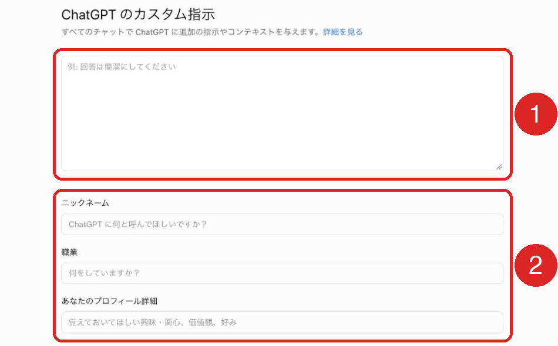

ChatGPTのカスタム指示は、自分の前提と回答の形式を一度書いておくと、すべてのチャットに反映される設定です。無料版を含む全プランで使え、場所は設定の「パーソナライズ」です。

仕事で使うなら、書く中身は「自分のこと」と「回答の形式」の2つに絞ると迷いません。この記事では設定方法、営業企画の管理職を例にした書き方、メモリ・プロジェクト・GPTsとの使い分け、会社のプランで管理者が決められる範囲を2026年11月14日時点のOpenAIのヘルプで説明します。

:::takeaways
- カスタム指示は**全チャット共通の前提と回答形式**を書く場所。案件ごとの指示はプロジェクトに分ける
- 文字数の上限は**Free・Goが1,500文字、Plus・Pro・Business・Enterprise・Eduが5,000文字**
- 会社のプランでは、2025年10月のリリースノートに**ワークスペース全体の指示を管理者が設定できる**項目が載っている。今の設定のヘルプには載っていないため、管理画面の「General」で確認する。社員個人のカスタム指示は各自が書く
:::

## ChatGPTのカスタム指示とは？何が変わる？

**毎回の会話の冒頭で書いていた前置きを、設定に移せる機能です。**ヘルプは「回答時に考慮してほしいことを ChatGPT に自由に伝えられます」と説明し、内容はすべてのチャットにすぐ適用されます。ウェブ・デスクトップ・iOS・Androidのどれでも、無料版を含む全プランで使えます。

たとえば「結論を最初に」「社外向けの文はです・ます調で」と毎回打っている人は、それをカスタム指示に書けば、次の会話からは入力不要です。口調だけを変えたいなら、文章を書かずに選べる性格（基本のスタイルとトーン）という設定も別にあります。

文字数の上限はプランで分かれます。2026年7月15日に有料プランの上限が1,500文字から5,000文字に引き上げられたため、1,500文字と書かれた解説は今の有料プランには当てはまりません。

| プラン | カスタム指示の上限 |
|---|---|
| Free・Go | 1,500文字 |
| Plus・Pro・Business・Enterprise・Edu | 5,000文字 |

**仕事で使うなら、文字数より何を書くかのほうが結果を左右します。**5,000文字まで書けても、書く量は後の節の例くらいを目安にするのがおすすめです。

## カスタム指示を使うメリット

**同じ前置きを書く手間がなくなり、答えの形が会話ごとにぶれにくくなります。**仕事での利点は次の3つです。

### 毎回の前置きが不要になる

役職・業界・用途のような自分の前提は、会話ごとに変わりません。カスタム指示に書いておけば、新しいチャットでも一行目から本題を入力できます。「この前提で」と書き忘れて一般論が返ってくる失敗も起きにくい設定です。

### 回答の形式を統一できる

結論の位置・箇条書きの量・敬語の有無を決めておくと、議事録の要約もメールの下書きも同じ形で返ってきます。**そのまま資料に貼れる形で受け取れるので、手で整える時間も短くて済むのが利点です。**

### 途中の会話にも反映される

2025年11月7日の更新から、カスタム指示と性格の変更は既存の会話を含む全チャットにすぐ反映されます。それ以前は新しい会話にしか反映されませんでした。設定を変えたあと、開いている会話の次の返答から新しい指示が使われます。

## カスタム指示のデメリットと注意点

**全チャットに一律で入るため、合わない場面にも反映される点と、データの扱いに注意が必要です。**

### 合わない会話にも反映される

「回答は300文字以内」と書けば、長い報告書の下書きを頼んだときにも短くまとまろうとします。用途ごとに前提が違うなら、カスタム指示は共通の部分だけにし、案件ごとの指示はプロジェクトに分けるほうが混ざりません。会話の中で「今回は表で」と指示すれば、その場では会話の指示に合わせます。

### 機密情報は書かない

ヘルプにはカスタム指示の利用に伴う情報がモデルの性能向上にも使われると書かれています。個人アカウントで「Improve the model for everyone」がオンのときです。BusinessとEnterpriseなど会社のワークスペースの内容は、既定で学習に使われません。また、外部のプラグインを使うと、カスタム指示の関連情報がプラグインの開発者に渡ることがあるとヘルプにあります。**取引先名・案件名・数字は書かず、業界と役職までにとどめるのが安全です。**

### 反映されない場所がある

GPTの会話では保存したメモリ・カスタム指示・過去の会話が使われない、とGPTsのヘルプに書かれています。プロジェクトの中での扱いも含め、詳しくは「設定したのに反映されないときは？」の節で説明します。

## カスタム指示の設定方法

**パソコンは「設定」の「パーソナライズ」、スマホのアプリはヘルプの手順では「設定」の「ChatGPT をカスタマイズ」から入ります。**入力した内容はアカウントに保存されるため、どちらで書いても両方に反映されます。

### パソコンでの手順

1. [ChatGPT](https://chatgpt.com/)を開き、プロフィールのアイコンから「設定」を選ぶ
2. 「パーソナライズ」を選ぶ
3. 「カスタム指示」の「ChatGPT」の「Edit」を押す
4. 開いた「ChatGPT のカスタム指示」の画面に入力する

この画面には、指示の欄、「ニックネーム」「職業」「あなたのプロフィール詳細」の欄が上から並んでいます。「自分のこと」はニックネーム・職業・プロフィール詳細に、「回答の形式」は指示の欄に書くと画面どおりです。

<figure class="post-figure"><figcaption>ChatGPT のカスタム指示の画面（2026年11月）</figcaption></figure>

「パーソナライズ」の同じページで性格（基本のスタイルとトーン）を選ぶと口調の土台が変わり、温かさ・熱意・見出しと箇条書き・絵文字の量も個別に調整できます。メモリの設定の場所も同じ「パーソナライズ」の中です。

### スマホのアプリでの手順

ヘルプのiOS・Android向けの手順は、「設定」で「ChatGPT をカスタマイズ」を開き、「カスタマイズを有効にする」をオンにして、カスタム指示の欄に入力する、です。性格のヘルプではスマホも「Personalization」と書かれていて、アプリの版によって名前が違う場合があります。どちらかの名前で探すと見つかります。

### 消す

完全に消したい場合は欄の文章を削除します。ヘルプによると、すでに書かれた過去の回答は変わらず、古い指示が反映された会話は履歴に残ります。消したい場合の手段はその会話の削除です。ヘルプの手順にある「カスタマイズを有効にする」のスイッチは、2026年11月に確認したパソコンの画面には見当たりませんでした。

## カスタム指示の書き方は？

**「自分のこと」と「回答の形式」を分けて、それぞれ3〜5行で書くと効果が出やすくなります。**前者で答えの中身が、後者で答えの形が決まります。「自分のこと」は「職業」と「あなたのプロフィール詳細」の欄に、「回答の形式」は指示の欄に入れます。

### 営業企画の管理職を例にした記入例

BtoBの会社で営業企画を担当する課長が、会議資料と顧客への提案書の下書きにChatGPTを使う場合の例です。

**自分のこと（「職業」「あなたのプロフィール詳細」の欄）**

```
BtoB向けソフトウェアの会社で営業企画の課長をしています。
主な用途は週次の営業会議の資料と顧客への提案書の下書きです。
読み手は社内の役員と、顧客の部長クラスです。
```

**回答の形式（指示の欄）**

```
結論を最初の1文で書いてください。
根拠は3点までの箇条書きにしてください。
社外向けの文章はです・ます調にしてください。
数字に出典がない場合は「出典未確認」と書いてください。
確認の質問は判断できないときだけ1つにしてください。
```

この例のポイントは**読み手まで書いていること**です。「役員向け」と分かっていれば、前置きの長さや判断材料の順番を読み手に合わせやすくなります。

### 書くときの3つのコツ

1つ目は**抽象的な言葉を条件に置き換えること**です。「分かりやすく」ではなく「根拠は3点まで」「300文字以内」のように、守れたかどうかが判断できる形にします。

2つ目は**矛盾する条件を同時に書かないこと**です。「簡潔に」と「具体例を多く」が並ぶと、どちらに寄せるかが会話ごとに変わります。

3つ目は**仕事が変わったら見直すこと**です。異動や担当の変更のあとも古い前提が残っていると、答えが急に合わなくなったように感じます。異動・新しい案件の開始のときに設定画面を開くと決めておくと忘れません。

### 気になる回答の傾向を修正する一文

全体を書き直さなくても、気になる点だけを1行追加すれば修正できます。

| 気になる回答 | 追加する一文の例 |
|---|---|
| 毎回最後に質問が付く | 確認の質問は判断できないときだけにしてください |
| 褒め言葉や前置きが長い | 前置きと称賛は省き、本題から書いてください |
| 推測を事実のように書く | 推測には「推測」と明記してください |

## メモリ・プロジェクト・GPTsとの使い分けは？

**全チャット共通の前提はカスタム指示、案件ごとの前提はプロジェクト、会話の中で出てきた情報はメモリ、と分けると重なりません。**GPTsは終了予定（標準は2026年12月11日、FedRAMPと延期が承認されたワークスペースは2027年2月11日）のため、新しく決まった手順を配る場所はプラグインに移ります。

| 置き場所 | 反映される範囲 | 誰が書くか |
|---|---|---|
| カスタム指示 | 全チャット（GPTsを除く） | 自分で書く |
| プロジェクトの指示 | そのプロジェクトの中だけ。カスタム指示より優先 | 自分かプロジェクトの共有メンバー |
| メモリ | 全チャット（設定でオフにできる） | ChatGPTが会話から保存・更新 |
| GPTs | そのGPTの中だけ。カスタム指示は使わない | GPTの作成者 |

### メモリとの違い

メモリのヘルプはカスタム指示を「ChatGPTが知っておくべきことと答え方について自分が直接与える指示」、メモリを会話やほかの情報源から積み上がる情報として分けています。**変わらない前提は自分でカスタム指示に書き、進行中の話題はメモリに任せるのが向いています。**

メモリに逆向きの好み（「くだけた口調が好き」など）が残っていると、カスタム指示や性格の効果が弱まる点には注意が必要です。回答の下に表示される「ソース」で、どのメモリ・過去のチャット・カスタム指示が使われたかを確認できます。

:::linkcard
url: /media/chatgpt-memory-full/
title: ChatGPTのメモリがいっぱいの対処
desc: 保存したメモリが上限に達したときの空け方と、チャットのメモリとの違いを解説しています。
:::

### プロジェクトとの違い

プロジェクトのヘルプには「プロジェクトの指示はそのプロジェクトの中だけで有効で、全体のカスタム指示より優先される」とあります。部署や顧客ごとに書き方の決まりが違うなら、カスタム指示には共通の形式だけを書き、顧客ごとの前提はプロジェクトに分けるのがおすすめです。共有したプロジェクトではメンバー個人のカスタム指示とメモリは参照されません。

### GPTsとの違い

GPTsは作成者が決めた指示で動くため、使う人のカスタム指示は参照されません。カスタムGPTの終了は標準が2026年12月11日、FedRAMPと延期が承認されたワークスペースは2027年2月11日の予定で、決まった手順を社内に配る役割はプラグインに移ります。移行の手順と共有のやり直しは[GPTsを社内だけで共有する方法](/media/gpts-internal-share/)にまとめています。

## 設定したのに反映されないときは？

**まず指示が保存されているか、次にその会話がプロジェクト・GPT・一時チャットの中でないかを確認します。**多くはこのどちらかです。

### 会話の場所を確認する

GPTの中の会話にはカスタム指示が使われません。Enterprise・Eduのプロジェクトの中のチャットも、使われるのはプロジェクトの指示だけです。BusinessやPlusなどのプロジェクトではカスタム指示とプロジェクトの指示が両方入り、食い違う所はプロジェクトの指示が優先されます。

### 一時チャットの設定を確認する

一時チャットは始める前に「Personalized」か「Unpersonalized」を選び、Unpersonalizedではメモリ・カスタム指示・プラグインを使いません。始めた後は変えられません。既定の扱いはOpenAIの説明で割れていて、2026年8月27日のリリースノートは「既定ではパーソナライズしない」、プロジェクトのヘルプは「既定でオンで、選んだ設定を覚える」と書いています。**始めるときの選択画面で毎回確認するのが確実です。**

### 速い回答と書き方を確認する

2026年4月22日から、個人に合わせる必要がない質問には過去のチャットやメモリを参照しない「速い回答」が返ることがあります。常に個人に合わせた回答にしたい場合は、パーソナライズの設定でオフにできます。設定に問題がなければ、指示が抽象的すぎないか、ほかの条件と矛盾していないかを見直します。

## 会社のプランで管理者は何を決められる？

**管理者はメモリの利用可否や社員への利用方針の表示を決められます。ワークスペース全体の指示を設定できる項目も、2025年10月のリリースノートに載っています。**ただし今の設定のヘルプにはその項目が見当たらないため、管理画面の「General」で確認します。社員個人のカスタム指示は各自が書きます。

### 管理者が設定できること

ワークスペース設定（管理コンソール）は、ワークスペースによっては自動で管理コンソールが開きます。Enterpriseではオーナーと管理者が「General」にAIの利用方針を書け、社員には30日ごとと内容の更新時に表示されます。メモリは「Permissions & roles」で、標準のロールやカスタムのロールごとに共有メモリと改善されたメモリの設定が可能です。Businessでも、プロジェクト専用のメモリを使うにはオーナーがワークスペースのメモリを有効にする必要があります。

ワークスペース全体の指示については、公式の記載が割れています。BusinessとEnterprise・Eduのリリースノートには、2025年10月16日の「Updated Workspace settings」として、「General」タブに名前・ロゴ・外観・ワークスペース全体の指示がまとまったと書かれています。一方、Enterpriseのワークスペース設定のヘルプの「General」には、名前・画像・識別子・AIポリシーの項目だけで、指示の項目はありません。社員のカスタム指示より優先されるかどうかは、どのページにも書かれていません。

Business・Enterprise・Eduのワークスペースの内容は既定で学習に使われないため、**社員が個人のアカウントで仕事に使うより、会社のワークスペースに集めるほうがデータの扱いを統一できます。**個人のPlusから会社のワークスペースに移る社員のカスタム指示の扱いは、[ChatGPT Businessのメンバー招待と管理](/media/chatgpt-business-admin/)で説明しています。

### 社内で記入例を配るときの決め方

全員に共通の前提はワークスペースの指示（あれば）に入れ、部署ごとの回答の形式は記入例を配る、という線引きが現実的です。社内でChatGPTの導入を進める担当者が決めるのは次の3点です。

1. 書いてよい情報と書かない情報（業界と役職まで・取引先名と数字は書かない）
2. 部署ごとの「回答の形式」の記入例（上の例の形）
3. 案件ごとの前提はプロジェクトに置き、カスタム指示には書かないという線引き

記入例は社内の手順書に載せ、AIポリシーの表示から案内するのが見落とされにくい方法です。社内向けの指示やエージェントの設計から任せたい場合は、nitoの[AIエージェント構築支援](/ai-agent/)でも相談を受けています。

:::linkcard
url: /media/chatgpt-projects/
title: ChatGPTのプロジェクトとは？使い方・チームでの共有・GPTsとの違い
desc: プロジェクトの作り方と指示の入れ方、共有したときの権限とメモリを解説しています。
:::

## まとめ

- 毎回同じ前置きを書いている人は、「自分のこと」と「回答の形式」を3〜5行ずつカスタム指示に書く
- 顧客や案件で前提が変わる人は、共通の形式だけをカスタム指示に残し、案件ごとの前提はプロジェクトに分ける
- 書いたのに反映されない人は、保存されているか・プロジェクトやGPTの中か・一時チャットの選択の順に確認する
- 社内で統一したい担当者は、管理画面の「General」にワークスペースの指示があるか確認し、共通の前提はそこに、部署ごとの回答の形式は記入例で配り、書かない情報の線引きは手順書に載せる

## よくある質問

### ChatGPTのカスタム指示は無料版でも使えますか？

使えます。ウェブ・デスクトップ・iOS・Androidのすべてのプランが対象だとヘルプに書かれています。無料版（Free）とGoの上限は1,500文字です。

### ChatGPTのカスタム指示は何文字まで書けますか？

FreeとGoは1,500文字、Plus・Pro・Business・Enterprise・Eduは5,000文字です。有料プランの上限は2026年7月15日に1,500文字から引き上げられました。

### ChatGPTのカスタム指示は共有リンクの相手に見えますか？

見えません。カスタム指示が共有リンクの閲覧者に共有されることはない、とヘルプに明記されています。回答の下の「ソース」も共有したチャットには表示されません。

### ChatGPTのカスタム指示はGPTsでも使われますか？

使われません。GPTは保存したメモリ・カスタム指示・過去の会話を使わず、毎回まっさらな状態で始まるとGPTsのヘルプにあります。

### ChatGPTのプロジェクトの指示とどちらが優先ですか？

プロジェクトの中ではプロジェクトの指示が優先されます。Enterprise・Eduのプロジェクトの中では、カスタム指示自体が使われず、プロジェクトの指示だけになります。

### ChatGPTのカスタム指示は英語で書いたほうがいいですか？

日本語で問題ありません。日本語で仕事をするなら、日本語で条件を具体的に書くほうが、あとから自分や同僚が読み返したときにも修正しやすくなります。

### ChatGPTのカスタム指示はAPIでも使えますか？

使えません。カスタム指示のAPIを提供する予定はなく、同じ効果にはChat Completions APIのシステムメッセージを使うようヘルプで案内されています。

### ChatGPTのアカウント削除で指示も消えますか？

消えます。アカウントの削除の手続きの中で、アカウントに紐づくカスタム指示も30日以内に削除されるとヘルプにあります。データのエクスポートにはカスタム指示も含まれるため、残したい場合は削除の前に書き出しておくのが安全です。

## 出典

- [ChatGPT カスタム指示（OpenAI ヘルプ）](https://help.openai.com/ja-jp/articles/8096356-chatgpt-custom-instructions) — 設定の手順・文字数・データの扱い（2026年11月14日取得）
- [Customizing Your ChatGPT Personality（OpenAI ヘルプ）](https://help.openai.com/en/articles/11899719-customizing-your-chatgpt-personality) — 性格の種類と、メモリ・カスタム指示との関係
- [Memory in ChatGPT（OpenAI ヘルプ）](https://help.openai.com/en/articles/8590148-memory-faq) — メモリとカスタム指示の違い・一時チャットの選択・学習の扱い
- [Projects in ChatGPT（OpenAI ヘルプ）](https://help.openai.com/en/articles/10169521-projects-in-chatgpt) — プロジェクトの指示の優先・Enterprise と Edu のプロジェクトでの扱い
- [GPTs in ChatGPT（OpenAI ヘルプ）](https://help.openai.com/en/articles/8554407-gpts-in-chatgpt) — GPTs がカスタム指示を使わないこと・終了の予定
- [ChatGPT release notes（OpenAI ヘルプ）](https://help.openai.com/en/articles/6825453-chatgpt-release-notes) — 2025年11月7日の即時反映・2026年7月15日の上限変更・8月27日の一時チャット・4月22日の速い回答
- [Managing workspace settings in ChatGPT Enterprise（OpenAI ヘルプ）](https://help.openai.com/en/articles/8411955-managing-workspace-settings-in-chatgpt-enterprise) — AI ポリシーの表示とロールごとのメモリ設定
- [ChatGPT Enterprise admin quickstart（OpenAI ヘルプ）](https://help.openai.com/en/articles/20001264-chatgpt-enterprise-admin-quickstart) — ワークスペースの初期設定の項目
- [ChatGPT Enterprise & Edu release notes（OpenAI ヘルプ）](https://help.openai.com/en/articles/10128477-chatgpt-enterprise-edu-release-notes) — 2025年10月16日のワークスペース設定の更新
- [ChatGPT Business release notes（OpenAI ヘルプ）](https://help.openai.com/en/articles/11391654-chatgpt-business-release-notes) — ワークスペースのメモリとプロジェクト専用メモリ・ワークスペース設定の更新
