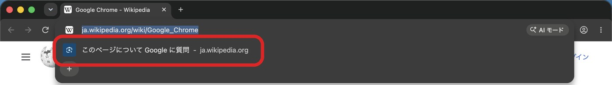
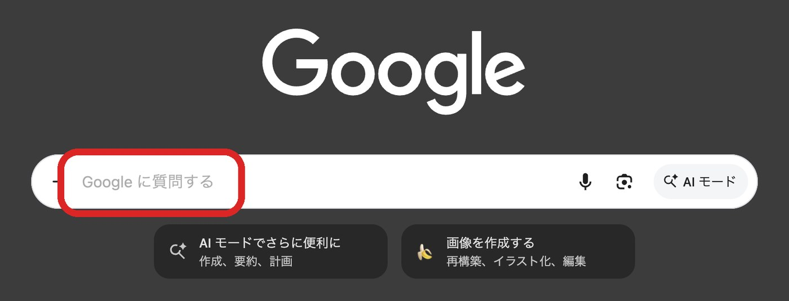
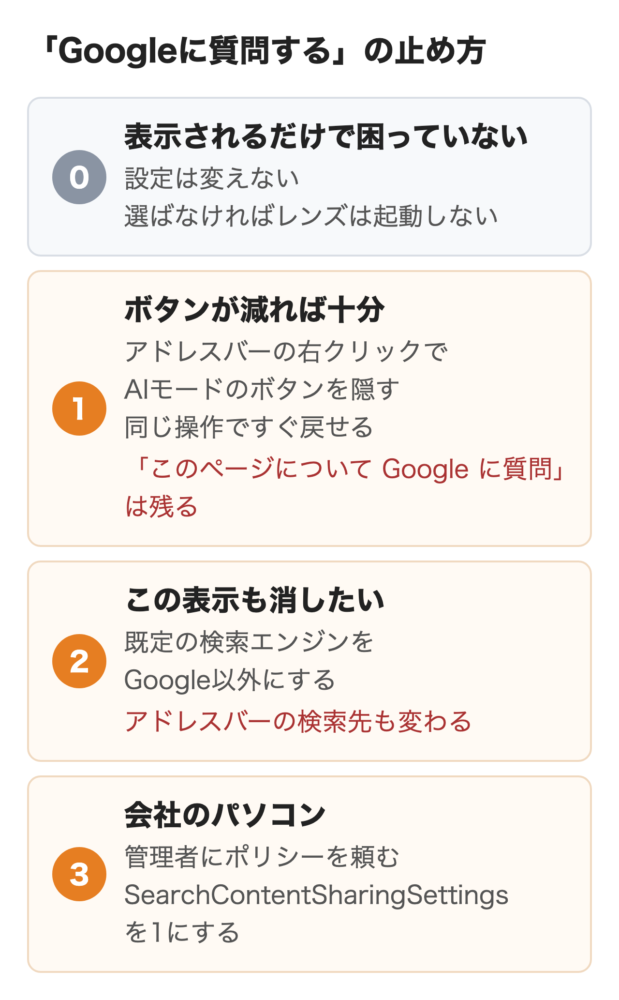
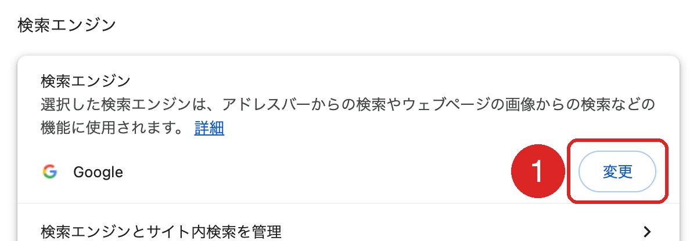
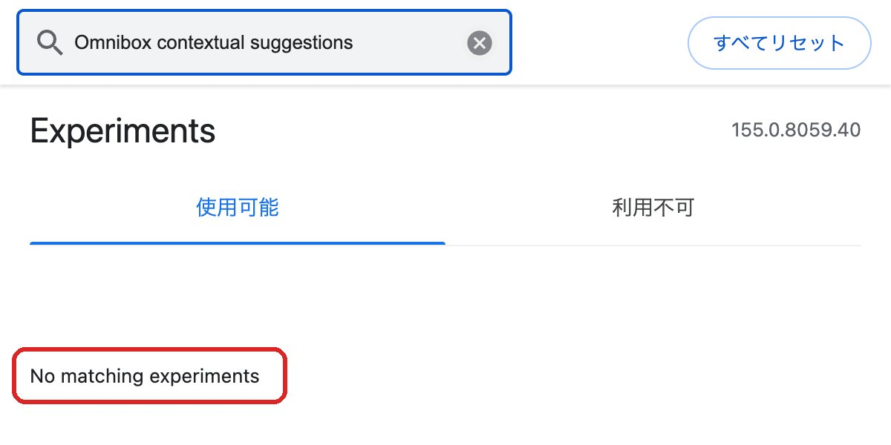

Chromeで「Google に質問」と出る場所は2つあります。サイトを開いてアドレスバーを押したときに候補の一番上に出る「このページについて Google に質問」と、新しいタブの検索ボックスに薄い字で出る「Google に質問する」です。

どちらも設定画面に消すスイッチは無く、個人のパソコンで確実なのは既定の検索エンジンをGoogle以外にすることです。2025年に広まった chrome://flags の手順は、今のChromeでは使えません。

:::takeaways
- 出る場所は**アドレスバーの候補と新しいタブの検索ボックスの2つ**
- どちらも設定画面に**消すスイッチは無い**
- 個人のパソコンで確実なのは**既定の検索エンジンをGoogle以外にする**こと
- 会社のパソコンは**管理者のポリシー**で止められる
- スマホの下の「質問する」は、**先にChromeかGoogleアプリかを確かめる**
:::

## 「Google に質問」が出る2つの場所

画面に出ているのがどちらかで、消し方が変わります。

<figure class="post-figure"><figcaption>サイトを開いてアドレスバーを押すと、候補の一番上に出る（2026年11月2日、MacのChrome 156）</figcaption></figure>

<figure class="post-figure"><figcaption>新しいタブの検索ボックスに薄い字で出る（同じ日・同じ版）</figcaption></figure>

アドレスバーの候補なら次の節から、新しいタブの検索ボックスなら「新しいタブに出るとき」の節を読んでください。

## アドレスバーの候補に出る1行の正体

アドレスバーの候補の「このページについて Google に質問」は、開いているページをGoogleレンズで調べる入口です。Chromeヘルプの「[Google レンズ in Chrome を使用して検索する](https://support.google.com/chrome/answer/15086890?hl=ja)」には、特定のページではこの項目がアドレスバーに既定で表示されることがある、と書かれています。頼んでいないのに出てくるのは、不具合や設定の誤りではありません。

選ぶと、ページの内容をレンズで調べた答えがサイドパネルに出ます。ページのスクリーンショットとデータがGoogleに送られるのはこのときで、表示されているだけで送られるとはヘルプに書かれていません。**表示が目に入るだけで困っていないなら、設定を変えずに選ばないでおけば足ります。**

## Chromeに増えた3つのAIの入口

Chromeには名前の似たAIの入口が3つあり、別の入口の消し方を読むと「手順どおりにしたのに消えない」になります。先に、消したいのがどれかを確かめてください。

| 入口 | 出る場所 | 消し方 |
|---|---|---|
| 「このページについて Google に質問」 | アドレスバーの候補 | この記事の方法 |
| 「AI モード」 | アドレスバーの右・新しいタブの検索ボックス | アドレスバーを右クリックして「AI モードを常に表示する」を外す（アドレスバーのボタンだけ） |
| 「Gemini に相談」 | ブラウザの上部のボタン | 右クリックで「Gemini の固定を解除」 |

「Gemini に相談」は[Chromeの「Geminiに相談」を消す方法](/media/chrome-gemini-remove/)にまとめています。

## アドレスバーの候補から消す方法

この表示を止めるのは②と③で、①はAIモードのボタンを隠すだけの方法です。使っているパソコンとどこまで消したいかで、どれを選ぶかが決まります。

1. 個人のパソコンでボタンが減れば十分なら、①でAIモードのボタンを隠す。すぐ戻せるが、「このページについて Google に質問」は残る
2. この表示も消したいなら、②で既定の検索エンジンをGoogle以外にする。アドレスバーの検索先も変わる
3. 会社のパソコンなら、管理者に③のポリシーを頼む

<figure class="post-figure"></figure>

### ① AIモードのボタンを隠す

アドレスバーを右クリックして「AI モードを常に表示する」の選択を外すと、「AI モード」と「タブなどを追加」のボタンが隠れます。同じメニューで選び直せば元どおりです。**隠れるのはこの2つだけで、「このページについて Google に質問」は候補に残ります。**

### ② 既定の検索エンジンを変える

レンズは既定の検索エンジンがGoogleのときに使う機能です。管理者向けのポリシーの説明にも、Googleが既定でないとページの内容をレンズやAIモードに渡す機能は無効になる、とあります。

1. Chromeの右上の︙から「設定」を開く
2. 左のメニューの「検索エンジン」を選ぶ
3. 検索エンジンの欄の「変更」を押し、Google以外を選ぶ

<figure class="post-figure"><figcaption>「設定」の「検索エンジン」で「変更」を押す</figcaption></figure>

**設定画面から止められる方法はこれだけですが、アドレスバーに打った言葉の検索先も変わります。**アドレスバーからGoogle検索することが多い人には向きません。画面から消えるところまでは手元で試していませんが、Chromiumのソースでも、この候補はレンズが使えるときだけ出る作りで、レンズはGoogleが既定の検索エンジンでないと有効になりません。

### ③ ポリシーで止める

会社のパソコンなら、管理者がChromeのポリシー SearchContentSharingSettings を1にすると、ページの内容をレンズやAIモードに渡す入口が止まります（Chrome 144以降）。Gemini in Chromeには影響しません。生成AIの機能をまとめて止める GenAiDefaultSettings もありますが、この表示だけが目的ならSearchContentSharingSettingsのほうが影響は小さく済みます。

このポリシーは自分のパソコンにも入れられ、Windowsはレジストリの Software\Policies\Google\Chrome に SearchContentSharingSettings をREG_DWORDの1で作り、Macは構成プロファイルで同じ名前に1を入れます。効いたかは chrome://policy で確かめられます。**ただし設定画面に「お使いのブラウザは組織によって管理されています」と出続けるので、それが気にならない人向けです。**この方法も手元では試していません。

## 新しいタブに「Google に質問する」と出るとき

新しいタブの検索ボックスの薄い字は、前は「Google で検索または URL を入力」でした。Chromiumのソースでは、Chrome 152から新しい検索ボックスが既定になり、AIモードが使える状態だと「Google に質問する」と出る作りです。下の「AI モードでさらに便利に」「画像を作成する」のカードも同じ条件で出ます。

「Chrome をカスタマイズ」には、この文言やカードを消す項目はありません。ヘルプに載っているのも、ショートカット・デザイン・カード・フッターの設定までです。

止める方法はアドレスバーの候補と同じ2つです。

1. **既定の検索エンジンをGoogle以外にする**：2026年11月2日にMacのChrome 156でMicrosoft Bingに変えると、新しいタブはBingのページに変わり、「Google に質問する」の検索ボックスもカードも出なくなりました。手順は上の②と同じです
2. **会社のパソコンは管理者にAIModeSettingsを1にしてもらう**：ポリシーの説明は、アドレスバーと新しいタブの検索ボックスのAIモードを止めるとしています。このときも元の文言に戻る作りがソースにあります。手元では試していません

**Googleを既定のまま、文言だけを元に戻す設定はありません。**ソースには chrome://flags/#ntp-realbox-next を「Disabled」にすると元の文言に戻る作りがありますが、nitoでは試しておらず、この項目もChrome 160で期限が来ます。

## flagsで消す方法が使えなくなった

2025年に広まった手順は、chrome://flags で「Omnibox contextual suggestions」を「Disabled」にして再起動するものでした。2026年10月15日にMacのChrome 155で探すと、項目は出てきませんでした。

<figure class="post-figure"><figcaption>Chrome 155のflagsでは項目が見つからない（2026年10月15日）</figcaption></figure>

Chromiumのソースでは、この項目の期限はChrome 150までです。期限を過ぎたflagは画面から消え、前に「Disabled」にした設定も効かなくなります。**見つからないのは手順の誤りではないので、古い記事の手順で時間を使う必要はありません。**

## スマホの下に「質問する」と出るとき

スマホの画面の下に出る「質問する」は、Chromeのヘルプに説明が無く、正体を確かめられていません。報道と相談から考えられる候補は次の3つで、どれもテスト中か、配信が広がっていると報じられた機能です。

- Googleアプリで検索結果から開いたページに「Ask」のボタンを加えるテスト（Android。Android Authority、2026年5月）
- AndroidのChromeで、アドレスバーを下に移した人にGeminiのボタンを出す新しい下のバー（Android Headlines、2026年7月）
- iPhoneのChromeの新しいツールバー（PiunikaWeb、2026年7月・9月）。知恵袋にも「質問する」「新しいタブ」「すべてのタブ」が一番下に並んだという相談があり、並びがこれと同じ

**まず、ホーム画面のChromeとGoogleアプリのどちらから開いたかを確かめてください。**Googleアプリの画面なら、Chromeの設定とは別の話です。ChromeはiPhoneでもAndroidでもアドレスバーを画面の下に移せるので、位置では見分けられません。

iPhoneのChromeの新しいツールバーなら、chrome://flags の ChromeNextIa を「Disabled」にすると元に戻る、と海外のサイトPiunikaWebが報じています。nitoでは試しておらず、flagsは予告なく消えることがあります。画面の下の「質問する」を切る手順は、Chromeのヘルプにもありません。

## まとめ

- **表示されるだけで困っていない場合**：設定は変えなくてよい。選ばなければレンズは動かない
- **個人のパソコンで消したい場合**：既定の検索エンジンをGoogle以外にする。AIモードのボタンを隠すだけでは「このページについて Google に質問」は残る
- **Google検索を既定のまま使いたい場合**：設定画面では消せない。自分でポリシーを入れれば止まるが、「組織によって管理されています」と出続ける
- **会社のパソコンの場合**：管理者にSearchContentSharingSettingsを1にしてもらう
- **新しいタブの「Google に質問する」が気になる場合**：既定の検索エンジンをGoogle以外にする。新しいタブがその検索エンジンのページに変わる
- **スマホの場合**：先にChromeの画面かGoogleアプリの画面かを確かめる

## よくある質問

### ChromeのGoogleに質問するは非表示にできますか？
設定画面に、この表示だけを消すスイッチはありません。止めるなら、既定の検索エンジンをGoogle以外にするか、管理者のポリシー（SearchContentSharingSettings）を使います。

### 新しいタブのGoogleに質問するは消せますか？
設定画面に、文言だけを元に戻すスイッチはありません。既定の検索エンジンをGoogle以外にすると、新しいタブがその検索エンジンのページに変わり、表示されなくなります。会社のパソコンなら、管理者がAIModeSettingsを1にする方法もあります。

### Chromeのflagsで消す方法は今も使えますか？
使えません。2026年10月15日にChrome 155で探したところ項目が無く、Chromiumのソースでも期限がChrome 150までになっています。

### ChromeのGoogleに質問するでページは送られますか？
選んだときに、ページのスクリーンショットとデータがGoogleに送られます。ヘルプによると一時的な保存を除いて保存されず、学習にも使われません。ページの中で選んだ部分はGoogle検索に送られ、マイアクティビティで削除できます。

### Googleに質問するとGeminiに相談は同じですか？
別の機能です。前者はGoogleレンズで、続きの質問はAIモードに進みます。後者はGemini in Chromeで、右クリックの「Gemini の固定を解除」でボタンを消せます。

### ChromeのAIモードのボタンは消せますか？
アドレスバーを右クリックして「AI モードを常に表示する」を外すと、「AI モード」と「タブなどを追加」が隠れます。「このページについて Google に質問」はこの操作では消えません。

### 検索エンジンを変えてもGoogle検索できますか？
google.com を開けば今までどおり検索できます。変わるのはアドレスバーに打った言葉の検索先と、Googleが既定であることを前提にしたレンズやAIモードの入口です。

### Chromeで質問するの項目が出ないことはありますか？
あります。管理者がポリシーで止めている場合と、既定の検索エンジンがGoogle以外の場合です。chrome://policy で、SearchContentSharingSettingsやGenAiDefaultSettingsが入っているかを確かめられます。

### iPhoneのChromeで下に出る質問するは消せますか？
Chromeのヘルプに、画面の下の「質問する」を切る手順は見当たりません。Googleアプリの画面のこともあるので、先にどのアプリかを確かめます。iPhoneのChromeの新しいツールバーなら、flagsの ChromeNextIa を「Disabled」にすると戻るとPiunikaWebが報じていますが、nitoでは試していません。会社が管理するiPhoneなら、GeminiのボタンはGeminiSettings、AIモードのボタンはAIModeSettingsが管理者向けのポリシーです。

## 出典

ヘルプとポリシーの記述、Chromiumのソースは2026年11月1日・2日に取り直して確認しています。flagsと設定画面は2026年10月15日にMacのChrome 155.0.8059.40で、アドレスバーの候補と新しいタブの画面、検索エンジンを変えたときの新しいタブは2026年11月2日にMacのChrome 156.0.8078.76（新しいプロファイル）で確かめました。

- [Google レンズ in Chrome を使用して検索する](https://support.google.com/chrome/answer/15086890?hl=ja)（Chrome ヘルプ。アドレスバーの「このページについて Google に質問」とページのデータの処理）
- [Chrome で AI モードを使用する](https://support.google.com/chrome/answer/16704170?hl=ja)（Chrome ヘルプ。AIモードのボタンの隠し方）
- [新しいタブページをカスタマイズする](https://support.google.com/chrome/answer/11032183?hl=ja)（Chrome ヘルプ。新しいタブで変えられる項目）
- [new_tab_page_ui.cc](https://chromium.googlesource.com/chromium/src/+/refs/tags/156.0.8078.80/chrome/browser/ui/webui/new_tab_page/new_tab_page_ui.cc)・[composebox_fieldtrial.cc](https://chromium.googlesource.com/chromium/src/+/refs/tags/156.0.8078.80/chrome/browser/ui/webui/new_tab_page/composebox/variations/composebox_fieldtrial.cc)・[aim_eligibility_service.cc](https://chromium.googlesource.com/chromium/src/+/refs/tags/156.0.8078.80/components/omnibox/browser/aim_eligibility_service.cc)（Chromium のソース、タグ 156.0.8078.80。新しいタブの検索ボックスの文言と、それを出す条件）
- [SearchContentSharingSettings](https://chromeenterprise.google/policies/#SearchContentSharingSettings)・[AIModeSettings](https://chromeenterprise.google/policies/#AIModeSettings)・[GenAiDefaultSettings](https://chromeenterprise.google/policies/#GenAiDefaultSettings)・[GeminiSettings](https://chromeenterprise.google/policies/#GeminiSettings)（Chrome Enterprise のポリシー一覧）
- [flag-metadata.json](https://chromium.googlesource.com/chromium/src/+/refs/tags/156.0.8078.80/chrome/browser/flag-metadata.json)・[flag_expiry.md](https://chromium.googlesource.com/chromium/src/+/refs/tags/156.0.8078.80/docs/flag_expiry.md)・[about_flags.cc](https://chromium.googlesource.com/chromium/src/+/refs/tags/156.0.8078.80/chrome/browser/about_flags.cc)（Chromium のソース、タグ 156.0.8078.80。flagsの期限と、期限切れのflagを一覧と設定から外す処理）
- [contextual_search_provider.cc](https://chromium.googlesource.com/chromium/src/+/refs/tags/156.0.8078.80/components/omnibox/browser/contextual_search_provider.cc)・[lens_overlay_entry_point_controller.cc](https://chromium.googlesource.com/chromium/src/+/refs/tags/156.0.8078.80/chrome/browser/ui/lens/lens_overlay_entry_point_controller.cc)（Chromium のソース、同じタグ。候補を出す条件と、レンズがGoogleの既定を前提にする処理）
- [『Googleで調べる』『このページについてGoogleに質問する』を消す方法](https://support.google.com/chrome/thread/387019511?hl=ja)（Chrome ヘルプ コミュニティ、2025年11月12日）
- [【Chrome】『このページについてGoogleに質問する』を削除する](https://qiita.com/rana_kualu/items/83d1272a2f92422f9304)（Qiita、2025年8月24日。flagsの手順）
- [Chromeを開いたら、急に1番下に、質問する、新しいタブ、すべてのタブと表示される様になった](https://detail.chiebukuro.yahoo.co.jp/qa/question_detail/q13331282393)（Yahoo!知恵袋、2026年9月11日）
- [Google Search on Android now lets you ask AI about any link you open](https://www.androidauthority.com/google-app-android-ai-ask-questions-3668753/)（Android Authority、2026年5月19日。報道）
- [Google Chrome Android redesign Gemini AI button](https://www.androidheadlines.com/2026/07/google-chrome-android-redesign-gemini-ai-button.html)（Android Headlines、2026年7月14日。報道）
- [Chrome is testing a new bottom bar on iOS, and here's how to turn it off](https://piunikaweb.com/2026/07/01/chrome-ios-new-bottom-bar-disable/)・[Here's how to bring back Chrome's old bottom bar on iOS](https://piunikaweb.com/2026/09/14/get-rid-of-chrome-new-bottom-bar-ios/)（PiunikaWeb、2026年7月1日・9月14日。報道）
