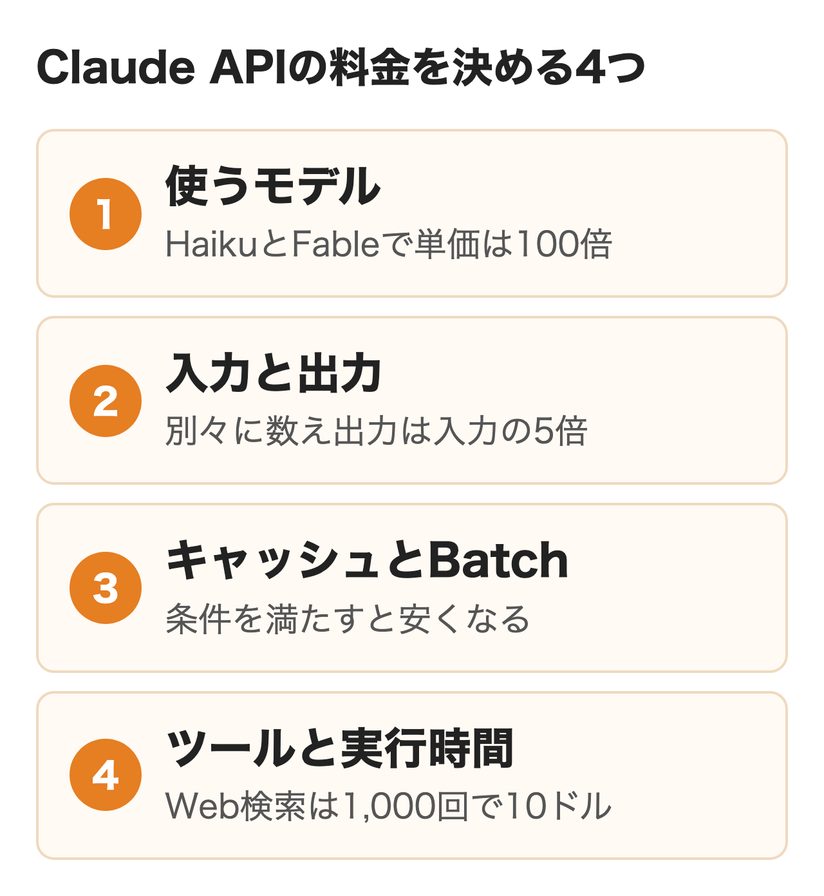
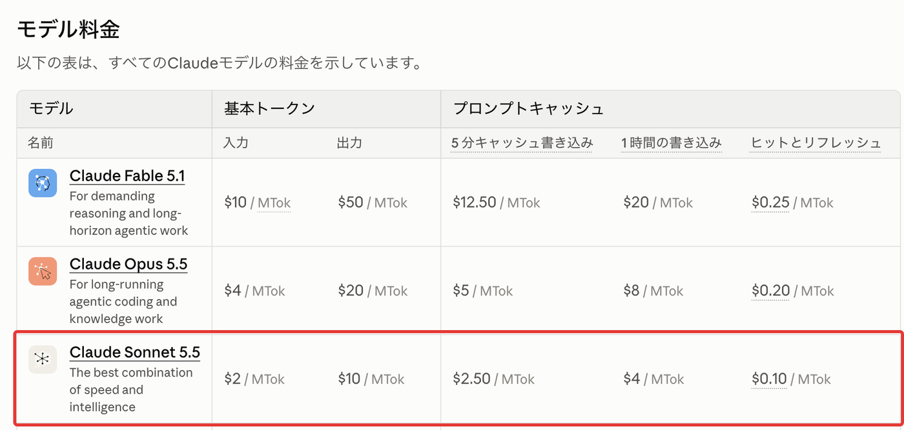
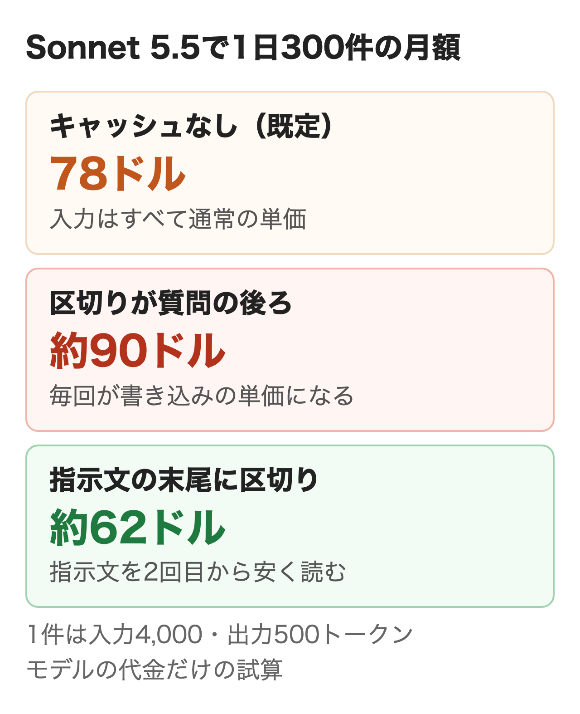
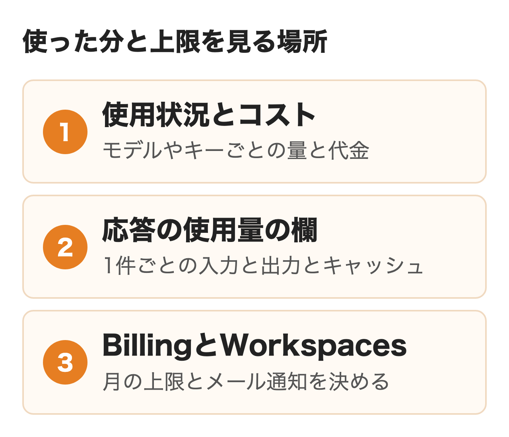

2026年11月4日のAnthropicの料金ページでは、社内の仕組みに組み込む候補になるClaude Sonnet 5.5が100万トークンあたり入力2ドル・出力10ドル、最も安いClaude Haiku 5.5が入力0.10ドル・出力0.50ドルです。

社内の問い合わせ対応や文書の要約にClaudeのAPIを使うことになり、月にいくらかかるか、どう払い、使った分と上限をどこで確かめるかを社内に説明する必要がある情シス・DX担当の方に向けて、単価と割引の条件、自社の数字で置き換えられる月額の計算例、Claude Consoleでの確かめ方をまとめました。

:::takeaways
- 料金は**モデル・入力と出力のトークン数・キャッシュとBatchの使い方・ツールの呼び出し**で決まり、定額は無い
- 1日300件の社内の問い合わせ対応なら、Sonnet 5.5で**月約78ドル（税込み約1万3,500円）**の試算。指示文の後ろにキャッシュの区切りを置くと約62ドル、区切りの位置を誤ると約90ドルに上がる
- 支払いは前払いのクレジットで、購入から1年で失効する。**月の上限はConsoleのBillingとワークスペースの支出制限で決められる**
:::

## Claude APIの料金が決まる仕組み

見積もりを頼まれて料金ページを開くと、「$2 / MTok」のような米ドルの単価が何十行も並んでいて、月の金額はすぐには出ません。MTokは100万トークンのことで、料金を動かす要素を先に4つに分けておくと表の行を読み解けます。

**Claude APIに月額の定額や初期費用は無く、使ったトークンの分だけ払う従量課金です。** トークンは文章を区切った単位で、送る指示文・会話の履歴・参照させる資料が入力、返ってくる答えが出力として別々に数えられます。現行の4つのモデルはどれも出力の単価が入力の5倍のため、長い答えを返させる使い方ほど費用が膨らみます。

<figure class="post-figure"></figure>

日本語の文章が何トークンになるかの比率は、料金ページに載っていません。料金ページの注記にあるのは、**Claude 4.7以降のモデルは新しい区切り方を使うため、同じ文章でも以前のモデルより約30%多くトークンが数えられる**という点です。旧いモデルの見積もりをそのまま新しいモデルに当てると、トークン数が少なく出ます。社内の資料が何トークンになるかは、実際の文章をトークン数を数えるAPIに通すか、試しに送った応答の使用量の欄で確かめるのが確実です。

課金されるのは成功した呼び出しだけで、エラーで失敗した要求は請求されません。ただしAnthropicのヘルプによると、成功するはずの要求を自社のシステムが途中で切断したりタイムアウトさせたりした場合は請求されます。応答を待つ時間を短く設定しすぎると、使えない答えにも代金を払うことになります。

## 個人やTeamのプランとAPIの違い

よく混同されるのが、社員が画面で使うClaudeの月額とAPIの料金です。**Pro・Max・Team・Enterpriseの月額にAPIの利用料は含まれず、APIはClaude Consoleで別に払います。** プランごとの金額と選び方は[Claudeの料金プラン](/media/claude-pricing/)にまとめています。

ただしMax・Ultra・Teamの契約には、毎月のAPIクレジットが付きます。

| 契約 | 毎月のAPIクレジット |
|---|---|
| Max | 100ドル |
| Ultra | 200ドル |
| Team スタンダード | 1人分ごとに20ドル |
| Team プレミアム | 1人分ごとに100ドル |

Teamは全員分を合わせて月500ドルが上限で、スタンダード10人分なら月200ドルです。**すでにTeamを契約している会社は、試作の段階のAPIの代金をこのクレジットで賄える可能性があります。** 受け取るにはclaude.aiの組織の設定にある請求の画面で、Claude Consoleの組織を紐づけます。Team側はオーナー、Console側はOwner・Admin・Billingのどれかの役割が要り、加入から7日たってから受け取れます。Free・Pro・Enterpriseは対象外です。

クレジットは請求の期間ごとに付与され、使い残しは期間の終わりに失効して繰り越せません。使える先はClaude API・Managed Agents・Agent SDK・ConsoleのPlaygroundで、Claude Code・アプリの追加使用量・AWSやGoogle Cloud経由の利用には使えません。Claude CodeをAPIで使う場合の費用は[Claude Codeの料金](/media/claude-code-pricing/)が扱う範囲です。

## モデル別のClaude API料金

料金ページの通常の単価です。金額は100万トークンあたりの米ドルで、税は含みません。

| モデル | 入力 | 出力 | キャッシュの読み取り | 向く使い方 |
|---|---|---|---|---|
| Claude Fable 5.1 | 10ドル | 50ドル | 0.25ドル | 長時間のエージェントの作業 |
| Claude Opus 5.5 | 4ドル | 20ドル | 0.20ドル | 込み入った判断・コード |
| Claude Sonnet 5.5 | 2ドル | 10ドル | 0.10ドル | 社内の問い合わせ・要約 |
| Claude Haiku 5.5 | 0.10ドル | 0.50ドル | 0.01ドル | 分類・抽出・振り分け |

<figure class="post-figure"><figcaption>Claude Platform Docsの料金ページ（2026年11月4日）</figcaption></figure>

**いちばん高いFable 5.1と安いHaiku 5.5では、同じ量でも100倍の差があります。** 料金ページの案内も、単純な作業はHaiku、本番の多くはSonnet、最も込み入った推論はOpusという使い分けです。社内の質問に答える程度ならSonnetとHaikuに同じ質問を送って答えの質を比べ、足りない種類の質問だけOpusに上げるのが費用の面では合理的です。

### 長い入力と旧いモデル

Claude 4.6以降のモデルは、Haiku 5.5を除いて100万トークンまで同じ単価で使えます。Haiku 5.5だけは1回のプロンプトが10万トークンを超えると入力0.50ドル・出力2.50ドルの高い単価になり、キャッシュから読んだ分も長さに数えられます。**Haiku 5.5で社内規程を丸ごと渡す作りにすると、単価が5倍の側に入ります。**

旧いモデルの方が高い点も見落とされがちです。Claude Sonnet 4.6は入力3ドル・出力15ドルで、Sonnet 5.5の1.5倍です。Claude Opus 5とOpus 4.8は入力5ドル・出力25ドルで、Opus 5.5より高く設定されています。数か月前に組んだ仕組みが旧いモデルの名前を指定したままなら、新しいモデルに替えるだけで単価が下がるかを先に確かめておくのがおすすめです。

## キャッシュとBatchの割引

同じモデルでも、送り方を変えると単価が下がる仕組みが2つあります。どちらも条件を満たさないと効かず、キャッシュは設定を誤ると逆に高くなります。

### プロンプトキャッシュの単価と既定の扱い

前と同じ指示文や資料を先頭に付けて送ると、一致した部分をキャッシュから読む安い単価になります。読み取りは通常の入力の0.1倍が基本で、Opus 5.5とSonnet 5.5は0.05倍、Fable 5.1は0.025倍です。その代わり、キャッシュに書き込む分には割増があり、5分保持なら入力の1.25倍、1時間保持なら2倍です。

**Messages APIでは、要求に`cache_control`を付けない限りキャッシュは使われず、すべての入力が通常の単価で数えられます。** 付け方は2通りです。要求の先頭に1つ付ける自動の方式は、最後のブロックに区切りを置き、会話が伸びるたびに区切りを後ろへ動かします。続いていく会話には合いますが、1回ごとに質問が変わる問い合わせ対応では、毎回変わる質問の後ろに区切りが置かれます。プロンプトキャッシュの説明でも「よくある間違い」として挙げられている形で、毎回の入力が書き込みの単価で数えられ、読み取りは一度も起きません。

指示文と社内資料のように毎回同じ部分を先頭に置き、その末尾のブロックに区切りを明示すると、2回目からはそこまでがキャッシュから読まれます。5.5系のモデルでキャッシュできるのは512トークン以上で、短い指示文は区切りを付けてもエラーにならずに素通りします。キャッシュはワークスペースごとに分かれるため、同じ指示文を使う仕組みを別のワークスペースに分けると、それぞれで書き込みが発生してしまう点に注意が必要です。

### Batchで半額

Message Batches APIで要求をまとめて送ると、入力も出力も半額になります。Sonnet 5.5なら入力1ドル・出力5ドル、Haiku 5.5なら0.05ドル・0.25ドルです。結果はすぐには返らないため、社員が画面で待つ処理には使えません。キャッシュの割引とは重ねられるので、**夜のうちに済めばよい要約や分類は、Batchとキャッシュの両方を当てると最も安くなります。**

### 速さと処理する場所の上乗せ

反対に単価が上がる指定もあります。出力を速くするFast modeは、Opus 5.5で入力8ドル・出力40ドルと通常の2倍で、Batchとは併用できません。Claude 4.6以降のモデルで処理を米国内に限る指定（`inference_geo`を`us`）をすると、入力・出力・キャッシュのすべてが1.1倍になります。料金ページに載っている処理の場所の指定は米国だけで、既定は場所を限らない扱いの標準の単価です。

## ツールとエージェントの料金

モデルにWeb検索などのツールを使わせると、トークンとは別の料金や、ツールの定義の分の入力トークンが加わります。

| 機能 | 料金 | 注意点 |
|---|---|---|
| Web検索 | 1,000回で10ドル | 検索結果は入力として課金。失敗した検索は無料 |
| Webページの取得 | 追加料金なし | 取得した本文が入力になる（平均的なページで約2,500トークン） |
| コード実行 | 組織あたり月1,550時間まで無料 | 超えると1コンテナ1時間0.05ドル。Web検索か取得と一緒なら無料 |
| Managed Agents | 実行中1時間0.08ドル | トークンの代金は別。Batchの割引は無い |

ツールを1つでも渡すと、ツールを使うための指示が入力に加わります。5.5系では1回につき286トークンほどで、件数が多い仕組みでは無視できない量です。Webページの取得は無料でも、500KBのPDFなら約12万5,000トークンが入力になるため、取得する長さの上限（`max_content_tokens`）を決めておくと代金の振れ幅が小さくなります。

## 社内の問い合わせ対応の月額

社員から総務や情シスへの問い合わせに、社内の規程を参照してAPIが答える仕組みを想定して、モデルの代金を数えます。自社の件数とトークン数に置き換えれば同じ式で出せます。

| 前提 | 値 | 置き換える所 |
|---|---|---|
| 1日の件数 | 300件 | 社員数×1人あたりの件数 |
| 月の営業日 | 20日 | 自社の営業日 |
| 1件の入力 | 4,000トークン（指示文1,500＋規程の抜粋2,000＋質問と履歴500） | 渡す資料の長さ |
| 1件の出力 | 500トークン | 答えの長さ |
| キャッシュ | 使わない（既定） | 区切りの置き方 |

この前提で月の入力は2,400万トークン、出力は300万トークンです。式は「月の入力トークン÷100万×入力の単価＋月の出力トークン÷100万×出力の単価」です。円は三菱UFJ銀行の2026年11月2日の公表仲値（1ドル157.80円）で換算し、消費税10%を足しました。

| モデル | 入力の代金 | 出力の代金 | 月額（ドル） | 円・税込の目安 |
|---|---|---|---|---|
| Haiku 5.5 | 2.4ドル | 1.5ドル | 3.9ドル | 約680円 |
| Sonnet 5.5 | 48ドル | 30ドル | 78ドル | 約1万3,500円 |
| Opus 5.5 | 96ドル | 60ドル | 156ドル | 約2万7,100円 |
| Fable 5.1 | 240ドル | 150ドル | 390ドル | 約6万7,700円 |

<figure class="post-figure"></figure>

**この規模なら、Sonnet 5.5で組んでもモデルの代金は月100ドルに届きません。** キャッシュの置き方で、この78ドルは上にも下にも動きます。自動のキャッシュだけを付けると、毎回の入力4,000トークンがすべて書き込みの単価で数えられ、月約90ドル（約1万5,600円）に上がります。指示文1,500トークンの末尾に区切りを明示し、1日20回は書き込みが起きる前提で数えると、月約62ドル（約1万800円）です。Opus 5.5なら同じ置き方で月約125ドルになります。

金額を動かすもう1つの要素は、1件で渡す資料の長さです。規程の抜粋を毎回1万トークン渡す作りにすると、キャッシュを使わないSonnet 5.5で月約174ドルになり、件数を増やすより先に代金が倍を超えます。**月額を下げたいときは件数より先に、渡す資料の長さと毎回同じ部分をキャッシュに乗せられているかを見直します。**

件数を10倍の1日3,000件に広げると、Sonnet 5.5でキャッシュを使わなければ月約780ドルです。後で説明する最初の段階（Startティア）の月の上限は500ドルのため、全社に広げる前に次の段階へ上げる手続きが要ります。

### 夜間の一括処理はBatchで半額

日中に届いた問い合わせの記録を、夜のうちに分類して要約する処理も数えておきます。1日2,000件、1件の入力2,000トークン・出力200トークンで30日動かすと、月の入力は1億2,000万トークン、出力は1,200万トークンです。

| モデル | 通常 | Batch |
|---|---|---|
| Haiku 5.5 | 18ドル | 9ドル |
| Sonnet 5.5 | 360ドル | 180ドル |

結果が翌朝そろえばよい処理なので、Batchに回すだけでSonnet 5.5なら月180ドル下がります。分類のような決まった作業はHaiku 5.5で質が足りるかを先に試すと、さらに1桁下げられます。

### モデル以外にかかる費用

上の金額はモデルの代金だけです。社内の文書を探して渡す部品やサーバーの費用は別にかかり、その考え方は[RAG構築の費用](/media/rag-build/)にあります。規模の大きい仕組みほど、画面や社内システムとのつなぎ込みを作る開発費と保守の費用がモデルの代金を上回りがちです。外部に開発を頼む場合は見積もりのAPIの欄にどのモデルとキャッシュの前提を置いたかを聞いておくと、稟議で月額の根拠を示せます。

## 支払いと請求書

**ConsoleでAPIを使う組織の多くは前払いで、先にクレジットを買い、使った分が残高から引かれます。** 購入できるのはAdminかBillingの役割を持つ人で、場所はConsoleのBillingのページです。

| 項目 | 内容 |
|---|---|
| 支払い方法 | 主要なクレジットカード。営業経由の契約なら請求書払い |
| 有効期限 | 購入から1年で失効・延長できない |
| 返金 | できない |
| 自動リロード | 残高がしきい値を下回ると、決めた残高まで買い足す |
| 残高が尽きたとき | 追加するまでAPIを呼べない |
| 消費税 | 2026年4月1日から10%が加わる |

自動リロードはしきい値と戻す先の残高を入れてオンにし、オンにした時点で残高がしきい値を下回っていれば、すぐに税込みの額が請求されます。残高が尽きるとAPIが止まるため、**社員が使う仕組みを動かすなら、自動リロードの額と後で説明する月の上限を一緒に決めておく**のがおすすめです。新規の利用者には少額の無料クレジットが付くと料金ページにはありますが、額は書かれていません。

単価表の金額は税抜きの米ドルです。Anthropicの告知では、2026年4月1日から日本の顧客に提供するサービスに10%の消費税を別に請求し、適格請求書発行事業者の登録番号はT7700150134388です。請求の通貨は米ドルのままで、消費税の額が円で記載されます。

前払いの組織にはクレジットを買うたびに受領書がメールで届き、自動リロードで買った分も同じです。ConsoleのBillingのページにある請求履歴からも取り出せ、0.50ドル未満の請求は次の請求に繰り越されます。営業を通じて請求の契約を結んだ組織は、暦月の終わりにまとめて請求書を受け取る後払いになります。宛名や受け取り先の詳細は[Claudeの領収書](/media/claude-invoice/)にまとめました。

## 使用量と上限の確かめ方

使った分と上限を確かめる場所は、Consoleの使用状況とコストのページ・応答の使用量の欄・BillingとWorkspacesの上限の設定の3つです。

<figure class="post-figure"></figure>

### Consoleの使用状況とコスト

ConsoleのUsage（platform.claude.com/usage）では、使ったトークン数をモデル・日時・APIキーごとに見られ、ワークスペース・モデル・月・キーで絞り込めます。レート制限に当たって断られた要求の数と、1分あたりの量が制限のどこまで来ているかのグラフもここにあります。Cost（platform.claude.com/cost）は代金の側で、モデル別・日別の金額と、Web検索やコード実行の分を含めた合計が出ます。

どちらもCSVで書き出せ、見られるのは開発者・請求・管理者の役割を持つ人です。**ヘルプによると、使用量や代金を個人ごとに分けて見ることは今はできません。** 部門やアプリごとに代金を割り振るなら、ワークスペースを分けてAPIキーをそれぞれで発行しておきます。キーは作ったワークスペースに紐づき、後から別のワークスペースへ移せないため、分け方は最初に決めておく必要があります。

### 1件ごとの使用量

APIの応答にはその要求で使ったトークン数が`usage`の欄で返ってきます。`input_tokens`はキャッシュの区切りより後ろの入力だけで、`cache_creation_input_tokens`（書き込み）と`cache_read_input_tokens`（読み取り）を足したものが入力の全体です。Web検索を使えば、その回数も`server_tool_use`に入ります。

書き込みばかりで読み取りが0のまま続くなら、キャッシュの区切りの位置が誤っています。この4つの数を自社の記録に残しておけば、部門別や機能別の代金を自分で集計でき、Costのページとの照合にも使えます。

### 支出の上限とワークスペース

月の上限は次の3つの段階です。

| 種類 | 上限 | 達するとどうなるか |
|---|---|---|
| ティアの上限 | Start 500ドル・Build 1,000ドル・Scale 20万ドル | 翌月1日9時（日本時間）まで429のエラーで止まる |
| 組織の独自の上限 | ティアの上限以下で自由に決める | 400のエラーで止まる。上げれば戻る |
| ワークスペースの上限 | 組織の上限以下 | そのワークスペースだけ止まる。金額ごとのメール通知を付けられる |

ティアは使った履歴とアカウントの状態で自動で上がり、新しい組織は標準より低いEvaluationの段階から始まることもあるため、今のティアはConsoleのRate limitsのページで確かめておくのが安全です。急ぐ場合は同じページの「Request tier increase」から引き上げを申し込みます。**ティアの上限で止まると、SDKの自動の再試行も翌月まで失敗し続けるため、本番の前に見込みの月額と今のティアを比べておくのが無難です。** TeamやMaxのクレジットを紐づけた組織は少なくともStartに、月のクレジットが200ドルを超えればBuildに引き上げられます。

組織の独自の上限はConsoleのBillingのページの「Spend limits」で金額を入れて決めます。ワークスペースの上限はWorkspacesのページでワークスペースを選び、「支出制限」で月の上限とメール通知の金額を設定する手順です。最初からあるDefaultのワークスペースには上限を付けられないため、**本番の仕組みは専用のワークスペースに置き、そこに上限と通知を付ける**のが確実です。キーが外に漏れたときの被害も、そのワークスペースの上限までに抑えられます。

## AWSやGoogle Cloud経由で払う場合

ClaudeのモデルはAnthropicのConsoleのほかにクラウドの事業者経由でも使えます。すでにAWSやGoogle Cloudで請求をまとめている会社では、こちらの方が社内の手続きが短く済むことがあります。

| 経路 | 請求 | 単価 | 月のAPIクレジット |
|---|---|---|---|
| Claude API（Console） | Anthropicへ前払い（米ドル） | 料金ページのとおり | 使える |
| Claude Platform on AWS | AWSの請求に後払い | Claude APIと同じ | 使えない |
| Amazon Bedrock・Google Cloud（Vertex AI） | 各クラウドの請求 | 各社の料金ページ | 使えない |

Claude Platform on AWSはAnthropicが運営する経路で、AWS Marketplaceを通して1単位0.01ドルの換算で請求され、前払いのクレジットはありません。Microsoftの経路（Microsoft Foundry）も、Azure Marketplaceを通して同じ形で請求されます。BedrockとGoogle Cloudはクラウドの事業者が請求し、Claude 4.5以降のモデルで地域を限るエンドポイントを選ぶと、限らない場合より10%高くなります。

**単価だけでは差が見えにくいため、比べるのは請求の窓口・月の上限で止められるか・処理する場所・クレジットが使えるかの4つです。** OpenAIのAPIと比べる場合の観点は[OpenAI APIの料金](/media/openai-api-pricing/)、手続きの全体は[Claudeの法人契約](/media/claude-corporate-contract/)にあります。

社内のAIをAPIでどこまで組むか、どのモデルとキャッシュの置き方で始めるかを決めきれない場合は、nitoの[AIエージェント構築支援](/ai-agent/)で要件の整理から相談できます。

## まとめ

- **まず試す段階なら**、Sonnet 5.5とHaiku 5.5に同じ質問を送り、答えの質と1件あたりのトークン数を測る。TeamやMaxを契約していれば、APIクレジットを先に紐づける
- **社内に配る段階なら**、件数×1件のトークン数で月額を出し、ティアの上限に収まるかを見る。専用のワークスペースに上限とメール通知を付けてから公開する
- **月額が膨らむときは**、毎回同じ部分の末尾にキャッシュの区切りを置けているかを応答の使用量で確かめ、待てる処理はBatchに回す

## よくある質問

### Claude APIは1回いくらかかりますか？

1回の代金は決まっておらず、送ったトークン数と返ってきたトークン数にモデルの単価を掛けて決まります。Sonnet 5.5で入力4,000トークン・出力500トークンなら1回0.013ドルで、1ドル157.80円なら約2円です（税抜き）。

### Claude APIに無料枠はありますか？

料金ページには新規の利用者にAPIを試すための少額の無料クレジットが付くとありますが、額は書かれていません。MaxとUltraとTeamの契約には、毎月のAPIクレジットが付きます。

### Claude APIはProプランで使えますか？

Proの月額にAPIの利用料は含まれず、APIはConsoleで別に払います。Proは毎月のAPIクレジットの対象外です。

### Claude APIの料金は円で払えますか？

単価もクレジットも米ドルで、円では払えません。2026年4月1日からは10%の消費税が加わり、請求書には消費税の額が円で記載されます。

### Claude APIのキーの発行に料金はかかりますか？

料金ページで課金の対象として挙がっているのはトークン・ツールの呼び出し・実行時間で、キーの発行は載っていません。代金がかかるのはキーを使って要求を送ったときです。

### Claude APIの使いすぎを止められますか？

ConsoleのBillingで組織の月の上限を、Workspacesでワークスペースごとの上限とメール通知を決められます。上限に達した後の要求はエラーになり、上限を上げるか翌月になるまで止まります。

## 出典

- Anthropic「[料金](https://platform.claude.com/docs/ja/about-claude/pricing)」（2026年11月4日取得）
- Anthropic「[Maxプラン、Ultraプラン、およびTeamプランのAPIクレジット](https://platform.claude.com/docs/ja/about-claude/api-credits-for-subscribers)」（同）
- Anthropic「[レート制限](https://platform.claude.com/docs/ja/api/rate-limits)」（同）
- Anthropic「[プロンプトキャッシング](https://platform.claude.com/docs/ja/build-with-claude/prompt-caching)」（同）
- Claude ヘルプセンター「[Claude APIの使用料金をどのように支払いますか？](https://support.claude.com/ja/articles/8977456)」（同）
- Claude ヘルプセンター「[日本の顧客向け消費税（JCT）に関するお知らせ](https://support.claude.com/ja/articles/14051822)」（同）
- Claude Help Center「[Understanding your Claude API invoices](https://support.claude.com/en/articles/16608069-understanding-your-claude-api-invoices)」（同）
- Claude ヘルプセンター「[Claude コンソールのコストと使用状況レポート](https://support.claude.com/ja/articles/9534590)」（同）
- Claude ヘルプセンター「[Claude コンソールでワークスペースを作成・管理する](https://support.claude.com/ja/articles/9796807)」（同）
- 三菱UFJリサーチ&コンサルティング「[2026年11月2日の為替相場](https://www.murc-kawasesouba.jp/fx/past/index.php?id=261102)」（同）
