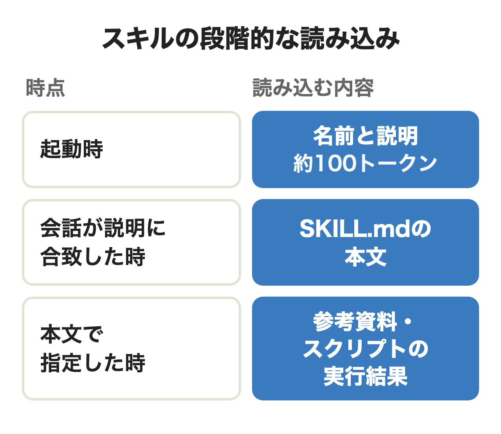

Anthropicは2025年10月16日にAgent Skills（スキル）を発表し、12月18日にはオープンな規格として公開しました。Claude Codeでは `SKILL.md` を1つ置くだけで、チームの手順をClaudeに覚えさせられます。

使い始めたチームで次に困るのは、作ったスキルをどこに置けば全員に届くのか、人が作ったスキルをそのまま入れてよいのかです。この記事は公式ドキュメントをもとに、仕組みと作り方・使い方を押さえたうえで、配り方と入れる前の確認を表にします。

:::takeaways
- スキルは手順や資料を入れたフォルダで、ふだんは名前と説明だけが読み込まれ、本文は使うときに読まれる
- 置き場所で届く範囲が変わる。チームならリポジトリにコミット、複数のリポジトリならプラグイン、全社なら管理設定
- 人が作ったスキルはソフトウェアのインストールと同じ扱い。スクリプト・allowed-tools・外への通信を読んでから入れる
:::

## Claude Code Skillsとは

**Claude Code Skillsは、Claudeに特定の作業のやり方を教えるためのフォルダです。** 中心は `SKILL.md` で、先頭の設定欄（フロントマター）に名前と説明を書き、その下に手順を書きます。必要ならスクリプトや参考資料のファイルも同じフォルダに入れられます。Claudeは会話が説明に合うと自分でスキルを読み込み、人が `/スキル名` と打って呼ぶこともできます。

公式ドキュメントが挙げるスキルを作る目安は、「同じ指示、チェックリスト、または複数ステップの手順をチャットに何度も貼り付けている場合」です。毎回同じ説明をしている作業が、スキルにする候補です。

以前からあったカスタムコマンド（`.claude/commands/` のMarkdown）は、いまはスキルに統合されています。`.claude/commands/deploy.md` と `.claude/skills/deploy/SKILL.md` はどちらも `/deploy` になり、古いコマンドファイルもそのまま動きます。

同じフォルダを規格に対応する他のAIツールで読めるのは、形式がAgent Skillsというオープンな規格に沿っているからです。Claude Codeはこの規格に、呼び出す人の制御・サブエージェントでの実行・コマンド結果の差し込みといった機能を足しています。

<figure class="post-figure"></figure>

Claude Codeには最初から入っているバンドルスキルもあり、`/code-review`・`/debug`・`/loop`・`/verify` などがあります。

## CLAUDE.md・MCP・サブエージェント・フックとの違い

Claudeを拡張する手段はスキルのほかにもあり、読み込まれ方と向く用途が違います。迷いやすい5つの比較は次の表のとおりです。

| 拡張 | 読み込まれ方 | 向いている用途 |
|---|---|---|
| CLAUDE.md | 毎回のセッションで全文 | 常に守る規約・ビルドコマンド |
| スキル | 説明は毎回、本文は使うとき | 手順・チェックリスト・参考資料 |
| MCP | 外部サービスにつなぐ | データベースやSlackなどの操作 |
| サブエージェント | 別の文脈で動き要約を返す | 多くのファイルを読む調査・並列作業 |
| フック | 決まったイベントで必ず動く | 編集後のlintや危ない操作の拒否 |

**常に必要ならCLAUDE.md、ときどき必要ならスキルに書くと分けられます。**

MCPとは競合しません。MCPが接続を受け持ち、スキルがそのスキーマや問い合わせの書き方を教える、という組み合わせを公式は例に挙げています。

見落としやすいのはフックとの違いです。公式は「`.env` は決して編集しない」のような指示をCLAUDE.mdやスキルに書いても「要望であり、保証ではありません」としています。**公式は必ず守らせたい決まりをフックに移し、判断しながら当てはめる手順をスキルに残すよう勧めています。**

## スキルが読み込まれる仕組み

スキルは3段階で読み込まれます。起動時に入るのは各スキルの名前と説明だけで、仕様では1つあたり約100トークンです。会話が説明に合うと `SKILL.md` の本文が読まれ、本文で指したファイルやスクリプトは必要なときだけ使われます。スクリプトで文脈に入るのは実行結果だけです。

Claude Codeでは、説明（`description` と `when_to_use` の合計）が1つあたり1,536文字で切られます。スキルの一覧全体にもコンテキストの1%という枠があり、超えると呼び出しの少ないスキルから説明が削られます。**説明の最初に主な用途を書いておくと、切られても判断に要る語が残ります。**

一度呼んだスキルの本文はその後のターンにも残りますが、ファイルは読み直されません。作業の間ずっと効かせたい指示は、「編集のたびにテストを回す」のように作業全体にかかる書き方にします。会話が自動で圧縮されたときに戻るのは各スキルの先頭5,000トークンまでなので、重要な指示は `SKILL.md` の上に置きます。

## SKILL.mdの作り方

**作り方はフォルダを作って `SKILL.md` を1つ置くだけで、追加の登録は要りません。** 

1. フォルダを作る。自分用なら `mkdir -p ~/.claude/skills/summarize-changes`、リポジトリの皆で使うなら `.claude/skills/` の下に作る
2. `SKILL.md` を書く。先頭の `---` で囲んだ欄に `description`、その下に手順を書く。公式の例は本文に `` !`git diff HEAD` `` を入れ、実行時の差分を差し込んでいる
3. 試す。説明に合う質問で自動で呼ばれるかを見て、`/summarize-changes` でも呼んでみる

追加や編集は再起動なしで反映されます。セッションの開始後に新しく作ったトップレベルのフォルダだけは、`/reload-skills` で読み込ませます。

フロントマターの項目はすべて省略でき、公式が推奨するのは `description` だけです。主なものを並べます。

| 項目 | 役割 |
|---|---|
| name | コマンド名。省略するとフォルダ名 |
| description | 何をするか・いつ使うか。自動で呼ぶ判断に使う |
| disable-model-invocation | true で人が呼んだときだけ動く |
| user-invocable | false で/メニューから消えClaudeだけが使う |
| context と agent | fork でサブエージェントとして実行 |

`description` は一番効く欄です。Anthropicのベストプラクティスは、悪い例に「Helps with documents」を挙げ、良い例には何をするかと「Use when〜」の使う場面を両方書いています。

長くなったら分けるのが基本です。公式は `SKILL.md` を500行未満に保ち、詳しい資料は `reference.md` などに移して本文からリンクするよう勧めています。リンクは本文から1段だけにします。たどらせすぎると、Claudeが先頭だけ読んで済ませることがあるためです。名前は規格では小文字・数字・ハイフンで64文字まで、説明は1,024文字までです。

## Claude Code Skillsの使い方

使い方は自動と手動の2通りです。**既定では人もClaudeもどのスキルも呼べ、2つの項目でこれを絞ります。** `disable-model-invocation: true` なら人が呼んだときだけ動き、`user-invocable: false` ならClaudeだけが使えます。

デプロイやSlackへの投稿のように副作用がある手順は、`disable-model-invocation: true` にしておくよう公式は勧めています。

`allowed-tools` は誤解されやすい項目です。呼んだターンの間だけ確認なしで使えるツールを足す設定で、使えるツールを絞るものではありません。絞りたいときは `disallowed-tools` か権限設定の拒否ルールを使います。

`` !`コマンド` `` は、本文がClaudeに渡る前にシェルで実行され、その出力に置き換わります。PRの差分を取り込んでから要約させる、といった使い方です。

## チームで配る置き場所と配り方

**どこに置くかで、スキルが誰に届くかが決まります。** 

| 置き場所 | 書く場所 | 届く範囲 | 向いている場面 |
|---|---|---|---|
| 個人 | ~/.claude/skills/ | 自分のPCの全プロジェクト | 自分の好みや試作 |
| プロジェクト | リポジトリの .claude/skills/ | コミット後はそのリポジトリで作業する全員 | チームの手順 |
| プラグイン | プラグインの skills/ | プラグインを入れた人 | 複数のリポジトリで同じセット |
| 管理設定 | 管理設定ディレクトリの .claude/skills/ | 組織がデプロイしたPCの全ユーザー | 全社で必ず使わせたいもの |

同じ名前が重なったときは管理設定が個人より、個人がプロジェクトより優先されます。プラグインのスキルは `/プラグイン名:スキル名` と名前空間が付くため、ぶつかりません。

迷ったら、まずプロジェクトに置いてコミットします。公式は「2つ目のリポジトリで同じセットアップが必要になった」ときにプラグインにまとめるよう書いています。プラグインはスキル・フック・MCPサーバーなどを1つにまとめた単位で、社内のGitHubリポジトリに `.claude-plugin/marketplace.json` を置けば社内用のマーケットプレイスになります。

全社で配るなら管理設定です。経路はサーバー管理設定・MDM・`managed-settings.json` の3つで、`extraKnownMarketplaces` と `enabledPlugins` を組み合わせると、社内のプラグインを全員のPCに入れられます。

**クラウドには落とし穴が一つあります。クラウドのセッションとクラウドのスケジュールタスクは、PCの `~/.claude/skills/` を読みません。** 個人の場所にしかないスキルをクラウドのタスクから呼ぶと、スキルが見つからないと返されるだけです。使わせたいなら、claude.aiのアカウントでそのスキルを有効にするか、リポジトリの `.claude/skills/` にコミットします。プラグインも同じで、PCで入れたものやリポジトリの `.claude/settings.json` で有効にしたものはクラウドのセッションに入りません。クラウドまで届くのは claude.aiの管理画面から配るサーバー管理設定のプラグインです。

claude.ai側から配る道もあります。TeamとEnterpriseではオーナーが組織にスキルをプロビジョニングでき、Claude Code v2.1.273以降は同じアカウントのターミナルにも同期されます。同期されないのはAPIキーやAmazon Bedrockで動かしているClaude Codeです。

会社で入れるときは誰が作り誰が確かめて配るかを先に決めておくと後で揉めません。nitoの[AIエージェント構築支援](/ai-agent/)でも、この置き場所と確認の流れから一緒に組んでいます。

## 入れる前に確かめること

**人が作ったスキルはソフトウェアをインストールするのと同じ重さで扱います。** Anthropicの文書は、使うのは自分で作ったものかAnthropicのものに限るよう勧め、悪意のあるスキルがデータを外に送る危険を挙げています。承認の前に見る項目は次のとおりです。

| 見る所 | 何を探すか | 公式の重さ |
|---|---|---|
| スクリプト | .py・.sh・.js などの実行ファイル | 高 |
| 指示の書き方 | 安全の決まりを無視させる・操作を隠させる文 | 高 |
| MCPの参照 | ServerName:tool_name の形のツール指定 | 高 |
| 外への通信 | URL・curl・fetch・requests | 高 |
| 認証情報 | APIキーやパスワードの直書き | 高 |
| ファイルの範囲 | スキルのフォルダ外や ../ を指すパス | 中 |

Claude Code特有の注意点として `allowed-tools` があります。この欄は一度も信頼していないフォルダでもプロジェクトのスキルに適用される、というのが公式の記述です。**他人のリポジトリでClaude Codeを動かす前に、そこにコミットされているスキルの `allowed-tools` を先に読んでおくと安全です。** 

`` !`コマンド` `` は、スキルを呼んだ時点で確認の画面を出さずに実行されます。自動モード以外では権限ルールで許可されていないコマンドは止まります。ただしスキルの `allowed-tools` で許可されていれば実行されるため、2つを合わせて読みます。全社で止めたいときは管理設定で `disableSkillShellExecution` をtrueにします（バンドルスキルと管理設定のスキルは対象外）。

プラグインで入れるときは公式のセキュリティのページにある手順で中身を確かめます。

1. `claude plugin marketplace list` で、マーケットプレイスがどこから追加されたかを見る
2. `/plugin` の詳細で「Will install」の欄を読み、入るスキル・フック・MCPサーバーを確かめる
3. ソースの `hooks/hooks.json`・`.mcp.json`・`bin/` を開き、何が実行されるかを読む

一度確かめても安心はできません。自動更新がオンだと、確かめたファイルが後から変わることがあります。社内で配るなら、管理設定の `strictKnownMarketplaces` で社内とAnthropic公式だけに絞る形を公式は例に挙げています。

## おすすめのスキルと一覧の探し方

**最初は自作するより、Anthropicが管理しているものから試すのが安全です。** 探す先を確かめやすい順に並べます。

| 探す先 | 中身 | 入れ方 |
|---|---|---|
| バンドルスキル | /code-review・/debug・/verify など | 最初から入っている |
| 公式マーケットプレイス | 317のプラグイン。Anthropicが作ったものは約40で、残りは提携先などが作ったもの（2026年11月7日時点） | /plugin の Discover |
| anthropics/skills | 19のスキル例 | /plugin marketplace add anthropics/skills |
| 第三者のリポジトリ | 有志がまとめたスキル集 | 中身を読んでから |

公式マーケットプレイス（`claude-plugins-official`）は、対話型のターミナルを初めて開いたときに自動で追加されます。スキルを作る人に役立つのは、作成と評価を手伝う `skill-creator` です。ほかにコミットからPR作成までの `commit-commands`、CLAUDE.mdを点検する `claude-md-management` があります。公式マーケットプレイスに載っていても、作り手が提携先のものは前の節の手順で中身を読みます。

anthropics/skillsには、Word・Excel・PowerPoint・PDFを扱う文書スキルや `frontend-design` などが入っています。READMEは「デモと教育目的」と断っており、文書の4つはソース公開でオープンソースではありません。

第三者のスキル集もあります。alirezarezvani/claude-skillsは410以上のスキルを集め、GitHubのスターは約2.9万です（2026年11月7日時点）。**使うものだけを選んで前の節の表で読み、プロジェクトにコミットしてから配る**のが無理のない進め方です。

## うまく動かないときの直し方

呼ばれないときは説明にユーザーが言う語を入れて `/スキル名` で直接呼び、呼ばれすぎるときは説明を具体的にするか手動専用にします。途中で従わなくなるときの直し方は、必ず守る決まりをフックへ移し重要な指示を本文の上に置くことです。説明が切れているときは使っていないスキルを `/skill-doctor` で探して止めます。

`/名前` では動くのに自動で呼ばれないときは、`claude plugin validate .claude/skills` でフロントマターの崩れを探します。

効いたかどうかはスキルありとなしで同じ質問を新しいセッションに投げて比べます。企業向けの文書は呼ばれるべき質問・呼ばれるべきでない質問・あいまいな質問を3〜5件用意し、別の人が確かめる体制を求める内容です。

## まとめ

- 自分の作業を楽にしたいだけなら、`~/.claude/skills/` に1つ作り、説明に使う場面を書いて試す
- チームの手順を揃えたいなら、リポジトリの `.claude/skills/` に置いてコミットし、PRでレビューする
- 複数のリポジトリや部署で使うなら、プラグインにまとめて社内のマーケットプレイスから配る
- 全社で統制したいなら、管理設定で配る先と許すマーケットプレイスを決め、`allowed-tools` とシェル実行の扱いも決めておく
- 人が作ったスキルは、スクリプトと外への通信を読んでから入れる

## よくある質問

### Claude Code Skillsは無料で使えますか？

Claude Code自体はProやMaxなどの有料プランかAPIの従量課金で使います。スキルの説明は使わなくても毎ターンの文脈に入ります。呼べば本文も読み込まれるため、その分だけプランの使用量が増えます（APIなら料金に出ます）。

### Claude CodeのスキルとCLAUDE.mdの違いは？

毎回守らせる規約はCLAUDE.md、ときどき使う手順や参考資料はスキルに書くのが基本です。公式の目安はCLAUDE.mdが200行を超えてきたら手順の部分をスキルに移すことです。

### Claude Codeの古いコマンドは使えますか？

使えます。`.claude/commands/` のファイルはスキルと同じ `/名前` で動きます。補助ファイルも置きたいなら、スキルの形に移します。

### Claude Codeのスキルはclaude.aiと共通？

同じ形式ですが、置き場所は別です。claude.aiで有効にしたスキルは、同じアカウントでサインインしたClaude Codeに同期されます。claude.aiやAPIにアップロードするときは、Claude Codeの独自項目を含めるとエラーで止まるため、共通に使うなら規格の6項目に絞ります。

### Claude Codeのスキルは何個まで入れられますか？

数の上限は書かれていませんが、説明の一覧にはコンテキストの1%という枠があり、多いと説明が削られます。

### Claude Codeのスキルを社内で配る注意点は？

クラウドのセッションはPCの個人スキルや、PCで入れたプラグインを読まないこと、`allowed-tools` は信頼していないフォルダでも効くこと、プラグインは自動更新で中身が変わり得ることの3つです。

## 出典

すべて2026年11月7日に取得。

- Claude Code Docs「[Claude をスキルで拡張する](https://code.claude.com/docs/ja/skills)」
- Claude Code Docs「[Claude Code を拡張する](https://code.claude.com/docs/ja/features-overview)」
- Claude Code Docs「[プラグインの概要](https://code.claude.com/docs/ja/plugins/overview)」
- Claude Code Docs「[組織向けの Claude Code プラグインを管理する](https://code.claude.com/docs/ja/plugins/org)」
- Claude Code Docs「[プラグインのセキュリティと信頼](https://code.claude.com/docs/ja/plugins/security)」
- Claude Platform Docs「[Agent Skills](https://platform.claude.com/docs/en/agents-and-tools/agent-skills/overview)」
- Claude Platform Docs「[Skill authoring best practices](https://platform.claude.com/docs/en/agents-and-tools/agent-skills/best-practices)」
- Claude Platform Docs「[Skills for enterprise](https://platform.claude.com/docs/en/agents-and-tools/agent-skills/enterprise)」
- Agent Skills「[Specification](https://agentskills.io/specification)」
- Anthropic「[エージェントスキルの紹介](https://www.anthropic.com/news/skills)」（2025年10月16日、12月18日追記）
- Anthropicヘルプセンター「[Claudeでスキルを使用する](https://support.claude.com/ja/articles/12512180)」
- GitHub「[anthropics/skills](https://github.com/anthropics/skills)」「[anthropics/claude-plugins-official](https://github.com/anthropics/claude-plugins-official)」
- Claude Code Docs「[Anthropicのマーケットプレイス](https://code.claude.com/docs/en/plugins/anthropic-marketplaces)」「[クラウド環境](https://code.claude.com/docs/en/cloud-environments)」
- GitHub「[claude-plugins-official の marketplace.json](https://github.com/anthropics/claude-plugins-official/blob/main/.claude-plugin/marketplace.json)」
- GitHub「[alirezarezvani/claude-skills](https://github.com/alirezarezvani/claude-skills)」
