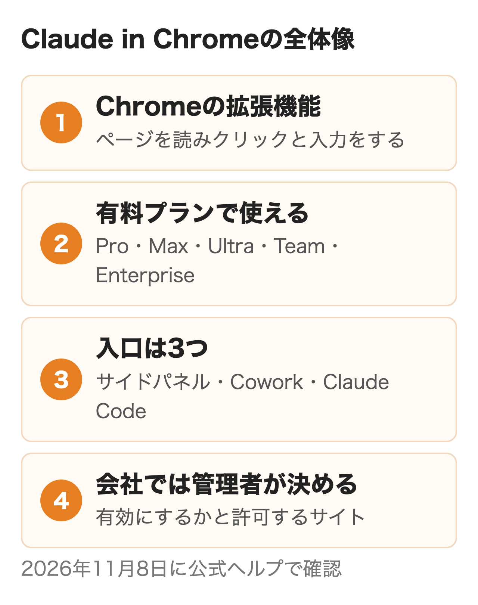
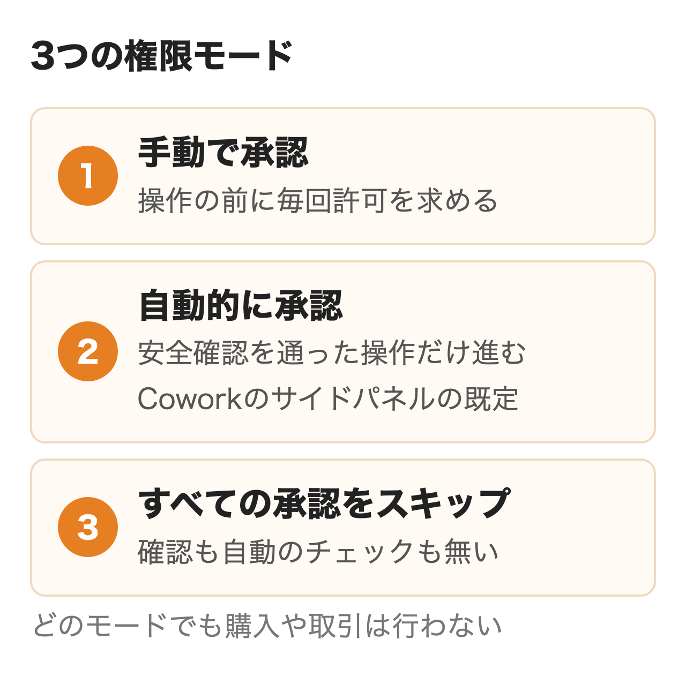
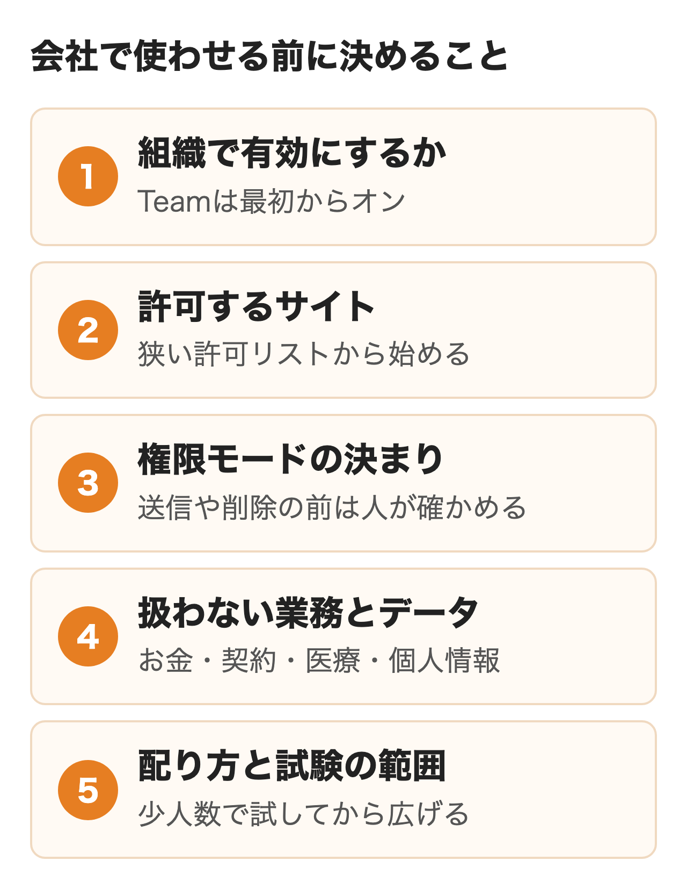
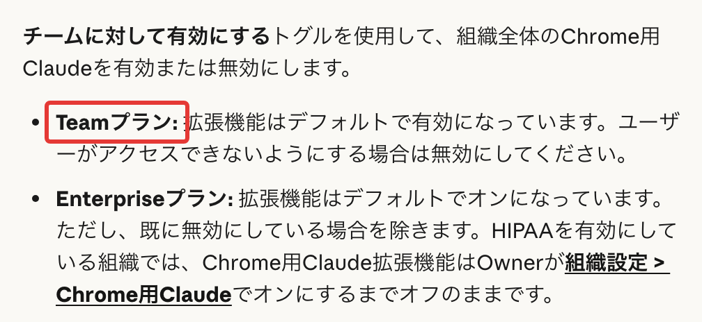

Claude in Chromeは、AnthropicのAIであるClaudeがChromeの中でページを読み、クリックや入力まで行う拡張機能です。2026年8月26日にClaudeの有料プランすべてで一般提供が始まり、操作ごとに承認しなくても作業を進められるようになりました。ベータ版と書いた解説が多いものの、提供の扱いは8月の発表が新しい情報です。

社員に使わせてよいかを決める立場なら、何ができるかと同じくらい、どこまで任せるかが判断の中心になります。この記事ではできること・プランと料金・入れ方を公式ヘルプで確かめたうえで、会社で使わせる前に管理者が決めておく設定と安全面をまとめます。

:::takeaways
- 有料プラン（Pro・Max・Ultra・Team・Enterprise）なら追加料金なしで使え、使用量はチャットと同じ枠から減る
- Teamは組織の設定で最初からオン。サイドパネルの既定は自動的に承認で、会話は履歴に残る
- 会社で決めるのは有効にするか・許可するサイト・権限モードの決まり・扱わない業務・配り方と試験の5つ
:::

## Claude in Chromeとは

Google Chromeに追加して使う、Claudeの拡張機能です。ツールバーのアイコンを押すとページの横にサイドパネルが開き、頼みたいことを書くと、Claudeが見ているページを読んでリンクを押し、文字を入力してフォームを埋めます。**ログインしたまま開いている社内ツールや管理画面でも動くため、APIやエクスポートの無いサイトの作業を任せられるのが特徴です。**公式のページも、社内ツール・古いポータル・管理コンソール・請求書のシステムを例に挙げています。

ヘルプによると、Claudeは作業中のタブのスクリーンショットを撮ってページを把握し、次に何をするかを決めます。ストアの提供元はAnthropicです。名前の似た拡張機能はほかにもあるので、社員に案内するときはストアのURLごと渡すと取り違えが起きません。

<figure class="post-figure"></figure>

### チャットやRPAとの違い

ふつうのチャットではページの文章をコピーして貼り、返ってきた答えをもとに自分で操作します。Claude in Chromeは開いているタブを直接読み、操作まで進めるところが違います。RPAは決めた手順を正確に繰り返すのが得意な一方、画面の配置が変わると止まりやすい道具です。Claude in Chromeは画面を見てその場で次の手を選ぶため、手順が毎回少しずつ違う作業に向いています。**その代わり毎回同じ結果になる保証は無く、件数の多い定型の転記はRPAのほうが確実です。**

AIを組み込んだ別のブラウザに乗り換える製品とは違い、Claude in Chromeは今のChromeに足す形なので、ブックマークやログインの状態、ほかの拡張機能をそのまま使えます。入れ替えずに試せる反面、社員が普段のログインのまま動くため、許可サイトの設計が大事になります。ChatGPTで同じような作業を頼む方法は[ChatGPTエージェントモードの記事](/media/chatgpt-agent-mode/)にまとめています。

## Claude in Chromeでできること

### ページを読んで操作する

ヘルプが挙げるサイドパネルの使い道は、タブで開いているものの要約や比較、ページの内容をメモ・文書・フォームへ移すこと、サイトの手続きを見守りながら進めることです。Slack・Googleカレンダー・Gmail・Googleドキュメント・GitHubは操作の仕方を最初から知っているので、会議を入れて、のような短い指示でも進みます。画像を渡して経費の報告書やフォームの添付欄にアップロードさせることもできます。開発者向けにはブラウザのコンソールに出るエラー・通信・DOMの状態を読む機能もあります。

### 複数のタブと定期実行

タブをClaudeのタブグループにドラッグすると、グループに入れたタブすべてを読んで操作します。決めた作業は毎日・毎週・毎月・毎年の予定で動かせ、設定は拡張機能のパネル右上にある時計のアイコンからです。タブを切り替えても作業は続きますが、**動いている間はChromeを開いておく必要があります。**終わったときや許可が要るときには、通知をオンにしておくと、パソコンに通知が届きます。

### ショートカットと記録

うまくいった指示はショートカットとして保存でき、入力欄で「/」と打てば呼び出せます。手順を自分で操作して覚えさせる記録の機能もありますが、**ヘルプによると記録が使えるのはクラシックのサイドパネルだけ**です。Coworkのセッションとして動く今のサイドパネルでは使えないため、記録を前提に業務を組むならパネル右上の3つの点から「クラシックに戻す」を選びます。

### Claude CodeとCoworkとの連携

公式が示す入口は3つあります。目の前のページだけで済むならサイドパネル、ファイルやほかのアプリも使う長い仕事の1工程ならデスクトップアプリのCowork、作っているサイトの確認ならClaude Codeです。Coworkと組むと、Chromeで集めた情報をExcelの表やPowerPointの資料に仕上げるところまで進みます。Coworkそのものの使い方は[Claude Coworkの記事](/media/claude-cowork-guide/)で扱っています。Claude Codeからは `claude --chrome` で起動するとつながり、`/chrome` で接続の状態を確かめたり、毎回つなぐ設定にしたりできます。

### 公式が挙げる使い道

公式のページが例に出す業務は次のとおりです。右の列は権限のヘルプの決まりと利用者の報告から付けた注意です。

| 作業 | 公式が示すやり方 | 気をつける点 |
|---|---|---|
| 分析ダッシュボード | 画面を操作して数値を抜き出し要約にまとめる | グラフから読んだ数値はCSVの値と照らす |
| Googleドライブの整理 | フォルダを作って振り分け、重複や古いファイルに印を付ける | 移動と削除は承認してから |
| 会議の準備 | カレンダーとメールから準備の要る会議を拾い、会議室も押さえる | 毎晩動かすならChromeを開いておく |
| 競合の調査 | 各社サイトの価格と機能を集め、CoworkでPowerPointにする | ログインの要るサイトは許可リストに入れる |
| 訪問営業の記録 | カレンダーとSalesforceの連絡先を照らして活動ログを作る | 作成の前にメモを足して承認する |
| 宣伝メールの片づけ | 宣伝・ニュースレター・自動通知を一覧にして一括で削除 | 削除には明示の許可が要る |

## 使えるプランと料金

Claude in Chromeに別の料金はありません。**有料プランに入っていれば追加料金なしで使え、無料プランでは使えません。**下の表の金額は料金ページを取得した米国向けの税別の値です。

| プラン | 料金（米国向け・税別） | Claude in Chrome | サイドパネル |
|---|---|---|---|
| Free | $0 | 使えない | なし |
| Pro | 月払い$20・年払いで月$17 | 使える | Coworkのセッション（順次） |
| Max | 月$100 | 使える | Coworkのセッション |
| Ultra | 月$200 | 使える | Coworkのセッション |
| Team（2〜150人） | 1人あたりスタンダード$25（年払い$20）・プレミアム$125（年払い$100） | 使える | Coworkのセッション |
| Enterprise | 1人あたり月US$20（年払い・20人から）に使った分を足す | 使える | 管理者が有効にした後 |

日本の料金ページは消費税10%込みで表示され、nitoが10月に日本の画面で確かめた値ではProが月払い$22（年払いで月$18）、Maxが$110、Ultraが$220、Teamのスタンダードが$27.50（年払いで$22）でした。**同じプランの同じ値段を税別と税込みで見ているだけ**なので、稟議に書くときはどちらの値かを添えてください。プランの比べ方は[Claudeの料金プランの記事](/media/claude-pricing/)、Teamと個人プランの選び方は[Claude Teamの記事](/media/claude-team/)にあります。

### モデルと使用量

2026年前半の解説にはProではHaikuしか使えないと書くものがありますが、今のヘルプには「Chrome用Claudeはすべてのパブリックモデルで利用可能です」とあります。プランで変わるのはモデルではなく使える量です。使用量はチャットやClaude Codeと同じ枠から減り、ヘルプは**ブラウザの操作は通常のチャットより計算が多く、枠を多く使う**と書いています。長く続く作業ほど割り当てを使う、という説明も載っています。

Proで2時間を超える作業をさせると1回で上限に届いた、Proの5倍の枠のMaxでは3〜5時間続けても止まらなかったという利用者の報告があります。毎日長い作業を任せる社員がいるなら、Teamのプレミアムか個人のMaxを考える目安です。

## インストールと使い方

入れるのは数分で済み、ヘルプの手順は次のとおりです。

1. Google Chromeを開く
2. [Chromeウェブストアのページ](https://chromewebstore.google.com/detail/claude/fcoeoabgfenejglbffodgkkbkcdhcgfn?hl=ja)で「Chromeに追加」を押す
3. 求められたらClaudeのアカウントでサインインする
4. ツールバーのパズルのアイコンを押し、Claudeの横のピンで固定する
5. Claudeがブラウザを操作するための権限を許可する
6. ツールバーのClaudeのアイコンを押してサイドパネルを開く

インストールのときにChromeが求める権限は15種類あります。クリックや入力やスクリーンショットに使うdebugger、決まった時間に動かすalarms、ファイルを保存するdownloads、デスクトップアプリやClaude Codeとつなぐ nativeMessaging などです。**ヘルプは権限ごとに理由を書いているので、情シスが拡張機能を審査するときの根拠に使えます。**ストアのプライバシーの欄には、扱うデータとして個人を特定できる情報・個人的なコミュニケーション・位置情報・ウェブ履歴・ユーザーのアクティビティ・ウェブサイトのコンテンツが並んでいます。

### 対応ブラウザと端末

ヘルプとストアはGoogle Chrome以外のChromium系のブラウザとスマホでは使えないと書いています。Claude Codeの説明書だけは書き方が違い、Claude CodeからつなぐときはMicrosoft Edgeでも動き、Brave・Arc・Vivaldi・Operaでも拡張機能を見つけてつなぐとあります（WSLは対象外）。**社員の標準ブラウザがEdgeの会社では、サイドパネルを使う人にChromeを入れてもらう必要があります。**

### デスクトップアプリからつなぐ

Claudeのデスクトップアプリから使うときは、左下のイニシャルから設定、カスタマイズ、コネクタと進み、Chrome用Claudeをオンにします。この接続は既定で無効になっていて、会話ごとにコネクタの一覧から有効にする仕組みです。CoworkにはChrome拡張の要らない組み込みのブラウザもあり、Claude in Chromeを使っていない人にはこちらが既定になります。どちらを使うかは「設定 > Cowork > 優先ブラウザ」で選べます。チャットとCoworkが1つになった新しい画面（Pro・Max・Ultraに順次配信中）では、英語の公式ページの案内では、選ぶ場所は機能（Capabilities）の設定の中です。

## 権限モードと安全の仕組み

Claudeにどこまで任せるかは、サイドパネルの入力欄のメニューで3つのモードから選びます。

<figure class="post-figure"></figure>

| モード | 動き方 | 向く場面 |
|---|---|---|
| 手動で承認 | 操作の前に許可を求める。サイトごとにすべてを許可・今回のみ・拒否を選ぶ | 初めてのサイト・送信や削除のある作業 |
| 自動的に承認 | 操作ごとに安全を確かめ、危ないものは止める。止まり続けると許可を求める形に戻る | 慣れたサイトでの読み取りと整理 |
| すべての承認をスキップ | 確認も自動のチェックも無い | 関わるサイトとデータを全部信頼できるときだけ |

手動で承認は以前の「実行する前に確認」、すべての承認をスキップは以前の「確認なしで実行」にあたります。**Coworkのサイドパネルの既定は自動的に承認で（Coworkの管理者ヘルプでは、Enterpriseは新しい作業を手動で承認から始めるのが既定）、選んだモードは次の作業にも引き継がれます。**社員が一度スキップに切り替えると、そのまま使い続けることになります。お金・本人として送るメッセージ・重要なファイルが関わる作業は、確認するか手動に戻すのがヘルプの勧めです。

### モードに関係なく決まっていること

権限のガイドにはどのモードでも明示の許可が要る操作と、そもそも行わない操作が書かれています。

- 明示の許可が要る操作: 権限の設定の変更・認可の付与・機密情報の入力・完全な削除（ゴミ箱を空にする、メールやファイルやメッセージの削除）
- 行わない操作: 購入や金融の取引・アカウントの作成・クレジットカードや身分証のデータの処理・信頼できない元からのダウンロード・投資の助言・システムファイルの変更・メールやウェブの中の指示に従うこと

安全のヘルプはこれに加えて、株の取引・CAPTCHAの突破・機密データの入力・顔画像の収集を禁じています。macOSでベータの1Passwordとの連携を使えば、ログインの要る作業もClaudeがパスワードやワンタイムコードを見ないままサインインまで進められます。

### プロンプトインジェクションへの対策

ページやメールに隠した指示でAIを操る攻撃は、プロンプトインジェクションと呼ばれるものです。安全のヘルプが挙げる例は一見ふつうのToDoリストに銀行の明細を取り出して共有させる隠れた文が入っているもの。Anthropicの対策は、悪い指示を見抜くようモデルを訓練すること、読み込む内容を調べる分類器と実行前の操作を調べる分類器、危ないサイトのブロック、危ない操作の確認、人の研究者によるレッドチームの組み合わせです。

公式が出している攻撃成功率は発表ごとに測り方が違い、過去の数字は出典の欄に並べました。最新の一般提供の発表で、プロのレッドチームの強い攻撃に対し、プローブと分類器をつけたSonnet 5・Opus 5・Mythos 5では攻撃が成功せず、Fable 5は0.3%でした。

**数字は下がってきたものの、どの発表も攻撃がゼロになったとは言っていません。**2025年11月の発表は1%の成功率でも意味のあるリスクだと書き、ヘルプも評価から漏れた新しい攻撃が成功すればデータの流出につながりうると書いています。会社としては分類器だけを頼りにせず、そもそも危ないサイトに行かせない設定を先に置くのが筋です。

### 画面の情報と会話の履歴

Claudeは作業のためにタブのスクリーンショットを撮り、写ったものは会話の一部になります。Claudeは見たものから機密を取り除けないため、ヘルプは機密のサイトで使わないことと、機密のアカウントにつながない別のブラウザのプロファイルを使うことを勧めています。**今のサイドパネルでは会話が履歴に残り、ほかの端末からも開けます。**残したくない情報を出しているページではパネルを開かない、という決まりは社員向けの案内にも入れておきたいところです。

## 会社で使わせるときに決めること

管理者向けのヘルプには組織で使うときの設定がまとまっています。設定の場所はオーナーかプライマリーオーナーでサインインした「組織設定 > Chrome用Claude」です。決めることを5つに分けると次のようになります。

<figure class="post-figure"></figure>

<figure class="post-figure"><figcaption>Chrome管理者コントロールのClaude（2026年11月8日）</figcaption></figure>

### ① 組織で有効にするか

**Teamプランでは拡張機能が最初から有効**で、止めたいときだけ切ります。Enterpriseも、以前に無効にしていなければオンです。ただし、Teamから移行したEnterpriseについては、移行のヘルプがClaude in Chromeを「Enterpriseでは既定でオフ」の機能に挙げています。移行したあとは「組織設定 > Chrome用Claude」で状態を確かめてください。また、EnterpriseでサイドパネルをCoworkのセッションとして使うには、クラウドのCoworkも有効にする必要があり（Enterpriseでは既定でオフ）、それまではクラシックのサイドパネルです。社員から使いたいと言われた時点で、Teamの会社ではもう使える状態にあると考えてください。HIPAAを有効にした組織だけは既定でオフで、オンにしても許可するサイトを決めるまではどのサイトも開けません。その場合もClaude in ChromeはBAA（医療情報の扱いの契約）の対象外です。Enterpriseで有効にしても社員には通知が届かないため、社内の連絡で知らせる必要があります。

### ② 許可するサイト

許可リストに入れたサイトだけで動かすことも、拒否リストで特定のサイトを止めることもでき、同じリストがCoworkの組み込みブラウザにも効きます。ヘルプの推奨は**狭い許可リストから始めて、慣れてから広げる**ことです。社内のダッシュボードや決まったSaaSだけを入れ、銀行・会計・人事の画面は拒否リストに入れておくと、社員のログインのまま動く拡張機能でも行き先を絞れます。

トラブルシューティングのヘルプは既定でブロックする種類として金融・銀行・投資・暗号資産取引所・成人向け・海賊版を挙げていますが、安全のヘルプは金融のサイトについて開く前に許可を求めると書いています。ページによって扱いの書き方が違うので、会社の側で金融系を拒否リストに入れておくほうが確実です。

### ③ 権限モードの決まり

Claude in Chromeの管理者ヘルプには権限モードの設定がありません。一方、Coworkの管理者ヘルプには、組織設定の機能の画面に2つの設定があります。1つは自動的に承認を社員に使わせるか、もう1つは新しい作業を自動的に承認で始めるかで、後者はPro・Max・Ultra・Teamでは既定でオン、Enterpriseでは既定でオフです。サイドパネルはCoworkのセッションとして動くので、この設定がサイドパネルにも効くかを管理画面で確かめてください。そのうえで、初めてのサイトや送信・公開・削除・お金が関わる作業は手動で承認、すべての承認をスキップは使わない、という線を社内の決まりにも書いておきます。

### ④ 扱わない業務とデータ

安全のヘルプが使わないよう強く勧めているのは、金融口座や投資の管理・法的な文書や契約・医療や健康の情報・機密な会社データのある仕事用アカウント・他人の個人情報を含むサイトです。**Claudeが代わりにした操作の責任は使った本人にある**とヘルプは書いており、公開や送信をしたもの、購入、変えたデータ、第三者のサイトの規約を守ることまで含みます。社内の規程にはこの一覧をそのまま使える業務の外として書いておくと迷いが減ります。

### ⑤ 配り方と試験の進め方

配り方は社員が自分でストアから入れる方法と、Google Workspaceの管理コンソールやMDMで決めた人に配る方法の2つです。ヘルプは本格的に広げる前の試験として、次の順番を示しています。

1. 組織で拡張機能を有効にする
2. 信頼できるサイトに絞った許可リストを作る
3. ITの管理で、入れられる社員を限る
4. 安全な使い方のヘルプを試す人に共有する
5. 意見を集めて、時間をかけて広げる

### 情シスが確かめておく条件

技術の面で事前に確かめておきたいのは次の点です。Claude in Chromeの通信はclaude.ai・api.anthropic.com・platform.claude.comと、デスクトップアプリと同じwss://bridge.claudeusercontent.comを通るので、絞ったネットワークでは許可が要ります。Chromeの企業ポリシーのforceLoginOrgUUIDを配ると、自社の組織以外のアカウントでは使えなくなります。データを残さない契約（ZDR）にはCoworkと同じく対応していません。Claude Codeからつなぐ場合は、Bedrockなどのクラウド経由やAPIキーでのログインでは使えません。

**Claude in ChromeはCoworkの権限を引き継がず、組織のトグルと（Enterpriseのカスタムロールでは）ロールごとの機能で別に管理します。**デスクトップアプリから使わせたくないときは、拡張機能をオフにするか、Enterpriseの設定でisLocalDevMcpEnabledを切ります。1Passwordとの連携も組織では既定でオフです。プランごとの管理の違いは[Claude Enterpriseの記事](/media/claude-enterprise/)にまとめています。社内の決まりや許可の設計まで含めてAIエージェントを業務に入れたい場合は、nitoの[AIエージェント構築支援](/ai-agent/)でも相談を受けています。

## 使う前に知っておきたい注意点

公式の説明に出てこない使い心地を知るには、試した人の報告が参考です。Rimo社の記事では人の手で10分の作業に30分から2時間かかった、慣れない管理画面のエディタを操作しきれなかった、グラフから数値を一度で正しく読めなかった、サイトによっては操作ごとに許可を押す必要があった、と報告されています。**不慣れな画面での調べものや毎回少しずつ違う入力は任せる意味が大きく、慣れた人が手早く済ませる作業は向きません。**

止まる場面もありました。Qiitaの投稿ではログインのページやCAPTCHAに当たると一時停止し、人が通してから続けてと伝えると再開しました。JavaScriptの確認のダイアログで操作が止まることもあったそうです。入れられないときやサイトを開けないときは、ヘルプのトラブルシューティングが有料プランか、管理者が有効にしているか、そのサイトを許可しているか、管理者が止めていないかの順で確かめるよう案内しています。

## まとめ

- 自分で試したいだけなら、Pro以上で拡張機能を入れ、手動で承認のまま公開されたページの要約から始める
- Teamで社員が使い始めているなら、最初から有効なので許可リストと扱わない業務を先に決めて社内に知らせる
- Enterpriseで入れるなら、管理者がオンにしたあと狭い許可リストと少人数の試験で始め、通信やZDRの条件を確かめる
- 医療など規制のあるデータを扱うなら、HIPAAの組織では既定でオフでBAAの対象外なので、データの無いサイトに範囲を限る

## よくある質問

### Claude in Chromeは無料で使えますか？

無料プランでは使えません。Pro・Max・Ultra・Team・Enterpriseのどれかに入っていれば、追加の料金なしで使えます。

### Claude in ChromeはEdgeでも使えますか？

ヘルプではGoogle Chrome以外のChromium系のブラウザとスマホは対象外です。Claude Codeからつなぐ場合だけ、EdgeやBraveなどでも動くと説明書に書かれています。

### Claude in ChromeのProで使えるモデルは？

ヘルプにはすべての公開モデルで使えるとあります。プランで違うのはモデルではなく、使える量です。

### Claude in Chromeは会社で止められますか？

TeamとEnterpriseでは、オーナーが「組織設定 > Chrome用Claude」で組織全体をオフにできます。許可リストと拒否リストで使えるサイトを絞ることもできます。

### Claude in Chromeはパスワードを見ますか？

1Passwordとの連携を使えば、パスワードとワンタイムコードはClaudeに渡りません。それ以外は画面に出ているものがスクリーンショットで会話に入ります。

### Claude in Chromeと組み込みブラウザの違いは？

組み込みブラウザはデスクトップアプリの中にあり、インストールが要らず普段のブラウザとは分かれています。Claude in Chromeはふだんログインしているブラウザで動きます。管理者の許可リストと拒否リストは両方に同じものが効く点は共通です。

## 出典

情報はいずれも2026年11月8日に確認しました。料金の表は料金ページを取得したときの米国向けの税別の値で、日本の税込みの値はnitoが2026年10月に日本の画面で確かめたものです。利用者の報告はそれぞれの記事の書き手が試したときの結果です。攻撃成功率の過去の数字として、2025年8月のパイロットが対策なし23.6%・対策後11.2%（29のシナリオ・123の試験、自律モード）、2025年11月の発表がOpus 4.5で1.4%（社内の攻撃役が1つの環境で100回試す、改良した安全策つき）、安全のヘルプの現在の記載が0.08%未満（既知の攻撃を組み合わせた社内試験）です。

- [Claude in Chrome（Anthropic）](https://claude.com/ja/claude-in-chrome)
- [Claude（Chrome ウェブストア）](https://chromewebstore.google.com/detail/claude/fcoeoabgfenejglbffodgkkbkcdhcgfn?hl=ja)
- [ChromeでClaudeを始める（Anthropicヘルプセンター）](https://support.claude.com/ja/articles/12012173)
- [Chromeで安全にClaudeを使用する（Anthropicヘルプセンター）](https://support.claude.com/ja/articles/12902428)
- [Chrome内のClaudeの権限ガイド（Anthropicヘルプセンター）](https://support.claude.com/ja/articles/12902446)
- [Chrome管理者コントロールのClaude（Anthropicヘルプセンター）](https://support.claude.com/ja/articles/13065128)
- [Chrome での Claude のトラブルシューティング（Anthropicヘルプセンター）](https://support.claude.com/ja/articles/12902405)
- [Claude in Chrome が一般提供開始（Anthropic、2026年8月26日）](https://claude.com/ja/resources/articles/claude-in-chrome-generally-available)
- [Claude in Chrome のパイロット試験（Anthropic、2025年8月25日）](https://claude.com/blog/claude-for-chrome)
- [Mitigating the risk of prompt injections in browser use（Anthropic、2025年11月24日）](https://www.anthropic.com/news/prompt-injection-defenses)
- [Use Claude Code with Chrome（Claude Code Docs）](https://code.claude.com/docs/ja/chrome)
- [料金プラン（Claude）](https://claude.com/ja/pricing)
- [Claude in Chrome実践ガイド（Rimo）](https://rimo.app/blogs/claude-in-chrome)
- [「Claude in Chrome」と「Claude Code」の連携を試してみた（Qiita）](https://qiita.com/Dinn/items/488afd83954c524954a0)
