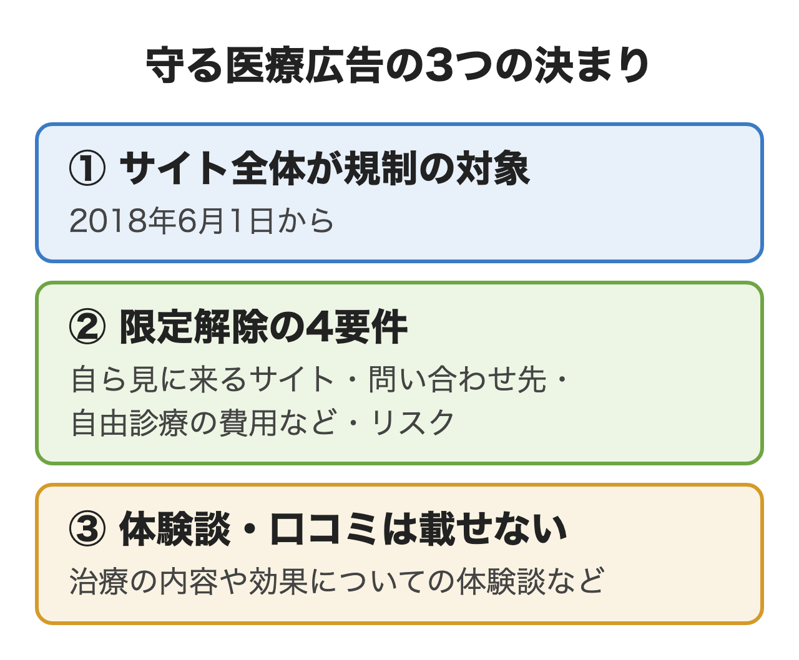
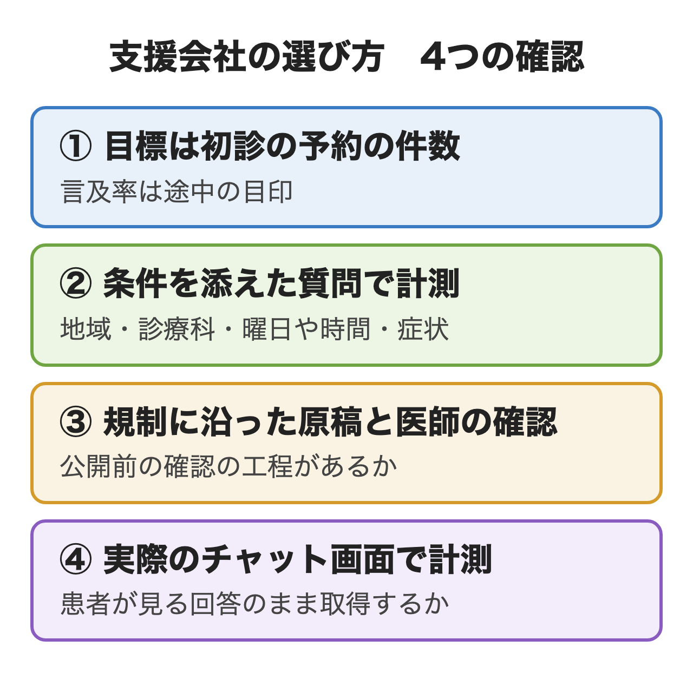

クリニックや病院がAIO対策（AI検索対策）を外に依頼するなら、**医療広告ガイドラインに沿って院のページに書ける事実を増やし、AIで名前が挙がる割合より初診の予約の件数を目標に置く会社**が向いています。

この記事は株式会社nitoが書いているため、自社を1番目に載せました。ほかの6社はクリニック・医療機関向けのAI検索対策を公式サイトで打ち出している会社から選び、2026年11月16日に各社の公式サイトで提供内容と公開されている料金を確認しています。

:::takeaways
- 成果は**初診の予約や新患の件数**で数え、AIの回答で名前が挙がる割合（言及率）はその手前の目印にとどめる
- 院のウェブサイトは医療広告の規制の対象で、**治療の内容や効果についての体験談・口コミの掲載や他院より優れているという表現は使えない**。AIに伝えるのは診療日・診療時間・医師の略歴などの事実
- 支援会社は**目標・質問の組み方・ガイドラインに沿った原稿・計測の方法**の4つで比べる
:::

## クリニック・病院のAI検索対策が他の業界と違う点は？

クリニック・病院は院のサイトそのものが広告の規制を受け、書ける事実の範囲が法令で決まっている点で他の業界と異なります。患者がAIに聞きそうな質問と、その答えに必要な情報を先に並べると次のとおりです。

| 患者の聞き方 | 答えに必要な情報 |
|---|---|
| 〇〇駅の近くで土曜も開いている内科は？ | 診療日・診療時間・休診日・予約の受付時間・駅からの道順 |
| 長引く咳は何科に行けばいい？ | 診療科と対応する症状・受診の目安 |
| 胃カメラを鎮静剤を使って受けられるところは？ | 検査の内容と流れ・費用の目安 |
| 評判のいい整形外科は？ | 医師の略歴・専門医の資格・診療体制 |
| 予約なしでも受診できる？ | 予約の有無と受付の決まり |

**AI検索対策の中身はこの表の右の列を院のページに事実として書くことが中心です。** 質問の文は一例で、AIがどの情報を答えに使うかは質問の言い方や時期で変わります。

<figure class="post-figure"></figure>

### 院のサイト全体が広告規制の対象

2017年に成立した改正医療法（2018年6月1日施行）で、規制の対象は「広告」から「広告その他の医療を受ける者を誘引するための手段としての表示」に広がりました。これで院のウェブサイトも医療広告の規制を受けるようになっています。

医療広告等ガイドラインは受診を誘う意図があり（誘引性）、院の名前が分かり（特定性）、医療に関する内容であれば医療広告に当たると整理しています。**AI検索対策のために書いた記事やよくある質問のページも、診療案内のページと同じ基準で書く必要があります。**

規制を受けるのは医療機関だけではありません。ガイドラインは対象を「何人も」とし、広告代理店やアフィリエイターも含めています。原稿を書く支援会社も対象に含まれるため、ガイドラインを踏まえて書けるかは契約前に確認しておきたい点です。

### 書ける事実の範囲と限定解除

医療広告で書ける事項は医療法第6条の5第3項と厚生労働省の告示で限られています。そのなかで診療日と診療時間について、ガイドラインは「可能な限り医療広告においても記載するのが望ましい」としています。**曜日や時間帯を添えた質問の答えになる情報は、規制の中でも書くことが勧められている情報です。**

ウェブサイトには広告できる事項の限定を解く「限定解除」の仕組みもあります。次の4つをすべて満たすと、広告できる事項以外も書けます。

1. 患者が自ら求めて入手する情報を表示するウェブサイトなどであること
2. 電話番号やメールアドレスなどの問い合わせ先を書くこと
3. 自由診療の通常必要とされる治療内容・標準的な費用・治療期間と回数を書くこと
4. 自由診療の主なリスクや副作用を書くこと

3と4は、限定解除を使って自由診療を詳しく紹介するときだけの要件です。人間ドックなどの健康診査は、実施していることや費用がもともと広告できる事項に入っているため、健診の案内だけなら3と4は求められません。標準的な費用が決まっていなければ、よく発生する追加費用も含めた最低金額から最高金額までを示します。説明をリンク先に回す形は認められません。

### 評判を聞かれても体験談は載せられない

「評判のいい整形外科は？」のように、患者が評判を聞くことも考えられます。ただし院のサイトに患者の体験談を載せることは、内容が広告できる範囲に収まっていても認められていません。

厚生労働省のQ&Aは院のサイトに載せる口コミも体験談として禁止し、都合のよい感想を選んで強調すると虚偽・誇大に当たるとしています。口コミをもとに院を順位づけするランキングサイトは、比較優良広告に当たる可能性があるという整理です。「日本一」「No.1」のような最上級の表現も、事実であっても比較優良広告として使えません。

一方で、個人のSNSや第三者が運営する口コミサイトへの体験談は、院が費用を負担して掲載を頼むなどの事情がなければ広告に当たりません。**院のサイトでは医師の略歴・診療体制・診療日などの事実で信頼を示し、口コミはGoogleマップなど第三者の場に集まる形になります。** Googleマップの情報とAI検索の関係は[MEO対策へのAI検索の影響](/media/meo-ai-search/)で扱っています。

:::linkcard
url: /media/clinic-ai-search/
title: クリニック・医療機関のAI検索対策。規制の中で信頼をどう示すか
desc: 医師の専門性の示し方や地域名を含む質問の考え方など、院内で進める対策を解説しています。
:::

## 支援会社はどう選べばいい？

クリニックが支援会社を比べるときは、目標・質問の組み方・原稿と確認・計測の方法の4つを最初の打ち合わせで聞くのがおすすめです。

<figure class="post-figure"></figure>

| 基準 | 確認する質問 | クリニックで重要な理由 |
|---|---|---|
| 目標 | 何の件数を成果として報告しますか？ | 言及率が上がっても、初診の予約が増えたかは別に数えないと分からない |
| 質問の組み方 | 地域・診療科・曜日や時間・症状を添えた質問で計測しますか？ | 条件の組み合わせで挙がる院が変わりやすい |
| 原稿と確認 | ガイドラインに沿って原稿を書き、医師の確認の工程を組みますか？ | 原稿を書く会社も規制の対象に含まれる |
| 計測の方法 | 回答は実際のチャット画面から取得していますか？ | 患者が見る回答と、プログラム用の窓口の回答は出典が異なることが多い |

### 初診の予約の件数を目標に置くか

言及率は途中の目印として役に立つものの、症状の一般的な説明を求める質問や、通える範囲の外の地域の質問で名前が挙がっても受診にはつながりません。**どの質問で名前が挙がれば初診の予約が増えるかを先に決め、Web予約や問診票で「何で知ったか」を聞いて数える会社**なら、費用に見合うかを予約の件数で判断できます。

### 地域と条件を添えた質問で計測するか

「〇〇市 内科 おすすめ」だけを計測しても、患者が実際に相談する場面の見え方は分かりません。駅名や市区町村、診療科、土曜や夜間のような時間帯、症状を1つずつ変えて計測すると、どの条件で他の院に替わるかが見えてきます。

### ガイドラインに沿った原稿と医師の確認があるか

どの会社が原稿を書いても、公開前には医師による医学的な内容の確認が必要です。原稿の段階でガイドラインに照らす工程があるか、医師の確認にかかる時間を見積もりに入れているかは、契約前に聞いておくと院長の負担を読みやすくなります。

### 実際のチャット画面で計測しているか

回答の集め方にはプログラム用の窓口（API）から取得する方法と、利用者と同じチャット画面に質問して取得する方法があります。2026年9月に公開された論文では、ChatGPTのAPIとチャット画面の両方に同じ質問をしたとき、示された出典が重なった割合は平均12.0%でした。患者がスマートフォンで見る回答と同じ画面で計測しているかは、レポートの数字を信頼できるかに直結します。

## この記事での選定基準

取り上げたのはAI検索対策（AIO・LLMO）を公式サイトでサービスとして案内し、そのうえでクリニック・医療機関向けのページを公開している会社です。書き手のnitoは1番目に置いています。

料金は公式に金額が出ているものだけを載せ、税の扱いも公式の表記に合わせました。最新の条件は各社の案内で確認してください。美容皮膚科・美容外科は[美容クリニックのAIO対策会社](/media/beauty-clinic-aio-companies/)、歯科は[歯科医院のAIO対策会社](/media/dental-aio-companies/)で、それぞれの事情に合わせて比べています。

## クリニックにおすすめのAIO対策会社7社の比較

主な支援・成果の見方・公式サイトに出ている料金の目安で7社を並べました。成果の見方の列は各社の公式サイトの記載です。

| 会社 | 主な支援 | 成果の見方（公式の記載） | 料金の目安（公式） |
|---|---|---|---|
| 株式会社nito | 計測からサイトの改善・記事の制作・公開後の運用まで支援 | 初診の予約の件数（何で知ったかを聞く） | 公開なし |
| 株式会社船井総合研究所 | 内科クリニック特化のコンサルティングと記事作成などの代行 | 売上や患者数などの経営数値に応じて提案 | 公開なし |
| 株式会社Medical DX | 構造化データ・FAQ・外部情報の統一とコンテンツ追加 | 新患数・問い合わせ数 | 月10万円・月20万円（税別） |
| 株式会社ドクターブリッジ | 医師のプロフィール・Q&A・構造化データなどを項目ごとに実装 | 指名検索とAIで見たという来院の動機 | 項目ごと（医師のプロフィール・監修者情報・llms.txt・構造化データの一式で110,000円など） |
| 株式会社grits | 100以上の媒体への情報掲載とMEO対策を同時に | 指名検索や問い合わせの増加 | 初期5万円・月29,800円〜（税抜・3年） |
| エイチリンク株式会社 | llms.txt・構造化データ・原稿・掲載交渉まで代行 | 推薦率の定点観測とAI経由の問い合わせ件数 | 月7万円・22万円・40万円（税別） |
| 株式会社ニュートラルワークス | 医療クリニック特化の調査から実装まで | AI検索からの流入数・指名検索数・問い合わせ数 | 月30万円〜（税別・6ヶ月〜） |

料金は支援の範囲と記事の本数で大きく変わります。金額だけで比べず、計測する質問の数と制作の量を同じ条件にして見積もりを比べるのがおすすめです。

業種を問わず依頼先を広く比べたい場合や、費用の相場を知りたい場合は、AIO対策と同じ取り組みを指すLLMO対策の会社20社を比較表で並べた記事が参考になります。

:::linkcard
url: /media/llmo-companies/
title: LLMO対策の会社おすすめ20選・比較表と費用相場・選び方
desc: LLMO対策の会社20社を比較表で並べ、費用相場と選び方を解説しています。
:::

## 1. 株式会社nito

[株式会社nito](/aio/)は、AIO対策（AI検索対策）で問い合わせや予約につながるまで実行する会社です。ヒアリングで院の強みを文章にまとめ、サイトの改善と記事の制作から公開後の運用まで支援します。何を書き、どこを直すかは、ChatGPTやGeminiなど主要なAIの実際の回答を毎晩読み、他の院が選ばれている理由から決めます。

**目標に置くのはAIでの言及率ではなく初診の予約の件数です。** 診療科によっては1人の新患が長く通院することもあるため、患者が地域と条件を添えて聞く質問で、理由つきで挙がる状態をつくることを優先します。

### クリニックに合う理由

- **地域・診療科・条件で質問を組む。** 駅名や市区町村・診療科・曜日や時間帯・症状を1つずつ変えた質問を設計する
- **実際のチャット画面で計測する。** 患者が見る回答のまま、回答本文と引用元を毎晩記録する。これまでに記録した回答は3万件を超えた（2026年11月時点）
- **他の院が挙がる理由を回答本文から抜き出す。** AIが他の院を勧めるときに添える理由（診療時間や医師の体制など）のうち、自院にも当てはまるのにページに書いていないものを、新しく書く内容の候補にする
- **ガイドラインに沿って、院のページの改善と記事の制作まで支援する。** 体験談や他院との比較の表現を使わず、診療日・医師の略歴・検査の内容を事実で書く。自由診療のページは、費用とリスクを同じページに並べて書く。公開の判断は院の医師が行い、公開後は回答の変化を見て書き方を直す
- **予約まで数える。** Web予約や問診票で「何で知ったか」を聞き、AIで知った人の初診の予約の件数まで追う

お客様にお願いするのはヒアリング・公開前の確認・実装の3点だけです。

### これまでの成果

| 支援先 | 成果 |
|---|---|
| SaaS企業 | 取り組み3ヶ月で、AIでの言及率が10%から45%に。AI経由のコンバージョンは5ヶ月で約6.7倍 |
| 士業 | AIでの言及率が0%から20%に。新しいページは公開3日でAIの回答の引用元に |

成果の出方は診療科・地域・院の体制しだいです。どの質問でどこまで狙えるかは、無料の現状分析のあとにお伝えしています。

### こんな院に向いている

- 地域の新患を増やし、自院のサイトから初診の予約につなげたい内科・小児科・整形外科などのクリニック
- 院内に記事を書く人がおらず、計測から制作まで窓口を1つにしたい医療法人
- 言及率のレポートより、初診の予約の件数で効果を見たい院

nitoでは狙いたい質問をChatGPT・Gemini・AIモードなどに実際に聞き、院の名前が挙がるか、どう紹介されるか、代わりにどの院が挙がっているかをまとめた[現状分析レポート](/aio/)を無料でお出ししています。

## 2. 株式会社船井総合研究所

株式会社船井総合研究所は業種別の経営コンサルティングの会社で、内科クリニックのためのAIO対策をサービスとして出しています。GoogleアナリティクスやSearch Consoleをもとにした環境分析、施策の提案、全国のクリニックの成功事例をもとにした提案、PDCAの支援に加え、記事作成やホームページ業者への依頼の代行まで扱うサービスです。

クリニックごとに専属のコンサルタントが付き、毎月のミーティングで戦略の策定から実行支援まで進める形です。売上や患者数などの経営数値に応じた提案ができるとしており、料金は公式サイトに金額が出ていません。

**AI検索対策だけでなく、集患や経営全体の相談相手も探している内科クリニック**に向いています。

## 3. 株式会社Medical DX

株式会社Medical DXは医科・歯科のWeb制作とDXコンサルティングの会社で、医療特化のLLMO対策を持っています。全国300医院以上の医療機関を支援してきたとし、歯科・美容・内科・整形外科などに対応しています。施策は見出しと構造化データの整備、FAQや診療の流れのコンテンツ、Googleビジネスプロフィールや医療ポータルの表記の統一、SNSや動画での発信の4段階です。

医療・美容分野専門のライターと監修の体制で、ガイドラインを守った表現にするとしています。料金は税別で、スタンダードが月10万円（月1回のミーティング・分析改善レポート・ページ修正3時間まで・コンテンツ追加は月1〜2ページが目安）です。プレミアムは月20万円で、修正が6時間まで、追加が月3〜4ページに増え、外部サイトやPRのサポートが付きます。

**月額を抑えながら、医療に絞った会社に構造化データとコンテンツの追加を毎月任せたい院**に合います。

## 4. 株式会社ドクターブリッジ

株式会社ドクターブリッジはクリニックのホームページ制作会社で、クリニック専門のLLMO対策を案内しています。医師の経歴や資格の掲載、症例・治療実績の掲載、費用の整理、Q&A、監修者情報、構造化データ、llms.txtの設置などを、項目ごとに実装する形です。

料金も項目ごとで、医師のプロフィール・監修者情報の掲載・llms.txtの設置・構造化データの実装の4つをまとめて110,000円、治療費・参考文献・実績の掲載が55,000円〜です。料金表は同社でホームページを作った院（既存のお客様）と新しく作る院に分かれ、Q&Aを同社が原稿案から作る場合は1ページ11,000円（新しく作る院は44,000円）です。ブログの執筆とGoogleビジネスプロフィールの更新は院側で行う前提で、Googleビジネスプロフィールは院内で定期的に更新すれば十分対応できるとしています。

**月額の契約ではなく、必要な項目を選んで一度に整えたい院**に向いています。

## 5. 株式会社grits

株式会社gritsは医科・歯科の開業医向けのホームページ制作を専門とする会社で、クリニック専門のAIO対策サービスを出しています。100以上の媒体（実装ベース）にクリニックの情報を載せるサイテーションの仕組みを使い、AIO対策とMEO対策を同時に進めるのが特徴です。

料金は税抜で、初期設定費用が50,000円、AI対策・運用費用が3年のパッケージで月29,800円〜です。効果としては認知度の向上や指名検索・問い合わせの増加といった間接的な集客を挙げています。

**外部サイトへの情報の掲載とGoogleマップの対策を、月の費用を抑えて長く続けたい院**に合います。

## 6. エイチリンク株式会社

エイチリンク株式会社はホームページの改善を中心にSEOとAIO対策を行う会社で、クリニック向けのAIO対策代行のページを設けています。llms.txtの設計、構造化データの実装、サービスページやFAQの書き直し、比較メディアへの掲載交渉までを代行します。ChatGPT・Gemini・AI Overviewsでの推薦率を定点観測し、指名検索やAI経由の問い合わせ件数と突き合わせるとしています。

料金は税別で、コンサルのみが月7万円、コンサルと対策代行が月22万円、担当を増やした強化版が月40万円です。最低契約期間はなく、前月末までに連絡すれば解約できます。

**院内に作業する人がおらず、契約期間の縛りなしで実行まで依頼したい院**向けです。

## 7. 株式会社ニュートラルワークス

株式会社ニュートラルワークスはWeb制作と集客支援の会社で、医療クリニック特化のAI検索最適化（LLMO/AIO）サービスを出しています。医療広告ガイドラインや薬機法を踏まえた対策を特徴に挙げ、調査・戦略から、コンテンツ制作・構造化データ・外部対策までを一貫して受けます。

自社開発のツールで主要なAIでの掲載状況を計測し、AI検索からの流入数・指名検索数・問い合わせ数を指標に月次で報告するとしています。料金は30万円（税別）〜で、サイトの規模や領域で変わり、契約期間は6ヶ月からです。院長一人のクリニックでも対応でき、院側の工数は月2〜3時間程度を想定しています。

**医療に絞った会社に、SEOとAI検索対策を一続きで任せたい院**に合います。

## 依頼する前に院内で整備しておくこと

どの会社に依頼する場合も、次の5つを先にまとめておくと、最初の提案が院の診療科と地域に合ったものになります。

1. **初診の予約の月の件数と、何で知ったかの内訳。** Web予約や問診票の「当院を何で知ったか」にAIの選択肢を追加しておくと、増えたかどうかを比べる起点になります
2. **力を入れたい診療科・症状・検査。** 新患を増やしたい診療科と、予約の枠に余裕がある曜日と時間帯
3. **院のページに書ける事実の一覧。** 診療日・診療時間・休診日・予約の受付時間、医師の略歴と専門医の資格（認定した団体の名前つき）、検査の内容です。自由診療を載せるなら、標準的な費用か最低から最高までの金額、期間と回数、主なリスクも必要です
4. **原稿を確認する医師とページを更新する担当。** 院長が確認するなら、1本にかける時間と月の本数を先に決めておくと公開が止まりにくくなります
5. **外部に出ている院の情報の表記。** Googleビジネスプロフィール・医療機関の検索サイト・自治体や医師会の一覧で、院名・住所・電話番号・診療時間がサイトと統一されているか

## まとめ

- 地域の新患と初診の予約を増やしたいなら、件数を目標に置き、分析だけで終わらずサイトの改善と記事の制作から公開後の運用まで支援する会社が向いています
- 内科で経営全体の相談もしたいなら、内科クリニックに特化したコンサルティング会社が候補です
- 月額を抑えたいなら、医療特化の月額プランか、項目ごとに料金が決まっている制作会社を比べてください
- 契約の縛りなしで実行まで依頼したいなら最低契約期間のない会社、SEOとまとめて任せたいなら医療クリニック特化のSEO会社が合います
- どの会社でも、原稿がガイドラインに沿っているかと医師の確認の工程は、契約前に確認してください

## よくある質問

### クリニックにAIO対策は必要ですか？

AIの回答で院が候補に挙がるかは、診療日や医師の略歴などの事実を院のページに書いているかに左右されやすいため、初診の予約を増やしたい院では取り組む価値があります。

### 医療のLLMO対策とAIO対策は違いますか？

指しているものはほぼ同じで、AIの回答の中で院の名前が挙がるようにする取り組みです。GoogleのAIによる概要やAIモードを中心に話すときはAIO、ChatGPTやGeminiなどの対話型AIまで含めるときはLLMOと呼ぶことが多くなっています。AIO対策の呼び方で依頼先を比べた記事は「[AIO対策会社おすすめ20選](/media/aio-taisaku-companies/)」です。

### llms.txtや構造化データはクリニックにも必要ですか？

AIによる概要やAIモードに出るためには必要ありません。Googleの公式ガイドは、Google検索はllms.txtを使わず、生成AI検索に構造化データは必要ないとしたうえで、構造化データはリッチリザルトのために引き続き使うことを勧めています。施策に入っているなら、何のために入れるのかを提案の段階で聞いておくと判断しやすくなります。

### 院長一人のクリニックでもAIO対策を依頼できますか？

依頼できます。院側の作業はヒアリングに答えることと、原稿の医学的な内容の確認、公開の判断が中心です。院側の工数を月2〜3時間程度と案内している会社もあるため、確認にかかる時間を見積もりの段階で聞いておくと安心です。

## 出典

- 各社の公式サイト（2026年11月16日確認）: [株式会社船井総合研究所 内科クリニックのためのAIO対策](https://www.funaisoken.co.jp/solution/hospital_internal-medicine_aio_806_S033)・[株式会社Medical DX 医療特化のLLMO](https://medical-dx.com/service/aio/)・[株式会社ドクターブリッジ クリニック専門LLMO](https://www.iryoto.jp/aio/)・[株式会社grits クリニック専門のAI対策](https://medical-grits.jp/aio/)・[エイチリンク株式会社 クリニックのAIO対策](https://h-link-marketing.co.jp/service/llmo-consulting/industry/clinic/)・[株式会社ニュートラルワークス 医療クリニック特化 AI検索最適化](https://n-works.link/llmo-clinic)
- 厚生労働省「[医療法における病院等の広告規制について](https://www.mhlw.go.jp/stf/seisakunitsuite/bunya/kenkou_iryou/iryou/kokokukisei/index.html)」
- 厚生労働省「[医業若しくは歯科医業又は病院若しくは診療所に関する広告等に関する指針（医療広告等ガイドライン）](https://www.mhlw.go.jp/content/001683594.pdf)」（2026年3月30日最終改正）
- 厚生労働省「[医療広告等ガイドラインに関するQ＆A](https://www.mhlw.go.jp/content/001683595.pdf)」
- llms.txtと構造化データ: Google 検索セントラル「[Google 検索の生成 AI 機能向けにウェブサイトを最適化する](https://developers.google.com/search/docs/fundamentals/ai-optimization-guide?hl=ja)」
- APIとチャット画面の出典の重なり: Uberti-Bona Marin ほか「[Auditing AI-Generated Product Recommendations](https://arxiv.org/abs/2609.18729)」（arXiv、2026年9月）
