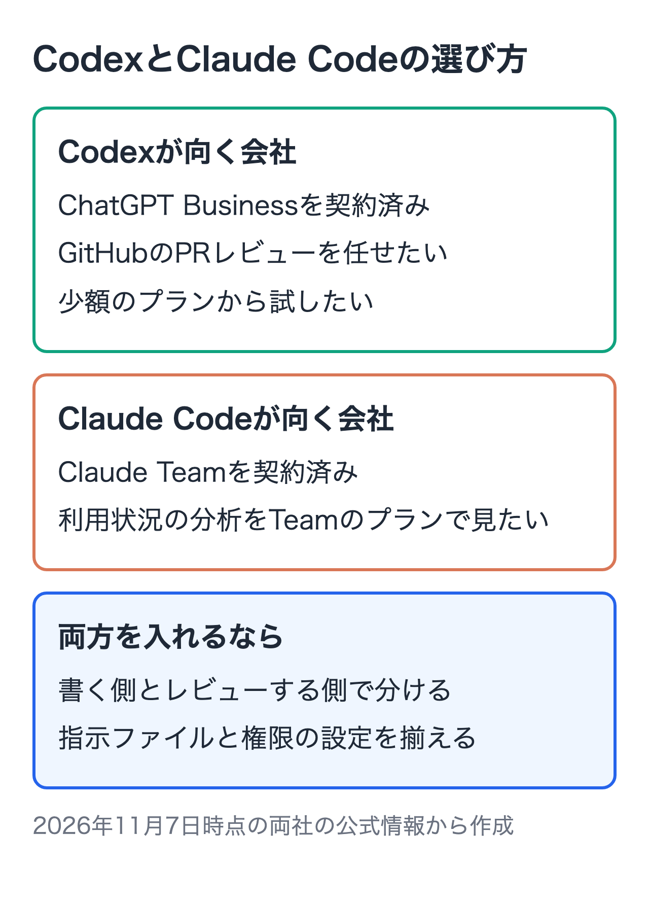
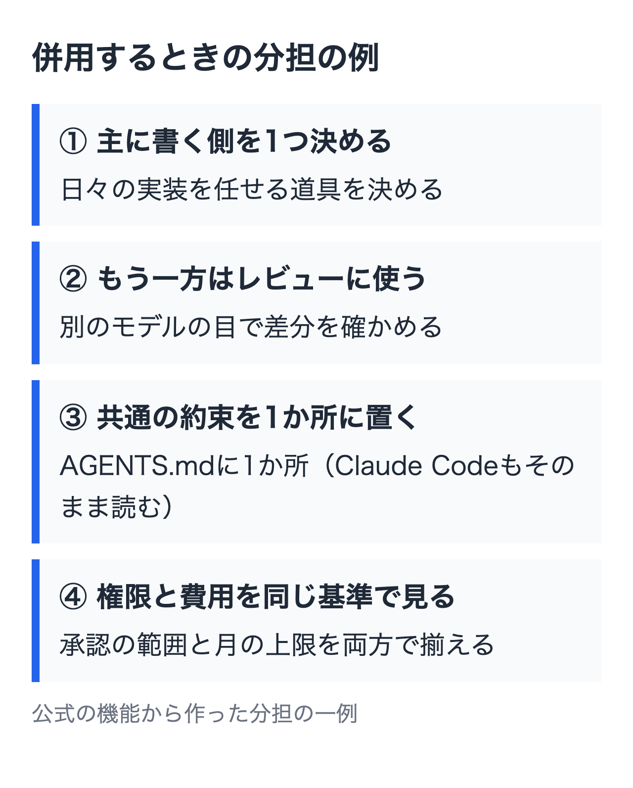

OpenAIのCodexはChatGPTのプランに、AnthropicのClaude CodeはClaudeのプランに含まれる形で提供されています。どちらもターミナル・エディタ・デスクトップアプリ・クラウドで動き、指示ファイルやMCP、スキルといった仕組みもそろってきました。

機能の差が縮んだ今、会社で入れるときに差が出るのは契約の形と管理の仕組みです。この記事では両社の公式ページを同じ物差しで並べ、どちらを入れるか、両方なら何を分けるかを判断できるようにします。

:::takeaways
- **ChatGPTを全社で使う会社はCodex、Claudeを使う会社はClaude Code**から入るのが近道。どちらも法人プランは既定で学習に使わない
- 監査ログ・SCIM・データ保持の管理は**両社ともEnterpriseの機能**。Business・Teamとの境目を先に確かめる
- 併用するなら**書く側とレビューする側を分け**、指示ファイルと権限の設定をそろえる
:::

## CodexとClaude Codeはどちらを入れるべきか

開発チームに入れる道具を選ぶ相談で多いのは「性能はどちらが上か」という問いです。ただ両社の最新モデルの発表を読むと、互いに自社が上回る結果を発表しており、性能だけでは決め手になりません。**会社の判断を分けるのはいま全社で契約しているAIのプランと、管理者が求める統制の深さです。**

<figure class="post-figure"></figure>

ChatGPT Businessを全社で入れている会社なら、Codexは追加の契約なしで開発者に開けます。Claude Teamを入れている会社なら、Claude Codeも同じ1人分の契約に含まれます。どちらも契約していない会社は、次の3つで比べると判断が早くなります。

- 監査ログやSCIMが必要か（必要なら両社ともEnterprise）
- 利用状況の分析をBusiness・Teamの段階で見たいか（CodexはEnterpriseから）
- GitHubのプルリクエストを自動でレビューさせたいか

## CodexとClaude Codeの違いの早見表

まず道具としての違いです。数か月前の比較記事では「Claude Codeはローカル、Codexはクラウド」と分けられていましたが、今はどちらもクラウドで動く作業の場所を持っています。

| 比べる点 | Codex | Claude Code |
|---|---|---|
| 提供元 | OpenAI | Anthropic |
| 使う場所 | ChatGPTのデスクトップアプリ・CLI・IDE拡張・Web・iOS | ターミナル・VS Code・JetBrains・デスクトップアプリ・Web・Slack |
| クラウドで動かす | Codex cloud（Plus以上） | クラウドのセッション（claude.aiのアカウントが必要） |
| 指示ファイル | AGENTS.md | CLAUDE.md（無ければAGENTS.md） |
| 設定ファイル | config.toml | settings.json |
| 拡張の仕組み | スキル・MCP・サブエージェント・Hooks・プラグイン | スキル・MCP・サブエージェント・Hooks・プラグイン |
| GitHubのPRレビュー | @codexで依頼・自動レビュー | Code Review（Team・Enterprise） |
| 無料プラン | デスクトップアプリで軽いモデルだけ | 使えない |
| APIキーでの利用 | CLI・SDK・IDE拡張（クラウド機能なし） | Claude Consoleで従量課金 |

拡張の仕組みは名前までほぼ同じです。スキルはどちらもSKILL.mdを置く形で、置き場所がCodexは.agents/skills、Claude Codeは.claude/skillsと違うだけです。**機能の有無で選ぶ段階は終わっていて、差は設定の書き方と管理の仕組みに移っています。**

細かい差として、Hooksで動かせる処理の種類はClaude Codeのほうが多く、両社の公式のHooksのページで数えるとClaude Codeが約27種、Codexが約12種です。Codexは設定をconfig.tomlに集め、プロジェクトに置かれた設定を信頼済みのときだけ読む作りです。

## 料金とプランの比較

どちらも単体の製品としては売られておらず、チャットのプランに含まれます。下の表の金額は両社の料金ページに表示されたドルで、どちらも税別です。日本の顧客には10%の消費税が加わり、たとえばClaudeのProは月$22になります。

| 区分 | Codex（ChatGPTのプラン） | Claude Code（Claudeのプラン） |
|---|---|---|
| 無料 | Free $0・Go $8（デスクトップアプリでGPT-6 Lunaのみ） | 使えない |
| 個人の入口 | Plus $20 | Pro $20（年払いは月$17） |
| 個人の上位 | Pro $100・$200・$500 | Max $100・Ultra $200 |
| 法人 | Business 1人$20（年払い・2人以上）、月払いは$25 | Team スタンダード$20（年払い）・月払い$25 |
| 法人の上位 | Enterprise（営業経由） | Team プレミアム$100（年払い）・月払い$125 |
| 大企業 | Enterprise・Edu | Enterprise 1人$20（年払い・最低20人）＋API料金での使用量 |
| APIキー | API料金の従量課金 | API料金の従量課金 |

入口の額はそろっていますが、中身の分け方が違います。**CodexはBusinessの1種類に管理機能が付き、ClaudeはTeamの中で使える量の違う2種類の契約を1人ずつ混ぜて買えます。**開発者だけ量の多いプレミアムにし、ほかの社員はスタンダードにする、という組み方ができるのはClaude側の特徴です。

Claudeの料金ページには、2026年11月7日時点でMaxに月$100分、Ultraに月$200分のAPIクレジットが付くと書かれていました。Teamにも最大で月$500分の共有のAPIクレジットが付いています。プランごとの金額と上限の詳しい仕組みは、[Codexの使い方](/media/codex-guide/)と[Claude Codeの料金プラン](/media/claude-code-pricing/)にまとめています。

## 使える量と上限の違い

定額のプランにはどちらも5時間ごとの枠と週の枠があります。チャットと開発ツールで同じ枠を使う点も共通で、CodexはChatGPT Workと、Claude Codeはclaude.aiのチャットと枠を分け合う作りです。

| 比べる点 | Codex | Claude Code |
|---|---|---|
| 5時間の枠 | Plusと標準のBusinessにある。Proは今はなし | Free・Pro・Maxにある。Ultraの認証済みアカウントはなし |
| 週の枠 | かかる場合がある | 有料プランにある |
| 量の目安 | 5時間でGPT-6.1 Solなら15〜160件のローカルメッセージ（Plus） | 固定の件数は公開していない。MaxはProの5倍 |
| 残りの確認 | 使用状況のページ、CLIの/status | /usage、claude.aiの設定の使用状況 |
| 超えたとき | Plus・Proはクレジットを買う。BusinessとEnterpriseは条件つきでワークスペースのクレジット | 使用クレジットをオンにした分だけAPI単価で請求 |
| 法人の上限管理 | 利用者ごとの支出の上限と通知（プランによる） | 組織・グループ・個人ごとの支出の上限 |

Codexの料金ページは5時間に送れる量を**Plusと標準のBusinessで同じ幅**と示しています。GPT-6 Astraなら5〜45件、GPT-6 Lunaなら350〜3,000件で、重いモデルほど早く尽きます。Claude側は会話の長さやモデルで消費が変わると説明するだけで、件数は出していません。

法人で月の費用を見積もるなら、Claude Codeの公式ドキュメントにある目安が参考になります。企業での平均は**開発者1人の稼働日あたり約$13、月$150〜250**で、9割の利用者は1日$30未満でした。これはAPIの従量で払った場合の数字で、定額のプランで使う場合の上限とは別の話です。Codexの枠の仕組みは[Codexの制限とリセット](/media/codex-limits/)で詳しく説明しています。

## 会社で入れるときの比較

情シスや開発の責任者が最後に確かめるのは、データが学習に使われるか、管理者が何を縛れるか、記録が残るかの3つです。両社の料金ページと管理者向けドキュメントを、同じ項目で並べました。

| 確かめること | Codex | Claude Code |
|---|---|---|
| 学習に使わないのが既定のプラン | Business・Enterprise・APIキー | Team・Enterprise・API |
| 個人プランの扱い | Plus・Proは「既定で学習しない」の対象外 | Free〜Ultraは設定で学習の可否を選ぶ |
| 標準のデータ保持 | Enterpriseで保持期間と所在地を管理 | 法人は標準30日。資格のあるEnterpriseはゼロデータ保持 |
| SSO | Business以上（SAML SSO・MFA） | Team以上 |
| SCIM・RBAC | Enterpriseのみ | Enterpriseのみ |
| 監査ログ | Enterprise（Compliance API） | Enterprise（監査ログ・Compliance API） |
| 端末の設定を縛る | requirements.toml（全プラン）、管理画面から配るのはBusiness以上 | 管理設定（ファイル・MDM）、管理画面から配るのはTeam以上 |
| 利用状況の分析 | 分析ダッシュボードはEnterprise | Team以上で利用者数・PRへの貢献を表示 |
| 既存のクラウド経由 | Amazon Bedrock・Google Cloud Vertex AI（CLI） | Amazon Bedrock・Google Cloud・Microsoft Foundry |

**学習とSSOの境目は両社ともそろっていて、法人プランに入れば既定で学習に使われません。**差が出るのは中規模の会社で、Claude Codeは管理画面からの設定の配布と利用状況の分析がTeamから使えます。Codexでこの2つをそろえるには、管理画面の設定配布はBusinessで足りますが、分析ダッシュボードはEnterpriseが必要です。

個人プランのまま業務に使わせるのは避けたほうが安全です。どちらも個人プランは会社の管理の外にあり、学習の設定も本人任せです。ChatGPT側の設定の場所は[ChatGPTの学習をオフにする方法](/media/chatgpt-training-off/)、Claudeの法人プランの違いは[Claude Teamの解説](/media/claude-team/)に書いています。

管理設定で縛れる中身も確かめておきます。Claude Codeは許可と拒否のコマンドの一覧、利用者の設定より管理者の規則を優先させる設定、確認を飛ばすモードの禁止まで管理側で決める仕組みです。CodexはEnterpriseのCodex cloudが既定でオフになっていて、管理者がオンにしてから使う形です。

## 性能と使い勝手の違い

ベンチマークは各社が自社の発表で出している値しか、条件まで確かめられません。Anthropicは2026年9月22日のClaude Opus 5.5の発表で、Terminal-Bench 4.0の正答率をOpus 5.5が66.4%、GPT-6 Astraが57.9%と示しました。Opus 5.5はxhigh、AstraはOpenAIの公表値（high）と、どちらも各モデルの最高値を並べたもので、Anthropic自身が、この水準ではベンチマークの差は実際の差を測る目安として当てにしにくくなったと書いています。

OpenAIはGPT-6.1 Solの発表で、業務の自動化を測るAutomationBenchでOpus 5.5を2.2ポイント上回り、費用は約3分の1だったとしています。こちらも推論の深さを中程度にした条件です。**どちらの発表も自社のモデルが上回る結果を前に出しているので、数字は自社の作業で試す前の参考にとどめます。**

使い勝手の違いとしては実際に両方を使った開発者の記事に共通の傾向がありました。2026年3月に自社サイトで2か月比べた開発会社は、Claude Codeは既存のコードの書き方に合わせ、Codexは入力の確認を多く入れる防御的なコードを書くと報告しています。当時のモデルでの体感なので、今のモデルでは自社の作業で確かめ直す必要があります。

コンテキストの長さは Claude Codeの今のモデルが既定で**100万トークン**、CodexのGPT-6.1 Solが既定で**50万トークン**です（どちらも公式のドキュメントによる）。大きなリポジトリを一度に読ませる作業が多い会社では、見落とせない差です。

## 使い分けと併用の設計

両方を使い分ける開発者もいますが、会社で併用すると、書く側・指示ファイル・権限・費用の上限と決めることが増えます。

<figure class="post-figure"></figure>

### 書く側とレビューする側を分ける

よく使われる分け方は、日々の実装を片方に任せ、もう片方に差分をレビューさせる形です。別のモデルの目で差分を見るためです。CodexはGitHubで@codexと書けばプルリクエストのレビューを頼めるので、レビュー役に置きやすいでしょう。**全員に両方の上位プランを配るのではなく、主に書く側の契約を厚くし、レビュー側は少ない量のプランで足りるかを試すのがおすすめです。**

### 指示ファイルを1つにまとめる

CodexはAGENTS.md、Claude CodeはCLAUDE.mdを読みます。両方に同じ規約を書くと、片方だけ直して食い違う元になりがちです。Claude Codeは2026年9月のv2.1.277から、CLAUDE.mdが無いプロジェクトではAGENTS.mdをそのまま読む仕様になりました。規約はAGENTS.mdだけに置き、Claude Code専用の指示が要るときだけCLAUDE.mdを作って@AGENTS.mdで読み込めば、置き場所は1つで済みます。スキルもSKILL.mdの書式がほぼ同じなので、共通の置き場所から両方に配る形が取れます。

### 移行や試用には /import を使う

CodexにはClaude Codeの設定を取り込む機能が公式にあります。CLIで /import と打って選べる取り込みの対象は、指示ファイル・settings.json・スキル・MCPの設定・Hooks・サブエージェント・直近30日のチャット（CLIは最大50件）です。元のClaude Codeの設定は変わりません。公式は取り込んだあと、スキルやエージェントの権限、MCPの認証、Hooksの動きを見直すよう書いています。

### 権限と費用の基準をそろえる

併用で事故が起きやすいのは、片方だけ承認の範囲が広い状態です。Codexの承認とサンドボックスの設定、Claude Codeの権限モードを、同じリポジトリでは同じ範囲にそろえます。費用も、Codexはクレジット、Claude Codeは使用クレジットと単位が違うので、月の上限を両方で決めてから配ります。

会社の業務に合わせた権限の設計や、エージェントを自社の仕組みに組み込む作業は、社内に詳しい人がいないと止まりやすいところです。nitoは[AIエージェントの構築と運用の支援](/ai-agent/)を行っています。

## まとめ

- ChatGPT Businessを全社で使っている会社はCodexを開発者に開くところから
- Claude Teamを使う会社や利用状況の分析をTeamの段階で見たい会社はClaude Code
- 監査ログやSCIMが要件なら、どちらを選んでもEnterpriseの見積もりが要る
- 両方入れるなら書く側とレビューする側を分け、指示ファイル・権限・月の上限をそろえてから配る
- 性能の数字では決めず、自社の作業1つで1〜2週間試して費用と結果を記録する

## よくある質問

### CodexとClaude Codeはどちらが安いですか？

入口は同じ月$20です。CodexはChatGPTのFreeとGoでもデスクトップアプリで軽いモデルを試せますが、CLIやIDE拡張はPlus以上です。Claude Codeは無料プランでは使えません。法人の契約はどちらも年払いで1人月$20からです。

### 日本では消費税がかかりますか？

どちらも料金ページのドルは税別で、日本の顧客には10%の消費税が加わります。Anthropicは2026年4月1日から全プランに加算しており、Proは月$22になります。OpenAIは2025年1月1日以降の請求に加えています（Enterpriseなど個別の契約で買う法人は対象外）。

### Codexを会社で使うとデータは学習に使われますか？

Business・Enterprise・APIキーで使う場合は、既定で業務のデータを学習に使わないと料金ページに書かれています。Plus・Proの個人プランはこの対象に入っていません。

### Claude Codeは会社のデータを学習しますか？

Team・Enterprise・APIでは、Claude Codeに送ったコードやプロンプトを学習に使いません。保持期間は標準で30日です。Free〜Ultraの個人プランは、学習に使うかどうかを本人の設定で選ぶ形です。

### CodexとClaude Codeは併用できますか？

併用は可能です。別の会社の製品なので、同じリポジトリで両方を動かしても問題ありません。規約をAGENTS.mdだけに置き（Claude Codeもそのまま読みます）、承認の範囲をそろえておくと食い違いが出にくくなります。

### Claude CodeからCodexへ移るのは大変ですか？

CodexのCLIの /import やデスクトップアプリの「設定 > Import」で、Claude Code（Claude Coworkも取り込み元に入ります）の指示ファイル・設定・スキル・MCP・Hooks・最近のチャットを取り込め、元の設定は残るので試したあとに戻ることもできます。

### Codexの監査ログはどのプランで取れますか？

Codexの監査ログはEnterpriseのCompliance APIが窓口です。Claude Codeも同じくEnterpriseで、監査ログとCompliance APIが付きます。BusinessとTeamには監査ログの機能が付いていません。

### CodexとClaude Codeの性能はどちらが上ですか？

各社の発表ではそれぞれ自社が上回る結果を前に出しています。Anthropicは発表の中で、この水準ではベンチマークの差は実際の差を測る目安として当てにしにくくなったと書いています。自社の作業で両方を試して比べるのが確実です。

## 出典

取得日はいずれも2026年11月7日です。

- [Codex Pricing（OpenAI）](https://learn.chatgpt.com/docs/pricing) — プラン・5時間あたりの目安・機能の比較表・学習の既定
- [Codex Models（OpenAI）](https://learn.chatgpt.com/docs/models) — GPT-6.1 Solのコンテキスト・モデルの選び方
- [Import from another agent（OpenAI）](https://learn.chatgpt.com/docs/import) — Claude Codeからの取り込み
- [Admin rollout guide（OpenAI）](https://learn.chatgpt.com/docs/enterprise/admin-setup) — Enterpriseの設定とCodex cloudの既定
- [Introducing GPT-6.1 Sol（OpenAI）](https://openai.com/index/introducing-gpt-6-1-sol/) — AutomationBenchの結果
- [Claude 料金ページ（Anthropic）](https://claude.com/ja/pricing) — 個人・Team・Enterpriseの料金と機能の比較
- [Data usage（Claude Code ドキュメント）](https://code.claude.com/docs/en/data-usage) — 学習とデータ保持
- [Set up Claude Code for your organization（Claude Code ドキュメント）](https://code.claude.com/docs/en/admin-setup) — 管理設定と接続先
- [Manage costs effectively（Claude Code ドキュメント）](https://code.claude.com/docs/en/costs) — 費用の目安と支出の上限
- [Track team usage with analytics（Claude Code ドキュメント）](https://code.claude.com/docs/en/analytics) — Team・Enterpriseの分析
- [Introducing Claude Opus 5.5（Anthropic）](https://www.anthropic.com/claude-opus-5-5) — Terminal-Bench 4.0の結果と条件
- [【実測比較】Claude Code vs Codex（合同会社playpark）](https://www.playpark.co.jp/blog/claude-code-vs-codex-comparison) — 2026年2〜3月の使用感
- [Hooks（Claude Code ドキュメント）](https://code.claude.com/docs/en/hooks) と [Hooks（OpenAI）](https://learn.chatgpt.com/docs/hooks) — Hooksの種類の数
- [Model configuration（Claude Code ドキュメント）](https://code.claude.com/docs/en/model-config) — コンテキストの既定
- [Memory（Claude Code ドキュメント）](https://code.claude.com/docs/en/memory) — AGENTS.mdの読み込み
- [日本の消費税（OpenAI ヘルプ）](https://help.openai.com/ja-jp/articles/10242647-the-japanese-consumption-tax-on-your-openai-invoices) と [日本の消費税（Claudeヘルプ）](https://support.claude.com/ja/articles/14051822) — 消費税の扱い
