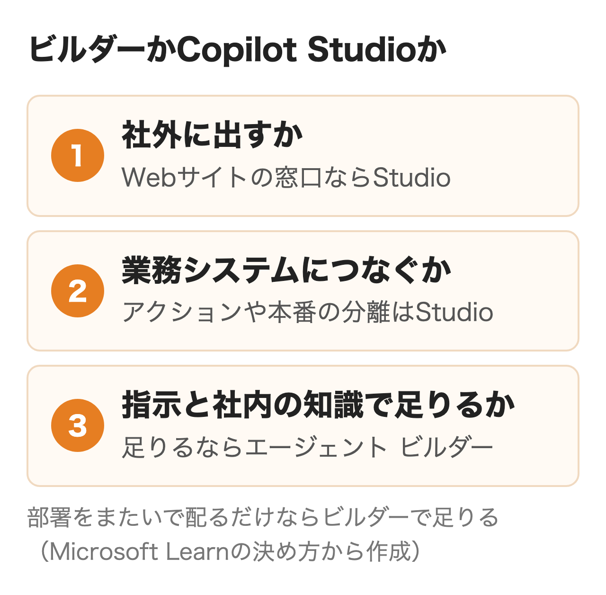
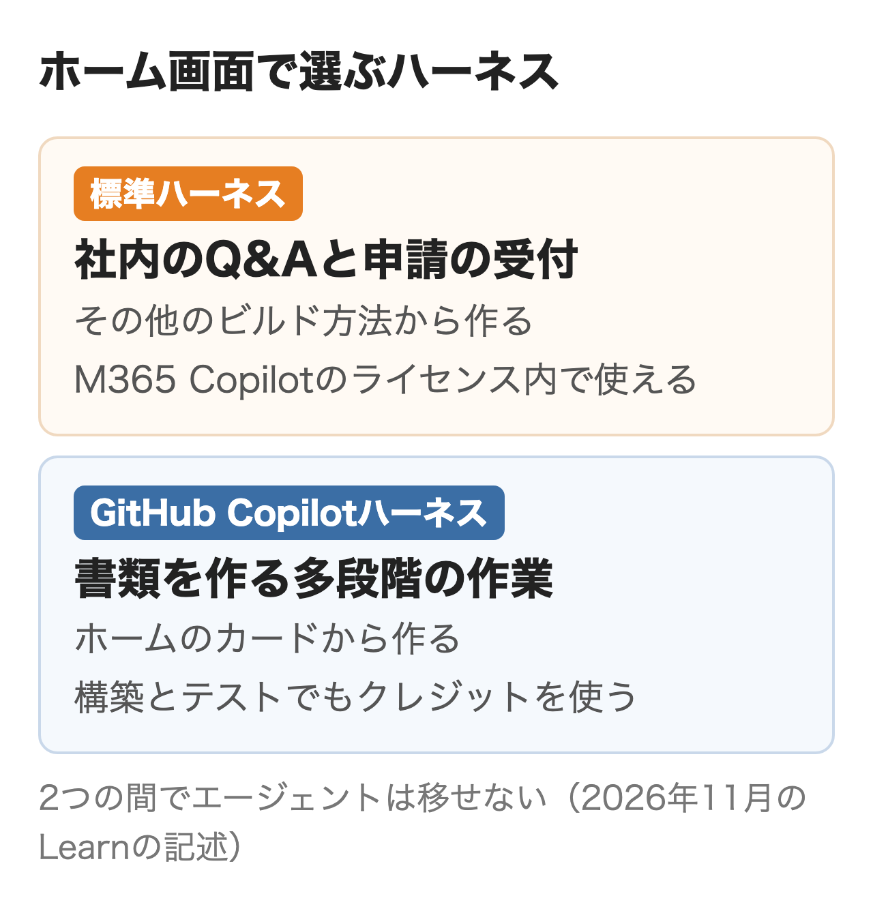
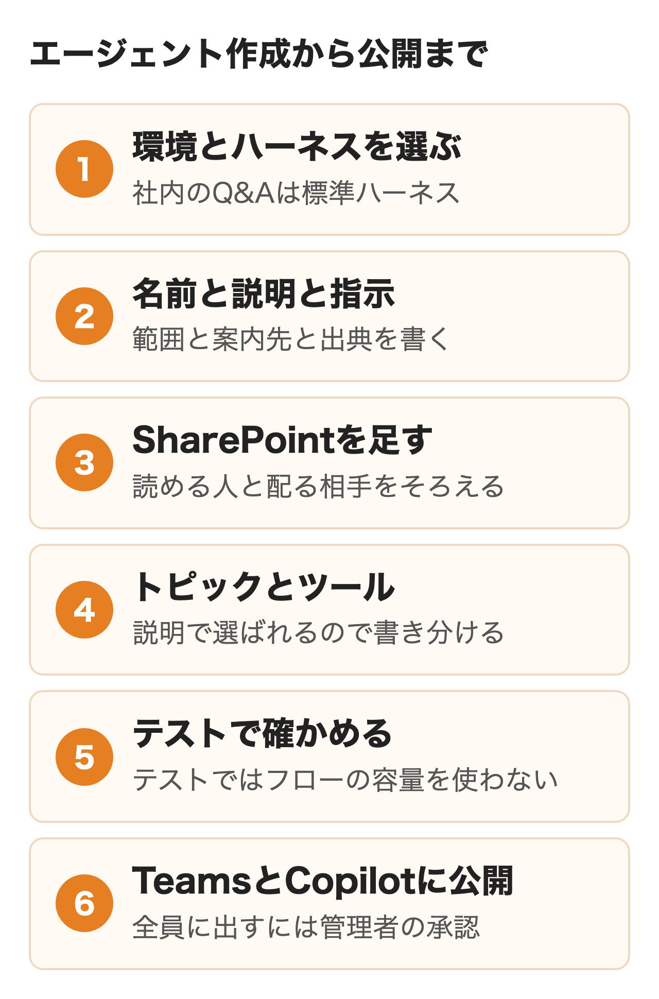
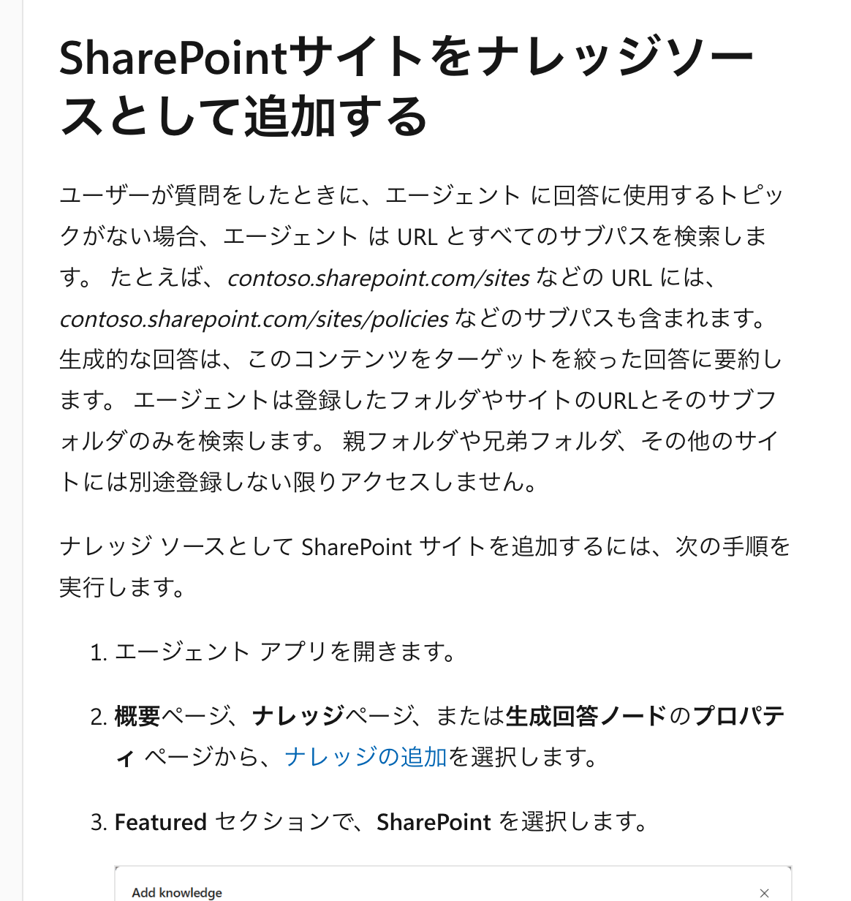
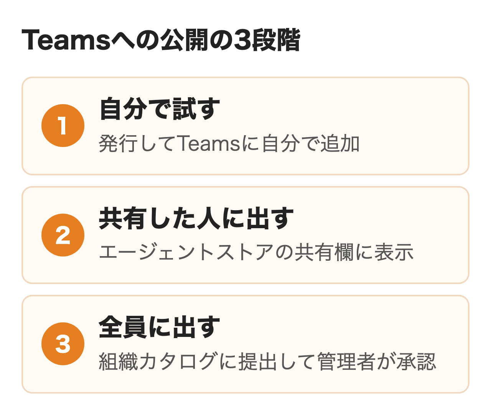
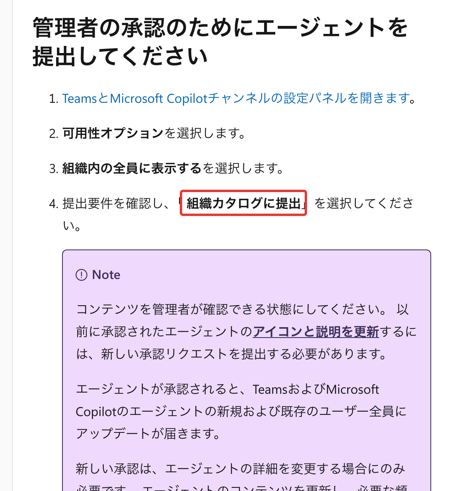

Microsoft Learnの2026年9〜10月の更新で、Copilot Studioのホーム画面のカードから作るエージェントはGitHub Copilotハーネスのものになりました。社内のQ&Aを作るつもりで押すと、作りながら試すだけでCopilotクレジットを使うことがある種類から始めることになります。

この記事ではMicrosoft 365を使う会社で社内向けのエージェントを作る担当者に向けて、作る前の判断から指示・SharePointのナレッジ・テスト・Teamsへの公開までを順に扱います。手順と画面の名前は2026年11月4日に取得したLearnによるもので、こちらで操作はしていません。

:::takeaways
- **社内のQ&Aや申請の受付なら、ホームの「その他のビルド方法」から標準ハーネスで作る**。カードのGitHub Copilotハーネスはテストでもクレジットを使うことがある
- **部署をまたいで社員に配るだけならエージェント ビルダーで足りる**。社外への公開・業務システムとの連携・開発と本番の分離が要るときにCopilot Studio
- **Teamsへは発行・チャネル追加・自分で試す・共有の順**。全員に出すには組織カタログへの提出と管理者の承認が要る
:::

## ビルダーとCopilot Studioの使い分け

Microsoft 365 Copilotのライセンスがある会社には、エージェントを作る入口が2つあります。CopilotのアプリやTeamsの中で開くエージェント ビルダーと、専用の画面で開くCopilot Studioです。Learnの「エージェント ビルダーと Copilot Studio のどちらかを選択」（2026年10月28日更新）は、使う人の数ではなく、要る機能と運用の仕方で選ぶよう書いています。

<figure class="post-figure"></figure>

| 問い | 答えがはいなら |
|---|---|
| 顧客向けのWebサイトなど社外のチャネルが要るか | Copilot Studio |
| 外部サービスのアクション・ワークフロー・開発とテストと本番の環境が要るか | Copilot Studio |
| M365 Copilotの指示と社内の知識で足りるか | エージェント ビルダー |

**部署をまたいで社員に配るだけなら、エージェント ビルダーで足ります。** ビルダーで作ったエージェントも組織カタログに出せるため、Learnは複数の部門で使うという理由だけではCopilot Studioは要らないという立場です。ビルダーにできないのは外部サービスを呼ぶアクションの作成で、業務システムにつなぐ段になったらCopilot Studioへコピーします。

### エージェント ビルダーで足りる場合

Learnが挙げる例はオンボーディングやプロジェクトの情報に答えるエージェントです。作れるのはmicrosoft365.com/chat・office.com/chat・Teamsのデスクトップ版とWeb版で、モバイルのアプリでは作れません。知識の元にはSharePointのファイルを100個まで選べます（上限の表は[社内チャットボットの選び方](/media/internal-chatbot/)に載せました）。

気をつけたいのは配り方の制約です。ビルダーで作ったエージェントはTeamsのグループチャットや1対1のチャットでは使えず、SharePointのファイルの権限は特定のセキュリティグループと共有したときしか自動で付きません。**全社に共有しても、ナレッジのファイルを読めない社員には答えが返らない**ので、ファイルの権限は手で合わせる必要があります。

### Copilot Studioで作る場合

承認を伴うIT申請の受付や、外部のサービスとつないで担当者に引き継ぐ問い合わせ窓口がLearnの例です。Power Platformの環境ごとにデータポリシー（DLP）やコネクタの制御をかけられ、開発・テスト・本番を分けて出せます。

ビルダーからのコピーは同期ではなく別のスナップショットなので、コピーした後にビルダー側を直しても反映されません。Learnの「エージェント ビルダーから Copilot Studio にエージェントをコピーする」（2026年9月30日更新）で、引き継がれるものは次のとおりです。

| 引き継がれる | 引き継がれない（コピー後の作業） |
|---|---|
| 名前・説明・指示・推奨プロンプト・アイコン | 埋め込みのファイル（アップロードし直す） |
| SharePointのファイル・フォルダー・サイト | Copilotコネクタ（設定し直す） |
| ナレッジに入れたWebサイト | Teamsのチャットと会議・メール（コネクタを足す） |

## 作る前に要る権限と環境

**作成とテストは試用版でもできますが、公開はできません。** LearnのFAQ（2026年10月20日更新）によると、公開する人にはCopilot Studioのユーザーライセンスか Microsoft 365 Copilotのライセンスが要り、環境かテナントには前払いか従量課金の容量が要ります。試用版は社員が自分でサインアップでき、管理者はそのサインアップを止められます。試用版で作り始めた部署が公開の段で止まる事態は、作る人を決める段階で防げる問題です。

料金の払い方（容量パック・従量課金・事前購入）と、M365 Copilotのライセンスで追加費用なく使える範囲は[Copilot Studioの料金](/media/copilot-studio/)にまとめています。

Copilot Studioを開くと、まずPower Platformの環境を選びます。一覧には作成の権限がある環境だけが出るため、空なら管理者に権限を確かめてもらいます。**試しに作るエージェントは本番と別の環境に置くのがおすすめです。** DLPや容量の上限を環境ごとに分けられるので、試作が本番の枠を使い切る事態を避けられます。

Teamsの中のCopilot Studioアプリで従来型のエージェントを作る方法は、2026年6月30日で終わりました。Microsoft 365 メッセージ センターの告知（MC1315217）によると、E1・E3・E5・F1に付く権利で作る従来型もWeb版で作る形に移り、既存のエージェントはそのまま動きます。この権利で作るエージェントは生成AIの機能を含みません。**Teamsの中で作る手順を書いた古い記事は、今はWeb版の手順に読み替えます。**

## ホーム画面でハーネスを選ぶ

今のCopilot Studioでは、作るものを選ぶ前に、どの実行の仕組み（ハーネス）で動かすかを選ぶ流れです。Learnの「構築を開始する」（2026年9月21日更新）によると、ホームのカードから作るのはGitHub Copilotハーネスのエージェントとワークフローで、標準ハーネスのエージェントは「その他のビルド方法」から作ります。標準ハーネスのクイックスタート（2026年9月22日更新）も、新しい画面の表示をオフにする手順から始まります。

<figure class="post-figure"></figure>

| | 標準ハーネス | GitHub Copilotハーネス |
|---|---|---|
| 向くもの | 社内ヘルプデスクのQ&A・決まった依頼の受付 | 多段階の業務・Word・Excel・PDFを作る作業 |
| 会話の組み立て | トピック・トリガー・分岐 | 自然言語の説明とスキル（トピックはフックに置き換え） |
| 課金 | M365 Copilotのライセンスを持つ社員の社内利用は追加なし（公正利用の上限あり） | Copilotクレジット。構築・テスト・評価でも使うことがある |
| 公開先 | Teams・M365 Copilot・Web・SharePointなど | Teams・M365 Copilot・Web（SharePointのチャネルは非対応） |

**社内のQ&Aや申請の受付を作るなら、標準ハーネスを選ぶのがおすすめです。** 2つのハーネスの間でエージェントは移せないため、作り始めの選択が後まで残ります。GitHub Copilotハーネスは書類を作る長い作業や複数のツールをまたぐ処理に強い一方、Learnの説明ではエージェントの構築とテストでもクレジットを消費することがあります。顧客の電話やWebのチャットに答える窓口には、3つ目のCustomer Conversationハーネスがあります。このあとの手順は標準ハーネスのものです。

## Copilot Studioでのエージェント作成の手順

<figure class="post-figure"></figure>

### ① 説明から作るか手動で作るか

標準ハーネスのホームの入力欄に、エージェントにしてほしいことを書くと、AIが名前・説明・指示の案を作ります。説明は1,024文字まで書けて、ナレッジやツールの候補も一緒に出ます。手動で作る場合は名前を入れて作成し、作成時の設定で言語を日本語にしておきます。

### ② 名前・説明・指示を書く

概要ページの各欄の編集から入力します。説明は組織カタログで社員が読む紹介文になり、指示はエージェントの振る舞いを決める文です。指示には次のような中身を書きます。

- 役割と範囲（例: 社内の経費規程に答える。規程に無いことは答えない）
- 答えられないときの案内先（担当部署・申請フォームのURL）
- 答えに必ず出典を付けること
- 口調（です・ます、短く答える）

**指示には出典の引用を求める1文を入れておくのがおすすめです。** Learnのナレッジの説明によると、根拠のない応答を許可しない設定では、正しい答えでも引用が付かないと隠され、見つからなかったように返ることがあるためです。「JSONだけで答える」のように形式を強く縛る指示も、引用の印を消してしまいます。

### ③ モデルを選ぶ

概要ページのモデルの欄で、推論に使うモデルを選べます。2026年6月ごろの検証記事では、GPTとClaudeが並び、既定にClaude Sonnet 4.6が選ばれていた例がありました（DevelopersIO）。既定と並ぶモデルは地域・管理者の設定・時期で変わります。**モデルを変えると同じ質問でも答え方が変わるため、変えたらテストをやり直します。**

### ④ 紹介メッセージと推奨プロンプト

会話開始のトピックで最初のあいさつを直し、何を聞けるかを例で示します。推奨プロンプトは10個まで設定でき、TeamsとMicrosoft 365 Copilotで会話を始める前に表示されます（テストの画面には出ません）。

## ナレッジにSharePointを入れる

社内の規程やマニュアルに答えさせるなら、ナレッジの中心はSharePointになります。概要ページかナレッジのページの「ナレッジの追加」からSharePointを選び、URLと名前と説明を入れます。

<figure class="post-figure"><figcaption>Microsoft Learn「ナレッジ ソースとしてSharePointを追加する」（2026年11月4日）</figcaption></figure>

**エージェントは、使う人が読める文書しか答えに使いません。** Learnの「ナレッジ ソースとしてSharePointを追加する」（2026年8月5日更新）によると、SharePointのナレッジは使う人のアカウントで検索され、読み取りの権限が無い人には答えが返りません。秘密度ラベルも効き、暗号化やパスワードで保護したファイルは、開ける人が聞いても答えに使われません。

| 点 | 内容 |
|---|---|
| 検索する範囲 | 登録したURLとその下の階層だけ。親や隣のフォルダーは別に登録する |
| 数の上限 | 生成オーケストレーションではSharePointのURLが25まで |
| 文書の中のリンク | たどらない。リンク先も使うなら別に登録する |
| 名前の変更 | サイトやフォルダーの名前を変えるとリンクが切れる |
| 説明 | 詳しく書くほど、どのナレッジを使うかの判断に効く |
| 絞り込み | 変更日・作成者などの条件で対象を絞れる |

**権限が広すぎるフォルダーを入れると、そのフォルダーを開ける人への答えに中身が出ます。** 逆に、全社に配るのに一部の部署しか読めないフォルダーを入れると、多くの社員に答えが返りません。入れる前に古い版のファイルを外し、配る相手と読める人がそろっているかを確かめておくと、公開後の問い合わせが減ります。

公開Webサイトもナレッジに入れられますが、こちらの検索はBing経由です。概要ページのWeb検索をオンにするとBingの検索結果全体も答えに混ざるため、**社内規程だけで答えさせたいエージェントでは、Web検索と一般知識の利用をオフにします。** オフにすると、ナレッジに答えが無いときは「応答なし」と返ります。M365 Copilotのライセンスを持たない社員も使う場合、テナントグラフとセマンティック検索の設定で検索の質を上げられますが、この機能には追加のクレジットがかかります。

## トピックとツールとエージェントフロー

標準ハーネスの新しいエージェントは、既定で生成オーケストレーションで動きます。質問が来るたびに、トピック・ツール・ナレッジ・他のエージェントの中から、名前と説明を手がかりに使うものを選ぶ仕組みです。設定の生成AIの項目でオーケストレーションを「いいえ」にするとクラシックになり、トリガーフレーズに一致したトピックだけが動きます。

**説明があいまいだと、エージェントは正しい部品を選べません。** 経費精算と出張申請のように似たトピックが並ぶときは、説明に対象と使う場面を書き分けます。

### トピック

申請の受付のように、聞く順番と分岐を決めたい会話はトピックで組みます。質問ノードで値を聞いて変数に入れ、条件ノードで分け、最後にツールのノードでフローを呼ぶ流れです。

### ツールとエージェントフロー

申請をSharePointのリストに書き込む、担当者にTeamsで知らせる、といった処理はエージェントフローで作り、ツールとしてエージェントに足します。Learnの「エージェント フローの概要」（2026年10月26日更新）によると、フローはアクションごとにCopilot Studioの容量を使い、前払いの容量を使い切ると新しい実行が止まります。**フロー デザイナーとテストチャットからの実行は容量を使わないため、作り込みはテストの画面で進められます。**

既にあるPower Automateのクラウドフローも、エージェントフローへの変換が可能です。ただし変換は一方向で戻せず、請求がPower AutomateからCopilot Studioの容量に変わります。エージェントから呼ばれる以外のトリガー（スケジュールなど）で動くフローはM365 Copilotのライセンスに含まれず、クレジットがかかります。

## テストで確かめること

画面右のテストのパネルで質問し、指示やナレッジを直しながら繰り返します。生成オーケストレーションのエージェントなら、どの部品を選んだかはアクティビティマップで追えるため。公開前に見ておきたいのは次の5つです。

- 規程にある質問に、出典つきで答えるか
- 規程に無い質問に、作り話をせず案内先を返すか
- 似た2つの依頼で、別のトピックやツールが選ばれるか
- フローが最後まで動き、書き込み先に結果が残るか
- ナレッジを読む権限の無い社員には、答えが返らないか

最後の項目は公開した後に権限の違う社員のアカウントで試すのが確実です。指示を1か所変えたら、同じ質問をもう一度投げて答えの変化を見ます。

## TeamsとM365 Copilotに公開する

公開は発行・チャネルの接続・自分で試す・広げるの順で進みます。Learnの「Teams とMicrosoft 365のエージェントを接続して構成する」の手順は次のとおりです。

<figure class="post-figure"></figure>

1. 上部の発行を選ぶ（数分かかる）
2. チャネルでTeamsとMicrosoft 365 Copilotを開き、「Microsoft Copilotでエージェントを利用可能」を選んで追加する（選ばないとTeamsだけ）
3. 「Teamsでエージェントを表示する」で自分にインストールして試す
4. 可用性オプションで、リンクを渡すか、共有した社員のエージェントストアに出す
5. 全員に出すときは「組織内の全員に表示」から組織カタログに提出し、管理者の承認を待つ

<figure class="post-figure"><figcaption>Microsoft Learn「Teams とMicrosoft 365のエージェントを接続して構成する」（2026年11月4日）</figcaption></figure>

**リンクを渡しても、エージェントを共有されていない社員はチャットできません。** 共有の設定とインストールのリンクは別物で、Teamsのモバイルアプリではリンクからのインストールもできないため、スマホで使う社員にはストアに出す必要があります。組織がTeamsへのPower Platformアプリの追加を止めている場合は、Teams管理センターで許可してもらうまでインストールもできません。

承認後は中身の更新なら再提出は要らず、アイコンと説明を変えたときだけ出し直します。管理者はTeams管理センターのセットアップポリシーで、全員に自動でインストールしてピン留めすることも可能です。認証は既定の「Microsoft による認証」のままが無難です。「認証なし」にすると、リンクを知っている人なら誰でも話せてしまいます。

## マルチエージェントにする目安

1つのエージェントに部品を足し続けると、どれを使うかの選び分けが崩れていきます。Learnの「他のエージェントの概要を追加」によると、ツール・トピック・他のエージェントを合わせた選択肢が30〜40を超えるあたりで精度が落ちる場合があるという目安です。

| 形 | 向く場面 |
|---|---|
| 子エージェント | 1つのチームが管理し、単独では公開しない作業のまとまり |
| 環境内の別のエージェントにつなぐ | 部署ごとに別のチームが作り、単独でも使わせる |
| 外部のエージェントにつなぐ | Microsoft FoundryやA2Aで作ったもの（一部はプレビュー） |

分けると、つなぐ段が増える分だけ答えが遅くなり、テストの範囲も広がります。**まず1つのエージェントで業務の効果を確かめ、選び分けが崩れてから分けるのがおすすめです。**

## 作った後に決めておくこと

公開の前に、次の4つを担当と一緒に決めておきます。

- 環境のDLPで、つないでよいコネクタと止めるコネクタを分ける
- Power Platform管理センターで、使ってよいチャネルを絞る
- 分析で答えられなかった質問を見て、指示とナレッジを直す人と頻度
- クレジットを使う使い方なら、エージェントごとの月の上限

社外向けの公開や業務システムとの連携まで含めて組む場合は、設計から運用までを外部に頼む方法もあります。進め方と費用の考え方は[AIエージェント導入の進め方](/media/ai-agent-introduction/)で扱い、nitoも[AIエージェント構築支援](/ai-agent/)で相談を受けています。

## まとめ

- 社員向けのQ&Aを部署で使うだけ: エージェント ビルダーで作り、組織カタログに出す
- 申請の受付や業務システムとの連携が要る: Copilot Studioの標準ハーネスで作り、SharePointの権限を整えてからTeamsに公開する
- 書類を作る長い作業を任せたい: GitHub Copilotハーネスで、作る前にクレジットを見積もる
- 試用版で作り始めた: 公開の前に、作る人のライセンスと環境の容量を管理者とそろえる

## よくある質問

### Copilot Studioは無料で作れますか？

試用版で作成とテストまではできますが、公開はできません。M365 Copilotのライセンスを持つ人はそのライセンスで作って公開でき、標準ハーネスで作った社内向けのエージェントをライセンスを持つ社員が使う分には、追加の費用はかかりません。

### Copilot Studioは権限を超えて答えますか？

SharePointのナレッジは使う人のアカウントで検索するため、その人が読めない文書は答えに使いません。ただし広い権限のフォルダーを入れると、そこを開ける人全員の答えに中身が出ます。

### Copilot Studioで答えが出ないのはなぜ？

ナレッジを読む権限が無い、ファイルが暗号化されている、答えに引用が付かず隠された、の3つが多い原因です。3つ目は指示に出典を必ず付けるよう書くと起きにくくなります。

### Copilot Studioはスマホで使えますか？

Teamsのモバイルアプリで使えますが、インストールのリンクはモバイルでは使えません。スマホの社員にはストアに出すか、管理者に自動インストールを設定してもらいます。

### Copilot Studioのフローは有料ですか？

フローはアクションごとにCopilot Studioの容量を使います。フロー デザイナーとテストチャットからの実行は容量を使いません。エージェントから呼ばれて動くフローはM365 Copilotのライセンスに含まれ、スケジュールなど別のトリガーで動くフローにはクレジットがかかります。

## 出典

いずれも2026年11月4日に取得。更新日はLearnのページの表示です。

- [エージェント ビルダーと Copilot Studio のどちらかを選択してエージェントを構築します](https://learn.microsoft.com/ja-jp/microsoft-365/copilot/extensibility/copilot-studio-experience)（2026年10月28日更新）
- [エージェント ビルダーの概要](https://learn.microsoft.com/ja-jp/microsoft-365/copilot/extensibility/agent-builder)（2026年10月26日更新）
- [エージェント ビルダーから Copilot Studio にエージェントをコピーする](https://learn.microsoft.com/ja-jp/microsoft-365/copilot/extensibility/copy-agent-to-copilot-studio)（2026年9月30日更新）
- [構築を開始する](https://learn.microsoft.com/ja-jp/microsoft-copilot-studio/agents-experience/authoring-first-bot)（2026年9月21日更新）
- [GitHub Copilot Harnessによるエージェント概要](https://learn.microsoft.com/ja-jp/microsoft-copilot-studio/agents-experience/overview)（2026年10月20日更新）
- [Copilot Studioのハーネス](https://learn.microsoft.com/ja-jp/microsoft-copilot-studio/harnesses-overview)（2026年10月23日更新）
- [クイックスタート：標準ハーネスでエージェントを作成・展開する](https://learn.microsoft.com/ja-jp/microsoft-copilot-studio/fundamentals-get-started)（2026年9月22日更新）
- [Copilot Studio の課金とライセンスに関するよくある質問](https://learn.microsoft.com/ja-jp/microsoft-copilot-studio/faq-billing-licensing)（2026年10月20日更新）
- [標準ハーネス駆動のエージェントのライセンス取得](https://learn.microsoft.com/ja-jp/microsoft-copilot-studio/billing-licensing)
- [知識源の概要](https://learn.microsoft.com/ja-jp/microsoft-copilot-studio/knowledge-copilot-studio)（2026年8月4日更新）
- [ナレッジ ソースとしてSharePointを追加する](https://learn.microsoft.com/ja-jp/microsoft-copilot-studio/knowledge-add-sharepoint)（2026年8月5日更新）
- [生成 AI でエージェントの動作を調整する](https://learn.microsoft.com/ja-jp/microsoft-copilot-studio/advanced-generative-actions)（2026年8月26日更新）
- [トピックの作成と編集](https://learn.microsoft.com/ja-jp/microsoft-copilot-studio/authoring-create-edit-topics)（2026年7月6日更新）
- [エージェント フローの概要](https://learn.microsoft.com/ja-jp/microsoft-copilot-studio/flows-overview)（2026年10月26日更新）
- [他のエージェントの概要を追加](https://learn.microsoft.com/ja-jp/microsoft-copilot-studio/authoring-add-other-agents)
- [重要な概念 - エージェントの公開と展開](https://learn.microsoft.com/ja-jp/microsoft-copilot-studio/publication-fundamentals-publish-channels)（2026年10月16日更新）
- [Teams とMicrosoft 365のエージェントを接続して構成する](https://learn.microsoft.com/ja-jp/microsoft-copilot-studio/publication-add-bot-to-microsoft-teams)
- [MC1315217 Classic agent creation moves from Teams to web experience](https://mc.merill.net/message/MC1315217)（Microsoft 365 メッセージ センターの告知を転載したページ、英語）
- [【Copilot Studio】初めてのエージェントを作ってみた：作成・指示・テスト](https://dev.classmethod.jp/articles/copilot-studio-create-first-agent/)（DevelopersIO）
