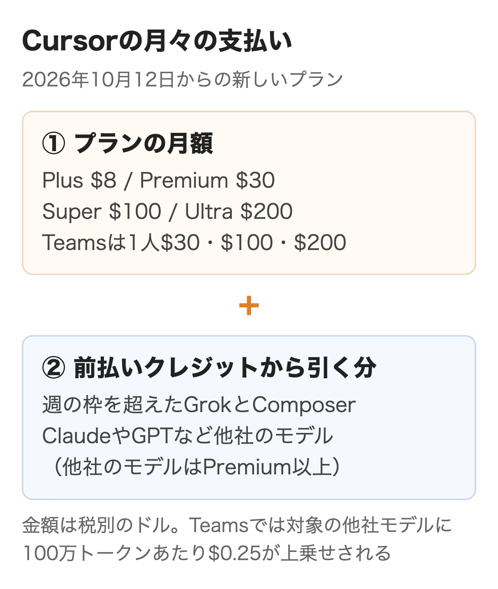
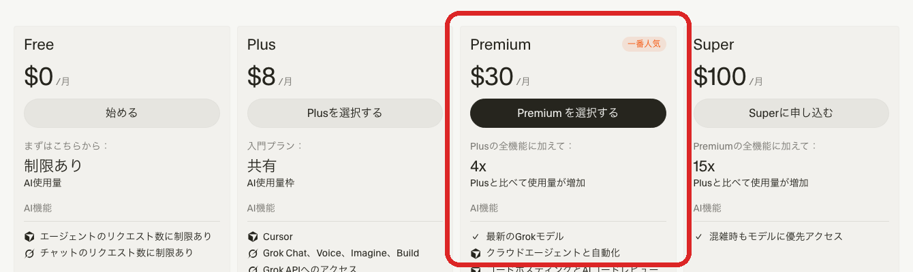
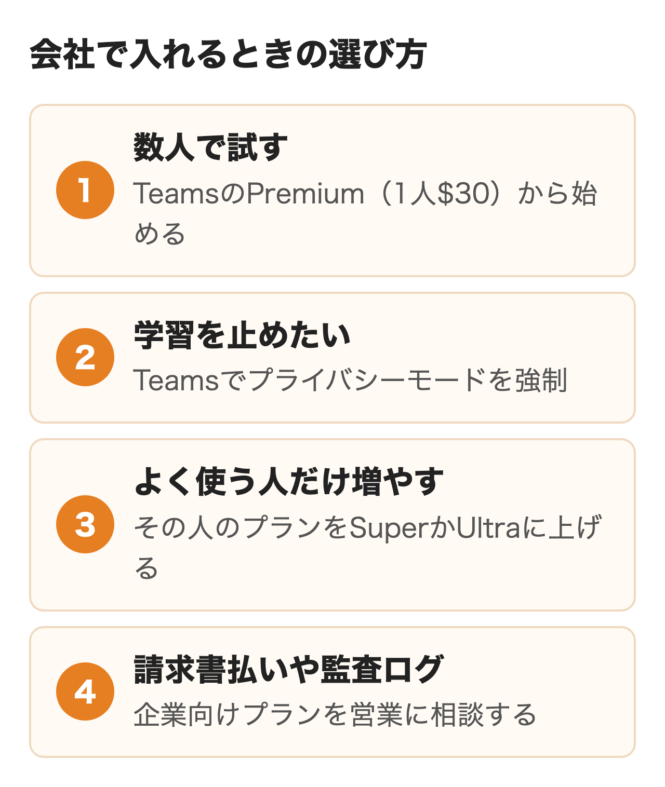
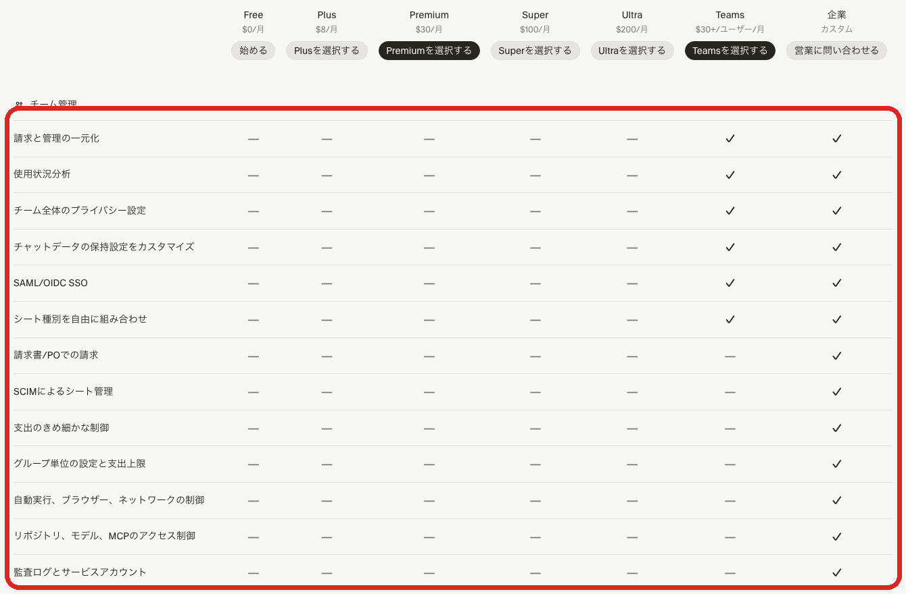

AIを組み込んだコードエディタのCursorは、2026年10月12日からGrok・Xとまとめた「The X Subscription」の一部として売られています。月$20のProは新規に申し込めなくなり、今の個人プランはFree・Plus・Premium・Super・Ultraの5段です。

旧プランの金額で稟議を書くと、申し込み画面で数字が合いません。この記事では公式の料金ページとドキュメントをもとに、今の月額と追加の費用、会社での比べ方、始め方を整理します。

:::takeaways
- **個人はPlus $8・Premium $30・Super $100・Ultra $200**。ClaudeやGPTなど他社のモデルはPremium以上で、使った分をAPIの定価で払う
- 会社で入れるなら**Teams（1人$30から）でプライバシーモードを強制**できる。請求書払い・SCIM・監査ログは企業向けプランの機能
- 旧Proを契約中なら**そのまま続けられる**。切り替えは取り消せないので、他社モデルの使い方を見てから決める
:::

## Cursorの料金は10月から新しい体系に

Cursorを開発するAnysphereは、今はSpaceXSIと同じ会社のグループにあり、10月12日の発表でGrok・Grok Bot・Cursor・X Premiumを1つの契約にまとめました。**月額で払うのは同じでも、使える量の数え方と他社モデルの扱いが変わっています。**

<figure class="post-figure"></figure>

変わった点は3つあります。

- 使える量の枠が**月ごとの2つ（Cursorのモデル・その他のモデル）から、週ごとの1つ**に変わった
- 枠に入るのはCursor自身のモデル（Grok 4.7・4.6・4.5とComposer 2.5）だけになり、**ClaudeやGPTは最初の1回からAPIの定価で別料金**になった
- 超えた分の払い方が、月末の後払い（オンデマンド）から**前払いのクレジット**に変わった

発表によると新しいプランは近い旧プランと比べて自社モデルでのコーディングの使用量が少なくとも2倍あるとしています。ただ他社のモデルを中心に使ってきた人は、支払いが増えることがあります。

## Cursorの料金プラン一覧

個人向けのプランは5つです。金額はすべて米ドルの税別です。

| プラン | 月額 | 年払い | 使える量 | 他社のモデル |
|---|---|---|---|---|
| Free | $0 | なし | 制限あり | 使えない |
| Plus | $8 | $80 | 基本 | 使えない |
| Premium | $30 | $300 | Plusの4倍 | API定価で別料金 |
| Super | $100 | $1,000 | Plusの15倍 | API定価で別料金 |
| Ultra | $200 | $2,000 | Plusの50倍 | API定価で別料金 |

<figure class="post-figure"><figcaption>Cursorの料金ページ（2026年11月8日）。表示は税別</figcaption></figure>

料金ページのよくある質問は、AIを初めて使う人にPremium、毎日エージェントを使う人にSuper、ヘビーに使う人にUltraを勧めています。**今の料金ページに有料プランのお試し期間は書かれていないため、まずFreeで操作に慣れるのが確実です。**

### Plusでできないこと

Plusは月$8と安い一方で、Cursorの機能は大きく絞られています。Plusで使えるのはGrokとComposerを決まった設定（高速モードなし・推論の深さは中）で動かすエージェントだけです。

- 他社のモデル（Claude・GPT・Gemini）と自分のAPIキーは使えない
- モデルの自動選択（Auto）、クラウドエージェント、自動化は無い
- AIのコードレビュー（Bugbot）とコードの置き場所（Origin）も無い

料金ページはPlusを、AIをあまり使わないSNSの発信者向けとしています。**開発の仕事で使うならPremiumが実質の入口になります。**

### PremiumとSuper・Ultraの差

Premium・Super・Ultraの機能はほぼ同じで、違うのは使える量と混雑時の扱いです。Superは混雑時にモデルを優先して使え、Ultraは新しい製品とモデルを最も早く使えます。

使える量の比は4倍・15倍・50倍で、量あたりの単価は上のプランほど下がります。**Premiumの枠を毎週使い切ってクレジットを買い足しているなら、Superに上げたほうが安くなる場合があります。**

年払いは月払いの約10か月分です。Premiumなら月払いの年$360に対して$300です。

## 使える量と追加料金の仕組み

月の請求額を読めるようにするには、何が枠に入り、何がクレジットから引かれるかを分けて押さえる必要があります。

### 週ごとの枠はGrokと共有

有料プランの枠は1週間ごとにリセットされます。この枠はエディタのエージェント・CLI・クラウドエージェントに加えて、Grokのアプリや Grok Bot とも共有です。**同じアカウントでGrokのチャットや画像生成を多く使うと、Cursorで使える量も減ります。**

残りの量と次のリセット日は、エディタの設定とgrok.comの「Usage」で見られ、使い残した枠は繰り越されません。

### 他社のモデルはクレジットから払う

ClaudeやGPTを選ぶと、そのリクエストは枠を使わず、前払いのクレジットからAPIの定価で引かれます。ドキュメントに載っている100万トークンあたりの単価は次のとおりです。

| モデル | 入力 | 出力 | 枠に入るか |
|---|---|---|---|
| Composer 2.5 | $0.5 | $2.5 | 入る |
| Grok 4.7 | $2 | $6 | 入る |
| Claude Sonnet 5.5 | $2 | $10 | 入らない |
| Claude Opus 5.5 | $4 | $20 | 入らない |
| GPT-5.6 Sol | $4 | $20 | 入らない |
| Gemini 3.1 Pro | $2 | $12 | 入らない |

GrokとComposerの単価は、週の枠を使い切った後に買い足すときの値段です。他社モデルの単価はAnthropicなど提供元のAPI料金と同じ水準で、**Cursorの中でClaudeを使っても割引は無く、APIを直接使うのと同じ単価です。**

クレジットは週の枠と違ってリセットされず、購入から365日で失効し、残高が設定額を下回ったら自動で買い足す設定（Auto Top-up）も用意されています。

### 使いすぎを止める上限

grok.comの請求画面の「Additional usage credits」で、月の追加使用量の上限を決められます。上限に達すると、クレジットが残っていても追加の利用は翌月まで止まりますが、週の枠の分はそのまま使えます。ただし反映は即時ではなく、少し超えることもあるのが注意点です。

## 会社で入れるときの比べ方

個人プランを配るのとTeamsにするので何が変わるか、企業向けプランが要るのはどんな会社かを、同じ項目で並べました。

| 確かめること | 個人プラン | Teams | 企業向け |
|---|---|---|---|
| 料金 | 1人$8〜$200 | 1人$30・$100・$200 | 個別見積もり |
| 使える量 | 本人の週の枠 | 1人ごとの週の枠 | 全員で共有するプール |
| 他社モデルの上乗せ | なし | 対象の他社モデルに100万トークンあたり$0.25 | 対象の他社モデルに100万トークンあたり$0.25 |
| 請求と管理の一元化 | なし | あり | あり |
| 使用状況の分析 | なし | あり | あり（コード追跡のAPIなども） |
| プライバシーモード | 本人の設定次第 | 管理者が全員に強制できる | 既定でオン・強制できる |
| チャットの保持期間の設定 | なし | あり | あり |
| SAML・OIDCのSSO | なし | あり | あり |
| SCIM・監査ログ | なし | なし | あり |
| モデル・リポジトリ・MCPの制限 | なし | なし | あり |
| 支出の上限 | 本人 | チーム全体とメンバーごと | グループ単位も |
| 支払い方法 | カード | カード | 請求書・発注書も可 |
| 契約 | オンラインの規約 | MSAとDPA | MSAとDPA |

**Teamsで足りる会社と企業向けが要る会社の境目は、SCIMでのアカウント管理・監査ログ・請求書払いが要るかどうかです。**退職者のアカウントを自動で止めたい、操作の記録を残したい、カード払いができない、のどれかに当たるなら、最初から営業に相談したほうが早く進みます。

<figure class="post-figure"></figure>

<figure class="post-figure"><figcaption>料金ページの比較表のチーム管理の行（2026年11月8日）</figcaption></figure>

### データの扱いとプライバシーモード

プライバシーモードを有効にすると、コードがCursorやモデルの提供元の学習に使われないことが保証されます。提供元とはデータを保存しない契約（ZDR）を結んでいるとデータ利用のページは説明しており、オフにするとコードやプロンプトが機能の改善と学習に使われることがあります。**個人プランでは本人がオフにできるため、会社として学習を止めたいならTeams以上で管理者が強制する形が必要です。**

審査で聞かれやすい点は次のとおりです。

- クラウドエージェントは、動いている間だけリポジトリの暗号化したコピーを置き、終わったら消す。コードの保存が禁止なら、この機能を有効にしない
- Claude Fable 5.1など提供元がデータを保持するモデルは、プライバシーモードのチームでは管理者が承認するまで使えない
- データを処理する地域を固定できるのは今は米国だけで、企業向けプランが対象（単価は10%上乗せ）。EU・英国は推論だけなら依頼で対応し、アジア太平洋は開発中

### 5人のチームの試算

開発者5人のうち4人をPremium、よく使う1人をSuperにすると、プランの料金は$30×4＋$100で**月$220（税別）**です。GrokとComposerだけを使い、週の枠に収まっている間は、これ以外の支払いはありません。枠を超えた分は前払いのクレジットから引かれます。

Claude Sonnet 5.5を1人が月に入力2,000万・出力200万トークン使うと仮定すると、APIの定価で$40＋$20＝$60です。Teamsではこれに$0.25×22で$5.50が上乗せされ（対象のモデルだけで、自分のAPIキーで使った分にもかかります）、1人あたり月$65.50になります（キャッシュを考えない単純な計算）。**他社のモデルを主に使うチームでは、プランの料金よりクレジットの方が大きくなりえます。**

### チームの作り方と請求

新しく作るなら料金ページの「Teamsを選択する」から grok.com のダッシュボードでチームを作り、「Members」の「Invite」でメールアドレス・役割・プラン（Premium・Super・Ultra）を選んで招待します。メールのドメインが一致する人を招待なしで参加させる設定やSSOも、ここで有効にできます。

請求は確保した人数ではなく、有料で使っている人数で決まります。月の途中で追加した人は日割り、プランの格上げはすぐ反映され、格下げは期末からです。無料の枠は管理者に限らず誰にでも割り当てられます。ただしチームの使用量は付かず、その人の使用量は本人の個人プランから引かれる形です。メンバーを外しても請求は止まらないので、支払いを止めるには請求画面で契約の数を減らします（減らした分は期末に外れます）。

## 旧プランを契約中の場合

Pro・Pro+・Ultraや旧Teamsを契約している人は、今の料金と機能のまま使い続けられます。

| 旧プラン | 月額 | 近い新プラン |
|---|---|---|
| Hobby | 無料 | Free |
| Pro | $20 | Premium（$30） |
| Pro+ | $60 | Super（$100） |
| Ultra | $200 | Ultra（$200） |
| Teams Standard | 1人$40 | TeamsのPremium（$30） |
| Teams Premium | 1人$120 | TeamsのSuper（$100） |

新プランに移ると旧プランは日割りで返金され、請求の管理はcursor.comからgrok.comに移ります。**切り替えは取り消せず、サポートに頼んでも元に戻せません。**旧プランに付いていた他社モデルの枠は無くなるため、ClaudeやGPTを中心に使っているなら、ダッシュボードで直近のモデルごとの使用量を見てから判断するのがおすすめです。

## Cursorの使い方と始め方

CursorはMicrosoftのVS Codeを元に作られたエディタで、拡張機能やキー操作の多くをそのまま使えます。macOS・Windows・Linux版があります。

### インストールと最初の質問

[ダウンロードページ](https://cursor.com/downloads)から入れて起動し、サインインしてから作業するフォルダを開きます。公式のクイックスタートが勧める最初の一歩は、Cmd+I（WindowsはCtrl+I）でエージェントを開き、コードベースの説明を頼むことです。

1. 「このコードベースを説明して、最初に読むべき場所を教えて」と頼む
2. 小さく安全な改善を3つ挙げさせ、1つを選んで変更させる
3. 差分を確かめ、テスト・型チェック・lintなど普段の確認を走らせる

大きな変更の前には自動でチェックポイントが作られ、チャットの履歴から変更前のファイルに戻せます。チェックポイントはGitとは別のローカル保存なので、残したい変更はGitで管理します。

### 大きな変更はPlan Modeで

入力欄でShift+Tabを押すとPlan Modeに切り替わります。エージェントはすぐにコードを書かず、関係するファイルを調べ、要件を質問し、計画を出して承認を待ちます。**複数のファイルにまたがる変更は、計画を読んでから進める形が手戻りの少ない進め方です。**

### ルールで社内の決まりを覚えさせる

毎回伝える決まりはプロジェクトの .cursor/rules に .mdc のファイルで置きます。常に読ませるか、特定のファイルを触るときだけ読ませるかを、ファイルの先頭の設定（alwaysApply・globs・description）で選ぶ仕組みです。素のMarkdownで書きたいならAGENTS.mdも使えます。Teamsでは管理者が全員に適用するチームのルールも配布できます。

### 上級編: CLIとクラウドに仕事を渡す

エディタの外でも同じエージェントを動かせます。CLIは `curl https://cursor.com/install -fsS | bash` で入れ（macOS・Linux・WSL用。WindowsのPowerShellでは別のコマンド）、`agent` で起動します。`agent -p "変更点のセキュリティ上の問題を確認して"` のように -p を付けると対話なしで動くため、CIのパイプラインにも組み込める点が便利です。

会話の途中で先頭に & を付けて頼むと、その仕事をクラウドエージェントに渡し、手元のPCを閉じても続けさせられます（Premium以上）。結果は cursor.com/agents やスマホから確認でき、長いリファクタリングはクラウドに回して手元では短い修正を続けられます。

## Claude Codeとの違いと分け方

同じ相談でよく比べられるのがAnthropicのClaude Codeです。会社の判断に関わる点を並べました。

| 比べる点 | Cursor | Claude Code |
|---|---|---|
| 主な形 | VS Code系のエディタ（CLI・クラウドもある） | ターミナル（VS Code拡張・デスクトップ・Webもある） |
| 個人の入口 | Premium $30 | Pro $20（年払いは月$17） |
| 個人の上位 | Super $100・Ultra $200 | Max $100・Ultra $200 |
| チーム | 1人$30・$100・$200 | スタンダード$25・プレミアム$125（年払いは$20・$100） |
| 枠に入るモデル | GrokとComposer | Claudeのモデル |
| 他社のモデル | Claude・GPT・GeminiをAPI定価で | 使わない |
| 枠のリセット | 週ごと（Grokと共有） | 5時間ごとと週ごと（チャットと共有。Ultraの認証済みアカウントに5時間の枠は無い） |
| 学習を止める | プライバシーモード（Teamsで強制） | Team・Enterpriseは既定で学習しない |
| SCIM・監査ログ | 企業向け | Enterprise |

金額はどちらも税別のドルです。Claudeは日本の利用者に10%の消費税が加わり、Proは月$22になります。**Claudeのモデルを中心に使いたい会社なら、Claude Codeは定額の枠の中で使え、CursorではClaudeを使った分がAPIの定価で積み上がる計算です。**一方、エディタの中で補完を受けながら書きたい人や、GPTやGeminiも切り替えて使いたい人にはCursorが向いています。

Claude Code側は[Claude Codeの料金プラン](/media/claude-code-pricing/)、Codexとの比べ方は[CodexとClaude Codeの比較](/media/codex-vs-claude-code/)、GitHub Copilotは[GitHub Copilotの料金](/media/github-copilot-pricing/)にあります。AWSのKiroは[Kiroの料金と使い方](/media/kiro-guide/)で扱っています。

道具を選んだ後に、社内の業務やデータにつなぐ所まで作りたい場合の相談先は、nitoの[AIエージェントの構築と運用の支援](/ai-agent/)です。

## 解約と返金の注意

解約はいつでもできますが、料金ページは追加の請求を避けるには更新の24時間前までに手続きするよう書いています。解約しても、支払い済みの期間の終わりまで有料の機能が使えなくなることはありません。

- 新プランの契約・解約・請求書は grok.com/dashboard/billing で扱う
- 新プランの月額・年額は前払いで、法律で求められる場合を除き返金はなく、解約しても残りの日数の返金はない
- 旧Pro・Pro+・Ultraだけは、請求から14日以内でその期間に使っていなければ返金の対象になりうる
- 使ったクレジットやオンデマンドの料金は返金されない
- iPhoneのアプリで契約した分はAppleの手続きで解約・返金する

## まとめ

- **これから1人で試す**ならFreeで操作に慣れ、仕事で使うならPremiumから始める
- **数人のチームで入れる**ならTeamsのPremium（1人$30）で始め、プライバシーモードを強制し、よく使う人だけプランを上げる
- **請求書払い・SCIM・監査ログが要る**会社は、Teamsを試す前に企業向けプランを営業に相談する

## よくある質問

### Cursorは無料で使えますか？

使えます。Freeプランでエージェント・チャット・補完を試せます。ただしリクエストの回数には上限があり、他社のモデルとクラウドエージェントは使えません。

### Cursor Proはもう契約できませんか？

新規の申し込みはできません。今のProに近いのは月$30のPremiumです。

### Cursorの料金に消費税はかかりますか？

料金ページの金額は税別で、適用される税金は別に加算されると書かれています。新プランの販売元は米国のX Subscription Corpです。規約は登録した住所などの情報をもとに税を計算して加算するとしています（追加のクレジットの販売元はAnysphere）。支払いはカードのほかApple Pay・Google Payでもでき、為替の手数料と変動は利用者の負担です。日本の消費税の扱いは公式に書かれていないため、経費処理に使うならgrok.comの請求書で要確認です。

### CursorでClaudeを使うといくらかかりますか？

対象はPremium以上で、APIの定価がそのまま請求されます。Claude Sonnet 5.5なら100万トークンあたり入力$2・出力$10です。Teamsと企業向けは対象のモデルに100万トークンあたり$0.25の上乗せです（キャッシュの読み込みが100万トークンあたり$0.10未満のClaude Haiku 5.5・Gemini 3.8 Flash・GPT-5.6 Lunaはかかりません）。

### Cursorはコードを学習に使いますか？

プライバシーモードを有効にすれば、Cursorとモデルの提供元の学習には使われません。企業向けプランは既定でオン、Teamsは管理者が全員に強制できます。個人プランは本人の設定次第です。

### 学生の割引はありますか？

今は学生割引の新規の受付はありません（2026年6月25日に終了）。今はイベントでのクレジット配布と、院生・研究者向けの申請フォームがあります。

### Cursor Teamsは何人から契約できますか？

有料の契約が1人分以上あれば作れ、人数の下限は書かれていません。料金は有料で使っている人数で決まります。

## 出典

金額・仕様は2026年11月8日に各ページで確かめたものです。

- [料金プラン](https://cursor.com/ja/pricing)（Cursor）
- [Models & Pricing](https://cursor.com/docs/account/pricing)（Cursor ドキュメント）
- [Team Pricing](https://cursor.com/docs/account/teams/pricing)（Cursor ドキュメント）
- [Legacy Cursor plans](https://cursor.com/docs/account/pricing/legacy-cursor-plans)（Cursor ドキュメント）
- [Usage and limits](https://cursor.com/help/models-and-usage/usage-limits)（Cursor ヘルプ）
- [Spend limits](https://cursor.com/help/account-and-billing/spend-limits)（Cursor ヘルプ）
- [Refunds](https://cursor.com/help/account-and-billing/refunds)（Cursor ヘルプ）
- [Enterprise](https://cursor.com/docs/enterprise)（Cursor ドキュメント）
- [Privacy and Data Governance](https://cursor.com/docs/enterprise/privacy-and-data-governance)（Cursor ドキュメント）
- [Data Use & Privacy Overview](https://cursor.com/data-use)（Cursor）
- [Teams の始め方](https://cursor.com/docs/account/teams/setup)（Cursor ドキュメント）
- [Quickstart](https://cursor.com/docs/get-started/quickstart)（Cursor ドキュメント）
- [Rules](https://cursor.com/docs/rules)（Cursor ドキュメント）
- [Student discount](https://cursor.com/help/account-and-billing/student-discount)（Cursor ヘルプ）
- [Bundled Subscription Terms](https://x.ai/legal/bundled-subscription-terms)（xAI）
- [Cursor CLI](https://cursor.com/docs/cli/overview)（Cursor ドキュメント）
- [Introducing The X Subscription](https://x.ai/news/x-subscription)（SpaceXSI、2026年10月12日）
- [Claudeの料金](https://claude.com/ja/pricing)（Anthropic）
