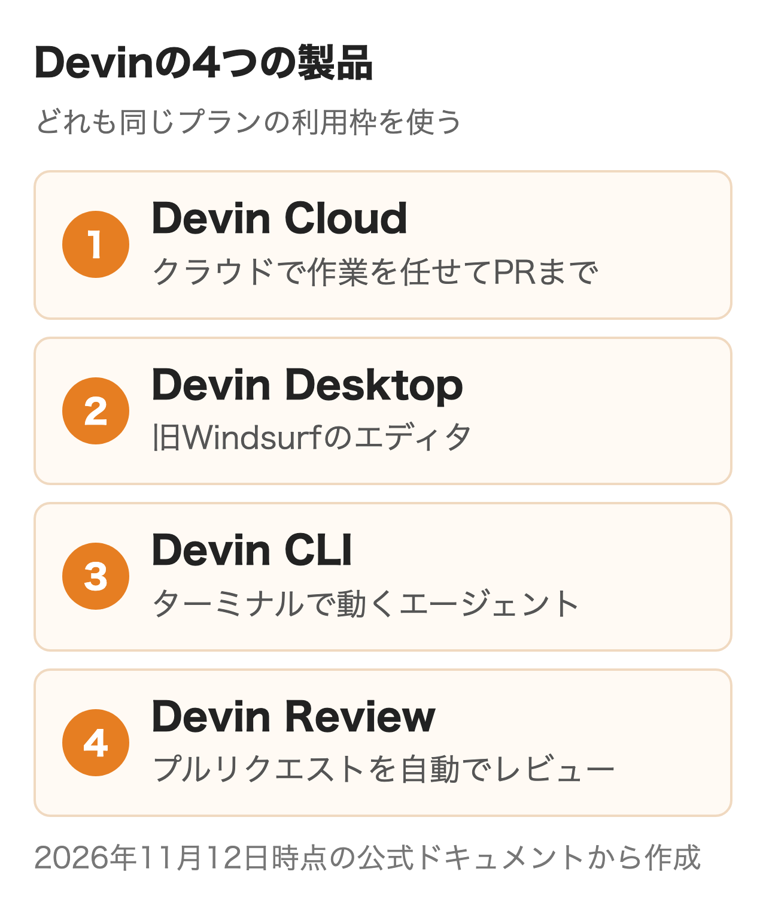
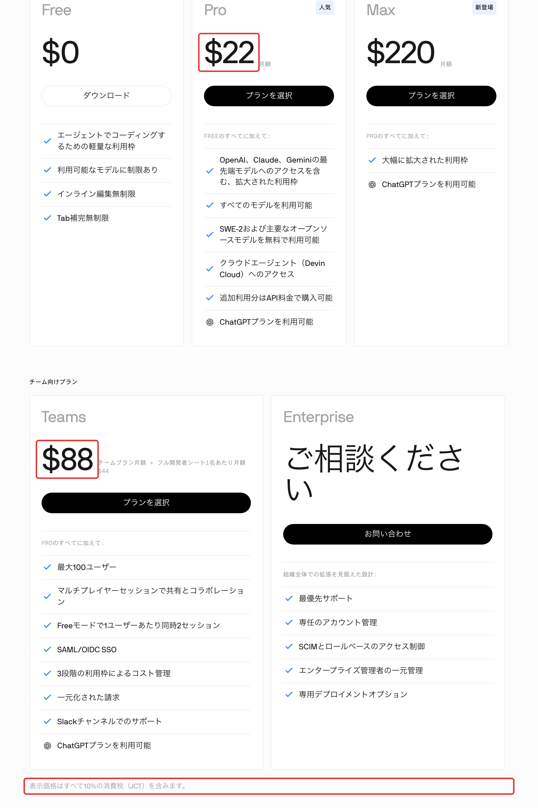
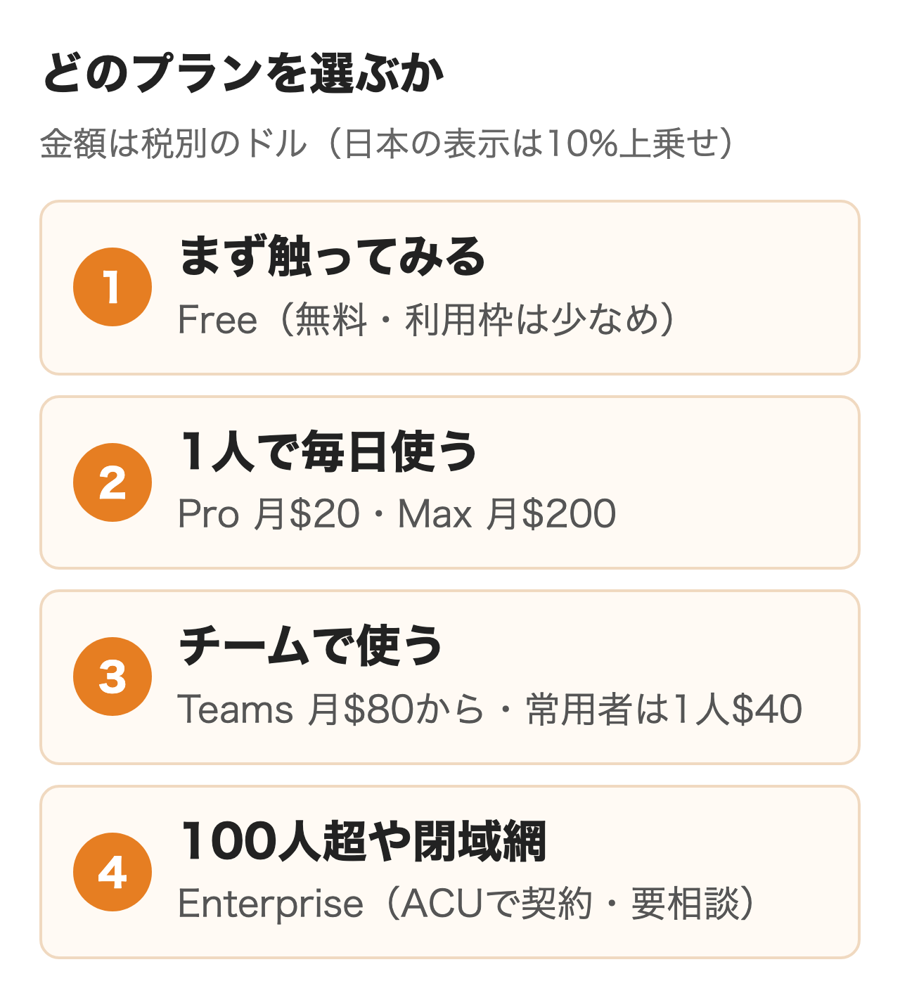
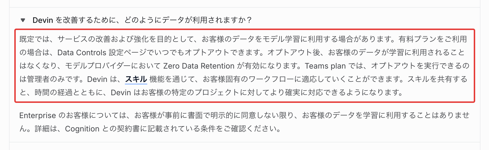
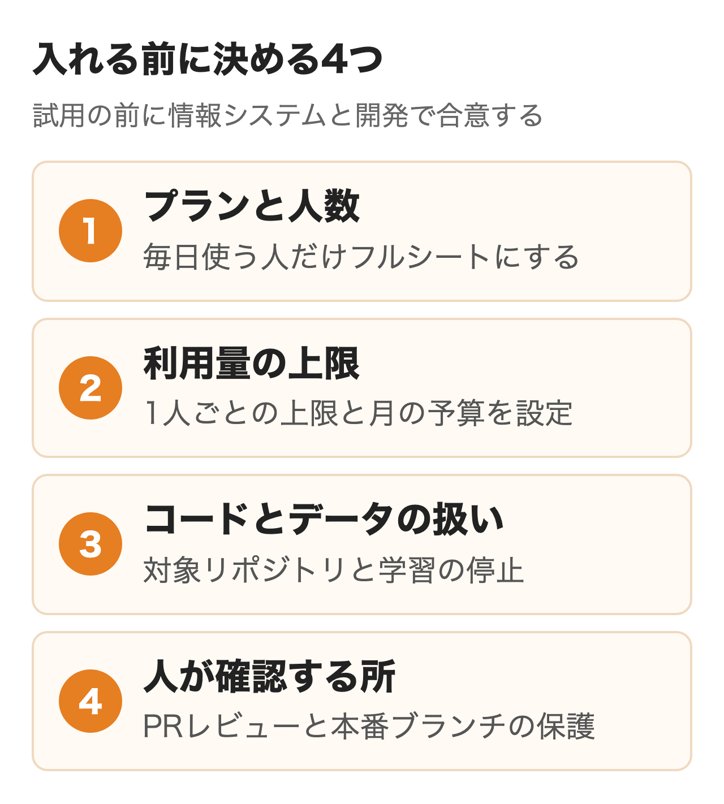

DevinはCognitionが作る自律型のAIソフトウェアエンジニアです。**チケットやSlackで頼んだ作業を自分の作業環境で計画・実装・テストし、プルリクエストを出すところまで進めます。**個人向けはPro月$20から、チームはTeams月$80からです。

2026年に料金の体系が変わり、Windsurfも名前をDevin Desktopに変えました。この記事では今の製品の構成、料金、使い方、会社のコードを預ける前に決めることを順に説明します。

:::takeaways
- Devinはクラウドで作業を任せる**Devin Cloud**を中心に、Desktop・CLI・Reviewの4製品で同じ利用枠を使う
- 料金はFree・Pro $20・Max $200・Teams $80〜（毎日使う人は1人$40）。**Enterpriseだけが従来のACUで契約する**
- 会社で入れるなら、**学習の停止・対象リポジトリ・PRレビューの決まりを試用の前に決めておく**
:::

## Devinとは何か

**Devinは指示を受けてコードを書き、動かし、直してからプルリクエストを出すAIエージェントです。**開発元の米Cognitionは2024年3月にDevinを発表しました。シェル・エディタ・ブラウザを備えた自分専用の作業環境で動くため、人が横で手を動かさなくても作業が進みます。

今のDevinは1つのアプリではなく、次の4つの製品の総称です。

| 製品 | 何をするものか |
|---|---|
| Devin Cloud | ブラウザやSlackから作業を頼み、クラウドでPRまで進める |
| Devin Desktop | 旧Windsurfのエディタ。手元とクラウドのエージェントをまとめて管理する |
| Devin CLI | ターミナルで動くエージェント。長い作業はクラウドに引き継げる |
| Devin Review | プルリクエストを読み、不具合の候補を指摘する |

<figure class="post-figure"></figure>

**Cognitionは2025年7月にエディタのWindsurfを買収し、2026年6月2日にWindsurfをDevin Desktopへ改名しました。**エディタ・拡張機能・設定はそのまま引き継がれ、料金も変わっていません。社用PCの管理ツールで「Windsurf」だけを許可していた会社は、アプリ名が「Devin」に変わったため許可リストの更新が必要です。

コードのリポジトリを読み込んで説明書を自動で作るDeepWikiや、コードについて質問できるAsk Devinも、Devin Cloudの中の機能として使えます。

## Devinは何ができる？

**公式の目安は「人が3時間でできる作業なら、Devinもほぼこなせる」です。**公式のドキュメントによる得意な仕事の分類は次の4つです。

- **並べて片づける仕事**: Jira・Linearのチケット、小さな新機能、バグ報告の再現と修正、アプリのテスト
- **移行と改修**: JavaScriptからTypeScriptへの書き換え、フレームワークの更新、使われていない機能フラグの削除
- **繰り返しの仕事**: PRレビュー、コードに関する質問への回答、単体テストの作成、ドキュメントの更新
- **顧客向けの技術支援**: 外部APIとの連携、デモや試作品、社内ツールの作成

2026年2月の更新（Devin 2.2）からは自分のLinuxデスクトップを操作でき、作ったデスクトップアプリも起動して試し、画面の録画を返します。画面は日本語にも対応し、指示も日本語で書けるため、国内のチームでもそのまま使える状態です。

### 任せやすい作業の形

**大規模な導入向けの手引きは、人の手で90分未満に収まる小さな単位に切り分けることを勧めています。**テスト・ビルド・CIで合否を判定できることと、ほかの作業から独立していることも条件です。逆に、複雑な新機能をまるごと渡すと仕上がりが安定しないとしています。

最初の試用ではテストが整ったリポジトリで「既存の関数に単体テストを足す」「ライブラリのバージョンを上げる」のような、成功の基準を1文で書ける作業から始めるのが向いています。

## Devinの料金はいくら？

**個人はFree・Pro・Max、チームはTeams、大きな組織はEnterpriseの5つです。**英語の料金ページは税別のドル、日本語の料金ページは10%の消費税込みのドルで表示されています。

| プラン | 月額（税別） | 向いている人 |
|---|---|---|
| Free | $0 | まず触ってみたい人 |
| Pro | $20 | 1人で日常的に使う人 |
| Max | $200 | Proの枠を毎週超える人 |
| Teams | $80から（毎日使う人は1人$40） | 2〜100人のチーム |
| Enterprise | 要相談 | 100人超・閉域網・専用環境が必要な会社 |

<figure class="post-figure"><figcaption>Devinの日本語の料金ページ（2026年11月12日）。表示は消費税込み</figcaption></figure>

有料プランには日ごと・週ごとに戻る利用枠が付き、Cloud・Desktop・CLIで共有します。超えた分は前払いのクレジットを使い、各モデルのAPIの定価で引かれます。クレジットは翌月に繰り越され、期限はありません。個人のChatGPT Plus・Proを契約していれば、GPTのモデルを使った分をChatGPT側の枠に回すこともできます。

<figure class="post-figure"></figure>

### Teamsはいくらになる？

**Teamsは毎日使う人をフルシート（1人$40）、たまに使う人をフレックスシート（無料）にして組みます。**フルシートにはProと同じ量の枠が付き、フレックスシートの人はチームで共有するクレジットから使います。

料金ページの表記は「チームプラン月$80＋フルシート1人$40」です。一方でドキュメントの説明では、$80は最低額で、フルシート2人分で満たされます。フルシートが2人未満のときは、足りない分が共有クレジットとして請求される仕組みです。

開発者5人のうち毎日使う3人をフル、2人をフレックスにすると、**固定費は月$120（税込$132）で、これにフレックスの2人が使ったクレジット分が加わります。**契約前に請求の見込みを営業かサポートに確認しておくと安心です。管理者は3段階の上限を作り、メンバーごとの使いすぎを止められます。

### EnterpriseのACUとは？

**ACU（Agent Compute Unit）はDevinの作業量の単位で、今はEnterpriseの契約だけで使われます。**単価は個別の契約書（オーダーフォーム）で決まり、公開されていません。

Devinが計画・調査・コードの実行などの行動をした量と作業環境の稼働時間に応じて、ACUは増えていきます。返事やテストを待つ間はほぼ消費せず、5分操作が無いと眠って止まります。見積もりの際に効いてくるのは作業の複雑さ・触るファイルの数・会話の往復の多さです。管理者は予算の上限を企業・組織・個人の単位で決められ、セッションごとの消費も画面で確認が可能です。

### 旧プランとの違い

2026年4月14日の発表で、旧Coreプラン（最低料金なしの従量課金）と旧Teamプラン（月$500）は廃止されました。**「Team月$500で250ACU付き」「1ACUは約15分」という説明は旧体系のもの**なので、今の比較には使えません。旧Windsurfの有料プランを使っていた人は、当時の価格のまま据え置かれています。

## Devinの使い方

**会社で試すなら、Webで登録してGitHubなどのリポジトリをつなぎ、Askで計画してからAgentで実行させる流れが基本です。**

1. [app.devin.ai](https://app.devin.ai)でメール・Google・GitHubのどれかで登録する
2. GitHub・GitLab・Bitbucketなどをつなぎ、Devinが触れてよいリポジトリだけを選ぶ
3. リポジトリを読み込ませ、ビルドとテストが通る作業環境を設定する
4. Askモードで質問しながら計画を作り、「Send to Devin」でAgentモードに渡す
5. 出てきたPRを人がレビューし、問題がなければマージする

Agentでは、軽い作業向けのLite、既定のNormal、難しい作業向けのUltraなどを選べ、上位ほど利用量が増えます。SlackやMicrosoft Teamsのスレッドで「@Devin」と呼びかけて頼むこともできます。

手元で使う開発者はDevin CLIを入れ、長くかかる作業だけ`/handoff`でクラウドに引き継ぐ使い方もできます。

```bash
curl -fsSL https://cli.devin.ai/install.sh | bash
```

## Devinを入れるメリットは？

**一番のメリットは、人が手を離している間も複数の作業が並んで進むことです。**

### 並べて任せられる

DevinのセッションはProで同時に最大10、Teams以上は上限なしで動かせます。朝にバックログから独立した作業をいくつか切り出して渡し、昼にPRを順にレビューする、という使い方ができます。

### 今の開発の流れに乗る

Jira・Linearのチケット、Slack・Teamsのスレッド、GitHubのPRコメント（`/devin`）から作業を始められます。PRはほかの開発者と同じブランチ保護の下に入るため、レビューの決まりを変えずに試せる点も利点です。

### 日本での導入の支えがある

Cognitionは2026年4月に日本法人を立ち上げました。伊藤忠テクノソリューションズ・SHIFT・ULSコンサルティングなどが国内のパートナーで、DeNAやみずほ証券の導入事例も公開されています。

## Devinのデメリットと注意点は？

**成果物の品質と会社のコードの扱いは、導入後も人が管理し続ける必要があります。**

### 間違ったコードも出す

公式のセキュリティのページ自身が、誤った内容や不具合、安全でないコードを出すことがあると書いています。PRのレビューと、テストが通らないとマージできないブランチ保護は外せません。

### 利用量の見通しが立てにくい

料金は作業の中身で増減するため、月額だけでは総額が決まりません。最初の1か月は上限を低めに設定し、どの作業でどれだけ使うかを見てから人数と枠を決めると安全です。

### 既定では学習に使われうる

**Devinは既定でデータをモデルの学習に使うことがあり、止めるには有料プランで設定が必要です。**Teamsでは停止できるのは管理者だけです。Enterpriseは書面での同意が無いかぎり学習に使わない、と公式は説明しています。

<figure class="post-figure"><figcaption>Devinのドキュメント「Cognition におけるセキュリティ</figcaption></figure>

## 会社で入れる前に決めること

**試用を始める前に、プランと人数・利用量の上限・コードとデータの扱い・人が確認する所の4つを、開発と情報システムの担当で決めておきます。**

<figure class="post-figure"></figure>

| 決めること | 公式の条件 | 決め方の例 |
|---|---|---|
| プランと人数 | Teamsは最大100人。超えるとEnterprise | 毎日使う人だけフルシート、ほかはフレックス |
| 利用量の上限 | Teamsは3段階の上限。Enterpriseは予算を階層で設定 | 試用の1か月は1人あたりの上限を低めに |
| 学習の扱い | 有料プランで停止できる。Teamsは管理者だけ | 契約したその日に管理者が停止する |
| 対象のリポジトリ | GitHubでは全部か選んだものだけを許可 | 試用は1〜2個のリポジトリに限る |
| 認証情報 | 設定のSecretsに保存して渡す | 本番の鍵は渡さず検証用だけ |
| 人の確認 | Devinも人と同じブランチ保護の下に入る | マージは必ず人。テストとCIの合格を条件に |

GitHubに入れるDevinのアプリは、コードの読み書き・PR・Issue・Actionsの実行などの権限を求めます。**「全リポジトリ」を許可すると新しいリポジトリの作成までできるため、試用の段階では対象を絞っておくほうが安全です。**

閉じたネットワークの中にあるGitLabやArtifactoryにつなぐ必要があるなら、Enterpriseの専用環境（単一テナントのVPCとAWS PrivateLink）の相談になります。どの専用環境でも、Devinの判断を担う部分はCognitionのクラウドで動き、自社のLLMのAPIキーには切り替えられません。データの置き場所に社内の決まりがある会社は、ここを先に確認しておきます。

Devinを入口に、社内の業務やデータにつなぐエージェントまで作る場合は、権限と運用の設計が必要です。nitoも[AIエージェントの構築と運用の支援](/ai-agent/)を行っています。

## Cursor・Claude Codeとどう使い分ける？

**Devinはクラウドで作業を丸ごと引き取り、チケットからPRまでを人の手を離れて進める点が強みです。**ほかのツールでは開発者が画面の前で一緒に書く使い方が中心です。

| ツール | 得意な使い方 | 会社向けの入口（税別） |
|---|---|---|
| Devin | チケットを渡してPRまで任せる | Teams 月$80〜（1人$40） |
| Cursor | エディタで補完を受けながら書く | Teams 1人$30から |
| Claude Code | ターミナルでClaudeと一緒に書く | Team 1人$25（年払い$20） |
| Codex | ChatGPTの契約の中で使う | Business 1人$25（年払い$20） |
| Kiro | 要件と設計の文書を作ってから実装 | 1シート$20 |

**開発者が手元で書く作業はCursorやClaude Codeに、独立して切り出せる作業の山はDevinに、と分けると併用しやすくなります。**Devin CLIはCursorやClaude Code、Codex、Kiroの設定を読み込めるので、すでに使っているルールをそのまま持ち込める仕組みです。

:::linkcard
url: /media/cursor-guide/
title: 【2026年11月】Cursorの料金と使い方・月$8〜$200の新プランとTeamsの選び方
desc: Cursorの新しい料金体系と、Teamsと企業向けの管理機能の違いを解説しています。
:::

:::linkcard
url: /media/codex-vs-claude-code/
title: 【2026年11月】CodexとClaude Codeを比較｜料金・管理機能・データ・併用
desc: CodexとClaude Codeの料金・使える量・管理者の設定・学習の扱いを同じ物差しで比べています。
:::

:::linkcard
url: /media/kiro-guide/
title: 【2026年11月】Kiroとは？AWSのAI開発ツールの料金・使い方・企業で使う条件
desc: 仕様駆動開発のKiroの料金と、AWSのIDで会社に入れる条件を解説しています。
:::

## まとめ

- 個人で試すなら、FreeかProでテストの整ったリポジトリを1つつなぎ、小さな作業を渡してみる
- チームで入れるなら、Teamsで毎日使う人だけフルシートにし、3段階の上限を低めに置いて始める
- 会社のコードを預けるなら、契約した日に管理者が学習を止め、対象リポジトリを絞る
- 閉域網や100人超の規模なら、EnterpriseでACUの単価と専用環境を営業に確認する
- 古い記事の「Team月$500」「1ACU約15分」は旧体系なので、比較には今の料金ページを使う

## よくある質問

### Devinは無料で使えますか？

使えます。Freeプランは少なめの利用枠で、一部のモデルに限ってエージェントを試せます。クラウドに作業を任せるDevin CloudはPro以上が対象です。

### Devinは日本語で使えますか？

使えます。画面は日本語に切り替えられ、指示も日本語で書けます。Devin Reviewのコメントの言語も日本語を選べます。

### DevinとWindsurfの関係は？

CognitionがWindsurfを買収し、2026年6月2日にWindsurfはDevin Desktopに名前を変えました。エディタや設定はそのまま使え、料金も変わっていません。

### DevinのACUはいくらですか？

ACUの単価は公開されておらず、Enterpriseの契約ごとに決まります。Pro・Max・Teamsの支払いはACUではなく、プランの利用枠とドル建てのクレジットです。

### Devinは会社のコードを学習に使いますか？

既定では使われる場合があり、止めるには設定が必要です。有料プランならデータ管理の設定で停止でき、Teamsでは管理者だけが操作できます。Enterpriseは書面の同意が無いかぎり学習に使いません。

### Devinはどのリポジトリにつなげますか？

GitHub・GitLab・Bitbucketに対応し、EnterpriseではGitHub Enterprise ServerやAzure DevOpsもつなげます。GitHubでは許可するリポジトリを選べます。

### Devinの料金に消費税はかかりますか？

日本語の料金ページは10%の消費税込みで表示されており、Proは月$22、Teamsのフルシートは1人$44です。

### Devinはエンジニアの代わりになりますか？

なりません。作業の切り出し、PRのレビュー、マージの判断は人が担います。人の手で数時間かかる独立した作業を、並べて任せる使い方が向いています。

## 出典

- [Devin 料金プラン（日本語）](https://devin.ai/ja/pricing)（2026年11月12日取得）
- [Devin Plans and Pricing](https://devin.ai/pricing)
- [Devin Docs Self-serve plans](https://docs.devin.ai/admin/billing/self-serve)
- [Devin Docs Enterprise（Billing）](https://docs.devin.ai/admin/billing/enterprise)
- [Devin Docs Usage](https://docs.devin.ai/admin/billing/usage)
- [Devin Docs Use your ChatGPT plan in Devin](https://docs.devin.ai/admin/billing/chatgpt)
- [Devin Docs Introducing Devin](https://docs.devin.ai/get-started/devin-intro)
- [Devin Docs Your First Session](https://docs.devin.ai/get-started/first-run)
- [Devin Docs When to Use Devin](https://docs.devin.ai/essential-guidelines/when-to-use-devin)
- [Devin Docs Best Practices](https://docs.devin.ai/use-cases/best-practices)
- [Devin Docs Cognition におけるセキュリティ](https://docs.devin.ai/ja/admin/security)
- [Devin Docs Enterprise Deployment](https://docs.devin.ai/enterprise/deployment/overview)
- [Devin Docs GitHub](https://docs.devin.ai/integrations/gh)
- [Devin Docs Devin Desktop FAQ](https://docs.devin.ai/desktop/devin-desktop-faq)
- [Cognition Cognition's acquisition of Windsurf](https://cognition.com/blog/windsurf)（2025年7月14日）
- [Cognition Introducing Devin 2.2](https://cognition.com/blog/introducing-devin-2-2)（2026年2月24日）
- [Cognition Launching in Japan with Takumi Masai](https://cognition.com/blog/launching-in-japan)（2026年4月9日）
- [Cognition New self-serve plans for Devin](https://cognition.com/blog/new-self-serve-plans-for-devin)（2026年4月14日）
- [Cognition Introducing Devin Desktop](https://cognition.com/blog/introducing-devin-desktop)（2026年6月2日）
