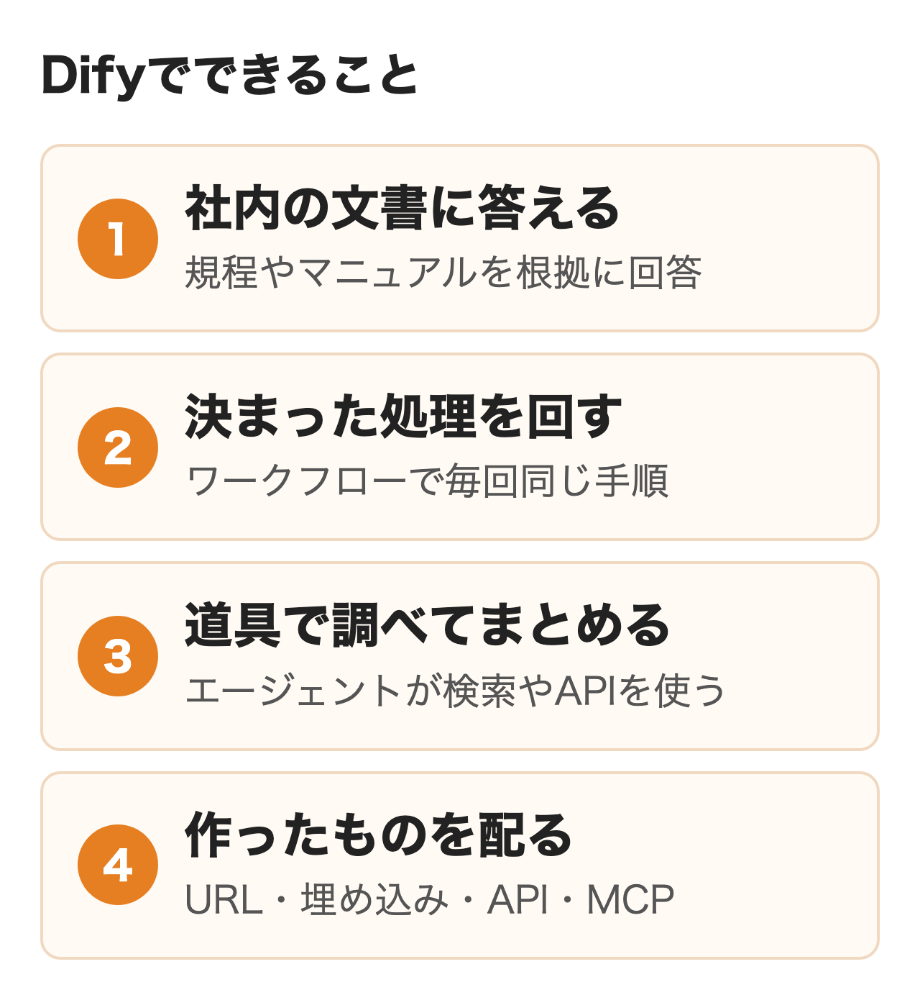
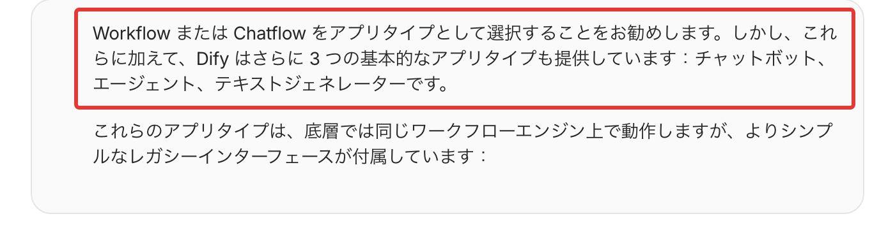
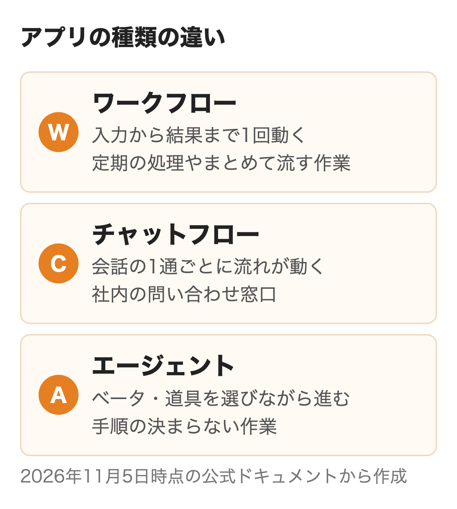
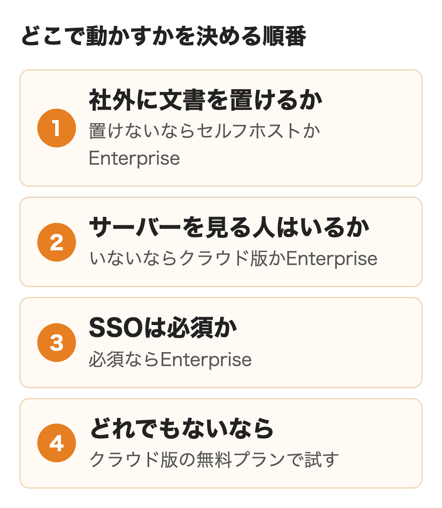
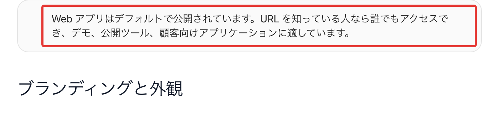
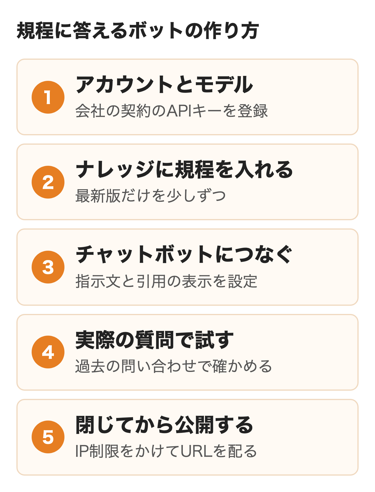

Difyは、AIを使ったチャットボットや業務の自動化を画面上で組み立てる開発基盤です。米国のLangGeniusが開発するオープンソースで、GitHubのスターは約16万、2026年11月4日にバージョン1.19.0が出ました。

社内でDifyを使いたいという声が上がると、導入担当は何に使えるか、データをどこに置くか、誰が作るかを決めることになります。この記事は2026年11月5日に読んだ公式のドキュメントとライセンスをもとに、できること、アプリの種類の違い、クラウドとセルフホストの選び方、最初の1本の作り方を扱います。契約とセルフホストの構築は試していません。

:::takeaways
- **Difyはモデル・社内の文書・外部の道具を組み合わせてAIアプリを作り、URL・埋め込み・API・MCPで配る基盤**。公式が勧める種類はワークフローとチャットフロー
- **クラウド版はDifyのクラウドで動き、セルフホストなら自社の環境に置ける**。社外に出せない文書を扱うなら、セルフホストかEnterpriseから検討する
- **公開したWebアプリは、既定ではURLを知っていれば誰でも開ける**。社内規程を入れたボットは、IPアドレスの制限か社内ネットワークで閉じてから配る
:::

## Difyとは何か

日本では「ディフィ」と「ディファイ」の両方の読み方が使われています。ChatGPTのようにそのまま話しかけるサービスではなく、**社内向けのAIアプリを作って配る側の道具**です。Dify自体はAIのモデルを持たず、OpenAI・Anthropic・Googleなどのモデルを呼び出して動く仕組みです。

公式のドキュメントの入口には、作業はすべてワークスペースから始まり、アプリを作る・自社のデータをつなぐ・公開する・利用状況を見るまでを1か所で行えると書かれています。ワークスペースはアプリ・ナレッジベース・メンバー・モデルの設定・外部サービスとの連携・請求をまとめた単位で、ほかの組織とは分けて管理されます。クラウド版の各プランとセルフホストのコミュニティ版はワークスペースが1つで、1つの契約で部署ごとに複数のワークスペースを持てるのはEnterpriseだけです。**まず1つのワークスペースを全社か1つの部署で使う前提で、メンバーの人数と役割を決める**と設計しやすくなります。

ソースは[GitHubのリポジトリ](https://github.com/langgenius/dify)で公開され、ライセンスはApache License 2.0に条件を2つ足したものです。商用での利用はほかのアプリの裏側や企業のアプリ開発基盤として使う場合も含めて認められています。条件の中身は後のライセンスの節にまとめました。

<figure class="post-figure"></figure>

## Difyでできること

### 社内の文書に答える

RAG（検索拡張生成）は質問が届くたびに関係する文章をナレッジベースから探し、質問と一緒にモデルへ渡す仕組みです。モデルが学習で得た知識だけでなく、入れた規程やマニュアルを踏まえて答えます。公式ドキュメントによると、大事なのは利用者が実際に尋ねる質問に適切な断片が返るかどうかです。**答えの質はモデルを替えるより先に、正しい文章を探し出せるかで決まります。** 文書の切り方と探し方の細部は「[RAG構築とは](/media/rag-build/)」で扱いました。

### 決まった処理を自動で回す

ワークフローはモデルの呼び出し・ナレッジの検索・コードの実行・条件分岐などの部品を線でつないで作ります。公式の30分のチュートリアルでは、入力から投稿先を抜き出し、無効な入力なら途中で止め、投稿先ごとに文章を作り分ける流れが題材です。スケジュールやWebhookで自動で動かすこともできます。**1回の実行の中身を先に決めておけるため、毎回同じ品質が要る作業に向いています。**

### 道具を使って調べてまとめる

エージェントはWeb検索や外部のAPIといった道具をモデルが自分で選びながら仕事を進める種類です。今は従来のエージェントのアプリに加えて、専用のサンドボックスでコマンドの実行やファイルの読み書きまで行う新しいエージェントがベータで出ています。クラウド版ではサンドボックスがクラウド上で動くため、社内ネットワークの中のファイルやページには届きません。**業務に組み込むなら、ベータのうちはワークフローの1ステップとして任せる範囲を決めて使うのが安全です。**

### 作ったものを配る

アプリを公開すると、Webアプリ・サイトへの埋め込み・API・MCPサーバーの4通りで使えるようになります。Webアプリはアプリを作った時点で自動で用意され、URLを送るだけで社員が使える仕組みです。MCPサーバーとして公開すると、Claude DesktopやCursorから道具として呼べます。このURLには認証の情報が含まれるため、公式はAPIキーと同じように扱うよう注意しています。ゼロから作らずに、用意されたテンプレートから始めることもできます。

### 導入した会社の例

国内の導入例として各社や紹介記事が出している数字は、次のとおりです。数字はそれぞれの記事の記載で、nitoでは確かめていません。

| 会社 | 使い方 | 記事にある効果 |
|---|---|---|
| リコー | 27サイトから競合などの情報を集め、分類して約1,000人に毎日配信 | 業務の工数を約90%削減 |
| カカクコム | セルフホストのDifyに経理の文書を入れ、Teamsから使える社内ボットに | 経理の問い合わせ対応の時間が約15%減。全社アンケートでは年間18,000時間の削減を見込む |
| Hakuhodo DY ONE | Power Automateが取った請求書のPDFを、Difyのワークフローで読み取ってExcelへ | 年間で約60%のコスト削減を見込む |

**3社とも、問い合わせや情報収集のように同じ形の作業が大量にある所から始めています。**

## ワークフロー・チャットフロー・エージェントの違い

Difyでアプリを作るときは、最初に種類を選びます。公式の「主要な概念」のページは、**ワークフローかチャットフローを選ぶよう勧めています**。そのほかのチャットボット・エージェント・テキストジェネレーターの3つは、同じ仕組みの上に作られた簡単な画面という位置づけです。

<figure class="post-figure"><figcaption>Dify Docsの主要な概念（2026年11月5日）</figcaption></figure>

| 種類 | 動き方 | 向く仕事 |
|---|---|---|
| ワークフロー | 入力を受け取り、最初から最後まで1回動く。スケジュールやWebhookでも起動できる | レポート作成、データの処理、まとめて流す作業 |
| チャットフロー | 会話の1通ごとに、組んだ流れが動いてから答える | 社内の問い合わせ窓口、手順を案内するQ&A |
| エージェント（新しい種類） | ベータ。サンドボックスで道具を選びながら進む。単体でもワークフローの中でも使える | 調べて要約する、手順が決まっていない作業 |
| チャットボット | モデル・指示文・ナレッジだけで会話する | 社内Q&Aの試作 |
| テキストジェネレーター | 1回の入力に1回だけ答える | 要約、翻訳、定型文 |
| エージェント（従来の種類） | 会話の中でモデルが道具を選ぶ | データを取ってきて答えるアシスタント |

ワークフローとチャットフローは同じ部品で組めて、違うのは利用者との関わり方です。チャットフローは利用者のメッセージで必ず始まるため、スケジュールでの起動はありません。**人と会話するならチャットフロー、毎回同じ処理を流すならワークフローと決めれば、ほとんど迷いません。**

<figure class="post-figure"></figure>

ナレッジベースには自分で切り方を決める従来型と、整理を自動で行うAgentナレッジベース（ベータ）があり、チャットボットで試作した従来型はチャットフローでもそのまま使えます。新しいエージェントで使うときは、Agentナレッジベースへのアップグレードが要ります。

## クラウド版とセルフホストの選び方

会社で決めることの中心はDifyをどこで動かすかです。選択肢はクラウド版・セルフホスト（コミュニティ版）・Enterpriseの3つあります。

| | クラウド版 | セルフホスト | Enterprise |
|---|---|---|---|
| 動く場所 | Difyのクラウド | 自社のサーバーやクラウド | 自社の環境 |
| 始めるまで | 登録してすぐ | Dockerで構築する | 見積もりと構築 |
| 更新と守り | Dify側 | 自社 | 公式の更新・保守とパートナーのSLA |
| SSO | なし | なし | SAML・OIDC・OAuth2 |
| 費用 | プランの月額とモデルの代金 | サーバー代とモデルの代金、運用の人手 | 個別の見積もり |

プランごとの金額とモデルの代金の見積もり方は「[Difyの料金](/media/dify-pricing/)」にまとめました。

<figure class="post-figure"></figure>

### クラウド版のデータの扱い

Difyのプライバシーポリシーは、ウェブサイトのサーバーは米国にあるとし、集めた情報は利用者の地域のほか米国・オーストラリア・カナダ・中国・EEA・英国など、LangGeniusや委託先が拠点を持つ国や地域で保存・処理されることがあると書いています。料金ページは置き場所をマネージドのクラウドとだけ書き、国や地域を選べる記載はありません。同じポリシーで、LangGeniusはやり取りのデータを学習に使わないとしています。自社のAPIキーを登録したモデルを使う場合、質問の内容はそのモデルの提供元へ送られ、学習に使うかどうかは提供元との契約しだいです。**国内に置く決まりがある文書なら、クラウド版より先にセルフホストを検討することになります。**

### セルフホストに要るもの

公式の[Docker Composeでの構築の手順](https://docs.dify.ai/ja/self-host/deploy/quick-start/docker-compose)では、CPU 2コア・メモリ4GiB以上のマシンに、Docker Compose 2.35.0以降・Git・OpenSSLを入れます。リリースのタグを指定して取得し、設定ファイルを用意して起動したあと、ブラウザで管理者のアカウントを作る流れです。他の人が使える状態にする前に、HTTPSを設定し、同梱された開発用のパスワードやキーをすべて置き換えるよう書かれています。

更新のときはバックアップを取り、新しい版の設定の見本と自社の設定を見比べてから入れ替えるのが公式の手順です。1.18.0から1.19.0までのように新しい版は続けて出るため、**サーバーを置くだけでなく、更新を追う担当を決めておく必要があります。**

### ライセンスで気をつけること

[DifyのLICENSE](https://github.com/langgenius/dify/blob/main/LICENSE)は、商用での利用を認めたうえで、次の2つに当たるときは開発元の商用ライセンスが要るとしています。

- 書面の許可なく、Difyのソースでマルチテナントの環境を運用する場合（1つのワークスペースが1テナント）
- Difyの画面（フロントエンド）を使いながら、ロゴや著作権の表示を消したり変えたりする場合

**社内で1つのワークスペースを使うだけなら、どちらにも当たりません。** 顧客ごとにワークスペースを分けて提供する、受託で作って自社のロゴで納める、といった使い方は当てはまるかを確かめます。迷うときは開発元の問い合わせ先に書面で確かめておくのが安全です。

## 社内で誰が作り誰が使うか

ワークスペースの中の権限は4つの役割で決まります。公式のメンバー管理のページによると、それぞれ次のことができます。

| 役割 | できること |
|---|---|
| オーナー | ワークスペースのすべて。請求・モデルの提供元・設定。1つのワークスペースに1人 |
| 管理者 | メンバーとモデルの提供元の管理、エディターの操作すべて |
| エディター | アプリとナレッジベースの作成・編集・削除 |
| メンバー | 公開済みのアプリを使うだけ |

クラウド版のメンバーの上限はプランで決まり、Sandboxが1人、Professionalが3人、Teamが50人です。モデルの提供元とAPIキーを管理できるのはオーナーと管理者だけで、登録したキーはワークスペース全体で使われ、その人の提供元の契約に請求が来ます。**試作の段階から会社の契約のキーを管理者が入れておくと、本番に移っても請求先が変わりません。**

もう1つ、公開の範囲に注意が要ります。Webアプリの設定のページには、**Webアプリは既定で公開されていて、URLを知っている人なら誰でもアクセスできる**と書かれています。社内規程を入れたボットのURLが社外に転送されれば、その相手も質問できる状態です。

<figure class="post-figure"><figcaption>Dify DocsのWebアプリの設定（2026年11月5日）</figcaption></figure>

クラウド版で閉じるには、送信元のIPアドレスで絞るIPアクセス制御を使います。使えるのはProfessionalとTeamで、許可するアドレスの一覧を作れるのはオーナーと管理者です。契約が切れると制限も外れる点も公式に書かれています。セルフホストなら、社内ネットワークの中だけに置く方法もあります。

作った人が辞めてもアプリとナレッジベースはワークスペースに残り、公開した内容は次の操作から利用者に届きます。**誰がアプリを公開してよいか、公開前に誰が中身を見るかを、最初の1本の前に決めておくと勝手に作られたアプリが増えません。**

## Difyの使い方と最初の1本の作り方

最初の1本には社内規程に答えるチャットボットが向いています。答えるべき文書がはっきりしていて、正しく答えたかを担当部署が判断できるためです。ここでは公式のドキュメントの手順に沿って、クラウド版でチャットボットと従来型のナレッジベースを使う形を説明します。

<figure class="post-figure"></figure>

### ① アカウントとモデルを用意する

[Dify Cloud](https://cloud.dify.ai)に登録すると、無料のSandboxから始まります。OpenAI・Anthropic・Geminiなどのモデルを呼べる200のAIクレジットが付きますが、一度きりの付与で毎月は戻りません。統合のメニューからモデルの提供元を入れ、自社のAPIキーを登録すると、クレジットとキーのどちらを先に使うかを選べます。ナレッジの検索に使う埋め込みのモデルなど、ワークスペースの既定のモデルもこの時点で決めておくのが安全です。


### ② ナレッジに規程を入れる

ナレッジのメニューで作成を押し、すぐに使えるナレッジベースを選んでファイルをアップロードします。続く画面で文書の切り方と、探せる形にする方法（高品質か経済的か）を選び、処理が終わるのを待つ流れです。**旧版と新版の規程が両方入っていると、ボットはどちらも答えの材料にしてしまう**ため、最新版だけを集めてから入れてください。最初は代表的な数本だけで始め、検索の具合を確かめてから残りを足すと、設定を変えたときに入れ直す文書が少なくて済みます。

### ③ チャットボットを作ってつなぐ

スタジオでアプリを作成し、チャットボットを選びます。指示文の欄には役割と答え方の決まりを次のように書いてください。

```text
あなたは社内規程の問い合わせに答える担当です。
コンテキストにある規程だけを根拠に、該当する条文の名前を添えて答えてください。
規程に書かれていないことは推測で答えず、人事部の窓口を案内してください。
```

何から書けばよいか迷うときは、生成のボタンで下書きを作らせることもできます。次に、コンテキストの欄で②のナレッジベースを追加し、機能の追加から引用と帰属を有効にします。**答えの下にどの文書を引いたかが出るため、利用者も担当者も根拠を確かめられます。**


### ④ 実際の質問で試す

右側のデバッグとプレビューで質問を送り、答えと引用された文書を見ます。試す質問には担当部署に過去に届いた問い合わせをそのまま使うのが近道です。外れる質問が多いなら、検索の設定で返す件数（Top K）や一致の基準（スコアのしきい値）を変えて比べます。

### ⑤ 閉じてから公開する

公開のボタンを押すと、アクセスポイントのタブにWebアプリのURLが出ます。前の節のとおり、このURLは既定で誰でも開けるため、IPアクセス制御を設定してから社員に配ります。説明とアイコンを入れておくと、利用者が何のボットか迷いません。

1本目が動いたら、1つの部署で数週間使ってもらい、自己解決できた割合や問い合わせの件数の変化を見てから広げると、上への説明がしやすくなります。社内の業務システムにつなぐ所まで組むなら、nitoの[AIエージェント構築支援](/ai-agent/)でも相談を受けています。

## Copilot Studioやn8nとの使い分け

社内でAIのアプリやエージェントを作る道具はDifyのほかにもあり、それぞれ中心にしている仕事が異なる製品です。

| 製品 | 中心にしている仕事 | 向く会社 |
|---|---|---|
| Dify | AIアプリを作って配る。モデルを選べ、自社にも置ける | モデルを選びたい、文書を自社に置きたい |
| Copilot Studio | Microsoft 365の中でエージェントを作る | 社員の大半がMicrosoft 365で働いている |
| Gemini Enterprise | Google Cloudの法人向けのエージェントと社内データの検索 | Google Workspaceが土台 |
| n8n | システムどうしをつなぐ自動化。AIエージェントの部品もあり、自社にも置ける | 定期の処理やAPIの連携が主 |

**DifyはAIの答えを作る側、n8nはデータを運ぶ側が得意**で、n8nで集めたデータをDifyに渡すように組み合わせる使い方もあります。それぞれの費用と範囲は「[Copilot Studioの料金](/media/copilot-studio/)」「[Gemini Enterpriseとは](/media/gemini-enterprise/)」「[n8nの料金](/media/n8n-pricing/)」にまとめました。

## まとめ

- **まず試すだけなら**、クラウド版のSandboxで、チャットボットと従来型のナレッジで規程のボットを1本作る。機密の文書はまだ入れない
- **社内規程や顧客の情報を入れて配るなら**、データの置き場所を社内の規程と照らす。クラウド版ならProfessional以上でIP制限をかけ、社外に出せないならセルフホストかEnterpriseを比べる
- **毎回同じ処理を自動化したいなら**ワークフロー、会話の窓口ならチャットフローで作る。新しいエージェントはベータのうちは範囲を決めて使う
- **Microsoft 365やGoogle Workspaceの中で完結させたいなら**、Copilot StudioやGemini Enterpriseを先に比べる

## よくある質問

### Difyは無料で使えますか？

使えます。クラウド版のSandboxは無料で、200のAIクレジットが一度だけ付きます。セルフホストのコミュニティ版も無料ですが、サーバー代とモデルの代金は自社の負担です。

### Difyの読み方は？

「ディフィ」と「ディファイ」の両方が使われています。

### Difyはプログラミングの知識がなくても使えますか？

アプリは画面で部品をつないで作れるため、チャットボットやワークフローはコードを書かずに作れます。セルフホストで動かす場合は、DockerとLinuxのサーバーを扱える担当が必要です。

### Difyのクラウド版のデータはどこに置かれますか？

Difyのプライバシーポリシーは、ウェブサイトのサーバーは米国にあり、情報は米国・中国・EEAなど複数の国や地域で保存・処理されることがあると書いています。国内に置く決まりがある場合は、セルフホストかEnterpriseが候補です。

### Difyで作ったアプリは社外の人も開けますか？

既定では誰でも開ける設定です。公式ドキュメントに、公開したWebアプリはURLを知っている人ならアクセスできると書かれています。クラウド版のProfessionalとTeamでは、IPアドレスで利用者の場所を絞れます。

### Difyのワークフローとチャットフローはどう使い分けますか？

人と会話しながら答えるならチャットフロー、入力を受けて決まった処理を1回流すならワークフローです。スケジュールやWebhookで自動で動かせるのはワークフローだけです。

### Difyは商用利用できますか？

できます。ただし、Difyのソースでマルチテナントの環境を運用する場合と、Difyの画面を使いながらロゴや著作権の表示を変える場合は、開発元の商用ライセンスが要ります。

### DifyとChatGPTは何が違いますか？

ChatGPTは1人ずつ話しかけて使う対話サービスです。Difyは使うモデルを選び、社内の文書や外部の道具とつないだアプリを作って、URLやAPIで組織に配るための基盤です。

## 出典

- Dify Docs「[Dify の使い方](https://docs.dify.ai/ja/cloud/use-dify/getting-started/introduction)」「[主要な概念](https://docs.dify.ai/ja/learn/key-concepts)」「[Workflow と Chatflow](https://docs.dify.ai/ja/cloud/use-dify/build/workflow-chatflow)」「[Agent](https://docs.dify.ai/ja/cloud/use-dify/build/new-agent/overview)」「[Agent の構築](https://docs.dify.ai/ja/cloud/use-dify/build/new-agent/build)」「[チャットボット](https://docs.dify.ai/ja/cloud/use-dify/build/chatbot)」
- Dify Docs「[ナレッジ](https://docs.dify.ai/ja/cloud/use-dify/knowledge/overview)」「[アプリ内でのナレッジベース統合](https://docs.dify.ai/ja/cloud/use-dify/knowledge/integrate-knowledge-within-application)」「[検索のテストとチューニング](https://docs.dify.ai/ja/cloud/use-dify/knowledge-base/test-and-tune)」
- Dify Docs「[AI アプリの共有](https://docs.dify.ai/ja/cloud/use-dify/publish/README)」「[Web アプリの設定](https://docs.dify.ai/ja/cloud/use-dify/publish/webapp/web-app-settings)」「[IP アクセス制御](https://docs.dify.ai/ja/cloud/use-dify/publish/ip-access-control)」「[MCP サーバー](https://docs.dify.ai/ja/cloud/use-dify/publish/publish-mcp)」
- Dify Docs「[ワークスペースの概要](https://docs.dify.ai/ja/cloud/use-dify/workspace/readme)」「[メンバーの管理](https://docs.dify.ai/ja/cloud/use-dify/workspace/team-members-management)」「[モデルプロバイダー](https://docs.dify.ai/ja/cloud/use-dify/workspace/model-providers)」「[30 分間クイックスタート](https://docs.dify.ai/ja/quick-start)」「[Docker Compose で Dify をデプロイする](https://docs.dify.ai/ja/self-host/deploy/quick-start/docker-compose)」
- GitHub「[langgenius/dify](https://github.com/langgenius/dify)」「[LICENSE](https://github.com/langgenius/dify/blob/main/LICENSE)」「[Releases](https://github.com/langgenius/dify/releases)」（1.19.0は2026年11月4日）
- Dify「[Privacy Policy](https://dify.ai/privacy)」「[料金](https://dify.ai/jp/pricing)」
- リコー「[Difyとは？概要から特徴やメリット、出来ることまでを徹底解説](https://promo.digital.ricoh.com/ai/column/detail048/)」（2026年8月27日更新）
- 日本HP「[ビジネス現場で話題の「Dify」超入門編](https://jp.ext.hp.com/techdevice/ai/ai_explained_29/)」（2025年9月18日）
- いずれも2026年11月5日に確認
