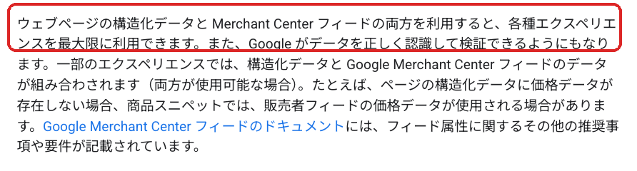
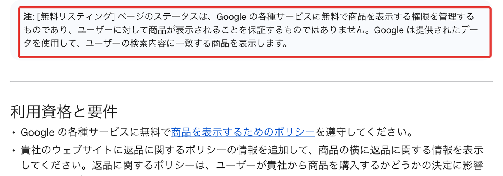

EC・通販のAIO対策会社は、**自社ECサイトを持っているか、楽天市場やAmazonなどのモール出店が中心か**で選ぶと迷いません。自社ECなら商品ページの構造化データや記事まで実装できる会社、モール出店が中心ならモール運営の知見があり外部の情報まで扱える会社が候補です。

この記事は株式会社nitoが書いています。ECのAI検索対策を公式サイトで案内している4社に、nitoを1番目に加えた5社を比べます。

:::takeaways
- ECのAI検索対策は、ページの文章に加えて**商品データ（構造化データ・Merchant Center・商品フィード）**も対象になる
- 自社ECとモール出店では店舗が修正できる範囲が違うため、**依頼先も分かれる**
- 料金は診断1回30万円から月40万円までと幅があり、**契約期間を掛けた総額と実装の範囲**で比べる
:::

## ECのAIO対策が他の業種と違う点は？

ECのAIO対策では会社のサービスページや記事に加えて**商品そのもののデータをAIや検索に渡す作業**が加わる点が、ほかの業種と違います。買い手がChatGPTやGeminiに「1万円以内で贈れる日本酒は？」と聞いたとき、AIは文章のページだけでなく、価格・在庫・レビューを持った商品の情報も材料にします。

### 商品データを渡す経路がある

Googleの検索セントラルは、商品の情報をGoogleに渡す方法として、商品ページにProductの構造化データを入れる方法と、Merchant Centerに商品フィードを送る方法の2つを挙げています。**両方を使うと各種の表示を最大限に利用できる**、というのが公式の説明です。購入できるページ向けの「販売者のリスティング」と、レビューなどを載せる「商品スニペット」の2種類があり、色やサイズ違いの商品には別の構造化データもあります。

<figure class="post-figure"><figcaption>Google 検索セントラル「Product の構造化データについて」（2026年11月17日）</figcaption></figure>

Merchant Centerのヘルプによると、Merchant Centerを使っていなくても、Googleがオンラインショップをクロールして商品を表示することがあります。一方で無料リスティングの設定は表示の許可であって、表示を保証するものではありません。**文章のページだけでなく商品データの整備まで依頼できるかを、ECの対策会社には確認しておく**必要があります。

<figure class="post-figure"><figcaption>Google Merchant Center ヘルプ「商品の無料リスティング」（2026年11月17日）</figcaption></figure>

### ChatGPTとGoogleに買い物の枠がある

ChatGPTには画像・価格・購入先のリンクを付けて商品を並べる買い物の検索結果があります。OpenAIの事業者向けページには、**ShopifyかEtsyで売っている場合はカタログがすでに連携されていて、追加の設定も申請も要らない**と書かれています。それ以外の会社の商品フィードの申請はウェイトリストの段階です。ChatGPTのショッピングは米国の利用者向けに提供されていて、日本の利用者への提供時期は公式に書かれていません。

GoogleのAIモードとAIによる概要については、表示されるための追加の要件はないと検索セントラルが明記しています。そのうえで基本の1つとして、**Merchant Centerとビジネスプロフィールの情報を最新に保つ**ことを挙げています。手続きの詳しい内容は[ChatGPTショッピングに自社商品を載せる方法](/media/chatgpt-shopping/)と[Google AIモードのショッピングに商品を載せる方法](/media/ai-mode-shopping/)にまとめています。

### 口コミの集め方に法律の決まりがある

AIは公式サイトの説明だけでなく、比較記事や口コミサイトの情報も回答の材料にします。そのためECの対策では、レビューを増やす施策や第三者のメディアへの掲載がよく提案されます。

ただし2023年10月1日から、事業者が書かせたのに広告だと分からない表示（ステルスマーケティング）は景品表示法の違反です。**レビューの依頼やメディアへの掲載を任せるなら、広告であることの表示をどう扱うかを契約前に確認しておく**と安心です。

## 自社ECとモール出店で依頼先はどう変わる？

依頼先を分けるのは**店舗が自分で修正できる範囲**です。自社ECはページの作りから商品データまで自社で持てますが、モールではページの作りと構造化データをモール側が管理しています。

| | 自社ECサイト（Shopify・MakeShop・EC-CUBEなど） | モール出店（楽天市場・Amazon・Yahoo!ショッピングなど） |
|---|---|---|
| 店舗が修正できる範囲 | 商品ページの本文・構造化データ・robots.txt・Merchant Center・記事 | 商品名・説明文・画像・レビューへの対応など、モールの決まりの範囲 |
| 主な対策 | 商品・カテゴリページの改善、選び方の記事、商品データの整備 | 商品説明の改善、レビューの運用、自社サイトや外部の記事で情報を補う |
| 向いている依頼先 | 実装まで任せられる会社、カートに詳しい会社 | モール運営の支援経験がある会社、外部の情報まで扱う会社 |

モールの商品ページがChatGPTやGoogleのAIの回答にどう使われるかは、各AIの公式資料に書かれていません。モール出店が中心なら**ブランドの公式サイトや選び方の記事を自社で持ち、AIが読める情報の置き場所を増やす**ことも合わせて検討します。自社ECとモールの両方で売っているなら、まず自社ECの商品データと記事から着手すると、修正した結果を自社で確認しやすくなります。

## EC・通販のAIO対策会社を選ぶ4つの基準

ECのAIO対策会社は**商品データまで扱えるか・自社のカートや販路に詳しいか・実装を誰が行うか・総額でいくらか**の4つで比べます。

| 基準 | 確認すること |
|---|---|
| 商品データへの対応 | 構造化データ・Merchant Center・商品フィードの整備を契約に含むか |
| カートと販路の知見 | 自社のカート（Shopifyなど）やモール出店の支援経験が公式に書かれているか |
| 実装の担当 | 提案だけか、ページの修正や記事の制作まで行うか |
| 総額と成果の指標 | 最低契約期間を掛けた総額と、購入まで成果として計測するか |

### 商品データまで扱えるか

商品ページの本文を修正しても構造化データやMerchant Centerの情報が古いままだと、AIや検索に渡る価格や在庫が食い違います。**提案書に「構造化データ」「Merchant Center」「商品フィード」の作業が入っているか**を見ます。

### 自社のカートや販路に詳しいか

構造化データの入れ方や商品フィードの出し方はカートごとに違います。Shopifyならアプリで、ほかのカートなら管理画面やテンプレートで設定します。モール出店が中心なら、モールの決まりを知っている会社の方が修正できない場所に費用をかけずに済むでしょう。

### 実装を誰が行うか

計測と提案までの会社もあれば、ページの修正や記事の制作まで行う会社もあります。社内にECサイトを更新できる担当がいなければ、**提案が届いても実装できずに止まる**ことが起きやすいため、制作まで受ける会社が向いています。

### 総額と成果の指標で比べる

月額の安さだけでなく、最低契約期間を掛けた総額で比べます。たとえば月30万円で6か月契約なら、初期費用を別にして総額は180万円です。ECの成果は問い合わせより購入なので、**AIの回答に名前が出た割合だけでなく、AI経由の購入まで計測するか**を確認しておくと、売上の言葉で効果を判断できます。

:::linkcard
url: /media/llmo-cost/
title: LLMO・AIO対策の費用相場はいくら？月額の目安と失敗しない依頼先の選び方
desc: AIO対策の月額の内訳と、見積もりの見方を解説しています。
:::

## EC（通販）のAIO対策会社おすすめ5選

選定基準は、EC・モール出店・カート・商品データへの対応を公式サイトでサービスとして案内していることです。該当した5社に、この記事を書いているnitoを1番目に加えました。2番目以降は公式サイトにECの記載がある範囲の広い順です。料金は2026年11月17日に各社の公式サイトで確認したものだけを書き、記載が無いものは「公開なし」としました。

| 会社 | 主に対応する場所 | 依頼できる範囲 | 料金（公式の表記） |
|---|---|---|---|
| 株式会社nito | 自社サイト（商品・ブランドのページと記事） | 計測・分析・サイトの改善・記事の制作・公開後の運用 | 公開なし（無料の現状分析のあと見積もり） |
| ステラジェント株式会社 | 小売・EC（商品データ・商品フィード） | 診断・技術対応・商品データの整備・外部情報 | 診断1回30万円（税別）、継続支援は公開なし |
| 株式会社セルフプラス | Shopify・ecforce・futureshop・MakeShop・カラーミー | 診断・構造化データ・Merchant Center・記事 | 診断は無料、改善は公開なし |
| 株式会社シード | 単品通販・EC通販（Google検索のAIによる概要が中心） | 構造化データ・ページの改善・掲載支援・記事 | 公開なし（基本6ヶ月から） |
| オルグロー株式会社 | EC・D2C・ブランド通販（楽天市場の店舗の支援実績） | 調査・戦略・改善の提案、実装は別見積もり | 月30万円〜（6か月プラン）、月40万円〜（3か月プラン） |

### 1. 株式会社nito

**[株式会社nito](/llmo/)**: AIO対策（AI検索対策）の会社で、計測から分析、サイトの改善と記事の制作、公開後の運用までを一気通貫で支援し、問い合わせや購入につながるまで回し続けます。

ChatGPTやGeminiなど主要なAIの実際の回答を、利用者と同じチャット画面で毎晩記録しています（記録した回答は3万件以上。2026年11月時点）。競合の商品やブランドが挙がっている理由を回答から読み取り、自社サイトのどのページに何を書くかを決めます。お客様にお願いするのはヒアリング・公開前の確認・実装の3点です。

| 支援先 | 成果 |
|---|---|
| SaaS企業 | 取り組み3ヶ月で、AIでの言及率が10%から45%に。AI経由のコンバージョンは5ヶ月で約6.7倍 |
| 士業 | AIでの言及率が0%から20%に。新しいページは公開3日でAIの回答の引用元に |

- 自社ECやブランドの公式サイトで、商品が選ばれる理由をページと記事で伝えたい会社
- AIでの言及率のレポートだけでなく、購入の数で効果を見たい会社

商品フィードの申請やカートの設定そのものが中心なら、カートに詳しい会社の方が向いています。料金は無料の現状分析のあとにお見積もりします。

### 2. ステラジェント株式会社

**ステラジェント株式会社**: 横浜市の会社で、2026年7月28日に小売・EC事業者向けのLLM対策「Stella LLMO」を発表しました。対象はAIでの見え方の計測を起点にした7つの領域で、クロールの基盤・商品とブランドのデータ・外部の推薦の根拠・AIへの商品データの配信・AI経由の購入の体験・効果の確認までを含みます。

公式サイトで料金が載っているのは単発の診断「AI検索ドック」で、1つの商品・サービス・ブランドにつき1回30万円（税別）です。30問をChatGPT・Gemini・GoogleのAIモードに10回ずつ聞き、回答の全文と引用元、AIが作った検索語、対策の優先順位をレポートにします。**商品データの配信まで視野に入れて、まず自社の商品がAIにどう見えているかを数字で知りたい会社**に向いています。

### 3. 株式会社セルフプラス

**株式会社セルフプラス**: Shopifyの構築を手がける会社で、ECの情報サイト「Shopi Lab」で無料の「AIO・GEO・LLMO対策診断」を受け付けています。公式サイトにはShopify Plus Partner、相談実績1,500件と書かれています。

自社で対応する範囲は4つで、AIでの言及の計測・コンテンツの改善・構造化データとAIクローラーの許可設定・**Googleマーチャントセンターの設定と商品フィードの最適化**です。改善はShopify向けとecforce・futureshop・MakeShop・カラーミー向けの2つのサービスに分かれ、料金は内容に応じた見積もりです。ShopifyなどのカートでECを運営し、カートの設定から相談したい会社の候補です。

### 4. 株式会社シード

**株式会社シード**: 千代田区のデジタルマーケティングの会社で、GoogleのAIによる概要に掲載されることを主な目的にしたAIO対策を案内しています。対応ジャンルの例には化粧品・健康食品・美容器具の単品通販と、アパレル・家具・日用品のEC・通販を挙げています。

支援の内容にはサービスページのAI向けの改善・構造化データのマークアップ・上位メディアへの掲載とプレスリリースの支援・AIによる概要で引用されている記事の競合調査が並びます。他社にSEOを任せたままAIO対策だけを依頼でき、契約は基本6ヶ月からで短期や単発の相談にも応じると書いています。**Google検索での見え方から改善したい単品通販の会社**に向いています。

### 5. オルグロー株式会社

**オルグロー株式会社**: SEOサービス「ホワイトリンク」を運営する渋谷区の会社で、4,700社以上のSEO支援の実績を持ちます。LLMOコンサルティングの得意領域に「楽天市場の店舗やオンラインビジネスを2,000社以上支援してきた実績」を挙げ、対応例にEC・D2C・ブランド通販を載せています。

料金は6か月プランが月30万円から、3か月プランが月40万円からで、サポートの内容は共通です。実装まで任せる「LLMOコンサルティング＋実装」は別の見積もりになります。自社開発の計測ツールで言及率とシェア率を報告し、ツールだけの利用もできます。**楽天市場などモール出店の経験がある会社に、AI検索の計測と方針から相談したい会社**の候補です。

### 依頼先を決める前に

紹介した会社のほかにも、ECの比較記事でSEOの大手が挙がることがあります。公式サイトにECの記載が見つからなかった会社は、この記事では比較から外しました。**どの会社に相談する場合も、自社のカートと販路を最初に伝え、その経験があるかを質問する**と、提案の中身を比べやすくなります。

:::linkcard
url: /media/aio-taisaku-companies/
title: AIO対策会社おすすめ12選・選び方と費用・SEOとの違い
desc: 業種を問わずAIO対策会社12社を、支援範囲と費用で比べています。
:::

## 依頼する前に社内で決めておくこと

最初の提案を自社に合ったものにするため、次の3つを社内で決めてから相談します。

1. **AIの回答で自社の商品を挙げてほしい質問。** 「30代の敏感肌向けの化粧水は？」「一人暮らしに合う小型の冷蔵庫は？」のように、買い手が実際にAIに聞きそうな言い方で10〜30個書き出します。売上に近い商品・カテゴリから選び、ChatGPTやGeminiに自分で聞いて今の挙がり方を見ておくと話が早く進むはずです
2. **増やしたい数字。** AI経由の購入・指名検索・特定の商品の売上のどれを増やすかと、今の月の数字です。効果を比べる起点です
3. **商品データと販路の担当。** カートの管理画面・Merchant Center・モールの店舗の管理画面の権限を誰が持つかを決めましょう。制作会社にサイトの更新を依頼しているなら、その会社への連絡の段取りも事前に決めておきます

AIの回答の見え方を自社で確認する手順は[ECのAI検索対策の考え方](/media/ec-ai-search/)でも扱っています。

## まとめ

- Shopifyなどのカートの設定や商品フィードから整えたいなら、セルフプラスやステラジェントのように商品データを扱う会社を比べる
- 単品通販でGoogle検索の見え方から改善したいならシード、モール出店の経験を重視するならオルグローが候補になる
- 自社ECやブランドサイトのページと記事を改善し、購入の数まで見て運用を続けたいならnitoに相談する
- どの会社でも最低契約期間を掛けた総額と、実装を誰が行うかを契約前に確認する

## よくある質問

### ECのAIO対策会社の費用はいくらですか？

公式に料金を載せている会社では、ステラジェントの診断「AI検索ドック」が1回30万円（税別）、オルグローのLLMOコンサルティングが6か月プランで月30万円から・3か月プランで月40万円からです。セルフプラスの診断は無料で、改善は見積もりです。実装の範囲と契約期間で総額が変わるため、総額で比べてください。

### モール出店だけでもAIO対策は依頼できますか？

依頼はできます。ただしモールの商品ページは店舗が修正できる範囲が限られます。商品説明やレビューの運用に加えて、ブランドの公式サイトや選び方の記事を自社で持つ対策も合わせて検討します。オルグローは楽天市場の店舗の支援実績を公式サイトに載せています。

### ShopifyのストアはChatGPTに自動で載りますか？

OpenAIの事業者向けページには、Shopifyで売っている場合はカタログがすでに連携されていて、追加の設定も申請も要らないと書かれています。ただしChatGPTのショッピングは米国の利用者向けで、日本の利用者への提供時期は公式に書かれていません。

### Merchant Centerは必須ですか？

GoogleのAIに商品を出すうえで必須ではありません。Merchant Centerのヘルプには、Googleがオンラインショップをクロールして商品を表示することがあると書かれています。価格や在庫を正しく渡すために、構造化データとMerchant Centerの両方を整えるのが公式の勧める形です。

### ECのAIO対策の効果はどのくらいで出ますか？

シードは一般的な目安を3〜6ヶ月としています。オルグローは3か月で一定の成果が出ることが多いとしつつ、成果の保証はしていません。nitoの支援先では新しく公開したページが3日後にAIの回答の引用元に入った例がありました。

### AIO対策の会社はAIでの表示を保証してくれますか？

保証はできないと考えてください。GoogleもMerchant Centerの設定は表示を保証しないと書いており、AIの回答も質問の時期や言い方で変わります。保証の代わりに、計測する質問の数と頻度や改善の進め方を具体的に説明できるかで比べましょう。

### llms.txtを置けばECの商品はAIに推薦されますか？

Googleの検索セントラルは、AIによる概要やAIモードに表示されるための追加の要件は無いとしています。llms.txtを置くことより、商品ページの本文・構造化データ・Merchant Centerの情報を正しく保つことを優先します。

### レビューを増やす施策を依頼するときの注意点は？

2023年10月1日から、事業者が関わっているのに広告だと分からない表示は景品表示法の違反です。レビューの依頼や外部メディアへの掲載を任せる場合は、広告であることの表示をどう扱うかを契約前に依頼先と決めておきます。

## 出典

- 各社の公式サイト（2026年11月17日確認）: [ステラジェント AI検索ドック](https://stellagent.ai/ja/ai-search-dock)・[セルフプラス（Shopi Lab）AIO・GEO・LLMO対策診断](https://shopi-lab.com/aio-muryo-shindan/)・[シード AIO対策](https://www.seedinc.jp/aio/)・[オルグロー（ホワイトリンク）LLMOコンサルティング](https://white-link.com/llmo/)
- ネットショップ担当者フォーラム「[小売・EC特化のLLM対策「Stella LLMO」提供開始、7領域を一貫支援](https://netshop.impress.co.jp/r/prtimes/items/000000034.000131348)」2026年7月28日（PR TIMES 掲載のプレスリリース）
- Google 検索セントラル「[Product の構造化データについて](https://developers.google.com/search/docs/appearance/structured-data/product?hl=ja)」
- Google 検索セントラル「[AI 機能とウェブサイト](https://developers.google.com/search/docs/appearance/ai-features?hl=ja)」
- Google Merchant Center ヘルプ「[商品の無料リスティング](https://support.google.com/merchants/answer/13889434?hl=ja)」
- OpenAI「[Power product discovery in ChatGPT](https://chatgpt.com/merchants/)」
- 消費者庁「[令和5年10月1日からステルスマーケティングは景品表示法違反となります。](https://www.caa.go.jp/policies/policy/representation/fair_labeling/stealth_marketing/)」
