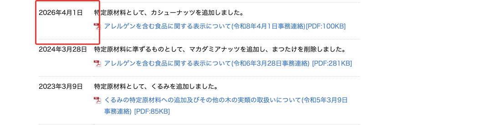

食品・飲料メーカーがAIO対策（AI検索対策）を外部に依頼するなら、**AIに商品のおすすめを聞かれたときに自社の商品が理由つきで挙がり、購入や取引の問い合わせにつながるまでを追う会社**を選ぶのがおすすめです。栄養ドリンク・ビール・調味料などのおすすめを聞かれたAIは原材料や栄養成分、口コミや比較記事を材料に答えることがあり、商品情報の整備から外部での言及までのどこを扱う会社かで成果までの距離が変わります。

この記事は株式会社nitoが書いているため、自社を1番目に載せました。ほかの5社は2026年11月27日に各社の公式サイトで確認した内容で比べています。

:::takeaways
- 成果は**公式ECや取扱店での購入と、小売・外食のバイヤーからの取引や業務用・OEMの相談の件数**で数え、AIで名前が挙がる割合はその手前の指標にする
- 原材料・アレルゲン・栄養成分は**商品ページの本文に文字で書き、ブランドサイト・EC・モール・小売のサイトで食い違わない状態**を保つ
- 機能性表示食品や健康食品で言える範囲は表示の法令で決まっているため、**記事や口コミの施策を法令に沿って扱えるか**を依頼先に確認する
:::

## 食品メーカーのAI検索対策が他の業界と違う点は？

食品・飲料メーカーは商品を条件の組み合わせで相談され、同じ商品の情報が何か所にも載り、言える効果の範囲が法令で決まっている点で他の業界と異なります。

部品や素材を企業に売るメーカーは[製造業におすすめのAIO対策会社](/media/manufacturing-aio-companies/)、自社の通販が売上の中心なら[EC（通販）のAIO対策会社](/media/ec-aio-companies/)、店舗の集客が目的なら[飲食店のAIO対策会社](/media/restaurant-aio-companies/)のほうが近い比較です。この記事が対象にするのは加工食品・菓子・調味料・飲料・酒類・健康食品を消費者に届けるメーカーと、小売や外食と取引するOEM・業務用のメーカーです。

### 商品を条件の組み合わせで相談される

「カフェインが入っていない栄養ドリンクは？」「糖質ゼロのビールでおいしいのはどれ？」「小麦を使っていないしょうゆを教えて」。消費者には用途・成分・アレルゲン・価格を添えてAIに聞く人もいます。条件が細かい質問ほど、その条件を本文に書いている商品ページや比較記事が答えの材料になりやすく、成分や原材料を書いていない商品は条件に合っていても候補から漏れることがあります。

小売・外食のバイヤーが「プライベートブランドのお菓子を作れるOEMメーカーは？」と取引先を探す場面もあり、消費者の質問とは参照されるページが異なります。

| 聞き方 | 答えの材料になりやすいページ |
|---|---|
| おすすめを聞く（プロテインのおすすめは？） | 比較・ランキング記事、口コミサイト、メーカーの商品ページ |
| 取引先を探す（お菓子のOEMメーカー） | メーカーのOEM・業務用のページ、受発注のマッチングサイト |

### 商品情報が何か所にも載る

1つの商品の情報はブランドサイト・特設サイト・公式EC・楽天市場やAmazonなどのモール・小売のネットのページ・口コミサイトに分かれて載ります。リニューアルで原材料や内容量を変えたあとどこかが古いままだと、AIの回答に古い成分や旧パッケージの情報が出ることがあります。

アレルゲンの表示は今も更新が続いている分野です。消費者庁は2023年3月9日にくるみ、2026年4月1日にカシューナッツを特定原材料に追加しました。容器包装された加工食品には特定原材料を含む旨の表示が義務づけられています。**パッケージを改めた日に、サイトのアレルゲン一覧と各販路の商品ページも同じ内容に更新できるか**が、情報の食い違いを防ぐ前提になります。

<figure class="post-figure"><figcaption>消費者庁「食物アレルギー表示に関する情報」（2026年11月27日）</figcaption></figure>

### 言える効果の範囲が法令で決まっている

機能性表示食品は事業者が安全性と機能性の科学的根拠などを販売前に消費者庁長官へ届け出れば機能性を表示できる制度で、特定保健用食品（トクホ）と異なり国は審査を行いません。消費者庁は国が効果を認めているかのような表示をしていた行き過ぎたウェブサイト広告の事例を挙げ、届出の内容を超えた広告に注意するよう呼びかけています。健康増進法も食品の健康保持増進効果について著しく事実に相違する表示や、著しく人を誤認させる表示を禁じています。

口コミの施策にも決まりがあり、2023年10月1日から広告なのに広告だと分からない表示（ステルスマーケティング）は景品表示法の違反になり、規制の対象は広告主の事業者です。

**AIに伝えたい商品の強みも、記事や口コミの施策も表示の法令の範囲で書く必要があるため、依頼先が法令の確認をどう進めるかは契約前に聞いておきたい点です。**

## 食品メーカーのAIO対策会社はどう選べばいい？

食品・飲料メーカーがAIO対策の会社を選ぶときは、目標・質問の組み方・扱う範囲・表示の確認の4つを最初の打ち合わせで聞くと、各社の違いが比べやすくなります。

| 基準 | 確認する質問 | 食品メーカーで重要な理由 |
|---|---|---|
| 目標 | 何の件数を増やすことを目標にしますか？ | 言及率が上がっても、購入や取引の相談が増えたかは分からない |
| 質問の組み方 | 商品の条件と、消費者とバイヤーを分けて質問を組みますか？ | 成分・アレルゲン・用途の組み合わせで挙がる商品が変わる |
| 扱う範囲 | 商品ページ・外部での言及・記事・計測のどこまで扱いますか？ | 支援会社ごとに得意な範囲が分かれる |
| 表示の確認 | 記事や口コミの施策で表示の法令をどう確認しますか？ | 機能性や健康の表現は法令で範囲が決まっている |

### 購入と取引の相談の件数を目標に置くか

食品は単価が低く、AIで知った人が公式ECではなくスーパーやモールで買うこともあるため、AI経由の売上をそのまま数えるのは簡単ではありません。**公式ECの注文、お客様相談室、業務用・OEMの問い合わせで「何で知ったか」を聞き、AIで知った人の数まで追う会社**なら、費用に見合うかを数字で判断できます。

### 商品の条件と相談する人で質問を組むか

「おすすめの調味料は？」のような短い質問だけを計測しても、減塩・グルテンフリー・ギフト向けといった条件で相談されたときの挙がり方は見えません。商品カテゴリごとに成分・原材料・用途・価格の条件を1つずつ変えた質問を組み、消費者の質問とバイヤーの質問を分けて計測する設計が合っています。

### 扱う範囲が自社の課題と合うか

AIO対策の会社が扱う範囲は、商品ページの本文と構造化データの整備、ニュースリリースや外部メディアでの言及づくり、レシピや選び方の記事の制作、AIの回答の計測と報告の大きく4つです。**商品ページの情報が足りないのか、外部で語られていないのか、計測する手段が無いのかによって、合う依頼先が変わります。**

### 表示の法令を確認する段取りがあるか

機能性表示食品やトクホ、いわゆる健康食品の記事を任せるなら、依頼先が原稿を書き、メーカーの品質保証や法務の担当が届出の内容と照らして確認する分担にしておくと、公開後に表現を差し戻す手間が減ります。口コミの依頼を含む場合は広告であることの表示の扱いも見積もりの段階で確認します。

## この記事での選定基準

取り上げたのはAIO・LLMO・GEO対策を公式サイトでサービスとして案内し、食品・消費財の事例や対応ジャンル、食品業界に向けたページを公式に示している会社です。書き手のnitoを1番目に置き、2番目からは食品業界向けのページや食品の事例がある会社から順に並べました。

金額は2026年11月27日に公式サイトで確認できたものだけを載せています。業種を問わず広く比べるなら「[AIO対策会社おすすめ20選](/media/aio-taisaku-companies/)」が使えます。

## 食品・飲料メーカーにおすすめのAIO対策会社6社の比較

比べたのは株式会社nito・株式会社コネクタブルー・株式会社Faber Company・awoo株式会社・株式会社シード・株式会社Uravationの6社です。扱う範囲・食品や消費財の記載・料金を、公式サイトの記載で並べました。

| 会社 | 主に扱う範囲（公式の記載） | 食品・消費財の記載（公式） | 料金（公式の表記） |
|---|---|---|---|
| 株式会社nito | 計測・分析・サイトの改善・記事の制作・公開後の運用 | 業種を問わず対応（成果の公開はSaaS企業・士業） | 公開なし（無料の現状分析のあと見積もり） |
| 株式会社コネクタブルー | 戦略策定・コンテンツ制作・構造化データ・週次のモニタリング・リライト | 食品業界向けのサービスページ、食品メーカーの事例 | 成果報酬型（金額の記載なし） |
| 株式会社Faber Company | ミエルカGEOでの計測と分析、診断、月次のコンサルティング | お米ギフトの八代目儀兵衛の事例 | ミエルカGEOが月4万9,800円〜（税抜・別途初期費用） |
| awoo株式会社 | AIでの見え方の計測と改善レポート、商品データのツール、コンサルティング | 対応業界に食品、サントリーグループの業務用備品ECの事例 | 金額の記載なし |
| 株式会社シード | サービスページの最適化・構造化データ・外部メディアへの掲載・プレスリリース・コンテンツ | 対応ジャンルに健康食品などの単品通販 | 金額の記載なし（基本6ヶ月から） |
| 株式会社Uravation | 実測・質問に答えるページの原稿・構造化データ・プレスリリースの原稿・週次の計測 | 食品メーカー・D2C向けの解説を公開 | 実装代行が初期5万円＋月10万円（税別・最低3か月） |

**料金の形がツールの月額、成果報酬、実装代行の月額と分かれているため、月額だけでは比べられません。** 初期費用と最低契約期間を含めた総額で並べてください。

:::linkcard
url: /media/llmo-companies/
title: LLMO対策の会社おすすめ20選・比較表と費用相場・選び方
desc: LLMO対策の会社20社を比較表で並べ、費用相場と選び方を解説しています。
:::

## 1. 株式会社nito

[株式会社nito](/aio/)は、AIO対策（AI検索対策）で商品の購入や取引の問い合わせが増えるところまでを実行支援する会社です。計測から分析、サイトの改善と記事の制作、公開後の運用までを一気通貫で支援します。何を書き足し、どこを修正するかは、ChatGPTやGeminiなど主要なAIの実際の回答を毎晩読み、他社の商品が勧められている理由から決めています。

**食品・飲料メーカーで目標に置くのは、AIでの言及率ではなく公式ECでの購入と、小売・外食のバイヤーからの取引や業務用・OEMの相談の件数です。** 条件つきのおすすめの相談で理由とともに挙がり、公式サイトで原材料や取扱店まで確認してもらえる状態を優先してつくります。

### 食品・飲料メーカーに合う理由

- **商品の条件と相談する人で質問を設計する。** 成分・原材料・アレルゲン・用途の条件と、消費者とバイヤーの聞き方を分けて質問を組む
- **利用者と同じチャット画面で毎晩記録する。** 回答の本文と引用元を残しており、記録した回答は3万件を超えている（2026年11月時点）
- **他社の商品が勧められる理由を回答本文から抜き出す。** 「保存料不使用」「国産原料」のように、AIが他社の商品に添えた理由のうち、自社にも当てはまるのにページに書いていないものを追加する候補にする
- **商品の強みを文章にして、ページと記事に使う。** 製法・原料の産地・開発の経緯をヒアリングで聞き取り、表示の法令の範囲で文章にまとめる。公開後も回答の変化を見て書き方を修正する
- **購入と問い合わせまで数える。** 公式ECの注文・お客様相談室・業務用の問い合わせで「何で知ったか」を聞き、AIで知った人の数まで追う

### これまでの成果

| 支援先 | 成果 |
|---|---|
| SaaS企業 | 取り組み3ヶ月で、AIでの言及率が10%から45%に。AI経由のコンバージョンは5ヶ月で約6.7倍 |
| 士業 | AIでの言及率が0%から20%に。新しいページは公開3日でAIの回答の引用元に |

成果の出方は商品カテゴリの競合の数や社内の体制で変わります。どの質問でどこまで狙えるかは、無料の現状分析のあとにお伝えしています。

### こんな食品・飲料メーカーに向いている

- 健康志向・アレルギー対応・ギフトなど、条件つきの相談で自社の商品を挙げてもらいたいメーカー
- 業務用・OEMの取引先からの相談を、自社サイトを窓口にして増やしたいメーカー

:::point
nitoでは消費者やバイヤーが聞きそうな質問をChatGPT・Gemini・AIモードなどに実際に入力し、自社の商品が挙がるか、どう紹介されるか、代わりにどの商品が挙がるかをまとめた[現状分析レポート](/aio/)を無料でお出ししています。
:::

## 2. 株式会社コネクタブルー

株式会社コネクタブルーは東京・南青山のコンサルティング会社で、食品業界向けのAIO対策コンサルティングは成果報酬型です。生成AIで商品が推薦されるよう、戦略の策定・コンテンツの制作・モニタリング・リライトを一気通貫で支援する形です。

レシピ・栄養情報・アレルゲン情報・原材料に関する質問のうち優先するものを選び、構造化データやllms.txtで商品情報や栄養情報を整える進め方です。週次のモニタリングではブランド名や商品名の推薦状況と、言及のトーン、競合との比較が報告に入ります。公式サイトには商品・レシピ・栄養情報の構造化で生成AIの回答内での商品の引用率が57%向上した食品メーカーの事例が載っていますが、料金の金額は出ていません。

**商品・栄養・アレルゲンの情報が部門ごとに分かれていて、整理の段階から成果報酬型で任せたい食品メーカー**に向いています。

## 3. 株式会社Faber Company

株式会社Faber CompanyはSEOツール「ミエルカSEO」と、AI検索での見え方を計測・分析するツール「ミエルカGEO」を提供する会社です。AI検索での自社と競合の扱われ方、AI検索からの流入とコンバージョン、言及率と引用率をまとめて見られるツールで、スポットの診断や月次のコンサルティングにも対応しています。料金は単一サイトプランが月4万9,800円（税抜）で、初期費用は別です。

食品の事例として、Faber Companyが協賛したWeb担当者Forumの記事で、お米ギフトを中心に通販を手がける八代目儀兵衛の取り組みが紹介されています。200以上のプロンプトでChatGPTとGeminiを定点調査したうえで、サイトで「お米のギフト」と明記する、顧客アンケートを調査リリースとして出す、レビューを目的別に分ける、の3つを進めました。記事の時点で成果は担当者の手応えとして語られ、定量の計測は今後の予定とされています。

**社内にWebの担当者がいて、ツールで自社と競合の数字を見ながら改善を進めたいメーカー**に向いています。

## 4. awoo株式会社

awoo株式会社はECサイトの商品の特徴をAIが読み取ってハッシュタグを付ける「awoo AI」と、生成AIでのブランドの見え方を計測する「awoo GEO Suite」を提供する会社です。GEO Suiteでは設定した質問ごとにメンション率・サイト引用率・情緒スコア・シェア・オブ・ボイス・平均掲載順位を計測し、改善レポートで優先する課題を示します。

公式サイトでは成果を出している業界を「ファッション、家電から食品まで」と紹介しています。2026年11月にはサントリーマーケティング＆コマースが運営する飲食店向けの業務用備品のEC「飲食店用品.jp」の事例を公開し、「割れにくいグラス」を探す質問でawooのページの引用率が5%（5〜7月）から20%（8〜9月）に上がったと示しました。質問15本・2,989回答の集計で、母数が小さいため傾向として見るよう注記があります。料金はソリューションのページに金額の記載がありません。

**公式ECの商品数が多く、商品ページと商品データの側から整えたいメーカー**に向いています。

## 5. 株式会社シード

株式会社シードは東京・飯田橋のデジタルマーケティングの会社で、GoogleのAIによる概要への掲載を中心にしたAIO対策を、LLMO対策・SEO対策とあわせて運用とコンサルティングで支援しています。対応できるジャンルとして、化粧品・健康食品・美容器具の単品通販を挙げています。

AIO支援のメニューは上位メディアへの掲載支援、サービスページのAI向けの最適化、構造化データのマークアップ、AIによる概要で引用されている記事の競合調査、コンテンツの作成、プレスリリースの掲載支援、Googleビジネスプロフィールの支援の7つです。SEOを他社に任せたままAIO対策だけを依頼でき、契約は基本6ヶ月からで短期や単発の相談にも応じるとしています。料金の金額は公式サイトに出ていません。

**健康食品を単品通販で売っていて、Google検索での見え方から改善したいメーカー**に向いています。

## 6. 株式会社Uravation

株式会社Uravationは東京・本郷で、法人向けの生成AI研修とAIエージェントの構築、AI検索対策の実装を手がける会社です。自社のメディアで食品メーカー・D2CブランドのLLMO対策を解説しています。

AI検索対策の実装代行では、見込み客の質問を40問前後に書き起こしてChatGPT・Gemini・Perplexity・Claude・GoogleのAIによる概要で計測し、質問に答えるページの原稿を月2本、プレスリリースの原稿を月1本作り、既存ページの構造化データも整えます。計測は毎週です。

料金は実測レポートが1回5万円、実装代行が初期5万円＋月10万円（いずれも税別、実装代行は最低3か月）で、サービスを始めたばかりのため原価に近い価格としています。サイトへの反映の代行は別の見積もりです。

**月の費用を抑え、原稿の作成まで任せて始めたいメーカー**に向いています。

## 依頼する前に社内で整備しておくこと

どの会社に依頼する場合も、次の4つを先に決めておくと、最初の提案が自社の商品と売り場に合ったものになります。

1. **商品情報の正本と更新の担当。** 原材料・アレルゲン・栄養成分・内容量・賞味期限の表示を1か所にまとめ、リニューアルのときにブランドサイト・公式EC・モールの情報を誰が照合するかを決めます
2. **AIに挙げてほしい質問の候補。** 消費者向けは商品カテゴリごとに成分・用途・価格の条件を添えて、取引先向けはOEM・業務用・プライベートブランドの探し方で、それぞれ10個ほど書き出しておくと計測の設計に使えます
3. **経路ごとの今の数字。** 公式ECの注文、お客様相談室への問い合わせ、業務用・OEMの相談の月の件数と指名検索の数が、効果を比べる起点です
4. **表示の確認の段取り。** 機能性表示食品・トクホ・いわゆる健康食品の表現を誰が確認するかと、口コミやPRの依頼で広告であることの表示をどう扱うかを決めておきます

## まとめ

- 商品・栄養・アレルゲンの情報の整理から成果報酬型で任せたいならコネクタブルー
- 社内の担当者がツールで数字を見ながら進めたいならFaber Company、公式ECの商品データから整えたいならawoo
- 健康食品の単品通販でGoogle検索の見え方から改善したいならシード、費用を抑えて原稿まで任せたいならUravation
- 購入や取引の相談の件数まで追い、商品ページの改善と記事の制作から公開後の運用まで任せたいならnito

## よくある質問

### 食品メーカーにAIO対策は必要ですか？

消費者がおすすめの商品をAIに聞き、バイヤーが取引先の候補をAIで洗い出す場面もあるため、自社の商品が条件つきの相談で挙がるかは売り場の外での接点になります。

### 機能性表示食品の機能はAI向けのページにどこまで書けますか？

届け出た内容の範囲までです。機能性表示食品は事業者が届け出た科学的根拠に基づいて機能性を表示する制度で、国は審査を行わないため、表示の責任は事業者にあります。AIに取り上げられやすい書き方を優先して、届出に無い効果まで書き足すことは避けてください。

### OEMや業務用の取引先探しにもAIO対策は役立ちますか？

取引先を探すバイヤーがAIで候補を洗い出す場面では役立ちます。OEMや業務用のページに、対応できる品目・ロット・HACCPなどの認証・製造の設備を文字で書いておくと、条件を添えた相談で候補に入りやすくなります。

### 食品メーカーのAIO対策の費用はどれくらいですか？

この記事で比べた会社の公開料金では、計測ツールが月4万9,800円（税抜・別途初期費用）から、原稿の作成まで含む実装代行が初期5万円＋月10万円（税別・最低3か月）からでした。コネクタブルーは成果報酬型で金額を公開しておらず、nito・awoo・シードも金額を公式に載せていません。

### レシピや使い方の記事はAIO対策に役立ちますか？

調味料や食材のメーカーでは商品を使ったレシピを聞かれる場面があり、レシピの記事が答えの材料になることがあります。GoogleのRecipeの構造化データには栄養情報（nutrition）の項目があり、カロリーなどをレシピのページに記述できます。

## 出典

- 各社の公式サイト（2026年11月27日確認）: [株式会社コネクタブルー（食品業界向けAIO対策コンサルティング）](https://connectablue.com/consulting/lp4/aio-aio-food/)・[ミエルカGEO（株式会社Faber Company）](https://mieru-ca.com/geo/)・[awoo株式会社（GEO / LLMO最適化）](https://www.awoo.ai/ja/awoo-geo-llmo-solutions/)・[株式会社シード（AIO対策）](https://www.seedinc.jp/aio/)・[株式会社Uravation（LLMO対策・AIO対策の実装代行）](https://uravation.com/aieo-daiko/)
- 八代目儀兵衛の事例: Web担当者Forum「[検索上位でもAI Overviewsに出ない!? 老舗米屋・八代目儀兵衛が取り組んだGEO施策](https://webtan.impress.co.jp/e/2026/04/20/52368)」（2026年4月20日、Faber Company協賛の記事）
- 飲食店用品.jpの事例: awoo株式会社「[サントリーグループのEC「飲食店用品.jp」が挑む、AIに「選ばれるお店」づくり](https://prtimes.jp/main/html/rd/p/000000177.000050088.html)」（PR TIMES、2026年11月12日）
- 食品メーカー・D2Cの解説: 株式会社Uravation「[食品メーカー・D2CのAI検索対策](https://uravation.com/llmo/shokuhin-maker-d2c-llmo-taisaku/)」（2026年8月2日）
- 特定原材料の追加: 消費者庁「[食物アレルギー表示に関する情報](https://www.caa.go.jp/policies/policy/food_labeling/food_sanitation/allergy/)」
- 機能性表示食品の制度: 消費者庁「[機能性表示食品について](https://www.caa.go.jp/policies/policy/food_labeling/foods_with_function_claims/)」
- 誇大表示の禁止: 消費者庁「[健康増進法（誇大表示の禁止）](https://www.caa.go.jp/policies/policy/representation/extravagant_advertisement/)」
- ステルスマーケティングの規制: 消費者庁「[令和5年10月1日からステルスマーケティングは景品表示法違反となります。](https://www.caa.go.jp/policies/policy/representation/fair_labeling/stealth_marketing/)」
- レシピの構造化データ: Google 検索セントラル「[レシピ（Recipe）の構造化データ](https://developers.google.com/search/docs/appearance/structured-data/recipe?hl=ja)」
