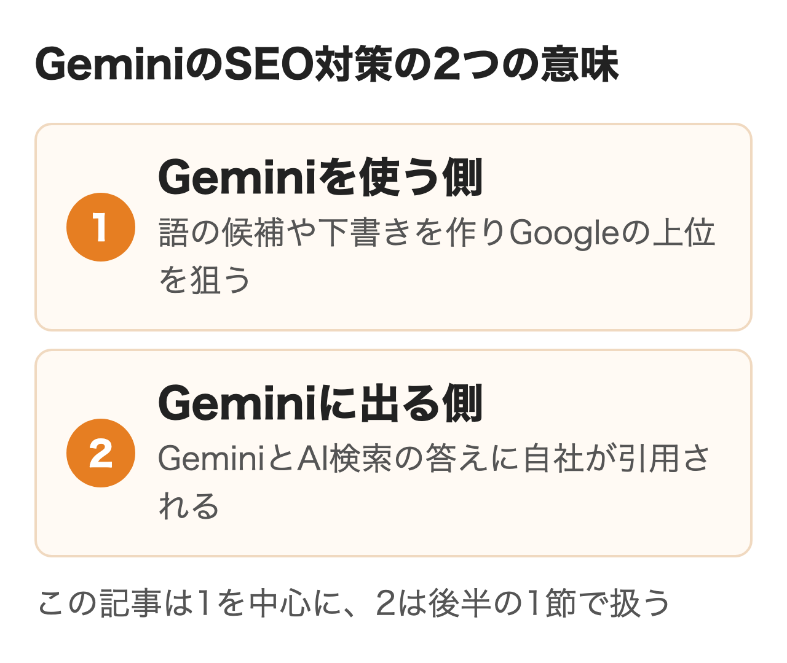
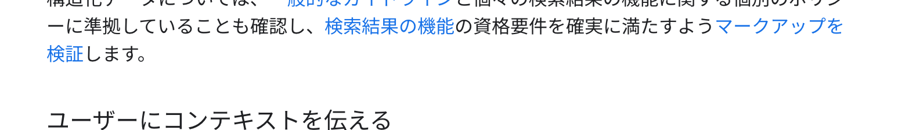
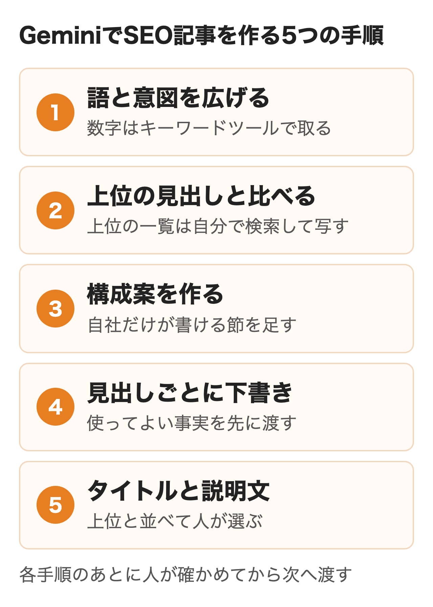
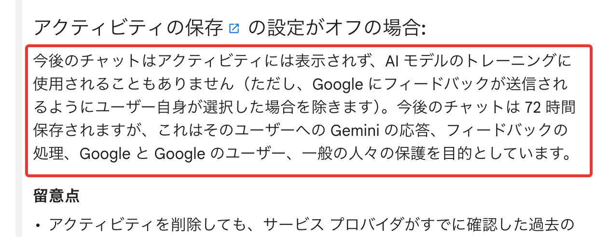
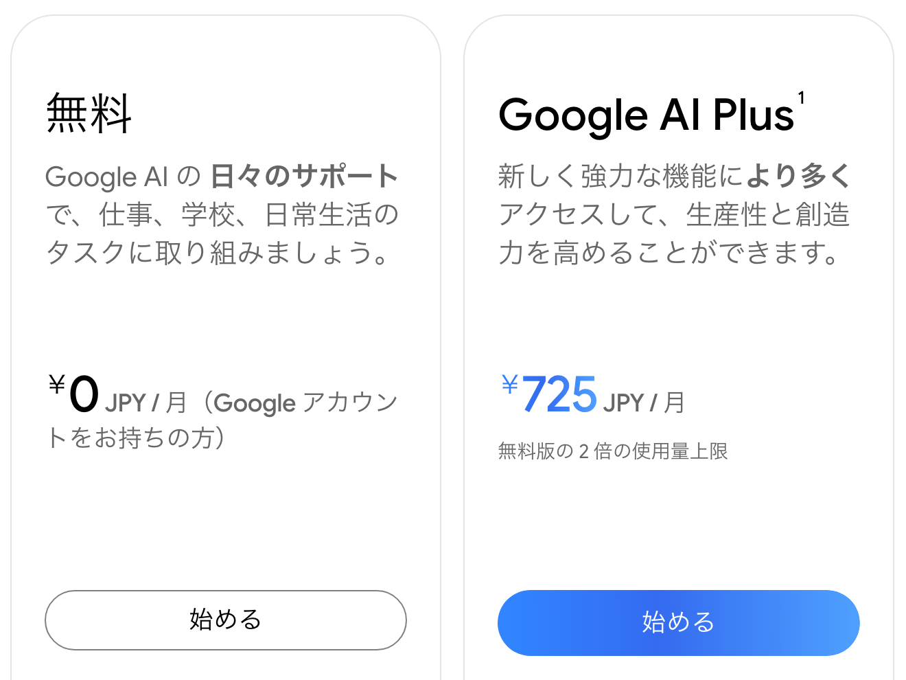
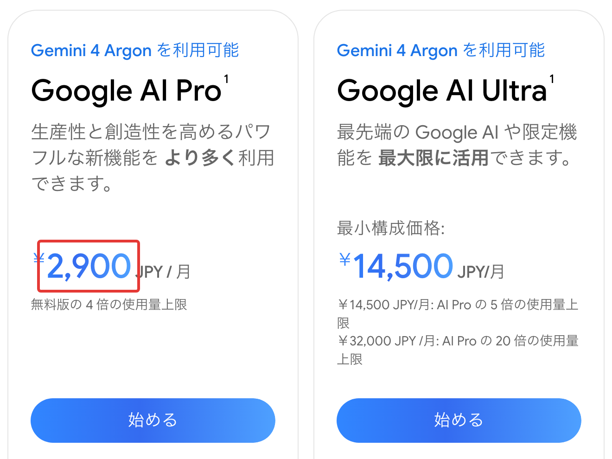
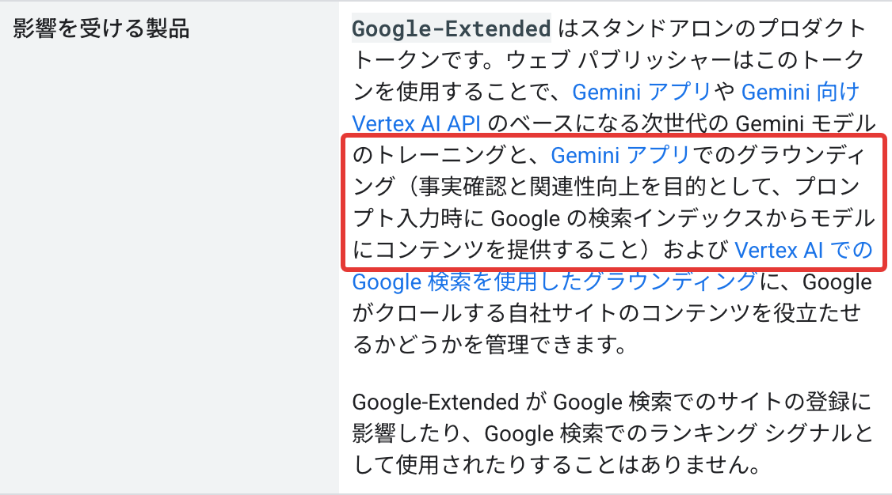
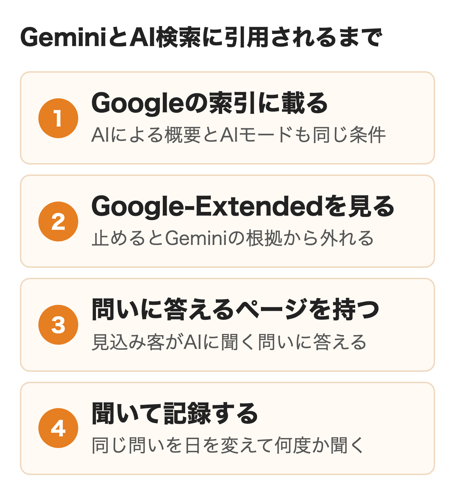

GoogleはGeminiアプリのプライバシー ハブで、Geminiの回答の一部はGoogle検索の検索結果に基づいて作られると説明しています。

Geminiを記事づくりに使うよう言われ、同時に「GeminiやAIによる概要にうちの会社は出ているのか」とも聞かれているマーケ担当・Web担当の方に向けて、Geminiに任せる作業の範囲と手順、プロンプト例、会社で決めること、Geminiに自社が引用される側の入口までを書きます。

:::takeaways
- Geminiで速くなるのは**語の候補・構成・下書き・タイトルと説明文・データの読み取り**で、検索ボリュームの実数と自社の一次情報は出せない
- Googleが見るのは作り方でなく価値で、**公開前の事実確認はtitle・説明文・構造化データ・altまで人が行う**とガイダンスにある
- Geminiに引用されるかは別の作業で、**入口はGoogleの索引に載ることとGoogle-Extendedの設定**。AIによる概要とAIモードも同じ索引を使う
:::

## GeminiのSEO対策は2つに分かれる

社内で「GeminiでSEOをやろう」と言われたとき、指している中身は2通りあります。1つ目はGeminiを使ってキーワードの候補出しや記事の下書きを進め、Google検索で上位を狙う作業を速くすることです。2つ目はGeminiやGoogle検索のAIによる概要・AIモードが質問に答えるとき、自社のページが引用元に入り、社名が挙がるようにすることを指します。

**1つ目は制作の効率化、2つ目はAIの答えという新しい入口への対策で、担当も測り方も違います。** 依頼を受けたら、どちらの話かを最初に確かめておくと手戻りが減ります。この記事は1つ目を中心に書き、2つ目は後半の1節にまとめました。

<figure class="post-figure"></figure>

## Geminiに任せられるSEOの作業

SEOの作業を工程に分けると、Geminiが速くできる所と、人やほかの道具が持つ所に分かれます。

| 作業 | Geminiに任せる所 | 人やほかの道具が持つ所 |
|---|---|---|
| キーワード選び | 関連する語と悩みの言い換えを出す | 検索ボリュームはキーワードツールで取る |
| 検索意図 | 調べる人の立場と知りたいことの仮説 | 実際の上位が何に答えているかで決める |
| 競合の分析 | 貼った見出しから共通点と抜けを出す | 上位の一覧は自分で検索して写す |
| 構成案と下書き | 見出しの案と見出しごとの叩き台 | 自社の材料を足し、事実を確かめる |
| タイトルと説明文 | 字数を決めた案を複数出す | 狙う語の位置と言い過ぎを確かめる |
| 構造化データ | JSON-LDのひな形 | リッチリザルト テストで検証する |
| 効果の分析 | Search Consoleの書き出しの傾向を読む | 数字の計算と判断は人が確かめる |

**Geminiに競合の順位や検索ボリュームを聞いて出てきた数は、そのまま使わないようにします。** プライバシー ハブが書いているのは回答の一部が検索結果に基づくことまでで、Geminiの答えに並ぶ記事の順番が検索結果の順位と同じだという説明は、Googleの公式の資料にありません。語を決める数字はキーワードツールとSearch Consoleで取り、Geminiは候補を広げる役に置くと迷いません。

プランの名前も変わっています。以前の有料版の名前だったGemini Advancedは、2026年11月3日の料金ページには出てきません。今の個人向けはGoogle AI Plus・Pro・Ultraで、会社で選ぶときの見方は後の節に書きました。

## GeminiとChatGPTの使い分け

どちらを使うか迷う担当者は多いのですが、SEOの作業の多くはどちらでもこなせます。違いが出るのはウェブの情報の取り方と、普段使っている道具とのつながりです。

| 項目 | Gemini | ChatGPT |
|---|---|---|
| 開発元 | Google | OpenAI |
| ウェブの情報 | 回答の一部がGoogle検索の結果に基づく | 検索するとき外部の検索サービスに語を送ることがある |
| 普段の道具 | Gmail・ドキュメントなどの中で呼べる | ChatGPTの中で外部のアプリを使える |
| 会社向けの契約 | Google WorkspaceのGemini | ChatGPT Business・Enterprise |

社内のメールや文書をGoogle Workspaceで扱っている会社なら、下書きをドキュメントに置いたままGeminiを呼べる分、作業の行き来が減ります。ChatGPTの使い方は[ChatGPTのSEO対策](/media/chatgpt-seo/)に同じ形でまとめています。

**Google製だからGeminiは検索の順位の付け方を知っている、という説明は公式にはありません。** Googleは2023年のガイダンスで、AIを使ったからといってランキングで特別に有利になることはないと答えています。どちらのAIで書いても、Googleが見るのは出来上がったページの中身です。

## AIで書いた記事のGoogleでの扱い

Googleの検索セントラルには、生成AIで作ったコンテンツの扱いを書いたガイダンスがあり、2026年10月6日に更新されました。生成AIはトピックを調べたり構造化データを足したりするときに特に便利だと、冒頭に書かれています。同時に、読者への価値を足さずに大量のページを作ると、大量生成されたコンテンツの不正使用というスパムポリシーに違反するおそれがあるとしています。

ガイダンスはその理由も書いています。生成モデルは事実を取りにいくのでなく、学習したデータからありそうな単語の並びを予測するため、出力に誤りが混ざるという説明です。**そのため公開前に人の手でファクトチェックを行い、その対象はtitle・メタディスクリプション・構造化データ・画像の代替テキストにも及ぶとしています。**

<figure class="post-figure"><figcaption>ウェブサイトで生成 AI によるコンテンツを使用するための Google 検索のガイダンス（Google 検索セントラル、2026年11月2日）</figcaption></figure>

ここで気をつけたいのは、Geminiに任せやすい短い部品ほど見落としやすいことです。説明文やaltは本文より読み返される回数が少なく、誤りが残ったまま公開されがちです。どのような自動化を使ったかを読者に伝えることも、ガイダンスは検討するよう勧めています。

## GeminiでSEO記事を作る5つの手順

「この語で記事を書いて」と一度に頼むと、どこかで読んだような一般論の記事になりやすくなります。人が記事を作るときの工程を分け、工程ごとにGeminiに頼み、出てきたものを人が確かめてから次の工程に渡すのが基本の進め方です。

<figure class="post-figure"></figure>

プロンプトは［ ］の中を自社の内容に置き換えて使う形にしました。同じ指示でも答えは毎回変わるため、出力の例は載せていません。

### ① 語と意図を広げる

最初に、狙う語の周りにある語と、それぞれの語で調べる人の状況を広げます。

```
あなたはBtoB企業のWeb担当者です。
［狙う語］を調べる人について、次を表にしてください。
- 一緒に検索していそうな語を15個
- その語で知りたいこと（1行）
- 調べている人の立場（現場の担当者・決裁者など）
検索ボリュームと順位は書かないでください。
```

出てきた語はキーワードツールでボリュームを取り、実際に検索して上位の顔ぶれを見てから選んでください。

### ② 上位の見出しと比べる

狙う語で検索した上位5〜10本の見出しを自分で写し、Geminiに貼って比べさせます。Geminiに上位の記事を挙げさせると、実際の検索結果と並びが違うことがあるためです。

```
次は［狙う語］の検索結果の上位の記事の見出しです。
［記事ごとに見出しを貼る］
1. 2本以上が扱っている論点を一覧にしてください
2. 1本だけが扱っている論点を一覧にしてください
3. どの記事にも答えが無い読者の疑問を挙げてください
```

### ③ 構成案を作る

②で出た論点に、自社だけが持つ材料を足して構成を頼みます。

```
［読者］が［狙う語］で調べたときに読む記事の構成案を作ってください。
- 入れる論点: ［②の共通の論点］
- 自社の材料: ［自社の数字・事例・試した結果］
- h2は6〜8個、h2の下のh3は0〜3個
- 自社の材料を使う見出しの後ろに【自社】と付ける
見出しだけを階層で出してください。
```

### ④ 見出しごとに下書きする

本文は記事全体でなく、見出し1つずつ頼みます。**見出しごとに頼むと、誤りが混ざったときにどこを直せばよいかが分かりやすくなります。**

```
次の見出しの本文を400字程度で書いてください。
- 見出し: ［h2またはh3］
- 読者: ［読者］
- 使ってよい事実: ［確かめた事実と出典］
ここに無い数字・社名・制度名は書かず、要るときは［要確認］と書いてください。
```

使ってよい事実を先に渡しておくと、Geminiが数字を補って作る余地を小さくできるからです。

### ⑤ タイトルと説明文を作る

最後にタイトルとメタディスクリプションの案を出させ、上位に並ぶタイトルと見比べて人が選ぶ流れです。

```
［記事の要点を3行］の記事に、タイトル案を5つ出してください。
- ［狙う語］を先頭から15字以内に入れる
- 全角32字前後
- 本文で裏付けられない言葉（No.1・必ず など）は使わない
120字以内の説明文も3つ出してください。
```

FAQの構造化データも同じ要領でJSON-LDのひな形を頼めますが、ページに見えている文と一致しているかを確かめ、リッチリザルト テストを通してから載せます。

## Geminiならではの3つの使い方

ここまでの5つの手順はどの生成AIでも同じように回せる内容です。Geminiで差が出るのは、指示の使い回しとGoogleの道具の中での作業、長い調べものの3つです。

### Gemで社内の決まりを固定する

GemはGeminiアプリを目的に合わせて設定しておく機能で、ウェブアプリでは左側の［Gem を表示］から［Gem を作成］に進みます。ヘルプは指示に入れる観点として、ペルソナ・タスク・コンテキスト・形式の4つを挙げ、ファイルを読み込ませて前提を渡せるとしています。表記の決まりや禁止の表現、読者像をGemにしておけば、**担当者が替わっても同じ前提で下書きや見直しを頼めます。** 毎回のプロンプトに前提を貼る手間も要りません。

### ドキュメントとスプレッドシートの中で使う

料金ページを見ると、Googleドキュメントの中で呼べるGeminiはGoogle AI Proの特典に入っています。Google Workspaceの料金ページには、ドキュメントに加えてスプレッドシートのGeminiも並びます。Search Consoleの検索パフォーマンスを書き出し、「先月より表示が増えたのにクリックが減った語」のように問いを決めて読ませると、傾向の洗い出しにかかる時間を縮められるでしょう。**ただ、集計の数字そのものは表の上で計算して確かめ、Geminiの要約だけで判断しないようにします。**

### Deep Researchの出典を開く

Deep Researchは、料金ページではGoogle AI Proの説明に挙がる機能です。多くのページを読んで報告書の形にまとめる機能で、記事の下調べに向いていますが、報告書に出てくる数字や公式の名前は引用元のページを開いて確かめます。出典が付いていても、そのページにそう書いてあるとは限らないためです。

## 公開前に人が確かめること

Geminiの下書きを公開できる記事にする作業は、事実を確かめることと、Geminiが書けない中身を足すことの2つです。

1. **数字・固有名詞・料金・制度**: 公式ページや発表元で確かめ、取得した日付と出典を残す
2. **製品名と仕様の新しさ**: AIの製品は数か月で名前や上限が変わる
3. **ほかのページとの重なり**: 似た文章が無いかをコピーチェックの道具で見る
4. **自社の一次情報**: 事例・数字・試した結果・現場の判断を足す
5. **メタ情報**: title・説明文・構造化データ・altも本文と同じように読む

GoogleのE-E-A-T（経験・専門性・権威性・信頼性）のうち、経験はGeminiが持てない部分です。実際に使った、現場で見たという中身を足せるのは人だけで、ここが上位の記事との違いにもなります。

## 会社で使うときに決めること

担当者が1人で試す段階から、チームで記事を作る段階に移るときに、先に決めておくことが3つあります。

### アカウントの種類と入力してよい情報

個人のGoogleアカウントでGeminiアプリを使う場合、プライバシー ハブによると［アクティビティの保存］がオンのときは、チャットの一部を人間のレビュアーが確認することがあり、生成AIモデルのトレーニングを含むサービスの改善に使われます。オフにすると以降のチャットはトレーニングに使われず、応答などのために72時間だけ保持される仕組みです。

<figure class="post-figure"><figcaption>Gemini アプリのプライバシー ハブ（Gemini アプリ ヘルプ、2026年11月3日）</figcaption></figure>

Google WorkspaceのGeminiは、Workspaceのプライバシー ハブで、内容を人間がレビューせず、許可なく組織の外でモデルのトレーニングに使わないとされています。**学習に使われるかどうかと、何を入力してよいかは別に決める必要があります。** 未公開の商品情報・顧客の名前・アクセス解析の生データのどれを入れてよいかは、社内の決まりとして書いておきます。Workspace側の設定と学習の条件は[Google WorkspaceのGeminiとは](/media/google-workspace-gemini/)にまとめました。

### プランの選び方

2026年11月3日に日本の料金ページで見た個人向けのプランは次のとおりです。

| プラン | 月額 | 料金ページの主な記載 |
|---|---|---|
| 無料 | 0円 | Flash-Liteモデル・Gem・画像の生成 |
| Google AI Plus | 725円 | 無料の2倍の上限・Flashモデル |
| Google AI Pro | 2,900円 | 無料の4倍の上限・Proモデル・ドキュメントの中のGemini |
| Google AI Ultra | 14,500円から | Proの5倍の上限（32,000円で20倍） |

<figure class="post-figure"><figcaption>Gemini の定期購入プラン 無料とPlus（Google、2026年11月3日）</figcaption></figure>

<figure class="post-figure"><figcaption>Gemini の定期購入プラン ProとUltra（Google、2026年11月3日）</figcaption></figure>

語の候補出しと下書きだけなら無料でも始められます。**ただ、個人のプランを会社の仕事に使うと、入力した内容は前の節の個人アカウントの扱いになります。** チームで使うと決めたら、管理者が設定を持てるWorkspaceのGeminiを候補にするのが安全です。個人向けプランの違いは[Geminiの料金プラン](/media/gemini-pricing/)で比べています。

### 事実確認と公開の責任者

Geminiを入れると下書きの本数は増えますが、確かめる人の時間は増えません。誰が事実を確かめ、誰が公開を決めるかを先に決めておくと、ガイダンスに沿った運用になります。**本数を目標にすると、ガイダンスがスパムの例に挙げる大量生成に近づくため、目標は記事ごとの流入や問い合わせに置きます。**

## GeminiとGoogleのAI検索で自社が引用される対策

ここまではGeminiを使って記事を作る話でした。もう1つのGeminiのSEO対策は、見込み客がGeminiアプリやGoogle検索のAIによる概要・AIモードに質問したとき、答えの中に自社のページや社名が出るようにすることです。

3つの入口はどれもGoogle検索の索引を使います。Googleの「AI 機能とウェブサイト」は、AIによる概要とAIモードのリンクに出る条件を、索引に登録されていることとスニペットを表示できることと技術要件の3つだけとし、特別な最適化や専用のファイル、特別な構造化データは要らないと書いています。Geminiアプリについては、Googleのクローラーの一覧がグラウンディングを「プロンプト入力時に Google の検索インデックスからモデルにコンテンツを提供すること」と説明しています。

**robots.txtでGoogle-Extendedを止めていると、Geminiアプリの回答の根拠に自社のページが使われません。** Google検索の登録と順位には影響しないため、AIによる概要とAIモードに出るかとは別の設定です。学習用のボットをまとめて止めている会社は、この行を先に確かめてください。

<figure class="post-figure"><figcaption>Google 検索セントラル『Google の一般的なクローラー』のGoogle-Extendedの節（2026年10月24日）</figcaption></figure>

Geminiアプリが引用元を選ぶ基準そのものは公開されていません。**見込み客が聞く問いに答えるページが自社にあるか、比較記事のような第三者のページに自社が何と書かれているかで、社名が挙がるかが変わります。** 今のSEOで続けることと、足すことを並べると次のとおりです。

<figure class="post-figure"></figure>

| 今のSEOで続けること | Geminiに出るために足すこと |
|---|---|
| 検索する人の問いに答えるページ | 見込み客がAIに聞く問いを書き出して答える |
| robots.txtとサイトマップの管理 | Google-Extendedの行を確かめる |
| Search Consoleの順位とクリック | 生成AIパフォーマンスレポートとAIへの質問の記録 |
| 被リンクと指名検索 | 比較記事や口コミでの自社の書かれ方を確かめる |

Search Consoleの生成AIパフォーマンスレポートで見えるのは、AIによる概要とAIモードでリンクが表示された回数で、Geminiアプリの分は入りません。Geminiアプリは同じ問いを日を変えて何度か聞き、社名と引用元を記録して判断します。

細部は記事を分けました。Geminiアプリのソースボタンの見方と測り方は[Gemini・Perplexityに自社が引用されるには](/media/gemini-perplexity-citation/)、AIモードがページを選ぶ仕組みは[AIモードのSEO対策](/media/ai-mode-seo/)、AIによる概要の条件とチェックリストは[AI Overview対策とは](/media/cited-by-ai-overviews/)にあります。

問いの設計と毎日の記録には手間がかかります。nitoのLLMO支援では、見込み客がAIに聞く問いを決めて回答を毎日記録し、引用元を読んでページを直すところまで受けています。士業の支援では新しいページが公開3日後からGemini・Perplexity・AIモードの回答の引用元に入りました。社内で回す余力がなければ、[LLMO支援](/llmo/)の内容を見てください。

## まとめ

- **記事づくりを速くしたい場合**: 工程を5つに分け、見出しごとに頼む。数字と固有名詞は公式で確かめる
- **チームの書き方をそろえたい場合**: 表記の決まりと読者像をGemにして共有する
- **会社で使い始める場合**: アカウントの種類と入力してよい情報、確かめる人を先に決める
- **Geminiに自社が出るか聞かれた場合**: Google-Extendedの行を確かめ、見込み客の問いで実際に聞いて記録する

## よくある質問

### Q. Geminiで書いた記事はGoogleで不利になりますか？

Geminiで書いたこと自体で不利にはなりません。Googleの説明ではAIや自動化を適切に使っている限りガイドラインの違反にならず、ランキングの操作を主な目的に価値を足さず大量に作るとスパムポリシーの違反になるとしています。公開前に事実を確かめ、自社の一次情報を足すのが前提です。

### Q. Geminiでキーワードの検索ボリュームは調べられますか？

Geminiアプリが検索ボリュームの実数を返すという説明は、Googleの公式の資料にありません。Geminiは関連する語の候補を広げるのに使い、数はキーワードツールやSearch Consoleで確かめます。

### Q. Geminiの無料版でもSEOに使えますか？

使えます。2026年11月3日の料金ページでは、無料版でもFlash-LiteモデルとGemが使える表示でした。上限に当たる回数や、ドキュメントの中で使いたいかを見て、Google AI ProやWorkspaceのGeminiを選びます。

### Q. Geminiに入力した下書きは学習に使われますか？

個人のアカウントで［アクティビティの保存］がオンのときは、トレーニングを含む改善に使われ、人間のレビュアーが確認することもあります。オフにすると以降のチャットはトレーニングに使われません。Google WorkspaceのGeminiは、許可なく組織の外でトレーニングに使われません。

### Q. Geminiに自社サイトを引用させるには何が必要ですか？

Google検索の索引に載っていることが出発点で、robots.txtでGoogle-Extendedを止めていないかも確かめます。そのうえで、見込み客がGeminiに聞く問いに答えるページがあるかで、引用されるかが変わります。

## 出典

- Google 検索セントラル「[ウェブサイトで生成 AI によるコンテンツを使用するための Google 検索のガイダンス](https://developers.google.com/search/docs/fundamentals/using-gen-ai-content?hl=ja)」2026年10月6日更新（2026年11月3日取得）
- Google 検索セントラル ブログ「[AI 生成コンテンツに関する Google 検索のガイダンス](https://developers.google.com/search/blog/2023/02/google-search-and-ai-content?hl=ja)」2023年2月8日（同）
- Google 検索セントラル「[AI 機能とウェブサイト](https://developers.google.com/search/docs/appearance/ai-features?hl=ja)」2025年12月31日更新（同）
- Google 検索セントラル「[Google の一般的なクローラー](https://developers.google.com/search/docs/crawling-indexing/google-common-crawlers?hl=ja)」（同）
- Google「[Gemini アプリのプライバシー ハブ](https://support.google.com/gemini/answer/13594961?hl=ja)」Gemini アプリ ヘルプ（同）
- Google「[カスタム Gem 作成のヒント](https://support.google.com/gemini/answer/15235603?hl=ja)」Gemini アプリ ヘルプ（同）
- Google「[Gemini の定期購入プラン](https://gemini.google/subscriptions/?hl=ja)」（同）
- Google Workspace 管理者ヘルプ「[Google Workspace の生成 AI に関するプライバシー ハブ](https://support.google.com/a/answer/15706919?hl=ja)」（同）
- Google Workspace「[料金プラン](https://workspace.google.com/intl/ja/pricing)」（同）
- Search Console ヘルプ「[生成 AI パフォーマンス レポート（検索）](https://support.google.com/webmasters/answer/16984139?hl=ja)」（同）
- OpenAI Help Center「[ChatGPT でウェブを検索する](https://help.openai.com/ja-jp/articles/9237897-chatgpt-search)」（同）
