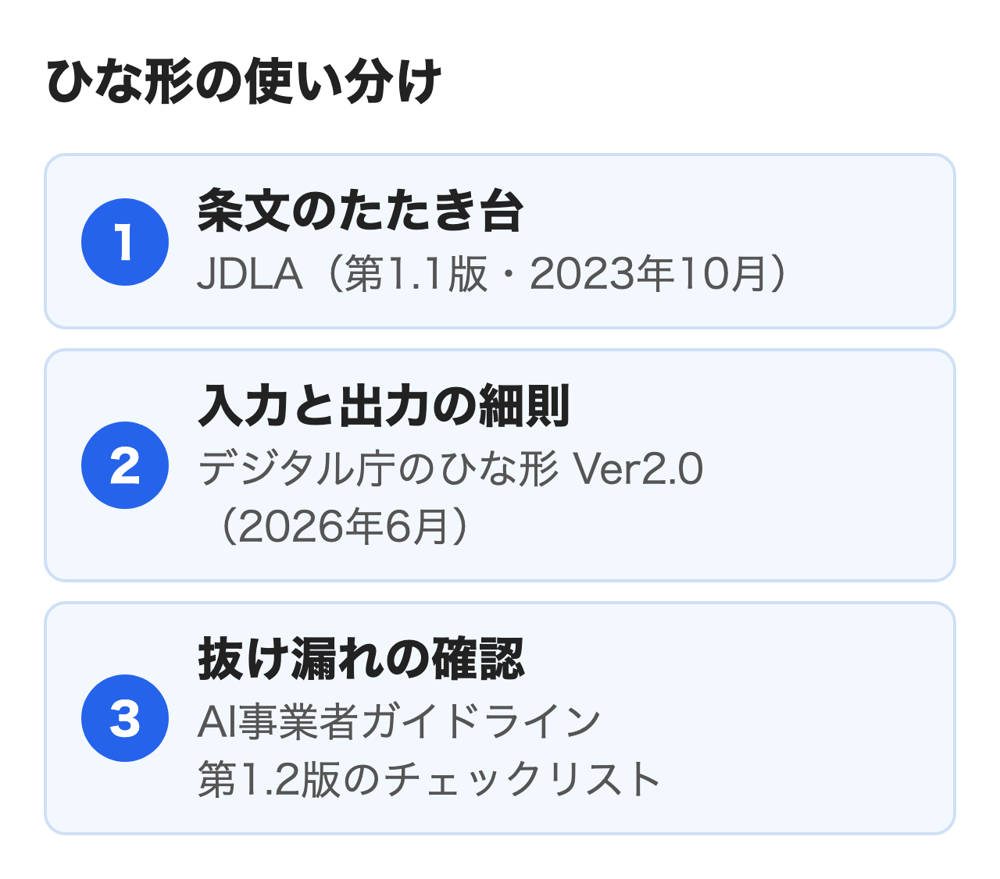
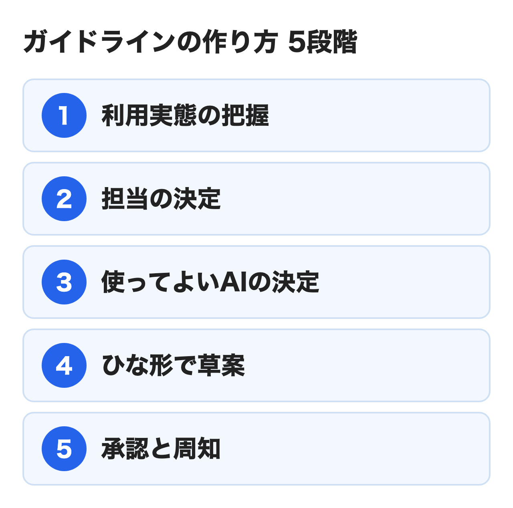

企業の生成AIガイドラインで最低限決めるのは、使ってよいAIとアカウント、入力してはいけない情報、出力を使う前の確認、迷ったときと誤って入力したときの連絡先の4つです。下敷きには日本ディープラーニング協会（JDLA）のひな形が使いやすく、入力と出力の細則はデジタル庁のひな形 Ver2.0 で補えます。

総務省の令和8年版情報通信白書では、生成AIの活用方針を持つ日本企業は2025年度の調査で68.9%でした。この記事では盛り込む項目・公的なひな形の版と使い分け・作る手順・企業の公開例・作った後の運用を順に解説します。

:::takeaways
- 最初の版で決めるのは、使ってよいAI・入力してはいけない情報・出力の確認・連絡先の4つ
- 条文の下敷きはJDLAのひな形（第1.1版・2023年10月）、入力と出力の細則はデジタル庁のひな形 Ver2.0（2026年6月）
- IPAのテキスト生成AIの導入・運用ガイドラインは、本書に書かれた有効期限（発行から2年）を過ぎている
:::

## 生成AIガイドラインとは？公的な指針とどう違う？

**生成AIガイドラインは社員が業務で生成AIを使うときの決まりを会社が定めた社内文書です。**国や業界団体も同じような名前の文書を出していますが、そちらは自社のルールを作るときの物差しやひな形にあたります。たとえばデジタル庁のガイドラインは政府の情報システムで守るルールとして決められたもので、民間企業がそのまま従う義務を負う文書ではありません。

<figure class="post-figure"></figure>

総務省と経済産業省のAI事業者ガイドラインは、AIに関わる事業者をAI開発者・AI提供者・AI利用者の3つに分けています。既製のChatGPTやCopilotを社員に使わせる会社は、主にAI利用者の項目を見れば足ります。社内の文書を検索して答える仕組みやAIエージェントを自社で組み込んで社員に配るなら、AI提供者の項目もあわせて読むのがおすすめです。

ルールが無いまま使い始めると、何を入れてよいかを社員がそれぞれで判断することになります。IPAの文書が紹介しているJIPDECの2024年の調査では、会社で構築・契約した生成AIを使う企業のうち規定やガイドラインを定めていたのは68.6%、社員が各自で契約・登録した生成AIを使う企業では9.0%でした。**個人のアカウントで使われている会社ほど、ルールが無い状態になりやすいと読めます。**禁止だけを出すと個人のアカウントで使われ続けやすいため、使ってよいAIを用意してから決まりを示す順が向いています。

:::linkcard
url: /media/shadow-ai/
title: シャドーAI対策とは？会社がやること
desc: 社員が個人のChatGPTを業務に使う状態への対策と、移行・ブロックでつまずく所を解説しています。
:::

## 企業の生成AIガイドラインに盛り込む項目は？

**盛り込む項目は10個ほどで、最初の版では使ってよいAI・入力してはいけない情報・出力の確認・連絡先の4つを先に固めます。**残りの項目はひな形の条文を自社の体制に合わせて書き換えるだけで埋められるものが大半です。

| 項目 | 決めること |
|---|---|
| 目的と基本方針 | 何のために使うか。積極的に使うか、業務を限って試すか |
| 適用範囲 | 役員・正社員・契約社員・派遣社員・業務委託先のどこまでか |
| 使ってよいAIとアカウント | 許可するサービスの一覧、会社契約のアカウントとシングルサインオン、一覧にないサービスの申請方法 |
| 学習の設定 | 入力が学習に使われない設定を会社で統一するか、社員ごとに設定させるか |
| 入力してはいけない情報 | 個人情報・営業秘密・未公開の財務情報・秘密保持契約の対象・パスワードなど |
| 出力の確認と責任 | 事実と権利侵害の確認、最終的な責任は使った社員にあること |
| 用途ごとの決まり | 社外に出す文書・画像・プログラム・AIエージェントで追加する手続き |
| 教育 | 使い始める前の研修と理解度の確認 |
| 違反と誤入力 | 就業規則に基づく措置と、誤って入力したときの報告先 |
| 窓口と見直し | 相談先の連絡先、見直しの時期と担当 |

### 入力してよい情報の区分

入力の決まりは情報の区分とAIの契約の組み合わせで書くと社員が判断しやすくなります。区分の名前は自社の情報セキュリティ規程で使っている言葉への統一が必要です。

| 情報の区分 | 会社が契約したAI | 個人向けの無料版など会社の管理外のAI |
|---|---|---|
| 公開済みの情報 | 可 | 可 |
| 社内限定の情報 | 学習に使わない設定と契約を確認したうえで可 | 不可 |
| 個人情報 | 原則不可。入れるなら利用目的の範囲内かと学習に使われないことを確認 | 不可 |
| 営業秘密・秘密保持契約の対象 | 原則不可。必要なら責任者の承認 | 不可 |

個人情報の行の根拠は個人情報保護委員会の注意喚起（2023年6月2日）です。この注意喚起によると、本人の同意なく個人データを含むプロンプトを入力し、それが応答の出力以外の目的で扱われると、個人情報保護法の規定に違反することとなる可能性があるとしています。デジタル庁のひな形 Ver2.0 も、規約への同意だけで誰でも使えるクラウド型の生成AIでは、原則として要機密情報を扱わないと定めています。

条文だけでは現場が迷うため、例を1組添えておくと伝わります。顧客の名刺の一覧をそのまま貼って並べ替えさせるのは不可で、架空の会社名に置き換えた文面の下書きなら可、のような対の例です。

### 出力の確認と責任

**出力をそのまま使わず、事実と権利侵害を人が確認してから使う、と書きます。**デジタル庁のひな形は出力に基づいた判断も説明責任の対象に含まれるとし、判断に迷う場合は利活用しないとしています。社外に出す画像やキャッチコピーについて、東京商工会議所の入門ガイドは、プロンプトに既存の著作物・作家名・作品名を入れないこと、公開の前に既存の著作物との類似を調査すること、ロゴや広告に使うなら登録商標・登録意匠も調査することを挙げています。

確認の重さは用途で変えるのが現実的です。社内の議事録の要約は使った本人の確認で済ませ、顧客向けの文書や広告は公開前に責任者が確認し、契約や採用の判断ではAIの出力を参考の情報に限る、という段階の付け方があります。

:::linkcard
url: /media/chatgpt-business/
title: ChatGPT Businessとは？料金とPlusとの違い
desc: 会社契約のChatGPTの料金、学習に使われない設定、管理者に会話が見えるかを解説しています。
:::

## 下敷きにする公的なひな形はどれ？

**条文のたたき台はJDLAのひな形、入力と出力の細則はデジタル庁のひな形 Ver2.0、抜け漏れの確認はAI事業者ガイドラインのチェックリストが向いています。**著作権と個人情報の扱いは文化庁と個人情報保護委員会の文書を根拠に置きます。版と公表日は2026年11月22日に各公式ページで確認したものです。

<figure class="post-figure"></figure>

| 文書（発行元・版） | 向いている使い方 | 注意点 |
|---|---|---|
| 生成AIの利用ガイドライン（JDLA、第1.1版・2023年10月） | 条文の初版を短期間で作る。Wordで条項のみと簡易解説付き。画像編（第1版・2024年2月）もある | 第1.1版の後の版は出ていない。AIエージェントなど後から広がった使い方は他の文書で補う |
| 生成AIシステム利活用ルール ひな形 Ver2.0（デジタル庁、2026年6月12日のガイドライン第2.0版の別紙2） | 使う前と使う間（入力・生成物）の細則 | 府省向けの文書なので、省の名前や責任者の役職を自社の体制に置き換える |
| AI事業者ガイドライン 第1.2版（総務省・経済産業省、2026年3月31日） | チェックリストとワークシート（別添7）で項目の抜けを確認 | 条文のひな形ではない。社内にAIを組み込んで配るならAI提供者の項目も見る |
| AIと著作権に関する考え方について（文化庁、2024年3月15日）とチェックリスト＆ガイダンス（2024年7月31日） | 生成物を広告や制作物に使う会社の確認手順 | 個別の案件が権利侵害にあたるかは法務や弁護士に相談する |
| 生成AIサービスの利用に関する注意喚起等（個人情報保護委員会、2023年6月2日） | 個人情報を入力するときの条件の根拠 | 入力の前に、提供する会社が機械学習に使わないこと等の確認を求めている |
| 中小企業のための生成AI活用入門ガイド（東京商工会議所、第7版・2025年8月1日） | 社員向けの説明資料 | 規程のひな形ではなく、ひな形としてJDLAを案内している |

JDLAのひな形は、組織がスムーズに導入できるように作られたもので、活用の目的に照らして追加や修正をして使う前提です。民間企業の条文の構成にそのまま合うのはこちらで、デジタル庁のひな形は条文ごとの書きぶりを借りる使い方になります。

<figure class="post-figure"><figcaption>日本ディープラーニング協会 資料室（2026年11月22日）</figcaption></figure>

### IPAの文書を使うときの注意

**IPAのサイトにあるテキスト生成AIの導入・運用ガイドライン（2024年7月）は、今の版の指針として下敷きにしない方が安全です。**作成者はIPAの産業サイバーセキュリティセンター中核人材育成プログラム7期生のプロジェクトで、免責事項に、IPAおよび同センターの意見を代表するものではなく著者の見解に基づく、と書かれています。同じ免責事項は本書の有効期限を発行日から2年間としており、2026年11月の時点で過ぎています。前提にしているAI事業者ガイドラインも第1版です。

<figure class="post-figure"><figcaption>IPA テキスト生成AIの導入・運用ガイドライン 1.6 免責事項（2026年11月22日）</figcaption></figure>

中身は導入と運用の担当者向けに厚く、利用ルールに書く項目（利用を制限する目的・入力を制限する情報・生成物の注意）や社内検索の仕組みの注意点は、読み物として参考になります。条文や公的な根拠には上の表の文書を使います。

### 版と公表日を控える

公的な文書は改定が続いています。AI事業者ガイドラインは2024年4月の第1.0版から2026年3月の第1.2版まで4回出ており、デジタル庁のガイドラインは初版（2025年5月）から約1年で第2.0版になりました。**自社のガイドラインの末尾に、参照した文書の名前・版・公表日を書いておくと、見直しの日にどこが古くなったかをすぐ確認できます。**

## 生成AIガイドラインの作り方は？

**作り方は利用実態の把握・担当の決定・使ってよいAIの決定・草案・承認と周知の5段階です。**ツールが決まらないと許可するサービスの条が書けないため、草案より先に契約を決めます。

<figure class="post-figure"></figure>

### ① 利用実態を把握する

部署ごとに使っているAIのサービス・使う目的・入力しているデータ・出力の行き先の4点をアンケートで集めるところから始まります。サイバーエージェントは画像生成AIのガイドラインを作る前に、全クリエイターを対象にアンケートを行いました。現場がすでに個人のアカウントで使っているなら、その業務を会社契約のAIで置き換えられるかが最初の論点になります。

### ② 担当を決める

情報システムの担当がツール・アカウント・ログを、法務が著作権・個人情報・契約を、人事が就業規則・研修・違反時の扱いを受け持つ形が一般的です。利用部門からも代表を入れ、どの業務で使いたいかを出してもらいます。最終的な承認は経営層が行い、改定を受け持つ部署を1つに決めておくと運用が止まりません。

### ③ 使ってよいAIと契約を決める

入力が学習に使われない法人向けのプランや、会社で管理できる環境から許可するサービスを選びます。X-Tech5の公開しているガイドラインは、許可するサービスを表にし、会社契約のアカウントには学習しない設定を会社でまとめて適用済みと書いています。社員が個人で設定する手間を残さない書き方です。

### ④ ひな形で草案を書く

JDLAのひな形を土台にし、自社の情報セキュリティ規程・個人情報保護方針と情報の区分名や承認の権限を統一します。専門用語を避けて平易に書き、入力の可・不可の例を添えます。条文に入れきれない一覧（許可するサービス・情報の区分・連絡先）は別紙にすると、一覧の更新のたびに本文を改定せずに済みます。

### ⑤ 承認して周知する

経営層の承認を得たら、説明会や研修でなぜこの決まりにしたかまで伝えましょう。最初は1つの部署で試し、問い合わせの多い所を修正してから全社に広げると、机上では見えなかった迷い所を反映できます。

## 企業が公開している生成AIガイドラインの例

自社のサイトで生成AIの方針や規程を公開している5社を、公開している文書の形がわかるように並べます。

- **X-Tech5**: 生成AIサービス利用ガイドラインを全19条で公開。許可するサービスの表、会社ドメインのアカウント、マスキングを原則とした入力の決まり、名簿など特別に管理する情報は取締役の承認、ブラウザ拡張機能の制限まで書いている。2025年7月の初版から2026年8月までに4回改定し、MCPなどの外部連携の規定を統合した
- **カナデビア**: 生成AIポリシーを2025年10月1日に制定して公開。人間中心・安全性・公平性・プライバシー・セキュリティ・透明性と説明責任・法令遵守と教育・イノベーションの8原則で、具体の手順は別に定めるガイドラインに従うとしている
- **KDDI**: KDDIグループAI開発・利活用原則を公開。人間の尊厳からアカウンタビリティまでの8項目を、AI開発者・AI利用者・AIデータ提供者のどの立場でも守る原則としている
- **サイバーエージェント**: 2024年2月に社内のクリエイター向けに画像生成AIガイドラインを発表し、策定の経緯を公式メディアで公開。推奨ツール以外は法務とセキュリティの担当が事前に確認し、理解度テストに合格しないと利用申請を受け付けない
- **パナソニック ホールディングス**: 2023年4月14日に社内向けのPX-GPTを国内約9万人に提供した際、入力情報の二次利用がされない仕様にしたうえで、社内情報・営業秘密・個人情報などを入力しない利用ルールを整備したと発表した

**公開の形は原則（ポリシー）だけを外に出して運用の手順は社内のガイドラインに分ける形と、規程の全文を改訂履歴ごと出す形に分かれます。**取引先から生成AIの扱いを聞かれる会社なら、前者の原則だけでも公開しておくと、同じ文書で答えられます。

## 作った後の運用はどうする？

**運用で決めるのは理解度の確認・誤って入力したときの報告・見直しの時期の3つです。**作って配っただけのガイドラインは、問い合わせが窓口に集まらず、守られているかもわかりません。

### 理解度を確認してから使わせる

研修のあとに確認テストを置き、合格した人にアカウントを発行する方法があります。サイバーエージェントは解釈が分かれそうな所をテストに出し、不合格なら利用申請を受け付けない仕組みにしました。研修の選び方は[法人向け生成AI研修の比較](/media/genai-training-companies/)にまとめています。

### 誤って入力したときの報告を決める

個人情報や機密を誤って入れたときに、入力を止め、画面と時刻を残して窓口に報告する手順を書きます。履歴を消してしまうと、どこまで影響したかを後から調査できません。就業規則に基づく懲戒の条と、誤入力の報告の手順は分けて書き、すぐ報告した人の扱いを決めておくと報告が遅れにくくなります。

### 見直しの時期

見直しは年1回を目安にし、許可するサービスを追加したとき、事故が起きたとき、参照している公的文書が改定されたときにも行います。X-Tech5は初版から約1年で4回改定しており、新しいサービスや外部連携が出るたびに条文を更新してきました。

:::linkcard
url: /media/genai-training-companies/
title: 法人向け生成AI研修おすすめ7選
desc: 法人向けの生成AI研修を形式・対応するAIツール・料金で比較し、助成金の改正点まで解説しています。
:::

## 社内の業務にAIエージェントを入れる場合

**AIエージェントのように、メールの送信やファイルの削除をAIが自分で行う使い方を始めるなら、ガイドラインに条を1つ追加します。**X-Tech5は2026年8月の改定で外部連携の規定を設け、権限は業務に必要な最小限にすること、削除・更新・送信・外部公開を伴う操作はその手前で止めて人が確認することを定めました。

追加する内容はAIに渡す権限の範囲・人が承認する操作・使ってよい外部連携の一覧・止め方とログの残し方です。社内向けにAIを組み込んで配る場合は、AI事業者ガイドラインのAI提供者の項目もあわせて確認します。ルールを作った後に業務へAIエージェントを入れる場合の作り方は[AIエージェントの作り方](/media/ai-agent-build/)、進め方と費用は[AIエージェント導入の進め方](/media/ai-agent-introduction/)で扱っています。nitoは社内業務に合わせたAIエージェントの構築と運用を支援しています。

## まとめ

- まだルールが無い会社は、使ってよいAI・入力してはいけない情報・出力の確認・連絡先の4項目を暫定ルールとして先に出し、JDLAのひな形で正式版を作る
- すでにガイドラインがある会社は、参照している公的文書の版を確認し、IPAの2024年の文書や古い版を根拠にしていれば更新する
- 個人のアカウントでの利用が多い会社は、会社契約のAIを用意してから個人の利用を制限する
- 社内にAIエージェントや社内検索の仕組みを組み込む会社は、権限と人の確認の条を追加し、AI事業者ガイドラインのAI提供者の項目も見る

## よくある質問

### 中小企業でも生成AIガイドラインは必要ですか？
社員が業務で生成AIを使うなら、規模によらず作るのがおすすめです。令和8年版情報通信白書では、生成AIの活用方針を持つ中小企業は58.1%で、大企業の74.0%より低い水準でした。最初は4項目の短いものでも構いません。

### JDLAの生成AIの利用ガイドラインは無料で使えますか？
無料でダウンロードできます。JDLAの資料室に、条項のみと簡易解説付きのWordファイル（第1.1版・2023年10月）と画像編（第1版・2024年2月）が置かれています。自社の目的に合わせて追加・修正して使う前提です。

### デジタル庁のガイドラインは民間企業も守りますか？
守る義務はありません。デジタル庁のガイドライン（第2.0版・2026年6月12日）は政府の情報システムで守るルールとして決められたものです。民間企業は別紙2の利活用ルールのひな形 Ver2.0 を条文の参考にする使い方になります。

### AI事業者ガイドラインの最新版はどれですか？
2026年11月22日時点の最新版は、2026年3月31日の第1.2版です。経済産業省のページに本編・別添のほか、チェックリストとワークシート（別添7）が置かれています。

### IPAの生成AIガイドラインは今も使えますか？
読み物としては参考になりますが、今の版の指針として下敷きにするのは避けた方が安全です。2024年7月に中核人材育成プログラムの受講者が作ったもので、IPAの意見を代表しないと断っており、本書の有効期限は発行日から2年間と書かれています。

### 生成AIガイドラインはどのくらいの頻度で見直しますか？
公的な決まりはありません。年1回を目安にし、許可するサービスの追加や事故、公的文書の改定があればその都度見直します。

### ChatGPTの無料版を業務で使ってよいかはどう決めますか？
許可するサービスの表で、会社が契約したものと個人向けのものを分けて書きます。個人向けの設定は社員ごとに変えられ、会社が管理できないため、社内限定の情報を入れてよいのは会社契約のAIだけ、とする書き方が一般的です。個人の設定の切り方は[ChatGPTに学習させない設定](/media/chatgpt-training-off/)にまとめています。

### 画像生成AIのルールは別に作るべきですか？
社外に出す画像を作る部署があるなら、文章と分けて書くのがおすすめです。JDLAは画像編のひな形を別に出しており、サイバーエージェントもクリエイター向けに画像生成AIのガイドラインを別に作りました。

## 出典

- 日本ディープラーニング協会「[資料室 生成AIの利用ガイドライン](https://www.jdla.org/document/#ai-guideline)」（2026年11月22日取得）
- デジタル庁「[行政の進化と革新のための生成AIの調達・利活用に係るガイドライン（第2.0版）](https://www.digital.go.jp/news/decb64eb-f26e-41cb-8d37-f3dd173108b8)」（2026年6月12日決定、同日取得）
- 総務省・経済産業省「[AI事業者ガイドライン（第1.2版）](https://www.meti.go.jp/shingikai/mono_info_service/ai_shakai_jisso/20260331_report.html)」（2026年3月31日、同日取得）
- 経済産業省「[AI事業者ガイドライン検討会](https://www.meti.go.jp/shingikai/mono_info_service/ai_shakai_jisso/index.html)」（版の履歴、同日取得）
- 文化庁「[AIと著作権について](https://www.bunka.go.jp/seisaku/chosakuken/aiandcopyright.html)」（同日取得）
- 個人情報保護委員会「[生成AIサービスの利用に関する注意喚起等について](https://www.ppc.go.jp/news/careful_information/230602_AI_utilize_alert/)」（2023年6月2日公表、同日取得）
- 東京商工会議所「[中小企業のための生成AI活用入門ガイド（第7版）](https://www.tokyo-cci.or.jp/file.jsp?id=1204275)」（2025年8月1日、同日取得）
- IPA 産業サイバーセキュリティセンター 中核人材育成プログラム7期生「[テキスト生成AIの導入・運用ガイドライン](https://www.ipa.go.jp/jinzai/ics/core_human_resource/final_project/2024/f55m8k0000003spo-att/f55m8k0000003svn.pdf)」（2024年7月、同日取得）
- 総務省「[令和8年版 情報通信白書 生成AIの活用方針等](https://www.soumu.go.jp/johotsusintokei/whitepaper/ja/r08/html/nd121110.html)」（同日取得）
- 株式会社X-Tech5「[生成AIサービス利用ガイドライン](https://x-tech5.co.jp/generative_ai_guideline/)」（同日取得）
- カナデビア株式会社「[生成AIポリシー](https://www.kanadevia.com/ai-policy/)」（2025年10月1日制定、同日取得）
- KDDI株式会社「[KDDIグループAI開発・利活用原則](https://www.kddi.com/corporate/kddi/public/ai_principles/)」（同日取得）
- サイバーエージェント「[社内のクリエイターに向けて発表した画像生成AIガイドライン策定の裏側](https://www.cyberagent.co.jp/way/list/detail/id=30017)」（同日取得）
- パナソニック ホールディングス「[AIアシスタントサービスPX-GPTをパナソニックグループ全社員へ拡大](https://news.panasonic.com/jp/press/jn230414-1)」（2023年4月14日、同日取得）
