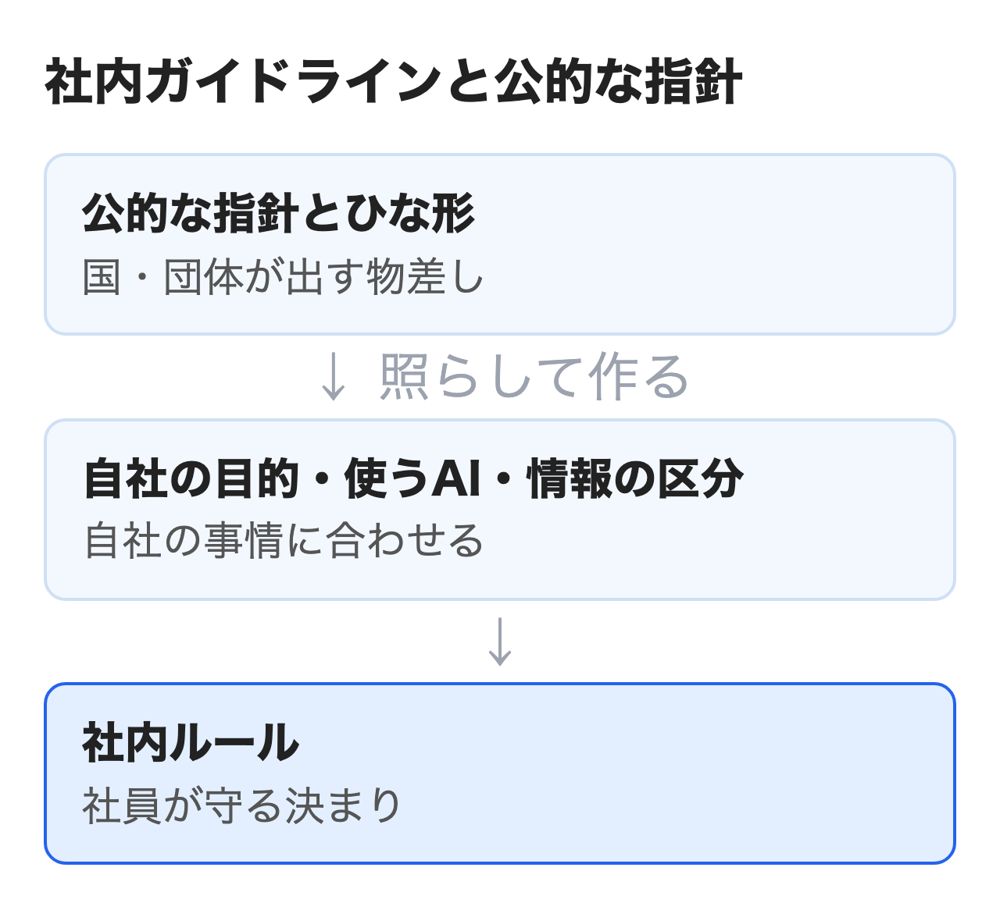
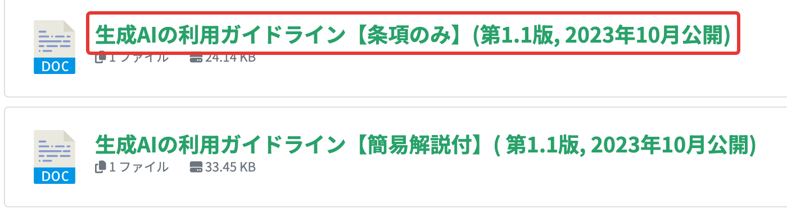
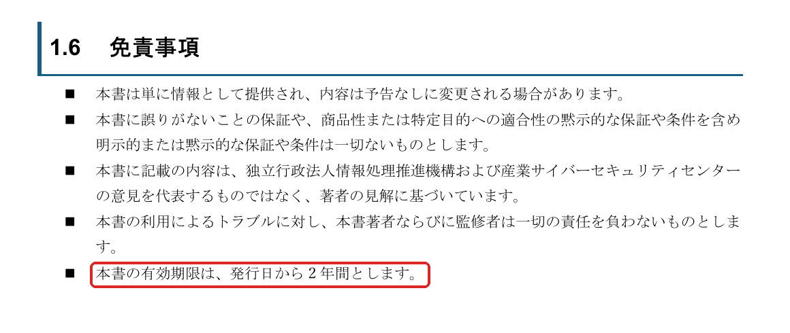

企業の生成AIガイドラインで最低限決めるのは、使ってよいAIとアカウント、入力してはいけない情報、出力を使う前の確認、迷ったときと誤って入力したときの連絡先の4つです。下敷きには日本ディープラーニング協会（JDLA）のひな形が使いやすく、入力と出力の細則はデジタル庁のひな形 Ver2.0 で補えます。

この記事では盛り込む項目・公的なひな形の版と使い分け・作る手順・企業の公開例・作った後の運用を順に解説します。

:::takeaways
- 最初の版で決めるのは、使ってよいAI・入力してはいけない情報・出力の確認・連絡先の4つ
- 条文の下敷きはJDLAのひな形（第1.1版・2023年10月）、入力と出力の細則はデジタル庁のひな形 Ver2.0（2026年6月）
- IPAのテキスト生成AIの導入・運用ガイドラインは、本書に書かれた有効期限（発行から2年）を過ぎている
:::

## 生成AIガイドラインとは？公的な指針とどう違う？

**生成AIガイドラインは社員が業務で生成AIを使うときの決まりを会社が定めた社内文書です。**国や業界団体も同じような名前の文書を出していますが、そちらは自社のルールを作るときの基準やひな形にあたります。たとえばデジタル庁のガイドラインは政府の情報システムで守るルールとして決められたもので、民間企業がそのまま従う義務を負う文書ではありません。

<figure class="post-figure"></figure>

総務省と経済産業省のAI事業者ガイドラインは、AIに関わる事業者をAI開発者・AI提供者・AI利用者の3つに分けています。既製のChatGPTやCopilotを社員に使わせる会社は、第1部・第2部の共通の指針に加えて、第5部のAI利用者の項目と別添を確認します。社内の文書を検索して答える仕組みやAIエージェントを自社で組み込んで社員に配るなら、AI提供者の項目もあわせて読むのがおすすめです。

ルールが無いまま使い始めると、何を入れてよいかを社員がそれぞれで判断することになります。JIPDECの企業IT利活用動向調査2026（N=399）でAI活用のガバナンス体制を聞いたところ、全社のポリシー・ガイドラインがあると答えたのは36.3%、部門ごとにはあるが統一されたポリシーはないが15.3%、AIの利用は各部門に任されていて全社的な統制はないが8.8%でした。**全社で統一したルールが無い会社が、一定数あります。**禁止だけを出すと、職場に使えるAIが無いまま個人のアカウントで使われる状態（シャドーAI）になりやすいため、使ってよいAIを用意してから決まりを示す順が向いています。

:::linkcard
url: /media/shadow-ai/
title: シャドーAI対策とは？会社がやること
desc: 社員が個人のChatGPTを業務に使う状態への対策と、移行・ブロックでつまずく所を解説しています。
:::

## 企業の生成AIガイドラインに盛り込む項目は？

**盛り込む項目は10個ほどで、最初の版では使ってよいAI・入力してはいけない情報・出力の確認・連絡先の4つを先に固めます。**残りの項目はひな形の条文を自社の体制に合わせて書き換えるだけで埋められるものが大半です。

| 項目 | どのひな形のどこにあるか |
|---|---|
| 目的と基本方針 | JDLAの1「本ガイドラインの目的」、デジタル庁 別紙2の1「ルールの目的」、X-Tech5の第1条（目的）・第2条（基本方針） |
| 適用範囲 | X-Tech5の第3条（役員・従業員と業務委託先）。JDLAには範囲だけを定める項目は無い |
| 使ってよいAIとアカウント | JDLAの2「対象とする生成AI」、X-Tech5の第4条（許可サービスの分類の表）・第5条（会社のドメインのアカウントとシングルサインオン）・第17条（利用申請） |
| 学習の設定 | X-Tech5の第6条（オプトアウト設定の義務）。JDLAは5(4)で、入力が学習に使われる前提で個人情報を入れないよう書いている |
| 入力してはいけない情報 | JDLAの5（6類型）、デジタル庁 別紙2の2(2)①、X-Tech5の第7条 |
| 出力の確認と責任 | JDLAの6(1)(2)、デジタル庁 別紙2の2(2)②、X-Tech5の第8条 |
| 用途ごとの決まり | JDLAの6(2)（著作権・商標・意匠・虚偽の個人情報）、X-Tech5の第9条（コード生成）・第15条（削除・送信など破壊的操作の確認） |
| 教育 | 3つの文書には条として無い。運用の節で扱う |
| 違反と誤入力 | デジタル庁 別紙2の2(2)②（重大なリスクはAI統括責任者に報告）、X-Tech5の第18条（懲戒） |
| 窓口と見直し | JDLAの2・5(4)（【セキュリティ部門】に問い合わせ）、X-Tech5の第6条（問い合わせ先）と附則（定期的に見直す） |

### 入力してよい情報の区分

JDLAのひな形は他社の著作物・登録商標や意匠・著名人の顔写真や氏名・個人情報・秘密保持契約で受け取った情報・自社の機密情報のデータの類型ごとに、入力するときの注意点とその理由を書く作りです。入力の可否の組み立てはX-Tech5の第7条が例です。

- 原則：個人情報や機密情報などの固有の情報は、マスキング（匿名化・抽象化）してから使う
- 例外：マスキングで回答の精度が著しく落ち、業務に支障が出る場合に限り、オプトアウト設定が有効で学習に使われないこと・入力は業務上必要最小限であること・特別管理情報に当たらないこと、の3つをすべて満たしたときだけ固有の情報を使える
- 特別管理情報：氏名・住所・電話番号・メールアドレス・マイナンバー等を一覧にした名簿など。例外は適用されず、原則として入力せず、やむを得ない場合は取締役の承認を得る

第7条は冒頭で、お客様の業務に関連してAIを使うときはお客様側の規定が優先する、とも定めています。

個人情報の扱いの根拠は個人情報保護委員会の注意喚起（2023年6月2日）です。この注意喚起は本人の同意なく個人データを含むプロンプトを入力し、それが応答の出力以外の目的で扱われると、個人情報保護法の規定に違反することとなる可能性があると指摘しています。デジタル庁のひな形 Ver2.0 も、規約への同意だけで誰でも使えるクラウド型の生成AIでは、原則として要機密情報を扱わないと定めています。

条文だけでは社員が迷うため、例を1組添えておくと伝わります。顧客の名刺の一覧をそのまま貼って並べ替えさせるのは不可で、架空の会社名に置き換えた文面の下書きなら可、のような対の例です。

### 出力の確認と責任

**出力をそのまま使わず、事実と権利侵害を人が確認してから使う、と書きます。**デジタル庁のひな形は出力に基づいた判断も説明責任の対象に含まれるとし、判断に迷う場合は利活用しないとしています。社外に出す画像やキャッチコピーについて、東京商工会議所の入門ガイドは、プロンプトに既存の著作物・作家名・作品名を入れないこと、公開の前に既存の著作物との類似を調査すること、ロゴや広告に使うなら登録商標・登録意匠も調査することを挙げています。

確認の深さはデジタル庁のひな形が「正確性や根拠・事実関係を必要な範囲内でリスクに応じて確認すること」と書くように、用途のリスクに応じて決めるのが現実的です。X-Tech5の第8条は生成物をそのままコピー＆ペーストせず下書き・参考として使うこと、正確性は信頼できる情報源で再確認することを求める内容です。

:::linkcard
url: /media/chatgpt-business/
title: ChatGPT Businessとは？料金とPlusとの違い
desc: 会社契約のChatGPTの料金、学習に使われない設定、管理者に会話が見えるかを解説しています。
:::

## 下敷きにする公的なひな形はどれ？

**条文のたたき台はJDLAのひな形、入力と出力の細則はデジタル庁のひな形 Ver2.0、抜け漏れの確認はAI事業者ガイドラインのチェックリストが向いています。**著作権と個人情報の扱いは文化庁と個人情報保護委員会の文書を根拠に置きます。版と公表日は2026年11月22日に各公式ページで確認したものです。

| 文書（発行元・版） | 向いている使い方 | 注意点 |
|---|---|---|
| 生成AIの利用ガイドライン（JDLA、第1.1版・2023年10月） | 条文の初版を短期間で作る。Wordで条項のみと簡易解説付き。画像編（第1版・2024年2月）もある | 第1.1版の後の版は出ていない。【】の中のChatGPTの記述は2023年の規約の内容なので、今の規約と自社の契約で書き直す（Word本文の5(4)・6(4)・6(5)）。AIエージェントなど後から広がった使い方は他の文書で補う |
| 生成AIシステム利活用ルール ひな形 Ver2.0（デジタル庁、2026年6月12日のガイドライン第2.0版の別紙2） | 使う前と使う間（入力・生成物）の細則 | 府省向けの文書なので、省の名前や責任者の役職を自社の体制に置き換える |
| AI事業者ガイドライン 第1.2版（総務省・経済産業省、2026年3月31日） | 共通の指針に照らした取組の確認（別添7のチェックリストとワークシート） | 条文のひな形ではない。社内にAIを組み込んで配るならAI提供者の項目も見る |
| AIと著作権に関する考え方について（文化庁 文化審議会 著作権分科会 法制度小委員会、2024年3月15日）とチェックリスト＆ガイダンス（2024年7月31日） | 生成物を広告や制作物に使う会社の確認手順 | 個別の案件が権利侵害にあたるかは法務や弁護士に相談する |
| 生成AIサービスの利用に関する注意喚起等（個人情報保護委員会、2023年6月2日） | 個人情報を入力するときの条件の根拠 | 入力の前に、提供する会社が機械学習に使わないこと等の確認を求めている |
| 中小企業のための生成AI活用入門ガイド（東京商工会議所、第7版・2025年8月1日） | 社員向けの説明資料 | 規程のひな形ではなく、ひな形としてJDLAを案内している |

JDLAのひな形は組織がスムーズに導入できるように作られたもので、活用の目的に照らして追加や修正をして使う前提です。民間企業の条文の構成にそのまま合うのはこちらで、デジタル庁のひな形は条文ごとの書きぶりを借りる使い方になります。

<figure class="post-figure"><figcaption>日本ディープラーニング協会 資料室（2026年11月22日）</figcaption></figure>

### IPAの文書を使うときの注意

**IPAのサイトにあるテキスト生成AIの導入・運用ガイドライン（2024年7月）は、今の版の指針として下敷きにしない方が安全です。**作成者はIPAの産業サイバーセキュリティセンター中核人材育成プログラム7期生のプロジェクトで、免責事項に、IPAおよび同センターの意見を代表するものではなく著者の見解に基づく、と書かれています。同じ免責事項は本書の有効期限を発行日から2年間としており、2026年11月の時点で過ぎています。前提にしているAI事業者ガイドラインも第1.0版です。

<figure class="post-figure"><figcaption>IPA テキスト生成AIの導入・運用ガイドライン 1.6 免責事項（2026年11月22日）</figcaption></figure>

中身は導入と運用の担当者向けに厚く、利用ルールに書く項目（利用を制限する目的・入力を制限する情報・生成物の注意）や社内検索の仕組みの注意点は、読み物として参考になります。条文や公的な根拠には上の表の文書を使います。

### 版と公表日を控える

公的な文書は改定が続いています。AI事業者ガイドラインは2024年4月の第1.0版から2026年3月の第1.2版まで4回出ており、デジタル庁のガイドラインは初版（2025年5月）から約1年で第2.0版になりました。**自社のガイドラインの末尾に、参照した文書の名前・版・公表日を書いておくと、見直しの日にどこが古くなったかをすぐ確認できます。**

## 生成AIガイドラインの作り方は？

**作り方は利用実態の把握・担当の決定・使ってよいAIの決定・草案・承認と周知の5段階です。**ツールが決まらないと許可するサービスの条が書けないため、草案より先に契約を決めます。

### ① 利用実態を把握する

部署ごとに使っているAIのサービス・使う目的・入力しているデータ・出力の行き先の4点をアンケートで集めるところから始まります。サイバーエージェントは画像生成AIのガイドラインを作る前に、全クリエイターを対象にアンケートを行いました。社員がすでに個人のアカウントで使っているなら、その業務を会社契約のAIで置き換えられるかが最初の論点になります。

### ② 担当を決める

情報システムの担当がツール・アカウント・ログを、法務が著作権・個人情報・契約を、人事が就業規則・研修・違反時の扱いを受け持つ形が一般的です。利用部門からも代表を入れ、どの業務で使いたいかを出してもらいます。最終的な承認は経営層が行い、改定を受け持つ部署を1つに決めておくと運用が止まりません。

### ③ 使ってよいAIと契約を決める

入力が学習に使われない法人向けのプランや、会社で管理できる環境から許可するサービスを選びます。X-Tech5の公開しているガイドラインは、許可するサービスを表にし、会社契約のアカウントには学習しない設定を会社でまとめて適用済みと書いています。社員が個人で設定する手間を残さない書き方です。

### ④ ひな形で草案を書く

JDLAのひな形は【（例）会社】【セキュリティ部門】など【】の所を自社の名前と担当に置き換える作りです。対象とする生成AI（2）は例として【ChatGPT】が入っており、禁止する用途（3）は【】が空欄なので、③で決めた一覧を入れます。専門用語を避けて平易に書き、入力の可・不可の例を添えると伝わります。条文に入れきれない一覧（許可するサービス・情報の区分・連絡先）は別紙にすると、一覧の更新のたびに本文を改定せずに済みます。

### ⑤ 承認して周知する

経営層の承認を得たら、説明会や研修でなぜこの決まりにしたかまで伝えましょう。最初は1つの部署で試し、問い合わせの多い所を修正してから全社に広げると、机上では見えなかった判断に迷う点を反映できます。

## 企業が公開している生成AIガイドラインの例

生成AIの方針・規程そのものか、その策定や利用ルールの中身を自社のサイトで公開している5社を、公開している文書の形がわかるように並べます。

- **X-Tech5**: 生成AIサービス利用ガイドラインを全19条で公開。許可するサービスの表、会社ドメインのアカウント、マスキングを原則とした入力の決まり、名簿など特別に管理する情報は取締役の承認、ブラウザ拡張機能の制限まで書いている。2025年7月の初版から2026年8月までに5回改定し、MCPなどの外部連携の規定を統合した
- **カナデビア**: 生成AIポリシーを2025年10月1日に制定して公開。人間中心・安全性・公平性・プライバシー・セキュリティ・透明性と説明責任・法令遵守と教育・イノベーションの8原則で、具体の手順は別に定めるガイドラインに従うとしている
- **KDDI**: KDDIグループAI開発・利活用原則を公開。人間の尊厳から連携までの9項目で、項目ごとにAI開発者・AI利用者・AIデータ提供者のどの立場で守るかを分けて書いている
- **サイバーエージェント**: 2024年2月に社内のクリエイター向けに画像生成AIガイドラインを発表し、策定の経緯を公式メディアで公開。推奨ツール以外は法務とセキュリティの担当が事前に確認し、理解度テストに合格しないと利用申請を受け付けない
- **パナソニック ホールディングス**: 2023年4月14日に社内向けのPX-GPTを国内約9万人に提供した際、入力情報の二次利用がされない仕様にしたうえで、社内情報・営業秘密・個人情報などを入力しない利用ルールを整備したと発表した

**公開の形は3つに分かれます。**原則（ポリシー）だけを外に出して運用の手順は社内のガイドラインに分ける形（カナデビア・KDDI）、規程の全文を改訂履歴ごと出す形（X-Tech5）、策定の経緯や導入の発表で、ルールの一部だけを出す形（サイバーエージェント・パナソニック）です。取引先から生成AIの扱いを聞かれる会社なら、原則だけでも公開しておくと、同じ文書で答えられます。

## 作った後の運用はどうする？

**運用で決めるのは理解度の確認・誤って入力したときの報告・見直しの時期の3つです。**作って配っただけのガイドラインは、問い合わせが窓口に集まらず、守られているかもわかりません。

### 理解度を確認してから使わせる

研修のあとに確認テストを置き、合格した人にアカウントを発行する方法があります。サイバーエージェントは解釈が分かれそうな所をテストに出し、不合格なら利用申請を受け付けない仕組みにしました。研修の選び方は[法人向け生成AI研修の比較](/media/genai-training-companies/)にまとめています。

### 誤って入力したときの報告を決める

個人情報や機密を誤って入れたときに、入力を止めて窓口に報告する手順を書きます。デジタル庁のひな形は生成AI特有のリスクのうち特に重大なものを検知した場合、迅速にAI統括責任者へ報告するよう定めています。違反への措置はX-Tech5の第18条にあり、就業規則に基づく懲戒処分の対象となることがあるという内容です。報告の手順と懲戒の条は分けて書き、すぐ報告した人の扱いを決めておくと、報告が遅れにくくなります。

### 見直しの時期

見直しは年1回を目安にし、許可するサービスを追加したとき、事故が起きたとき、参照している公的文書が改定されたときにも行います。X-Tech5は初版から約1年2か月で5回改定しており、新しいサービスや外部連携が出るたびに条文を更新してきました。

:::linkcard
url: /media/genai-training-companies/
title: 法人向け生成AI研修おすすめ7選
desc: 法人向けの生成AI研修を形式・対応するAIツール・料金で比較し、助成金の改正点まで解説しています。
:::

## 社内の業務にAIエージェントを入れる場合

**AIエージェントのように、メールの送信やファイルの削除をAIが自分で行う使い方を始めるなら、ガイドラインに条を1つ追加します。**X-Tech5は2026年8月の改定で外部連携の規定を設け、権限は業務に必要な最小限にすること、削除・更新・送信・外部公開を伴う操作はその手前で止めて人が確認することを定めました。

追加する内容はAIに渡す権限の範囲・人が承認する操作・使ってよい外部連携の一覧・止め方とログの残し方です。社内向けにAIを組み込んで配る場合は、AI事業者ガイドラインのAI提供者の項目もあわせて確認します。ルールを作った後に業務へAIエージェントを入れる場合の作り方は[AIエージェントの作り方](/media/ai-agent-build/)、進め方と費用は[AIエージェント導入の進め方](/media/ai-agent-introduction/)で扱っています。nitoは社内業務に合わせた[AIエージェント構築支援](/ai-agent/)として、構築と運用を支援しています。

## まとめ

- まだルールが無い会社は、使ってよいAI・入力してはいけない情報・出力の確認・連絡先の4項目を暫定ルールとして先に出し、JDLAのひな形で正式版を作る
- すでにガイドラインがある会社は、参照している公的文書の版を確認し、IPAの2024年の文書や古い版を根拠にしていれば更新する
- 個人のアカウントでの利用が多い会社は、会社契約のAIを用意してから個人の利用を制限する
- 社内にAIエージェントや社内検索の仕組みを組み込む会社は、権限と人の確認の条を追加し、AI事業者ガイドラインのAI提供者の項目も見る

## よくある質問

### 中小企業でも生成AIガイドラインは必要ですか？
社員が業務で生成AIを使うなら、規模によらず作るのがおすすめです。令和8年版情報通信白書では、生成AIを活用する方針の中小企業は58.1%まで増えています。最初は4項目の短いものでも構いません。

### JDLAの生成AIの利用ガイドラインは無料で使えますか？
無料でダウンロードできます。JDLAの資料室に、条項のみと簡易解説付きのWordファイル（第1.1版・2023年10月）と画像編（第1版・2024年2月）が置かれています。自社の目的に合わせて追加・修正して使う前提です。

### デジタル庁のガイドラインは民間企業も守りますか？
守る義務はありません。デジタル庁のガイドライン（第2.0版・2026年6月12日）は政府の情報システムで守るルールとして決められたものです。民間企業は別紙2の利活用ルールのひな形 Ver2.0 を条文の参考にする使い方になります。

### AI事業者ガイドラインの最新版はどれですか？
2026年11月22日時点の最新版は、2026年3月31日の第1.2版です。経済産業省のページに本編・別添のほか、チェックリストとワークシート（別添7）が置かれています。

### IPAの生成AIガイドラインは今も使えますか？
読み物としては参考になりますが、今の版の指針として下敷きにするのは避けた方が安全です。2024年7月に中核人材育成プログラムの受講者が作ったもので、IPAの意見を代表しないと断っており、本書の有効期限は発行日から2年間と書かれています。IPAの最新の整理としては、[情報セキュリティ10大脅威 2026の解説書（組織編）](https://www.ipa.go.jp/security/10threats/omgdg50000008fi8-att/kaisetsu_2026_soshiki.pdf)が、社員が個人で使うAIサービスを業務に使うシャドーAIを取り上げています。対策は[シャドーAI対策とは？](/media/shadow-ai/)にまとめています。

### 生成AIガイドラインはどのくらいの頻度で見直しますか？
公的な決まりはありません。年1回を目安にし、許可するサービスの追加や事故、公的文書の改定があればその都度見直します。

### ChatGPTの無料版を業務で使ってよいかはどう決めますか？
許可するサービスの表で、会社が契約したものと個人向けのものを分けて書きます。個人向けの設定は社員ごとに変えられ、会社が管理できないため、社内限定の情報を入れてよいのは会社契約のAIだけ、とする書き方が一般的です。個人の設定の切り方は[ChatGPTに学習させない設定](/media/chatgpt-training-off/)にまとめています。

### 画像生成AIのルールは別に作るべきですか？
社外に出す画像を作る部署があるなら、文章と分けて書くのがおすすめです。JDLAは画像編のひな形を別に出しており、サイバーエージェントもクリエイター向けに画像生成AIのガイドラインを別に作りました。

## 出典

- 日本ディープラーニング協会「[資料室 生成AIの利用ガイドライン](https://www.jdla.org/document/#ai-guideline)」（2026年11月22日取得）
- デジタル庁「[行政の進化と革新のための生成AIの調達・利活用に係るガイドライン（第2.0版）](https://www.digital.go.jp/news/decb64eb-f26e-41cb-8d37-f3dd173108b8)」（2026年6月12日決定、同日取得）
- 総務省・経済産業省「[AI事業者ガイドライン（第1.2版）](https://www.meti.go.jp/shingikai/mono_info_service/ai_shakai_jisso/20260331_report.html)」（2026年3月31日、同日取得）
- 経済産業省「[AI事業者ガイドライン検討会](https://www.meti.go.jp/shingikai/mono_info_service/ai_shakai_jisso/index.html)」（版の履歴、同日取得）
- 文化庁「[AIと著作権について](https://www.bunka.go.jp/seisaku/chosakuken/aiandcopyright.html)」（同日取得）
- 個人情報保護委員会「[生成AIサービスの利用に関する注意喚起等について](https://www.ppc.go.jp/news/careful_information/230602_AI_utilize_alert/)」（2023年6月2日公表、同日取得）
- 東京商工会議所「[中小企業のための生成AI活用入門ガイド（第7版）](https://www.tokyo-cci.or.jp/file.jsp?id=1204275)」（2025年8月1日、同日取得）
- IPA 産業サイバーセキュリティセンター 中核人材育成プログラム7期生「[テキスト生成AIの導入・運用ガイドライン](https://www.ipa.go.jp/jinzai/ics/core_human_resource/final_project/2024/f55m8k0000003spo-att/f55m8k0000003svn.pdf)」（2024年7月、同日取得）
- JIPDEC「[企業IT利活用動向調査2026](https://www.jipdec.or.jp/archives/publications/h2le1c000000bkzt-att/ITresarch2026report.pdf)」（図20、同日取得）
- IPA「[情報セキュリティ10大脅威 2026 解説書（組織編）](https://www.ipa.go.jp/security/10threats/omgdg50000008fi8-att/kaisetsu_2026_soshiki.pdf)」（2026年1月公表）
- 総務省「[令和8年版 情報通信白書 生成AIの活用方針等](https://www.soumu.go.jp/johotsusintokei/whitepaper/ja/r08/html/nd121110.html)」（同日取得）
- 株式会社X-Tech5「[生成AIサービス利用ガイドライン](https://x-tech5.co.jp/generative_ai_guideline/)」（同日取得）
- カナデビア株式会社「[生成AIポリシー](https://www.kanadevia.com/ai-policy/)」（2025年10月1日制定、同日取得）
- KDDI株式会社「[KDDIグループAI開発・利活用原則](https://www.kddi.com/corporate/kddi/public/ai_principles/)」（同日取得）
- サイバーエージェント「[社内のクリエイターに向けて発表した画像生成AIガイドライン策定の裏側](https://www.cyberagent.co.jp/way/list/detail/id=30017)」（同日取得）
- パナソニック ホールディングス「[AIアシスタントサービスPX-GPTをパナソニックグループ全社員へ拡大](https://news.panasonic.com/jp/press/jn230414-1)」（2023年4月14日、同日取得）
