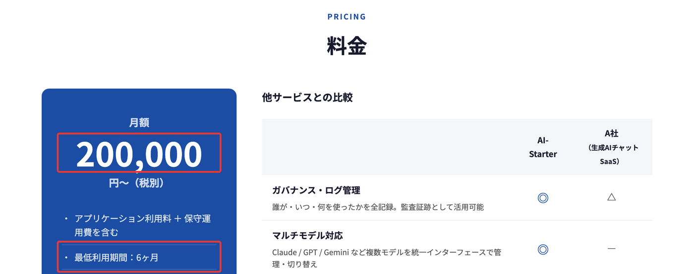

生成AIの導入支援は、何を依頼したいかで向いている会社が分かれます。何から始めるかを決めたいならNECやKPMGの構想づくり、全社員が安全に使える環境が先ならクラスメソッドのAI-Starter、問い合わせ対応などの業務をAIに任せたいならSkyやGMO即レスAI、社内で使う人を増やしたいならグラファーの定着支援が候補です。

この記事では支援範囲と料金の掲載を公式サイトで確認した10社を4つの型に分けて比べ、費用の決まり方と依頼の流れを扱います。この記事はAIエージェントの構築支援を行うnitoが書いており、nitoも一覧に含めました。

:::takeaways
- **導入支援は構想づくり・利用環境の整備・業務への組み込み・研修と定着の4つの範囲に分かれる**。最初に決めるのは会社でなく、外に依頼する範囲
- **サービスページに金額を載せている会社は少ない**。10社のうち金額の掲載はAI-Starterの月20万円〜（税別）だけで、ほかは見積もり
- **失敗しやすいのはPoCで止まる・任せきりで社内に何も残らない・データが整っていないの3つ**。合格ラインと引き渡しの範囲を契約前に決める
:::

## 生成AI導入支援とは？何を依頼できる？

生成AI導入支援は会社が生成AIを業務で使えるようになるまでを外部の専門家が手伝うサービスです。**依頼できる範囲は会社ごとに違い、大きく構想づくり・利用環境の整備・業務への組み込み・研修と定着の4つに分かれます**。企画やPoC（本番の前に小さく試して効果を確認する検証）、ガイドラインの作成、研修といった個々の依頼内容も、このどれかに収まります。

| 支援範囲 | 主な依頼内容 | 向いている状況 |
|---|---|---|
| 構想づくり | 業務の診断・ユースケースの選定・ロードマップ・費用対効果の試算 | 何から始めるか決まっていない |
| 利用環境の整備 | ツールの選定・社内専用のAI環境・権限とログの設定・利用ガイドライン | 社員が個人のアカウントで使い始めている |
| 業務への組み込み | PoC・社内文書を参照するAIやAIエージェントの開発・既存システムとの連携 | AIに任せたい業務が決まっている |
| 研修と定着 | 研修・利用状況の分析・推進担当の育成・内製化 | 導入したのに使われていない |

4つ全部に対応すると書く会社も多いものの、実績の厚い範囲は会社ごとに異なります。**依頼先を探す前に、自社がどの範囲を外に依頼したいのかを1つ決めておくと、比較の軸がぶれません**。その範囲を主に扱う会社から次の一覧を見ていくのが近道です。

## 生成AI導入支援の会社おすすめ10選

選定基準は生成AIの導入支援を法人向けのサービスとして公式サイトに載せ、支援範囲と料金の掲載を2026年11月17日に確認できたことです。並びは構想づくり・利用環境の整備・業務への組み込み・研修と定着の順で、料金は公式に載っている金額だけを書き、載っていない会社は見積もりの扱いとしました。

| 会社・サービス | 主な支援範囲 | 料金の公式掲載 | 向いている会社 |
|---|---|---|---|
| NEC AIディスカバリープログラム＋ | 構想づくり | 打ち合わせで提示 | 全社の方針から決めたい |
| KPMG 生成AI導入支援サービス | 構想づくり・PoC | 掲載なし | 投資判断の材料を揃えたい |
| クラスメソッド AI-Starter | 利用環境の整備 | 月20万円〜（税別） | 全社員に安全な環境を早く用意したい |
| Dynabook 生成AI導入支援サービス | 利用環境の整備（オンプレミス） | 問い合わせ | データを社外のクラウドに出したくない |
| Sky 生成AIソリューション | 業務への組み込み | 掲載なし | 段階ごとの成果物を確認したい |
| GMO即レスAI | 業務への組み込み（問い合わせ対応） | 初期・月額とも問い合わせ | 問い合わせ対応をAIに任せたい |
| キカガク AX推進支援 | 業務への組み込み・内製化 | 掲載なし | 開発と人材育成を並行したい |
| nito AIエージェント構築支援 | 業務への組み込み（AIエージェント） | 業務の棚卸し後に提示 | 社内の定型業務をAIに任せたい |
| グラファー Graffer AI Solution | 研修と定着 | 金額は相談（2プラン） | 導入後の利用率を上げたい |
| ヒューマンリソシア AI・DX活用・伴走支援 | 研修と定着・AIエージェント構築 | 内容により異なる | 教育と開発を並行したい |

### NEC（AIディスカバリープログラム＋）

会社方針・ビジネス活用・ガバナンス・システム・データ・組織と人材の6つの観点で現状を診断し、AI活用のロードマップを作るコンサルティングです。ベーシックプランは3か月で、重点業務2部門の業務アセスメントから3年の中期AIロードマップまでを作ります。**NEC独自のAIの導入を前提にしておらず、コンサルティングの後にシステム構築や定着まで続けて依頼することもできます**。費用は打ち合わせでヒアリングしてから提示する形です。

### KPMG（生成AI導入支援サービス）

PoCの実施、ユースケースの選定、ロードマップの策定を支援するサービスです。ユースケースの選定は目的の明確化から収集、必要な機能の調査、優先順位づけ、見積もりの順に進み、**ユースケース別の見積もりや部門への費用配賦案まで出すため、経営会議で投資を判断する材料を揃えたい会社に向いています**。料金はサービスページに載っていません。

### クラスメソッド（AI-Starter）

管理者が統制できる社内専用の生成AI環境を、最短2週間で全社に展開するサービスです。使えるモデルと機能の制限、全利用ログの記録、部署別の権限、SSO、閉域網での接続に対応し、ClaudeやGPT、Geminiを1つの画面で使えます。**料金は月20万円〜（税別）で、アプリの利用料と保守運用費を含み、最低利用期間は6か月、初期費用は別途見積もりです**。三井住友トラストクラブ（約700名）やコクヨ（約3,000名）の事例が公開されています。

<figure class="post-figure"><figcaption>AI-Starterの料金（クラスメソッド、2026年11月17日）</figcaption></figure>

### Dynabook（生成AI導入支援サービス）

AIワークステーションに生成AIの利用環境（OS・ローカルのLLM・Dify）を組み込んで社内に置く、オンプレミス型のサービスです。**機密情報を外部のクラウドに出さずに、社内文書を参照するAIアプリを作れる**ことと、Difyの研修をエントリー・アドバンス・エキスパートの3段階で用意していることが特徴です。料金は利用者数や研修・保守の範囲で変わるため、営業担当への問い合わせになります。Difyそのものは[Difyとは？](/media/dify-guide/)で解説しています。

### Sky（生成AIソリューション）

現状把握・プランニング・PoC・実用化・定着化支援の5段階で伴走するサービスです。業務フロー図、PoC環境と効果測定レポート、設計書とマニュアル、モニタリングレポートと、**段階ごとの成果物を公式ページで明示しているため、何が納品されるかを契約前に確認しやすい**点が特徴です。Azure OpenAI ServiceやCopilot Studio、Amazon BedrockでのPoC実績があり、公開事例には文部科学省やキリンホールディングスがあります。料金はサービスページに載っていません。

### GMO即レスAI（GMOペパボ）

問い合わせ対応に絞ったAIエージェントの導入支援です。Webサイト・LINE・SlackのAIチャットボットのほか、2026年9月にはAI電話も始まりました。契約の前にデモの作成や社内向けの説明会を行う流れで、公式のFAQは初期費用と月額費用が契約内容で変わり、解約金や違約金はかからないと案内しています。**社内外の問い合わせ対応という1つの業務をAIに任せたい会社に向いています**。

### キカガク（AX推進支援）

AIコンサルティング、AIエージェントや生成AI機能の開発、内製化と保守の3つを組み合わせたサービスです。無料相談から活用可能性の診断、PoCのテーマ選定、ロードマップの順に進め、社内文書やマニュアルを使う生成AI機能を開発します。**もとは教育事業の会社のため、開発と並行して社内の人材を育てたい会社に向いています**。公式サイトには導入企業1,000社以上、受講生200,000名と掲載されています。

### nito（AIエージェント構築支援）

社内の定型業務を任せるAIエージェントを、会社の業務に合わせて構築するサービスです。無料の業務棚卸し（オンライン30分から）で繰り返している業務を書き出し、工数と売上への影響で順位を付けたうえで、最初の業務のデモを見てから導入するかを決められます。構築では任せる業務の範囲と人が承認する操作の線引きを決め、引き渡し後は月1回の運用アドバイザリーで次に任せる業務を選びます。費用は構築費と月額の2つで、金額は棚卸しで対象業務と範囲が決まってから提示しています。

### グラファー（Graffer AI Solution）

導入前、利用定着、利用拡大の3段階で支援するサービスです。導入前はツールの選定と利用ガイドライン、目標と評価指標、半年から1年のロードマップを作り、定着の段階では研修や利用ログの分析、推進人材の育成を行います。**ツールを入れた後の利用率を上げたい会社に向いています**。料金は完全サポートとツールのみ導入の2つのプランがあり、金額は相談です。

### ヒューマンリソシア（AI・DX活用・伴走支援サービス）

AIエージェント構築の伴走、DXとRPAの導入の伴走、生成AI活用のコンサルティングを組み合わせたサービスです。現状診断、PoC、本実装とハンズオン研修、定着支援の順に進み、**教育と開発を並行させ、プロジェクトの終わりに社内へノウハウが残る状態を目指す**と公式に書かれています。社内ガイドラインの策定や利用状況の分析を代行する事務局の受託もあり、法人向け生成AI研修の累計受講者は2026年7月に1万人を超えました。費用はプロジェクトの内容で変わります。

:::linkcard
url: /media/ai-agent-introduction/
title: AIエージェント導入の進め方と費用
desc: AIエージェントを会社に入れる段取りと費用の型、自社で作るか外に依頼するかを解説しています。
:::

## 支援範囲別の選び方は？

**社内の今の状態から、最初に外へ依頼する範囲を1つ選ぶのが近道です**。4つの状態ごとに、候補の会社と次にやることをまとめます。

### 何から始めるか決まっていない

構想づくりの会社に、業務の診断とロードマップを依頼します。成果物は優先する業務の一覧と費用対効果の試算で、ここで決めた業務が、次の範囲で依頼する内容そのものです。NECやKPMGのほか、キカガクやSkyも最初の段階として診断から受けています。

### 社員が個人のAIを使い始めている

この状態では利用環境の整備を優先します。会社で管理できる環境を用意しないまま禁止だけを出しても、個人アカウントでの利用は止まりません。**AI-StarterやDynabookのように環境と権限・ログをまとめて整える会社に依頼するか、ChatGPTやClaudeの法人プランを契約してグラファーのような会社にガイドラインづくりを依頼するかの2通りがあります**。

:::linkcard
url: /media/shadow-ai/
title: シャドーAI対策とは？会社がやること
desc: 社員が個人のChatGPTを業務に使うリスクと、会社が整える契約・社内ルール・検知の順番を解説しています。
:::

### AIに任せたい業務が決まっている

業務への組み込みを依頼します。問い合わせ対応ならGMO即レスAIのような特化型、社内システムとの連携が多い業務ならSkyやキカガク、日々の定型業務をAIエージェントに任せるならnitoが候補です。**PoCの合格ラインと、AIに承認なしで任せる操作の範囲は、依頼先任せにせず自社で決めます**。ここを預けると、引き渡しの後に社内で判断できる人がいなくなるためです。

### 導入したのに使われていない

研修と定着の会社に、利用状況の分析と推進担当の育成を依頼します。全社員向けの研修を1回行うだけでは使い方が業務に結びつかないため、部署の業務を題材にしたワークショップや、利用ログを見て次の施策を決める支援があるかを確認してください。グラファーやヒューマンリソシアがこの範囲を主に扱っています。Copilotを入れている会社は、[Copilotが社内で使われないときの調べ方](/media/copilot-adoption/)で利用状況の見方を扱っています。

## 依頼先を比べるときに確認することは？

支援範囲が決まったら、**2〜3社に同じ条件で相談し、次の5点を見比べるのが確実です**。比べる軸は提案書の厚さや会社の規模ではなく、自社の業務で何が残るかです。

- **実績**: 自社と近い業務の事例が、公式の発表や顧客名で確認できるか
- **PoCから本番への基準**: どの数字が出たら本番に進むかを、提案の段階で示しているか
- **データの扱い**: 入力したデータの保存場所、AIの学習に使わない設定、利用ログと権限の設計
- **引き渡し後**: 保守とAIモデルの更新への対応、社内で直せる手順書や研修があるか
- **見積もりの内訳**: どの工程にいくらかかり、何が成果物として残るか

クラウドでの処理を認めるかと個人情報を含むかによっても、依頼できる会社が変わります。**相談の前に、情報システム部門や法務と社内のセキュリティの要件を確認しておくと、合わない提案を早い段階で外せます**。

## 生成AI導入支援の費用はいくら？

**費用は契約形態と支援範囲で決まり、金額をサービスページに載せている会社は少数です**。NECやDynabook、GMO即レスAIも、金額は打ち合わせや問い合わせのうえで提示する形です。

| 契約形態 | 主な内容 | 費用の決まり方 | 公式の例 |
|---|---|---|---|
| 相談・診断 | 課題の相談・業務の診断 | 回数や期間ごと。無料の会社もある | キカガクの無料相談、nitoの無料の業務棚卸し |
| プロジェクト型 | 構想づくり・PoC・開発 | プロジェクト単位の見積もり | NECのベーシックプラン（3か月） |
| 継続型 | 環境の提供・運用改善・研修 | 月額 | AI-Starter（月20万円〜・税別）、GMO即レスAI（初期費用＋月額） |

例として、AI-Starterを最低利用期間の6か月使う場合、月20万円×6か月で利用料は120万円（税別）からになり、ここに別途見積もりの初期費用が加わります。

支援会社への支払いとは別に、ChatGPTやClaudeなど法人プランのライセンス料、参照させる社内資料の整理、ヒアリングやPoCの評価に参加する社員の時間もかかります。**見積もりは支援会社の金額に社内の時間とツールの利用料を足した総額で比べてください**。

国の補助金のデジタル化・AI導入補助金では登録されたITツールと対で申請する場合に限り、導入の相談や設定・研修・保守といった役務も合計200万円まで対象になります。一方で申請代行費は対象外で、完成していないスクラッチ開発は登録の対象になりません。開発を外部に委託するなら、新事業進出・ものづくり補助金や省力化投資補助金が候補です。

:::linkcard
url: /media/ai-subsidy/
title: 生成AIに使える補助金5選
desc: 法人プランの利用料・AIエージェントの開発・社員研修に使える制度と、対象外の経費、締切を解説しています。
:::

## 外部に生成AI導入支援を依頼するメリットは？

**社内にAIに詳しい人がいなくても、導入の判断と準備を短い期間で進められることが一番のメリットです**。

### 何から始めるかが早く決まる

支援会社は他社の事例と業務の診断の型を持っているため、対象業務の選定とロードマップの作成を数か月で終えられます。社内で手探りに進めるより、経営に説明する材料が早く揃うのも利点です。

### 環境とルールを一度に整えられる

ツールの選定と利用ガイドライン、権限とログの設計をまとめて1社に依頼できるのも利点です。AI-Starterはヒアリングから全社展開までを最短2週間としており、個人アカウントでの利用が広がる前に会社の環境を用意できます。

### PoCから定着まで同じ相手に依頼できる

診断から開発、定着までを同じ会社に依頼すると、前の段階の決定事項が次の段階に引き継がれ、伝言による食い違いが減ります。NEC・Sky・キカガクは、コンサルティングの後の開発や定着も受けると公式に書いています。

## 外部に生成AI導入支援を依頼するデメリットは？

**効果が出る前に費用がかかることと、任せきりにすると社内に何も残らないことが主なデメリットです**。どちらも契約前の取り決めで小さくできます。

### 効果が出る前に費用がかかる

業務の時間が減る前に、構想づくりやPoCの費用が発生します。最初の依頼を1つの業務に絞り、PoCの段階で契約を区切っておけば、効果が見えなかったときに次の段階へ進まない判断ができるようにしておくのが対策です。

### 社内にノウハウが残りにくい

外部に任せきりにすると、引き渡しの後に小さな修正でも外部へ依頼することになります。自社の担当者を決めてPoCから参加させ、手順書・研修・設定を変更する権限を、引き渡しの範囲として契約に入れておくのが対策です。

### PoCで止まりやすい

目的と合格ラインが決まらないまま始めると、効果があったのかを判断できず、検証を繰り返すだけになります。**処理時間をどれだけ減らすか、回答の正確さをどこまで求めるかを、PoCを始める前に関係者で決めておく必要があります**。参照させる社内資料が古い、保存場所が散らばっているといったデータの問題も、この段階で精度が出ない主な原因です。

## 生成AI導入支援を依頼する流れは？

多くの支援会社が採る順番は、相談と診断・計画・PoC・本番の構築・定着です。**各段階の終わりに次へ進むかを判断する場を置くと、費用を抑えながら進められます**。

1. **相談・診断**: 業務と課題を伝え、AIを適用できる業務の候補を出してもらう。無料で受ける会社が多い
2. **計画**: 対象業務と目標の数字、ロードマップ、PoCの範囲と費用を決める
3. **PoC**: 限られた業務とデータで試し、合格ラインに届くかを確認する
4. **本番の構築**: 既存システムとの連携、権限とログの設定、マニュアルの整備を行う
5. **定着**: 研修と利用状況の分析を続け、次に任せる業務を決める

相談の前に次の6点を整理しておくと、見積もりの前提がずれにくくなります。

- 解決したい業務と対象の部署
- その業務の月の時間と担当の人数
- 使えるデータの種類と保存場所
- 今使っているシステムとAIツール
- 予算と希望の時期、決裁する人
- セキュリティと個人情報の扱いに関する社内ルール

## まとめ

- 何から始めるか決まっていない会社は、構想づくりの会社に業務の診断を依頼し、対象業務を1〜2つに絞る
- 社員が個人のAIを使い始めている会社は、会社で管理できる環境とガイドラインを先に整える
- AIに任せたい業務が決まっている会社は、組み込みに強い2〜3社に同じ条件で相談し、PoCの合格ラインを先に決める
- 導入したのに使われていない会社は、利用状況の分析と部署別の研修に対応する会社を選ぶ

## よくある質問

### 生成AI導入支援は中小企業でも依頼できますか？

依頼できます。無料相談や業務の診断から受ける会社が多く、1つの業務に絞った小さな範囲から始められます。デジタル化・AI導入補助金の対象になる登録ツールを扱う支援事業者なら、導入の相談や研修の費用も補助の対象になる場合があるので、扱う事業者に確認してください。

### 生成AI導入支援の期間はどれくらいですか？

依頼する範囲しだいです。公式の例だとAI-Starterの環境構築はヒアリングから最短2週間で、NECの構想づくりのベーシックプランは3か月です。開発を含む依頼の場合、本番の構築期間はPoCの結果を見てから見積もるのが一般的です。

### ChatGPT導入済みでも生成AI導入支援は必要ですか？

あります。NECは公式のQ&Aで、個別のツールの導入にとどまり、全社の戦略と連携した活用やガバナンスの構築に課題を抱える企業が多いと説明しています。導入済みで使われていないなら、研修と定着の範囲を依頼する方法もあります。

### 生成AIの導入コンサルと開発会社の違いは何ですか？

コンサルティングは対象業務の選定やロードマップづくりが中心で、開発会社はPoCやシステムの構築が中心です。ただしNECやキカガクのように、コンサルティングの後に開発や定着まで続けて受ける会社もあるため、会社の分類より依頼したい範囲に対応しているかで比べてください。

### データが未整備でも生成AI導入支援に相談できますか？

相談できます。データの整理から引き受ける会社も少なくありません。持っているデータの種類・保存場所・形式を相談の場で伝えておけば、PoCの前にどこまで整理が必要かを見積もってもらえます。

### 生成AIの社内ガイドラインの作成も依頼できますか？

依頼できます。グラファーは導入前の支援に利用ガイドラインと運用ポリシーの策定を含み、ヒューマンリソシアは社内ガイドラインの策定を事務局の代行として受けています。

## 出典

各社の公式サイトは2026年11月17日に確認しました。

- NEC [生成AIコンサルティング・導入支援サービス](https://group.nec/jp/ja/solutions/ai/consulting/discovery)
- KPMG [生成AI導入支援サービス](https://kpmg.com/jp/ja/services/advisory/management-consulting/digital-transformation/genai-adoption-support.html)
- クラスメソッド [AI-Starter](https://classmethod.jp/services/generative-ai/ai-starter/)
- Dynabook [生成AI導入支援サービス](https://dynabook.com/solution/aisolution/generative-ai/index.html)
- Ｓｋｙ [生成AIソリューション](https://www.skygroup.jp/si/generative-ai/)
- GMOペパボ [GMO即レスAI](https://ax.pepabo.com/)
- キカガク [AX推進支援](https://www.kikagaku.co.jp/business/ax)
- nito [AIエージェント構築支援](/ai-agent/)
- グラファー [Graffer AI Solution 伴走支援](https://graffer.jp/ai-solution/generative-ai-consulting)・[Graffer AI Studio](https://graffer.jp/ai-solution/products/graffer-ai-studio)
- ヒューマンリソシア [AI・DX活用・伴走支援サービス](https://dx-pro.resocia.jp/ai-dx-support)
- デジタル化・AI導入補助金2026 [通常枠](https://it-shien.smrj.go.jp/applicant/subsidy/normal/)
