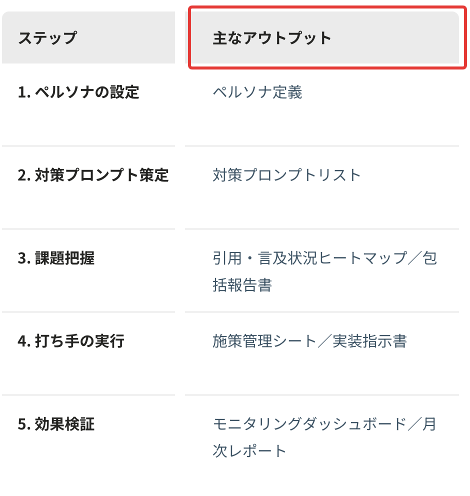

GEO対策の会社は、**どのAIに何をどれだけ聞いて計測するか・何が納品されるか・何を成果として数えるか**の3点を提案書で確認して選ぶのがおすすめです。社内に記事を書く人がいなければ制作まで受ける会社、制作の体制があれば方針と計測に強い会社が向いています。

この記事は株式会社nitoが書いており、自社を1番目に載せています。GEO・LLMO・AIOは呼び名の違いで、頼める会社もほぼ同じです。日本で頼める10社を各社の公式サイトの記載で比べ、提案書で確認する点と費用、依頼の流れの順にまとめました。

:::takeaways
- GEO対策の会社は、計測の条件・納品物・成果の数え方の3点で見比べると違いが見える
- 公開されている料金はツールが月5万円前後から、伴走の支援が月20万円前後から60万円以上まで幅がある
- 見積もりは対象のAI・質問の数・制作の本数を統一し、最低契約期間を掛けた総額で比べる
:::

## GEO対策の会社おすすめ10選の比較表

### この記事の選定基準

載せたのはGEO・LLMO・AIOなどの名前でAI検索への対策を**公式サイトで今も案内している会社**です。GEO対策の会社を比べた記事で繰り返し取り上げられていて、公式の記載から計測の仕方と料金の考え方が読める9社を選び、書き手のnitoを1番目に置きました。2番目以降は記事やサイトの改善まで受ける範囲の広い会社から順に並べました。LLMO・AIOの呼び名で探すなら、[LLMO対策の会社おすすめ20選](/media/llmo-companies/)と[AIO対策会社おすすめ20選](/media/aio-taisaku-companies/)も同じ問いに答えています。

### 10社の比較表

| 会社 | 頼める範囲 | 計測するAI（公式の記載） | 料金（公式の表記） |
|---|---|---|---|
| 株式会社nito | 計測から記事の制作・サイトの改善・公開後の運用まで | ChatGPT・Gemini・AIモード・AI Overviews | 無料の現状分析のあと見積もり |
| TechSuite株式会社 | 調査から制作・実装・効果検証まで | ChatGPT・Gemini・Claude・Perplexity・Copilot・AI Overviews・AIモード | 初期包括調査40万円〜、月額40万円〜 |
| 株式会社CINC | 調査から制作・外部メディア施策・効果検証まで | ChatGPT・Gemini・Claude・Perplexity・Grok・AI Overviews・AIモード | 個別見積もり（契約期間の縛りなし） |
| クーミル株式会社 | 分析からサイト改修・記事制作まで | ChatGPT・Gemini・AI Overviewsなど | 診断15万円〜、運用代行20万円〜（一例） |
| ナイル株式会社 | 分析から施策の実装支援・コンテンツ制作まで | 6つの生成AIサービスを日次で計測 | LLMO単体月30万円〜、SEOとセット月60万円〜 |
| 株式会社デジタルアイデンティティ | 診断から内部構造の改善・リライトまで | ChatGPT・Gemini・AI Overviewsなど | 月額約60万円〜（最低6ヶ月） |
| 株式会社メディアリーチ | 計測と施策の提示・レビュー（制作は実行代行オプション） | ChatGPT・Gemini・Perplexity・Copilot | 見積もり（DolphinX AIOの導入が前提） |
| 株式会社LANY | 戦略設計と施策の要件定義・効果検証（制作は別途） | ChatGPT・Geminiが中心 | サービス資料で案内 |
| 株式会社Speee | 分析・戦略と実装要件の定義（制作は体制に合わせて提案） | ChatGPT・Gemini・AIモード | 問い合わせ（3つのプラン） |
| 株式会社Faber Company | 計測ツールと分析・改善の提案 | ChatGPT・Gemini・AI Overviews（ミエルカGEO） | ミエルカGEO月4万9,800円（税抜）〜、初期費用別 |

**公開されている金額はどれも最小構成のもので、含まれる作業は会社ごとに違います。** 金額だけで高い安いを決めず、次の節の3点を統一してから見積もりを取り直してください。

## GEO対策の会社10社の特徴

### 1. 株式会社nito

**[株式会社nito](/llmo/)**: GEO対策（AI検索対策）を、問い合わせや購入につながるまで一気通貫で支援する会社です。見込み客がChatGPTやGeminiなど主要なAIに聞いたときの回答を毎日記録し、他社がすすめられている理由を回答の本文から抜き出して、サイトの改善と記事の制作、公開後の運用まで受け持ちます。

- **利用者が使うのと同じチャット画面で毎日計測する。** 記録した回答は3万件を超えました（2026年11月時点）。結果は専用のダッシュボードで確認できます
- **目標は言及率でなく問い合わせの数。** 問い合わせのフォームで何で知ったかを聞き、AIで知った人の数まで追います
- **計測から制作まで窓口が1つ。** 依頼する側にお願いするのはヒアリング・公開前の確認・サイトへの反映の3点です

| 支援先 | これまでの成果 |
|---|---|
| SaaS企業 | 取り組み3ヶ月で、AIでの言及率が10%から45%に。AI経由のコンバージョンは5ヶ月で約6.7倍 |
| 士業 | AIでの言及率が0%から20%に。新しいページは公開3日でAIの回答の引用元に |

2026年11月からは注文住宅の会社のAI検索対策も支援しています。料金は狙う質問の数と制作する記事やページの量で決める月額制です。

- 社内に記事を書く人がおらず、計測から制作までを1つの窓口にまとめたい会社
- AIでの露出の数字より、問い合わせの数で効果を判断したい会社

nitoでは狙いたい質問をChatGPT・Gemini・AIモードなどに実際に聞き、名前が挙がるか、どう紹介されるか、代わりにどの会社が挙がるかをまとめた[現状分析レポート](/llmo/)を無料でお出ししています。

### 2. TechSuite株式会社

**TechSuite株式会社**: 「AI検索パートナーズ」の名前で、ペルソナの設定から効果検証までを5つの工程で進める会社です。**工程ごとの納品物を公式に並べている**点が特徴で、ペルソナ定義・対策プロンプトリスト・引用と言及の状況のヒートマップ・施策管理シートと実装指示書・月次レポートまでが挙がっています。KPIはAIでの言及の回数、AI経由のセッション数と問い合わせ数、引用されたキーワードの数、受注率の4つです。料金は初期包括調査が40万円から（単月）、月額のコンサルティングが40万円からの最小構成の目安で、制作や代行は時間稼働のプランで受けます。

<figure class="post-figure"><figcaption>TechSuite AI検索パートナーズの工程別の納品物（ステップと主なアウトプットの列を抜粋、2026年11月23日）</figcaption></figure>

### 3. 株式会社CINC

**株式会社CINC**: サービス名に「GEO/LLMO/AIO/AEO」を並べる、AI検索最適化のコンサルティングの会社です。7種類のAIの回答と引用元を自社ツールで集め、調査・戦略設計・施策の実行・モニタリングの4段階で支援します。追う数字は言及数と言及率、競合と比べた言及シェア、引用数、AI経由の流入とCVで、AIの回答の誤りを見つけて情報源までたどる機能も持っています。料金は個別見積もりで契約期間の縛りはありません。実行を代行するAIsearchmap BPOの月19万8,000円（税別）は、コンサルティングとは別のサービスです。

### 4. クーミル株式会社

**クーミル株式会社**: SEOのコンサルタントとWeb制作のチームが組み、分析からサイト改修・記事制作までを受ける会社です。分析のあとに出す戦略と改善のレポートには、対策する質問・改善するページ・優先順位・担当範囲・評価指標までを書くと公式に載せています。効果はAIでの言及と引用に加え、検索順位・指名検索・参照流入・問い合わせで確認します。料金は一例として診断15万円から、基盤整備30万円から、運用代行20万円からで、単発の依頼もできます。

### 5. ナイル株式会社

**ナイル株式会社**: 累計2,000社以上のSEO支援の実績を土台に、SEOとLLMOを合わせて支援する会社です。6つの生成AIサービスを日次で計測するツールを自社で開発し、推薦と引用の状況、AI経由の流入数、CV数をレポートします。改善の段階ではページやコンテンツの改善、必要なコンテンツの制作、外部メディアへの掲載交渉まで挙げています。料金はSEOとセットで月60万円から、自社でSEOに取り組む会社向けのLLMO単体で月30万円からです。

### 6. 株式会社デジタルアイデンティティ

**株式会社デジタルアイデンティティ**: 自社ツール「Forté.AI LLMO Analytics」で、AIが回答を作るときに参照したページまで特定する会社です。構造化データやHTMLの見直しによる内部構造の改善、AIに引用されやすい形へのリライトを行い、アンケート調査など一次情報づくりもオプションで受けます。KPIは提案の段階で設計し、定例とレポートで報告します。料金はミニマム月額約60万円から、最低契約期間は6ヶ月です。

### 7. 株式会社メディアリーチ

**株式会社メディアリーチ**: 自社開発の「DolphinX AIO」の導入を前提に、専任の担当が毎月伴走する会社です。「おすすめの〇〇を教えて」のような質問を20〜40件設計して毎日計測し、AI露出状況レポート、戦略ロードマップと施策リスト、実装チェックリスト、Looker Studioのダッシュボードと段階ごとの成果物を示しています。コンサルティングの範囲は施策の提示とレビューまでで、記事の制作や外部メディアへの打診は実行代行のオプションです。違約金なしで途中解約できます。

### 8. 株式会社LANY

**株式会社LANY**: 書籍『強いLLMO』の出版やLLMO白書の発行で知られ、300社以上の支援実績を持つ会社です。初月に対策するプロンプトの策定、AIがブランドを選ぶ理由の分析、ロードマップとモニタリング用ダッシュボードの作成までを行い、キックオフ・中間・最終の3回で報告します。2ヶ月目以降は施策の要件定義と効果検証で、制作やサイト改修は依頼側か制作会社が担い、LANYの実行支援も選べます。料金はサービス資料での案内です。

### 9. 株式会社Speee

**株式会社Speee**: 3,500社以上のSEO支援の実績を持ち、AI検索対策を「AEOコンサルティング」として提供する会社です。独自の指標「AI Visibility Score®」でChatGPT・Gemini・AIモードごとの言及率、1位で推される割合、平均の掲載順位を計測し、GA4でAI経由の流入とCVも見ます。施策の前後の変化は月次レポートで共有し、コンテンツの修正方針や構造化データの実装要件までを決めます。プランはスタンダード・アドバンスト・自由プランの3つで、料金は問い合わせです。

### 10. 株式会社Faber Company

**株式会社Faber Company**: SEOツール「ミエルカ」の会社で、GEO対策の計測ツール「ミエルカGEO」とGEOコンサルティングを提供しています。ツールではChatGPT・Gemini・GoogleのAIによる概要での言及率と引用率、AI検索から来た人の流入とCVを日次で見られます。単一サイトのプランは月4万9,800円、複数サイトは月9万9,800円（どちらも税抜、別途初期費用）で、100以上の質問を定点で見る機能は月5万円（税抜）からの追加です。コンサルティングではコンテンツの拡充や既存ページの改善を提案して実行まで伴走します。

## 失敗しないGEO対策の会社の選び方は？

GEO対策の会社は提案書と見積もりに**計測の条件・納品物・成果の数え方**の3つが書かれているかで見極めます。どの会社もサービスページでは「AIに選ばれる状態をつくる」と書いており、違いが出るのはこの3つの中身です。

| 会社 | 計測の条件 | 納品物・報告 | 成果として数えるもの |
|---|---|---|---|
| nito | チャット画面で毎日 | 現状分析レポート・ダッシュボード・記事と改善 | 問い合わせ・購入 |
| TechSuite | 7つのAI | ヒートマップ・実装指示書・月次レポート | 言及の回数・セッション・問い合わせ・受注率 |
| CINC | 7つのAIを自社ツールで | 4段階の調査とモニタリング | 言及・言及シェア・引用・AI経由のCV |
| クーミル | 主要なAIを定期調査 | 戦略・改善レポート | 言及・引用・指名検索・問い合わせ |
| ナイル | 6つのAIを日次 | 定期レポート・定例報告会 | 推薦・引用・AI経由の流入とCV |
| デジタルアイデンティティ | 参照元まで特定 | 定例・レポーティング | 提案時にKPIを設計 |
| メディアリーチ | 20〜40件を毎日 | ロードマップ・実装チェックリスト・ダッシュボード | 推薦率・引用率・AI経由の流入 |
| LANY | 策定したプロンプトで再調査 | ロードマップ・ダッシュボード・月次レポート | 推奨率・言及率・AI経由のCV |
| Speee | 3つのAIを独自指標で | 月次レポート | 言及率・1位で推される割合・AI経由のCV |
| Faber Company | ツールで日次 | ツールの画面と改善提案 | 言及率・引用率・AI経由のCV |

### どのAIに何をどれだけ聞くか

AIの回答は聞くたびに変わるため、**計測するAI・質問の数・頻度・聞く画面が書かれていない数字は、施策の前後で比べられません。** メディアリーチのように質問を20〜40件と書く会社もあれば、件数を提案で決める会社もあります。提案書では計測するAIに自社の顧客が使うものが入っているか、質問が「〇〇のおすすめは？」のように社名を入れない形か、毎月同じ条件で聞くかを確認してください。プログラム用の窓口（API）で集めるか、利用者と同じチャット画面で集めるかでも回答の出典は変わります。

### 何が納品されるか

**レポートだけを受け取っても、ページを書く人がいなければAIの回答は変わりません。** TechSuiteの実装指示書、クーミルの担当範囲を書いた改善レポートのように、誰が何をいつまでに直すかまで書かれた納品物があると、社内で止まりにくくなります。記事やページの制作が月額に入るのか、オプションか、依頼側の作業かを見積もりの行で分けてもらいます。

### 何を成果と数えるか

言及率や引用の数は途中の目安で、事業の成果ではありません。**どの質問で挙がれば問い合わせにつながるかを決め、AI経由の問い合わせや受注まで数える会社**なら、続けるかどうかを社内で説明しやすくなります。アクセス解析では参照元にAIが残らない訪問が多いため、問い合わせのフォームで何で知ったかを聞く方法も合わせて確認します。

### 避けたい提案のサイン

- 必ずAIに紹介される、1位にすると約束する（Googleもインデックスや表示は保証されないとしている）
- 改善した数字の計測条件を聞いても答えられない
- llms.txtの設置や文章の細切れ化を主な施策にする（GoogleはGoogle検索ではこうした戦術を無視できるとしている）
- 第三者を装った口コミや、PRの表示が無い掲載を勧める

## GEO対策を会社に頼む費用の目安は？

公式サイトに金額を出している会社では、**計測ツールが月5万円前後から、伴走の支援が月20万円前後から60万円以上まで**です。多くの会社は個別見積もりで、制作や実装の範囲で金額が変わります。

| 頼み方 | 公式の金額の例 |
|---|---|
| 計測ツール | ミエルカGEO 月4万9,800円（税抜）〜、初期費用別（Faber Company） |
| 単発の診断・調査 | 診断15万円〜（クーミル）、初期包括調査40万円〜（TechSuite） |
| 伴走の支援 | 運用代行20万円〜（クーミル）、LLMO単体月30万円〜（ナイル）、月40万円〜（TechSuite）、月約60万円〜（デジタルアイデンティティ） |
| SEOとセット | 月60万円〜（ナイル） |

最低契約期間があれば月額に期間を掛けた総額で比べるのが確実です。月30万円の支援を6ヶ月続けると180万円になり、記事の制作費やツールの費用が別なら、その分が加わります。

:::linkcard
url: /media/llmo-cost/
title: LLMO・AIO対策の費用相場はいくら？月額の目安と失敗しない依頼先の選び方
desc: 費用の内訳と、見積もりで範囲を見誤らないための見方を解説しています。
:::

## GEO対策とは？LLMOやAIOとどう違う？

GEO（Generative Engine Optimization）は、生成AIの回答で自社の情報が材料に使われ、名前が挙がるようにする取り組みです。**日本の支援会社はGEO・LLMO・AIO・AEOを同じサービスの呼び名として並べることが多く、呼び名で会社を絞る理由はありません。**

Googleは公式ガイドで、Google検索の観点では生成AI検索向けの最適化も「SEO であることに変わりはありません」と書いています。GEO対策の提案がSEOの土台と切り離されていないかも、会社を比べる点の1つです。用語の成り立ちと論文の中身は次の記事にまとめました。

:::linkcard
url: /media/geo-taisaku/
title: GEO対策とは？論文の内容とLLMO・AIOとの違い・会社が決めること
desc: GEO対策の意味と元の論文、LLMO・AIOとの違いを解説しています。
:::

:::linkcard
url: /media/ai-search-companies/
title: AI検索対策の会社おすすめ10選・選び方と費用を比較
desc: AI検索対策の呼び名で探す人向けに、10社を頼める範囲で比べています。
:::

## GEO対策を会社に頼む流れは？

**最初に社内で狙う質問と成果の数え方を決め、2〜3社に同じ条件で提案を頼むと、提案書の差をそのまま比べられるのが利点です。**

1. **社内で決める**: 見込み客がAIに聞きそうな質問を5〜10個、比べられたい競合を2〜3社、成果として数えるもの（問い合わせ・資料請求など）、記事を書く人とサイトを更新する人
2. **無料の診断や相談を受ける**: nito・CINC・ナイルなど無料の診断を用意している会社で、今の見え方を把握する
3. **同じ条件で提案を頼む**: 計測するAI・質問の数・制作の本数を伝え、前の節の3点が書かれた提案書と見積もりを並べる
4. **契約後は月次で判断する**: 最低契約期間が終わる前に、決めた数字で続けるか範囲を変えるかを決める

すでにSEOを別の会社に頼んでいる場合は、役割の分け方も最初に決めます。CINCとLANYは依頼側・制作会社・支援会社の3社で進める形にも対応すると公式に書いていました。

## まとめ

- 社内に記事を書く人がいないなら、計測から制作まで受ける会社を選ぶ
- 制作の体制があるなら、計測と方針に強い会社に絞って頼む範囲を小さくする
- まず数字だけ見たいなら、計測ツールか単発の診断から始める
- どの会社でも、計測の条件・納品物・成果の数え方を提案書で比べ、総額で判断する

## よくある質問

### 日本でGEO対策を支援できる会社はどこですか？

この記事の10社（nito・TechSuite・CINC・クーミル・ナイル・デジタルアイデンティティ・メディアリーチ・LANY・Speee・Faber Company）は、どれも公式サイトでGEO・LLMO・AIOなどの名前でAI検索への対策を案内しています。計測から制作まで受ける会社か、方針と計測が中心の会社かで向き不向きが分かれる点に注意が必要です。

### GEO対策の会社とLLMO対策の会社は違いますか？

ほとんどの場合、同じ支援を別の呼び名で出しています。違いが出るのは計測するAIと頼める範囲なので、呼び名でなく提案書の中身で比べてください。

### GEO対策を会社に頼むと費用はいくらかかりますか？

公式に金額を出している会社では、計測ツールが月5万円前後から、伴走の支援が月20万円前後から60万円以上までです。最低契約期間がある会社は月額に期間を掛けた総額で比べます。

### GEO対策の効果はどれくらいで出ますか？

CINC・Speee・TechSuite・クーミルは3〜6ヶ月を目安に挙げ、メディアリーチは3〜9ヶ月です。新しいページが数日で引用元に入る例もあるため、競合の多さと自社のページの中身で差が出ます。

### 中小企業でもGEO対策の会社に頼めますか？

頼めます。クーミルは単発の診断が15万円からで、無料の診断を用意している会社もあります。まず診断で自社と競合の差を見てから、月額の支援に進むかを決める流れが一般的です。

### SEOを別の会社に頼んでいてもGEO対策を依頼できますか？

依頼は可能です。LANYはSEOを他社に頼んでいても並行して進められると案内しています。構造化データやページの修正をどちらが受け持つかを、最初に決めておくのが安全です。

### GEO対策の会社は成果を保証してくれますか？

保証はできないと考えてください。AIの回答は聞き方や時期で変わり、Googleも表示は保証されないとしています。保証の代わりに、計測の条件と判断の時期を契約前に書面で決めておくのが安全です。

### 提案書で良い会社かどうかを見抜くにはどうすればいいですか？

計測するAI・質問の数・頻度、毎月の納品物、成果として数えるものの3つが具体的に書かれているかを見るのが近道です。書かれていない項目は商談で聞き、答えが提案書に反映されるかまで確認すると差が出ます。

## 出典

- 各社の公式サイト（2026年11月23日確認）: [nito AI検索対策](/llmo/)・[TechSuite AI検索パートナーズ](https://ai-search.techsuite.co.jp/)・[CINC AI検索最適化コンサルティング](https://www.cinc-j.co.jp/service/analytics/geoconsulting/)・[クーミル LLMO・AIO対策コンサルティング](https://coomil.co.jp/service/llmo/)・[ナイル LLMOコンサルティング](https://www.seohacks.net/service/llmo-consulting/)・[デジタルアイデンティティ LLMO/AIO/AI Overviews対策](https://digitalidentity.co.jp/service/seo/llmo/)・[メディアリーチ LLMOコンサルティング・運用代行](https://mediareach.co.jp/seo-consulting/llmo-service)・[LANY LLMOコンサルティング](https://www.lany.co.jp/service/digitalmarketing/llmo)・[Speee AEOコンサルティング](https://webanalytics.speee.jp/aeo/)・[Faber Company GEOコンサルティング](https://www.fabercompany.co.jp/service/geo/)・[ミエルカGEO](https://mieru-ca.com/geo/)
- Google 検索セントラル「[Google 検索の生成 AI 機能向けにウェブサイトを最適化する](https://developers.google.com/search/docs/fundamentals/ai-optimization-guide?hl=ja)」（2026年11月23日確認）
- nitoの支援先の数字: 言及率は質問単位の実測、AI経由のコンバージョンは会員登録時のアンケート
