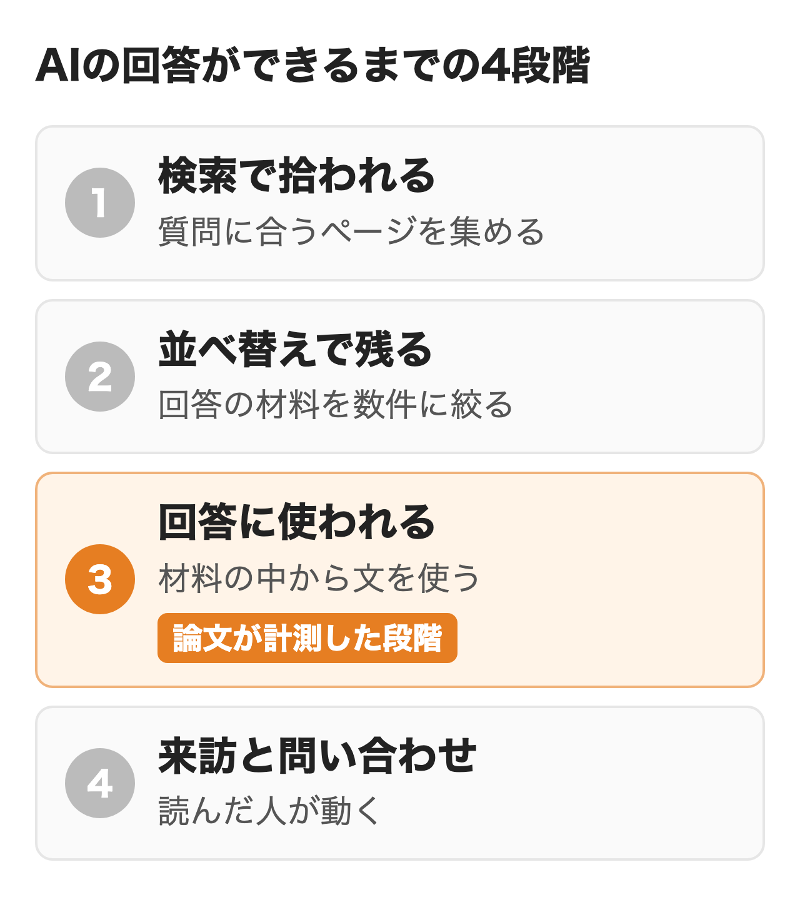
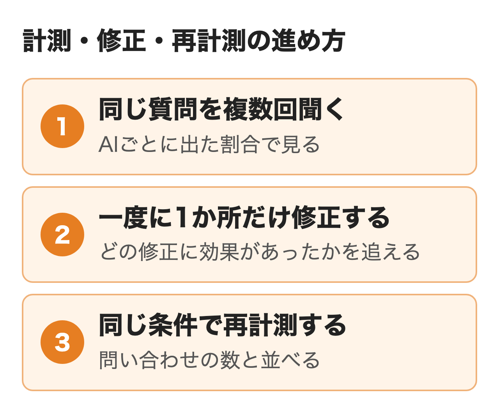
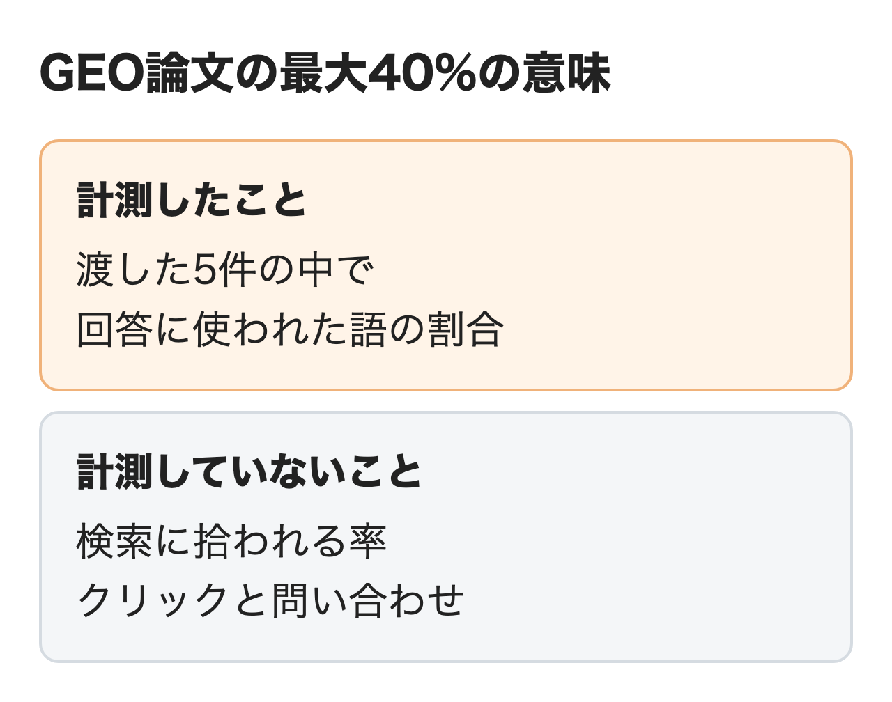

GEO対策のやり方は、見込み客がAIに聞く質問を決めて回答を記録し、AIのクローラーに読まれる状態を確認してから、回答の材料になる一次情報と出典をページに追加し、同じ質問で再計測する流れです。

GEOは2023年の論文が名付けた呼び名で、ChatGPTやPerplexityのような生成AIの回答に自社のページが使われやすくする取り組みを指します。この記事では5つの手順と、Googleが不要とする施策、論文の最大40%の意味、外部に依頼するときの確認点を扱います。

:::takeaways
- 手順は**質問の決定・クローラーの確認・回答の材料の追加・社外の情報の統一・段階ごとの再計測**の5つ
- 論文の最大40%は、**AIにあらかじめ渡した5件のページの中で、回答に使われた語の割合の伸び**。検索に拾われる率や問い合わせの数ではない
- Googleは**構造化データ・llms.txt・チャンク化を生成AI検索には不要**と明記。ChatGPTやPerplexityはクローラーの許可を別に確認する
:::

## GEO対策とは？何を目指す取り組み？

**GEO対策は生成AIが検索結果をまとめて答えるときに自社のページが材料として使われ、社名やサービスが正しく紹介されるようにする取り組みです。** GEOはGenerative Engine Optimization（生成エンジン最適化）の略で、2023年11月に米プリンストン大学とインド工科大学デリー校などの研究者が論文で名付けました。論文は2024年8月のデータマイニングの国際会議KDD 2024に採択されています。

地図や位置情報のGEO（ジオターゲティング）とは関係がありません。日本ではSEO会社や制作会社のサービス名として使われ、論文の書き換えの手法だけを指す会社もあれば、診断から記事の制作・毎月の計測までを含める会社もあります。

Googleは生成AI機能向けの公式ガイドで、Google検索の観点では生成AI検索向けの最適化もSEOであることに変わりはないと明言しました。**AEO・GEOとして提案される「ハック」の多くは効果がなく、Google検索の実際の仕組みにも支えられていないとGoogleは書いています。** 第三者のAEO・GEOの助言を受けるときは、公式のSEOガイドと照らし合わせて慎重に評価するよう、Googleの別のページは求めています。

<figure class="post-figure"></figure>

生成AIの回答は、検索で拾われる・並べ替えで残る・回答に使われる・来訪や問い合わせにつながる、の4段階を通った結果です。**論文が試したのは3つ目の「回答に使われる」段階だけで、会社のGEO対策は4つの段階を全部扱う必要があります。** 手順②は拾われる段階、③は回答に使われる段階に当たります。

## GEO対策のやり方5つの手順

**GEO対策は計測する質問を決めることから始め、拾われる段階・使われる段階の順に整えて、最後に段階ごとに再計測します。** 論文の書き換えの手法を先に当てはめても、そのページがAIに拾われていなければ回答には出ません。

### ① 計測する質問と対象のAIを決める

**最初に、見込み客がAIに聞きそうな質問を20〜30問書き出し、どのAIで計測するかを決めます。** 社名を入れない質問（「工場の省エネ設備を相談できる会社は？」のような種類）と、社名を入れた質問（「〇〇社の評判は？」）は分けて扱います。新しい顧客につながるのは社名を入れない質問で候補に入るかどうかです。

質問の案はマーケ担当より、営業とカスタマーサポートが多く持っています。商談で最初に聞かれること、比べられた相手、失注の理由を集めると、実際の質問に近づきます。

対象のAIはChatGPT・Gemini・GoogleのAIモードとAIによる概要を基本にし、見込み客が使っているならPerplexityも加えるのがおすすめです。記録する欄は自社が出たか・何番目か・どう紹介されたか・引用元のURLの4つです。

**完了の目安は質問の一覧と対象のAIが決まり、日を変えた2回分の記録が全部の欄で埋まった状態です。**

### ② AIのクローラーが読める状態か確認する

**次に、各社のAIがページを取りに来られる状態かを確認します。** 拾われる段階で止まっていると、本文をどれだけ修正しても回答の材料になりません。

Googleの「AI 機能とウェブサイト」のページは、AIによる概要とAIモードに追加の技術要件は無く、インデックスに登録されてスニペットを表示できることが条件と書いています。最適化ガイドはこれに加えて、Search Consoleの検索の生成AI設定でサイトが含まれていることを条件に挙げています。robots.txtに加えて、CDNやホスティングの設定でもクロールの許可が必要です。Search Consoleの「検索の生成AI設定」は既定でサイトを含める設定で、除外にするとリンクとしても回答の根拠としても使われません。この設定が世界中のサイトに公開されたのは2026年8月31日です。

ChatGPT・Claude・Perplexityは、検索に使うクローラーと学習に使うクローラーを分けています。

| 会社 | 検索の回答に使う | 学習に使う | 利用者の操作で取得 |
|---|---|---|---|
| OpenAI | OAI-SearchBot | GPTBot | ChatGPT-User |
| Anthropic | Claude-SearchBot | ClaudeBot | Claude-User |
| Perplexity | PerplexityBot | 学習には使わないと明記 | Perplexity-User |

**GEO対策で止めてはいけないのは、検索の回答に使う列のクローラーです。** OpenAIはOAI-SearchBotを止めたサイトはChatGPTの検索の回答に出ない（ナビゲーション用のリンクとしては出ることがある）と書き、AnthropicもClaude-SearchBotを止めると検索結果での見え方と正確さが下がりうると書いています。学習用のGPTBotを止めるかどうかは設定が独立しているため、検索への表示とは別に社内で決めてかまいません。robots.txtを変えてからOpenAIの側に反映されるまで、約24時間かかります。

OpenAIとPerplexityは、公開しているIPアドレスの範囲をファイアウォールで許可することも勧めています。CDNやサーバーで止まっていないかの確認方法は、[ChatGPT検索で引用元に出る条件](/media/chatgpt-search-citation/)で解説しています。

**完了の目安はrobots.txtで検索用の3つを止めておらず、CDNでも弾いておらず、Search Consoleの設定が「含める」になっている状態です。**

### ③ 回答の材料になる情報を追加する

**拾われる状態になったら、①の質問に答える情報を、数字と出典つきでページに追加します。** 論文の実験では信頼できる出典の発言を引用する手法・言葉の説明を数字に置き換える手法・出典を明記する手法が、回答に使われる語の割合を30〜40%ほど伸ばしました。一方で質問の語を詰め込む手法はほぼ伸びず、説得的で断定的な口調にしても有意な伸びはありませんでした。

会社のサイトに置き換えると、追加するのは次のような社内にしか無い情報です。

- 料金の決まり方と、見積もりが変わる条件
- 納期と、対応できない条件
- 導入事例の数字（期間と対象を書き添える）
- 比べられたときの違いと、どちらが向くかの条件
- 公的な統計や規格を引くときの出典名

**営業資料には書いてあるのにサイトに出ていない情報が、最も早く追加できる材料です。** 総説が再現しやすいとまとめた要素も、質問との関係の深さと、確認できる数字・定義・比較でした。

Googleは生成AI検索向けの書き方をする必要はなく、AIのために文章を細かく分ける必要も無いと書いています。見出しの直後に答えを置き、段落と見出しで構成するのは、読者が先に答えを読めるようにするためです。AIのために細切れにするのとは目的が違います。

**完了の目安は①の質問ごとに答えるページがあり、そのページに社内にしか無い情報と、数字の出典が1つ以上ある状態です。**

### ④ 社外の情報を統一する

**自社サイトの外で、会社名・所在地・サービスの説明が食い違っていないかを確認し、統一します。** 総説が引く調査（Kirstenほか、2026年）では、GoogleのAIによる概要が引用したドメインの53%が通常の検索の上位10件に入っていませんでした。自社サイトの順位だけを見ていると、AIが読んでいる社外のページを見落とします。

Googleのガイドは地域の会社ならGoogleビジネスプロフィール、ECならMerchant Centerの情報を利用すると表示されやすくなると書いています。業界の比較サイトや取引先の紹介ページで、社名の表記や古い料金が残っていれば、掲載先に修正を依頼します。

社外での言及を作るための活動は勧めていません。Googleの日本語のガイドは、不自然な言及の追求などの戦術は無視できると書いています。社外のページで社名がどう語られているかの考え方は、[サイテーションとは](/media/citation-for-ai/)で解説しています。

**完了の目安は自社サイト・ビジネスプロフィール・主な比較サイトの3か所で、社名・所在地・サービスの説明が一致した状態です。**

### ⑤ 段階ごとに分けて再計測する

**最後に、拾われたか・引用されたか・正しく紹介されたかを分けて、①と同じ質問で再計測します。** 総説もこの3つを分けた計測を求めていました。段階を分けると、どこで止まっているかが分かり、次に修正する手順が決まります。

| 段階 | 見る数字 | 計測方法 |
|---|---|---|
| 拾われたか | 検索用クローラーと利用者の操作で取得するクローラー（ChatGPT-User・Perplexity-Userなど）の来訪 | サーバーのアクセスログ |
| 引用されたか | 質問ごとに自社が引用元に付いた割合（Googleはリンクの表示回数） | 同じ質問を同じ条件で複数回聞いて記録・生成AIパフォーマンスレポート |
| 正しく紹介されたか | 料金・対応範囲などの誤りの有無 | 記録した回答の文を読む |
| 来訪と問い合わせ | AIを挙げた問い合わせの数 | GA4の参照元と問い合わせ時のアンケート |

Search Consoleの生成AIパフォーマンスレポートは、AIによる概要とAIモードでサイトへのリンクが表示された回数を出し、ChatGPTやPerplexityの分は入らないため、そちらは手で聞いた記録か計測ツールで見ます。

生成AIの回答は同じ質問でも聞くたびに変わり、AIごとに引用元も一定ではありません。**1回聞いて出た・出ないで判断せず、同じ質問を同じ条件で複数回聞き、AIごとに出た割合で見ます。** 修正は一度に1つずつにし、前と同じ質問・同じ回数で再計測すると、どの修正に効果があったかを追えます。

<figure class="post-figure"></figure>

来訪と問い合わせの段階は、GA4だけでは足りません。AIの回答で社名を知った人が、その場でリンクを押さずにあとで社名を検索して来ると、GA4ではAIから来たと記録されないためです。**nitoが支援するSaaS企業では、会員登録のときのアンケートで26.7%がAI検索で知った・比べたと答えた一方、同じ期間のGA4でAI経由として記録された会員登録は全体の0.007%でした。** GA4ではchatgpt.com・openai・gemini.google.com・perplexity.aiなどの参照元を見たうえで（ChatGPTからの訪問はopenai / organicとしてオーガニック検索に記録されることもあります）、問い合わせのフォームや商談の最初に何で知ったかを聞きます。

**完了の目安は表の4行の数字が前回の記録と並び、次に修正する手順が1つに決まった状態です。**

### 社内の分担

5つの手順を社内で分けるなら、たとえば次のようになります。

| 手順 | 主な担当 | 外部に依頼しやすいか |
|---|---|---|
| ① 質問と対象のAIの決定 | マーケ担当・営業 | 案は出してもらえるが、決めるのは社内 |
| ② クローラーの確認 | Webの担当・制作会社 | 依頼しやすい |
| ③ 回答の材料の追加 | 事業の責任者・営業 | 情報は社内から。文章にする作業は依頼できる |
| ④ 社外の情報の統一 | 広報・店舗の担当 | 一部は依頼できる |
| ⑤ 段階ごとの再計測 | マーケ担当 | 作業は依頼できる。目標は社内で決める |

:::linkcard
url: /media/ai-search-measurement/
title: 【2026年11月】LLMO・AIO対策の効果測定のやり方・5つの指標と質問数・GA4の見方
desc: 計測する指標と質問数、GA4でAI経由の来訪を見る方法を解説しています。
:::

## GEO対策で不要な施策は？

**Googleは構造化データ・llms.txt・チャンク化・AI向けの書き換えを、Google検索の生成AI機能には不要と書いています。** GEO対策の提案でよく見る説明と、Googleのガイドの記述を並べると次のとおりです。

| よく聞く説明 | Googleのガイドの記述 |
|---|---|
| llms.txtを置くとAIに読まれやすい | Google検索はllms.txtを使わず、置いても表示や順位に影響しない |
| AIのために文章を小さく区切る | 細かく分ける必要はなく、理想的なページの長さも無い |
| AI向けの書き方に変える | 同じ単語を使っていない内容でも利用者に提示できる |
| 質問の言い換えごとにページを作る | 回答の操作が目的なら、大量生成コンテンツの不正使用に当たる |
| 構造化データがAI対策に必須 | 生成AI検索には不要。リッチリザルトのためには引き続き推奨 |
| 社外の言及を増やせば推薦される | 作られた言及を探しても実際にはそれほど役に立たない（英語版はinauthentic mentions、日本語版の訳は「不正確な「言及」」）。不自然な言及の追求は無視できる |

構造化データは不要と言われても、外す必要はありません。リッチリザルトの対象になる助けになるため、SEO全体の一部として使い続けることをGoogleは勧めています。**入れる場合は中身をページに表示される文章と一致させます。**

右の列はGoogle検索（AIによる概要・AIモード）についての記述で、ChatGPTやPerplexityでの扱いはこのガイドには書かれていません。llms.txtも、ほかのサービスのために置くのは問題ないとGoogleは書いていますが、ChatGPTやPerplexityが使うとは各社の公式に書かれていないため、手順の中では優先しません。

:::linkcard
url: /media/aeo-taisaku/
title: 【2026年10月】AEO対策とは？SEO・AIO・GEOとの違いとGoogleの見解・FAQの扱い
desc: よくある質問のページと構造化データの扱いを、Googleの見解とあわせて解説しています。
:::

## LLMO・AIOとの違いは？

**GEO・LLMO・AIO・AEOは、どれも生成AIの回答に自社の情報を出す取り組みの呼び名で、会社がやることはほぼ重なります。** 違うのは言葉の由来と、使われる場面です。

| 呼び名 | 正式名 | 見かける場面 |
|---|---|---|
| GEO | Generative Engine Optimization | 2023年の論文が由来。海外の記事と、論文を引く日本の解説 |
| LLMO | Large Language Model Optimization | 日本の支援会社のサービス名や解説 |
| AIO | AI Optimization など | 日本の支援会社。GoogleのAI Overviewsへの対策の意味で使う会社もある |
| AEO | Answer Engine Optimization | 海外のSEO会社。Googleのガイドも名前を挙げる |

呼び名で依頼先を選び分ける理由はなく、見積もりでは診断・ページの修正・記事の制作・計測のどこまで入るかを先に確認します。用語の成り立ちは[LLMOとは？SEOとの違い](/media/what-is-llmo/)で解説しています。

Google検索に絞ったチェックリストと費用はAIO対策の記事にまとめています。

:::linkcard
url: /media/aio-taisaku/
title: 【2026年11月】AIO対策とは？やり方の5手順とチェックリスト・費用・効果の計測方法
desc: Google検索のAIによる概要とAIモードを中心に、5つの手順とチェックリストを解説しています。
:::

## 元の論文と研究で分かったことは？

**論文が示したのはAIにあらかじめ渡したページの中で、引用・統計・出典を加えたページほど回答に多く使われるという結果です。** 検索に拾われるかどうかまでは試していません。

研究チームはGoogle検索の上位5件をgpt-3.5-turboに渡して回答を作らせ、1件だけを書き換えて前後を比べました。出典の明記は5位のページで115.1%伸びた一方、1位では30.3%下がっています。Perplexityはページの文章をファイルとして渡す形の200問で確認し、引用の追加は22%の伸びでした。

### 最大40%が指すもの

GEOの説明でよく引かれる最大40%は、AIにすでに渡した5件の中での語数の割合が伸びた幅です。**検索に拾われる確率・クリック・問い合わせが40%増えるという意味ではありません。** 論文も限界の節で、手法が検索順位にどう響くかは測っていないと断っています。

<figure class="post-figure"></figure>

2023年11月から2026年7月までの45本の研究を検討した総説（Martinez、2026年7月公開・査読前）も同じ点を指摘しています。元の論文の伸びは実験の設定の中では正しいものの、すでに回答の材料に入ったページが前提で、自然に見つけられることや続く流入は示していないと総説は整理しています。

### 書き換えで下がった実験

総説が取り上げるSAGEO Arena（Kimほか、2026年）は、17万1,003件の文書と2,700問で、検索・並べ替え・回答の段階を全部通して試しました。本文だけを書き換えると、並べ替えのあとで上位10件に残る割合が約16%、最後に引用される割合が約6%下がっています。**引用されやすく書き換えた結果、その前の段階で拾われにくくなることがあるため、手順⑤で段階を分けて計測する必要があります。**

総説の結論は控えめで、複数のAIで長く見つけられやすくなる、または利用者の行動が変わると因果まで示せた手法は、検討した範囲ではまだありません。

## 外部に依頼するときの確認点

**外部に依頼するなら、目標を言及率だけでなく問い合わせまで置くか、どのAIに何問を何回聞くかを、契約の前に決めます。** Googleの「SEO業者の利用を検討する」のページが挙げる点から、GEO対策の見積もりで聞く点に絞ると次のとおりです。

| 確認すること | 聞き方の例 | 注意したい答え |
|---|---|---|
| 目標 | 何をもって成果とするか | 言及率だけで、問い合わせの数を見ない |
| 計測方法 | どのAIに、何問を、何回ずつ聞くか | 1回だけ聞いた結果で良し悪しを言う |
| 根拠 | 施策の根拠になる資料はどれか | 論文の40%を、AIでの露出が40%上がると説明する |
| 納品物 | 毎月何が変わるか | llms.txtや構造化データの設置だけで終わる |
| 権限 | 最初に何の権限が必要か | 診断の段階でSearch Consoleの書き込み権限を求める |
| 保証 | 結果を約束するか | AIで必ず紹介される、上位を保証すると言う |

**診断の段階ではSearch Consoleの権限を読み取りだけにし、掲載順位を保証すると言う業者には注意するよう、Googleのページは勧めています。** 第三者のツールについても、Googleの内部のランキングデータには触れられず、パフォーマンスも保証できないと書いています。

決裁で揉めやすいのは期間です。流入や売上への効果は研究の証拠がいちばん弱い部分で、投資対効果の主張が学術の証拠を大きく上回っていると総説は書きました。契約の前に、何か月目にどの数字を見て次の対応を決めるかを社内で合わせておくと、途中の判断が速くなります。

費用の幅と作業の分け方は[AIO対策の費用相場](/media/llmo-cost/)で解説しています。社内との分け方は[内製と外注どちらがいい？](/media/llmo-inhouse-vs-outsource/)、海外の支援会社が出している成果の数字は[海外のAI検索対策の成功事例](/media/overseas-geo-cases/)にまとめました。

:::linkcard
url: /media/geo-taisaku-companies/
title: 【2026年11月】GEO対策の会社おすすめ10選・選び方と提案書で確認する点
desc: 日本でGEO対策を依頼できる会社を、提案書で確認する点ごとに比べています。
:::

## まとめ

- これから始めるなら、社名を入れない質問を20〜30問決め、ChatGPT・Gemini・GoogleのAIモードで日を変えて2回記録を取る
- AIの回答に一度も出ないなら、本文の修正より先にrobots.txtとCDNで検索用のクローラーを止めていないかを確認する
- 拾われているのに引用されないなら、質問に答えるページに社内にしか無い数字と出典を追加する
- 紹介の内容が古い・誤っているなら、自社サイトと比較サイト・ビジネスプロフィールの記述を統一する
- 外部に依頼するなら、llms.txtや構造化データの設置だけで終わる提案は避け、問い合わせまでの目標と計測方法を契約前に決める

## よくある質問

### Q. GEO対策のやり方で最初にやることは何ですか？

見込み客がAIに聞きそうな質問を20〜30問決め、対象のAIで今の回答を記録することです。社名を入れない質問と社名を入れた質問を分け、自社が出たか・どう紹介されたか・引用元を残します。この記録が、あとで再計測するときの比較の基準になります。

### Q. GEO対策とLLMO対策は何が違いますか？

指す取り組みはほぼ同じです。GEOは英語の論文から海外で広まった言葉で、日本の支援会社のサービス名にはLLMOやAIOもよく使われます。見積もりでは呼び名でなく、診断・修正・制作・計測のどこまで入るかで比べてください。

### Q. GEO対策をすればChatGPTで必ず紹介されますか？

必ずではありません。元の論文の最大40%はAIにあらかじめ渡した5件の中での伸びで、ChatGPTが自分で検索してページを選ぶ場面は試していません。同じ質問を何回か聞き、出た割合で確認します。

### Q. GEO対策でrobots.txtはどう設定しますか？

検索の回答に使うクローラー（OAI-SearchBot・Claude-SearchBot・PerplexityBot）を止めないことが前提です。学習に使うGPTBotやClaudeBotを止めるかどうかは、検索への表示とは別に決められます。OpenAIはrobots.txtの変更が反映されるまで約24時間かかると書いています。

### Q. Google検索のAIモードに出るためにGEO対策は特別に必要ですか？

Googleは必要ないと書いています。Googleの「AI 機能とウェブサイト」のページが挙げる条件は、インデックスに登録されてスニペットを表示できることで、追加の技術要件は無いとのことです。最適化ガイドはこれに加えて、Search Consoleの検索の生成AI設定でサイトが含まれていることを条件に挙げています。Google検索の観点では、生成AI向けの最適化もSEOに含まれます。

### Q. llms.txtを置けばGEO対策になりますか？

Google検索については効果がありません。Googleの公式ガイドは、Google検索はllms.txtを使わず、置いても表示や順位に影響しないと書いています。ほかのサービスのために置くのは問題ないとも書いていますが、ChatGPTなどの扱いはこのガイドには書かれていません。

### Q. GEO対策の効果はGoogle Search Consoleで見られますか？

Googleの分は見られます。生成AIパフォーマンスレポートで、AIによる概要とAIモードでの表示回数をページごとに確認できます。ChatGPTやPerplexityの分は入らないため、問い合わせのときに何で知ったかを聞く方法と組み合わせてください。

### Q. GEO対策は自社だけでできますか？

質問を決める、AIに聞いて記録する、自社の情報を追加する、といった作業は社内でできます。小規模な地域の会社なら作業の多くを自分でできると、Googleも書いています。サイトの技術的な不具合の修正や計測の仕組みづくりは、外部に依頼したほうが早い作業です。

## 出典

- Aggarwal, P. ほか「[GEO: Generative Engine Optimization](https://arxiv.org/abs/2311.09735)」arXiv 2311.09735 v3（2024年6月28日改訂、KDD 2024）（2026年11月27日取得）
- GEOのコードとプロンプト「[GEO-optim/GEO](https://github.com/GEO-optim/GEO)」GitHub（同）
- Martinez, O.「[Optimizing Visibility in Generative Engines: A Critical Survey of Generative Engine Optimization (2023-2026)](https://arxiv.org/abs/2607.14035)」arXiv 2607.14035（2026年7月15日、査読前）（同）
- Google 検索セントラル「[Google 検索の生成 AI 機能向けにウェブサイトを最適化する](https://developers.google.com/search/docs/fundamentals/ai-optimization-guide?hl=ja)」2026年5月15日公開、2026年10月30日更新（同）
- Google 検索セントラル「[AI 機能とウェブサイト](https://developers.google.com/search/docs/appearance/ai-features?hl=ja)」2025年12月31日更新（同）
- Google 検索セントラル「[SEO 業者の利用を検討する](https://developers.google.com/search/docs/fundamentals/do-i-need-seo?hl=ja)」2026年6月10日更新（同）
- Google 検索セントラル「[サードパーティの SEO ツール、サービス、アドバイスの使用に関する Google 検索のガイダンス](https://developers.google.com/search/docs/fundamentals/third-party-seo?hl=ja)」2026年6月10日更新（同）
- Search Console ヘルプ「[生成 AI パフォーマンス レポート（検索）](https://support.google.com/webmasters/answer/16984139?hl=ja)」（同）
- Search Console ヘルプ「[検索の生成 AI 設定](https://support.google.com/webmasters/answer/16908024?hl=ja)」（同）
- OpenAI「[Overview of OpenAI Crawlers](https://developers.openai.com/api/docs/bots)」（同）
- Anthropic「[Does Anthropic crawl data from the web, and how can site owners block the crawler?](https://support.claude.com/en/articles/8896518-does-anthropic-crawl-data-from-the-web-and-how-can-site-owners-block-the-crawler)」（同）
- Perplexity「[Perplexity Crawlers](https://docs.perplexity.ai/guides/bots)」（同）
