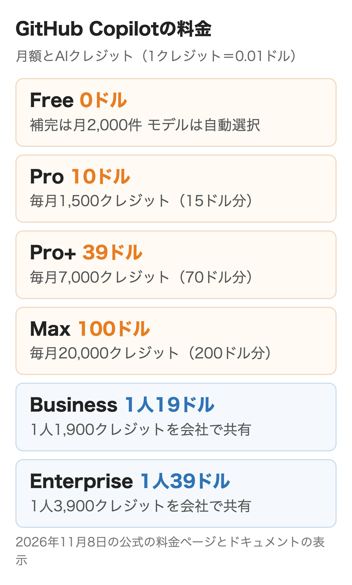
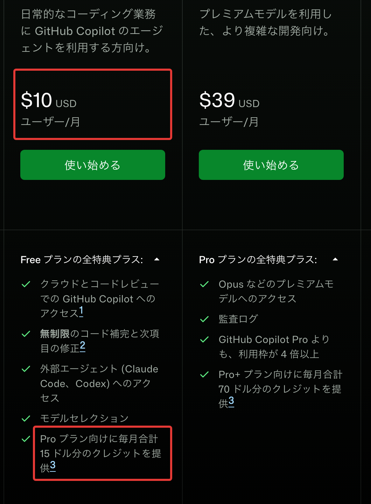
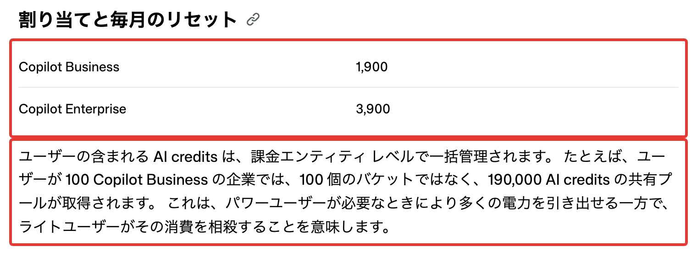

GitHub Copilotは2026年6月1日に、プレミアムリクエストの回数で数える課金から、使ったトークンの量で数えるAIクレジットの課金に切り替わりました。月額は据え置かれた一方で、エージェントやコードレビューを多く使う会社ほど、月の請求が席の数だけでは決まらなくなっています。

この記事では2026年11月8日時点の公式の料金ページとドキュメントをもとに、プランごとの月額、クレジットの減り方、会社で入れるときの見積もりと予算の設定を順に説明します。Microsoft 365のCopilotは別の製品で、ここでは扱いません。

:::takeaways
- 月額は個人がFree 0ドル・Pro 10ドル・Pro+ 39ドル・Max 100ドル、会社がBusiness 1人19ドル・Enterprise 1人39ドル
- 席の料金と同じ額のクレジットが会社の共有プールに入り、超えた分は1クレジット0.01ドルで課金される
- **Business・Enterpriseは超過の利用が既定で許可されているため、使い始める前に予算と止め方を決める**
:::

## GitHub Copilotの料金プラン一覧

プランは個人向けの4つと、会社向けの2つに分かれます。どのプランにも毎月のAIクレジットが付き、チャットやエージェントの作業はこのクレジットから減っていきます。**エディタの中のコード補完と次の編集候補はクレジットを使わず、有料プランなら回数の制限もありません。**

| プラン | 月額 | 毎月のAIクレジット | 対象 |
|---|---|---|---|
| Free | 0ドル | 決まった量（補完は月2,000件） | 個人 |
| Pro | 10ドル | 1,500（15ドル分） | 個人 |
| Pro+ | 39ドル | 7,000（70ドル分） | 個人 |
| Max | 100ドル | 20,000（200ドル分） | 個人 |
| Business | 1人19ドル | 1人1,900を共有 | 組織・企業 |
| Enterprise | 1人39ドル | 1人3,900を共有 | GitHub Enterprise Cloudの企業 |

<figure class="post-figure"></figure>

1クレジットは0.01ドルです。料金ページの金額はドル建てで、三菱UFJ銀行の2026年11月6日の仲値（1ドル157.77円）で換算すると、Proは約1,578円、Businessは1人約2,998円、Enterpriseは1人約6,153円になります。料金ページの表からは消費税の加わり方を読み取れないため、請求書で確かめてください。

<figure class="post-figure"><figcaption>GitHub Copilotの料金ページ（2026年11月8日）</figcaption></figure>

## 無料版でできること

Freeはクレジットカードなしで始められ、コード補完が月2,000件まで使えるプランです。チャットやエージェントモード、Copilot CLIも入っていますが、使えるのは決められた量のクレジットの範囲で、**モデルは自動選択だけ**です。モデルを指定したい、GitHub上のプルリクエストをCopilotにレビューさせたい、という段階でProが必要になります。

Freeを使えるのは組織や企業からCopilotを割り当てられていない個人だけです。認証された学生はStudentプランを無料で使え、認証済みの教師と人気のあるオープンソースの保守者はProを無料で使える場合があります。

## Pro・Pro+・Maxの違い

有料の3プランでは月額と同じ額の基本クレジットに、フレックス割り当てと呼ばれる上乗せ分が付きます。基本を使い切るとフレックスから自動で減り、その順番を設定する必要はありません。

| | Pro | Pro+ | Max |
|---|---|---|---|
| 基本クレジット | 1,000 | 3,900 | 10,000 |
| フレックス割り当て | 500 | 3,100 | 10,000 |
| 合計 | 1,500 | 7,000 | 20,000 |
| 主に増えるもの | モデル選択・クラウドエージェント・コードレビュー | Opusなどのプレミアムモデル・監査ログ・他社エージェントへの委任 | 新しいモデルと機能の優先利用 |

**フレックス割り当てはモデルの価格や効率に合わせて今後変わることがある、と公式に書かれています。**上乗せ分は約束された量ではないため、基本クレジットだけで足りるかで選ぶほうが外れません。Claude by AnthropicやOpenAI Codexにタスクを任せる機能（プレビュー）は、料金ページの表ではPro+とMaxにだけ付いています。

個人のプランを上げるとその場で切り替わり、払うのは差額だけです。下げる・解約するときは期間の終わりまで今のプランが続き、返金はありません。

## 2026年6月からの従量課金

6月1日より前はプレミアムモデルへの1回の依頼を1回と数え、モデルごとの乗数を掛けていました。今の方式では送ったトークン・返ってきたトークン・キャッシュしたトークンを、モデルごとの単価で計算し、クレジットに直します。

クレジットを使う機能はCopilot Chat、Copilot CLI、クラウドエージェント、Copilot Spaces、Spark、他社のコーディングエージェントです。**コードレビューはクレジットに加えて、GitHub Actionsの実行時間も使います。**

切り替えで変わった点はほかに2つです。使い切ったときに安いモデルへ自動で落として続ける仕組みが無くなり、年額プランの扱いも分かれました。年額のProとPro+を6月1日時点で契約していた人は、満了までは回数で数える旧方式のままで、満了後はFreeに戻ります。旧方式のほうはモデルの乗数が6月1日に引き上げられ、窓の杜の記事によるとClaude Opus 4.7は3倍から27倍になりました。

### モデルごとの単価

単価は100万トークンあたりで決まっています。たとえばClaude Sonnet 5.5は入力2ドル・出力10ドル、GPT-6 Astraは入力10ドル・出力50ドルです。同じ作業でも、モデルの選び方で金額が20倍以上（公式の単価で比べた場合）変わります。

キャッシュを考えずに試算すると、Sonnet 5.5で100万トークンを読んで3万トークンを書く作業は約2.3ドル（230クレジット）です。**Businessの1人分の1,900クレジットは、この規模の作業で8回分ほどにあたります。**

## BusinessとEnterpriseの違い

会社で入れるプランはBusiness・Enterpriseと、2026年10月に始まった「Copilot アクセス」の3つがあります。

| | Business | Enterprise | Copilot アクセス |
|---|---|---|---|
| 1人の月額 | 19ドル | 39ドル | GitHub Enterprise Cloudの利用者は0ドル、それ以外は10ドル |
| 含まれるクレジット | 1人1,900 | 1人3,900 | なし（最初から従量） |
| 使える組織 | GitHub Free・Team・Enterprise Cloud | GitHub Enterprise Cloud | 対象の企業 |
| 機能 | 一元管理・ポリシー・監査ログ | Businessの全部と新しいモデル・機能の優先利用 | Enterpriseと同じ |

Copilot アクセスは営業の担当がいる企業向けに2026年10月28日から始まり、自分で契約を管理する会社とGitHub Free・Teamの組織はまだ使えません。同じ企業の中でBusiness・Enterpriseの席と混ぜることもできません。

<figure class="post-figure"><figcaption>組織と企業の課金の説明（GitHub Docs、2026年11月8日）</figcaption></figure>

## 会社で入れるときの月額の見積もり

Business・Enterpriseでは、席の料金と同じ額のクレジットが共有のプールに入ります。100人のBusinessなら、1人ずつ1,900を持つのではなく、190,000クレジットを全員で使う形です。たくさん使う人の分はあまり使わない人の残りで埋まります。

**そのため月の請求は「席の料金」と「その月に使ったクレジットの額」の大きいほうになります。**プールを超えた分はどちらのプランも1クレジット0.01ドルで、単価が変わらないからです。50人で入れたときの月額を使用量ごとに並べました。

| 50人の月の使用量 | Business | Enterprise |
|---|---|---|
| 500ドル分 | 950ドル | 1,950ドル |
| 1,750ドル分 | 1,750ドル | 1,950ドル |
| 3,000ドル分 | 3,000ドル | 3,000ドル |

<figure class="post-figure"></figure>

使う量が多い会社ほど、2つのプランの差は小さくなり、最後は同じ額になります。**Enterpriseを選ぶ理由は使える量ではなく、新しいモデルを先に使えることと、GitHub Enterprise Cloudの機能です。**Enterpriseの席にはGitHub Enterprise Cloudの契約が要り、その料金はこの表に入っていません。

Copilot アクセスを使える企業なら、Enterprise Cloudを持たない人は1人10ドルに使用量のすべてが乗ります。50人で使用量が1人平均9ドルを下回るなら、Businessより安くなる計算です。

### 使用量の目安を作る

公式のドキュメントが示す見積もりの手順では、AIの使用状況のダッシュボードでプールの中で使った分も含めた全体の量を出し、単価で金額にします。まだ使っていない会社なら、少人数で1か月試して1人あたりの量を測るのが確かです。

**コードレビューは1回ごとにクレジットが減るので、別に見積もります。**公式の目安では1回あたりLiteが平均0.25ドル、Balancedが平均1.50ドル、Maxが平均10ドルです。50人が月に10本ずつBalancedでレビューすると、それだけで750ドル分になり、Businessのプール950ドル分の大半を使います。Actionsの実行時間は別に請求されます。

## 予算と上限の設定

BusinessとEnterpriseでは、プールを使い切った後の利用が初めから許可されています。**超えた分を払いたくない場合は、AIの設定でAIクレジットの有料使用のポリシーをオフにします。**オフにすればプールが空になった時点で次の月まで止まります。

予算はドルで決め、使った量の表示はクレジットです。10ドルの予算で1,000クレジットです。決められる単位は4つで、役割が違います。

| 予算 | 何を止めるか | 超えたとき |
|---|---|---|
| ユーザー単位 | 1人の使用量（プールの分も含む） | いつも止まる |
| コストセンター | 部署の超過分 | 停止の設定がオンのときだけ止まる |
| 組織 | 組織に請求される超過分 | 同上 |
| エンタープライズ | 会社全体の超過分 | 同上 |

<figure class="post-figure"></figure>

**「予算の上限に達したときに使用を停止する」は既定でオフです。**オフのままでは予算は知らせるだけで、請求が続いてしまいます。予算を作るときは必ずオンにしてください。

ユーザー単位の予算は全員に同じ額を当てる方法と部署ごとに変える方法、特定の人だけ変える方法から選べます。公式の例ではエンジニアは1人20ドル、マーケティングは1人5ドルのように部署で分けています。忙しい時期だけ上げたい人には、期限つきで個別の予算を付けられ、期限が来ると自動で元に戻ります。

もう1つ注意したいのが、エンタープライズの予算は席の料金を含まないことです。公式の例ではBusinessの400席が月7,600ドルで、予算を5,000ドルにしても請求は最大12,600ドルに届きます。使用量が予算の75%・90%・100%（料金ページのFAQの記載）に達したときの知らせも設定できます。

## 席の割り当てと請求のタイミング

席は1人につき1つのライセンスで、組織のオーナーがメンバーに割り当てます。月の途中で席を足すと、残りの日数分が日割りで請求され、プールのクレジットもその場で増える仕組みです。カードやPayPalで払う会社は、その日割りの分が前払いです。

席を外したときはその月の終わりまで請求が続き、返金もありません。**組織から外した人はすぐに使えなくなりますが、席の料金は月末まで発生します。**プールのクレジットも、減るのは翌月からです。

請求の仕組みでほかに知っておきたい点です。

- 個人のPro・Pro+・Maxを契約している人に会社の席を割り当てると、個人プランは自動で解約され、残りは日割りで返金される
- 同じ企業の複数の組織から席を受けた人は1回分だけ請求され、どの組織に付くかは毎月ランダム
- BusinessとEnterpriseの席を両方持つ人は、Enterpriseの分だけ請求される
- クレジットは毎月1日の0時（UTC、日本時間9時）に戻り、余りは翌月に繰り越さない
- 席を足したときのクレジットは日割りになることがある

部署ごとの予算を効かせたいなら、1人が1つの組織から1つの席を受ける形にそろえてください。複数の組織から受けていると、毎月ちがう組織の予算から引かれてしまうためです。

## プランの選び方

まず個人か会社かで分け、会社なら使う量で決めます。会社の業務で使うなら、管理と予算が効くBusiness以上を選びます。料金ページのFAQによると、FreeやPro、Pro+の個人のデータは、本人がオプトアウトしない限りAIモデルの学習と改善に使われます。Business・Enterpriseの説明に挙がっているのは、サービスの提供や問題の対応といった運用の目的だけです。

| 状況 | 向いているプラン |
|---|---|
| 個人で試したい | Free |
| 個人で毎日使い、モデルを選びたい | Pro |
| 個人でOpusなどを多く使う | Pro+かMax |
| 会社で数人から始める | Business |
| GitHub Enterprise Cloudを使い、新しいモデルを先に使いたい | Enterprise |
| Enterprise Cloudの利用者が多く、使う量に差が大きい | Copilot アクセス（営業に相談） |

Pro・Pro+・Maxの料金をClaude CodeやCodexと比べたい場合は、[Claude Codeの料金プラン](/media/claude-code-pricing/)と[CodexとClaude Codeの比較](/media/codex-vs-claude-code/)に月額と上限の仕組みをまとめました。

社内でCopilotを入れたあと、レビューや定型の作業をエージェントに任せる仕組みまで作りたい場合は、nitoの[AIエージェント構築支援](/ai-agent/)で相談を受けています。

## まとめ

- 個人で試すならFreeから始め、モデルを選びたくなったらProに上げる。上げるときは差額だけで済む
- 会社で使うならBusinessを基本にする。使う量が多い会社ではEnterpriseとの差が縮み、差額は新モデルの優先利用とEnterprise Cloudの機能の代金になる
- 席を割り当てる前に、ユーザー単位の予算・有料使用のポリシー・使用を停止する設定の3つを決める
- コードレビューを全員で回すなら、1回の目安の額とレビューの本数から、プールに収まるかを先に計算する

## よくある質問

### GitHub Copilotは無料で使えますか？

Freeプランは無料で、コード補完が月2,000件まで使えます。チャットやエージェントモードも決められたクレジットの範囲で使えますが、モデルは自動選択だけです。認証された学生はStudentプラン、認証済みの教師と人気のあるオープンソースの保守者はProを無料で使える場合があります。

### GitHub Copilot Enterpriseとの差は？

Businessは1人月19ドルで1,900クレジット、Enterpriseは1人月39ドルで3,900クレジットが共有のプールに入ります。超過の単価は同じ1クレジット0.01ドルです。EnterpriseにはGitHub Enterprise Cloudの契約が要ります。

### GitHub Copilotを使い切ったら？

個人のプランなら上のプランに上げる・追加の予算を決めて払いながら続ける・翌月のリセットを待つ、の3つから選べます。Business・Enterpriseは、管理者が超過を許可していれば同じ単価で続き、許可していなければ翌月まで止まります。どちらの場合もコード補完は使えるままです。

### GitHub Copilotで公開コードを避けられますか？

できます。公開コードと65語彙素以上（平均150文字）一致する提案を表示しないフィルターがあり、企業の管理者が全組織に適用するか、各組織に任せるかを選ぶ形です。

## 出典

2026年11月8日に取得した公式ページと記事です。

- [GitHub Copilot の料金プラン（GitHub）](https://github.com/features/copilot/plans?locale=ja)
- [GitHub Copilotの計画（GitHub Docs）](https://docs.github.com/ja/copilot/get-started/plans)
- [組織と企業の使用量ベースの課金（GitHub Docs）](https://docs.github.com/ja/copilot/concepts/billing-and-usage/organizations-and-enterprises/billing)
- [使用量ベースの課金の予算（GitHub Docs）](https://docs.github.com/ja/copilot/concepts/billing-and-usage/organizations-and-enterprises/budgets)
- [組織およびエンタープライズ向けのシートと請求サイクル（GitHub Docs）](https://docs.github.com/ja/copilot/concepts/billing-and-usage/organizations-and-enterprises/seats-and-billing-cycles)
- [GitHub Copilot のシート割り当て（GitHub Docs）](https://docs.github.com/ja/copilot/reference/copilot-billing/seat-assignment)
- [GitHub Copilot ライセンスに変更を加える（GitHub Docs）](https://docs.github.com/ja/copilot/reference/copilot-billing/license-changes)
- [個人の使用量ベースの課金（GitHub Docs）](https://docs.github.com/ja/copilot/concepts/billing-and-usage/individuals/billing)
- [GitHub Copilot のモデルと価格設定（GitHub Docs）](https://docs.github.com/ja/copilot/reference/copilot-billing/models-and-pricing)
- [GitHub Enterprise および Copilot 課金の変更点（GitHub Docs）](https://docs.github.com/ja/copilot/get-started/whats-changing-with-github-enterprise-and-copilot)
- [Copilot課金の変更点（レガシ）（GitHub Docs）](https://docs.github.com/ja/copilot/reference/copilot-billing/request-based-billing-legacy/what-changed-with-billing)
- [GitHub Copilot is moving to usage-based billing（GitHub Blog、2026年4月27日）](https://github.blog/news-insights/company-news/github-copilot-is-moving-to-usage-based-billing/)
- [「GitHub Copilot」、6月1日より従量課金制へ移行（窓の杜、2026年4月28日）](https://forest.watch.impress.co.jp/docs/news/2105124.html)
- [三菱UFJ銀行の外国為替相場（三菱UFJリサーチ＆コンサルティング）](https://www.murc-kawasesouba.jp/fx/index.php)
