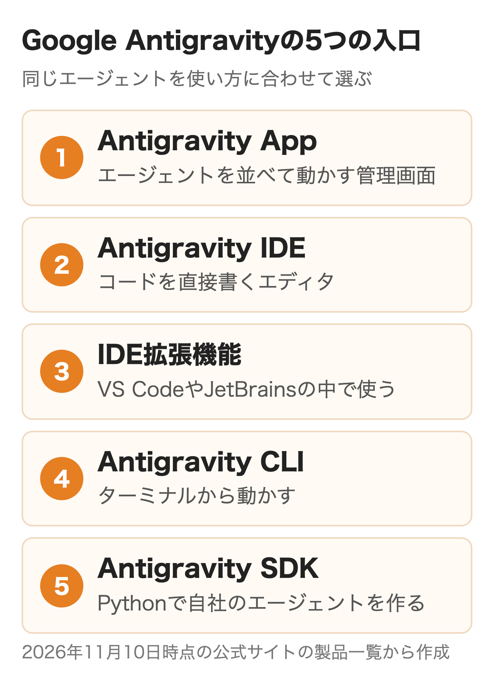
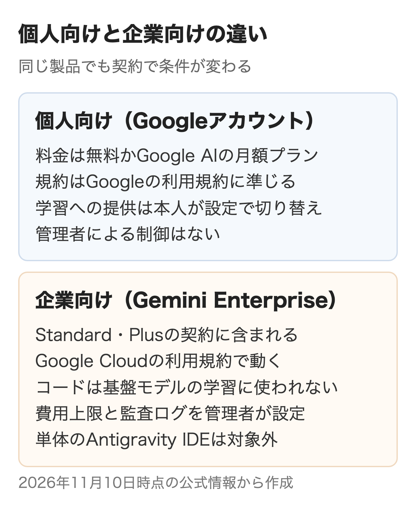
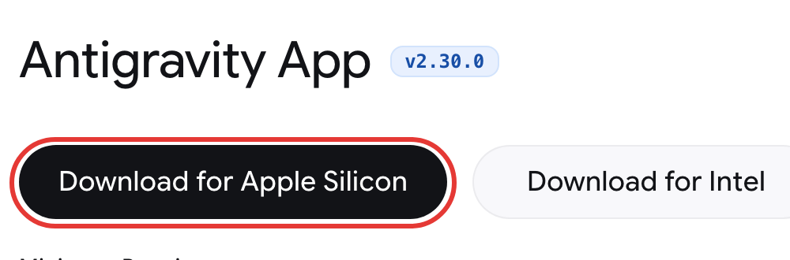

Google Antigravityは、AIエージェントにコードの調査・編集・コマンドの実行・ブラウザの確認までを任せる、Googleの開発プラットフォームです。**個人は無料から使え、会社ではGemini Enterpriseの契約に含まれる形で入れられます。**

2025年11月にAI付きのIDEとして出たあと、2026年5月の2.0で中身が大きく変わりました。この記事では今の製品の構成、料金と使える量、会社で入れるときの条件、始め方と日本語化、ほかの開発AIとの違いを順に説明します。

:::takeaways
- 今の中心は**エージェントを管理するデスクトップアプリ**。IDE・CLI・IDE拡張・SDKも同じエージェントで動く
- 個人は無料・Google AI Pro（月$20）・Ultra（月$100か$200）。**会社は対象のGemini Enterprise Standard・Plus（1人月$30から）に含まれる**
- 企業向けはコードが基盤モデルの学習に使われず、費用上限と監査ログを管理者が持てる。**単体のAntigravity IDEは企業向けの対象外**
:::

## Google Antigravityとは何か

**Google Antigravityは、1つのエージェントを5つの入口から使える開発プラットフォームです。**最初は2025年11月に、エージェントを組み込んだIDE（コードエディタ）として公開されました。IDEの中にはAgent Managerという、コードを見ずにエージェントとの会話と成果物だけを扱う画面がありました。

2026年5月19日のGoogle I/Oで出たAntigravity 2.0は、このAgent Managerを**IDEから切り離した単体のデスクトップアプリ**です。公式のブログでも2.0は「IDEのない」アプリと説明されています。開発だけでなく調べものや資料づくりにも使えるよう、IDEとは別の製品にしたという経緯です。

<figure class="post-figure"></figure>

| 入口 | 何に使うか | 企業向け（Gemini Enterprise） |
|---|---|---|
| Antigravity App（2.0） | 複数のエージェントを並べて動かす・定期実行 | 対応 |
| Antigravity IDE | コードを直接編集しながらエージェントを使う | 対象外 |
| IDE拡張機能 | VS Code・Visual Studio・JetBrains・Zed・Xcode・Eclipseの中で使う | 対応（一部はプレビュー） |
| Antigravity CLI | ターミナルから使う。Gemini CLIの移行先 | 対応 |
| Antigravity SDK | Pythonで自社用のエージェントを作る | Google Cloudのプロジェクトでつなげる（ライセンスの対象製品の一覧には無い） |

Googleは2.0と使い慣れたIDEを並べて使う形を勧めていて、IDEの中のAgent Managerは今後のリリースで外す予定と書いています。**これから入れるなら、Appを入口にし、コードは手元のIDEか拡張機能で触る形が公式の想定に近い**でしょう。

## Antigravityで何ができるのか

エージェントに目的を伝えると、ファイルを読み書きし、コマンドを実行し、Webを調べながら作業を進めます。チャットでコードをもらって自分で貼り付ける使い方との違いは、**調べる・直す・動かして確かめるまでをエージェントが続けて行う点**にあります。

### 作業の単位はプロジェクト

エージェントが触れる範囲は、プロジェクトに登録したフォルダです。1つのプロジェクトにフロントエンドとバックエンドのように複数のフォルダを入れられ、権限の設定もプロジェクトごとに変えられます。Gitのworktreeで元のフォルダと分けて作業させることもでき、2.0ではメインのエージェントが作業を分けてサブエージェントに並行で任せます。

### 成果物で要所を確認する

Antigravityの特徴は、エージェントが作業の途中と結果をアーティファクト（成果物）として出すことです。実装計画・タスクの一覧・作業のまとめ（Walkthrough）・コードの差分・画面のスクリーンショットなどがあり、それぞれにコメントを付けて方向を直せます。**ツールの実行を1つずつ見張るのではなく、計画と差分の2か所で人が確かめる**前提の作りです。ただし、成果物が毎回作られるわけではなく、タスクの大きさや /plan を使ったかで変わります。

### ブラウザ操作と定期実行

/browser を付けると、エージェントが起動中のChromeにつないで画面を操作し、表示を確かめます。使う前にChrome（バージョン144以降）を開き、chrome://inspect/#remote-debugging で「Allow remote debugging for this browser instance」をオンにしておくことが条件です。/schedule や画面の「Schedule」では、曜日と時刻を決めて同じ指示を繰り返し実行できます。

ほかに、手元のPCで動いているエージェントをブラウザから操作するRemote Control（2026年8月）、音声で話しかける音声モード（2026年11月）、開発以外の作業向けに画面を簡単にしたKnowledge Workの表示も加わりました。

## Google Antigravityの料金はいくら？

**個人の料金はAntigravity単体ではなく、GoogleのAIプラン（Google AI Pro・Ultra）で決まります。**会社向けはGoogle Cloudの契約です。公式の料金ページとブログの金額は次のとおりで、どれもドル表示です。

| プラン | 月額 | Antigravityで使える量 |
|---|---|---|
| 無料（For Individuals） | $0 | 週ごとに戻る基本の枠。Tab補完とCommand（エディタの中で指示してコードを書き換える機能）は無制限 |
| Google AI Pro | $20 | 5時間ごとに戻る枠（週の上限まで） |
| Google AI Ultra | $100 | Proの5倍のトークン |
| Google AI Ultra | $200 | Proの20倍のトークン。週の上限も最大 |
| 対象のGemini Enterprise Standard・Plus | 1人$30から | 1人ごとのGeminiのクレジットを組織でまとめて使う |
| Google Cloudの従量課金 | 1人分の固定費$0 | 使った分だけ |

Ultraは2026年5月19日に月$100の段が新しくでき、上の段は$250から$200に下がりました。Geminiのモデルは使える量が1つの枠にまとまっていて、APIの価格に合わせて減ります。安いFlashを使えば、同じ枠でPro系より多くの処理ができる仕組みです。ClaudeなどGemini以外のモデルは、別の固定の枠になります。

**枠を使い切ったあとに払うかどうかは、利用者が決めます。**ProとUltraでは購入したAIクレジットを枠の超過分に充てられます。設定の「AI Credit Overages」で、自動で使う（Always）か、枠が戻るまで待つ（Never）かを選ぶ形です。自分のAPIキーを持ち込んで枠を増やすことや、個別の契約で組織向けの枠を作ることには対応していません。

使える量を減らすのは指示の数ではなくエージェントの作業量です。簡単な指示なら多く送れ、複雑な作業ほど枠を使います。公式も、上限は混み具合に合わせて変わることがあると書いています。

日本でGoogle AI ProやUltraを申し込むと、価格はGoogle Oneの円建てです。円の金額とプランの違いは別の記事にまとめています。

:::linkcard
url: /media/gemini-pricing/
title: 【2026年9月】Geminiの料金プランを比較｜無料・Plus 725円・Pro 2,900円・Ultraの違いと選び方
desc: Google AI Plus・Pro・Ultraの日本の月額と、プランごとに増える機能を解説しています。
:::

### プランごとに選べるモデル

| モデル | 無料・Plus | Pro | Ultra | 企業向け |
|---|---|---|---|---|
| Gemini 4 Argon | なし | あり（有料） | あり | あり |
| Gemini 3.8 Flash | あり | あり | あり | あり |
| Gemini 3.7 Flash・3.6 Flash・3.1 Pro | なし | なし | なし | あり |
| Claude Sonnet 5.5・Opus 5.5 | なし | あり（有料） | あり | あり（管理者が有効化） |
| Claude Sonnet 4.6・Opus 4.6 | あり | あり | なし | なし |
| GPT-OSS-120b | あり | あり | あり | なし |

**Claude Sonnet 4.6・Opus 4.6とGPT-OSS-120bは、2026年11月18日に外れる予定です。**無料の枠で他社のモデルを試せるのは、それまでと考えておくのが安全です。Proの「有料」は試用中を除くという意味です（Gemini 4 Argonは、対象の端末についてくる試用でも使えます）。モデルは会話の入力欄の下で選び、考える深さ（Low・Medium・High）も変えられます。

## 会社で入れるときの条件は？

**同じAntigravityでも、個人のGoogleアカウントで使うか、Gemini Enterpriseで使うかで、規約・データの扱い・管理の範囲が変わります。**画面と機能はほぼ共通で、違うのは契約の外側です。

<figure class="post-figure"></figure>

| 確認すること | 個人向け | 企業向け（Gemini Enterprise） |
|---|---|---|
| 契約 | Googleアカウント＋Google AIプラン | 対象のStandard・Plusの1人ごとの契約、または従量課金（請求書払いのCloud Billingアカウントが前提） |
| 規約 | Googleの利用規約に準じる規約 | Google Cloudの利用規約 |
| 学習への利用 | 設定のEnable Telemetryで本人が切り替え | コードは基盤モデルの学習に使われない |
| ログイン | 個人のGoogleアカウント | Google CloudのSSO・外部のIDプロバイダ（Workforce Identity連携）・ADC |
| 費用の管理 | 本人のクレジット設定 | プロジェクト単位の月の予算上限・クレジットの共有・超過分の上限 |
| 記録 | なし | 指示・回答・メタデータの監査ログを1回の切り替えで有効化 |
| 使える入口 | すべて | App・CLI・IDE拡張（単体のIDEは不可） |
| データの場所 | 指定なし | global・us・euから選ぶ |

### Gemini Enterpriseに含まれる中身

2026年8月から、Antigravityは対象となるGemini EnterpriseのStandard・Plus（新興国向けのStandard Emerging Marketを含む）の契約に含まれています。**Antigravity用に別の1人分のライセンスを買う必要はありません。**Geminiのモデルは最初から使えて、1人ごとのクレジット（Standardは月$10、Plusは月$15）を組織でまとめて使います。使われずに残る分を減らすための仕組みです。

Claude Opus 5.5・Sonnet 5.5は、管理者がGoogle Cloudのコンソールで有効にしたときだけ使え、トークンの量に応じた別の請求になります。Claudeを選んでも、会話の要約などは裏で軽いGeminiのモデルが動き、その分も料金がかかることがあります。他社モデルの処理はglobal・us・euのどれかで行われ、日本国内のリージョンは選べません。

費用の上限はGoogle Cloudの課金コンソールにあるCloud Billingの予算で、プロジェクトの月ごとに決められます。上限に達すると従量課金の分の利用が止まりますが、止まるまでに時間差があり、少し超えることもあります。ライセンスを使わずGoogle Cloudのプロジェクトから従量課金でつなぐ場合は、請求書払い（invoiced）のCloud Billingアカウントが前提です。共有のクレジットを使い切ったあとに従量課金へ移るかどうかも、上限つきで管理者が決めます。

### 管理者が先にやること

入れる前に、情報システムやGoogle Cloudの管理者が次の4つを済ませておくことが必要です。

1. Gemini Enterpriseの設定の「AI developer tools」を、契約したリージョンで有効にする（既存の契約では既定でオフのことがある）
2. ライセンスを買う前に、Gemini EnterpriseのAPIを有効にして約5分待つ（先に買うと割り当てに失敗することがある）
3. 使う人に利用者のIAMロール、管理者に管理用のロールを付ける
4. 社内のファイアウォールで外への通信を絞っているなら、公式の一覧のドメインを443番で許可する

Google Workspaceのアカウントで社員に使わせる場合も、Workspaceの管理者がAntigravityを有効にしないとログインできません。

### 個人のアカウントで使わせる場合

試しに数人だけ使わせるなら、個人のGoogleアカウントでも始められます。その場合は会社の管理の外で、規約上、やり取りはGoogleの製品と機械学習の改善に使われ、Googleの担当者や委託先が見ることもあります。規約は機密情報を入れないよう求めており、改善に使わせたくなければ設定のEnable Telemetryをオフにできます（オフでも、サービスの提供と安全のためには使われます）。**社内のコードを扱うなら、試用の段階から企業向けで始めるほうが規約の面で迷いません。**

エージェントにコマンドの実行やブラウザの操作を任せる以上、どこまで自動で許すかの線引きは導入の前に決めておくことが必要です。nitoでも、会社でAIエージェントを入れるときの権限とルールの設計を支援しています。

## Antigravityの始め方と使い方

個人で試すなら、公式サイトからアプリを入れて、Googleアカウントでログインするだけで始められます。対応OSはmacOS・Windows・Linuxで、ブラウザ操作を使うならChromeも必要です。18歳未満は使えず、日本は提供国に入っています。

<figure class="post-figure"><figcaption>Google Antigravityのダウンロードページ（2026年11月10日）</figcaption></figure>

1. [ダウンロードページ](https://antigravity.google/download)でOSに合ったアプリを入れる
2. 起動して「Continue with Google」（個人）か「Use business account」（企業）を選び、ブラウザでログインする
3. 仕事の種類を選ぶ（開発ならSoftware Engineering。あとで設定から変えられる）
4. プロジェクトを作り、作業させたいフォルダを登録する
5. 会話の入力欄に指示を書く。大きな作業は先頭に /plan を付けると、実装計画を確認してから進められる

### どこまで自動で任せるか

エージェントに確認なしで何をさせるかは、権限のプリセットで決めます。既定のDefaultではコマンドを外と切り離した環境（サンドボックス）の中だけで自動で動かし、それ以外は確認を求めます。

| プリセット | コマンド | ファイル | MCP・Web |
|---|---|---|---|
| Request Review | 毎回確認 | プロジェクトのみ | 確認 |
| Default（既定） | サンドボックス内は自動、外は確認 | プロジェクト＋一時フォルダ | 確認 |
| Auto | 外に出るコマンドは安全かを自動で判定 | プロジェクト＋一時フォルダ | 確認 |
| Turbo | 制限なし | すべて | 許可 |

**Turboは使い捨ての環境だけにとどめるのが公式の推奨です。**なお、企業向けのアカウントはこのプリセットではなく以前の権限設定を使い、Autoは選べません。

### 慣れてきたら使う4つの仕組み

| 仕組み | 何をするか | 置き場所の例 |
|---|---|---|
| Rules | いつも守らせる決まり（使う言語・触らないフォルダ） | AGENTS.md・GEMINI.md |
| Skills | 特定の作業の手順書。必要なときだけ読まれる | .agents/skills/ |
| MCP | 社内システムや外部サービスとつなぐ | 設定の「Customizations」 |
| Hooks | ツールの実行前後に決まったスクリプトを動かす | JSONで定義 |

## Google Antigravityの日本語化はできる？

**公式サイトは言語のメニューで日本語を選べますが、アプリの表示言語を切り替える項目は、公式の設定の説明に載っていません。**一方で、エージェントの回答を日本語にそろえることはRulesで指定できます。

手順はAppの「Customizations」から「Rules」を開き、「+ Global」で全プロジェクト共通のルールを作って「回答と成果物は日本語で書く」と1行入れるだけです。ファイルで書く場合の置き場所はホームフォルダの ~/.gemini/GEMINI.md（またはAGENTS.md）です。チームでそろえたいならリポジトリの直下にAGENTS.mdを置く方法が向いていて、そのプロジェクトで作業するエージェント全員に同じ決まりが読み込まれます。

画面のメニューを日本語にする方法として、VS Codeの日本語の言語パックを入れる手順を紹介している記事もあります。これはVS CodeをもとにしたAntigravity IDE（今も単体で配布）の話で、Appには当てはまりません。公式のドキュメントには載っていない方法です。

## ほかの開発AIとの違いは？

**Antigravityの強みは、複数のエージェントを並べて管理する画面と、Google Cloudの管理にそのまま乗る企業向けの形です。**どれも「指示を受けてコードを書き、動かして直す」エージェントである点は共通しています。

| 比べる点 | Google Antigravity | Cursor | Claude Code |
|---|---|---|---|
| 主な形 | 管理用アプリ＋IDE・CLI・IDE拡張 | AIを組み込んだエディタ | ターミナル・IDE拡張・デスクトップ |
| 個人の入口 | 無料、Pro $20 | Free、Plus $8 | Pro $20 |
| 会社向け | Gemini Enterpriseに含む（1人$30から） | Teams（1人$30から） | Team（年払い1人$20から） |
| モデル | Gemini中心。Claudeも選べる | 自社モデルと他社モデル | Claude |
| 管理の土台 | Google Cloud（IAM・課金・監査ログ） | Cursorの管理画面 | Claudeの管理画面・各クラウド |

すでにGoogle Cloudで請求とIDを管理している会社なら、Antigravityは新しい契約先を増やさずに入れられます。エディタの使い心地を重視するならCursor、ターミナル中心の開発ならClaude Codeも候補です。料金と管理の細かい違いは[Cursorの料金と使い方](/media/cursor-guide/)と[CodexとClaude Codeの比較](/media/codex-vs-claude-code/)で解説しています。

1つ注意があります。**Antigravityのログインを、Claude Codeなど他社のツールから使うことは規約違反**で、アカウントの停止もありえます。他社のエージェントでGeminiを使いたいなら、Gemini EnterpriseかGoogle AI StudioのAPIキーを使うよう、公式が案内しているとおりです。

Gemini CLIを無料やGoogle AI Pro・Ultraで使っていた人は、2026年6月18日からAntigravity CLIへ移りました。

:::linkcard
url: /media/gemini-cli-guide/
title: 【2026年9月】Gemini CLIはAntigravity CLIへ｜使えない理由と今の選択肢
desc: Gemini CLIの無料枠の終了と、Antigravity CLIへの移行で変わる点を解説しています。
:::

## まとめ

- 個人で触ってみたいなら、無料のままアプリを入れ、小さなプロジェクトで /plan を使った作業を1つ任せてみる
- 毎日の開発で使うなら、枠が5時間ごとに戻るGoogle AI Pro以上にし、AIクレジットの自動消費はNeverから始める
- 会社で社内のコードに使うなら、最初からGemini Enterpriseで入れ、AI developer toolsの有効化・予算上限・監査ログを先に決める
- Claudeのモデルを無料で試すなら、2026年11月18日までと考えておく

## よくある質問

### Google Antigravityは無料で使えますか？

使えます。Googleアカウントがあれば、月$0のプランでGemini 3.8 Flashなどを週ごとの枠の範囲で使えます。Tab補完とCommand（エディタの中で指示してコードを書き換える機能）は無制限です。

### 会社のWorkspaceで使えますか？

Workspaceの管理者がAntigravityを有効にすれば使えます。有効になっていないとログインに失敗します。Gemini Enterpriseのライセンスで使う場合は、ログイン時に「Use business account」を選びます。

### Antigravityのコードは学習に使われますか？

企業向け（Gemini Enterprise）はGoogle Cloudの利用規約のもとで動き、コードは基盤モデルの学習に使われないと公式ブログに書かれています。個人のアカウントの規約上、やり取りはGoogleの製品と機械学習の改善に使われ、Googleの担当者や委託先が見ることがあります。設定のEnable Telemetryをオフにしても、サービスの提供と安全のために使われる点は変わりません。

### AntigravityでClaudeは使えますか？

使えます。Google AI Pro（試用を除く）とUltraではClaude Sonnet 5.5・Opus 5.5を選べます。企業向けでは管理者が有効にする必要があり、トークンの量に応じて別に請求される形です。

### 企業向けでもAntigravity IDEは使えますか？

単体のAntigravity IDEは企業向けの対象外です。企業向けで使えるのはApp・CLIと、VS CodeなどのIDE拡張機能です（JetBrains・Zed・Xcode・Eclipseはプレビュー）。

### Antigravity CLIは自動化に使えますか？

agy -p のヘッドレスモードは、スクリプトやCIから使う前提で用意されています。ただし個人のプランでは、他社のエージェントやアプリに組み込んだり、アカウントを自動で切り替えたりする使い方は対象外です。

## 出典

金額・仕様は2026年11月10日に各ページで確かめたものです。

- [Google Antigravity](https://antigravity.google/)（Google）
- [Pricing](https://antigravity.google/pricing)（Google Antigravity）
- [Plans](https://antigravity.google/docs/plans/)（Google Antigravity Docs）
- [Choose a model](https://antigravity.google/docs/models/)（Google Antigravity Docs）
- [Antigravity in Gemini Enterprise](https://antigravity.google/docs/enterprise/)（Google Antigravity Docs）
- [FAQ](https://antigravity.google/docs/faq/)（Google Antigravity Docs）
- [Authenticate](https://antigravity.google/docs/install/)（Google Antigravity Docs）
- [Settings](https://antigravity.google/docs/settings/)（Google Antigravity Docs）
- [Agent permissions](https://antigravity.google/docs/permissions/)（Google Antigravity Docs）
- [Rules](https://antigravity.google/docs/rules/)（Google Antigravity Docs）
- [IDE extensions](https://antigravity.google/docs/ide/extensions/)（Google Antigravity Docs）
- [Antigravity IDE](https://antigravity.google/product/antigravity-ide/)（Google Antigravity）
- [Introducing Google Antigravity 2.0](https://antigravity.google/blog/introducing-google-antigravity-2/)（Google Antigravity Blog、2026年5月19日）
- [Changes to Antigravity plans](https://antigravity.google/blog/changes-to-antigravity-plans/)（Google Antigravity Blog、2026年5月19日）
- [Google Antigravity in Gemini Enterprise](https://antigravity.google/blog/google-antigravity-for-enterprises/)（Google Antigravity Blog、2026年5月19日、8月追記）
- [Bringing Antigravity to Gemini Enterprise](https://antigravity.google/blog/antigravity-enterprise/)（Google Antigravity Blog、2026年8月20日）
- [Antigravity anywhere with Remote Control](https://antigravity.google/blog/remote-control-for-antigravity/)（Google Antigravity Blog、2026年8月21日）
- [Google Antigravity の提供対象を企業のお客様まで拡大](https://cloud.google.com/blog/ja/products/ai-machine-learning/expanding-google-antigravity-for-enterprise-customers)（Google Cloud 公式ブログ、2026年9月1日）
- [Browser](https://antigravity.google/docs/commands/browser/)（Google Antigravity Docs）
- [SDK overview](https://antigravity.google/docs/sdk/overview/)（Google Antigravity Docs）
- [Terms of Service](https://antigravity.google/terms)（Google Antigravity）
- [Download](https://antigravity.google/download)（Google Antigravity）
- [Manage costs](https://docs.cloud.google.com/gemini/enterprise/docs/manage-costs-overview)（Google Cloud Docs）
- [Configure overages](https://docs.cloud.google.com/gemini/enterprise/docs/configure-overages)（Google Cloud Docs）
- [Google Antigravity のスタートガイド](https://codelabs.developers.google.com/getting-started-google-antigravity)（Google Codelabs）
