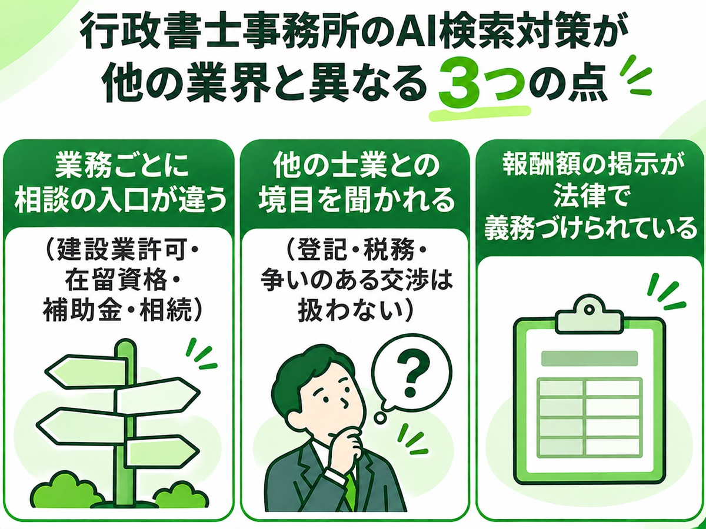
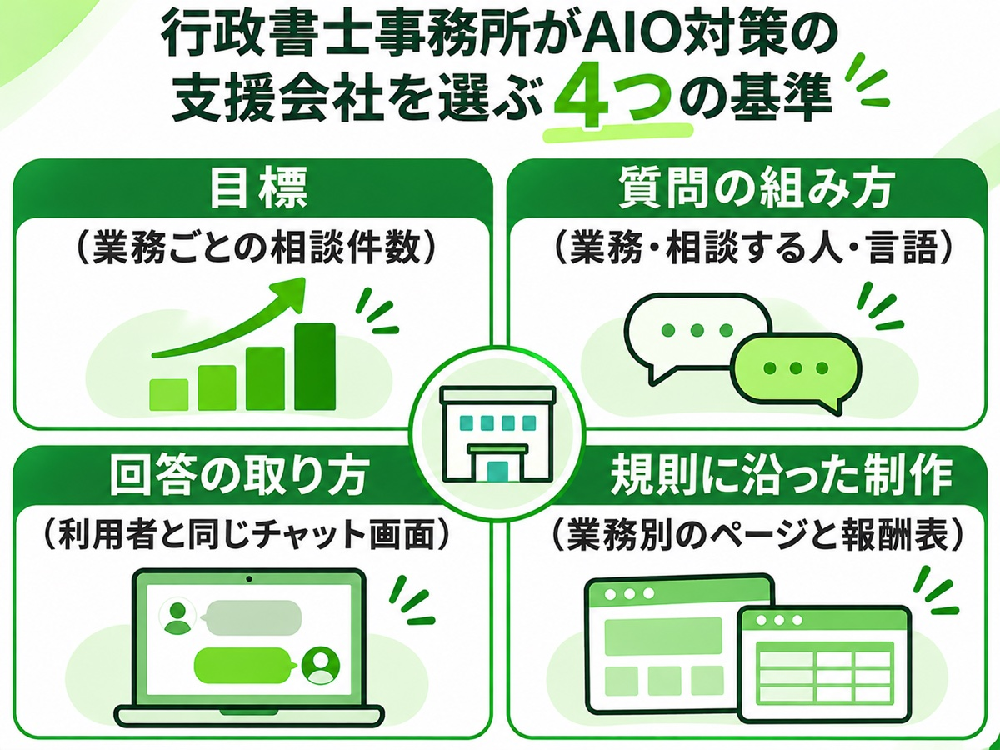

行政書士事務所がAIO対策（AI検索対策）を外に依頼するなら、**AIで名前が挙がる割合（言及率）より、建設業許可・在留資格・補助金・相続など業務ごとの相談件数を目標に置く会社**を選ぶのがおすすめです。増やしたい業務がはっきりしている事務所ほど、業務ごとに質問を分けて計測する会社が向いています。

この記事は株式会社nitoが書いています。士業の支援実績があるAI検索対策の会社として自社を1番目に置き、ほかの6社は2026年11月16日に各社の公式サイトで確認した内容から、どんな事務所に合うかで整理しました。

:::takeaways
- 支援会社には、言及率より**建設業許可・在留資格・補助金・相続など業務ごとの相談件数**で効果を示してもらう
- 業務によって相談する人も添える事情も違い、**外国籍の本人が英語などで相談先を探すこともある**
- 登記・税務・争いのある交渉など行政書士の業務の外を聞かれることもあるため、**扱う範囲と連携する士業を本文に書いておく**
- 行政書士法は報酬額の掲示を義務づけ、職務基本規則は**インターネットでの公表にも努めるよう定めている**
- 支援会社を比べる軸は、目標・質問の組み方・回答の取り方・規則に沿った制作の4つ
:::

## 行政書士事務所におすすめのAIO対策会社7選

行政書士事務所におすすめのAIO対策支援会社は次の7社です。各社の公式サイトの表記から、特徴を1〜2文ずつまとめました。

- **株式会社nito**: 士業の支援実績がある。ChatGPTやGeminiなど主要なAIの回答を毎晩読み、計測から記事の制作と公開後の運用までを一気通貫で受け持つ
- **ナイル株式会社**: 創業以来17年超のSEO研究と累計2,000社以上の支援実績。SEOとLLMOを組み合わせた伴走型のコンサルティング
- **株式会社LANY**: 300社以上の支援で培ったSEOの知見に、書籍『強いLLMO』の出版やLLMO白書の発行で体系化した手法を加えたコンサルティング
- **株式会社Faber Company**: SEOツール「ミエルカSEO」の会社。AI検索での見え方を確認できるツール「ミエルカGEO」を持つ
- **株式会社ニュートラルワークス**: Web制作と集客支援の会社。不動産・建設業・医療クリニックなど6業界の専用プランを持つLLMO対策
- **株式会社PLAN-B**: SEOコンサルティングを長く手がけ、生成AIが業界ごとにすすめる会社を調べた「AI×業界調査レポート」を出している
- **株式会社ジオコード**: 東証スタンダード上場。21年間のSEOノウハウと累計4,743サイトの支援実績があり、SEO・Web制作・AI最適化を一社で扱う

| 会社 | 強み | 向いている行政書士事務所 |
|---|---|---|
| 株式会社nito | 士業の支援実績。業務ごとの相談件数を目標に、計測から記事の制作・公開後の運用まで | 建設業許可・在留資格など増やしたい業務が決まっている事務所 |
| ナイル株式会社 | SEOとLLMOを組み合わせた伴走支援 | 業務解説のコラムが多く、SEOとまとめて依頼したい事務所 |
| 株式会社LANY | 戦略設計から実行支援までのLLMOコンサルティング | 手続きの解説記事を中長期で積み上げたい事務所 |
| 株式会社Faber Company | ミエルカGEOでの計測とGEOコンサルティング | 所内でツールを操作して見え方を追いたい事務所 |
| 株式会社ニュートラルワークス | サイトの改修まで一括で対応 | ホームページの作り直しも考えている事務所 |
| 株式会社PLAN-B | AI×業界調査レポート・LLMO/GEOエージェント・SEOの土台づくり | まず業界でAIがどの事務所を紹介しているかを調べたい事務所 |
| 株式会社ジオコード | SEO・Web制作・AI最適化を一社で | 制作会社と窓口を一つにまとめたい事務所 |

料金はnitoを含めてどの会社も、狙う業務の数や制作の量で変わります。2〜3社から見積もりを取り、後半の4つの基準への答えを並べて比べてください。

業種を問わず依頼先を広く比べたい場合や、費用の相場を知りたい場合に参考になるのが、AIO対策と同じ取り組みを指すLLMO対策の会社20社を比較表で並べた記事です。

:::linkcard
url: /media/llmo-companies/
title: LLMO対策の会社おすすめ20選・比較表と費用相場・選び方
desc: LLMO対策の会社20社を比較表で並べ、費用相場と選び方を解説しています。
:::

### この記事の選定基準

載せたのはAI検索対策（AIO・LLMO・GEO）を公式サイトでサービスとして案内している会社です。そのうえでAIO対策会社の比較・一覧記事によく名前が挙がる6社を選び、書き手のnitoは1番目に置きました。行政書士向けのページを持つ支援会社もありますが、検索上位で見た範囲では、業種別ページの1つとして行政書士を扱う会社が中心でした。

各社は公式サイトで読み取れる範囲（目標の置き方・計測の方法・制作まで任せられるか）と、どんな行政書士事務所に合うかで紹介しています。相続の業務が中心の事務所は[相続の司法書士・行政書士向けの比較](/media/souzoku-aio-companies/)、事務所で自ら進めるときの考え方は[士業のためのAI検索対策](/media/shigyo-ai-search/)にまとめています。

## 行政書士のAI検索対策は何が違う？

行政書士の業務は官公署に出す書類の作成と相談が中心で、そのほとんどが許認可に関わる書類です。日本行政書士会連合会（日行連）は、その書類が「1万種類を超えるとも言われます」と案内しています。業務の幅が広いため、AI検索対策でも次の3つの点が他の業界と異なります。

<figure class="post-figure post-figure--zu"></figure>

### 業務ごとに分かれる相談の入口

事務所の名前ではなく、「〇〇県で経営事項審査を任せられる行政書士は？」「配偶者ビザへの変更を相談できる事務所を知りたい」のように、**手続きの名前と地域から聞く人もいます**。日行連の「こんなときにご相談を」の分け方に沿うと、相談する人と添えやすい事情は業務ごとに次のように違います。

| 業務 | 相談する人 | 添えやすい事情 |
|---|---|---|
| 建設業許可 | 建設会社の経営者・独立する職人 | 一般か特定か・知事許可か大臣許可か・経営経験や技術者の要件・入札の予定 |
| 在留資格・帰化 | 外国籍の本人・外国人を雇う会社 | 在留資格の種類・在留期限・入管へ行かずに済むか・英語で相談できるか |
| 飲食・風俗営業 | 開業を控えた店の経営者 | 開業日・物件・深夜の営業の有無 |
| 会社設立・補助金 | 起業する人・中小企業の経営者 | 電子定款・融資の予定・補助金の締切 |
| 遺言・相続 | 相続人・遺言を考えている人 | 遺産分割協議書・相続人の数・争いになっているか |

在留資格の手続きでは申請取次行政書士に依頼すると本人が出入国在留管理局へ出向かずに済みます。日行連のサイト自体も英語・中国語・ベトナム語など7つの言語で案内を出しており、申請する本人が日本語以外で相談先を探すことも想定されています。**業務ごとに報酬・期間・対応言語を書いたページがあるかで、AIが事務所を紹介するときの材料の量が変わります**。

### 他の士業との境目を聞かれる

行政書士が扱えない業務もあります。日行連の案内では相続で行政書士が受けるのは争いになっている事案と税務・登記の申請を除いた書類の作成と、その前提の調査です。会社の設立も、手続きの代理から登記の申請は除かれています。

そのため「相続の手続きは行政書士と司法書士のどちらに依頼するか」「会社を作るときは誰に相談すればいいか」のように、依頼先から聞く人もいます。こうした質問では士業の違いを説明する記事が読まれることもあり、事務所のページに扱う範囲が書かれていないと、自分の事務所の説明では答えてもらえません。**扱う業務と扱わない業務、連携している司法書士・税理士・弁護士を本文に書いておくと、依頼先を比べる質問にも事務所の言葉で答えられるようになります。**

補助金の申請では民間のコンサルティング会社と並べて紹介されることもあります。2026年1月1日に施行された改正を反映した行政書士法第19条は、行政書士でない者が「いかなる名目によるかを問わず」報酬を得て、官公署に出す書類の作成などを業として行うことを禁じています。補助金の申請書類の作成を受けていることも、業務のページに書いておきたい事実です。

### 報酬の掲示と広告の決まり

行政書士法第10条の2は報酬の額を事務所の見やすい場所に掲示するよう定めています。日行連の「行政書士職務基本規則」は第24条で報酬額表の掲示を求め、2項では**インターネットを利用した方法などで公表するよう努めることも定めています**。業務ごとの報酬はもともと公開を前提にした情報です。

広告は同じ規則の第17条が扱い、ホームページやSNSによるものも対象に含めています。第15条の依頼の誘い方とあわせて、禁じられていることと代わりに書ける事実は次のとおりです。

| 規則で禁じられていること | 代わりに書ける事実 |
|---|---|
| 事実に合致しない内容（第17条2項） | 扱う業務と扱わない業務・連携先の士業 |
| 誤認または誤導のおそれのある内容（第17条3項） | 報酬と実費の内訳・追加費用がかかる条件 |
| 誇大な内容（第17条4項） | 申請から結果までの期間の目安・申請取次や特定行政書士かどうか |
| 金品の提供などによる依頼の誘致（第15条2項） | 初回相談の時間と方法・対応できる地域と言語 |

許可を出すかどうかは官公署が判断するため、「必ず許可が取れる」のような書き方は事実と合わない内容になりかねません。AIが紹介に使える事実を規則の範囲で具体的に書き足していくのが基本です。表現の線引きは所属する行政書士会にも確認してください。

## AIO対策会社はどう選べばいい？

行政書士事務所が支援会社の提案を比べるときは、次の4つを聞くと考え方の違いが見えてきます。

<figure class="post-figure post-figure--zu"></figure>

| 基準 | 確認する質問 | 行政書士事務所で効果に関わる理由 |
|---|---|---|
| 目標 | 何の数を増やすことを目標にしますか？ | 業務ごとに報酬も手間も違い、相談の合計だけでは費用に見合うか判断しにくい |
| 質問の組み方 | 業務・相談する人・言語ごとに質問を分けますか？ | 本人と雇う会社、日本語と英語で、挙がる事務所が変わりやすい |
| 回答の取り方 | 回答は利用者と同じチャット画面で取りますか？ | プログラム用の窓口（API）の回答とは出典がずれることが多い |
| 規則に沿った制作 | 業務別のページと報酬表まで作りますか？ | 誇大や誤認のおそれのある言い方が入ると、公開の前に書き換えが必要になる |

### 業務ごとの相談件数を目標に置くか

言及率は途中の目印として役に立ちますが、それだけでは受任の数になりません。「行政書士と司法書士の違いは？」のような一般的な質問で名前が出た回も、言及率では同じ1回に数えられます。

**どの業務のどの質問で名前が挙がれば相談につながるかを先に決め、問い合わせのフォームで業務の種類と「何で知ったか」まで数える会社**なら、費用に見合っているかを受任の件数で判断できます。

### 業務と相談する人で質問を分けるか

計測する質問が「〇〇市でおすすめの行政書士」だけでは、事務所が増やしたい業務での見え方が分かりません。建設業許可なら「知事許可の新規申請」「経営事項審査」、在留資格なら「就労ビザの変更」「配偶者ビザ」、外国人を雇う会社なら「特定技能の受け入れ」のように、上の表の事情を添えた質問を業務ごとに組む会社が向いています。外国籍の依頼者が多い事務所は、英語での質問も計測に入れてもらうと実際の相談に近い見え方を追えます。

### 利用者と同じ画面で計測するか

AIの回答を集める方法には、プログラム用の窓口（API）から取る方式と、利用者が使うチャット画面に質問して取る方式があります。2026年9月に公開された論文では、ChatGPTのAPIとチャット画面に同じ質問をしたとき、出典が重なったのは平均で12.0%でした（[Auditing AI-Generated Product Recommendations](https://arxiv.org/abs/2609.18729)）。依頼者が実際に目にする回答で計測しているかは、契約の前に聞いておきたい点です。

### 規則に沿ってページまで作るか

AIが紹介の理由に使う事実は、事務所のページに書かれていなければ増えません。業務ごとのページに必要書類・期間・報酬と実費を書き、扱わない範囲と連携先まで示すところまで任せられるかで、成果までの距離が変わります。一般の業種向けの書き方のままだと「地域で一番」「許可率100%」のような言い方が入ることがあるため、職務基本規則に沿って原稿を作れるかも確認してください。

## 1. 株式会社nito

[株式会社nito](/aio/)は、計測から分析、サイトの改善と記事の制作、公開後の運用までを一気通貫で支援するAI検索対策の会社です。何を書き、どこを直すかは、ChatGPTやGeminiなど主要なAIの実際の回答を毎晩読み、他社が選ばれている理由から決めます。士業の支援実績もあり、**追いかける数字はAIでの言及率ではなく、相談の申し込みの数です。**

行政書士事務所なら、目標は建設業許可・在留資格・補助金・相続など業務ごとの相談件数です。名前が挙がる質問をむやみに増やすより、増やしたい業務の質問で理由つきで挙がる状態をつくる方が、受任に近づきます。

### 行政書士事務所に合う理由

- **業務と相談する人ごとに質問を組む。** 建設業許可なら経営者、在留資格なら本人と雇う会社のように、相談する人が添える事情から質問を作り、検索の数（Ahrefsの月間検索数）から順番を決めます
- **実際のチャット画面で計測する。** 依頼者が目にする回答のまま、回答本文と引用元を毎日記録します。これまでに記録したAIの回答は3万件を超えます（2026年11月時点）
- **他の事務所が挙がる理由を回答本文から抜き出す。** 「初回相談無料」「英語で相談できる」など、AIが他の事務所をすすめるときに添えた理由のうち、自分の事務所にも当てはまるのにページに無いものを、新しく書く内容の候補にします
- **規則に沿って記事を作り、直し続ける。** 誇大や誤認のおそれのある言い方を使わずに、業務ごとの報酬・期間・扱わない範囲を本文に書き、公開の判断は事務所の行政書士にしていただきます。公開後は回答の変化を見て書き方を直します
- **相談の申し込みまで数える。** フォームに業務の種類と「何で知ったか」「AIに何を聞いたか」を入れ、AIで知った人からの相談の数まで追います

### これまでの成果

| 支援先 | 成果 |
|---|---|
| SaaS企業 | 取り組み3ヶ月で、AIでの言及率が10%から45%に。AI経由のコンバージョンは5ヶ月で約6.7倍 |
| 士業 | AIでの言及率が0%から20%に。新しいページは公開3日でAIの回答の引用元に |

成果は事業・体制・地域の競合によって変わります。どの業務のどの質問でどこまで狙えるかは、無料の現状分析のあとにお伝えしています。料金は狙う業務の数と記事の本数に合わせて個別に案内する形です。

### こんな事務所に向いている

- 建設業許可・在留資格・補助金のうち、増やしたい業務がはっきりしている事務所
- 業務の解説記事を職務基本規則に沿って増やし、報酬額表のページの直し方も相談したい事務所
- 言及率のレポートだけでなく、業務ごとの相談の件数で効果を見たい事務所

:::point
nitoでは事務所が増やしたい業務の質問をChatGPTやGeminiなどに実際に入力し、名前が挙がるか、どう紹介されるか、代わりにどの事務所が挙がっているかをまとめた[現状分析レポート](/aio/)を無料でお出ししています。
:::

## 2. ナイル株式会社

ナイル株式会社は創業以来17年超のSEO研究と累計2,000社以上の支援実績を掲げるマーケティング支援会社です。LLMOコンサルティングはSEOとLLMOを組み合わせた伴走型で、コンテンツの設計から技術・UXの改善、KPIの設計までを扱います。

在留資格や許認可の解説コラムを長く書きためてきて、その記事をAI検索にも活かしたい行政書士事務所に向いています。

## 3. 株式会社LANY

株式会社LANYは300社以上の支援で培ったSEOの知見をもとにLLMOコンサルティングを提供する会社です。書籍『強いLLMO』の出版やLLMO白書の発行を通じて手法を発信しており、戦略設計から実行の支援までを受けています。

建設業許可や帰化申請など手続きの解説記事を中長期で積み上げ、記事の本数もまとめて任せたい事務所に合います。

## 4. 株式会社Faber Company

株式会社Faber Companyは、SEOツール「ミエルカSEO」で知られる会社です。AI検索での見え方を確認できるツール「ミエルカGEO」と、GEO/LLMO支援のコンサルティングを持っています。

所内にWebの担当者がいて、業務ごとの見え方をツールで自分たちで追いながら改善したい行政書士事務所に向いています。

## 5. 株式会社ニュートラルワークス

株式会社ニュートラルワークスは、Web制作と集客支援を手がける会社です。LLMO対策（AI検索最適化対策）を扱い、不動産・SaaS・医療クリニック・建設業・製造業・物流業の6業界には専用のプランを出しています。Web制作の会社なので、サイトの改修までまとめて任せられます。

ホームページが古く、業務別のページを作るのに合わせてサイト全体の作り直しも考えている事務所に合います。6業界の専用プランに士業は含まれていない点は確認しておいてください。

## 6. 株式会社PLAN-B

株式会社PLAN-Bは、SEOコンサルティングを長く手がけてきた会社です。2026年10月にはSEO実行支援ツール「SEARCH WRITE」を更新し、AI検索上の自社ブランドの可視化・分析から改善提案までを支援する「LLMO/GEOエージェント」の提供を始めました。生成AIが業界ごとにどの会社をすすめるかを調べた「AI×業界調査レポート」を出しており、SEOの土台づくりとあわせてAI検索の状況を調べられます。

運用を任せる前に、自社の業界でAIがどの事務所をどう紹介しているかを先に調べておきたい事務所に向いています。

## 7. 株式会社ジオコード

株式会社ジオコードは東証スタンダードに上場している会社です。21年間のSEOノウハウと累計4,743サイトの支援実績を掲げ、SEO・コンテンツ・Web制作に加えてAIO・LLMOなどのAI最適化も扱っています。

ホームページの制作・SEO・AI検索対策を、窓口を分けずに一社へ任せたい行政書士事務所に合います。

## 依頼する前に事務所で準備しておくこと

どの支援会社に依頼する場合も、次の5つを先に準備しておくと、最初の提案が事務所の業務に合ったものになります。

1. **ウェブ経由の相談の月の件数と、業務ごとの内訳。** 建設業許可・在留資格・補助金・相続などに分けておくと、増えたかどうかを比べる起点になります
2. **業務ごとの1件の価値。** 報酬の目安と、相談の何件に1件が受任に進むか。どこまで費用をかけてよいかの目安になります
3. **事務所に掲示している報酬額表。** 報酬と実費（申請手数料・証明書の取得費など）を分け、追加費用がかかる条件まで書ける形にしておきます
4. **扱う業務・扱わない業務と、連携先の士業。** 登記・税務・争いのある交渉を誰につなぐかを決めておくと、他士業との違いを聞かれる質問にも答えるページが作れます
5. **登録情報と対応できる言語。** 事務所名・所属会・申請取次の届出の有無は、日行連の[行政書士会員検索](https://www.gyosei.or.jp/members-search)と同じ表記に統一します。事例に使う案件は依頼者が特定されない形で書けるかも決めておきます

[blogparts:llmo-cta]

## まとめ

- 建設業許可や在留資格など増やしたい業務が決まっている事務所は、業務ごとの相談件数を目標に置き、計測から記事の制作と公開後の運用まで受け持つnitoが向いている
- 業務解説のコラムが多く、SEOとまとめて依頼したい事務所はナイル・LANY・ジオコードが候補になる
- 所内でツールを使って見え方を追いたい事務所はFaber Company、サイトの作り直しも考えている事務所はニュートラルワークスが合う
- どの会社に依頼する場合も、業務ごとの報酬額表と扱う範囲を本文に書けるよう、事務所の側で先に準備しておく

## よくある質問

### 行政書士事務所にAIO対策は必要ですか？

許認可やビザの手続きは「誰に何を依頼すればいいか」から迷う人も多く、事務所に電話する前にAIで状況を整理する人もいます。業務の名前と地域で聞かれたときに名前が挙がるかどうかが、相談の候補に入れるかの分かれ目です。業務の説明が1ページにまとまっているだけの事務所では、業務別のページを整えると紹介のされ方が変わることがあります。

### AIO対策とLLMO対策は違いますか？

呼び方の違いで、どちらもAIの回答の中で事務所の名前が挙がるようにする取り組みを指します。GoogleのAIによる概要やAIモードを中心に話すときはAIO、ChatGPTやGeminiなどの対話型AIまで含めるときはLLMOと呼ぶことが多いです。AIO対策の呼び方で依頼先を探す場合の比較は「[AIO対策会社おすすめ20選](/media/aio-taisaku-companies/)」にまとめました。

### 報酬額をホームページに載せても問題ありませんか？

載せられます。行政書士法第10条の2は報酬の額を事務所に掲示するよう定め、職務基本規則第24条2項はインターネットを利用した方法などでの公表に努めるよう求めています。報酬と実費を分け、追加費用がかかる条件まで書くと、誤認のおそれも減らせます。

### 他の事務所と比べたページは作れますか？

職務基本規則は比較広告を名指しで禁じてはいませんが、事実に合致しない広告・誤認や誤導のおそれのある広告・誇大な広告と、他の行政書士への誹謗中傷を禁じています（第17条・第20条）。比べる形にするより、自分の事務所の扱う業務・報酬・期間を事実として書く方が安全です。所属する行政書士会の考え方も確認してください。

### 許可率100%と書いてもいいですか？

許可を出すかどうかは官公署の判断なので、根拠や集計の条件を示さない許可率は、誤認や誇大のおそれのある表示になりかねません。数字を出すなら、集計した期間・業務・件数を添えてください。ページの数字は回答に引かれることもあるため、条件まで一緒に書いておく必要があります。

### 外国籍の依頼者が多い事務所は何を準備すればいいですか？

対応できる言語と、申請取次行政書士として届け出ているかを本文に書いておきます。在留資格の種類ごとのページを英語でも用意すると、英語で相談先を探す人の質問にも事務所の説明が届きやすくなります。

### 言及率が上がれば相談も増えますか？

必ずしも増えません。名前が挙がる質問が「行政書士とは何か」のような一般的な説明を求めるものばかりだと、相談の申し込みにはつながりにくいからです。どの業務のどの質問で挙がったかと、フォームで「AIで知った」と答えた人の数を合わせて見る必要があります。

### AIO対策の効果が出るまでどのくらいかかりますか？

新しいページが公開から3日でAIの回答の引用元に入った例も、2ヶ月ほどかけて言及率が上がった例もあります。業務と地域ごとの競合の多さで変わるため、見通しは現状を計測してから出すのが確実です。「必ずAIに載せる」と保証する提案は、AIの回答を外から決められない以上、慎重に聞いてください。

## 出典

- 日本行政書士会連合会「[行政書士の業務](https://www.gyosei.or.jp/info/service)」「[こんなときにご相談を](https://www.gyosei.or.jp/service)」（建設業・宅地建物取引業、国際、遺言・相続、法人・企業支援の各ページを含む）「[For Foreigners 外国人の方へ](https://www.gyosei.or.jp/about/language)」「[行政書士会員検索](https://www.gyosei.or.jp/members-search)」（2026年11月16日確認）
- 日本行政書士会連合会「[行政書士職務基本規則](https://www.gyosei.or.jp/about/organization/law)」（2024年4月1日施行、2026年7月15日改正施行）
- 「[行政書士法](https://laws.e-gov.go.jp/law/326AC1000000004)」（e-Gov法令検索、2026年1月1日施行の改正を反映）
- PLAN-B「[SEARCH WRITEのアップデート（LLMO/GEOエージェント）](https://www.plan-b.co.jp/news/search-write_update_202610/)」（2026年10月19日）
- 各社の公式サイト（2026年11月16日確認）: [ナイル株式会社](https://nyle.co.jp/)・[株式会社LANY](https://www.lany.co.jp/)・[株式会社Faber Company](https://www.fabercompany.co.jp/)・[株式会社ニュートラルワークス](https://n-works.link/)・[株式会社PLAN-B](https://www.plan-b.co.jp/)・[株式会社ジオコード](https://www.geo-code.co.jp/)
- APIとチャット画面の出典の重なり: Uberti-Bona Marin ほか「[Auditing AI-Generated Product Recommendations](https://arxiv.org/abs/2609.18729)」（arXiv、2026年9月）
