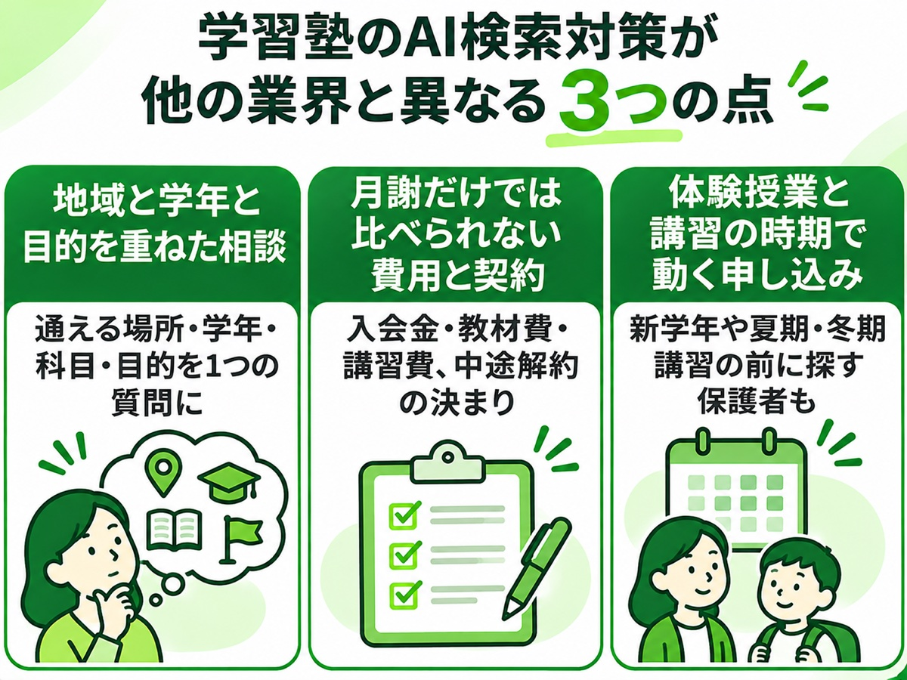
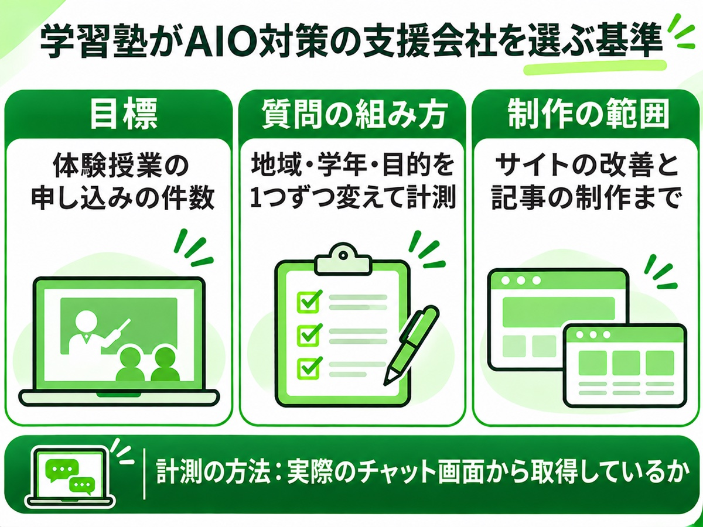

学習塾・個別指導塾がAIO対策（AI検索対策）を外に頼むなら、**AIでの言及率より体験授業の申し込みの件数を目標に置き、分析だけで終わらずサイトの改善や記事の制作から公開後の運用まで実行支援してくれる会社**が向いています。AIが塾を挙げるときの根拠の1つは、塾のサイトです。トップページだけでなく、教室ごとの場所・講師・合格実績・料金まで自塾のサイトに書かないと、AIは塾の検索サイトなどの情報で答えることがあります。

この記事は株式会社nitoが書いているため、自社を1番目に載せました。ほかの6社は2026年11月16日に各社の公式サイトで確認できた内容から、どんな塾に向いているかを書いています。

:::takeaways
- 成果は**体験授業の申し込みと問い合わせの件数**で数え、AIでの言及率は途中の目印にとどめる
- 保護者は**駅や学区・学年・目的を1つの質問に重ねて**聞くことがあるため、計測する質問もその組み合わせで組む
- 条件によっては学習塾の契約は特定商取引法の対象になり、**月謝・講習費・教材費と中途解約の条件を本文に書いておく**と比べる保護者の材料になる
- 合格実績は**年度・対象・人数の条件を数字と同じ文に**書けるかを、原稿を書く会社と確認しておく
- 提案は**目標・質問の組み方・制作の範囲・計測の方法**の4つで比べる
:::

## 学習塾のAI検索対策が他の業界と違う点は？

学習塾・個別指導塾は相談の中身が地域と子どもの事情で細かく分かれ、費用と契約に法律の決まりがあり、申し込みの入口が体験授業に集まりやすい業種です。この3つを自塾に当てはめておくと、支援会社の提案が合っているかを判断しやすくなります。

<figure class="post-figure post-figure--zu"></figure>

### 地域と学年と目的を重ねた相談

保護者がAIに塾を聞くときは、「〇〇駅の近くで、中学2年の数学が苦手な子に合う個別指導塾は？」のように、通える場所・学年・科目・目的を1つの文にまとめることがあります。目的も高校受験・中学受験・定期テストや内申点の対策・学校の授業の補習と分かれるため、同じ塾でも質問ごとに挙がるかどうかが変わりやすいところです。

| 聞き方 | 参考にされることがあるページ |
|---|---|
| 地域で聞く（〇〇駅の近くの個別指導塾は？） | 塾の検索・口コミサイト、地図の情報、各塾の教室ページ |
| 目的を添える（〇〇高校を目指す中3に向いている塾は？） | 各塾のコースや合格実績のページ、受験情報の記事 |
| 形式を比べる（個別指導と集団授業の違いは？） | 解説記事、各塾の指導形式のページ |
| 費用を聞く（中学生の個別指導の月謝の相場は？） | 各塾の料金ページ、比較記事、検索サイトの料金欄 |

通う範囲が限られるため、質問には駅名・市区町村・学区・中学校の名前が入りやすくなります。**教室ごとに最寄り駅・対象の学校と学年・開校時間を本文に書き、Googleビジネスプロフィールと同じ表記にしておくと、地域を添えた質問に答える材料を自塾のページで示せます。**

### 月謝だけでは比べられない費用と契約

保護者が比べる費用は月謝だけではありません。文部科学省の令和5年度子供の学習費調査は、学習塾費に入会金・授業料・講習会費・教材費・模擬テスト代・塾への交通費までを含めて集計しています。年間で学習塾費を支出した子ども1人あたりの平均は、公立中学校で約34万9千円、公立高校（全日制）で約38万1千円でした。

月謝だけを載せたページでは年額が分からず、保護者がほかの塾や検索サイトの料金で判断することもあります。**月謝・入会金・教材費・季節の講習費を分けて書き、学年ごとの年額の目安まで示せるかは、原稿を書く会社に確認しておきたい点です。**

契約にも法律の決まりがある点に注意が必要です。幼稚園・小学校の受験対策や浪人生だけのコースを除き、期間が2か月を超え、入会金や教材費を含めた総額が5万円を超える学習塾の契約は、特定商取引法の特定継続的役務提供にあたります。契約の前後に書面を渡すこと、書面を受け取った日から8日以内のクーリング・オフ、中途解約のときに請求できる額の上限（授業が始まる前は1万1000円）が定められています。

実際より著しく優良だと誤認させる広告も、同じ法律で禁止です。合格実績の数字は講習だけを受けた生徒を含めるかどうかのような集計の条件で変わり、AIの回答で数字だけが紹介されることもあります。**年度・対象・人数の条件を数字と同じ文に書けるかも、原稿を任せる前に確認したい点です。**

### 体験授業と講習の時期で動く申し込み

体験授業や入塾前の面談を申し込みの入口にしている塾も多くあります。決めるのは保護者で通うのは生徒のため、体験の流れ・振替・退塾の手続きのような、入塾したあとの様子が想像できる情報も比べる材料になります。

新学年の前や夏期・冬期講習の前に塾を探す保護者もいます。申し込みの経路も、チラシ・紹介・塾の検索サイト・自塾のサイトとさまざまです。**体験授業の申込フォームや電話の受付で何で知ったかを聞いておかないと、AIで知った人の申し込みはほかの経路に紛れてしまいます。**

## 支援会社はどう選べばいい？

学習塾が支援会社を選ぶときは、目標・質問の組み方・制作の範囲・計測の方法の4つを最初の打ち合わせで確認するのがおすすめです。

<figure class="post-figure post-figure--zu"></figure>

| 基準 | 確認する質問 | 学習塾で重要な理由 |
|---|---|---|
| 目標 | 何の件数を増やすことを目標にしますか？ | 言及率が上がっても体験授業の申し込みが増えるとは限らない |
| 質問の組み方 | 地域・学年・目的を変えた質問で計測しますか？ | 条件の組み合わせで挙がる塾が入れ替わりやすい |
| 制作の範囲 | 分析のあと、サイトの改善や記事の制作まで支援しますか？ | 教室・講師・実績・料金が自塾のサイトに無いと、AIは塾の検索サイトなどの情報で代わりに答えやすい |
| 計測の方法 | 回答は実際のチャット画面から取得していますか？ | 利用者が見る回答とプログラム用の窓口の回答は出典が異なることが多い |

### 体験授業の申し込みを目標に置くか

言及率は途中の目印として役に立つものの、それ自体は入塾の数ではありません。名前が挙がる質問の多くが通えない地域の質問や塾講師のアルバイト探しの質問なら、言及率が上がっても体験授業の申し込みは増えないこともあります。

**どの質問で名前が挙がれば申し込みにつながるかを先に決め、申込フォームの「何で知ったか」まで数える会社**なら、費用に見合うかを申し込みの件数で判断できます。

### 地域・学年・目的で質問を組むか

「〇〇市 塾 おすすめ」だけを計測しても、保護者が実際に相談する場面での見え方は分かりません。「〇〇中学の定期テスト対策をしてくれる塾」「部活と両立できる個別指導」「〇〇高校を目指す中3の夏期講習」のように、地域・学年・目的・形式を1つずつ変えて計測すると、どの条件でほかの塾に入れ替わるかが見えてきます。

### サイトの改善と記事の制作まで支援するか

AIに塾をたずねたときに返ってくる候補と理由は、各塾のサイトのほか、塾の検索・口コミサイトや地図の情報などがもとになります。このうち塾が自分で書けるのは自塾のサイトです。トップページだけでは足りず、教室ごとの最寄り駅と対象の学校、講師と指導形式、合格実績、月謝と講習費、体験授業の流れを、AIが読み取りやすい形で自塾のサイトに書いておくことが必要です。

分析のレポートを出して終わるAIO対策の会社もあります。**AIが塾を選ぶときに見る点に合わせてこうした情報を書き起こし、サイトのページの改善と記事の制作まで続けてくれるか**が、学習塾で会社を選ぶときの分かれ目です。

### 実際のチャット画面で計測しているか

回答の集め方にはプログラム用の窓口（API）から取得する方法と、利用者と同じチャット画面に質問して取得する方法があります。2026年9月に公開された論文では、ChatGPTのAPIとチャット画面に同じ質問をしたとき、示された出典が重なった割合は平均12.0%でした。保護者がスマートフォンで見る回答と同じ画面で計測しているかは、契約前に確認しておきたい点です。

## この記事での選定基準

取り上げたのはAI検索対策（AIO・LLMO・GEO）を独立したサービスとして公式サイトに載せている会社です。2026年11月16日に調べた範囲では学習塾に絞ってAIO対策を提供する会社は見つからなかったため、AIO対策会社の比較・一覧記事によく挙がる6社を選び、書き手のnitoは1番目に置きました。掲載順は評価の順位ではありません。

紹介は公式サイトで読み取れる範囲と、どんな塾に向いているかでまとめました。料金や契約の条件は各社の最新の案内で確認してください。

自塾でAI検索対策を進めるときの考え方は[学習塾のAI検索対策](/media/cram-school-ai-search/)にまとめています。

## 学習塾におすすめのAIO対策会社7社の比較

| 会社 | 強み | 向いている塾 |
|---|---|---|
| 株式会社nito | 計測からサイトの改善・記事の制作・公開後の運用まで支援し、体験授業の申し込みの件数を目標に置く | 教室と料金のページを整え、自塾のサイトからの申し込みを増やしたい塾 |
| ナイル株式会社 | SEOの長い支援実績とLLMOコンサルティング | 受験情報のコラムが多く、SEOとまとめて依頼したい塾 |
| 株式会社LANY | SEOとLLMOのコンサルティング、記事とLPの制作 | 受験情報のコラムを中長期で育てたい塾 |
| 株式会社Faber Company | ミエルカGEOなどのツールとGEO/LLMO支援 | マーケティングの担当者がツールで数字を見たい塾 |
| 株式会社ニュートラルワークス | 業界別のLLMO対策、サイト改修まで一括 | サイトの作り直しも考えている塾 |
| 株式会社PLAN-B | SEOの土台づくり・LLMO/GEOエージェント・AI×業界の調査レポート | まず自社の業界の状況を調べたい塾 |
| 株式会社ジオコード | SEO・Web制作・AI最適化を一社で | 制作とSEOとAI検索対策を1つの窓口で依頼したい塾 |

料金はnitoを含めてどの会社も、狙う質問の範囲や制作の量で変わります。2〜3社から見積もりを取り、4つの基準への答えを並べて比べてください。

業種を問わず依頼先を広く比べたい場合や、費用の相場を知りたい場合は、AIO対策と同じ取り組みを指すLLMO対策の会社12社を比較表で並べた記事が参考になります。

:::linkcard
url: /media/llmo-companies/
title: LLMO対策の会社おすすめ12選・比較表と費用相場・選び方
desc: LLMO対策の会社12社を比較表で並べ、費用相場と選び方を解説しています。
:::

## 1. 株式会社nito

[株式会社nito](/llmo/)は、計測から分析、サイトの改善と記事の制作、公開後の運用までを一気通貫で支援するAI検索対策の会社です。何を書き、どこを直すかは、ChatGPTやGeminiなど主要なAIの実際の回答を毎晩読み、他社が選ばれている理由から決めます。**追いかける数字は、AIでの言及率ではなく体験授業の申し込みと問い合わせの件数です。**

入塾した生徒が通い続ける間は、毎月の授業料に季節の講習費も加わります。通える範囲の保護者は近くの塾と見比べて決めるため、名前が挙がる質問をむやみに増やすより、地域・学年・目的を添えた質問で理由つきで挙がる状態をつくることを優先します。

### 学習塾に合う理由

- **保護者の相談の組み立てで質問を組む。** 駅や学区・学年・目的（受験・定期テスト・補習）・指導形式を1つずつ変えた質問を設計する
- **実際のチャット画面で計測する。** 保護者が見る回答のまま、回答本文と引用元を毎晩記録する。これまでに記録したAIの回答は3万件を超える（2026年11月時点）
- **ほかの塾が挙がる理由を回答本文から抜き出す。** AIがほかの塾をすすめるときに添える理由（たとえば自習室や定期テスト前の対策授業）のうち、自塾にも当てはまるのにサイトに書いていないものを、新しく書く内容の候補にする
- **教室ごとの情報をAIが読み取りやすい形で書き起こす。** 教室の場所・講師・実績・料金・体験授業の流れをヒアリングで聞き取り、教室のページと記事に使う。公開後はAIの回答の変化を見て直し続ける
- **体験授業の申し込みまで数える。** 申込フォームと電話の受付で何で知ったかを聞き、AIで知った人の申し込みと入塾の件数まで追う

ヒアリングで塾の強みを文章にする工程から始め、お客様にお願いするのはヒアリング・公開前の確認・実装の3点だけです。

### これまでの成果

| 支援先 | 成果 |
|---|---|
| SaaS企業 | 取り組み3ヶ月で、AIでの言及率が10%から45%に。AI経由のコンバージョンは5ヶ月で約6.7倍 |
| 士業 | AIでの言及率が0%から20%に。新しいページは公開3日でAIの回答の引用元に |

成果は事業・体制・地域によって変わります。どの質問でどこまで狙えるかは、無料の現状分析のあとにお伝えしています。

### こんな塾に向いている

- 塾の検索サイトやチラシに加えて、自塾のサイトからの体験授業の申し込みを増やしたい学習塾・個別指導塾
- 地域と学年を添えた質問で、近くのほかの塾の名前ばかりが挙がる塾
- 言及率のレポートより、体験授業の申し込みと入塾の件数で効果を見たい塾

:::point
nitoでは保護者が聞きそうな質問をChatGPTやGeminiなど主要なAIに実際に入力し、自塾の名前が挙がるか、どう紹介されるか、代わりにどの塾が挙がるかをまとめた[現状分析レポート](/llmo/)を無料でお出ししています。
:::

## 2. ナイル株式会社

ナイル株式会社はSEOコンサルティングの長い実績を持つマーケティング支援会社です。LLMO（AI検索対策）コンサルティングをSEOのサービスと並べて提供しており、SEOとAI検索対策をまとめて依頼できます。

受験情報や学習法のコラムがすでに多く、SEOで集めてきた記事をAI検索にも活かしたい塾に向いています。

## 3. 株式会社LANY

株式会社LANYはSEOを中心にしたデジタルマーケティングの支援会社です。LLMOコンサルティングのほか、SEO/LLMO向けの記事制作やLP制作も扱っています。

受験情報のコラムや講習の案内ページを中長期で育て、記事の本数もまとめて依頼したい塾に向いています。

## 4. 株式会社Faber Company

株式会社Faber CompanyはSEOツール「ミエルカSEO」で知られる会社です。AI検索での見え方を確認するツール「ミエルカGEO」と、GEO/LLMO支援のコンサルティングを持っています。

マーケティングの担当者がいて、ツールで自塾の数字を見ながら改善を回したい塾に向いています。

## 5. 株式会社ニュートラルワークス

株式会社ニュートラルワークスはWeb制作と集客支援の会社です。LLMO対策（AI検索最適化対策）を扱い、建設・不動産・クリニックなど業界別のサービスも出しています。業界別の6つ（不動産・SaaS・クリニック・建設・製造・物流）に学習塾は含まれていませんが、Web制作の会社なのでサイトの改修までまとめて依頼できます。

塾のサイトが古く、AI検索対策と合わせて教室ページの作り直しも考えている塾に向いています。

## 6. 株式会社PLAN-B

株式会社PLAN-BはSEOコンサルティングを長く手がけてきた会社です。2026年10月には「SEARCH WRITE」を更新し、AI検索上の自社ブランドの可視化・分析から改善提案までを支援する「LLMO/GEOエージェント」の提供を始めました。生成AIが業界ごとにどの会社をすすめるかを調べた「AI×業界調査レポート」を出しており、SEOの土台づくりとあわせてAI検索の状況を調べられます。

運用を任せる前に、自社の業界でAIがどの会社をすすめているかを調べておきたい塾に向いています。

## 7. 株式会社ジオコード

株式会社ジオコードはSEO・コンテンツ・Web制作に加えて、AIO・LLMOなどのAI最適化も支援する会社です。Webマーケティングを一社で完結させる体制をうたっています。

塾のサイトの制作・SEO・AI検索対策を、窓口を分けずに一社で依頼したい塾に向いています。

## 依頼する前に社内で整備しておくこと

どの会社に依頼する場合も、次の5つを事前に整理しておくと、最初の提案が自塾の教室と募集の流れに合ったものになります。

1. **体験授業の申し込みと入塾の月ごとの件数と、何で知ったかの内訳。** チラシ・紹介・塾の検索サイト・自塾のサイトのそれぞれから何件来ているかを数え始めておくと、増えたかどうかを比べる起点になります
2. **教室ごとの情報の正本と更新の担当。** 最寄り駅・対象の学校と学年・開校時間・自習室を1か所にまとめ、Googleビジネスプロフィールや検索サイトの記載を誰が照合するかを決めておきます。フランチャイズの教室なら、本部が管理する範囲と教室で書ける範囲も確認します
3. **料金と契約の公開範囲。** 月謝・入会金・教材費・講習費・年額の目安のどこまでを本文に書けるかと、契約書面に書いたクーリング・オフと中途解約の内容
4. **合格実績と成績の事例の集計条件。** 年度・対象にした生徒・在籍の期間・人数の書き方を統一し、数字を載せるときの社内の確認担当を決めておきます
5. **入塾1件の価値。** 平均の在籍期間と月謝・講習費から1人あたりの売上を出しておくと、支援にかけてよい費用の上限が見えます

[blogparts:llmo-cta]

## まとめ

- 自塾のサイトから体験授業の申し込みを増やしたいなら、件数を目標に置き、分析だけで終わらずサイトの改善と記事の制作から公開後の運用まで支援する会社が向いています
- 受験情報のコラムが多く、SEOとまとめて見直したいなら、SEOとAI検索対策を一緒に扱う会社が候補です
- 教室ページやサイトが古いなら、サイトの改修まで依頼できる制作系の会社を比べるのがおすすめです
- どの会社に依頼しても、料金・契約・合格実績の書き方は公開前に塾側で確認してください

## よくある質問

### 学習塾にAIO対策は必要ですか？

保護者がChatGPTやGoogleのAIモードに、通える地域と学年や目的を添えて塾を聞くこともあります。こうした質問で自塾が理由つきで挙がるかは自塾のサイトからの体験授業の申し込みに関わるため、サイトからの集客を増やしたい塾では取り組む価値があります。

### AIO対策とLLMO対策は違いますか？

呼び方の違いで、どちらもAIの回答の中で自社の名前が挙がるようにする取り組みを指します。GoogleのAIによる概要やAIモードを中心に言うときはAIO、ChatGPTやGeminiなどの対話型AIまで含めるときはLLMOと呼ぶことが多いです。AIO対策の呼び方で依頼先を探すなら、「[AIO対策会社おすすめ12選](/media/aio-taisaku-companies/)」が比較に使えます。

### 塾の検索サイトに載っていればAI検索対策は必要ありませんか？

必要ないとは言えません。塾の検索・口コミサイトはどの塾も同じ項目で並ぶため、教室ごとの対象の学校や講習の中身、振替のルールまでは書き切れないことがあります。こうした情報は自塾のページにも書いておき、検索サイトの記載と食い違わない状態にしておくのが基本です。

### フランチャイズの教室でもAIO対策はできますか？

加盟の契約と本部のルールによります。サイトを本部が管理している場合は教室側で修正できる範囲が限られますが、教室ページの対象の学校や講習の日程、成績の事例は本部に情報を出せることがあります。修正できる範囲を確認してから、依頼する内容を決めてください。

### 合格実績はどう書けばAIに誤解されにくいですか？

年度・対象にした生徒・人数の条件を、数字と同じ1文に書きます。条件が別の場所に小さく書かれていると、AIの回答で数字だけが紹介されることもあります。特定継続的役務提供にあたる学習塾の広告は、特定商取引法で実際より著しく優良だと誤認させる表示が禁じられているため、集計の条件は社内で確認してから載せてください。

### 料金を問い合わせにしていると不利ですか？

料金の質問では塾の検索サイトの料金欄や比較記事の金額が代わりに使われることがあります。金額を出せなくても、学年と授業の回数で月謝がどう決まるか、入会金・教材費・講習費がかかるかを本文に書いておくと、比べる保護者の材料になります。

### 言及率が上がれば体験授業の申し込みも増えますか？

必ずしも増えません。名前が挙がる質問が通えない地域の質問や塾講師の求人を探す質問ばかりなら、申し込みにはつながりにくいからです。どの質問で挙がったかと、申込フォームで「AIで知った」と答えた人の数を合わせて見る必要があります。

### AIO対策の効果が出るまでどのくらいかかりますか？

競合の塾の多さと自塾のページの中身で変わるため、見通しは現状を計測してから出します。新学年や講習の前に塾を探す保護者もいるため、募集の時期から逆算して早めに着手するのがおすすめです。

## 出典

- 文部科学省「[令和5年度子供の学習費調査](https://www.mext.go.jp/b_menu/toukei/chousa03/gakushuuhi/kekka/k_detail/mext_00002.html)」（令和6年12月25日公表、令和8年1月16日訂正）
- 消費者庁「[特定継続的役務提供](https://www.no-trouble.caa.go.jp/what/continuousservices/)」（特定商取引法ガイド）
- PLAN-B「[SEARCH WRITEのアップデート（LLMO/GEOエージェント）](https://www.plan-b.co.jp/news/search-write_update_202610/)」（2026年10月19日）
- 各社の公式サイト（2026年11月16日確認）: [ナイル株式会社](https://nyle.co.jp/)・[株式会社LANY](https://www.lany.co.jp/)・[株式会社Faber Company](https://www.fabercompany.co.jp/)・[株式会社ニュートラルワークス](https://n-works.link/)・[株式会社PLAN-B](https://www.plan-b.co.jp/)・[株式会社ジオコード](https://www.geo-code.co.jp/)
- APIとチャット画面の出典の重なり: Uberti-Bona Marin ほか「[Auditing AI-Generated Product Recommendations](https://arxiv.org/abs/2609.18729)」（arXiv、2026年9月）
