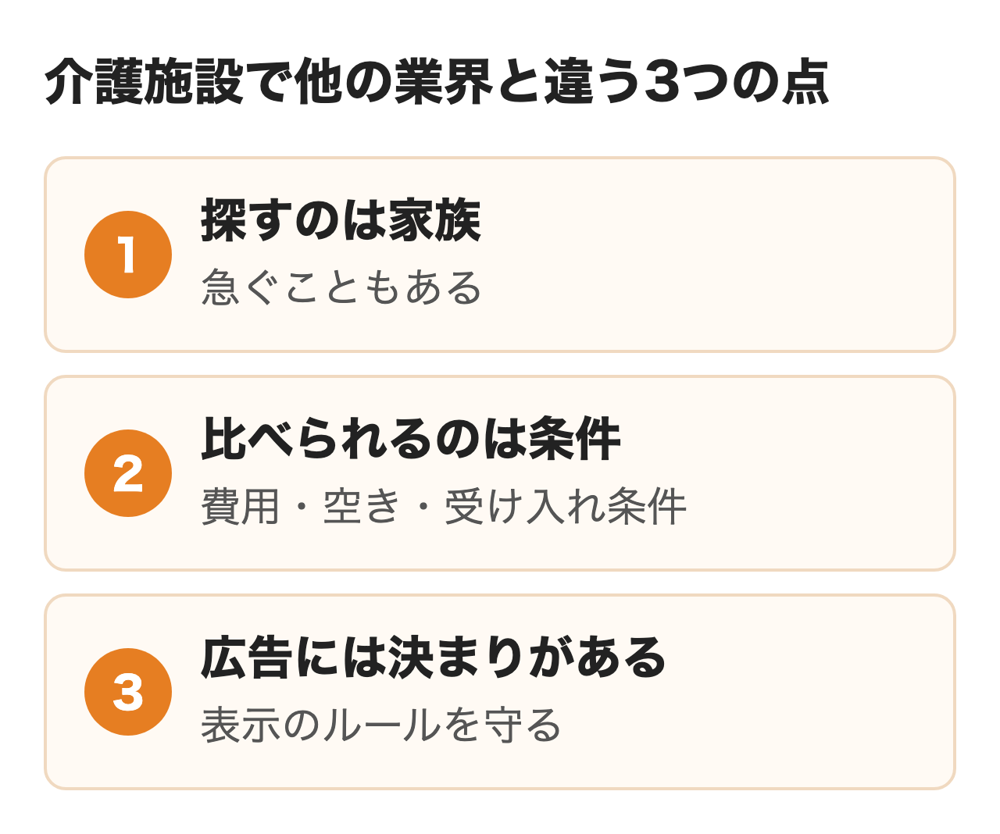
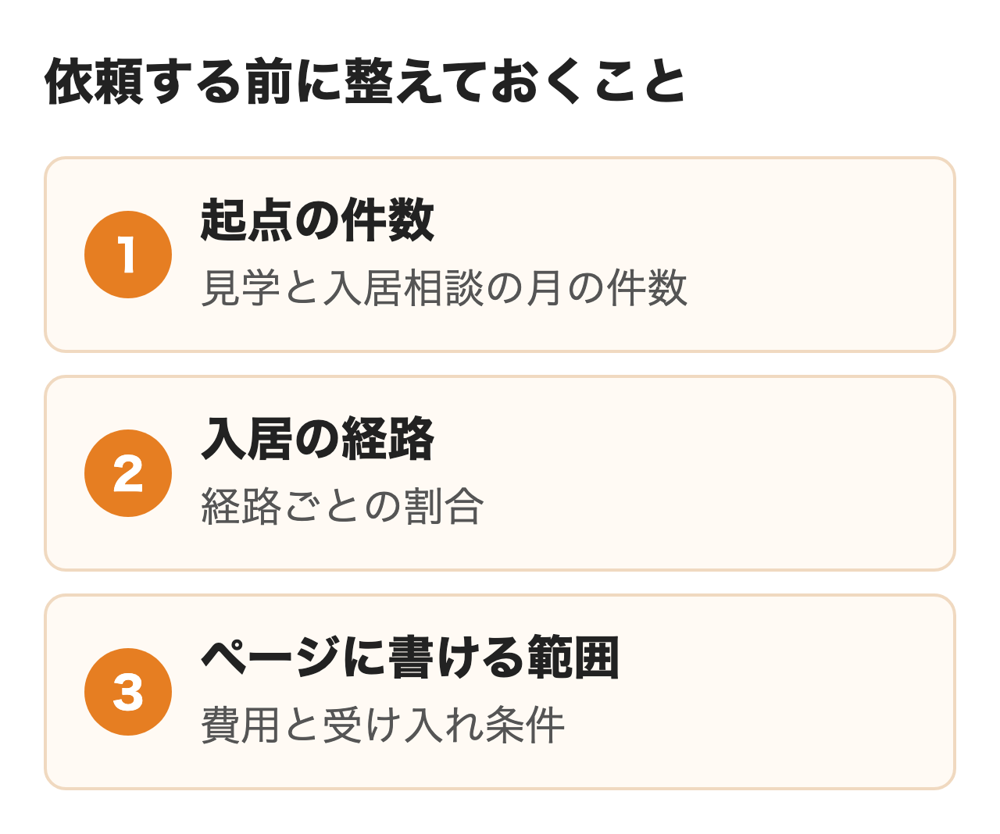

介護施設・老人ホームがAIO対策（AI検索対策）を外に頼むなら、**見学や入居相談の件数を目標に置き、家族がAIに聞く費用・空き・受け入れ条件を、有料老人ホームの表示の決まりに沿ってページにできる会社**が向いています。

この記事は株式会社nitoが書いているため、自社を1番目に載せました。ほかの6社は介護施設のAI検索対策を自社サイトで打ち出している会社から選び、各社の公式サイトを2026年11月15日に読んで、提供内容と公開されている料金を整理しています。

:::takeaways
- 成果は**見学の申し込みと入居相談の件数**で数え、AIの回答で名前が挙がる割合（言及率）はその手前の目印にとどめる
- 家族の質問は「地域・介護度・費用・認知症や医療的ケア」の組み合わせになりやすく、**費用の内訳・空き・受け入れ条件をページに書けるか**で差が出る
- 有料老人ホームの広告には**景品表示法の告示と厚生労働省の指針**があり、ページを作る会社がそれを踏まえて書けるかを契約前に確認する
:::

## 介護施設のAI検索対策が他の業界と違う点は？

介護施設は探す人・比べられる情報・書き方の決まりの3つが他の業界と異なります。この3つを自施設に当てはめておくと、提案の良し悪しを判断しやすくなります。

<figure class="post-figure"></figure>

### 施設を探すのは家族で急ぐこともある

厚生労働省の検討会のとりまとめ（2025年11月）は、有料老人ホームを探すとき、自立した人向けの施設は本人が、介護が必要な人向けの施設は家族などが探すことが多い傾向にあると整理しています。**AIに相談するのは入居する本人ではなく、子どもや配偶者であることが多い**と考えて質問を組むのが前提です。

退院の時期を告げられた、在宅での介護が難しくなった、といった事情で急いで入居先を決める家族もいます。「母が要介護3で、来月退院する。〇〇市で月20万円以内の施設は？」のように、事情と条件を1つの文にまとめてAIに聞く使い方です。相談員やケアマネジャーから聞いた施設名で、AIに評判や費用を確認する人もいます。

### 比べられるのは費用・空き・受け入れ条件

家族がAIに添える条件は費用・介護度・認知症や医療的ケア・空きの4つに集まりやすくなります。どれも電話なら施設が答えられる内容ですが、ページに書いていなければ、AIはポータルサイトや他の施設のページを材料に答えます。

| 家族の聞き方 | 答えに必要な情報 |
|---|---|
| 〇〇市で月20万円以内の老人ホームは？ | 入居時の費用・月額の内訳・介護保険の自己負担・別にかかる費用 |
| 認知症でも入れる施設は？ | 受け入れる介護度と認知症への対応 |
| 胃ろうやたんの吸引があっても入れる？ | 対応できる医療的ケアと看護職員がいる時間帯 |
| 今月中に入れるところは？ | 空き状況と更新した日・申し込みから入居までの日数 |
| 看取りまでお願いできる？ | 看取りへの対応と協力医療機関 |

**AI検索対策の中身はこの表の右の列を自施設のページに事実として書くことが中心です。** 支援会社にはどの質問を狙いどのページにどの情報を追加するかまで提案してもらうと、施設側の作業が明確になります。

### 表示の決まりと公的な情報がある

有料老人ホームの広告には景品表示法にもとづく告示「有料老人ホームに関する不当な表示」があります。土地や建物・設備・居室の利用・医療機関との協力関係・介護サービス・介護職員等の数・管理費等の7つについて、制約があるのに明りょうに書かない表示を不当表示としています。消費者庁の運用基準では介護職員の数を「多数」「充実の」と数値を示さずに書く表示も対象です。「終身介護」「最後までお世話します」は、退去や住み替えを求める場合とその状態を書かなければ不当表示にあたるとしています。

厚生労働省の「有料老人ホームの設置運営標準指導指針」も、募集広告で有料老人ホームの類型を示すことや、誇大広告をせず告示を守ることを求めています。重要事項説明書は入居相談があったときに交付するものなので、**ページに書く費用や職員体制は重要事項説明書と食い違わない数字にそろえる**のが前提です。

公的な情報源には、全国の介護サービス事業所を誰でも検索できる介護サービス情報公表システムがあります。有料老人ホームは運営状況などを年1回以上都道府県知事等に報告しており、AIがこうした公表情報を参照することもあります。**自施設のページと公表されている情報が食い違わない状態**を先に作っておくと、支援会社に頼む施策も無駄になりにくくなります。

こうした事情を踏まえた支援会社の比べ方を、次の節で整理しました。

## 支援会社はどう選ぶ？4つの基準

介護施設が支援会社を選ぶときは、目標・質問の組み方・ページの作り方・計測の方法の4つを最初の打ち合わせで確認するのがおすすめです。

| 基準 | 確認する質問 | 介護施設で重要な理由 |
|---|---|---|
| 目標 | 何の件数を増やすことを目標にしますか？ | 見学と入居相談は電話で来ることも多く、件数まで数えないと効果が見えない |
| 質問の組み方 | 家族の事情と条件を添えた質問で計測しますか？ | 地域・介護度・費用・医療的ケアの組み合わせで挙がる施設が変わりやすい |
| ページの作成 | 費用や受け入れ条件のページまで作りますか？ | AIが理由に使う情報は自施設のページに書かないと増えにくい |
| 計測の方法 | 回答は実際のチャット画面から取得していますか？ | 家族が見る回答と、プログラム用の窓口の回答は出典が異なることが多い |

### 見学・入居相談の件数を目標に置くか

言及率は途中の目印として役に立つものの、制度の説明だけを求める質問や、対応地域の外の質問で名前が挙がっても入居にはつながりません。**どの質問で名前が挙がれば見学や入居相談が増えるかを先に決め、問い合わせのときに「何で知ったか」を聞いて数える会社**なら、費用に見合うかを入居相談の件数で判断できます。

### 家族の質問を条件ごとに組むか

「〇〇市 老人ホーム おすすめ」だけを計測しても、家族が実際に相談する場面での見え方は分かりません。「要介護2の父が退院する」「認知症の母を夜間も見てほしい」のように事情を添えた質問を、介護度・費用・医療的ケア・地域を1つずつ変えて計測すると、どの条件で他の施設に替わるかが見えてきます。

### 表示の決まりに沿ってページまで作るか

**AIが施設を紹介するときに使う理由は、自施設のページに書かれていないと増えにくくなります。** 介護施設なら、入居時と月額の費用の内訳・介護度ごとの総額の例・受け入れ条件・空き状況と更新日・見学の流れが候補です。

原稿の段階で職員数や費用を重要事項説明書と照合する工程があるかも、契約前に聞いておくと安心です。

### 実際のチャット画面で計測しているか

回答の集め方にはプログラム用の窓口（API）から取得する方法と、利用者と同じチャット画面に質問して取得する方法があります。2026年9月に公開された論文では、ChatGPTの両方に同じ質問をしたとき、示された出典が重なった割合は平均12.0%でした。家族がスマートフォンで見る回答と同じ画面で計測しているかは、レポートの数字を信頼できるかに直結します。

4つの基準を手元に置いたうえで、次の比較表を見てください。

## この記事での選定基準

取り上げたのはAI検索対策（AIO・LLMO）を独立したサービスとして公式サイトに載せ、そのうえで介護施設向けのページや解説記事を公開している会社です。書き手のnitoは1番目に置いています。ほかの6社の掲載順は評価の順位ではありません。

料金は公式に金額が出ているものだけを載せました。最新の条件は各社の案内で確認してください。

## 介護施設におすすめのAIO対策会社7社の比較

介護施設向けの打ち出し方と、公式サイトに出ている料金の目安で7社を並べました。介護施設向けの記載の列は各社の公式サイトに介護向けのページや記事があるかを示しています。

| 会社 | 主な支援 | 介護施設向けの記載 | 料金の目安（公式） |
|---|---|---|---|
| 株式会社nito | 計測から記事の制作と既存ページの直し方の指示まで | 記載なし | 公開なし |
| AIOエージェント（IT-Optimization株式会社） | 介護向けコラムの設計と原稿制作 | 介護施設向けの専用ページ | 66万円〜（税込・原稿10本） |
| 株式会社課題解決プラットフォーム | 構造化データ・FAQの設計と毎月の報告 | 介護・福祉事業の解説記事 | 月30万円〜（税抜・初期費用別） |
| 株式会社創希 | ホームページ制作とAI対策の記事 | 介護事業向け制作のページ | 月5万円〜（税別・初期費用別） |
| 株式会社Piftee | テクニカルSEOの土台からAI検索対策まで | 介護施設の解説記事 | 月25万円〜（12か月契約の例） |
| 株式会社ipe（AKARUMI） | 分析ツールとLLMOコンサルティング | 介護施設の解説記事 | 公開なし（資料で案内） |
| 株式会社トリニアス（LLMO prime） | Googleマップ対策・記事・外部サイトへの登録 | 介護施設の解説記事 | 月9.8万円〜（目安・初期費用別） |

料金は支援の範囲と記事の本数で大きく変わるため、金額だけで比べず、同じ質問の数と制作の量で見積もりをそろえて比べるのがおすすめです。

## 1. 株式会社nito

[株式会社nito](/llmo/)は、AIO対策（AI検索対策）で問い合わせや申し込みにつながるまで実行する会社です。ヒアリングで施設の強みを文章にまとめ、記事の制作と既存ページの直し方の指示まで受け持ちます。何を書き、どこを直すかは、ChatGPTやGeminiなど主要なAIの実際の回答を毎晩読み、他の施設が選ばれている理由から決めます。

**目標に置くのはAIでの言及率ではなく見学と入居相談の件数です。** 空いた居室が埋まるかは施設の収支に直結するため、家族が条件を添えて聞く質問で理由つきで挙がる状態をつくることを優先します。

### 介護施設に合う理由

- **家族の事情と条件で質問を組む。** 介護度・費用・認知症や医療的ケア・地域・退院の時期を1つずつ変えた質問を設計する
- **実際のチャット画面で計測する。** 家族が見る回答のまま、回答本文と引用元を毎晩記録する。これまでに記録した回答は3万件を超えた（2026年11月時点）
- **他の施設が挙がる理由を回答本文から抜き出す。** 「看護職員が夜間もいる」「費用の総額の例を載せている」など、AIが他の施設を勧めるときに使った理由のうち、自施設のページに無いものを作るページの候補にする
- **記事を作り、既存ページの直し方を指示する。** 費用・受け入れ条件・見学の流れの記事を作り、公開後の回答の変化を見て書き方を直す
- **入居相談まで数える。** フォームと電話の受付で「何で知ったか」を聞き、AIで知った人の見学と入居相談の件数まで追う

お客様にお願いするのはヒアリング・公開前の確認・実装の3点だけです。

### これまでの成果

| 支援先 | 成果 |
|---|---|
| SaaS企業 | 取り組み3ヶ月で、AIでの言及率が10%から45%に。AI経由のコンバージョンは5ヶ月で約6.7倍 |
| 士業 | AIでの言及率が0%から20%に。新しいページは公開3日でAIの回答の引用元に |

成果の出方は事業・体制・地域しだいです。どの質問でどこまで狙えるかは、無料の現状分析のあとにお伝えしています。

### こんな施設に向いている

- 自施設のサイトから直接、見学と入居相談を増やしたい有料老人ホーム・グループホーム
- 社内に記事を書く人がおらず、計測から制作まで窓口を1つにしたい運営会社
- 言及率のレポートより、入居相談の件数で効果を見たい運営会社

:::point
nitoでは狙いたい質問をChatGPT・Gemini・AIモードなどに実際に聞き、施設の名前が挙がるか、どう紹介されるか、代わりにどの施設が挙がっているかをまとめた[現状分析レポート](/llmo/)を無料でお出ししています。
:::

## 2. AIOエージェント

AIOエージェントはIT-Optimization株式会社が運営するAI検索対策のサービスで、介護施設向けの専用ページを設けている会社です。質問の整理・コラムのテーマ設計・原稿10本の制作・掲載構造の整理・AIでの見え方の確認までを1つの流れにしています。入居向けと採用向けのコラムの構成例も公開しています。

料金は税込で、コンテンツの納品だけの基本プランが66万円、1年間の監視・改善と成果保証が付くプランが88万円（一括）と99万円（月々払い）です。成果保証はコンテンツの設置完了から60営業日後に判定するとしています。

**入居と採用の両方のコラムを、介護に絞ったテーマでまとめて揃えたい施設**に向いています。

## 3. 株式会社課題解決プラットフォーム

株式会社課題解決プラットフォームは、LLMO対策（AI検索対策）を月額のプランで提供している会社です。介護・福祉事業のAIO対策の解説記事を公開し、費用・空き・医療対応・面会など家族が知りたい情報の開示を中心に据えています。

料金は税抜で、初月の診断・構造化データとFAQの設計・毎月の報告を含むスタンダードが月30万円、記事の制作（月4本）や外部での紹介づくり、AIの回答の毎月の計測が加わるプレミアムが月50万円です。どちらも初期費用15万円〜で、最低6か月の契約です。

**料金を見てから相談したい施設や、まず既存サイトの構造とFAQを整えたい施設**に合います。

## 4. 株式会社創希

株式会社創希は大阪のホームページ制作会社で、介護事業向けのホームページ制作のページと、AI対策（AIO/LLMO）のサービスを持っています。介護事業向けの制作では利用者と家族向けの情報設計に加え、介護職員の採用までを扱っています。

AI対策のプランは税別で、記事月4本からのライトが月5万円〜（最低6か月）、制作本数とAIの回答の観測を増やしたスタンダードが月10万円〜、プレミアムが月15万円〜（どちらも最低1年）です。初期費用は5万円〜です。

**サイトが古く、作り直しとAI検索対策を同じ会社にまとめて頼みたい施設**に向いています。

## 5. 株式会社Piftee

株式会社PifteeはSEOとAIO（AI検索対策）を組み合わせたコンサルティングの会社で、介護施設・老人ホームのSEO・AIO対策の解説記事を公開しています。テクニカルSEOでサイトの土台を整え、そのうえでAI検索対策を段階的に進める方針です。代表が直接対応し、実装まで支援するとしています。

料金の一例は1か月の単発型が40万円、6か月からの運用型が月30万円、12か月からの運用型が月25万円です。

**施設のページが検索結果にきちんと載っているかといった技術面から見直したい運営会社**に合います。

## 6. 株式会社ipe（AKARUMI）

株式会社ipeはAIの回答での言及や引用を計測する分析ツール「AKARUMI」を提供し、そのデータをもとにしたLLMOコンサルティングも行う会社です。介護施設のLLMO/AIO対策の解説記事では、介護施設を探す場面を想定した500問の質問で引用元を集計した結果を公開しています。

コンサルティングの料金は資料で案内しており、公式サイトに金額は出ていません。コンサルティングの終了後も、ツールで社内の計測と改善を続けられるよう支援するとしています。

**本部や法人の担当者が、ツールで複数の施設の見え方を自分たちで追いたい運営会社**に向いています。

## 7. 株式会社トリニアス（LLMO prime）

株式会社トリニアスはMEO対策の「MEO prime」で店舗集客を支援してきた会社で、AI検索対策の「LLMO prime」の提供元です。Googleマップの対策と口コミの環境づくり、記事の制作、約40サイトへの店舗情報の登録を同じ窓口で行うとしています。運営するメディアで介護施設のLLMO対策の解説記事も出しています。

料金の目安は月9.8万円〜で、初期費用は別です。

**地域名での検索やGoogleマップからの見学予約も含めて、地域の集客をまとめて頼みたい施設**に合います。

## 依頼する前に施設側で整備しておくこと

どの会社に頼む場合も、次の5つを先にまとめておくと、最初の提案が自施設の地域と入居者像に合ったものになります。

<figure class="post-figure"></figure>

1. **見学の申し込みと入居相談の月の件数。** あわせて、そのうちウェブやAIで知った件数を数え始めておくと、増えたかどうかを比べる起点になります
2. **入居の経路と割合。** 紹介センター・ケアマネジャー・病院の相談員・家族からの直接の申し込みのうち、どこからどれくらい来ているか
3. **ページに書ける費用の範囲。** 入居時と月額の内訳、介護度ごとの総額の例、別にかかる費用のうち、重要事項説明書と同じ数字で公開できるもの
4. **受け入れ条件と空きの更新担当。** 対応できる介護度・認知症・医療的ケア・看取りと、空き状況を誰が何日ごとに更新するか
5. **外部に出ている施設情報の表記。** 介護サービス情報公表システム・Googleビジネスプロフィール・紹介ポータルの施設名・住所・電話番号・費用が、自施設のサイトと統一されているか

## まとめ

- 自施設のサイトから見学と入居相談を増やしたいなら、件数を目標に置き、計測から記事の制作まで受け持つ会社が向いています
- 介護に絞ったコラムを決まった本数でまとめて作りたいなら、介護施設向けのパッケージを持つ会社が候補です
- サイトの作り直しを考えているなら、制作とAI検索対策を一緒に頼める会社を選ぶと、窓口が1つで済みます
- 地域の検索とGoogleマップからの来訪も伸ばしたいなら、MEOとあわせて扱う会社が合います
- どの会社でも、費用と職員体制の書き方が告示と重要事項説明書に沿っているかは、公開前に施設側で確認してください

## よくある質問

### 介護施設にAIO対策は必要ですか？

入居先を探す家族が、ChatGPTやGoogleのAIモードに地域と条件を添えて施設を聞くこともあります。そこで自施設が候補に挙がるかは、費用や受け入れ条件を自施設のページに書いているかに左右されやすいため、見学や入居相談を増やしたい施設では取り組む価値があります。

### 紹介経由の入居が多くてもAIO対策は必要ですか？

厚生労働省の検討会のとりまとめでは、高齢者向け住まいの入居の経路で最も多いのは本人や家族からの直接の申し込みで、紹介事業者を通した入居は特定施設で25%程度、住宅型有料老人ホームやサービス付き高齢者向け住宅で1割程度でした（令和2年度の調査）。紹介を受けた家族が、施設名でAIに費用や評判を確認することもあるため、紹介が多い施設でも自施設の情報を整えておく意味はあります。

### 介護施設のAIO対策とホームページ制作は何が違いますか？

ホームページ制作はサイトの見た目と構成を作る仕事で、AIO対策はAIの回答で施設がどう紹介されるかを計測し、その結果からページの中身を作って直し続ける仕事です。制作とAI検索対策を1社で受ける会社もあるため、どこまで含むかを見積もりで確認してください。

### 有料老人ホームの表示の決まりは関係しますか？

関係します。景品表示法の告示「有料老人ホームに関する不当な表示」は広告全般の表示が対象で、サイトの記事や費用のページも含めて考える必要があります。介護職員の数は常勤換算の人数で書く、協力医療機関は名称と協力の内容を書く、といった書き方が運用基準の例です。

### 介護施設の費用をサイトに載せると不利になりませんか？

月額の利用料だけを載せると、介護保険の自己負担やおむつ代などが加わったときに、見学の段階で予算と合わないことが分かってしまいます。入居時と月額の内訳、介護度ごとの総額の例、別にかかる費用を並べておくと、予算に合う家族が見学に来やすくなり、AIが費用を説明するときの材料にもなります。

### デイサービスや訪問介護でもAIO対策はできますか？

可能です。入居施設と違い、送迎の範囲・空いている曜日・入浴やリハビリへの対応・介護度ごとの自己負担の例が聞かれやすい情報です。ケアマネジャーが事業所を探すときに見る受け入れ条件と空き状況を、更新日つきで載せておくと役立ちます。

### 介護施設のAIO対策は職員の採用にも役立ちますか？

求職者が「〇〇市で働きやすい介護施設」のようにAIに聞くこともあり、職員体制・研修・夜勤の回数などをページに書いておくと、採用の質問でも材料になります。入居と採用のどちらを優先するかは、先に支援会社と決めておきましょう。

### 介護施設のAIO対策の効果が出るまでどのくらいかかりますか？

公開から3日で引用元に入った例も、3ヶ月かけて言及率が上がった例もあります。同じ地域の施設の数と、ページに書かれた情報の量で変わるため、見通しは現状を計測してから出すのが確実です。

## 出典

- 各社の公式サイト（2026年11月15日確認）: [AIOエージェント（IT-Optimization株式会社）](https://aioagent.jp/nursingcare/)・[株式会社課題解決プラットフォーム](https://0120.co.jp/aio/)・[株式会社創希](https://www.souki-inc.co.jp/ai)・[株式会社Piftee](https://piftee.co.jp/service/seo-aio/)・[株式会社ipe（AKARUMI）](https://akarumi.jp/llmo-consulting/)・[株式会社トリニアス（LLMO prime）](https://media.meo-taisaku.com/llmoprime/)
- 有料老人ホームの表示: 消費者庁「[有料老人ホームに関する不当な表示](https://www.caa.go.jp/policies/policy/representation/fair_labeling/representation_regulation/case_001)」（平成16年公正取引委員会告示第3号）・「[「有料老人ホームに関する不当な表示」の運用基準](https://www.caa.go.jp/policies/policy/representation/fair_labeling/guideline/pdf/100121premiums_33.pdf)」
- 募集広告と重要事項説明書: 厚生労働省「[有料老人ホームの設置運営標準指導指針について](https://www.mhlw.go.jp/content/001347957.pdf)」（最終改正 令和6年12月6日）
- 探す人・入居の経路・情報の公表: 厚生労働省「[有料老人ホームにおける望ましいサービス提供のあり方に関する検討会 とりまとめ](https://www.mhlw.go.jp/content/12300000/001592426.pdf)」（2025年11月）
- 介護サービス情報公表システム: 厚生労働省「[介護サービス情報の公表制度](https://www.mhlw.go.jp/stf/kaigo-kouhyou.html)」・「[介護サービス情報公表システム](https://www.kaigokensaku.mhlw.go.jp/)」
- APIとチャット画面の出典の重なり: Uberti-Bona Marin ほか「[Auditing AI-Generated Product Recommendations](https://arxiv.org/abs/2609.18729)」（arXiv、2026年9月）
