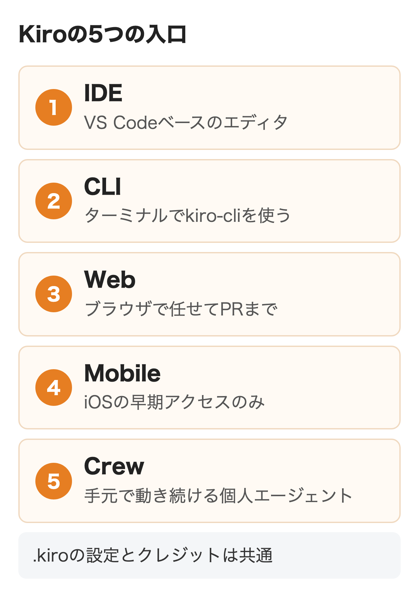
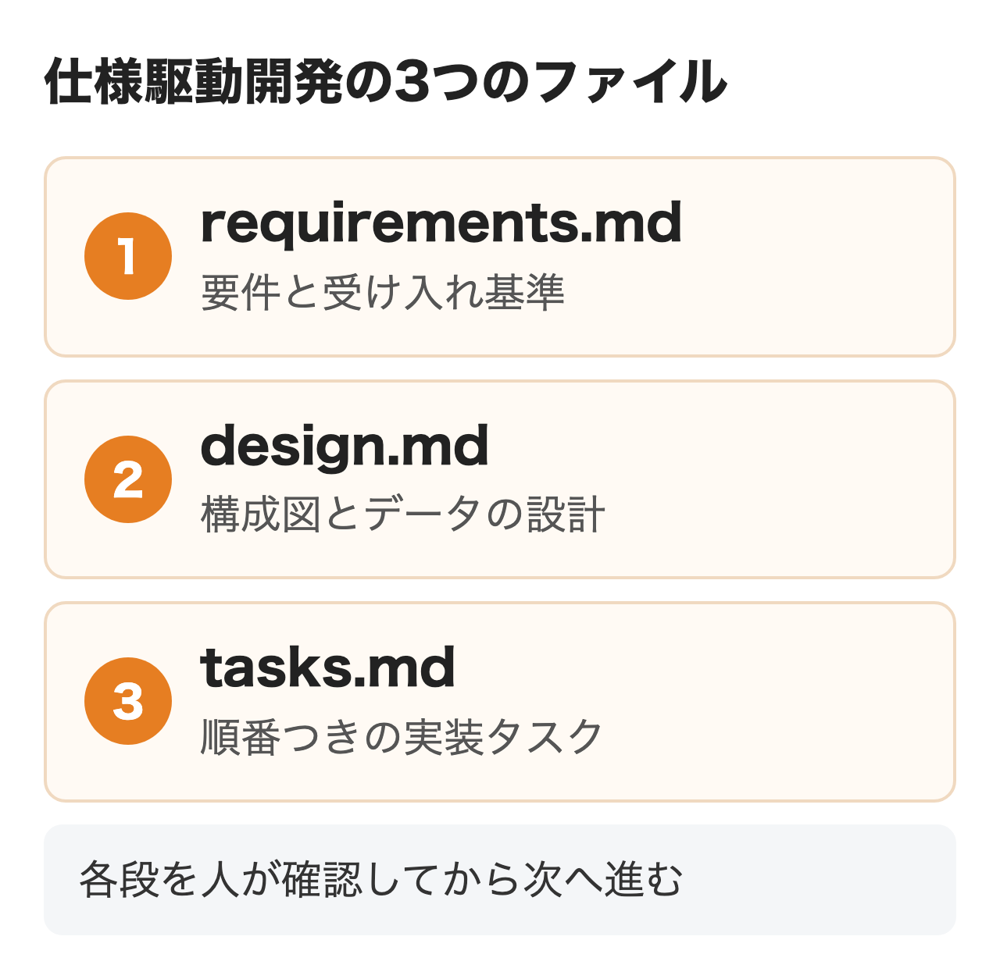
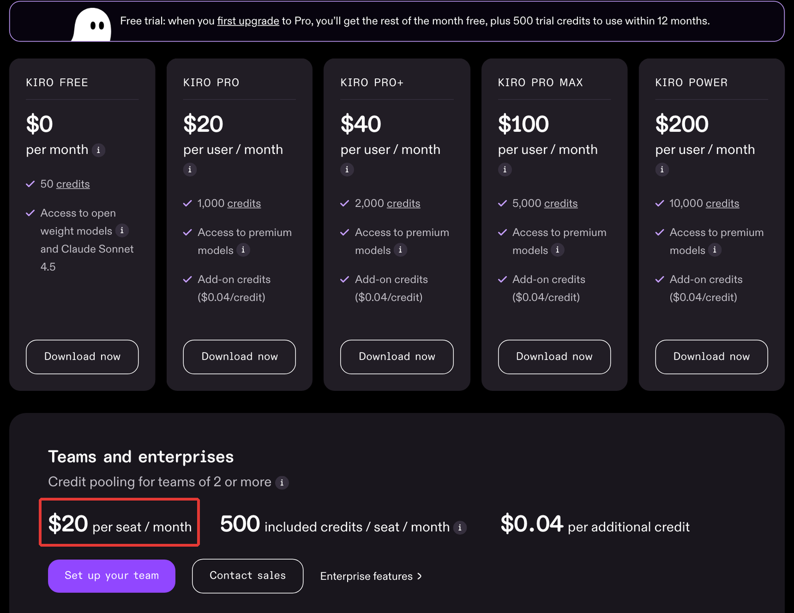
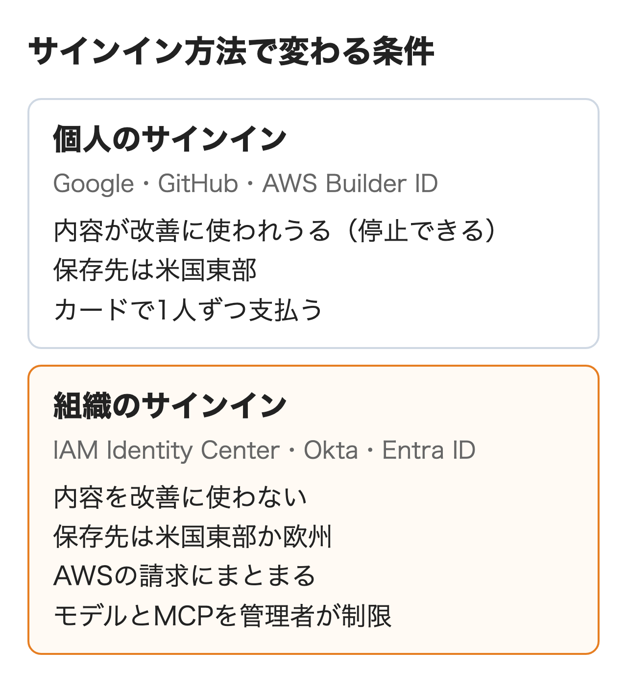

KiroはAWSが作って運用しているAI開発ツールです。**指示から要件・設計・タスクの文書を作り、それに沿ってエージェントがコードを書く仕様駆動開発が特徴**で、無料プランは月50クレジット、有料は1人月$20〜$200です。

エディタ（IDE）とターミナル（CLI）を中心に、ブラウザ版や常駐するエージェントまで入口が増えました。この記事では今の製品の構成、仕様駆動開発の進め方、料金、始め方、会社で入れるときの条件、ほかの開発AIとの違いを順に説明します。

:::takeaways
- 中心は**要件・設計・タスクの3つの文書を作ってから実装する仕様駆動開発**。IDE・CLI・Webで同じ設定を使える
- 個人はFree（月50クレジット）とPro $20〜Power $200。**チームは1人$20のシートでクレジットを共有する**
- 会社のコードを扱うなら**IAM Identity Centerなど組織のサインインで入れる**。個人のサインインでは内容が改善に使われうる
:::

## Kiroとは何か

**Kiroは1つのエージェントをエディタ・ターミナル・ブラウザなど5つの入口から使える、AWSの開発ツールです。**2025年7月にプレビューとして公開され、2025年11月に一般提供が始まりました。裏側ではAmazon Bedrockの上で複数の基盤モデルが動いています。

最初はVS Codeの土台（Code OSS）で作ったエディタでしたが、今は次の5つの形で提供されています。

| 入口 | 何をするものか | 使える人 |
|---|---|---|
| IDE | VS Codeベースのエディタ。仕様駆動開発の中心 | 無料から |
| CLI | ターミナルで動く`kiro-cli`。SSH先やCI/CDでも使う | 無料から |
| Web | ブラウザでリポジトリを指定し、PRまで任せる | Pro以上 |
| Mobile | スマホからセッションの確認と指示 | iOSの早期アクセスのみ |
| Crew | 手元のPCで動き続ける個人向けのエージェント | 無料から |

<figure class="post-figure"></figure>

どの入口でも、プロジェクトの`.kiro`フォルダに置いた設定とプランのクレジットは共通です。**まずIDEかCLIのどちらか1つから始め、慣れたら任せたい作業だけWebに回す**、という順で十分です。以前「Kiro Autonomous Agent」と呼ばれていたIssueからPRまで自動で進める機能は、今はWeb版の自律モードとして提供されています。

AWSの開発AIには以前からAmazon Q Developerがありました。**Q DeveloperのIDEプラグインと有償サブスクリプションは2027年4月30日にサポートを終え、Kiroが後継になります。**2026年5月15日から新規の申し込みは止まっており、Q Developer CLIもKiro CLIに置き換わりました。AWSコンソールの中やSlack・Teamsで使うQ Developerは終了の対象外です。

## Kiroの仕様駆動開発とは

**仕様駆動開発はいきなりコードを書かせず、先に何を作るかを文書にしてから実装させる進め方です。**AIに思いつきで指示を重ねると、どんな前提で作ったのかが後から分からなくなります。Kiroは1つの指示から3つのファイルを順に作り、人が各段で確かめてから次に進みます。

<figure class="post-figure"></figure>

- **requirements.md**: ユーザーストーリーと受け入れ基準。EARS（要件を「〜のとき、システムは〜する」の形でそろえる書き方）で書かれる
- **design.md**: 構成図、データの流れ、APIやデータベースの設計、エラー処理とテストの方針
- **tasks.md**: 依存関係の順に並んだ実装タスク。タスクごとにテストやアクセシビリティの観点も入る

ファイルは`.kiro/specs/<名前>/`に置かれるので、Gitに入れればチームでレビューできます。タスクは1つずつでも全部まとめてでも実行でき、全部のときは依存の無いタスクを同時に進めます。IDEでは要件から性質を取り出し、数百通りの入力で確かめるプロパティベーステストも使えます。

### VibeとSpecの使い分け

すべての作業に文書は要りません。**小さな修正や試作はVibe（会話で直接書かせる）、複数のファイルにまたがる機能追加や改修はSpec**、と分けるのが基本です。

不具合向けの形が、原因・修正方針・変えない振る舞いを書き出すBugfix Specです。内容が固まっている機能なら、承認の手間を省いて3つのファイルを一度に作るQuick Specも選べます。Specの質は最初の指示の具体さで決まります。対象の画面、守る制約、既存のコードの場所まで書いてから始めると、手戻りが減ります。

## ステアリングとフックで何ができる？

**チームで使うときに効くのは、ルールを覚えさせるステアリングと、決まった作業を自動で走らせるフックの2つです。**

ステアリングはプロジェクトの決まりをMarkdownで書いて`.kiro/steering/`に置く仕組みです。IDEのボタンで製品の概要（product.md）・技術スタック（tech.md）・フォルダ構成（structure.md）の3つを作れます。常に読む、特定のファイルを触るときだけ読む、呼んだときだけ読む、と読み込み方を選べるので、APIの規約はAPIのファイルを触るときだけ効かせる、といった使い分けができます。AGENTS.mdにも対応しています。

フックはファイルの保存やツールの実行などをきっかけに、コマンドかエージェントへの指示を自動で走らせる仕組みです。設定は`.kiro/hooks/`のJSONで、「TypeScriptを保存したらESLintをかける」「新しい部品を作ったらテストの雛形も作る」といった使い方をします。IDEとCLIで動き、Web版のセッションでは動きません。

**どちらもGitでリポジトリに入れれば、全員が同じルールで動くエージェントを使えます。**属人化しがちなプロンプトの工夫を、コードと同じようにレビューして管理できるのがKiroらしい点です。

外部の道具とつなぐにはMCPが使えます。FigmaやStripe、Supabaseなどの使い方とMCPの設定をまとめたPowersもあり、追加料金はかかりません。

## Kiroの料金はいくら？

**Kiroの料金は毎月のクレジットの量で決まる5つの個人プランと、チームで共有するシートの2本立てです。**金額は税別のドルで、日本の請求先住所なら消費税が加わります。

| プラン | 月額（1人） | 月のクレジット | 追加購入 |
|---|---|---|---|
| Free | $0 | 50 | できない |
| Pro | $20 | 1,000 | $0.04/クレジット |
| Pro+ | $40 | 2,000 | $0.04/クレジット |
| Pro Max | $100 | 5,000 | $0.04/クレジット |
| Power | $200 | 10,000 | $0.04/クレジット |
| チーム・企業 | 1シート$20（2人以上） | 1シート500を共有 | $0.04/クレジット |

<figure class="post-figure"><figcaption>Kiroの料金ページ（2026年11月11日）。表示は税別のドル</figcaption></figure>

クレジットは作業の量を表す単位です。短い質問なら1クレジット未満で、Specのタスクを実行すると1を超えるのが普通です。チャット・Specの作成・タスクの実行・フックの実行のどれもクレジットの消費対象です。

**クレジットの減り方は選ぶモデルで変わります。**既定のAutoを1倍として、Claude Opus 5.5は2倍、Sonnet 4.6は1.3倍、Haiku 5.5は0.06倍といった倍率が決まっています。Autoは軽いモデルで始め、行き詰まりを検知すると上位のモデルに引き継ぐ仕組みで、有料プランではClaude Opus並みの品質を基準にしています。迷ったらAutoのまま使うのが、量あたりでは得です。

Freeで使えるのはオープンウェイトのモデルとClaude Sonnet 4.5だけで、GPT-5.6やClaude Opusなどは有料プランから選べます。

### 初めて有料にするときの無料月

2026年11月1日から、Freeから初めて有料プランに上げると、**その月の残りのPro料金が無料になり、12か月使える試用クレジット500が付きます。**料金とクレジットは秒単位の日割りです。たとえば30日の月の15日にProへ上げると、支払いは$0で、日割りの533クレジットと試用の500クレジットを受け取れます。

月のクレジットは翌月に繰り越されません。足りなくなったら$5（125クレジット）から$100までのパックで買い足せ、買った分は12か月有効です。プランを上げると即時に切り替わり、下げると翌月から切り替わります。

### チームのクレジット共有

チーム・企業向けは1シート月$20でシートごとに500クレジットが共有のプールに入る形です（2人以上）。**よく使う人が、あまり使わない人の余りを使えるので、1人ずつProを配るより無駄が出にくくなります。**

管理者は利用者・グループ・プロファイルごとに上限を決め、80%と100%で通知を受けられます。上限に達した人は管理者がクレジットを買い足すまで使えなくなるため、月末に想定外の請求が来ることはありません。新しく企業で契約する場合はこの共有の形が既定です。

## Kiroの始め方と使い方

**個人で試すならIDEかCLIを入れ、Google・GitHub・AWS Builder IDのどれかでサインインすれば数分で使えます。**会社で入れる場合のサインインは次の節で扱います。

### IDEの始め方

1. [kiro.dev](https://kiro.dev/)からOSに合うインストーラーを落として実行する（macOS・Windows 10/11・Linux）
2. 初回の画面でサインイン方法を選ぶと、ブラウザが開いて認証が終わる
3. VS Codeを使っていれば、設定・拡張機能・キー割り当てを取り込む（任意）
4. 作業するフォルダを開き、チャットかSpecで始める

使える拡張機能はOpen VSXに公開されているものです。JetBrainsのIDEを使っている人は、CLIを入れてACP（エディタとエージェントをつなぐ仕組み）経由で使えます。

### CLIの始め方

CLIはmacOS・Linux・Windows 11（PowerShell）で動きます。macOSとLinuxなら次の1行です。

```bash
curl -fsSL https://cli.kiro.dev/install | bash
cd my-project
kiro-cli chat
```

macOSは`brew install kiro-cli`でも入り、Windowsは`irm 'https://cli.kiro.dev/install.ps1' | iex`を使います。初回の`kiro-cli`でブラウザのサインインに進み、ブラウザの無いサーバーでは、表示されたURLとコードを別の端末で入力します。


CLIでもSpecは`/spec new <名前>`で作り、`/spec run <名前>`でタスクを実行できます。役割ごとに道具と指示を絞ったカスタムエージェントや、手順書をまとめるSkills（`.kiro/skills/`）もCLIの機能です。CI/CDで動かすときは有料プランで発行できるAPIキーを環境変数`KIRO_API_KEY`に入れて非対話で実行します。

### Webに任せる使い方

Pro以上なら[app.kiro.dev](https://app.kiro.dev/)でGitHubかGitLabをつなぎ、ブラウザから作業を頼めます。**自律モードをオンにすると、計画から実装までを任せ、最後にPRを開くところまで進みます。**Kiroは自動でマージしないため、取り込む判断は常に人の側です。

## 会社で入れるときの条件は？

**会社で使うなら、AWSのIAM Identity CenterかOkta・Microsoft Entra IDで組織としてサインインさせるのが前提です。**同じKiroでも、個人のサインインと組織のサインインでは、データの扱い・保存先・請求・管理の範囲が変わります。

<figure class="post-figure"></figure>

| 確かめること | 個人のサインイン | 組織のサインイン |
|---|---|---|
| 方法 | Google・GitHub・AWS Builder ID | IAM Identity Center・Okta・Entra ID |
| 内容の利用 | サービス改善に使われうる（設定で停止できる） | 改善に使わない |
| 保存先 | 米国東部（バージニア北部） | Kiroプロファイルのリージョン |
| 支払い | クレジットカード | AWSアカウントの請求 |
| 管理 | なし | モデル・MCP・Web検索・APIキーを管理者が制御 |
| 記録 | なし | プロンプトのログを自社のS3に保存できる |
| 無料プラン | 使える | 使えない（有料のみ） |

### 学習とデータの扱い

公式の書き方は2か所で分かれています。企業向けのページはPro〜Powerの購読では内容を基盤モデルの学習に使わないと書いています。**一方でデータ保護のページは、FreeとGoogle・GitHub・Builder IDで払う個人の購読者の内容は、モデルの学習を含むサービス改善に使われることがある**とし、停止の手順を載せています。

社員が個人のアカウントで会社のコードを開いた場合は、この後者です。IDEなら設定のUser、Application、Telemetry and Contentの順に開き、2つのチェックを外すと止められます。組織のサインインの利用者は、最初から収集の対象外です。

### リージョンと請求

**Kiroのプロファイルを作れるのは米国東部（バージニア北部）と欧州（フランクフルト）、GovCloudだけで、東京は選べません。**プロファイルのリージョンにデータが保存され、推論も同じ地域の中で行われます。社員のIDを置くIAM Identity Centerのほうは、東京・大阪を含む19のリージョンで使えます。

GPT-5.6系のように、世界の商用リージョンで処理されるモデルもあります。データを国外に出す範囲に社内の決まりがあるなら、管理者がモデルの許可リストを使い、対象のモデルだけを選んでおくのが確実です。その場合、Autoは許可リストの外のモデルに振ることがあるため、Autoを止めて既定のモデルを決めておきます。

請求はAWSのBilling and Cost Managementに「Kiro」として載り、ほかのAWSの費用と一緒に管理できます。同じプロファイルの中で1人を2重に登録しても1回分ですが、別のリージョンのプロファイルに登録すると2重に請求されるので注意が必要です。

### 導入の手順と管理できること

1. AWSアカウントにログインし、IAM Identity Centerか外部のIDプロバイダーをつなぐ
2. AWSコンソールのKiroコンソールでプロファイルを作り、シートを買う
3. 利用者かグループをプールに追加し、上限を決める
4. 社員にIDEかCLIを配り、「Your organization」でサインインさせる

管理者は、使えるモデル・MCPサーバー・Web検索の可否・APIキーの発行を決められます。**社用のPCに設定ファイルを配れば、サインイン画面から個人の方法（Google・GitHub・Builder ID）を消すこともできます。**ブラウザ版のWebは管理者がCloud Sessionsをオンにするまで使えません。

監査や調達の確認ではKiroのIDEとCLIがHIPAAの対象で、AWSのISO/IEC 27001:2022の範囲に含まれる点が材料になります。報告書の入手先はAWS Artifactです。Pro以上の出力には知的財産の補償も付きますが、一部のモデルは除外されています。

国内では東京製鐵が全社に入れた事例をAWSが公開しています。情報システム部門を除いても、利用者は2026年7月の149人から9月の192人に増えました。最初は全社のルールをステアリングに書き、後から権限の設定と組み合わせた運用です。

会社の業務やデータにつないで動かす所まで作るなら、権限と運用の設計が必要です。nitoも[AIエージェントの構築と運用の支援](/ai-agent/)を行っています。

:::linkcard
url: /media/amazon-bedrock-guide/
title: 【2026年11月】Amazon Bedrockとは？料金・始め方・AgentCoreとの違い
desc: Kiroの土台にもなっているAmazon Bedrockの料金と、東京でClaudeを使う条件を解説しています。
:::

## Cursor・Claude Codeとの違いは？

**Kiroの強みは要件と設計の文書を残しながら進める仕様駆動開発と、AWSのIDと請求にそのまま乗る企業向けの形です。**指示を受けてコードを書き、動かして直すエージェントである点はどれも同じです。

| 比べる点 | Kiro | Cursor | Claude Code | Google Antigravity |
|---|---|---|---|---|
| 主な形 | IDE・CLI・Web | エディタ | ターミナル・IDE拡張 | 管理アプリ・IDE・CLI |
| 個人の入口 | Pro $20 | Premium $30 | Pro $20 | Pro $20 |
| 会社向け | 1シート$20 | Teams 1人$30から | Team 1人$25（年払い$20） | Gemini Enterprise 1人$30から |
| モデル | Claude・GPT・オープンウェイト | 自社と他社 | Claude | Gemini中心 |
| 管理の土台 | AWS（IAM・請求） | Cursorの管理画面 | Claudeの管理画面 | Google Cloud |

すでにAWSでIDと請求を管理している会社なら、Kiroは新しい契約先を増やさずに入れられます。エディタの補完を中心に使いたいならCursor、ターミナル中心でClaudeを使い込むならClaude Code、Google Cloudの会社ならAntigravityが候補です。ほかの道具の細かい条件は[Cursorの料金と使い方](/media/cursor-guide/)と[Google Antigravityとは](/media/google-antigravity/)が詳しいです。

:::linkcard
url: /media/codex-vs-claude-code/
title: 【2026年11月】CodexとClaude Codeを比較｜料金・管理機能・データ・併用
desc: CodexとClaude Codeの料金・使える量・管理者の設定・学習の扱いを同じ物差しで比べています。
:::

## まとめ

- まず試すなら、FreeでIDEかCLIを入れ、小さな機能を1つSpecで作ってみる
- 毎日使う開発者はPro、Specのタスクを大量に回す人はPro+以上
- 会社で入れるならIAM Identity Centerで組織のサインインにし、クレジット共有のシートで上限を決める
- Q Developerの有償版を使っている会社は、2027年4月30日までにKiroへの移行計画を立てる
- データの置き場所に決まりがあるなら、許可するモデルを選んでから配る

## よくある質問

### Kiroは無料で使えますか？

使えます。Freeは月50クレジットで、オープンウェイトのモデルとClaude Sonnet 4.5を制限つきで使えます。ブラウザ版のWebと追加クレジットの購入は有料プランだけです。

### KiroはAWSのアカウントがないと使えませんか？

個人ならAWSアカウントは要りません。Google・GitHub・AWS Builder IDのどれかでサインインできます。会社でIAM Identity Centerを使って管理する場合は、AWSアカウントでKiroのプロファイルを作ります。

### Kiroは日本語で使えますか？

チャットやSpecの指示は日本語で書けます。返答も日本語で返り、ステアリングに「日本語で答える」と書いておくと安定します。

### KiroのCLIでも仕様駆動開発はできますか？

できます。`/spec new <名前>`でSpecを作り、`/spec run <名前>`でタスクを実行します。プロパティベーステストによる確認はIDEだけの機能です。

### KiroとQ Developerはどう違いますか？

Q Developerは既存のエディタに補完やチャットを足すアシスタントで、KiroはSpec・フック・ステアリングを持つエージェントの開発環境です。Q DeveloperのIDEプラグインと有償サブスクリプションは2027年4月30日にサポートを終えます。

### Kiroで使えるプログラミング言語は何ですか？

Python・Java・JavaScript・TypeScript・C#・Go・Rust・PHP・Ruby・Kotlin・C・C++・SQLなど、日常の開発で使う主な言語に対応しています。TerraformのHCLやYAMLも対象です。

### Kiroのクレジットが足りなくなったらどうなりますか？

個人の有料プランなら$0.04/クレジットで買い足せます。チームの共有プールでは上限に達した人は管理者が買い足すまで止まります。月のクレジットは翌月に繰り越されません。

### Kiroに会社のコードを読ませても学習に使われませんか？

組織のサインイン（IAM Identity Center・Okta・Entra ID）なら、内容はサービス改善に使われません。Google・GitHub・Builder IDで使う場合は使われることがあるため、設定で停止してください。

## 出典

- [Kiro 料金ページ](https://kiro.dev/pricing/)（2026年11月11日取得）
- [Kiro ドキュメント Billing](https://kiro.dev/docs/billing/)
- [Kiro ドキュメント Installation](https://kiro.dev/docs/getting-started/installation/)
- [Kiro ドキュメント Authentication](https://kiro.dev/docs/getting-started/authentication/)
- [Kiro ドキュメント Specs](https://kiro.dev/docs/specs/)
- [Kiro ドキュメント Steering](https://kiro.dev/docs/steering/)
- [Kiro ドキュメント Hooks](https://kiro.dev/docs/hooks/)
- [Kiro ドキュメント Models](https://kiro.dev/docs/models/)
- [Kiro ドキュメント Data protection](https://kiro.dev/docs/privacy-and-security/data-protection/)
- [Kiro ドキュメント Supported regions](https://kiro.dev/docs/enterprise/supported-regions/)
- [Kiro ドキュメント Governance](https://kiro.dev/docs/enterprise/governance/)
- [Kiro ドキュメント Enterprise billing](https://kiro.dev/docs/enterprise/billing/)
- [Kiro ドキュメント Compliance validation](https://kiro.dev/docs/privacy-and-security/compliance-validation/)
- [Kiro for enterprise](https://kiro.dev/enterprise/)
- [AWS ブログ Kiro が一般提供開始](https://aws.amazon.com/jp/blogs/news/general-availability/)（2025年11月18日）
- [AWS ブログ Amazon Q Developer のサポート終了に関するお知らせ](https://aws.amazon.com/jp/blogs/news/amazon-q-developer-end-of-support-announcement/)（2026年5月1日）
- [AWS ブログ クレジットプーリングで Kiro のクレジットをチーム全体で共有する](https://aws.amazon.com/jp/blogs/news/credit-pooling/)（2026年11月5日）
- [AWS ブログ Kiro の Auto がモデルカスケードで作業に合ったモデルを使い分ける仕組み](https://aws.amazon.com/jp/blogs/news/model-cascade/)（2026年11月7日）
- [AWS ブログ 東京製鐵株式会社の Kiro 全社導入事例](https://aws.amazon.com/jp/blogs/news/tokyo-steel-kiro-case-study/)（2026年11月9日）
