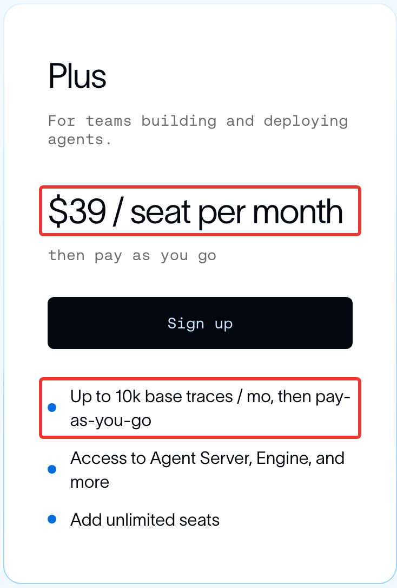
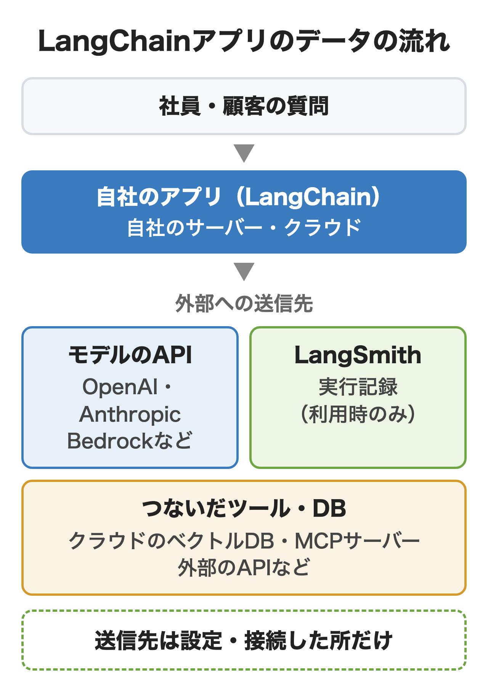
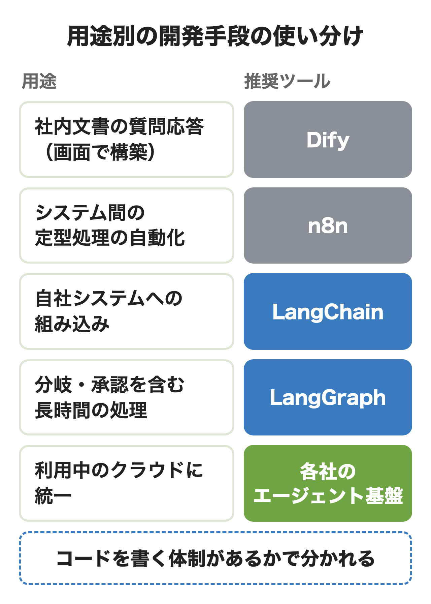

LangChainは、ChatGPTやClaudeなどの言語モデルを使うアプリやAIエージェントを、コードで組み立てるためのオープンソースのフレームワークです。本体は無料ですが、モデルのAPI代と、実行記録を残すLangSmithを使う場合はその料金が別にかかります。

この記事ではできることとLangGraph・LangSmithとの違い、費用とデータの流れ、Difyなどとの使い分けを2026年11月13日時点の公式ドキュメントで解説します。コードの実行とLangSmithの契約は試していません。

:::takeaways
- **LangChainは作る部品、LangGraphは動かす土台、LangSmithは記録と運用のサービス（1人までは無料）**。最初はLangChainだけで始められる
- **費用はモデルのAPI代とLangSmithの利用料**。LangSmithのPlusで開発者3人・月5万回の記録なら月317ドル
- **LangSmithの保存先に日本は無く、アジア太平洋はシドニー**。社内規程によっては記録を送らない設定か自社に置くプランが必要
:::

## LangChainとは？

**LangChainは言語モデルに社内のデータや外部のシステムをつなぎ、質問に答えたり作業を進めたりするアプリを少ないコードで作るためのライブラリです。** 2022年10月にHarrison Chase氏が公開し、今は米国のLangChain社が開発しています。PythonとJavaScript/TypeScriptで使え、ライセンスはMITです。

言語モデル単体は会話をまたいだ記憶を持たず、学習していない社内の文書を知らず、在庫の照会やメールの送信のような外部の操作もできません。LangChainはこの3つを補う部品を用意しており、開発者はモデルと社内のデータやシステムの間をつなぐ部分を一から書かずに済みます。

公式サイトではオープンソースの部品としてLangChain・LangGraph・Deep Agentsの3つを並べ、その上で動きを記録・評価・本番運用する、無料枠のあるLangSmithを提供しています。オープンソースのダウンロードは月3.5億回を超えると公式サイトに書かれています。2025年10月に出たバージョン1.0からはAIエージェントを作るための土台に絞り込まれ、2026年11月13日時点の最新は1.5.0です。

:::linkcard
url: /media/ai-agent-guide/
title: AIエージェントとは？生成AI・ChatGPTとの違いと仕組みをわかりやすく解説
desc: AIエージェントの定義と仕組み、ワークフローとの違いを解説しています。
:::

## LangChainでできることは？

**社内の文書に答えるRAG、ツールを選んで作業を進めるAIエージェント、会話を覚えるチャットボットや文書の要約が主な用途です。**

### 社内文書に答えるRAG

規程・マニュアル・契約書のような社内の文書を細かく分けて検索できる形で保存し、質問に近い部分を探してモデルに渡して答えさせる仕組みです。LangChainには文書の読み込み・分割・埋め込み・ベクトルデータベースへの保存と検索の部品があり、組み合わせると社内向けの質問応答を作れます。**モデルを学習し直さずに、社内の最新の文書をもとに答えさせられる**のが利点です。

### ツールを使うAIエージェント

モデルが質問を読み、どのツールをどの順で使うかを自分で決めて作業を進めます。たとえば「先週の問い合わせを集計して担当者に送って」と頼むと、データベースを照会し、集計し、メールを送るツールを順に呼ぶ流れです。ツールは自社のAPIやPythonの関数をそのまま登録できるため、**社内システムの操作をAIに任せる仕組み**の中心になります。

### チャットボット・要約・情報の抽出

前のやり取りを覚えたまま答えるチャットボット、長い議事録やレポートを分けて読ませてまとめる要約、文書から日付や金額を決まった形で取り出す抽出にも使えます。答えをJSONのような決まった形で返させる構造化出力の機能もv1で強化されました。

### MCPサーバーのツールを使う

MCPはAIと外部のツールをつなぐための共通の規格で、LangChainに「langchain[mcp]」を入れると、ベータの機能としてMCPサーバーが公開するツールをそのままエージェントに渡せます。**MCPはつなぎ方の規格、LangChainはつないだツールを使って処理の流れを組む部品**で、片方があればもう片方が不要になる関係ではありません。

:::linkcard
url: /media/mcp-guide/
title: MCPとは？仕組みとMCPサーバー・会社で使うときに管理者が決めること
desc: MCPの仕組みと主なAIの対応、管理者が決めることを解説しています。
:::

## LangChainの仕組みと主な部品は？

**今のLangChainはモデル・ツール・エージェントの3つを中心に、記憶や検索の部品と、動きを途中で変えるミドルウェアを組み合わせて作ります。** 主な部品は次のとおりです。

- **モデル**: OpenAI・Anthropic・Google・AWS・Azureなどのモデルを同じ書き方で呼ぶ部品。init_chat_modelで切り替える
- **ツール**: エージェントが呼べる関数やAPI。@toolを付けた関数をそのまま登録できる
- **エージェント**: create_agentで作る。モデルを呼び、ツールを使わせ、ツールを呼ばなくなったら終える流れを受け持つ
- **ミドルウェア**: 個人情報の伏せ字・長い会話の要約・人の承認など、エージェントの各段階に処理を差し込む仕組み
- **記憶**: 1つの会話の中の短期の記憶と、会話をまたぐ長期の記憶
- **検索の部品**: 文書の読み込み・分割・埋め込み・ベクトルデータベースとの接続

以前の解説記事でLangChainの中心として説明される「チェーン」（LLMChainなど）は、v1でlangchain-classicという別のパッケージに移りました。**新しく作るなら、公式が標準とするcreate_agentから始める**のが今の推奨です。

:::linkcard
url: /media/rag-build/
title: RAG構築とは？作り方3通りと手順・費用・自社で作るか外注か
desc: RAGの作り方の3通りと手順、つまずく所と費用を解説しています。
:::

## LangGraph・LangSmithとの違いは？

**LangChainはエージェントを作る部品、LangGraphは長く動く処理を止めずに動かす土台、LangSmithは動きを記録して評価し本番で動かす、無料枠のあるサービスです。** 公式は計画やファイル操作まで付いたDeep Agentsも並べています。

| 名前 | 役割 | 必要になる場面 |
|---|---|---|
| LangChain | モデル・ツール・エージェントの部品 | 最初の1本・チームの書き方の統一 |
| LangGraph | 状態の保存・分岐・中断と再開 | 人の承認や長時間の処理を挟む |
| Deep Agents | 計画・サブエージェント付きの土台 | 調査など手順の多い作業 |
| LangSmith | 実行記録・評価・本番運用 | 本番前の品質確認と運用 |

LangSmith以外の3つはMITライセンスで無料です。

LangChain 1.0はLangGraphの上に作られているため、**LangGraphを学ばなくても、途中で止めて再開する機能や会話の保存はLangChainのエージェントで使えます。** 逆にLangGraphはLangChainなしでも動き、決まった手順とモデルに任せる手順を1つの流れの中で細かく組みたいときの選択肢です。

LangSmithはLangChain専用ではなく、OpenAIやAnthropicのSDK、CrewAIなどで作ったアプリの記録にも使えます。まずLangChainだけで1本作り、承認や分岐が増えたらLangGraphで組み直し、社内に公開する前にLangSmithで記録を取り始める順番が無理のない進め方です。

## LangChainを使うメリットは？

**モデルを替えやすく、連携先の部品が多く、細かい制御をコードで書ける点がLangChainを選ぶ理由になります。**

### モデルを差し替えやすい

公式のクイックスタートはOpenAI・Anthropic・Google・Amazon Bedrock・Azure・Ollamaのうち、ほとんどはモデル名の1行を変えるだけの同じコードで書かれています（Azureは配置名の指定が加わります）。**特定のAI企業に縛られず、値段や精度を比べて後から乗り換えられる**ため、モデルの値下げや新しいモデルの登場に合わせやすいのも利点です。

### 連携先と部品が多い

ベクトルデータベース・ファイル置き場・業務ツールとの接続の部品が公式とコミュニティから出ており、自社で書く部分を減らせます。

### 細かい制御をコードで書ける

ミドルウェアを使うと、モデルに送る前にメールアドレスやカード番号を伏せる、会話が長くなったら要約する、メールの送信だけは人が承認してから実行する、といった制御を数行で入れられます。**社内の規程に合わせた細かい決まりをコードで守らせられる**のは、画面で組み立てる製品との大きな違いです。

## LangChainのデメリットと注意点は？

**版によって書き方が大きく変わり、保守とサポートを自社で持つ必要があり、Pythonなどを書ける担当者がいないと運用できない点が主な注意点です。**

### 版によって書き方が大きく違う

2025年10月のv1で、エージェントの作り方はcreate_agentに統一され、チェーンや一部の検索の部品はlangchain-classicに移りました。2023年ごろの解説にあるLLMChain・initialize_agent・ConversationChainは、今の推奨の書き方ではありません。**検索で見つけたコードをそのまま使うと、古い書き方が混ざる**ため、公式のドキュメントで版を確認してから使う必要があります。

公式のリリースの方針によると1.0は長期サポートの版で、2.0が出てからも少なくとも1年は保守が続きます。旧版の0.3は保守のみの扱いで、サポートは2026年12月までです。0.3で作ったアプリがある会社は、年内に1.x への移行を計画しておくと安全です。

### 保守とサポートは自社で持つ

LangChain本体はオープンソースのため、不具合が起きても開発元が対応を約束するサポートはありません。更新も頻繁で、依存するモデルの各社のAPIの変更にも追従する必要があります。開発元のSLA付きのサポートは有料のLangSmith Enterpriseに付きます。オープンソースの部分の不具合まで対象になるかは契約で確認が必要で、構築した会社に保守を依頼する方法もあります。

### コードを書ける担当者が必要

LangChainはPythonかJavaScriptで書く前提のライブラリで、画面で組み立てる機能はありません。部品が抽象化されている分、思いどおりに動かないときに中で何が起きているかを追うのも簡単ではなく、LangSmithのような記録の仕組みがほぼ必須になります。

## LangChainの料金は？どこで費用がかかる？

**LangChain・LangGraph・Deep Agentsは無料で、費用がかかるのはモデルのAPI代、LangSmithの利用料、アプリを動かすサーバー代の3つです。** MITライセンスなので商用にも使えます。

モデルのAPI代はOpenAIやAnthropic、Amazon Bedrockなどモデルを提供する各社から、送受信した量に応じて請求される仕組みです。LangChainを通しても金額は変わりません。LangSmithのプランは次のとおりで、支払いは米ドルです。

| プラン | 月額（1人あたり） | 含まれる実行記録 | 主な違い |
|---|---|---|---|
| Developer | 0ドル | 月5,000件 | 1人まで |
| Plus | 39ドル | 月10,000件 | 人数無制限・Agent Server小1台が無料 |
| Enterprise | 個別見積もり | 個別 | 自社環境に設置・独自のSSO・SLA |

<figure class="post-figure"><figcaption>LangSmithの料金ページのPlusプラン（2026年11月13日）</figcaption></figure>

**実行記録（トレース）はアプリが1回動いた分の記録で、含まれる件数を超えると1件0.005 LSU（1 LSUは1ドル）がかかります。** 通常の記録の保存期間は14日で、評価などで残すと180日の長期保存になり、1件につき0.0025 LSUが加わります。

たとえば開発者3人で、月5万回動く社内エージェントをPlusで記録すると、3人分の39ドルで117ドル、含まれる1万件を超えた4万件で200ドルになり、**月317ドル（税別・モデルのAPI代は別）**です。社員に招待しただけの人も人数に数えられ、月の途中で増やした分は日割りで請求されます。

まずは無料のDeveloperで1人が記録を取り、1回の実行あたりのモデル代と月の件数の見込みを出してから、Plusに上げるかを決めるのが無駄のない順番です。LangSmithには利用額の上限をワークスペースごと・組織全体で設定する機能もあります。

## データはどこを通りどこに保存される？

**LangChainは自社のサーバーの中で動くライブラリで、データが外に出るのは、設定したモデルのAPI、使う場合のLangSmith、それにコードでつないだ外部のサービス（クラウドのベクトルデータベース・MCPサーバー・外部のAPIなど）です。**

<figure class="post-figure"></figure>

LangSmithのクラウドは5つの地域から選べ、**日本の地域はありません。** データは登録したときに選んだ地域に置かれ、今は別の地域への移行に対応していないと公式のよくある質問に書かれています。

| 地域 | 置かれる場所 | ログインの情報 |
|---|---|---|
| GCP US（既定） | 米国アイオワ | 米国バージニア |
| GCP EU | オランダ | ドイツ |
| GCP APAC | オーストラリア・シドニー | シドニー |
| AWS US | 米国オハイオ | 米国オハイオ |
| Azure US | 米国アイオワ | 米国バージニア |

どの地域でも、支払いと請求の情報の置き場所は米国です。料金ページの表は「米国かEU」のままですが、地域のよくある質問には、無料を含むすべてのプランで各地域を選べ、料金も同じと書かれています。

LangSmithは送られたデータをモデルの学習に使わないと料金ページのよくある質問で明言しています。GDPRへの準拠、SOC 2 Type 2の認証、HIPAAへの対応も公表しており、データ処理の契約（DPA）はサポート窓口で結べます。LangGraphのサーバーの説明では、LangSmithのAPIキーを設定するまで記録は送られない既定です。

記録を国外に置けない会社には、LangSmithを使わずに別の記録の仕組みを使う、Enterpriseで自社のクラウドに設置する、LangSmithの設定で入力と出力を記録から隠すか、個人情報を伏せてから記録する、の3つの方法があります。

## LangChainの使い方は？最初の1本はどう作る？

**Pythonとモデルの会社のAPIキーがあれば、公式のクイックスタートどおり十数行でツールを1つ持つエージェントを作れます。** 細かい書き方の参照先は公式の[LangChainのクイックスタート](https://docs.langchain.com/oss/python/langchain/quickstart)です。

### ① PythonとAPIキーを用意する

Python 3.11以上を入れ、OpenAI・Anthropic・Googleなど使うモデルの会社でAPIキーを発行します。キーはコードに書かず、環境変数に入れて読ませるのが基本です。会社で使うなら、個人のアカウントでなく会社の契約でキーを発行しておくと、請求と管理が分かれずに済みます。

### ② LangChainを入れる

ターミナルで「pip install -U langchain "langchain[anthropic]"」のように、本体と使うモデルの部品を入れます。OpenAIなら「langchain[openai]」、Amazon Bedrockなら「langchain-aws」です。

### ③ ツールを1つ持つエージェントを作る

次は在庫を答える関数をツールとして渡す例です。公式のクイックスタートの書き方に合わせて作った例で、実行は試していません。

```python
from langchain.agents import create_agent

def get_stock(item: str) -> str:
    """商品名を受け取り在庫数を返す"""
    return f"{item}の在庫は12個です"

agent = create_agent(
    model="claude-sonnet-4-6",
    tools=[get_stock],
    system_prompt="社内の在庫の質問に答えるアシスタントです",
)
result = agent.invoke(
    {"messages": [{"role": "user", "content": "A4用紙の在庫は？"}]}
)
print(result["messages"][-1].content)
```

get_stockの中身を自社の在庫システムへの照会に置き換えれば、そのまま社内向けの試作になります。

### ④ LangSmithで動きを確認する

LangSmithで記録先のエージェントを1つ作り、LANGSMITH_TRACING=true、LANGSMITH_API_KEY、エージェントのIDをLANGSMITH_AGENT_ID、環境（localなど）をLANGSMITH_AGENT_ENVIRONMENTに入れると、モデルを何回呼び、どのツールをどの順で使ったかが画面で見られます。社員に試してもらう前に、意図しないツールを呼んでいないか、1回あたりのモデル代がいくらかをここで確認しておくと安心です。米国以外の地域（シドニーなど）で登録した場合は、地域のAPIのURLをLANGSMITH_ENDPOINTにも入れます。

## Dify・n8n・クラウドの基盤とどう使い分ける？

**画面で社内向けのAIアプリを作るならDify、システム間の決まった処理の自動化ならn8n、自社のシステムや製品に組み込んで細かく制御するならLangChainが向いています。**

<figure class="post-figure"></figure>

DifyとLangChainの差は、画面で組むかコードで書くかです。Difyは担当者が画面で規程に答えるボットを作って配るまでを短く済ませられ、LangChainは社外向けの製品や既存の業務システムの中に組み込むときに向きます。同じLangChain社のLangSmith Fleetは、テンプレートから始めてコードなしでエージェントを作れるノーコードの製品で、画面で作る用途ならこちらも候補です。システム間の定型処理の自動化に向くn8nは、[n8nの解説記事](/media/n8n-guide/)にまとめています。

AWS・Microsoft・Googleのエージェントの基盤とは、二者択一ではありません。Amazon BedrockのモデルはLangChainから呼べ、[Microsoft Foundry](/media/microsoft-foundry/)のホスト型エージェントはLangGraphで作ったものを載せられます。**モデルや本番の置き場所はクラウドに任せ、エージェントの中身をLangChainで書く**組み合わせも一般的です。

:::linkcard
url: /media/dify-guide/
title: Difyとは？できること・使い方・クラウドとセルフホストの選び方
desc: Difyでできること、アプリの種類の違い、クラウドとセルフホストの選び方を解説しています。
:::

## 会社でLangChainを使う前に決めること

**どれを使うか、費用の上限、データの保存先、誰が保守するかの4つを、作り始める前に決めておくと後戻りが減ります。**

- **使う範囲**: LangChainだけで始めるか、承認や長時間の処理があってLangGraphまで使うか、本番の記録にLangSmithを契約するか
- **費用の上限**: モデルのAPI代の月の上限と、LangSmithの利用額の上限。1回の実行あたりのモデル代を試作で計測してから決める
- **データの保存先**: LangSmithの地域（日本は無い）を社内規程で認めるか。認めない場合は記録を送らないか、Enterpriseで自社に置く
- **保守の担当**: 版の更新とモデル各社のAPIの変更に誰が追従するか。0.3で作ったアプリがあれば2026年12月までに移行する
- **作るか選ぶか**: 画面で作れる範囲ならDifyやCopilot Studioなどの既製の基盤で足りないかを先に確認する

自社の業務システムにつなぐエージェントを、設計から保守の体制まで含めて作る場合は、nitoの[AIエージェント構築支援](/ai-agent/)でも相談を受けています。

## まとめ

- **社内の質問応答を早く配りたいだけ**なら、LangChainより先にDifyや既に契約しているサービスの機能を確認する
- **自社システムや製品に組み込みたい**なら、LangChainのcreate_agentで1本作り、承認や分岐が増えたらLangGraphへ広げる
- **社員や顧客に公開する前**には、LangSmithの無料枠で記録を取り、1回あたりのモデル代と動きを確認する
- **記録を国外に置けない**なら、LangSmithを使わない構成かEnterpriseの自社設置を前提に見積もる

## よくある質問

### LangChainは無料で使えますか？

LangChain・LangGraph・Deep AgentsはMITライセンスのオープンソースで、無料で使えます。費用がかかるのはモデルのAPI代と、使う場合のLangSmithの利用料、アプリを動かすサーバー代です。

### LangChainは商用利用できますか？

できます。MITライセンスなので改変や再配布も認められており、配布するときは著作権とライセンスの表示を残す必要があります。つなぐモデルやツールの各社の利用規約の確認は別に必要です。

### LangChainの読み方は？

「ラングチェーン」と読みます。LangGraphは「ラングラフ」、LangSmithは「ラングスミス」です。

### LangChainとLangGraphはどちらを使いますか？

最初はLangChainのcreate_agentで十分です。人の承認を途中に挟む、決まった手順とAIの判断を混ぜる、数時間かかる処理を止めずに続けるといった細かい制御が必要になったらLangGraphを使います。LangChainはLangGraphの上で動いているため、移っても書き直しは一部で済みます。

### LangChainとMCPは何が違いますか？

MCPはAIと外部のツールをつなぐ規格で、LangChainはそのツールを使ってエージェントの処理を組む部品です。LangChainの「langchain[mcp]」を入れると、MCPサーバーのツールをLangChainのエージェントで使えます。

### LangChainはPython以外でも使えますか？

JavaScript/TypeScript版があり、公式のドキュメントもPython版と並べて用意されています。

### LangSmithに送ったデータはAIの学習に使われますか？

使われません。LangSmithは送られた記録・プロンプト・出力をモデルの学習に使わないと料金ページで明言しています。保存先は登録時に選んだ地域で、日本の地域はありません。

### 古い記事に出てくるLangServeとは何ですか？

LangChainで作った処理をAPIとして公開する仕組みとして、以前の解説に出てきた名前です。2024年11月に公式に非推奨になり、GitHubのリポジトリも更新を止めています。後継はLangGraph Platformで、2025年10月にLangSmith Deployment、今はLangSmith Agent Serverという名前です。

## 出典

すべて2026年11月13日に確認しました。

- LangChain「[LangChain overview](https://docs.langchain.com/oss/python/langchain/overview)」「[What's new in LangChain v1](https://docs.langchain.com/oss/python/releases/langchain-v1)」「[Release policy](https://docs.langchain.com/oss/python/release-policy)」
- LangChain「[LangGraph overview](https://docs.langchain.com/oss/python/langgraph/overview)」「[Runtimes, frameworks, and harnesses](https://docs.langchain.com/oss/python/concepts/products)」「[Model Context Protocol (MCP)](https://docs.langchain.com/oss/python/langchain/mcp)」
- LangChain「[LangSmith Plans and Pricing](https://www.langchain.com/pricing)」「[Usage and billing](https://docs.langchain.com/langsmith/usage-and-billing)」「[Billing](https://docs.langchain.com/langsmith/billing)」
- LangChain「[Cloud (SaaS)](https://docs.langchain.com/langsmith/cloud)」「[Regions FAQ](https://docs.langchain.com/langsmith/regions-faq)」「[Data storage and privacy](https://docs.langchain.com/langsmith/data-storage-and-privacy)」「[LangSmith Agent Server](https://docs.langchain.com/langsmith/deployment)」「[LangGraph Platform GA](https://blog.langchain.com/langgraph-platform-ga)」「[Mask inputs and outputs](https://docs.langchain.com/langsmith/mask-inputs-outputs)」
- LangChain「[LangChain quickstart](https://docs.langchain.com/oss/python/langchain/quickstart)」「[Observability quickstart](https://docs.langchain.com/langsmith/observability-quickstart)」「[Migrate to agent-based workspaces](https://docs.langchain.com/langsmith/migrate-to-agent-based-workspaces)」「[LangSmith Fleet](https://docs.langchain.com/langsmith/fleet)」
- LangChain公式サイト「[LangChain: the open agent platform](https://www.langchain.com/)」
- GitHub「[langchain-ai/langserve](https://github.com/langchain-ai/langserve)」「[langchain-ai/langchain のライセンス](https://github.com/langchain-ai/langchain/blob/master/LICENSE)」、PyPI「[langchain](https://pypi.org/project/langchain/)」
- AWS「[LangChain とは何ですか?](https://aws.amazon.com/jp/what-is/langchain/)」、IBM「[LangChainとは](https://www.ibm.com/jp-ja/think/topics/langchain)」
