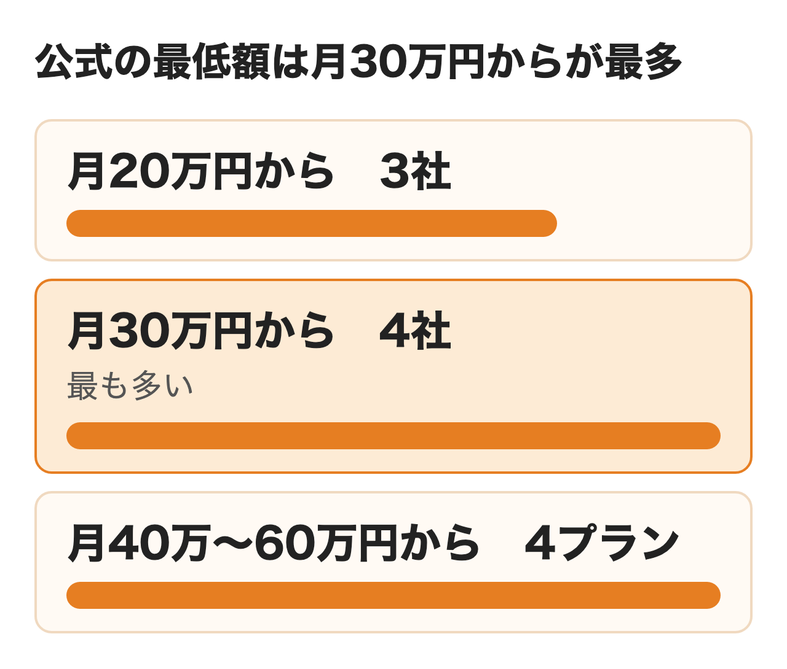
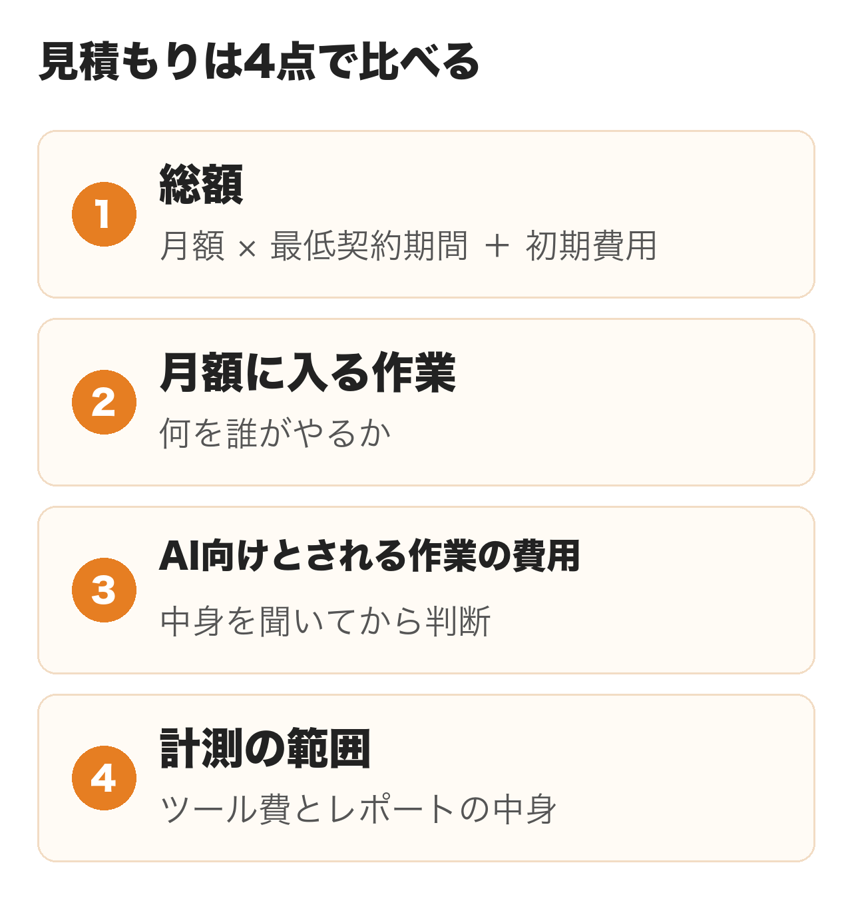

AIO対策の費用は、公式サイトに料金を載せている支援会社11社で見ると、継続して支援を頼む月額で**月20万〜70万円から**です。最も多いのは**月30万円から**で、単発の診断は15万〜40万円から、計測ツールは月3万円からあります。

中小企業向けなら月7万円（エイチリンク・助言のみ・税別）や月15万円（フォワードX・記事月3本まで・税抜）のプランもあります。同じ月30万円でも助言までの会社と外部対策まで行う会社があるため、比べるのは月額に入る作業と、最低契約期間をかけた総額です。この記事では11社の金額で、頼む内容ごとの費用と見積もりの見方をまとめました。執筆はAIO対策を支援する株式会社nitoです。

:::takeaways
- 公式に料金を載せる支援会社11社の月額の最低額は**月20万〜70万円**。最も多いのは月30万円から
- 単発の診断は15万〜40万円から、計測ツールは月3万円（DolphinX AIO、税別・6か月契約）からの例がある
- 同じ月額でも作業の範囲が違うため、**最低契約期間をかけた総額と月額に入る作業**で比べる
:::

## AIO対策の費用相場はいくら？

頼む内容ごとの費用の目安は次のとおりです。金額はどれも公式に載っている最低額で、上限は見積もりになります。

| 頼む内容 | 公式の最低額 |
|---|---|
| 計測ツール | 月3万円から（DolphinX AIO、税別・6か月契約） |
| 単発の診断 | 15万〜40万円から |
| 継続支援（助言中心） | 月20万〜70万円から |
| 継続支援（制作・実装まで） | 月20万〜60万円から |

作業の中身は下の「依頼の型」で比べています。

公式の料金ページで金額を確認できた11社では、継続支援の月額の最低額が月20万円から70万円までに収まります。**最も多いのは月30万円からで、ナイル（LLMO単体）・ジオコード（SEOとの組み合わせの例）・バクリ・ニュートラルワークスの4社**でした。月100万円以上を最低額に置く会社は、確認した中にはありません。

<figure class="post-figure"></figure>

表の選定基準はnitoの比較記事（LLMO対策の会社・AIO対策会社・LLMO診断）に載せている会社のうち、2026年11月25日に公式の料金ページで金額を確認できたことです。月額の安い順に並べました。金額はどれも「〜から」の最低額で、上限は各社とも見積もりになります。

| 会社 | 公式の最低額 | 最低契約期間 | 月額に入る主な作業 |
|---|---|---|---|
| メディアグロース | 月20万円〜 | 1か月〜 | 記事の見出しの作成と改善・執筆・専門家監修・PR・月次レポート（被リンク獲得の代行は別料金で月10万円〜＋成果報酬） |
| アドカル | 月20万円〜（診断20万円） | 記載なし | 定例ミーティング・月次レポート・サービスページの改善・コンテンツ改善 |
| クーミル | 運用代行20万円〜（一例） | 記載なし | 定期調査・競合との差分分析・外部評価の強化・サービスページと記事とFAQの改善 |
| ナイル | LLMO単体 月30万円〜、SEOとセット 月60万円〜 | 記載なし | 単体は調査・戦略立案・改善提案・定期レポート。セットは施策の実装支援まで |
| ジオコード | 月30万円〜（SEOとの組み合わせの例） | 記載なし | SEOコンサルティング・AIO・LLMO・コンテンツマーケティングの組み合わせ |
| バクリ | 月30万円〜 | 3か月〜 | 事業領域と対策キーワードの規模に合わせた支援。内製化支援を含む |
| ニュートラルワークス | 30万円（税別）〜 | 6か月〜 | 調査と分析・戦略策定・内部対策・外部対策 |
| TechSuite | 月40万円〜（最小構成の目安） | 記載なし | 助言・施策の要件定義・効果測定 |
| ウィルゲート | 月45万円〜 | 6か月のパッケージ | 分析と診断・ページとコンテンツの改善の実施・モニタリング環境の整備 |
| デジタルアイデンティティ | 月約60万円〜 | 6か月〜 | 診断・戦略・記事作成・コンテンツ改修 |
| PLAN-B | 月70万円〜（2か月目以降）。初月の調査は90万円〜 | 記載なし（6〜12か月の取り組みを推奨） | 認識調査・SEO/LLMOコンサルティング。記事は別料金で1本8万円〜 |

**同じ月額でも、月額に入る作業は会社ごとに違います。**同じ月30万円からでも、ナイルのLLMO単体は調査・戦略立案・改善提案とレポートまでで、ニュートラルワークスは内部対策と外部対策まで含む内容です。月20万円からのメディアグロースは、プランのサービス内容に文章の執筆と被リンクの獲得まで挙げています。ウィルゲートが公式で説明しているとおり、サイトの規模や課題と施策の量で金額が大きく変わるため、上限は見積もりでの提示です。

料金ページに金額を載せていない会社もあります（メディアリーチ・CINC・LANY・Speee・QUEUE・シード・Hakuhodo DY ONE）。このうちCINCは支援範囲に応じた個別の見積もりで、契約期間の縛りはないという案内です。まずは自社に必要な作業が入っている会社を2〜3社選び、同じ条件で見積もりを取るのがおすすめです。中小企業向けのプランは[中小企業向けのAIO対策会社](/media/smb-aio-companies/)で比べられます。

:::linkcard
url: /media/llmo-companies/
title: 【2026年11月】LLMO対策の会社おすすめ20選・比較表と費用相場・選び方
desc: 20社の特徴・実行の範囲・費用を比較表で解説しています。
:::

### 外注している会社が払っている月額

すでに外注している企業への調査では、公式の最低額より一段高い月額の回答が多く出ています。株式会社PRIZMAが2026年8月6日に発表した調査（2026年7月23日〜27日、LLMO対策を外注している従業員30人以上・年商5億円以上の企業の418人）では、実際に払っている月額は「40万円程度」が18.4%、「50万円程度」が17.2%、「30万円程度」が15.1%でした。

この3つで回答の半数（50.7%）を占め、外注している企業の月額は30万〜50万円に集まっています。ただし回答者は規模の大きい企業に限られ、調査したPRIZMAもLLMO関連のサービスを提供する会社です。**中小企業の平均ではなく、規模の大きい企業の実績値として読む**のが適切でしょう。

### 単発の診断と計測ツールの費用

単発の診断は**15万〜40万円から**です。クーミルの診断が15万円から（一例）、アドカルの診断が20万円、メディアグロースの単発の診断が30万円から、TechSuiteの初期包括調査（単月）が40万円からになります。メディアグロースは毎月20社に限って無料の診断も受け付けており、無料で受けられる診断は[LLMO診断・AIO診断の無料サービス10選](/media/llmo-shindan-companies/)にまとめました。

AIの回答を自社で計測するツールもあります。メディアリーチが前提にするDolphinX AIOは月3万円（税別・6か月契約）からです。ミエルカGEOは単一サイトプランが月49,800円（税抜）、複数サイトプランが月99,800円（税抜）で、どちらも別途初期費用がかかります。100プロンプト以上の計測などの追加オプションは月50,000円（税抜）からです。**診断で現状を知り、計測ツールで推移を追うだけなら、継続支援の月額より低い費用で始められます。**

## AIO対策の費用は依頼の型でどう違う？

AIO対策・LLMO対策の費用は依頼の型の名前より**月額にどの作業が入るか**で決まります。AIO対策とLLMO対策は、ChatGPTやGoogleのAIによる概要など、AIの回答で自社が挙がるようにする同じ取り組みを指すことが多く、呼び名で費用は変わりません。GoogleのAIによる概要だけを指してAIO対策と呼ぶ使い方もあり、言葉の違いは[AIO対策とは](/media/aio-taisaku/)にまとめました。

上の11社の公開料金を月額に入る作業で3つの型に分けると次のとおりです。

| 依頼の型 | 主な作業 | 公式の最低額 |
|---|---|---|
| 単発の診断 | AIの回答での言及と引用の調査・改善の優先順位の整理 | 15万〜40万円から |
| 助言中心の月額 | 定期調査・戦略立案・改善提案・レポート | 月20万〜70万円から |
| 制作・実装を含む月額 | 記事の執筆・サイトの改修・外部対策 | 月20万〜60万円から |

**執筆までをサービス内容に挙げる月20万円からのプランもあり、実行まで頼むと月50万円以上になるとは限りません。**制作・実装を含む型の最低額は、メディアグロースの20万円から、ナイルのSEOとのセットとデジタルアイデンティティの60万円からまで広がっています。月に書く記事の本数・サイトへの反映を誰が行うか・サイトの外への掲載依頼が入るかといった作業の量で差が出ます。見積もりは型の名前ではなく、作業の行ごとに並べて比べるのがおすすめです。

### 成果報酬型の費用

成果報酬の料金を公式に載せている会社は、今回の11社にはありませんでした。11社の公開料金はすべて月額か単発の金額です。成果報酬型は何を成果とみなすかで中身が大きく変わるため、成果の定義と計測の方法を契約前に確認する必要があります。

:::linkcard
url: /media/performance-based-llmo/
title: 成果報酬型のLLMO対策とは？成果地点で見抜く、損しない選び方
desc: 成果の定義の種類と、成果報酬型を選ぶときの確認点を解説しています。
:::

## 費用が変わる4つの要因

見積もりの金額を左右するのは、主に次の4つです。ウィルゲート・デジタルアイデンティティ・ニュートラルワークスも、サイトの規模や施策の量、求めるKPIで金額が変動すると公式に書いています。

1. **作業の範囲**：調査と助言だけか、記事の執筆・サイトの改修・サイトの外への掲載依頼まで含むか
2. **狙う質問と計測するAIの数**：自社の名前を出したい質問をいくつ決め、ChatGPT・Gemini・GoogleのAIによる概要などのどこまでを計測するか
3. **制作と修正の量**：月に書く記事や直すページの本数と、サイトの規模
4. **最低契約期間**：6か月からの会社（ニュートラルワークス・ウィルゲート・デジタルアイデンティティ）と、1か月から契約できる会社（メディアグロース）がある

月額が低いプランを見たら、この4つのどれが絞られているかを先に確認すると、金額の差の理由が分かるはずです。助言に絞られたプランなら実行は自社の担当になり、質問やAIの数が少ないプランなら、計測できる範囲も狭くなります。**金額だけで比べると、必要な作業が入っていない契約を選んでしまう**おそれがあります。

## 依頼先を選ぶときに確認すべきこと

見積もりは月額だけでなく、**最低契約期間をかけた総額・月額に入る作業・AI向けとされる作業の費用・計測の範囲**の4点で比べるのがおすすめです。

<figure class="post-figure"></figure>

### 総額を最低契約期間で計算する

総額は月額に最低契約期間をかけ、初期費用を足して出します。たとえばニュートラルワークスの30万円（税別）からのプランを最低の6か月続けると、**総額は180万円（税別）から**です。初期費用や追加の作業の費用は含まない計算のため、実際の見積もりはこれより上になります。

税別と明記している会社と、税の扱いを書いていない会社があります。見積もりを並べる際は税込みの総額に統一して比べてください。

### 月額に入る作業を項目ごとに確認する

同じ金額でも、記事を月に何本書くか、サイトへの反映を誰が行うか、サイトの外への掲載依頼が入るかで中身が変わります。狙う質問と計測するAIの数、報告の頻度も、契約前に書面で確認しておくのがおすすめです。**月額に入らない作業は別の見積もりか自社の作業になります。**

### llms.txtなどAI向けとされる作業の費用を確認する

「llms.txtの設置」「AI向けの構造化データ」のような名目の費用が見積もりにあったら、何の作業かを確認してください。GoogleはAIによる概要やAIモードに表示されるために、追加の要件や特別な最適化は必要ないと説明しています。AI用のテキストファイルや新しいマークアップ、特別な構造化データも、表示のために作る必要はないとしています。

構造化データの整備そのものに意味がないという説明ではありません。**Googleの AI の表示のためだけに追加で必要な作業は無い**ので、その名目の費用は中身を聞いてから判断できます。

### 計測とレポートの範囲を確認する

計測ツールの費用が月額に含まれるか、別料金かの確認も必要です。ミエルカGEOはツールの月額とは別に初期費用がかかる例でした。報告がAIの回答での言及だけか、AI経由の流入や問い合わせまで見るかで、社内への説明のしやすさも変わります。計測の方法は[AI検索対策の効果はどう測る？](/media/ai-search-measurement/)で解説しています。

## 戦略だけの契約で起きる失敗

月額が低い助言中心のプランは、**記事の執筆やサイトの修正を自社で回せる会社に向いたプランです。**ナイルはLLMO単体のプランを、すでに自社でSEOに取り組んでいる会社向けとして案内しています。

社内に実行の人手が無いまま助言中心の契約を結ぶと、レポートと改善案は届くものの、記事の執筆や外部への掲載依頼が進まない状態になりがちです。契約書に「戦略策定」「レポート提出」「助言」としか書かれていなければ、実行の主体は依頼する側に残ります。実行を社内で担うなら外注費の代わりに担当者の時間がかかり、その分も費用として見込む必要があります。この落とし穴は[LLMOに小手先の戦略は通じない](/media/no-quick-fix-llmo/)でも取り上げました。

:::linkcard
url: /media/llmo-inhouse-vs-outsource/
title: AI検索対策は内製と外注どちらがいい？自社でできる範囲と頼るべき範囲
desc: 自社でできる工程と外部に依頼する工程の分け方を解説しています。
:::

## LLMO対策の費用対効果は社内でどう説明する？

社内では**総額を先に出し、その総額の回収に問い合わせが何件必要か**を示すと判断しやすくなります。総額は前の節の最低契約期間の計算で出し、問い合わせから受注する割合と1件の受注の粗利から、回収に必要な件数を逆算します。計算には売上ではなく粗利を使うのが適切です。

LLMO対策の効果はAIの回答に名前が出る・引用元に自社のページが付く・指名検索と問い合わせが増える、の順に表れます。始めて数か月は問い合わせより前の段階の数字で進み具合を見ることになるため、その数字を社内への報告に入れておくのがおすすめです。実行まで進めて成果を出した例は[リード140件・ROI64倍。海外SaaSのLLMO成功事例](/media/fiska-case-study/)で紹介しています。

:::linkcard
url: /media/llmo-effect/
title: 【2026年11月】LLMO対策に効果はある？3つの段階と期間の目安・費用対効果
desc: 効果の3つの段階と、回収に必要な問い合わせ件数の出し方を解説しています。
:::

## nitoに依頼する場合の費用

nitoは料金を公式サイトに載せておらず、月額は狙う質問の数と制作する記事などの量で決めています。

依頼の前には[無料の現状分析レポート](/llmo/)で、いまのAIの回答で自社の名前が挙がるかをお伝えするのが最初の手順です。問い合わせや購入につながるまで、計測から分析、サイトの改善と記事の制作、公開後の運用までを一気通貫で支援します。

## まとめ

- 相場の目安を知りたい会社は、公式に料金を載せる会社の最低額（月20万〜70万円から、最も多いのは30万円から）を基準にする
- 社内に記事やサイトを修正する人手が無い会社は、執筆や改修が月額に入るプランを比べる。月15万円（記事は月3本まで）からのプランもある
- 見積もりを受け取った会社は、最低契約期間をかけた税込みの総額と、AI向けとされる作業の費用の中身を確認する
- 社内の稟議が必要な会社は、総額と回収に必要な問い合わせの件数を並べて説明する

## よくある質問

### AIO対策は最低いくらから始められますか？
単発の診断なら15万円から（クーミルの一例）、継続の支援なら月20万円からの会社があります（メディアグロース・アドカル）。クーミルの運用代行も20万円からです（一例）。計測ツールは月3万円（DolphinX AIO、税別・6か月契約）からで、中小企業向けには月7万円（エイチリンク、助言のみ・税別）や月15万円（フォワードX、記事は月3本まで）のプランもあります。無料の診断を受け付けている会社もあります。

### AIO対策とLLMO対策で費用は変わりますか？
呼び名で費用は変わりません。多くの会社が同じ取り組みとして扱っており、費用を分けるのは作業の範囲、狙う質問と計測するAIの数、制作の量、契約期間です。

### LLMOコンサルの費用に幅があるのはなぜですか？
助言までか、記事の執筆やサイトの改修まで行うかで作業の量が違うためです。同じ月30万円からでも、調査と改善提案までの会社と、外部対策まで含む会社があります。

### LLMO対策は月額が高いほど良い支援ですか？
金額の高さだけでは決まりません。月額に入る作業、狙う質問とAIの数、報告の中身を並べ、自社に足りない作業が入っているかで比べるのがおすすめです。

### AIO対策の費用は税込みで書かれていますか？
会社によります。ニュートラルワークスのように税別と明記している会社と、税の扱いを書いていない会社があるため、見積もりで税込みの総額を確認してください。

### 見積もりのAI向けとされる作業の費用は必要ですか？
何の作業かを確認してから判断できます。GoogleはAIによる概要やAIモードに表示されるための追加の技術要件はなく、AI用のテキストファイルや特別な構造化データも必要ないと説明しています。

### LLMO対策は成果報酬で依頼できますか？
成果報酬をうたうプランもありますが、この記事で料金を確認した11社の公開料金はすべて月額か単発でした。成果報酬型は何を成果とするかで中身が変わるため、成果の定義と計測の方法を契約前に確認する必要があります。

### LLMO対策を外注している会社は月いくら払っていますか？
株式会社PRIZMAの調査（2026年8月発表、外注している従業員30人以上・年商5億円以上の企業の418人）では、「40万円程度」18.4%、「50万円程度」17.2%、「30万円程度」15.1%が上位でした。規模の大きい企業の回答です。

## 出典

金額は2026年11月25日に各社の公式ページで確認しました。

- ナイル「[LLMOコンサルティング](https://www.seohacks.net/service/llmo-consulting/)」（2026年11月25日取得）
- ジオコード「[SEO対策](https://www.geo-code.co.jp/seo/)」（同）
- メディアグロース「[LLMO対策サービス](https://media-growth.co.jp/llmo-service/)」（同）
- バクリ「[AI検索対策・LLMOコンサルティング](https://www.bakuri.co.jp/service/ai-countermeasures_llmo-consulting/)」（同）
- アドカル「[LLMO対策](https://genai.adcal-inc.com/llmo)」（同）
- ウィルゲート「[AIO対策](https://www.willgate.co.jp/promonista/servicelist/aio/)」（同）
- クーミル「[LLMO対策](https://coomil.co.jp/service/llmo/)」（同）
- デジタルアイデンティティ「[LLMO対策](https://digitalidentity.co.jp/service/seo/llmo/)」（同）
- TechSuite「[AI検索パートナーズ](https://ai-search.techsuite.co.jp/)」（同）
- ニュートラルワークス「[AI検索最適化](https://n-works.link/ai-sarch-optimization)」（同）
- PLAN-B「[LLMOコンサルティング](https://www.plan-b.co.jp/solution/seo/llmo-consulting/)」（同）
- Faber Company「[ミエルカGEO](https://mieru-ca.com/geo/)」（同）
- Google 検索セントラル「[AI 機能とウェブサイト](https://developers.google.com/search/docs/appearance/ai-features?hl=ja)」（同）
- 株式会社PRIZMA「[LLMO対策の『費用』に関する調査](https://prtimes.jp/main/html/rd/p/000000201.000149156.html)」2026年8月6日（同）
