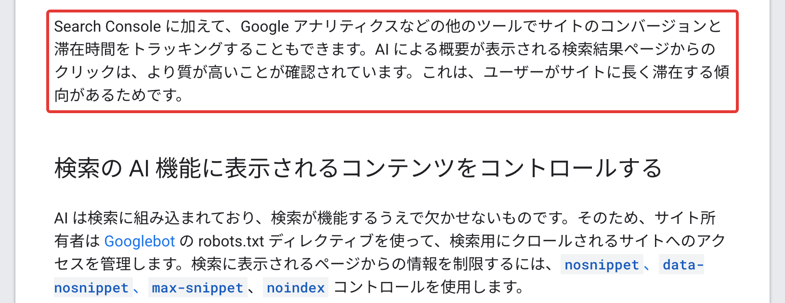
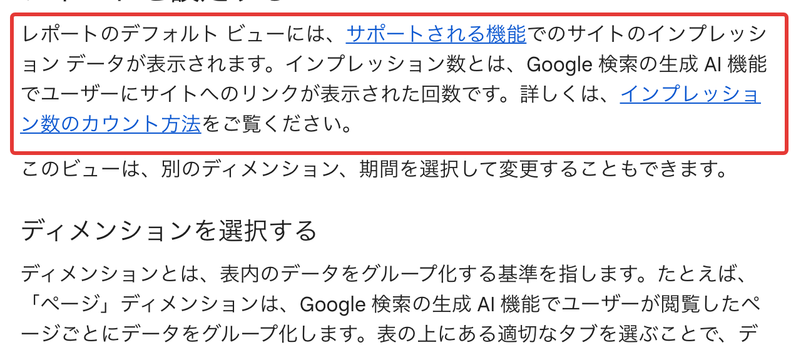
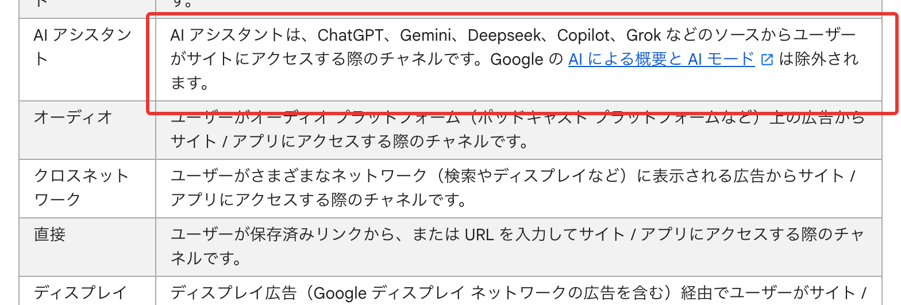

LLMO対策（AIO対策）に効果はあります。ただし効果は1つの数字で一度に表れるものではなく、AIの回答に社名が出る、回答の引用元に自社のページが付く、指名検索や問い合わせが増える、という3つの段階で順に確認していくものです。

LLMO対策に費用をかけるか迷っている会社の経営者・マーケティング担当に向けて、段階ごとの計測方法、期間の目安、費用に見合うかの判断をまとめました。この記事は株式会社nitoが書いています。

:::takeaways
- LLMO対策の効果は**AIの回答に名前が出る・引用元に自社ページが付く・指名検索と問い合わせが増える**の3段階で見る。先に動くのは回答の中の数字
- GA4で見えるAI経由の訪問は影響の一部。**問い合わせの窓口で何で知ったかを聞く**と、GA4に出ない分まで数えられる
- 費用に見合うかは**費用の回収に問い合わせが何件必要か**を先に出し、その件数と段階ごとの数字を並べて判断する
:::

## LLMO対策に効果はある？

効果はあります。公開されている事例ではAIの回答に社名が出る割合が上がり、問い合わせのきっかけに生成AIを挙げる人が増えたことを、支援会社や事業会社が自社の数字で示しています。一方でGoogleは、AIによる概要やAIモードへの表示を保証していません。**効果はあるものの、どの会社のどの質問でも必ず出るとは言い切れない**のが、今わかっている範囲です。

LLMO対策はChatGPT・Gemini・GoogleのAIによる概要などの回答に、自社の名前や自社のページが出るようにする取り組みです。AIO対策・GEOと呼ぶ会社もありますが、効果の見方は呼び名で変わらないため、この記事ではLLMO対策と書きます。

Googleの「AI 機能とウェブサイト」は、AIによる概要やAIモードに表示されるための追加の要件や特別な最適化は無いとしたうえで、インデックス登録と配信は保証されていないと書いています。同じページにはAIによる概要が表示される検索結果ページからのクリックは質が高いという記載もあり、理由はユーザーがサイトに長く滞在する傾向があるためです。効果を判断するときはAIに社名が挙がった回数だけでなく、そこから来た人が問い合わせまで進んだかを見る必要があります。

<figure class="post-figure"><figcaption>AI 機能とウェブサイト（Google 検索セントラル、2026年11月24日）</figcaption></figure>

## LLMO対策の効果は3つの段階で表れる

LLMO対策の効果は、AIの回答の中で起きる変化と、自社のサイトや営業の窓口で起きる変化に分かれます。3つの段階に分けると、段階ごとに計測する場所が違うことが分かります。

| 段階 | 変わること | 計測方法 | GA4で見えるか |
|---|---|---|---|
| ① AIの回答に名前が出る | 比較や相談の質問で自社が候補に挙がる | 決めた質問をAIに繰り返し聞き、挙がった割合（言及率）を記録 | 見えない |
| ② 引用元に自社ページが付く | 回答の出典欄に自社のサービスページや記事が載る | 同じ質問の出典欄の記録・Search Consoleの生成AIパフォーマンスレポート | 見えない |
| ③ 指名検索と問い合わせが増える | 社名での検索・AI経由の訪問・問い合わせが増える | Search Consoleの社名を含む検索語・GA4のAIアシスタント・問い合わせ時の設問 | 一部だけ |

①と②はAIの回答の中の変化で、③が売上に近い変化です。**経営の判断に使うのは③の数字ですが、③は遅れて動くため、①と②を途中の目印にします。** どの段の数字かを分けずに「効果が出た」「出ない」と話すと、社内で同じ言葉を別の意味で使うことになります。

### ① AIの回答に名前が出る

見込み客がChatGPTやGeminiに「〇〇でおすすめの会社は？」と質問したとき、回答に自社が挙がるかどうかが1段目です。計測するときは買い手が実際にしそうな質問を決めて文面を固定し、日を変えて繰り返し聞きます。AIの回答は同じ質問でも聞くたびに変わるので、1回の結果では判断できません。

質問に自社名を入れると候補に挙がったかどうかが分からないため、社名を含めない質問で計測します。**挙がったかに加えて、どう紹介されたかと、代わりにどの会社が挙がったかも記録しておく**と、次に何を修正するかが決まります。名前が出ても、AIの紹介が自社の今のサービスの説明と食い違っていれば、問い合わせにはつながりません。

### ② 引用元に自社ページが付く

2段目は回答の出典欄に自社のページが載ることです。比較の質問ではAIが回答で挙げた会社の公式ページを出典に付けることがあり、解説の質問では記事が出典に付くことがあります。**出典に自社ページが付くと、読んだ人が自社の説明を自社の言葉で読めるようになります。**

GoogleのAIによる概要とAIモードについては、Search Consoleの生成AIパフォーマンスレポートで、自社ページへのリンクが表示された回数をページ・国・デバイス・日付ごとに確認できます。2026年8月31日に全サイトに公開されたレポートで、クリック数と検索語は出ません。ChatGPTやGeminiの出典は、1段目と同じ質問の記録で数えます。

<figure class="post-figure"><figcaption>生成 AI パフォーマンス レポート（検索）（Search Console ヘルプ、2026年11月24日）</figcaption></figure>

出典に付くページが採用情報や会社概要に偏っていると、引用の数が増えても問い合わせは増えません。何回付いたかだけでなく、どのページが付いたかまで見ておきます。

### ③ 指名検索と問い合わせが増える

3段目はAIで自社を知った人が社名で検索したり、問い合わせたりする変化です。Search Consoleで社名やサービス名を含む検索語の表示回数とクリック数を月ごとに記録し、問い合わせフォームには「何で知りましたか」の設問を置いて、選択肢にChatGPTなどの生成AIを入れます。

**経営への報告に使うのはこの段の数字です。** ただし指名検索は広告や展示会でも増えるため、指名検索だけでLLMO対策の効果とは言えません。問い合わせ時の設問の割合と並べて見ると、AIの影響かどうかを判断しやすくなります。

:::linkcard
url: /media/ai-search-measurement/
title: 【2026年11月】LLMO・AIO対策の効果測定のやり方・5つの指標と質問数・GA4の見方
desc: 5つの指標・質問数と回数・GA4の見方・外注先の月次報告で確認する点を解説しています。
:::

## AI経由の訪問が少なくても効果がないとは限らない

GA4のAI経由の訪問が全体の1%に届かなくても、LLMO対策に効果が無いとは言えません。AIで会社を知った人が回答のリンクを押さずに、後から社名で検索したりURLを直接打ったりして訪れると、GA4ではAI経由に数えられないためです。

米国のPew Research Centerが900人の閲覧データ（2025年3月）を分析した結果では、Googleの検索でAIの要約が表示されたとき、通常の検索結果のリンクが押されたのは訪問の8%で、要約が出なかったときの15%の約半分でした。要約の中のリンクが押されたのは1%です。一方でGoogleは2025年8月の発表で、Google検索からサイトへのクリックの総量は前年から大きく変わっておらず、すぐに戻らない質の高いクリックはわずかに増えていると説明しています。**Pewの数字はクリックの数だけで見ると効果が小さく出やすいことを、Googleの説明は来た人の質まで見る必要があることを示しています。**

GA4の「AI アシスタント」チャネルは、ChatGPT・Gemini・Deepseek・Copilot・Grokなどからの訪問を分けて数えます。ただしGoogleのAIによる概要とAIモードからの訪問は対象外で、数える先は通常の自然検索です。

<figure class="post-figure"><figcaption>デフォルト チャネル グループ（アナリティクス ヘルプ、2026年11月24日）</figcaption></figure>

この差を自社の数字で公開しているのがLANYです。2026年1〜7月を合わせると、GA4でAI検索から来たセッションは全体の約0.91%、AI経由のコンバージョンは約1.19%でした。同じ期間の問い合わせ・資料ダウンロードで知った経緯を聞くと、生成AIと答えた人は約21.3%で、月ごとでは5月24.6%、6月26.9%、7月28.1%と上がっています。LANYは2つの数字について、集計の対象が違うので単純に比べられず、自己申告なので因果の証明でもないと断ったうえで、GA4の数字は影響の下限として扱う必要があると書いています。

**GA4の数字で判断する前に、問い合わせの窓口で何で知ったかを聞く設問を用意します。** 設問は施策を始める前に置かないと、始めた後と比べる起点がありません。LLMO支援を手がけるGrillは、支援を始めた28社のうち、着手の時点でAI経由の流入を分けて計測できていたのは6社（21%）だったと公表しています。

## LLMO対策の効果が出るまでの期間は？

何か月で効果が出るかを示す公的な統計は見当たりません。公開されているのは支援会社が自社の支援先で計測した例です。計測の方法は会社ごとに違うため、目安として読むときは段階に分けて見ます。表に載せた例の選定基準は計測した期間と数字を公表元のページで確認できることです。

| 段階 | 公開されている例 | 公表した会社 |
|---|---|---|
| ① 名前が出る | ある質問の言及率が3ヶ月で10%から45%（SaaS企業） | nito |
| ① 名前が出る | AIの回答で言及が確認できるまで中央値47日（支援先28社） | Grill |
| ② 引用元に付く | 新しいページが公開3日でAIの回答の引用元に（士業） | nito |
| ③ 問い合わせ | 問い合わせの増加が数字で確認できるまで中央値112日（支援先28社） | Grill |
| ③ 問い合わせ | AIで知って登録した人の割合が5ヶ月で約6.7倍（SaaS企業・登録時の設問） | nito |

並べると、**遅れて動くと言えるのは、同じ支援先28社の中央値で2つの段を測ったGrillの数字（言及の確認まで47日、問い合わせの増加まで112日）です。** nitoの3つの例は計測した区間の長さや対象が違うため、遅れの根拠には使えません。どれも支援先の数字で、ほかの会社に同じ期間が当てはまる根拠にもなりません。

### 判断の時点を最初に決める

期間の見通しが立たないまま始めると、数字が動く前に予算を止めることになりがちです。次の3つの時点を始める前に社内で決めておくのがおすすめです。

1. **始める前**: 狙う質問での今の回答（名前が出るか・出典に付くページ）と、何で知ったかの設問の回答を記録する。これが比べる起点になる
2. **回答の段の確認**: 修正したページが公開されてから、月に1回、同じ質問で起点と比べる。①と②が動いているかを見る
3. **問い合わせの段の判断**: ①と②が動いた時点に、自社の商材の検討期間（買い手が比較を始めてから問い合わせるまでの期間）を足した時点で、③を判断する。受注での回収の判断はさらに問い合わせから受注までの日数の後になる

**問い合わせの段は、自社の商材の検討期間の分だけ遅れて動くと考えておく**と、社内で「まだ効果が出ない」と言われたときに説明できます。検討に半年かかる商材なら、問い合わせの段の判断も半年は後ろにずらすのが筋です。

## 効果が見えないときに確認すること

効果が見えないときは施策をやめる前に、どの段階で止まっているかを確認します。止まっている段階によって、待つべきか施策を見直すべきかが分かれます。

1. **計測の起点があるか**: 始める前の記録と、何で知ったかの設問が無いと、変化があっても比べられない
2. **質問とAIを途中で変えていないか**: 質問の数や文面を変えると、前後の数字は同じ物差しで比べられない
3. **ページがGoogleに登録されているか**: AIによる概要とAIモードの出典になるには、インデックスに登録され、検索結果でスニペットが表示できる状態が条件。Search Consoleの検索の生成AI設定で除外していないかも見る
4. **AIが他社を挙げた理由が自社のページにも書かれているか**: 他社が挙がった理由が自社のページに無いと、AIは自社を比べる材料にしにくい

1と2は計測の問題なので、施策ではなく計測を先に整えます。3と4はページの問題なので、ページの修正が次の対応です。

:::linkcard
url: /media/llmo-not-working-checklist/
title: AI検索対策を続けても効果が出ない。原因を切り分けるチェックリスト
desc: 効果が出ないときに、計測のずれ・時間不足・読まれていない・選ばれていないの順に原因を切り分ける方法を解説しています。
:::

## LLMO対策の費用に見合うかの判断

費用に見合うかは効果の大きさを予想するより、**費用の回収に問い合わせが何件必要かを先に出す**と判断しやすくなります。必要な件数が分かれば、3つの段階の数字がその件数に近づいているかで、続けるかを決められます。

### 回収に必要な問い合わせの件数

次の仮の数字で計算します。月50万円の支援を6か月続けると、費用は300万円です。問い合わせから受注する割合が20%、1件の受注で得られる粗利が150万円なら、問い合わせ1件の価値は30万円になり、**6か月の費用を回収するにはAI経由の問い合わせが10件必要**です。

粗利の代わりに売上で計算すると、必要な件数が少なく見えてしまいます。契約が続く商材なら、1年や2年の取引額で計算すると実態に近づきます。問い合わせが10件必要と分かれば、何で知ったかの設問で生成AIと答えた人が何件いるかを毎月数え、その件数と比べるだけで判断できます。

### 費用に見合いにくい条件

次の条件に当てはまる場合は、始める前に条件を整えるか、範囲を絞って小さく始めるのがおすすめです。

- 1件の受注で得られる粗利が小さく、回収に数十件以上の問い合わせが必要
- 買い手が比較や相談にAIを使う商材かどうか分からない（まず自社の買い手が聞きそうな質問で今の回答を確認する）
- 問い合わせの窓口で何で知ったかを聞けず、3段目を数えられない

### 社内への報告の仕方

報告では3つの段階の数字を毎月同じ形で並べ、**最後の行に③の件数と、回収に必要な件数を並べます。** 途中の月は①と②の動きを見て続けるかを決め、③の件数は判断の時点で見る、という順番を最初の報告で共有しておくと、数字が小さい時期に議論が止まりません。

:::linkcard
url: /media/llmo-cost/
title: LLMO・AIO対策の費用相場はいくら？月額の目安と失敗しない依頼先の選び方
desc: 戦略コンサル型と実行支援型の月額の目安と、費用が変わる要因を解説しています。
:::

## 効果を計測しながら進めたい場合

nitoはLLMO対策を問い合わせの数を目標に進めています。[無料の現状分析](/aio/)では、狙いたい質問をお聞きし、ChatGPTやGemini、GoogleのAIモードなど利用者が実際に見るチャット画面で、自社の名前が挙がるか、代わりにどの会社がどんな理由で勧められているかをまとめてお送りします。

支援では毎日の計測で他社が挙がる理由を回答の本文から抜き出し、サイトの改善や記事の制作から公開後の運用まで実行して、問い合わせや購入の数まで追います。**費用に見合うかを判断する前に1段目の現状を確認したい場合**は、現状分析から始められます。

## まとめ

- これから始めるか迷っている会社は、回収に必要な問い合わせの件数を出し、何で知ったかの設問と狙う質問の記録を先に用意する
- 始めて数か月で数字が見えない会社は、①と②が動いているかを先に見る。問い合わせの段は検討期間の分だけ遅れる
- GA4のAI経由が少なく社内で説明できない会社は、問い合わせ時の設問の割合と並べ、GA4の数字は下限として報告する
- 支援会社の倍率の数字を比べている会社は、何の段の数字か・期間・誰が計測したかを確認してから比べる

## よくある質問

### LLMO対策の効果は保証されますか？

保証されません。GoogleはAIによる概要やAIモードについて、インデックス登録と配信は保証されていないと書いています。ChatGPTやGeminiの回答も聞くたびに変わります。契約の前に、何を成果として約束しているのか（表示か・言及率か・問い合わせか）を確認してください。

### LLMO対策の効果は何で計測しますか？

段階ごとに分けて計測します。AIの回答に名前が出るかは決めた質問の繰り返しの記録、引用元に自社ページが付くかは同じ記録とSearch Consoleの生成AIパフォーマンスレポート、指名検索と問い合わせはSearch Console・GA4・問い合わせ時の設問で見ます。

### AIO対策とLLMO対策で効果の見方は違いますか？

AIO対策をLLMO対策と同じ意味で使う会社が多く、その場合は効果の見方も同じです。AIO対策をGoogleのAIによる概要だけを指す意味で使う場合は、Search Consoleの生成AIパフォーマンスレポートの表示回数が中心になります。

### LLMO対策の効果は何か月で分かりますか？

何か月で効果が出るかを示す公的な統計はありません。公開されている例ではAIの回答の中の数字が数日から数か月で動き、問い合わせの段はそれより遅れています。問い合わせの段の判断は回答の中の数字が動いた時点に自社の検討期間を足した時点に置くのがおすすめです。

### クリックされないならLLMO対策は不要ですか？

不要ではありません。Pew Research Centerの分析ではAIの要約が出た検索でリンクが押される割合は下がっていますが、AIで知った人が後から社名で検索して訪れる分はGA4のAI経由に入りません。問い合わせ時に何で知ったかを聞くと、クリックに出ない影響まで数えられます。

### LLMO対策をすればSEOは不要になりますか？

不要にはなりません。GoogleはSEOのベストプラクティスがAIによる概要やAIモードでも引き続き有効だと書いています。GoogleのAIの出典に自社ページが付くにはインデックスに登録されていることが条件なので、SEOはLLMO対策の前提になります。

### 中小企業でもLLMO対策の効果はありますか？

会社の規模で効果の有無を示した公的なデータは見当たりません。判断の仕方は規模に関わらず同じで、回収に必要な問い合わせの件数を出し、自社の買い手が聞きそうな質問で今の回答を確認するところから始めます。

### 支援会社のLLMO対策の効果の数字はどう読みますか？

何の段の数字か、いつからいつまでの変化か、何問を何回聞いたか、誰が計測したかを確認してから比べます。回答の中の数字と問い合わせの数字は別のものを数えているため、同じ「〇倍」でも横に並べられません。事例ごとの数字は[LLMO対策の事例16選](/media/llmo-case-studies/)で同じ物差しに並べています。

## 出典

- Google 検索セントラル「[AI 機能とウェブサイト](https://developers.google.com/search/docs/appearance/ai-features?hl=ja)」（2026年11月24日取得）
- Search Console ヘルプ「[生成 AI パフォーマンス レポート（検索）](https://support.google.com/webmasters/answer/16984139?hl=ja)」（同）
- アナリティクス ヘルプ「[デフォルト チャネル グループ](https://support.google.com/analytics/answer/9756891?hl=ja)」（同）
- Pew Research Center「[Google users are less likely to click on links when an AI summary appears in the results](https://www.pewresearch.org/short-reads/2025/07/22/google-users-are-less-likely-to-click-on-links-when-an-ai-summary-appears-in-the-results/)」2025年7月22日（同）
- Google「[AI in Search is driving more queries and higher quality clicks](https://blog.google/products/search/ai-search-driving-more-queries-higher-quality-clicks/)」2025年8月6日（同）
- LANY「[LLMOの投資対効果（ROI）の考え方](https://www.lany.co.jp/blog/llmo-roi)」2026年10月20日：GA4と問い合わせ時の認知経路の自社データ（同）
- 株式会社Grill「[LLMO対策の成功事例と失敗事例11選を大公開！成果が出た8社と出なかった3社の差分とは？](https://grill.co.jp/marketing-log/15346/)」：支援28社の中央値と着手時点の計測の状況（同）
