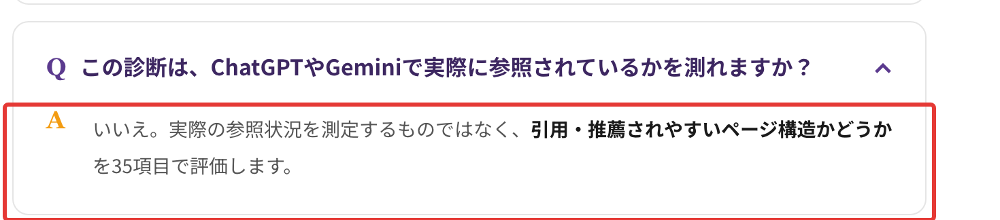

無料のLLMO診断（AIO診断）は、サイトの項目を点検する型か、AIに実際に質問して回答を計測する型かで選ぶのがおすすめです。**サイトの作りの不備をすぐ知りたいなら登録不要の点検ツール、自社と競合がChatGPTやGeminiでどう紹介されているかを知りたいなら、質問を設計して計測する診断が向いています。**

この記事は株式会社nitoが書いており、自社を1番目に載せています。無料で受けられる10のサービスを2つの型に分け、無料の条件、分かること・分からないこと、診断のあとの進め方までまとめました。

:::takeaways
- LLMO診断には**サイトを点検する型**と**AIの回答を計測する型**があり、分かることが違う
- 点検する型は登録不要で数十秒から数分で済むが、**AIが実際に自社を挙げるかまでは分からない**
- 計測する型は質問と競合を決めて回答を集めるため、**結果まで24時間から2週間ほどかかり、毎月の受付数を限る診断もある**
:::

## LLMO診断の無料サービス10選の比較

無料で受けられるLLMO診断のうち、公式サイトで無料の診断を案内している10のサービスを、書き手のnitoを先頭に、AIの回答を計測する診断・点検ツール・チェックリストの順に並べました。

| サービス（会社） | 診断の型 | 無料の条件 | 結果の受け取り方 |
|---|---|---|---|
| 株式会社nito | AIの回答を計測 | フォームから申し込み | 現状分析レポート |
| インハウスプラス（株式会社CALLOSUM） | 両方 | 毎月30社限定（超えると抽選）・法人のみ | 約1週間でPDF |
| umoren.ai（QUEUE株式会社） | 両方 | スコア診断は登録不要。レポートは会社のメールで申し込み | スコアはその場、Excelは24時間以内 |
| 株式会社LANY | 両方 | フォームから申し込み | レポートと報告のミーティング |
| 株式会社メディアグロース | AIの回答を計測 | 毎月20社限定 | レポート（通常2週間程度） |
| ミエルカ（株式会社Faber Company） | AIの回答を計測（ツール）・チェックリスト | チェックリストは無料。ツールは無料トライアル | 自分で記入・ツールの画面 |
| TRILIA株式会社 | サイトを点検 | 登録不要 | その場で表示。PDFは登録で |
| EmmaTools（株式会社EXIDEA） | サイトを点検 | 登録不要・1ページ単位 | その場で表示 |
| LLMO対策チェックサイト（株式会社ジーズ） | サイトを点検 | 登録不要 | レポートのURL（7日間） |
| アドマノ株式会社 | チェックリスト | フォームで資料を受け取る | 全15ページの資料と診断シート |

**10のうち6つはAIの回答を計測する診断を持ち、残りの4つはURLを入れて採点する点検ツール3つと、自分で確認するチェックリストです。**

### この記事の選定基準

載せたのは公式サイトでLLMO診断・AIO診断を無料で案内し、2026年11月22日に受付中と確認できた10のサービスです。1番目は書き手のnitoで、続けてAIの回答を計測する診断を持つ会社、点検するツールとチェックリストの順に並べました。紹介の文と型の判断は各社の公式サイトの記載だけをもとにしています。

### 1. 株式会社nito

**株式会社nito**: 無料の現状分析で、狙いたい質問をChatGPT・Gemini・GoogleのAIモードなどに実際に聞き、自社の名前が挙がるか、どう紹介されるか、代わりにどの会社が挙がっているかをまとめます。回答は利用者が実際に見るチャット画面で集めています。

代わりに挙がった会社については、AIがその会社をおすすめした理由を回答の本文から抜き出すため、自社のサイトに何が書かれていないかまで読み取れる点が特徴です。診断のあとは問い合わせや購入などの成果を目標に、サイトの改善と記事の制作から公開後の運用まで一気通貫で支援しています。

| 支援先 | これまでの成果 |
|---|---|
| SaaS企業 | 取り組み3ヶ月で、AIでの言及率が10%から45%に。AI経由のコンバージョンは5ヶ月で約6.7倍 |
| 士業 | AIでの言及率が0%から20%に。新しいページは公開3日でAIの回答の引用元に |

**自社と競合がAIにどう紹介されているかを、おすすめの理由まで含めて知りたい会社**に向いています。

nitoの[現状分析レポート](/llmo/)は無料です。狙いたい質問をお聞きして、ChatGPT・Gemini・AIモードなどでの結果をまとめてお送りします。

### 2. インハウスプラス（株式会社CALLOSUM）

**インハウスプラス**: 有料のLLMOコンサルティングで毎月届けている計測レポートを、1回分無料で作る診断です。ChatGPTなど5つの生成AIに25の質問（比較・推薦の質問20本と社名で聞く質問5本）を投げ、AIによる概要も最大20キーワードで確認します。

競合10社と同じ質問で、引用率・言及率・推奨率を比べるのが中心です。サイト側もAI可読性・構造化データ・結論ファースト・E-E-A-Tの4項目で合否を出すため、2つの型を1つのレポートで受けられます。

受付は毎月30社までで、超えた場合は抽選です。対象は自社サイトを運営する法人で、同業の調査目的とフリーメールでの申し込みは受け付けていません。ヒアリングシートは10分ほどで書け、質問と競合は同社が作って示し、修正は1回まで依頼できます。レポートは約1週間でPDFが届き、優先施策5つのうち1件目には作業指示が付きます。

### 3. umoren.ai（QUEUE株式会社）

**umoren.ai**: AI検索対策のサービスで、無料の診断を2種類用意しています。1つはURLを入れて約30秒で100点満点のスコアと改善の提案が出るAI SEO診断・LLMO診断で、登録は必要ありません。

もう1つはLLMO無料診断・AI検索スポット診断レポートです。全11シートのExcelが24時間以内にメールで届き、言及率・引用シェア・全回答データ・引用されたドメインなどが入ります。申し込みには会社のメールアドレスが必要で、Gmailなどのフリーアドレスは控えるよう案内しています。

### 4. 株式会社LANY

**株式会社LANY**: 自社と競合のAI検索上での言及率とサイトの状況を分析し、課題と今後の打ち手を無料で提案する診断です。初回のヒアリングで調査するキーワードをすり合わせてから、生成AI上の露出を調査します。

結果はレポートで共有され、報告のミーティングで優先する施策の説明を受けられます。今の取り組みの延長でできることと、新しく必要なことを切り分けて示す点も特徴です。無料診断を含めて300社以上のLLMO診断の実績があり、申し込む前に自分で点検したい人向けのチェックリストも無料で配っています。

### 5. 株式会社メディアグロース

**株式会社メディアグロース**: 毎月20社限定の無料お試しプランで、AIによる概要とChatGPTでの自社のURLの掲載状況とブランドの言及状況を、競合と比べて出す診断です。

PerplexityやGeminiは別の見積もりです。レポートは通常2週間程度で納品され、解説の打ち合わせは希望すれば別の見積もりになります。より広く調査する有料のプランは、現状診断・競合比較が30万円から（税別・単発）です。

### 6. ミエルカ（株式会社Faber Company）

**ミエルカ**: 自分で点検するための「LLMO診断チェックリスト」（5カテゴリ38項目）を無料で配っています。項目はサイトの作りに限らず、生成AIでの自社と競合の説明の確認や、AI経由の流入の把握まで含みます。

AIの回答を計測したい場合は、計測ツールの「ミエルカGEO」に無料トライアルがあります。ChatGPTとGeminiでの言及率・引用率やAI検索からの流入とコンバージョンを確認できるツールで、有料の単一サイトプランは月4万9,800円（税抜・別途初期費用）です。

### 7. TRILIA株式会社

**TRILIA**: URLを入れると約30秒で、10カテゴリ・最大70項目を自動で採点するLLMO診断ツールです。登録は不要で、構造化データ・メタタグ・E-E-A-T・AIのクローラーの許可などを、合格・注意・不合格の3段階で示します。登録すると、優先度の高い改善の作業をまとめたPDFのレポートも受け取れます。

### 8. EmmaTools（株式会社EXIDEA）

**EmmaTools**: SEOツールEmmaToolsのLLMO最適化診断で、7観点35項目を100点満点で採点します。診断は入力したURLの1ページだけで、サイト全体は対象外です。狙う質問を入れると、ページとの一致度（マッチ率）も示します。登録は不要で、結果は約30秒で出ます。

### 9. LLMO対策チェックサイト（株式会社ジーズ）

**LLMO対策チェックサイト**: URLを入れると、AIがSEO・LLMO・ユーザビリティの観点でサイトを分析する無料のツールです。トップページに加えて下層のページも見て、1〜2分（最大5分）で結果が出ます。発行されるレポートのURLは7日間開けて、登録は不要です。

### 10. アドマノ株式会社

**アドマノ**: 「LLMO診断チェックリスト7項目」を全15ページの資料として配っています。どの質問でAIに出たいかの整理、自社と競合がAIでどう説明されているかの確認、AIのクローラーが重要なページを読めるかの点検など、7項目を自分で確認できる形で、診断シートも付いています。受け取りにはフォームで会社名・電話番号・対策するURLなどの入力が必要です。

## LLMO診断の2つの型は何が違う？

**点検する型はURLを入れると自社サイトの作りを採点し、計測する型は見込み客が使いそうな質問をAIに聞いて、自社の名前が挙がるかを数えます。** LLMO診断（AIO診断）は、AIの中で自社がどう扱われるかを確認する作業の総称で、何を調べるかは会社ごとに違います。

| | サイトを点検する型 | AIの回答を計測する型 |
|---|---|---|
| 調査の対象 | 自社サイトのHTML・設定・書き方 | AIの実際の回答と引用元 |
| 分かること | 観点ごとの点数と修正の候補 | 自社が挙がるか、何番目か、どう紹介されるか |
| かかる時間 | 30秒から数分 | 24時間から2週間程度 |
| 申し込み | 多くは登録不要 | フォームから。ヒアリングや毎月の受付数の限定がある診断も |

**同じLLMO診断という名前でも、点検する型の点数と、計測する型の言及率は別のものを見ています。** 点検する型は読まれる土台を整える段階で、計測する型は今の見え方と競合との差を知る段階で使うものです。両方を持つのはインハウスプラス・umoren.ai・LANYの3社です。ミエルカは計測ツールとチェックリストを分けて用意しています。

## LLMO診断で分かること・分からないこと

**点検する型で分かるのはサイト側の不備、計測する型で分かるのはAIの回答での扱われ方です。AIで自社を知った人が問い合わせたかは、どちらの型でも一部しか分かりません。**

### サイトを点検する診断で分かること

点検する型で分かるのはAIのクローラーがサイトを読めるかと、読んだときに中身をつかみやすい書き方になっているかです。項目にはrobots.txtでGPTBotなどのアクセスを許可しているか、構造化データ（JSON-LD）、見出しの階層、著者や更新日の表示などが並びます。

**読まれる前提の不備は見つかれば社内や制作会社ですぐ修正できるため、最初の点検として向いています。** 一方で、点検の項目にllms.txtの有無を入れているツールもあります。GoogleはAIによる概要やAIモードに表示されるために、AIテキストファイルや特別な構造化データを新しく作る必要はないと案内しており、点数のためだけの作業は後回しでかまいません。

### AIの回答を計測する診断で分かること

計測する型で分かるのは見込み客が使いそうな質問で自社の名前が挙がるか、何番目に挙がるか、どんな理由で紹介されるかです。代わりに挙がった競合と、AIが引用したページ（比較記事・口コミなど）も並びます。

**自社が挙がらない理由がサイトの外にあるときは、この型でないと見つかりません。** AIは質問を受けると検索をかけ直し、公式サイトのほかに比較記事や口コミも読み比べて答えを作ります。計測する型ではAIが読んだページの一覧から、自社が載っていない比較記事や、古い料金のまま紹介しているページが見つかります。

<figure class="post-figure"><figcaption>EmmaToolsのよくある質問。この診断は実際の参照状況を測定するものではないと書かれている（2026年11月22日）</figcaption></figure>

### どちらの診断でも分からないこと

AIの回答は日によっても聞き方によっても変わるため、1回の診断で分かるのはその日の回答です。**無料の診断は1回の結果なので、施策のあとに同じ質問で再計測しないと、効果があったかは分かりません。**

AIで自社を知った人が問い合わせたかどうかは、診断では一部しか分かりません。GA4の閲覧権限を付与するとAI経由の流入とコンバージョンをレポートに入れる診断もありますが、後から社名で検索してサイトに来る人は、アクセス解析でAI経由として残りにくいためです。問い合わせフォームに「何で知ったか」の選択肢を置き、診断の結果と並べて見ます。

:::linkcard
url: /media/ai-overview-check/
title: AI Overviewの自社サイト表示チェック方法・表示率と引用率の出し方
desc: GoogleのAIによる概要に自社が表示・引用されているかを、自分で確認する手順を解説しています。
:::

## 無料のLLMO診断はどう選ぶ？

**知りたいのがサイトの不備かAIでの見え方かで型を決め、計測する型なら、質問と競合を誰が決めるか・どのAIを見るか・無料の条件の3つで比べます。**

| 知りたいこと | 向いている型 | この記事のサービスの例 |
|---|---|---|
| AIに読まれる作りになっているか | サイトを点検 | TRILIA・EmmaTools・LLMO対策チェックサイト・umoren.aiのスコア診断 |
| 何を確認すべきか全体を知りたい | チェックリスト | ミエルカ・アドマノ・LANYのチェックリスト |
| 自社と競合がAIにどう紹介されているか | AIの回答を計測 | nito・インハウスプラス・umoren.aiのレポート・LANY・メディアグロース |

### 質問と競合を誰が決めるか

計測する型の結果はどの質問で聞いたかで大きく変わるものです。インハウスプラスはヒアリングシートをもとに同社が質問を作り、LANYとメディアグロースはヒアリングでキーワードをすり合わせる形です。**見込み客が実際にAIに聞きそうな言い方で質問を作れるかが、結果を施策につなげられるかの分かれ目です。** nitoは狙いたい質問をお聞きし、その質問のまま計測します。

### 見るAIと結果の受け取り方

見るAIは診断ごとに違います。メディアグロースの無料プランはAIによる概要とChatGPT、インハウスプラスはChatGPT・Gemini・Perplexity・Copilot・AIモード・AIによる概要の6つを対象にしています。見込み客がGoogle検索から入ることが多いならAIによる概要を、比較の相談が多いならChatGPTやGeminiを含む診断が候補です。nitoはChatGPTやGeminiなど主要なAIを、利用者が実際に見るチャット画面で計測します。

結果の受け取り方はPDF・Excel・報告のミーティングに分かれ、社内で説明する資料が必要ならレポート、数字を並べ替えたいならExcel、読み方まで聞きたいならミーティング付きが候補です。

### 無料の条件と申し込みの前提

計測する型の無料診断には受付数の限定や申し込みの条件があります。インハウスプラスは毎月30社まで、メディアグロースは毎月20社限定で、インハウスプラスはフリーメールでの申し込みを受け付けておらず、umoren.aiも会社のメールアドレスでの申し込みを案内しています。**インハウスプラスは契約の義務はないと書き、メディアグロースは無料お試しプランだけの利用もできると答えています。**

:::linkcard
url: /media/llmo-companies/
title: LLMO対策の会社おすすめ20選・比較表と費用相場・選び方
desc: 診断のあとに支援の依頼先を、費用と対応範囲で比べた記事です。
:::

## 申し込む前に社内で用意すること

計測する型の診断はこちらが渡す情報で質問と比べる相手が決まります。次の4つを用意しておくと、ヒアリングが短く済みます。

1. **AIに聞かれたい質問を3〜5本。** 「〇〇でおすすめの会社は？」のように、見込み客が打ちそうな言い方で書く
2. **比べたい競合を3社ほど。** 商談でよく名前が出る会社を優先する
3. **会社のメールアドレスと担当者。** フリーメールを受け付けない診断がある
4. **GA4とSearch Consoleの閲覧権限を付与できるか。** インハウスプラスは任意で、付与するとAI経由の流入とコンバージョンもレポートに入る

## LLMO診断のあとはどう進める？

**診断の結果はサイトの中で修正できることと、サイトの外の情報が原因のことに分け、サイトの中から着手するのがおすすめです。** そのうえで、同じ質問で計測を続けます。

### サイトの中で修正できること

点検する型で不合格になった項目のうち、AIのクローラーの許可や、本文がHTMLに入っているかは、読まれる前提に関わるため優先して修正します。計測する型でAIが他社を勧めた理由（料金の公開・導入事例・対応できる条件など）が自社のページに無いと分かったら、その情報をサービスページや記事に追加します。

### サイトの外が原因のこと

AIが引用した比較記事に自社が載っていない、口コミが少ないといった原因は、自社サイトの修正だけでは変わりません。比較記事の媒体への情報提供や、自社で比較の観点を整理した記事の公開など、時間のかかる施策です。社内で進めにくい場合は診断した会社や支援会社にどこまで対応できるかを聞いてから決めます。

### 同じ質問で計測を続ける

施策の効果は診断と同じ質問で再計測しないと分かりません。月に1回ほど自分でAIに聞いて記録するか、計測ツールを使います。計測ツールの料金と対応するAIを比べた記事は「[GEO対策ツール・AIO対策ツール10製品の比較](/media/geo-aio-tools/)」です。

:::linkcard
url: /media/llmo-self-check/
title: LLMO診断は自分でできる｜自社サイトのセルフチェックリスト
desc: 無料診断に申し込む前に、自社で確認できる4つの観点のチェックリストを解説しています。
:::

## まとめ

- サイトの作りの不備をすぐ知りたい場合は、登録不要の点検ツールで済ませます。
- 自社と競合がAIにどう紹介されているかを知りたい場合は、質問と競合を決めて回答を計測する診断を選びます。
- 結果を社内で動かしたい場合は、修正できる点とサイトの外が原因の点を分けて、同じ質問で再計測します。

## よくある質問

### LLMO診断は無料で受けられますか？

受けられます。この記事の10のサービスはどれも無料です。ただし計測する型の一部には、毎月20社や30社までの受付数の限定や、法人のみ・フリーメール不可といった条件があります。より広く調査する診断は有料で、メディアグロースの現状診断・競合比較は30万円から（税別・単発）、アドカルのLLMO診断は20万円です。

### AIO診断とLLMO診断は違いますか？

どちらもAIの回答の中で自社がどう扱われるかを確認する診断で、呼び方の違いです。AIOをGoogleのAIによる概要の意味で使う会社もあるため、申し込む前にどのAIを見るのかを確認してください。

### LLMO診断の点数が上がればChatGPTに出ますか？

出るとは限りません。EmmaToolsは自社の診断が実際の参照状況を測定するものではなく、引用・推薦されやすいページの構造を評価するものだと公式で説明しています。ChatGPTでの扱われ方は、計測する型で確認します。

### LLMO診断とSEO診断は何が違いますか？

SEO診断はGoogleの検索順位を上げるための項目を見ます。LLMO診断はAIの回答で自社がどう扱われるか、またはAIに読まれやすい作りかを見ます。項目は重なる所も多く、GoogleはAI機能にもSEOの基本が有効だと案内しています。

## 出典

- 各社の診断のページ（2026年11月22日確認）: [nito AI検索対策](/llmo/)・[インハウスプラス LLMO診断（無料）](https://inhouse-plus.jp/llmo-shindan/)・[umoren.ai LLMO無料診断・AI検索スポット診断レポート](https://umoren.ai/diagnosis)・[umoren.ai AI SEO診断・LLMO診断](https://umoren.ai/free-tools/ai-seo-score)・[LANY LLMO診断（無料）](https://www.lany.co.jp/news/llmo_diagnosis_over100)・[メディアグロース LLMO診断サービス](https://media-growth.co.jp/llmo-check/)・[Faber Company LLMO診断チェックリスト](https://mieru-ca.com/ai-seo/llmo-check/)・[ミエルカGEO](https://mieru-ca.com/geo/)・[TRILIA LLMO診断ツール](https://trilia.co.jp/llmo-tools/)・[EmmaTools LLMO最適化診断](https://emma.tools/llmo-shindan/)・[LLMO対策チェックサイト](https://llmocheck.ai/)・[アドマノ LLMO診断チェックリスト7項目](https://admano.co.jp/contents_dl/llmo-7item/)
- AI機能に表示されるための要件: [AI 機能とウェブサイト](https://developers.google.com/search/docs/appearance/ai-features?hl=ja)（Google 検索セントラル）
