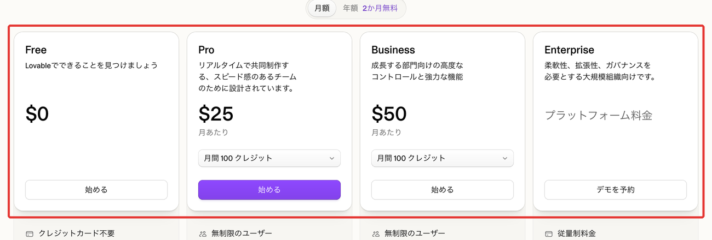
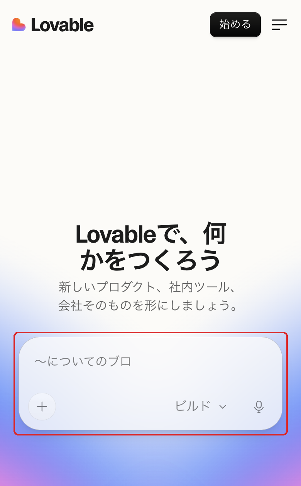
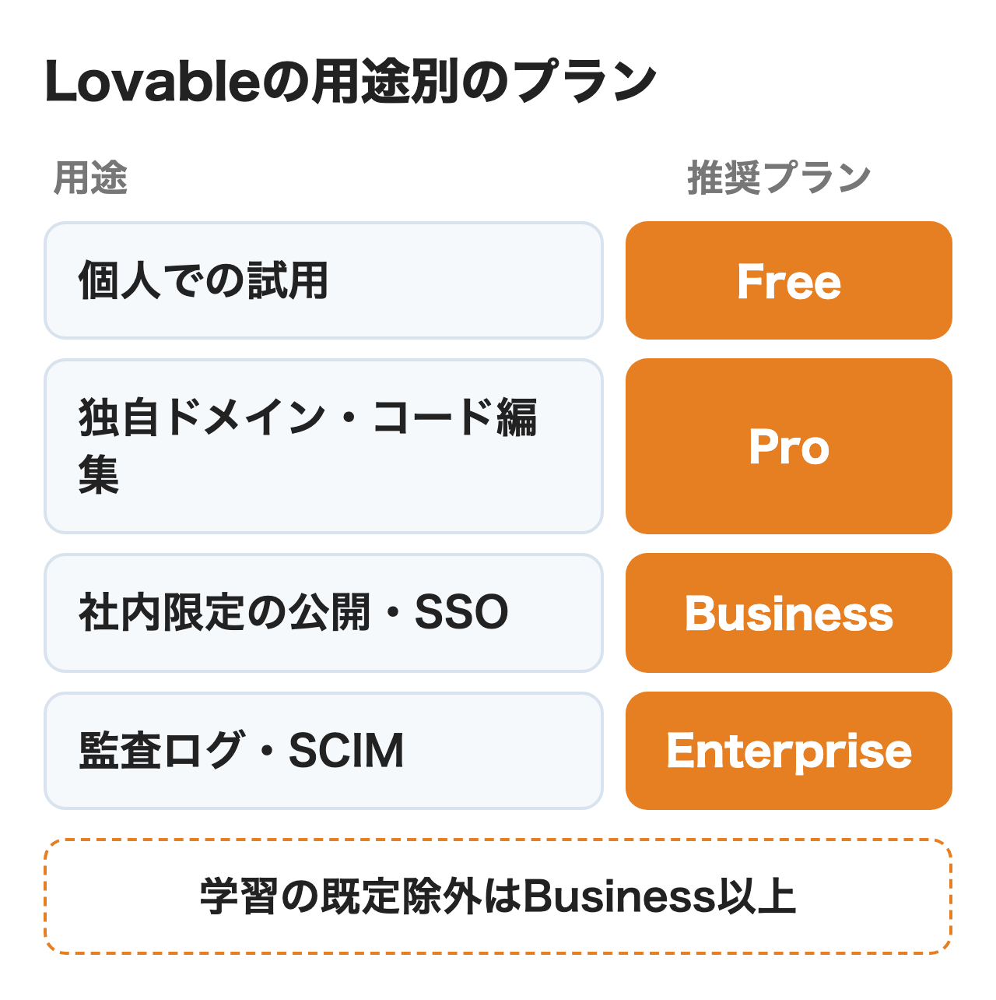
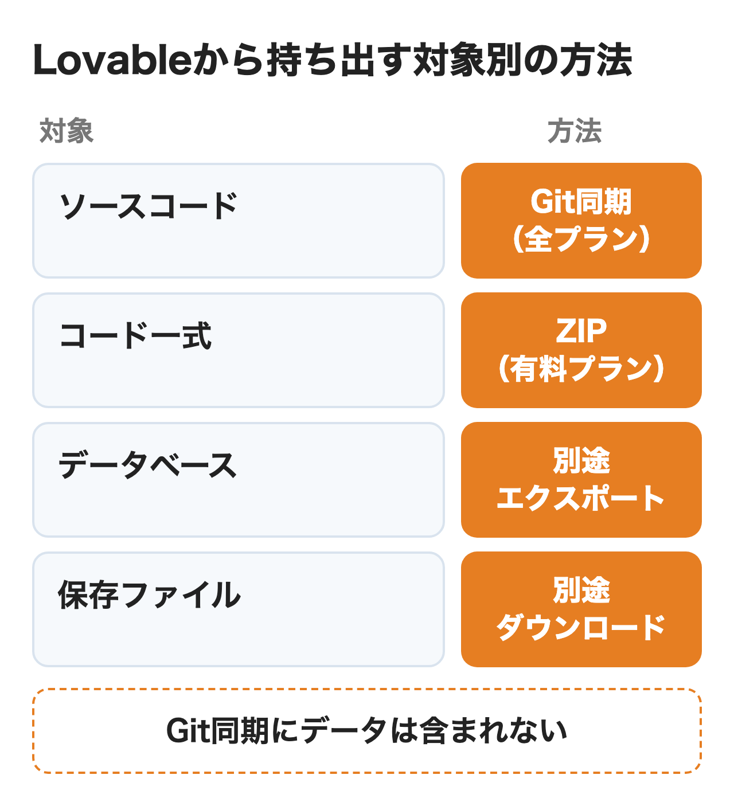

Lovable（ラバブル）は、作りたいアプリを文章で伝えるとAIが画面・データベース・ログインまで組み立て、そのまま公開までできるWebアプリの開発サービスです。料金は作業量を表すクレジットで決まり、メンバーを増やしても月額は変わりません。有料プランはProが月$25、Businessが月$50からです（どちらも毎月100クレジットの場合）。

この記事では料金とクレジットの見積もり方、始め方に加えて、社内ツールに使う前に決めておく公開範囲・データの置き場所・学習の扱い・コードの持ち出しを公式の情報で整理します。

:::takeaways
- **料金は人数でなくクレジットで決まる**。Pro月$25・Business月$50から（毎月100クレジット）で、メンバーは何人でも追加料金なし
- 社内だけへの公開・SSO・**学習に使わない設定が既定**になるのはBusinessから。Free・Proは各自が設定で止める
- データを置く地域は**後から変えられず**、バックエンドの種類も自動では切り替えられない。最初のプロジェクトを作る前に決めておく
:::

## Lovableとは？何ができる？

**Lovableは会話だけでフロントエンドからデータベース・認証・公開までをまとめて作るAIのアプリ開発サービスです。**2023年にスウェーデンのストックホルムで創業した会社が運営し、以前はGPT Engineerという名前でした。2024年11月に今のサービスを始め、2026年8月にはSeries Cで4億ドルを調達したと発表しました。同じ発表ではこれまでに作られたプロジェクトが6,000万を超え、作られたアプリへの訪問は月9億回を超えるとしています。

使う人はコードを書かず、日本語で「予約を受け付けるページと管理画面がほしい」のように伝えます。Lovableがコードを書き、画面の右側で動くアプリを表示し、修正の指示にもその場で対応します。画面の表示言語は日本語を含む11言語から選べますが、すべての画面が訳されているわけではありません。

### 作れるもの

公式が挙げる主な用途は事業部が自分で使うWebアプリです。

- 申請・承認や案件管理などの社内ツール、売上やKPIのダッシュボード
- 会社サイト・ランディングページ・キャンペーンサイト
- 顧客ポータル・予約・会員制のサービスの試作
- AIのチャットや要約を組み込んだアプリ

StripeやHubSpot、Slack、Googleスプレッドシートなどとつなぐコネクタも用意されています。アプリ以外に、スライドや画像、PDFのレポートも作れます。

### 作れないもの

**スマホのネイティブアプリは作れません。**作れるのはスマホでも見やすいWebアプリで、ホーム画面に置けるPWAにするか、外部のツールで包んでストアに出します。

使うフレームワークとデータベースも選べません。2026年5月13日以降の新しいプロジェクトはTanStack StartとPostgreSQLの組み合わせで、別の構成が必要なら、Git同期でコードをGitHubなどに出し、Lovableの外で開発を続けるよう公式は案内しています。ビルドに使うAIのモデルもLovableが選び、利用者は指定できません。

:::linkcard
url: /media/ai-agent-guide/
title: AIエージェントとは？生成AI・ChatGPTとの違いと仕組みをわかりやすく解説
desc: AIエージェントの定義と仕組み、ワークフローとの違いを解説しています。
:::

## Lovableの料金はいくら？

**料金は毎月のクレジット量で決まり、Proは100クレジットで月$25、Businessは100クレジットで月$50からです。**料金はワークスペース単位で、メンバーを何人招待しても月額は変わりません。人数が増えて変わるのは共有のクレジットが減る速さだけです。

<figure class="post-figure"><figcaption>Lovableの料金ページ（2026年11月13日）</figcaption></figure>

### プランの違い

| プラン | 月額（月払い） | 含まれる量 | 会社で使う際の違い |
|---|---|---|---|
| Free | 無料 | 1日5クレジット（月30まで） | 試用。コードの編集・独自ドメインは不可 |
| Pro | $25〜 | 毎月100〜10,000クレジット＋1日5 | コードの編集・ZIPのダウンロード・独自ドメイン・役割と権限 |
| Business | $50〜 | 毎月100〜10,000クレジット＋1日5 | SSO・社内だけへの公開・学習から除外が既定・DPA |
| Enterprise | 要問い合わせ | 契約で決める | SCIM・監査ログ・日本など国単位のデータの地域（要相談）・専任の支援 |

金額は米ドルで、クレジットを増やすと上がります。Proは200クレジットで月$50、800クレジットで月$200、Businessは200クレジットで月$100です。年払いにすると2か月分安くなり、Proの100クレジットは年$250（月あたり$21）です。

**Businessは1クレジットの単価がProの2倍（Proは$0.25、Businessは$0.50）で、同じ作業でも払う額は2倍になります。**公式はこの差を管理やガバナンスの機能の分と説明しています。

FreeからBusinessまでは、毎月Cloud用に20クレジット、アプリ内のAI機能用に4クレジットが付きます。ただし月ごとの付与について、公式は一時的な提供で変わることがあると断っている点に注意が必要です。Enterpriseには毎日の5クレジットも月ごとの付与も無く、すべて契約で決まるものです。

### クレジットが減る作業

1つのクレジット残高から、次の5つの費用が引かれます。

- アプリを作る・修正する（Build・Plan）
- Lovableとの相談（Chat。毎日の無料枠あり）
- 公開したアプリのホスティングとデータベース（Cloud）
- アプリに組み込んだAI機能の利用
- Lovableが管理するコネクタ（Perplexity・Firecrawlなど）の利用

作るときの費用は作業の大きさで変わります。料金ページの例ではボタンの色の変更が0.50、フッターの削除が0.90、ログイン機能の追加が1.20クレジットです。画像入りのランディングページは料金ページで1.70、ドキュメントでは2.00と書かれていて、例の数字にも幅があります。**公開したアプリの運用費は小さな社内ツールなら月ごとの付与でまかなえることが多い**と公式は説明しています。

### 見積もりの例

部署の3人が平日に1人10回ずつ修正を頼み、1回1クレジット前後かかると仮定すると、月20日で約600クレジットです。毎日の5クレジットが20日で100あるため、残り約500クレジットを月のプランで用意します。**この使い方ならProの800クレジット（月$200）が目安で、SSOや社内だけの公開が必要ならBusinessの800クレジット（月$400）です。**あくまで仮定の試算なので、最初の1か月は小さい枠で始め、使用量の画面で実績を見てから枠を決めるのが確実です。

### 期限と追加購入

月払いのクレジットは付与から2か月で失効し、契約中は翌月に繰り越されます。年払いの場合は年の契約期間が終わった1か月後までが期限です。毎日の5クレジットはその日限りで、翌日には繰り越せません。

足りないときはProは50クレジット$15、Businessは50クレジット$30で追加でき、追加分は購入から12か月使えます。残高が下がったら自動で買う設定もあり、月の上限額を決められます。**クレジットが無くなると、作業が止まるだけでなく公開中のアプリのAI機能も止まり、組み込みのデータベースを使うアプリは一時停止します。**社内で使うアプリを載せたら、自動追加かアラートを入れておく方が安全です。

## Lovableの使い方

**始め方はアカウントを作り、作りたいものを書いて送り、プレビューで確認して公開する4つの手順です。**公式のクイックスタートでは、最初のアプリを公開するまで約10分としています。

<figure class="post-figure post-figure--sp"><figcaption>Lovableのトップ画面（2026年11月13日）</figcaption></figure>

### 始め方

1. [Lovable](https://lovable.dev/ja)を開き、Google・GitHub・Apple・メールのいずれかでアカウントを作る
2. 中央の入力欄に作りたいアプリを書いて送る。画面の画像・Figmaのデザイン・Notionの資料も添えられる
3. 右側のプレビューで動きを確認し、修正したい箇所をチャットで伝える。スマホの幅でも確認できる
4. 右上のPublishで公開範囲を選んで公開する。公開後の修正はPublishからもう一度反映する

公開するとlovable.appの住所が発行され、独自ドメインはPro以上で設定できます。

### 3つのモード

チャット欄にはChat・Plan・Buildの3つのモードがあり、費用の数え方が違います。

| モード | すること | 費用 |
|---|---|---|
| Chat | アプリや変更の相談。コードは変えない | 毎日の無料枠から、その後はクレジット |
| Plan | プロジェクトを調査して計画を書き、承認してから作る | 1回1クレジット＋調査の分 |
| Build | 実際にコードを書き換え、動作を確認する | 作業の大きさで変動 |

Buildで目標を決めて長く作業させるGoalもありますが、同じ作業でもクレジットの減りがかなり速くなります。1回の作業が20クレジットを超えると、続けるかどうかを確認する画面で止まる設定が既定です。

### うまく作るための工夫

**大きな機能はいきなりBuildで頼まずPlanで計画を作り、中身を修正してから承認すると手戻りが減ります。**Planは計画の段階でコードを変えないため、方向が違っていても費用は1回分です。

社内の決まり（使う色・用語・権限の考え方）は、ワークスペースやプロジェクトの指示（Instructions）に書いておくと毎回伝え直さずに済みます。複数人で作るなら、最初にGitHubとつないでおくと、変更の履歴を開発者が後から追えます。

## 会社で使う前に決めること

**事業部が試作を始める前に、プランと人数・クレジットの上限・公開範囲・データの置き場所・学習・コードの持ち出しの6つを、情報システムと事業部で決めておきます。**このうちデータの地域は後から変えられず、バックエンドの種類も自動では移せないため、最初のプロジェクトより前に決めるのが前提です。

| 決めること | 公式の条件 | 決め方の例 |
|---|---|---|
| プランと人数 | 全プランでメンバー無制限。料金はクレジット量 | 部署の試作はPro、社内展開はBusiness |
| クレジットの上限 | Pro以上はメンバーごとの月の上限とアラートを設定できる | 1人あたりの上限を決め、管理者に通知 |
| 公開範囲 | 社内だけへの公開はBusiness以上。Proは招待した10人まで | 社内ツールはBusinessでワークスペース内に限定し、プレビューリンクの共有をオフ |
| データの置き場所 | 地域は米州・欧州・アジア太平洋。有効にした後は変更不可 | 管理者が既定の地域をアジア太平洋に固定 |
| 学習の扱い | Free・Proは各自の設定で除外、Business以上は既定で除外 | 顧客の情報を扱うならBusiness以上 |
| コードの持ち出し | Git同期は全プラン、ZIPは有料。データは別にエクスポート | 最初にGitHubの会社の組織とつなぐ |
| アプリに入れないデータ | 規約で、健康情報・カード番号・口座番号・公的な識別番号・生体情報は扱えない | 該当するデータを扱う業務は、作る前にLovableの営業へ相談 |

<figure class="post-figure"><figcaption>会社で使う前の目安になる、用途別のプラン</figcaption></figure>

### 公開範囲と認証

公開したアプリを開ける人は、プランで選べる範囲が違います。FreeとProは誰でも開ける公開か、招待した人だけかの2つです。招待は1プロジェクト10人までで、招待された人はLovableにログインして開く必要があります。

**Business以上ではワークスペースのメンバーだけ・特定のグループだけに公開でき、管理者は新しく公開するアプリの既定の範囲も決められます。**ただし既定の範囲の初期値は誰でも開ける設定なので、社内ツールを作るなら契約した日に変えておくのが安全です。プレビュー用のリンクはFree・Proでは7日で切れ、パスワードと期限を付けられるのはBusiness以上です。**ただしプレビュー用のリンクは公開範囲の設定より優先され、社内だけに公開していてもリンクを知っていればLovableのアカウント無しで開けます。**社外に見せたくないなら、管理者がプレビューリンクの共有をオフにするのが確実です。

作ったアプリの利用者のログインにはメール・Google・Microsoft・SAMLのSSOなどが使えるため、会社のSSOでログインする社員専用の業務アプリも作れます。

### データの置き場所

データの置き先は組み込みのバックエンド（Lovable Cloud）と自社で契約するSupabaseの2つです。組み込みのバックエンドはSupabaseのオープンソースを土台にしていて、必要になるとLovableが自動で用意するものです。

**データを置く地域は米州・欧州・アジア太平洋から選び、バックエンドを有効にした時点で決まって後から移せません。**BusinessとEnterpriseでは、管理者が新しいプロジェクトの地域を固定できます。日本などの国を指定したい場合は、Enterpriseで申し込むと、空きがあれば使えます。この地域はデータの保存場所で、AIの処理が行われる場所とは別です。

自社のSupabaseを使うと、請求とデータベースの管理を自社で持てます。ただし組み込みのバックエンドとSupabaseの間は自動で移せず、Supabaseから組み込みへの移行には対応していません。どちらにするかは最初のプロジェクトを作る前に決めておきます。

### 学習の扱い

**2026年9月9日から、FreeとProの利用者が入れたプロンプト・添付ファイル・コード・生成物は、LovableのAIの学習に使われることがあります。**止めるにはアカウント設定のPreferencesにあるAI model trainingを各自がオフにする必要があり、設定は1人ずつで、ほかのメンバーには及びません。オフにすると、それ以降に集める学習用のデータから外れます。オフにする前に集められたデータや、学習済みのモデルからは取り除かれません。

BusinessとEnterpriseのワークスペースのデータは、既定で学習から外れます。作ったアプリの利用者が入力したデータと、請求の情報は、どのプランでも学習に使われません。

### コードの持ち出し

**Lovableで作ったアプリ・コード・保存したデータは利用者のものと公式は明記しています。**GitHub・GitLab・BitbucketとのGit同期は全プランで使え、双方向に反映されます。同期は新しいリポジトリを作る形で、既存のリポジトリにはつなげません。

<figure class="post-figure"><figcaption>持ち出す対象ごとの方法</figcaption></figure>

コードを持ち出しても、データベースの中身とアップロードされたファイルは含まれません。データベースは設定画面から別にエクスポートし、保存ファイルも別に移します。Lovableの編集画面とAI自体は自社のサーバーには置けませんが、作ったアプリは他のクラウドでも動かせます。

## Lovableを使うメリットは？

**最大のメリットは事業部が開発の順番を待たずに、動く画面とデータまで自分で作れることです。**

### 試作から公開までが1か所

画面・データベース・ログイン・公開が1つのサービスで完結するため、サーバーの用意や設定の分担が不要です。打ち合わせの前に動く試作を用意し、触ってもらいながら要件を固める使い方ができます。

### 人数で料金が増えない

料金がクレジット量で決まるため、見るだけの人やたまに修正する人を何人招待しても月額は同じです。席ごとに課金する業務ソフトを置き換える場合、利用者が多いほど差が出ます。

### 後から開発者に引き継げる

コードは一般的な構成で、Git同期でいつでもLovableの外の開発環境に出せます。事業部が試作し、本番の段階で開発者が引き継ぐ流れを作れます。

## Lovableのデメリットと注意点は？

**注意点は安全性の確認・後から変えられない設定・仕様の変更の速さの3つです。**

### 安全性の確認は人が行う

公開のたびに自動のセキュリティスキャンが走り、データベースのアクセス制御の抜けや依存ライブラリの脆弱性を知らせます。**それでも公式は、スキャンはセキュリティレビューの代わりにはならないと書いています。**重大な指摘があると公開を止める設定もありますが、Lovableが新しく作るEnterpriseのワークスペース以外では、既定はオフです。顧客の情報を扱うアプリは公開前に開発者か情報システムが権限の設定を確認する手順を決めておきます。

### 後から変えられない設定がある

データの地域はバックエンドを有効にした後には変えられません。バックエンドの種類を移すには、データを書き出して手作業で移し直すことになります。思いつきで作り始めたプロジェクトがそのまま社内で使われ始めると、後から地域を変えるには作り直しになります。

### 仕様の変更が速い

2026年だけでも、新規プロジェクトの技術構成が5月に変わり、6月にはクレジットが1つの残高にまとまり、9月には学習の扱いが変わりました。**社内の利用規程に料金や機能を書くときは、変わる前提で公式の料金ページとドキュメントを確認先に指定しておくと安心です。**

## Replit・Bolt・v0とどう使い分ける？

**どれも会話でアプリを作り、公開までできるサービスで、違いは始め方と公開先です。**比べると次の表のとおりです。

| サービス | 作れるもの | 向いている用途 |
|---|---|---|
| Lovable | Webアプリ・サイト（組み込みのデータベースと認証付き） | 社内ツールや顧客向けWebアプリの試作と公開 |
| Replit | Webアプリ・スマホアプリ・スライドなど | 1つのプロジェクトで複数の形を作る |
| Bolt | サイト・アプリ・試作・スライド（Bolt Cloudでデータベース・認証・公開まで） | FigmaやGitHubのデータから始める試作 |
| v0 | アプリ・ランディングページ・画面の部品（Vercelに公開） | テンプレートから画面を組み立てる |

開発者が既存のコードを書き進めるなら、[Cursor](/media/cursor-guide/)や[Devin](/media/devin-ai/)のような開発者向けのツールが向いています。LovableはReplit・Bolt・v0などで作ったコードをZIPで取り込めるため、別のサービスで作った試作をLovableに移して続けることもできます。

Boltの料金・学習の扱い・会社で使う前に決めることは[bolt.newとは？](/media/bolt-new-guide/)で解説しています。

:::linkcard
url: /media/replit-guide/
title: Replitとは？Agentの料金・使い方と会社で使う前に決めること
desc: Replit Agentの料金とクレジット、社内公開やデータの扱いを解説しています。
:::

## まとめ

- 個人で試すなら、Freeの1日5クレジットで小さなアプリを1つ作って公開まで試す
- 部署で試作するなら、Proで始め、メンバーごとの上限と自動追加を設定する
- 社員だけが使う業務アプリや顧客の情報を扱うなら、社内限定の公開と学習の既定の除外があるBusinessを選ぶ
- 監査ログやアカウントの自動連携、日本でのデータ保管が必要なら、Enterpriseを相談する

どのプランでも、最初のプロジェクトの前にデータの地域とバックエンドを決めておくことが後の作り直しを防ぎます。社内の業務に合わせたAIエージェントの設計から相談したい場合は、[nitoのAIエージェント構築支援](/ai-agent/)も検討してください。

## よくある質問

### Lovableは無料で使えますか？

使えます。Freeプランでは1日5クレジット（月30まで）が付き、アプリを作って公開するところまで試せます。コードの編集や独自ドメインはProからです。

### Lovableは日本語で使えますか？

指示は日本語で書けます。画面の表示もアカウント設定で日本語に切り替えられますが、一部は英語のままです。ドキュメントは主に英語です。

### Lovableの料金は人数で増えますか？

増えません。全プランでメンバーは無制限で、料金は含まれるクレジット量で決まります。人数が増えるとクレジットの減りが速くなるため、メンバーごとの上限で調整します。

### Lovableで作ったアプリのコードは誰のものですか？

作った利用者のものです。ただし基盤のAIモデルやオープンソースのライセンスなど、第三者の権利がかかる部分は別です。Git同期で自社のリポジトリに保管できます。

### Lovableでスマホアプリは作れますか？

ネイティブアプリは作れません。スマホに対応したWebアプリを作り、PWAとしてホーム画面に置くか、外部のツールで包んでストアに出します。

### Lovableのクレジットが無くなるとどうなりますか？

作業が止まり、公開中のアプリのAI機能も止まります。組み込みのデータベースを使うアプリは一時停止するため、社内で使うアプリには自動追加かアラートを設定しておきます。

### Lovableは日本円や請求書払いで契約できますか？

公式の料金は米ドルで、支払いはStripeを通してカードなどで行います。国内の代理店（株式会社100）が日本円・請求書払い・年間契約の相談を受けていて、Proは月5,000円から（1ドル200円換算・税別）と案内しています。これは代理店の条件で、公式の価格ではありません。

### Lovableは返金できますか？

利用料とクレジットは法律で求められる場合を除いて返金されません。解約しても請求期間の終わりまでは使え、その後はFreeに切り替わります。

## 出典

金額・仕様は2026年11月13日に各ページで確認したものです。

- [料金](https://lovable.dev/ja/pricing)（Lovable 日本語）
- [Subscription plans](https://docs.lovable.dev/introduction/subscription-plans)・[Credits and usage](https://docs.lovable.dev/introduction/credits-and-usage)・[Credit top-ups](https://docs.lovable.dev/introduction/credit-top-ups)（Lovable ドキュメント）
- [FAQ](https://docs.lovable.dev/introduction/faq)・[Welcome to Lovable](https://docs.lovable.dev/introduction/welcome)・[Quick start](https://docs.lovable.dev/introduction/getting-started)（Lovable ドキュメント）
- [Plan mode](https://docs.lovable.dev/features/plan-mode)・[Build mode](https://docs.lovable.dev/features/agent-mode)（Lovable ドキュメント）
- [Control who can visit your published app](https://docs.lovable.dev/features/website-access)・[Control project access](https://docs.lovable.dev/features/project-visibility)・[Privacy & security settings](https://docs.lovable.dev/features/privacy-and-security-settings)（Lovable ドキュメント）
- [Built-in backend](https://docs.lovable.dev/features/cloud)・[Connect to Supabase](https://docs.lovable.dev/integrations/supabase)（Lovable ドキュメント）
- [Manage training data and privacy](https://docs.lovable.dev/features/business/data-opt-out)（Lovable ドキュメント）
- [Deployment, hosting, and ownership options](https://docs.lovable.dev/tips-tricks/deployment-hosting-ownership)・[Sync your Lovable project with GitHub](https://docs.lovable.dev/integrations/github)（Lovable ドキュメント）
- [Security overview](https://docs.lovable.dev/features/security)・[Lovable for Enterprise](https://docs.lovable.dev/introduction/lovable-for-enterprise)（Lovable ドキュメント）
- [We just raised $400M in Series C funding](https://lovable.dev/blog/series-c)（Lovable ブログ、2026年8月12日）
- [Lovable（ラバブル）日本語版](https://lovable.100inc.co.jp/)（株式会社100）
- [Bolt](https://bolt.new/)・[v0](https://v0.app/)
