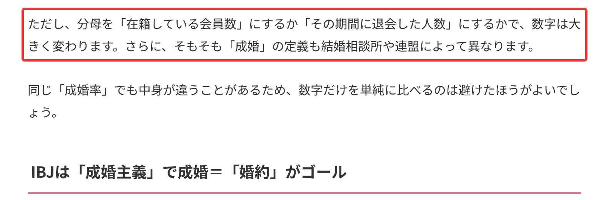
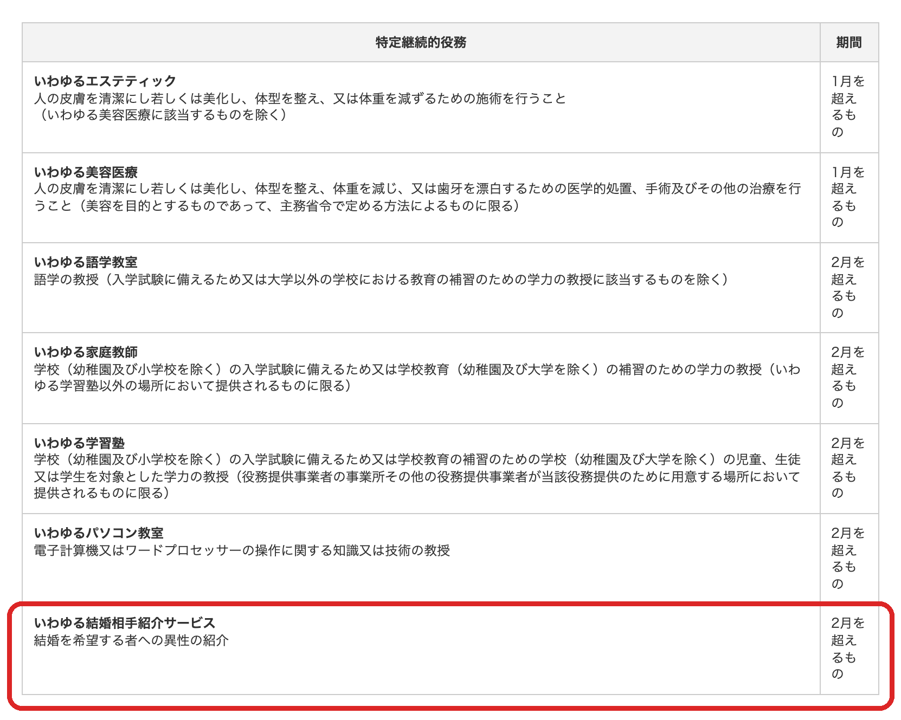

結婚相談所がAIO対策（AI検索対策）を外部に依頼するなら、**無料カウンセリングの予約数を目標に置き、成婚率の定義・料金の総額・加盟連盟の説明まで自社ページに作れる会社**が向いています。会員候補が「30代におすすめの結婚相談所は？」と聞いたとき、相談所どうしを比べる材料になるのがこの3つだからです。

この記事は株式会社nitoが書いており、自社を1番目に載せています。ほかの6社は2026年11月15日に各社の公式サイトで確認した内容をもとに、どんな相談所に合うかで整理しました。

:::takeaways
- 依頼先と決める目標は**無料カウンセリングの予約数**。言及率は途中の目印にとどめる
- 成婚率は**分母と「成婚」の定義で値が変わる**。会員数も自社の会員か連盟の共有データベースかを分けて書く
- 2か月を超え5万円を超える結婚相手紹介の契約は**特定商取引法の特定継続的役務提供**に当たり、ページの料金や解約の説明は契約書面と食い違わない内容にする
:::

## 結婚相談所におすすめのAIO対策会社7社

書き手のnitoを1番目に置き、結婚相談所や店舗のAI検索対策を打ち出している3社、計測ツールの会社、制作やSEOとまとめて依頼できる2社の順に並べました。各社の特徴を公式サイトの表記から1行ずつまとめています。

- **株式会社nito**: 問い合わせや予約につながるまで、計測・分析・記事の制作と既存ページの修正指示を毎日回す。記録したAIの回答は3万件以上
- **株式会社Mesut**: 結婚相談所向けのLLMO対策のページがあり、料金総額・成婚定義・中途解約条件の明示を掲げる。伴走は月5万円（税別）から
- **QUEUE株式会社（umoren.ai）**: 結婚相談所の100問でGeminiの回答を分析した調査を公開。LLMエンジニアのチームが質問の分析からコンテンツ制作まで担当
- **リードクリエーション株式会社（HIIDEL）**: 店舗向けのAIOプラットフォーム。Google口コミの収集と、ChatGPT・Gemini・Google AI Overviewsでの表示の定期診断を1つの画面で
- **株式会社Faber Company（ミエルカGEO）**: AI検索での言及率・引用率と、AI検索からの流入・CVを計測するツール。月4万9,800円（税抜）から
- **株式会社ニュートラルワークス**: 調査・戦略から外部対策・サイト実装まで、社内の制作チームで一貫して対応。30万円（税別）から、契約6ヶ月から
- **ナイル株式会社**: SEOとLLMOをまとめた伴走支援。LLMO単体は月30万円から

| 会社 | 依頼できる範囲 | 料金（公式の表記） | 向いている結婚相談所 |
|---|---|---|---|
| 株式会社nito | 計測から記事の制作・既存ページの修正指示まで | 無料の現状分析のあと見積もり | 予約数で効果を見たい相談所 |
| 株式会社Mesut | 質問調査・改善指示書から実行支援まで（制作は別見積もり） | 無料診断、スポット改善10万円〜、伴走は月5万円〜（税別） | 費用を抑えて相談から始めたい相談所 |
| QUEUE株式会社 | 質問の分析・コンテンツ制作・改善運用 | 公式に記載なし（要相談） | 質問ごとの出方を細かく分析したい相談所 |
| リードクリエーション株式会社 | 口コミの収集とAIでの表示の定期診断（ツール） | Freeプラン0円、有料プランは要相談 | 口コミとGoogleビジネスプロフィールから整えたい相談所 |
| 株式会社Faber Company | 計測ツールが中心 | 単一サイト月4万9,800円（税抜・初期費用別） | 社内でツールを見ながら改善したい相談所 |
| 株式会社ニュートラルワークス | 調査からサイト実装・外部対策まで | 30万円（税別）〜、契約6ヶ月〜 | サイトの作り直しも考えている相談所 |
| ナイル株式会社 | SEOとLLMOをまとめた伴走支援 | LLMO単体 月30万円〜、SEOとセットで月60万円〜 | コラムが多くSEOとまとめて依頼したい相談所 |

料金はどの会社も、狙う質問の数や制作の量で変わります。各社の詳しい特徴は後半の「1. 株式会社nito」から順に載せています。

### この記事の選定基準

載せたのはAI検索対策（AIO・LLMO・GEO）を公式サイトでサービスとして案内している会社です。そのうえで、結婚相談所や店舗のAI検索対策を打ち出している3社と、AIO対策会社の比較記事によく挙がる3社を選びました。nitoは書き手なので1番目に置いています。

料金は2026年11月15日に公式サイトで確認できたものだけを書き、記載が無いものは「公式に記載なし」としました。契約の条件は変わることがあるため、各社の最新の案内で確認してください。

:::linkcard
url: /media/aio-taisaku-companies/
title: AIO対策会社おすすめ20選・比較表と費用・選び方
desc: 業種を問わずAIO対策の会社を支援範囲で比べ、費用の目安と契約前の確認点を解説しています。
:::

## 結婚相談所のAI検索対策が他の業界と違う点

相談のされ方・比べられる数字・契約の決まりの3点で、結婚相談所はほかの業界と事情が違います。どれも依頼先にどこまで作ってもらうかを決める前提です。

### 年代と地域を添えた相談

会員候補は「30代で仕事が忙しい」「〇〇市で通いやすい」「再婚」のように、自分の条件を添えて相談所を聞くことがあります。

QUEUE株式会社が2026年9月に結婚相談所についての100問をGeminiに聞いた調査では、同じ相談所でも質問のテーマによって名前が出る回数が大きく変わりました。**狙う質問は年代・地域・料金・再婚などのテーマごとに分けて計測する必要があります。**

条件ごとにページに書いておきたい事実を並べると次のとおりです。

| 添えられやすい条件 | ページに書いておきたい事実 |
|---|---|
| 年代（20代・30代・40代以上） | 対象年齢、年代別のコース、会員構成（集計の時点つき） |
| 地域・通いやすさ | 面談の場所、オンライン面談の可否、対応地域 |
| 働き方・忙しさ | 面談できる時間帯、連絡手段、カウンセラーの関わり方 |
| 再婚・子どもがいる | 受け入れの方針、成婚実績の内訳（定義つき） |
| 費用 | 入会金から成婚料までの全費目と、総額の例 |

### 定義で値が変わる成婚率と会員数

成婚率は相談所を比べるときに必ず見られる数字です。IBJの公式ブログによると、成婚率は分母を在籍会員数にするか、その期間の退会者数にするかで大きく変わり、「成婚」の定義も相談所や連盟で異なると説明しています。IBJでは加盟するすべての相談所が婚約をゴールにしています。

<figure class="post-figure"><figcaption>IBJ公式ブログ「結婚相談所の成婚率とは？」（2026年11月15日）</figcaption></figure>

会員数も同じです。IBJの会員データベースはすべての加盟相談所で共有されており、加盟相談所は全国で4,700社を超えます（2026年7月の数字）。ページに書く数字が自社の会員数なのか、連盟全体の数なのかで意味が変わります。

**定義のない数字がAIの回答に切り出されると、ほかの相談所の数字と同じ物差しで比べられてしまうおそれがあります。**「成婚率No.1」のような表示も同じで、消費者庁が2024年9月に「No.1表示に関する実態調査報告書」を公表しているテーマです。算出の方法や調査の根拠は数字のすぐそばに書いておくのが安全です。

### 契約に法律の決まりがある

提供期間が2か月を超え、支払う金額が5万円を超える結婚相手紹介サービスの契約は、特定商取引法の特定継続的役務提供に当たります。契約の前には概要書面、契約の後には契約書面を渡す義務があり、誇大広告も禁じられています。

クーリング・オフは書面を受け取った日から8日以内にでき、中途解約の精算にも上限があります。サービスの提供が始まった後の解約で請求できるのは、提供済みのサービスの対価に、2万円か契約残額の20%のいずれか低い額を足した額までです。

<figure class="post-figure"><figcaption>消費者庁 特定商取引法ガイド「特定継続的役務提供」（2026年11月15日）</figcaption></figure>

**AIに読まれるページの料金・休会・退会の説明も、契約書面と食い違わない内容にする必要があります。** 依頼先がこの決まりを踏まえて原稿を作れるかは、契約前に確認しておきたい点です。

## AIO対策会社はどう選べばいい？

依頼先を比べるときは次の4つを聞くと各社の違いが見えてきます。

| 基準 | 確認する質問 | 結婚相談所で重要な理由 |
|---|---|---|
| 目標 | 何の数を増やすことを目標にしますか？ | 入会から成婚退会までの総額が数十万円になることもあり、予約1件の重みが大きい |
| 質問の組み方 | 年代・地域・料金などのテーマ別に計測しますか？ | テーマによって挙がる相談所が入れ替わる |
| 計測方法 | 回答は実際のチャット画面から取得していますか？ | 利用者が見る回答と、プログラム用の窓口（API）の回答は出典がずれることが多い |
| 制作 | 料金総額・成婚の定義・加盟連盟のページまで作りますか？ | 比べる材料は自社ページに書かないと増えない |

### 予約数を目標に置いているか

言及率は途中の目印として役に立ちますが、それ自体は予約の数ではありません。名前が挙がる質問が「結婚相談所と婚活アプリの違い」のような一般的な質問ばかりだと、言及率が上がっても予約は増えにくいからです。

**どの質問で名前が挙がれば予約につながるかを先に決め、予約フォームで「何で知ったか」まで数える会社**を選ぶと、かけた費用を予約の件数と比べて判断できます。

### テーマ別に質問を組むか

計測する質問が「〇〇市でおすすめの結婚相談所」だけだと、力を入れたい年代や料金の質問での見え方が分かりません。年代・地域・働き方・料金・再婚を添えた質問をテーマごとに組み、テーマ別に結果を出してくれる会社が向いています。

### 実際のチャット画面で計測しているか

AIの回答を集める方式には、プログラム用の窓口（API）から取得する方式と、利用者と同じチャット画面に質問して取得する方式があります。2026年9月に公開された論文では、ChatGPTのAPIとチャット画面に同じ質問をしたとき、出典の重なりは平均12.0%でした。会員候補が実際に見る回答で計測しているかは、見積もりの段階で聞いておく価値があります。

### 料金と成婚定義のページまで作るか

レポートで課題が分かっても、ページが変わらなければAIの回答は変わりません。料金の全費目と総額の例、成婚の定義と集計の条件、加盟連盟の正式名称と会員数の主体を、本文として書くところまで依頼できるかで成果までの距離が変わります。公開前に契約書面と照らし合わせる工程があるかも確認しておきましょう。

## 1. 株式会社nito

[株式会社nito](/aio/)は、AIO対策（AI検索対策）で問い合わせや予約につながるまで実行する会社です。ヒアリングで自社の強みを文章にまとめ、記事の制作と既存ページの修正指示まで受け持ちます。何を書き、どこを修正するかは、ChatGPTやGeminiなど主要なAIの実際の回答を毎晩読み、他社が選ばれている理由から決めます。**AIでの言及率ではなく、問い合わせの数を増やすことを目標にしています。**

結婚相談所なら、目標は無料カウンセリングの予約数です。名前が挙がる質問をむやみに増やすより、力を入れたい年代や地域の質問で、理由つきで挙がる状態をつくる方が予約に近づきます。

### 結婚相談所に合う理由

- **年代・地域・料金のテーマ別に質問を組む。** 会員候補が添えやすい条件から質問を作り、検索の数（Ahrefsの月間検索数）から順番を決めます
- **会員候補が見る回答のまま計測する。** 利用者と同じチャット画面で、回答本文と引用元を毎日記録します（記録した回答は3万件以上。2026年11月時点）
- **他の相談所が挙がる理由を回答本文から抜き出す。** 「平日の夜にオンラインで面談できる」「成婚料のないプランがある」のように、AIが他の相談所をすすめるときに使う理由のうち、自社にも当てはまるのにページに書いていないものを新しく書く内容の候補にします
- **料金総額・成婚の定義・加盟連盟の説明を記事と修正指示にする。** 説明は記事で書き、料金ページなどの既存ページには契約書面と食い違わない形で直し方の指示を出します。公開前の確認と実装は相談所にお願いし、公開後は回答の変化を見て書き方を直します
- **予約まで数える。** 予約フォームに「何で知ったか」「AIに何を聞いたか」を入れ、AIで知った人の予約の数まで追います

### これまでの成果

| 支援先 | 成果 |
|---|---|
| SaaS企業 | 取り組み3ヶ月で、AIでの言及率が10%から45%に。AI経由のコンバージョンは5ヶ月で約6.7倍 |
| 士業 | AIでの言及率が0%から20%に。新しいページは公開3日でAIの回答の引用元に |

成果は地域の競合・相談所の体制・力を入れる年代によって変わります。どの質問でどこまで狙えるかは、無料の現状分析のあとにお伝えする形です。

### こんな相談所に向いている

- 地域や年代を絞って、無料カウンセリングの予約を増やしたい相談所
- 料金や成婚実績の説明を整えたいが、社内で書く時間が取れない相談所
- 言及率のレポートだけでなく、予約の件数で効果を見たい相談所

**nitoでは相談所が狙いたい質問をChatGPT・Gemini・AIモードなどに実際に聞き、名前が挙がるか、どう紹介されるか、代わりにどの相談所が挙がっているかをまとめた[現状分析レポート](/aio/)を無料でお出ししています。**

## 2. 株式会社Mesut

株式会社MesutはSEOとAI検索対策のコンサルティング会社で、結婚相談所向けのLLMO対策のページを持っています。そのページでは特定商取引法・個人情報保護法を踏まえて料金総額・成婚定義・中途解約条件を明示することを掲げ、比べられる情報として料金総額・会員層・紹介方法・担当者体制・成婚定義・休会と退会の条件を挙げています。

料金は無料診断のほか、スポット改善が10万円から、伴走が月5万円から（税別）です。月5万円はチャットでの相談、月10万円から定例会と簡易な改善指示書が含まれ、制作やCMSの改修は別見積もりです。代表が全案件の戦略と重要な判断を確認する体制をうたっています。結婚相談所向けのページでは「AI検索から予約・体験・来店・問い合わせにつなげる設計」を掲げています。

社内に更新の担当者がいて、まず費用を抑えて相談と改善の指示から始めたい相談所に向いています。

## 3. QUEUE株式会社（umoren.ai）

QUEUE株式会社はAI検索対策のサービス「umoren.ai」を運営する会社です。運営するメディアで、結婚相談所についての非指名の質問100問をGeminiに聞き、どの相談所が回答に出たかと参照されたサイトを分析した調査を公開しています。

LLMエンジニアのチームが、AIが情報を検索・参照・再構成する流れを踏まえ、質問の分析・コンテンツの制作・改善運用まで担当します。無料の現状分析レポートがあり、料金は要相談です。AI検索から問い合わせや商談につながる状態を目指します。

質問のテーマごとに自社の出方を細かく分析し、それに沿ってページを作りたい相談所に合います。

## 4. リードクリエーション株式会社（HIIDEL）

リードクリエーション株式会社は、店舗向けのAIOプラットフォーム「HIIDEL」を提供する会社です。NFCタグやQRコードでGoogle口コミを集める機能と、ChatGPT・Gemini・Google AI Overviewsにお客様と同じ質問をして店舗の表示を定期的に診断する機能を、1つの画面にまとめています。結婚相談所向けのAI検索対策の解説記事も公開済みです。

QRコードで口コミ集めを試せるFreeプランは0円で、有料プランの料金は店舗数や機能に合わせて案内されます。無料のAI推薦度診断もあります。

対面の面談スペースがあり、口コミとGoogleビジネスプロフィールの整備から着手したい相談所に向いています。

## 5. 株式会社Faber Company（ミエルカGEO）

株式会社Faber CompanyはSEOツール「ミエルカSEO」で知られる会社です。AI検索向けのツール「ミエルカGEO」では、ChatGPT・Gemini・GoogleのAI Overviewsでの自社と競合の扱われ方や、AI検索からの流入・CVを計測できます。

料金は単一サイトプランが月4万9,800円、複数サイトプランが月9万9,800円（いずれも税抜・初期費用別）です。

社内にWebの担当者がいて、ツールで自社の数字を見ながら改善を回したい相談所に合います。

## 6. 株式会社ニュートラルワークス

株式会社ニュートラルワークスはWeb制作と集客支援の会社です。LLMOコンサルティングでは、調査・戦略設計から内部対策・外部対策・サイトの実装までを、社内の制作チームで一貫して受けています。費用は30万円（税別）から、契約期間は6ヶ月からです。効果はAIでの掲載・引用の状況、指名検索の量、AI経由の流入や問い合わせなどを定点で計測し、月次で報告します。

業界別の専用プランは不動産・SaaS・医療クリニック・建設業・製造業・物流業の6業界で、結婚相談所は含まれていません。ほかの業界も相談できると案内されています。

サイトが古く、AI検索対策と合わせてサイトの作り直しも考えている相談所に向いています。

## 7. ナイル株式会社

ナイル株式会社はSEOコンサルティングの長い実績を持つマーケティング支援の会社です。LLMOコンサルティングをSEOとセットで月60万円から、すでにSEOに取り組んでいる会社向けにLLMO単体で月30万円から提供しています。生成AIの回答での推薦・引用に加え、AI経由の流入数やコンバージョン数もレポートします。

婚活のコラムがすでに多く、SEOで積み上げたページをAI検索にも活かしたい相談所に合います。

## 依頼する前に社内で準備しておくこと

どの会社に依頼する場合でも、次の5つを先に準備しておくと、最初の提案が自社の状況に合ったものになります。

1. **ウェブ経由の無料カウンセリングの予約数と、その内訳。** 予約フォーム・LINE・電話・連盟の検索サイト経由を分けておくと、増えたかどうかを比べる起点になります
2. **予約1件の価値。** 無料カウンセリングから入会に進む割合と、入会1件あたりの売上です。どこまで費用をかけてよいかを決める目安です
3. **料金の全費目と総額の例。** 入会金・登録料・月会費・お見合い料・成婚料・オプションと、支払いの時期、休会と中途退会の扱いを、契約書面と同じ内容で洗い出します
4. **成婚の定義と実績の集計方法。** 婚約で数えるのか、分母は在籍会員か退会者か、どの期間かを決めておきます。加盟連盟の正式名称と、会員数の数字の主体も確認します
5. **公開前の確認担当と、ページを更新できる人。** 契約や表示の確認を誰がするかを先に決めると、公開が止まりにくくなります

## まとめ

- 地域や年代を絞って予約を増やしたく、制作まで任せたいなら、予約数を目標に計測から制作まで受け持つ会社
- まず費用を抑えて相談から始めたいなら、月額の小さなプランがある会社
- 口コミとGoogleビジネスプロフィールから整えたいなら、店舗向けのツール
- 社内に担当者がいて自分で数字を見たいなら、計測ツール
- サイトの作り直しやSEOとまとめて依頼したいなら、制作やSEOに強い会社

[blogparts:llmo-cta]

## よくある質問

### 結婚相談所にAIO対策は必要ですか？

会員候補が年代や地域、料金の条件を添えて、AIに相談所を聞く場面はあります。AIの回答に挙がる相談所は数社に絞られることが多く、そこに入るかで無料カウンセリングの候補に入れるかが変わります。料金や成婚実績の説明がページに少ない相談所ほど、ページを整えることで紹介のされ方が変わることがあります。

### AIO対策とLLMO対策は違いますか？

呼び方の違いで、どちらもAIの回答の中で自社の名前が挙がるようにする取り組みを指します。GoogleのAIによる概要やAIモードを中心に言うときはAIO、ChatGPTやGeminiなどの対話型AIまで含めて言うときはLLMOと呼ぶことが多いです。

### IBJなどの連盟に加盟していればAI検索対策は不要ですか？

不要にはなりません。連盟の会員データベースは加盟相談所で共有されますが、料金・カウンセラーの関わり方・面談の場所や時間帯は相談所ごとに違い、会員候補はそこを比べます。連盟の情報と自社だけの情報を分けて、自社ページに書いておくべきです。

### 成婚率はページに載せた方がいいですか？

載せるなら、成婚の定義（婚約か、交際の段階か）・分母（在籍会員か退会者か）・集計の期間を数字のすぐそばに書きます。定義は相談所や連盟によって異なるため、数字だけを載せるとほかの相談所の数字と同じ物差しで比べられてしまいます。

### 料金はどこまで書けばいいですか？

入会金・登録料・月会費・お見合い料・成婚料・イベント参加料などの全費目と、支払いの時期、休会や中途退会の扱いまでです。結婚相手紹介サービスは特定商取引法で契約前の概要書面に記載する事項が決まっているため、ページの説明もその内容と食い違わないようにします。

### MEO対策を依頼していればAI検索対策は不要ですか？

役割が違います。Googleビジネスプロフィールや口コミはAIが参考にする情報の一つですが、料金の総額や成婚の定義のように、公式サイトの本文で説明する情報も比べられます。MEOとAI検索の関係は[MEO対策へのAI検索の影響](/media/meo-ai-search/)で詳しく扱っています。

### 言及率が上がれば無料カウンセリングの予約も増えますか？

必ずしも増えません。名前が挙がる質問が婚活の一般的な質問ばかりだと、予約にはつながりにくいからです。どの質問で挙がったかと、予約フォームで「AIで知った」と答えた人の数を合わせて見る必要があります。

### AIO対策の効果が出るまでどのくらいかかりますか？

新しいページが公開から3日でAIの回答の引用元に入った例も、3ヶ月かけて言及率が上がった例もあります。地域の競合の多さと、自社ページに比べる材料がどれだけあるかで変わるため、見通しは現状を計測してから出すのが確実です。

## 出典

- IBJ「[結婚相談所の成婚率とは？よくある誤解と結婚相談所選びのポイント](https://www.ibjapan.com/marriage/p_41485/)」（2026年8月12日）・「[数字でIBJチェック！](https://www.ibjapan.com/ibj/data/)」
- 消費者庁 特定商取引法ガイド「[特定継続的役務提供](https://www.no-trouble.caa.go.jp/what/continuousservices/)」
- 消費者庁「[「No.1表示に関する実態調査報告書」の公表について](https://www.caa.go.jp/notice/entry/039459/)」（2024年9月26日）
- 日本結婚相手紹介サービス協議会（JMIC）「[結婚相手紹介サービスの上手な利用法](https://www.jmic.gr.jp/gooduse.html)」
- QUEUE株式会社 LLMOナビ「[結婚相談所のAI検索可視性を100問で分析](https://www.llmo-navi.com/articles/llmo-research-data/marriage-agencies-ai-search-2026-9)」（2026年9月23日）
- 各社の公式サイトのサービスのページ（2026年11月15日確認）: [Mesut 結婚相談所のLLMO対策](https://mesut.co.jp/service/aio/matchmaking-agency/)・[umoren.ai](https://umoren.ai/)・[HIIDEL](https://hiidel.com/)・[ミエルカGEO](https://mieru-ca.com/geo/)・[ニュートラルワークス LLMOコンサルティング](https://n-works.link/ai-sarch-optimization)・[ナイル LLMOコンサルティング](https://www.seohacks.net/service/llmo-consulting/)
- APIとチャット画面の出典の重なり: Uberti-Bona Marin ほか「[Auditing AI-Generated Product Recommendations](https://arxiv.org/abs/2609.18729)」（arXiv、2026年9月）
