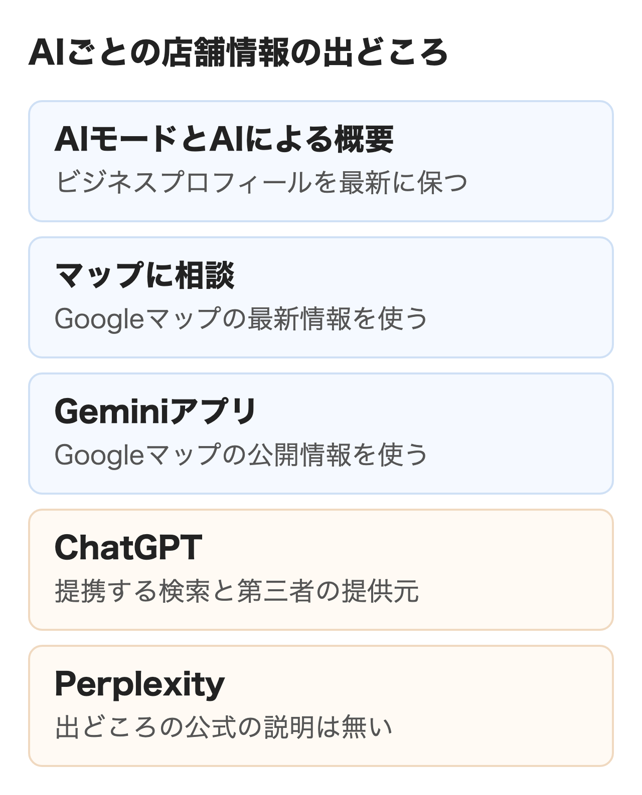
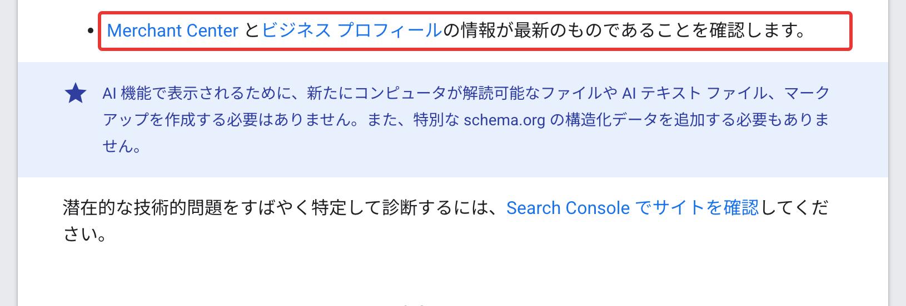
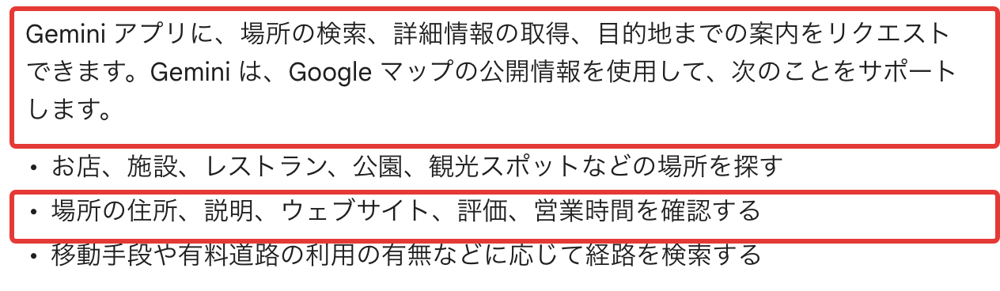
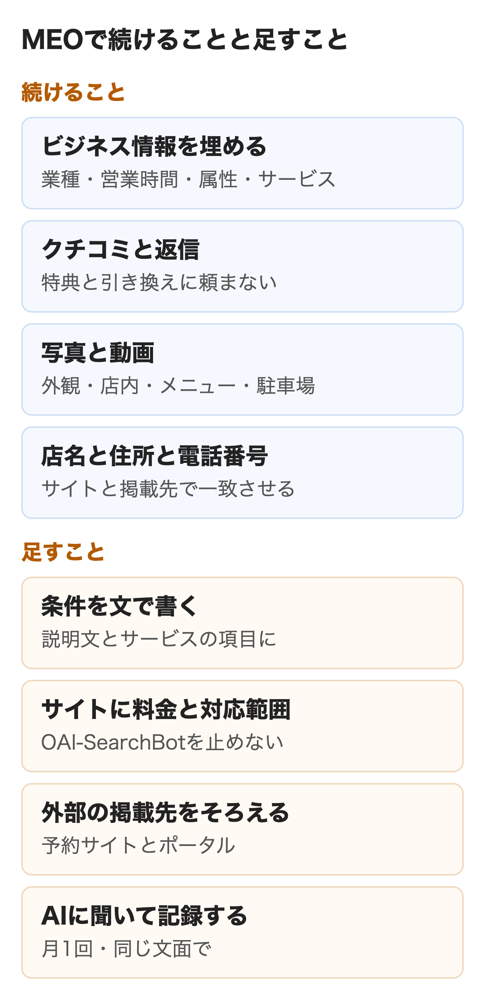

Googleは2025年9月9日に検索のAIモードを日本語で提供し始め、2026年8月7日にはGoogleマップで条件を話して店を探す「マップに相談」を日本で始めました。店を探す相談の一部が、地図の一覧からAIの答えに移っています。

MEO対策を続けてきた店舗や事務所にとっての問いは、今の施策を続けてよいのか、何を足せばよいのかです。この記事では2026年11月4日に取得した各社の公式ヘルプをもとに、**AIごとに店舗情報をどこから読むか**を分けて、MEOで続けることと足すことを整理します。nitoはAI検索対策の支援をしている会社です。

:::takeaways
- Googleの検索セントラルはAIモードとAIによる概要に特別な最適化は要らないとし、ビジネスプロフィールの情報を最新に保つことを基本に挙げている
- Geminiとマップに相談はGoogleマップの情報を使うと公式に書かれている。ChatGPTは近くの店の一覧に第三者の提供元を使うとだけ書き、名前は出していない
- MEOで整えた情報とクチコミはAI検索でも土台になる。足すのは条件を文で書くこと、サイトと外部の掲載先をそろえること、AIに聞いて記録すること
:::

## MEO対策へのAI検索の影響

「駅の近くで個室がある居酒屋」「土曜も診てもらえる歯医者」のような相談は、これまで検索窓に短い語で打たれ、地図の一覧から選ばれていました。AIの答えでは条件に合う数件の店が文章で紹介されるため、MEOの前提も変わります。影響の中身を探し方・検索の種類・地図の順位の3つに分けました。

### 店の探し方の変化

Google Japan Blogは、AIモードが特に役立つ場面に地域のおすすめ探しを挙げ、初期の利用者は従来の検索の2〜3倍の長さの質問をしていたと書いています。AIモードは長い質問を小さな検索に分けて調べ、まとめて答えます。マップに相談の紹介でも「今夜使える照明付きの公営テニスコートを探して」のような条件つきの質問が例でした。**地図の一覧で何位かより、条件に合う候補としてAIの答えに名前が挙がるかが問われる**ようになったのが、MEOにとって一番大きな変化です。

AIモードの答えにGoogle上の店舗情報がどれだけ使われているかは、Googleは公表していません。第三者の調査としてGMO TECHが2026年8月6日に結果を公表しました。2026年5月から7月に4回、21業種の日本語のローカル検索約10万9,500クエリを聞き、延べ約44万回答を調べたものです。約7割の回答でGoogle上の店舗カードの参照が見つかり、参照情報に占める店舗カードの割合は5月の38.0％から7月の48.8％に増えました。**店を探す相談でMEOで整えてきた店舗情報がAIモードの答えの材料になっている**と読める結果でした。

### 影響を受ける検索と受けにくい検索

店名で調べる検索や、地図アプリで近くの店を探してルートを見る使い方は、AIの答えがあっても大きくは変わりません。変わるのはまだ店を決めていない人が条件を並べて相談する場面です。「子連れで入れる」「駐車場がある」「当日予約できる」のような条件で候補を絞る役を、AIが受け持つようになりました。どの検索がどれだけ減るかをGoogleは公表していないため、ここはnitoの見立てです。自社の場合はビジネスプロフィールのパフォーマンス画面で検索語の一覧を開き、店名の語と条件の語のどちらで見られているかを先に確かめておくと判断しやすくなります。

### マップの順位とAIの答えの関係

ビジネスプロフィールのヘルプは、ローカル検索の結果を主に関連性・距離・知名度で決めると説明しています。関連性は検索語とプロフィールが合う度合い、知名度はリンクしているサイトの数やクチコミの数などで測られます。一方、AIモードやマップに相談が候補の店を同じ仕組みで選んでいるかは、どのヘルプにも書かれていません。**店舗側が手を入れられるのは、関連性を決める情報の中身と、知名度につながるクチコミ**です。距離は変えられないため、AIの答えでも近い店から挙がる前提で考えます。

## AIごとに店舗情報をどこから読むか

上位の解説記事の多くは「AIはビジネスプロフィールを参照する」とひとまとめにしています。各社の公式ヘルプを並べると、Googleの3つのAIと、ChatGPT・Perplexityでは書いてあることが違いました。

<figure class="post-figure"></figure>

| AI | 店舗情報について公式に書いてあること | 公式に書いていないこと |
|---|---|---|
| GoogleのAIモードとAIによる概要 | ビジネス プロフィールの情報を最新に保つことをSEOの基本に挙げる | どの項目をどう使うか |
| Googleマップのマップに相談 | Googleマップの最新情報を使って提案する | 候補の店の選び方 |
| Geminiアプリ | Googleマップの公開情報で住所・説明・評価・営業時間を確かめる | 候補の店の選び方 |
| ChatGPT | 検索の提供元と組むことがある。近くの店の一覧は第三者の提供元から | 提供元の名前。ビジネスプロフィールを使うか |
| Perplexity | 店やホテルの検索結果を地図に出す | 店舗情報の出どころ |

### GoogleのAIモードとAIによる概要

Google 検索セントラルの「AI 機能とウェブサイト」は、AIによる概要とAIモードに出るための追加の要件も特別な最適化も無いと書いています。そのうえで引き続き大事なSEOの基本のひとつに、Merchant Centerとビジネス プロフィールの情報を最新に保つことを挙げました。AIモードの日本語の提供を知らせたブログは、ウェブのページに加えてナレッジグラフなどの最新の情報源も使うと説明しています。

<figure class="post-figure"><figcaption>AI 機能とウェブサイト（Google 検索セントラル、2026年11月4日）</figcaption></figure>

検索ヘルプによるとAIモードは店のサイトに予約枠や在庫が載っていないとき、利用者の代わりに店へ電話して確かめます。ただしこの機能は18歳以上のログインした利用者に英語で提供するものとされ、2026年11月4日時点で日本語での提供は書かれていません。**Googleの検索のAIに対して公式に言えるのは、ビジネスプロフィールを最新に保つことと、ウェブのSEOの基本の2つ**です。ページの側の手入れは[AIモードのSEOの記事](/media/ai-mode-seo/)と[AIによる概要の対策の記事](/media/cited-by-ai-overviews/)で扱っています。

### Googleマップのマップに相談

マップに相談を日本で始めたときのブログは、この機能がGoogleマップの最新情報を活用して提案すると書いています。混雑の状況を見て長い列を避ける使い方も紹介されていました。マップの中の機能なので、**ビジネスプロフィールに載せた営業時間や属性が、そのまま答えの材料に入る**と考えるのが自然です。マップのクチコミの要約はGoogle Maps Platformの開発者向けドキュメントでユーザーのクチコミだけから作るとされ、店舗側では書き換えられません。マップ側の機能の一覧と設定は[GoogleビジネスプロフィールのAI対策の記事](/media/gbp-ai-search/)にまとめています。

### Geminiアプリ

Geminiアプリのヘルプ「Gemini アプリで場所や経路の検索をする」には、GeminiがGoogleマップの公開情報を使うとはっきり書かれています。店や施設を探すこと、場所の住所・説明・ウェブサイト・評価・営業時間を確かめることができ、使うには［アクティビティの保存］をオンにしておく必要があります。質問の例には「近くに本格的なメキシコ料理店はない？テーブル席があるところで。」のような条件つきの相談が並んでいました。

<figure class="post-figure"><figcaption>Gemini アプリで場所や経路の検索をする（Gemini アプリ ヘルプ、2026年11月4日）</figcaption></figure>

nitoが2026年10月7日に、ある士業の案件で地域名をつけた質問をGeminiに10回聞いたところ、9回はGoogleマップの店舗カードで答え、引用元のリンクは0件でした。1つの案件の実測ですが、ヘルプの記述と合っています。**Geminiはビジネスプロフィールに書いたことを読む**と考えて差し支えありません。GeminiとPerplexityの引用の違いは[GeminiとPerplexityの引用の記事](/media/gemini-perplexity-citation/)で詳しく扱っています。

### ChatGPT

OpenAIのヘルプ「Searching the web with ChatGPT」は、ChatGPTの検索がほかの検索の提供元と組むことがあると書き、提供元のプライバシーポリシーとしてMicrosoftとShopifyを挙げています。位置はIPアドレスからおおよそを推定し、近くの店の一覧などを出すために信頼できる第三者の提供元へ位置を渡すことがあるとも書かれていました。レストランの予約はOpenTable・Resy・Yelpの空きを見せ、OpenTableは全世界、ResyとYelpは米国などでの提供です。

ヘルプにGoogleマップやビジネスプロフィールの名前は出てきません。**ビジネスプロフィールを整えただけで、ChatGPTに同じ情報が届くとは言えない**のが公式の記述から言える範囲です。ヘルプはサイトを検索結果に載せる条件として、OpenAIの検索用のクローラー OAI-SearchBot を許可することを挙げています。ChatGPTに備えるなら公式サイトと外部の掲載先の情報をそろえるほうが確実です。

### Perplexity

Perplexityは更新情報で、レストランやホテル、旅行先を探すと結果が地図に出るようになったと告知しています。ただし店舗の情報をどこから取っているかは、2026年11月4日に確かめた範囲では公式の説明が見つかりませんでした。業者の記事にはPerplexityがGoogleマップを読むという説明もありますが、根拠になる公式の記述はありません。

Googleの3つのAIはビジネスプロフィールとGoogleマップの情報が共通の土台で、ここはMEOの施策がそのまま効く範囲です。ChatGPTとPerplexityは土台が別なので、**MEOだけでAI検索の全部に備えられるわけではありません**。

## MEOで今も効くこと

ビジネスプロフィールのヘルプが勧める施策は、AI検索が広がった後もそのまま土台になります。Googleの3つのAIがGoogleマップの情報を使う以上、MEOで整えてきた情報はAIの答えの材料です。

<figure class="post-figure"></figure>

### ① ビジネス情報の充実と正確さ

ヘルプは情報が充実していて正確なほどローカル検索の結果に出やすいとし、できるだけ多くの情報を入れるよう勧めています。業種（カテゴリ）・サービス・営業時間・属性は、AIに条件つきで聞かれたときに答えの根拠になる項目です。**祝日や年末年始の特別営業時間まで入れておく**と、「今日開いている店」のような時刻の条件にも答えられる情報がそろいます。項目ごとの入れ方は[GoogleビジネスプロフィールのAI対策の記事](/media/gbp-ai-search/)で扱っています。

### ② クチコミと返信

好意的なクチコミや有用な返信はビジネスの注目度を高めるのに役立つと、ヘルプは書いています。マップのクチコミの要約はユーザーのクチコミから作られるため、来店した人に具体的な体験を書いてもらうことが、店舗側の打てる手です。駐車場の場所や予約の方法のようにクチコミに書かれていない事実を返信に添えておけば、AIが読める情報が1つ増えます。**割引や特典と引き換えにクチコミを頼むことと、良い評価だけを選んで頼むことは、マップのポリシーで禁止**されています。

### ③ 写真と動画

写真や動画で商品やサービスを紹介することも、ヘルプが勧める項目です。外観・店内・メニュー・駐車場の写真があれば、AIの答えから店のページを開いた人が来店前に確かめられます。AIが写真の中身を候補選びに使うかはGoogleは書いていないため、まずは来店する人のために撮る写真として考えます。

### ④ 店名・住所・電話番号の一致

ヘルプ「Google がビジネス プロフィールとローカル検索結果の情報を入手する方法と、それらの用途」は、プロフィールの情報源に公式サイトなどの公開情報と、第三者がライセンスを持つデータを挙げています。Googleは自分のプロフィール以外からも店の情報を集めているということです。**営業時間や電話番号がサイト・ビジネスプロフィール・予約サイトで違うと、どれが正しいかを利用者もAIも判断できません**。1か所を直したらほかの掲載先も同じ日に直しましょう。

## AI検索のために足すこと

MEOの施策は主にGoogleマップの中の情報を整えるものでした。AI検索に備えて足すのは条件で聞かれたときに答えられる文と、Googleの外の情報です。

### ① 条件を文で書く

AIへの相談は「テーブル席がある」「子連れで入れる」のような条件つきです。ビジネスプロフィールの説明文やサービスの項目に、**対応できる条件を文で書いておく**と、相談の言葉と照らし合わせられる材料が増えます。ヘルプは説明文に価格やセールではなく、商品やサービスと他にない特長を書くよう案内しています。属性の項目にある条件は属性で選び、属性に無い条件を説明文やサービスに回します。

### ② 公式サイトに料金と対応範囲を書く

ChatGPTの検索に載るには、公式サイトがOAI-SearchBotに読まれる必要があります。サイトのrobots.txtやCDNの設定で止めていないかを、制作会社に一度確かめてもらいましょう。ページの中身にはメニューの料金・所要時間・対応できる地域や症状・対応しない条件を書いておきましょう。**「料金は要問い合わせ」だけのページは、料金の条件がついた相談に答える材料になりません**。業種ごとの書き方は[飲食店](/media/restaurant-ai-search/)・[クリニック](/media/clinic-ai-search/)・[歯科医院](/media/dental-clinic-ai-search/)・[建設・リフォーム](/media/construction-ai-search/)・[不動産](/media/real-estate-ai-search/)の記事にあります。

### ③ 外部の掲載先をそろえる

近くの店の一覧に第三者の提供元を使うと、ChatGPTのヘルプは書いています。どの提供元かは書かれていないため、店が載っている予約サイト・ポータルサイト・地域の紹介サイトの情報を広くそろえておくほかありません。予約サイトの営業時間が古いまま残っている例はよくあります。**ビジネスプロフィールを直すときに、外部の掲載先の一覧も一緒に見直す**のが手間の少ない進め方です。

### ④ AIに聞いて記録する

AIの答えに自社が出ているかは、どの管理画面にも出てきません。自社の条件でAIに聞き、名前が挙がるか、どう紹介されるかを記録して初めて、MEOで直した項目が効いたかを判断できます。聞き方は次の章で扱います。

## 効いたかの測り方

ビジネスプロフィールのパフォーマンス画面では、検索とマップでの閲覧数やクリック数が見られます。ただしAIモードやマップに相談から見られた分を分ける項目は、ヘルプに説明がありません。サイト側もAI機能での表示はSearch Consoleの検索タイプ「ウェブ」に含まれると検索セントラルが説明しています。

| 見るもの | どこで見るか | 頻度の目安 |
|---|---|---|
| プロフィールの閲覧数・通話・ルート | ビジネスプロフィールのパフォーマンス | 月1回 |
| 店名での検索の数 | Search Consoleの検索パフォーマンス | 月1回 |
| AIの答えに名前が挙がるか | AIモード・マップに相談・Gemini・ChatGPTに同じ質問 | 月1回 |
| 外部の掲載先の情報が一致しているか | 予約サイト・ポータルの店舗ページ | 情報を変えた日 |

質問は地域名と業種だけのもの・自社の強みの条件を足したもの・店名を入れて「どんな店か」を聞くものの3つを用意すると比べやすくなります。地域がずれるときは市区町村や郵便番号を質問に入れるよう、ChatGPTのヘルプは勧めていました。**都道府県ではなく市区町村名や駅名を入れ、毎月同じ文面で聞いて日付つきで残す**と、答えの変化を追えます。手で測るときの工数と記録の仕方は[AIO対策の記事](/media/aio-taisaku/)の測り方の節にまとめています。

## よく見る説明と公式の記述

MEO業者の記事や提案資料には、AIが重く見る項目を言い切った説明が多く見られます。よく見る説明と公式に書かれている範囲を並べました。

| よく見る説明 | 公式の記述 |
|---|---|
| AIはクチコミの数が多い店を選ぶ | 数と評価はローカル検索の順位の要素（ビジネスプロフィール ヘルプ）。AIの答えで同じかは記述なし |
| 投稿を週1〜2回続けると鮮度の評価が上がる | 投稿の頻度とAIの関係は記述なし |
| LocalBusinessの構造化データで引用が増える | 検索セントラルはAIのための特別な構造化データは不要とする |
| 返信すると運営していると判断される | 有用な返信は注目度を高める（ローカル検索）。AIについては記述なし |
| 写真のファイル名や説明をAIが読む | 記述なし |
| AIモードではほとんどの人がサイトを開かない | Googleの公表値は無い |

左の列が間違いだと決まったわけではありません。ただ、**根拠を示せない施策に月額の費用を払う前に、業者にその根拠を聞く**のは、会社として当然の確かめ方です。右の列に記述がある施策から先に進めれば、社内で予算を通すときの説明もしやすくなります。

## MEO業者との契約を見直すとき

AI検索の話が出てから、MEOの契約にAI対策を足すプランを勧められる店舗が増えています。今の契約を続けるか見直すかの分かれ目は、業者が実際に何をしているかです。

### 続ける価値がある契約

営業時間や属性の更新、写真の追加、クチコミへの返信、外部の掲載先の情報の点検を実際にしているなら、その作業はAI検索の土台を整える作業でもあります。先月どの項目を更新したか、返信を何件どんな方針で書いたかを業者に聞き、具体的な答えが返ってくれば続ける価値があると判断できるでしょう。

### 見直したほうがよい契約

月次の報告が地図の順位だけで、プロフィールの中身が何か月も変わっていない契約は見直しの対象です。クチコミの投稿を業者が用意する、特典と引き換えに集めるといった運用は、マップのポリシーに触れます。ビジネスプロフィールのヘルプは、Googleでの上位表示を保証する業者を注意すべき兆候に挙げています。**AIモードで必ず上位に出すという約束も、根拠を示せない点は同じ**です。

MEOの契約はGoogleマップの中を整える仕事が中心です。ChatGPTやPerplexityでの紹介のされ方を測り、公式サイトや外部の情報を直す仕事は範囲の外になりがちです。nitoはその部分を[LLMO支援](/llmo/)として請けており、あるSaaS企業の支援では、狙った質問の1つで3ヶ月のうちにAIの答えで名前が挙がる割合が10％から45％になりました。

## まとめ

MEO対策はAI検索が広がっても土台として残り、足すのはGoogleの外の情報と、AIに聞いて確かめる習慣です。状況ごとに次のように進めると無駄がありません。

- MEOを続けてきた店舗：契約はそのまま。説明文とサービスに条件を文で足し、月1回AIに聞いて記録する
- ビジネスプロフィールを放置してきた店舗：AIより先に業種・営業時間・属性・写真を埋める
- ChatGPTで名前が出ない店舗：公式サイトの料金と対応範囲、外部の掲載先の情報をそろえる
- 複数の店舗を持つ会社：店舗ごとの情報の担当と、外部の掲載先の一覧を先に決める

## よくある質問

### MEO対策はAI検索で意味がなくなりますか？

なくなりません。GeminiとGoogleマップのマップに相談はGoogleマップの情報を使うと公式に書かれており、検索セントラルもビジネスプロフィールを最新に保つことをAI機能のための基本に挙げています。MEOで整えた情報とクチコミは、そのままAIの答えの材料です。

### AIモードはビジネスプロフィールを読みますか？

どの項目をどう使うかをGoogleは公表していません。検索セントラルはビジネスプロフィールの情報を最新に保つことを基本に挙げています。第三者のGMO TECHの調査では、日本語のローカル検索の延べ約44万回答のうち約7割で、Google上の店舗カードの参照が見つかりました。

### ChatGPTはGoogleマップの情報を使いますか？

OpenAIのヘルプにGoogleマップやビジネスプロフィールの名前は出てきません。検索の提供元と組むことがあり、近くの店の一覧には第三者の提供元を使うと書かれています。ChatGPTに備えるには、公式サイトがOAI-SearchBotに読まれる状態にし、外部の掲載先の情報をそろえます。

### GeminiはGoogleマップのクチコミを読みますか？

Geminiアプリのヘルプは、Googleマップの公開情報で場所の評価や営業時間を確かめられると書いています。クチコミの本文を答えにどう使うかは書かれていません。Geminiからマップにクチコミを追加することはできません。

### Perplexityに店舗を載せるには何をすればよいですか？

Perplexityは店舗の情報をどこから取るかを公式に説明していません。店やホテルを探すと結果が地図に出ることは告知されています。公式サイトと外部の掲載先の情報をそろえ、実際にPerplexityで地域名つきの質問をして、名前が挙がるかを記録するのが確かな方法です。

### AI検索の影響はプロフィールの画面で分かりますか？

確かめられません。パフォーマンスの画面のヘルプに、AIモードから見られた分を分ける説明はありません。閲覧数・通話・ルートの全体の動きを見ながら、AIに自社の条件で質問して名前が挙がるかを記録します。

### MEO業者のAI対策プランは必要ですか？

中身によります。営業時間や属性の更新、クチコミへの返信、外部の掲載先の点検が入っていれば、AI検索の土台を整える作業です。AIが重く見る項目を言い切る説明や、AIモードでの上位を約束するプランは、公式の根拠を業者に聞いてから判断します。

## 出典

いずれも2026年11月4日に取得しました。

- Google 検索セントラル「[AI 機能とウェブサイト](https://developers.google.com/search/docs/appearance/ai-features?hl=ja)」
- Google ビジネス プロフィール ヘルプ
  - 「[Google のローカル検索結果のランキングを改善するヒント](https://support.google.com/business/answer/7091?hl=ja)」
  - 「[Google がビジネス プロフィールとローカル検索結果の情報を入手する方法と、それらの用途](https://support.google.com/business/answer/2721884?hl=ja)」
  - 「[Google マップに表示されるビジネスの概要について](https://support.google.com/business/answer/6088158?hl=ja)」
  - 「[ビジネス プロフィールのパフォーマンスとインサイトを確認する](https://support.google.com/business/answer/9918094?hl=ja)」
  - 「[サードパーティと連携してビジネス プロフィールを管理するためのヒント](https://support.google.com/business/answer/7163406?hl=ja)」
- マップユーザーの投稿コンテンツに関するポリシー「[禁止または制限されているコンテンツ](https://support.google.com/contributionpolicy/answer/7400114?hl=ja)」
- Google 検索ヘルプ「[AI モードを使用してローカルの在庫状況と価格を確認する](https://support.google.com/websearch/answer/17104441?hl=ja&co=GENIE.Platform%3DDesktop)」
- Gemini アプリ ヘルプ「[Gemini アプリで場所や経路の検索をする](https://support.google.com/gemini/answer/16622866?hl=ja&co=GENIE.Platform%3DDesktop)」
- Google Maps Platform「[AI によるクチコミの要約](https://developers.google.com/maps/documentation/places/web-service/review-summaries?hl=ja)」
- Google Japan Blog「[Google 検索における「AI モード」を日本語で提供開始](https://blog.google/intl/ja-jp/products/explore-get-answers/ai-mode-search/)」（2025年9月9日）
- Google Japan Blog「[Google マップの新機能「マップに相談」を日本で提供開始](https://blog.google/intl/ja-jp/products/connect-communicate/japanese-ask-maps/)」（2026年8月7日）
- OpenAI Help Center「[Searching the web with ChatGPT](https://help.openai.com/en/articles/9237897-chatgpt-search)」
- Perplexity Changelog「[Comet now available for everyone, background assistants, and Slack connector](https://www.perplexity.ai/changelog/what-we-shipped-october-3rd)」
- GMO TECH「[AIがお店を探すとき、頼りにしている情報は何か](https://prtimes.jp/main/html/rd/p/000005478.000000136.html)」（PR TIMES、2026年8月6日）
