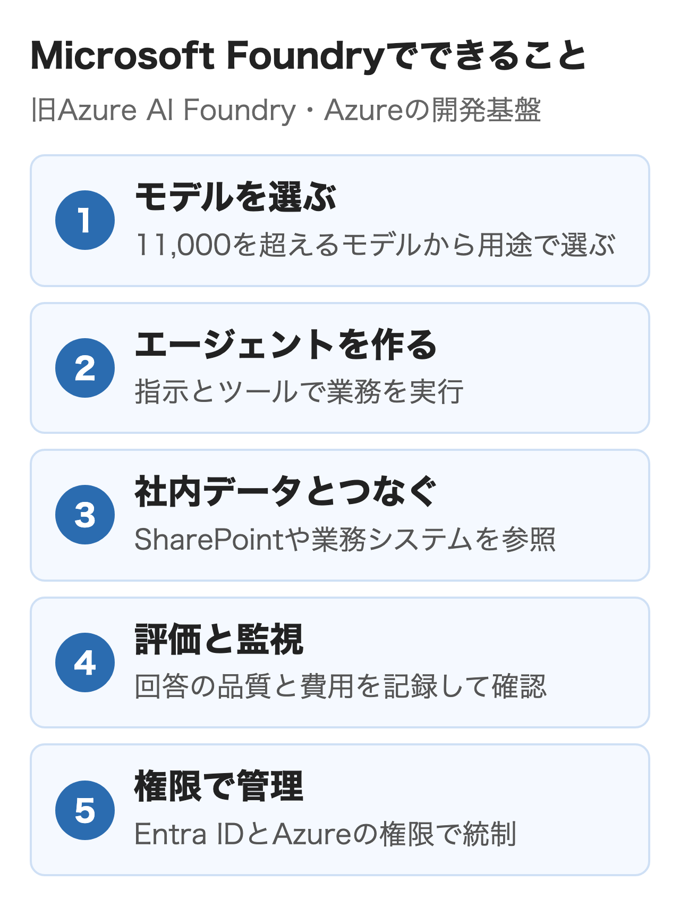
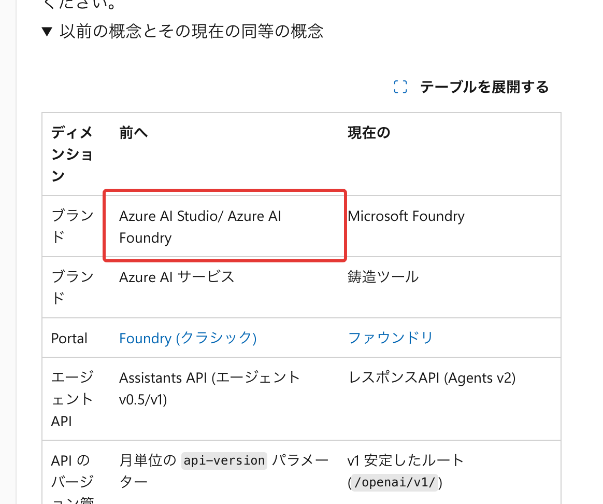
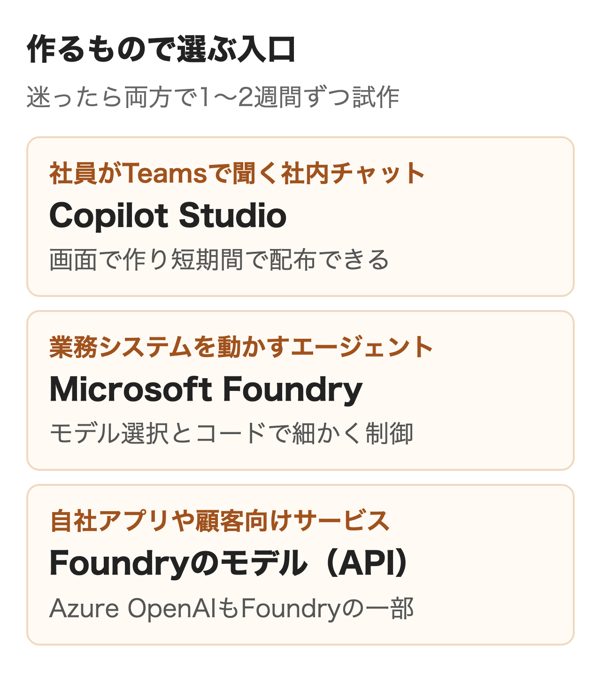
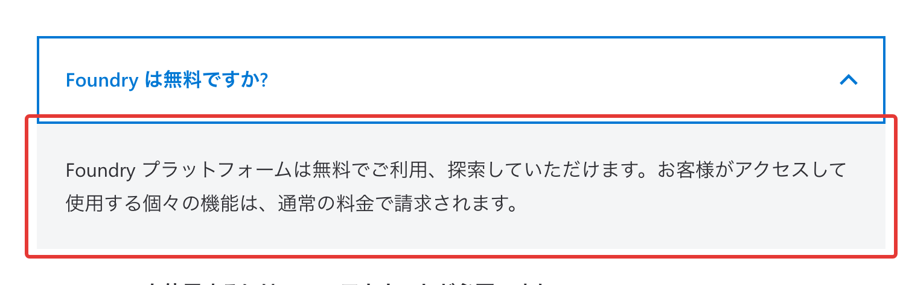
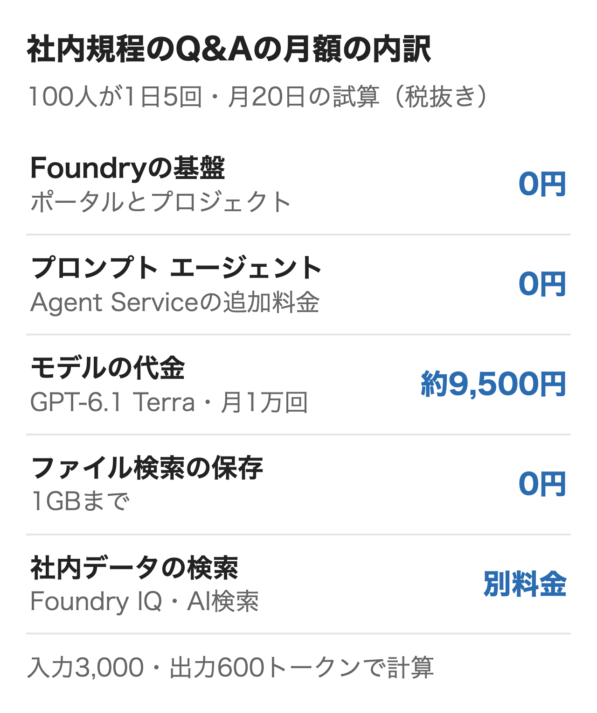
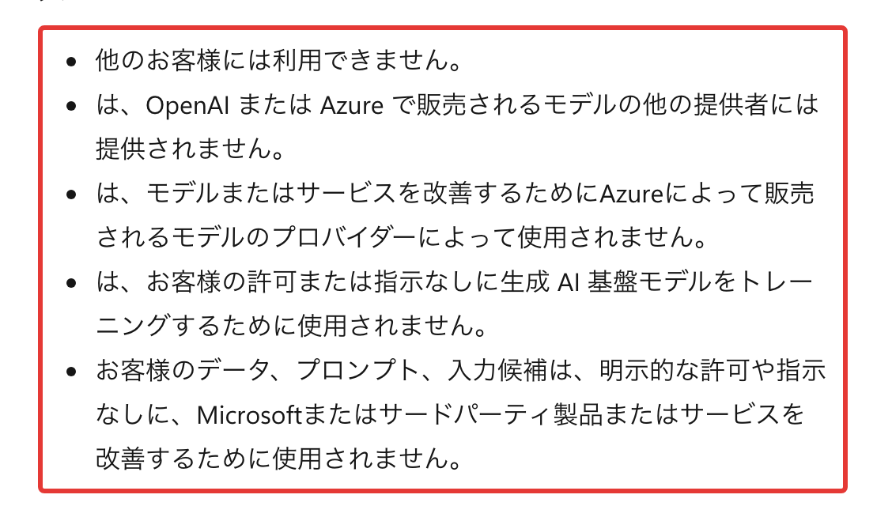
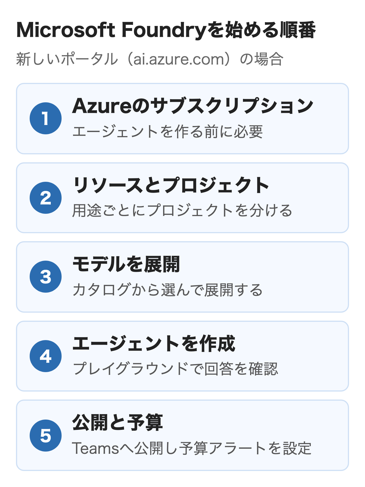

Microsoft Foundry（旧Azure AI Foundry）は、Azureの上でAIエージェントやAIアプリを作り、評価と監視まで1か所で行うMicrosoftの開発基盤です。基盤そのものは無料で、使ったモデルやツールの分だけAzureの請求に載ります。

この記事ではMicrosoft 365やAzureを使う会社で社内向けのエージェントや自社アプリを作るか決めたい担当者に向けて、できること・Copilot StudioやAzure OpenAIとの選び方・料金の考え方・データの扱い・始め方を扱います。

:::takeaways
- **Microsoft FoundryはAzure AI Studio・Azure AI Foundryの今の名前**。モデル・エージェント・ツール・評価を1つのリソースで管理する
- **社員がTeamsで聞く社内チャットならCopilot Studio、業務システムを動かすエージェントや自社アプリならFoundry**が向いている
- **基盤は無料で、モデルとツールの使った分を払う**。予算を超えても自動では止まらないので、アラートの設定が必要
:::

## Microsoft Foundryとは？何ができる？

**Microsoft Foundryは、モデルの選択からエージェントの作成、社内データとの接続、品質の評価と監視までを1つのAzureリソースで扱う基盤です。** Microsoft Learnの「Microsoft Foundry とは」は、エージェント・モデル・ツールを1つの管理単位にまとめ、権限・ネットワーク・ポリシーも同じ場所で管理できると説明しています。

作れるものは大きく3つです。1つ目はエージェントで、指示とツールを組み合わせて質問への回答や業務の処理を行います。2つ目はモデルの利用で、OpenAI・Anthropic・Meta・Microsoftなどの11,000を超えるモデルから用途に合うものを選び、APIで呼び出します。3つ目はツールと知識で、Web検索・ファイル検索・コードの実行に加え、SharePointや業務システムの情報をエージェントが参照できるようにします。

<figure class="post-figure"></figure>

完成品のAIを使うMicrosoft 365 Copilotと違い、Foundryは自社専用のAIを作る側の製品です。WordやTeamsの作業を楽にしたいだけなら、まずは[Microsoft 365 Copilotの使い方](/media/copilot-guide/)で足りるかを確認するのがおすすめです。

### 名前とポータルはどう変わった？

**Azure AI Studio、Azure AI Foundry、Microsoft Foundryは同じ製品で、2025年11月のIgniteで今の名前になりました。** 2023年にAzure AI Studioとして始まり、2024年にAzure AI Foundryへ改名され、2025年11月に「Azure」の冠が外れています。Azure AI ServicesもFoundry Toolsに名前が変わりましたが、Azureのリソースの種類は前と同じです。

<figure class="post-figure"><figcaption>Microsoft Learn「Microsoft Foundry とは</figcaption></figure>

名前より注意が必要なのは、ポータルが新旧2つある点です。今のポータル（ai.azure.com）に出るのはFoundryプロジェクトだけで、ハブベースのプロジェクトとプロンプトフローは画面上部の切り替えで開くクラシックのポータルに残っています。**検索で見つかる解説にハブやプロンプトフローの手順が出てきたら、それはクラシックの話**です。新しく作るならFoundryプロジェクトから始めます。

エージェントのAPIも変わりました。古いAssistants APIは2026年8月26日に終了し、今のエージェントはResponses APIで動きます。モデルを呼ぶSDKのazure-ai-inferenceも同じ日に廃止されています。Azure OpenAIのリソースを使っている会社は、エンドポイントとAPIキーを保ったままFoundryのリソースにアップグレードできます。

### エージェントは何種類ある？

**Foundryのエージェントは3種類で、コードを書かずに作るプロンプト エージェントから始めるのが公式の勧めです。** どれを選ぶかで、自社で保守する範囲と費用の型が変わります。

| 種類 | 作り方 | 費用の型 |
|---|---|---|
| プロンプト エージェント | 画面かSDKで指示・モデル・ツールを設定 | モデルとツールの使った分 |
| 音声のプロンプト エージェント | 同じ設定に音声を追加 | 上記に音声の処理の分 |
| ホスト型エージェント | 自社のコードをコンテナーで持ち込む | 上記にコンテナーの時間の分 |

プロンプト エージェントは、指示・モデル・ツールを決めればFoundryが実行まで受け持つため、保守するアプリのコードもサーバーもありません。ホスト型エージェントはMicrosoft Agent Framework・LangGraph・OpenAI Agents SDKなどで書いたコードを動かす型で、承認の流れや社内システムの操作を細かく組みたいときに向いています。宣言型で始めて、必要になったらコードに移れる作りです。

## Microsoft Foundryで何を作れる？

**Foundryで作られているのは、社内の規程や手順に答えるエージェント、業務システムを操作するエージェント、自社サービスに組み込むAI機能の3つが中心です。** Azureの製品ページにも、簡単なQ&Aのチャットボットから複数のエージェントが連携する業務の流れ・RPAに近い自動化まで作れるとあります。

- **社内の規程・手順のQ&A**: SharePointなどの文書をFoundry IQ（プレビュー）で知識として登録し、権限に沿って根拠つきで答える
- **業務システムを動かすエージェント**: Logic Appsの1,400を超える接続（SAP・Salesforce・Dynamics 365など）やMCPで、起票・通知・照会まで行う
- **自社サービスへの組み込み**: エージェントやモデルをAPIで呼び、顧客ポータルのサポートや見積もりの下書きに使う
- **音声の窓口**: 音声のプロンプト エージェントをTeams PhoneやTwilioの電話番号につなぐ（関連機能の一部はプレビュー）
- **ネットワークの外に出せない現場**: Foundry LocalでPCやエッジの端末上でモデルを動かす

社内のQ&Aのように「社員が質問して答える」だけなら、Foundryでなくても作れます。入口の選び方は次の節の早見にまとめました。

## Copilot Studioとどう違う？

**作るものが社員向けのチャットならCopilot Studio、業務システムを動かすエージェントか自社アプリならFoundryを選ぶのが基本です。** Azure OpenAIは別の製品というより、Foundryの中でOpenAIのモデルを使う部分にあたり、Azureの価格ページでも「Azure OpenAI in Foundry Models」と表示されています。

<figure class="post-figure"></figure>

| 作るもの | 選ぶ入口 | 決め手 |
|---|---|---|
| 社員がTeamsで聞く社内チャット | Copilot Studio | 画面で作り、Microsoft 365のデータとつなぎやすい |
| 業務システムを動かすエージェント | Microsoft Foundry | モデルの選択・コード・評価まで自社で制御できる |
| 自社アプリや顧客向けのAI機能 | Foundryのモデル（API） | Azure OpenAIを含むモデルをアプリから直接呼ぶ |

2つの製品の差が出るのは、作る人・払い方・自由度です。どちらで作ってもTeamsやMicrosoft 365 Copilotに公開でき、Entra IDで社内の人に限って使わせられる点は共通です。

| 比べる点 | Copilot Studio | Microsoft Foundry |
|---|---|---|
| 提供の形 | SaaS（画面で作る） | PaaS（画面とコードで作る） |
| 主に作る人 | 業務部門・ローコードの作り手 | 開発者・クラウドの担当 |
| 払い方 | Copilotクレジット | モデルとツールの使った分 |
| 自社のコード | コネクタとフローが中心 | ホスト型エージェントで持ち込める |

MicrosoftのCloud Adoption Framework（Azure導入の公式ガイド）も、Copilot Studioは最小限のコーディングで速く作る場面、Foundryは深い統合と独自の処理が必要な場面と分けています。そのうえで、**候補ごとに1〜2週間の試作を作って比べ、ローコードで機能とセキュリティの要件を満たせるならそちらに進む**よう勧めています。

2つは組み合わせることもできます。Copilot StudioのエージェントからFoundryのエージェントを呼び出す接続は、2026年11月12日時点でプレビューです。Foundry側でActivityプロトコルのエンドポイントをREST APIかPython SDKで有効にする必要があり、新しいポータルで作ったエージェントだけがつながります。

:::linkcard
url: /media/copilot-studio-agent/
title: Copilot Studioのエージェント作成手順
desc: Copilot Studioで社内向けのエージェントを作りTeamsに公開するまでの手順を解説しています。
:::

## Microsoft Foundryを使うメリットは？

**モデルを選び替えられること・評価と監視が最初から付いていること・Azureの権限管理にそのまま乗ることの3つが、Foundryを選ぶ利点です。** どれもPoCで終わらせず本番で動かし続けるときに効果が出ます。

### モデルを選び替えられる

Foundryのカタログに並ぶのは、OpenAIのGPT系・AnthropicのClaude・MetaのLlama・MicrosoftのPhiなど11,000を超えるモデルです。エージェントのコードを変えずにモデルを差し替えられるため、**安いモデルで試して、足りない所だけ高性能なモデルに替える**運用ができます。要求の内容に応じてモデルを自動で振り分ける機能がモデル ルーターです。

### 評価と監視が最初から付いている

エージェントの1回ごとの動き（どのモデルを呼び、どのツールを使ったか）をトレースで追え、回答が根拠に沿っているか・質問に合っているか・ツールを正しく選んだかを評価できます。**HTTPが正常に返っていても、回答が的外れなら業務では失敗**なので、この評価を本番の会話に継続してかけられる点は、自前で作るより手間が少なくなります。

### Azureの権限と統制に乗る

エージェントごとにEntra IDのIDが付き、RBAC・仮想ネットワーク・Azure Policy・コンテンツのフィルターで統制する仕組みです。情報システム部門がすでにAzureで管理している権限やネットワークの決まりを、AIエージェントにもそのまま当てられます。

## Microsoft Foundryの注意点は？

**費用が複数のサービスに分かれて上限で止まらないこと・プレビューの機能が多く変化が速いこと・作る側に開発の知識が必要なことの3つには注意が必要です。**

### 費用が分かれ上限で止まらない

Foundryには料金計算ツールの専用ページが無く、モデル・検索・音声などを1つずつ見積もる必要があります。Learnのコスト管理のページは、**OpenAIには予算を超えられないハード上限があるが、Azure OpenAIには無い**と明記しています。予算とアラートを設定し、超えたときの対応を自社で決めておくことが前提です。

### プレビューが多く変化が速い

マルチエージェントのワークフロー・エージェントのメモリ・Foundry IQ・Foundryコントロール プレーンは、2026年9月11日更新のLearnでプレビューと表示されています。プレビューはサービスレベルの保証が無く、仕様が変わることがあります。本番に使う機能が一般提供（GA）かどうかは、Learnの表示で確認してから選ぶのがおすすめです。

### 作る側に開発の知識が必要

プロンプト エージェントは画面で作れますが、社内システムとの接続・ネットワークの分離・評価の設計まで含めると、Azureと開発の知識が必要です。業務部門だけで作って配りたいなら、Copilot Studioのほうが早く進みます。

## Microsoft Foundryの料金はいくらかかる？

**Foundryの基盤とプロンプト エージェントには追加料金がかからず、払うのはモデルのトークンと、使ったツール・検索・コンテナーの分です。** 価格ページのFAQは「Foundry プラットフォームは無料でご利用、探索していただけます」と書き、使った個々の機能が通常の料金で請求されるとしています。

<figure class="post-figure"><figcaption>Azure「Microsoft Foundry の価格</figcaption></figure>

費用の項目は次のとおりです。Agent Serviceの価格ページは、プロンプトとワークフローで作るエージェントの作成と実行に追加料金は無いと書いています。

| 項目 | 課金のしかた |
|---|---|
| モデル | 入力と出力のトークン数（モデルと展開の型で単価が違う） |
| 組み込みツール | ファイル検索の保存は1GBまで無料、コード実行はセッションごと、Web検索は1,000回ごと |
| 社内データの検索 | Foundry IQ（Azure AI検索）・SharePoint・Logic Appsの接続は各サービスの料金 |
| ホスト型エージェント | コンテナーの時間。東日本は1vCPUで1時間17.3009円、メモリは1GiBで1時間2.0538円 |

社員100人が社内規程のQ&Aのエージェントを1日5回ずつ使う場合で数えます。プロンプト エージェントで作り、1回の入力が3,000トークン・出力が600トークン、月20日とすると、モデルにGPT-6.1 Terra（グローバル標準）を選んだときの代金は**月約9,500円（税抜き）**です。ファイル検索の保存が1GBに収まればそこは0円で、SharePointの文書をFoundry IQで検索させる場合はAzure AI検索の料金は別です。

<figure class="post-figure"></figure>

**この規模なら費用の大半はモデルの代金で、モデルの選び方で桁が変わります。** モデルごとの単価・展開の型・計算式の詳細は次の記事にまとめました。

:::linkcard
url: /media/azure-openai-pricing/
title: Azure OpenAIの料金
desc: Foundryでの課金の型とモデル別の円単価、社内チャットの月額の計算方法を解説しています。
:::

使う量が大きい会社向けにはMicrosoft Agentの事前購入プランもあります。1年分のエージェント コミット ユニット（ACU）を前払いすると、20,000 ACUで5%、100,000 ACUで10%、500,000 ACUで15%割り引かれ、FoundryとCopilot Studioのクレジットの両方に使えます。始める前に試すなら、Azureの無料アカウントに付く30日間200ドル分のクレジットが手軽です。

Foundryのポータルの「操作」の概要にある推定コストと、AzureポータルのCost Managementで費用を管理します。複数の部署で1つのFoundryリソースを共有するなら、プロジェクトごとに費用を分けて見る機能（プレビュー）がありますが、対象はAzureが販売するモデルだけです。

## 入力したデータはどう扱われる？

**AzureでOpenAIなどのモデルを使う場合、プロンプトと出力はほかの顧客やOpenAIに渡されず、許可なくモデルの学習にも使われません。** Learnの「Azure が販売するモデルのデータ、プライバシー、セキュリティ」は、Azure OpenAIを含むAzureが販売するモデルについて、この扱いを明記しています。

<figure class="post-figure"><figcaption>Microsoft Learn「Azure が販売するモデルのデータ、プライバシー、セキュリティ</figcaption></figure>

情報セキュリティの担当と確認しておきたい点は次の4つです。

- **処理の場所**: 既定は指定した地域の中。グローバルやデータゾーンの展開の型を選ぶと、その範囲の別の地域で処理されることがある
- **保存されるデータ**: アップロードしたファイルや会話の履歴は同じ地域のFoundryリソースに暗号化して保存され、いつでも削除できる。自社の鍵での暗号化も選べる
- **不正利用の監視**: 兆候があるとAIで自動で確認し、必要に応じてMicrosoftの認可された担当者が見る。申請が承認されれば人の確認とそのための保存を止められる
- **対象のモデル**: この扱いはAzureが販売するモデルの話。AnthropicのClaudeなどパートナーのモデルは、各モデルの条件の確認が必要

プレビューの機能では上の条件がすべて満たされない場合があると、Learnにも書かれています。社外秘の文書を扱うエージェントは、一般提供の機能と、仮想ネットワークで閉じる標準のセットアップで組むのが安全です。

## Microsoft Foundryの始め方は？

**Azureのサブスクリプションを用意し、Foundryのリソースとプロジェクトを作って、プロンプト エージェントを1つ作るところから始めます。** Foundryのポータルを見て回るだけならAzureのアカウントは不要ですが、エージェントを作るにはサブスクリプションが必要です。

<figure class="post-figure"></figure>

1. Azureのサブスクリプションを用意する（無料アカウントでも可）
2. Azureポータルか[Foundryのポータル](https://ai.azure.com/)で、Foundryのリソースとプロジェクトを作る。プロジェクトは用途やチームごとに分けられる
3. 「ビルド」のカタログからモデルを選んで展開する
4. 「ビルド」の「エージェント」で新しいエージェントを作り、指示とツールを設定してプレイグラウンドで回答を確認する
5. 発行してTeamsやMicrosoft 365 Copilotに公開し、Cost Managementで予算とアラートを設定する

作る人にはプロジェクトの範囲でFoundry Userのロール（旧称Azure AI User）が必要です。Responses APIとAgent Serviceはすべての地域で使えるわけではないため、リソースを作る前に使いたい地域が対応しているかを確認します。試作は手軽な基本のセットアップで、社内データを扱う本番は仮想ネットワークや自社のストレージを使う標準のセットアップで組むのが一般的です。

エージェントの作り方の全体像や、作る前に決めておくことは[AIエージェントの作り方](/media/ai-agent-build/)で扱っています。

## まとめ

- **社員がTeamsで規程や手順を聞くだけなら**、Copilot Studioかエージェント ビルダーで足りるかを先に確認する
- **業務システムの操作や承認の流れまで任せたいなら**、Foundryのプロンプト エージェントで試作し、必要になったらホスト型エージェントに移る
- **自社サービスにAIを組み込むなら**、FoundryのモデルをAPIで使い、モデルの単価から月額を見積もる
- **どちらか迷うなら**、両方で1〜2週間ずつ試作して、速さ・機能・連携の手間で比べる

社内での設計や試作を外部と進めたい場合は、nitoもAIエージェントの構築を支援しています。

## よくある質問

### Azure AI Foundryと同じ製品ですか？

同じ製品です。Azure AI Studio、Azure AI Foundryと名前が変わり、2025年11月のIgniteでMicrosoft Foundryになりました。ハブベースのプロジェクトなど古い仕組みはクラシックのポータルに残っています。

### Microsoft Foundryは無料で使えますか？

基盤とポータルは無料で、プロンプト エージェントの作成と実行にも追加料金はかかりません。使ったモデルのトークン、ツール、検索、ホスト型エージェントのコンテナーの分が、Azureの請求に載ります。

### Azure OpenAIとの違いは何ですか？

Azure OpenAIは、Foundryの中でOpenAIのモデルを使う部分です。FoundryはOpenAI以外のモデル、エージェント、ツール、評価までを含む基盤全体の名前です。既存のAzure OpenAIのリソースは、エンドポイントとAPIキーを保ったままFoundryのリソースにアップグレードできます。

### Copilot Studioとどちらを選びますか？

社員向けのチャットを画面で早く作るならCopilot Studio、業務システムの操作や自社アプリへの組み込みならMicrosoft Foundryが向いています。Microsoftの導入ガイドの勧めは、両方で1〜2週間ずつ試作して比べることです。

### FoundryでClaudeは使えますか？

使えます。AnthropicのClaudeはFoundryのモデルカタログにあり、使用量の請求もAzure経由です。ただしAzureの前払いクレジットはMarketplace経由のモデルには使えないとLearnに書かれています。契約の経路の違いは[Claudeの法人契約](/media/claude-corporate-contract/)にまとめました。

### FoundryのエージェントはTeamsで使えますか？

使えます。発行したエージェントをTeamsやMicrosoft 365 Copilotに公開する機能は一般提供されています。Copilot Studioのエージェントから呼び出す接続はプレビューです。

### Foundryのデータは学習に使われますか？

Azure OpenAIを含むAzureが販売するモデルでは、プロンプトと出力は許可なくモデルの学習に使われず、OpenAIにも渡されません。パートナーのモデルは各モデルの条件を確認する必要があります。

### Microsoft Foundryのハブはまだ使えますか？

ハブベースのプロジェクトは、クラシックのポータルで引き続き使えます。今のポータルにはFoundryプロジェクトだけが表示され、新しいエージェントの機能もFoundryプロジェクトでしか使えないため、新しく作るならFoundryプロジェクトがおすすめです。

## 出典

金額と仕様は2026年11月12日に確認した公式ページの表示です。ホスト型エージェントの円単価はAzure Retail Prices API（東日本・円）で取得しました。

- Microsoft Learn「[Microsoft Foundry とは](https://learn.microsoft.com/ja-jp/azure/foundry/what-is-foundry)」
- Microsoft Learn「[Microsoft Foundry のエージェント](https://learn.microsoft.com/ja-jp/azure/foundry/agents/overview)」
- Microsoft Learn「[Foundry (クラシック) ポータルから移行する](https://learn.microsoft.com/ja-jp/azure/foundry/how-to/navigate-from-classic)」
- Microsoft Learn「[Microsoft Foundry (クラシック) ポータルとは](https://learn.microsoft.com/ja-jp/azure/foundry-classic/what-is-foundry)」
- Microsoft Learn「[Microsoft Foundry のコストを計画および管理する](https://learn.microsoft.com/ja-jp/azure/foundry/concepts/manage-costs)」
- Microsoft Learn「[Azure が販売するモデルのデータ、プライバシー、セキュリティ](https://learn.microsoft.com/ja-jp/azure/foundry/responsible-ai/openai/data-privacy)」
- Microsoft Learn「[AI エージェントのテクノロジ計画](https://learn.microsoft.com/ja-jp/azure/cloud-adoption-framework/ai-agents/technology-solutions-plan-strategy)」（Cloud Adoption Framework）
- Microsoft Learn「[Microsoft Foundry エージェントに接続する（プレビュー）](https://learn.microsoft.com/ja-jp/microsoft-copilot-studio/add-agent-foundry-agent)」（Copilot Studio）
- Microsoft Azure「[Microsoft Foundry](https://azure.microsoft.com/ja-jp/products/ai-foundry)」
- Microsoft Azure「[Microsoft Foundry の価格](https://azure.microsoft.com/ja-jp/pricing/details/ai-foundry/)」
- Microsoft Azure「[Foundry Agent Service の価格](https://azure.microsoft.com/ja-jp/pricing/details/foundry-agent-service/)」
- Microsoft Learn「[Azure Retail Prices API](https://learn.microsoft.com/ja-jp/rest/api/cost-management/retail-prices/azure-retail-prices)」
- Microsoft Azure Blog「[Microsoft Foundry: Scale innovation on a modular, interoperable, and secure agent stack](https://azure.microsoft.com/en-us/blog/microsoft-foundry-scale-innovation-on-a-modular-interoperable-and-secure-agent-stack/)」（2025年11月18日）
