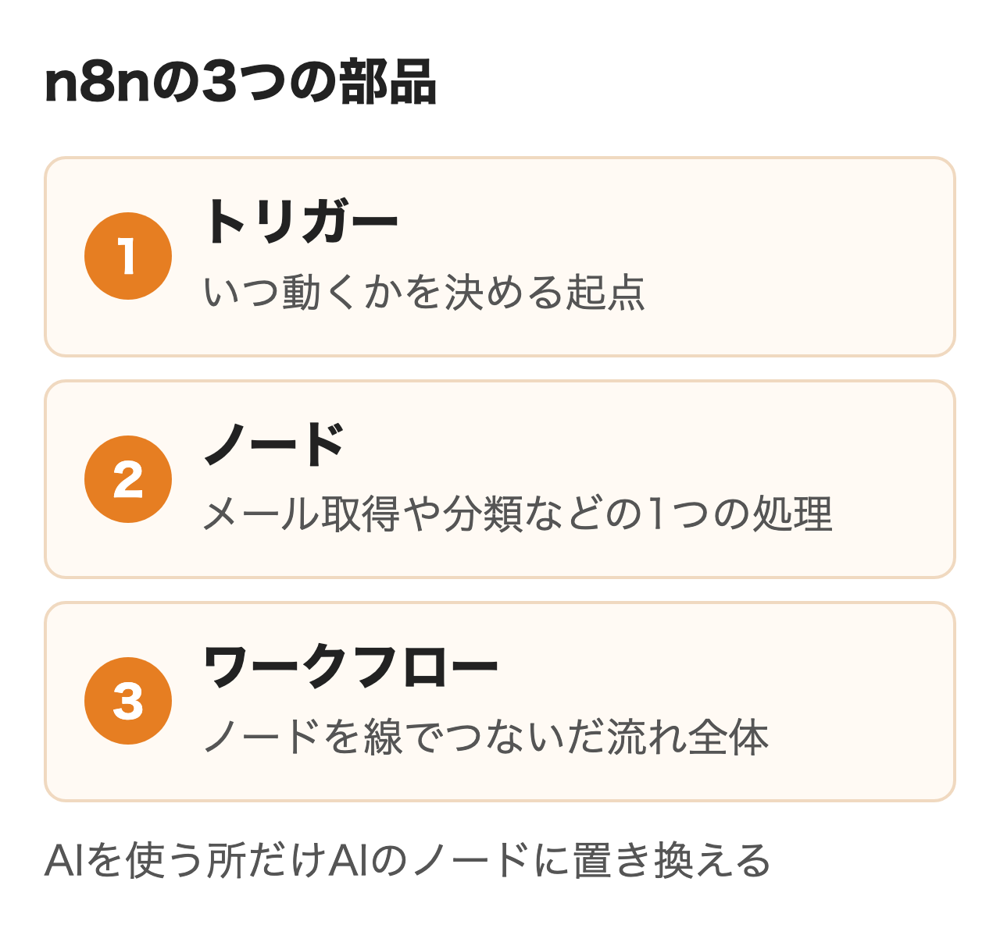
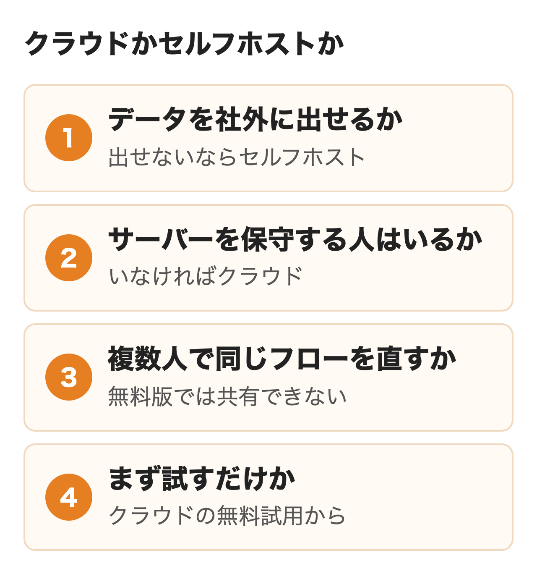
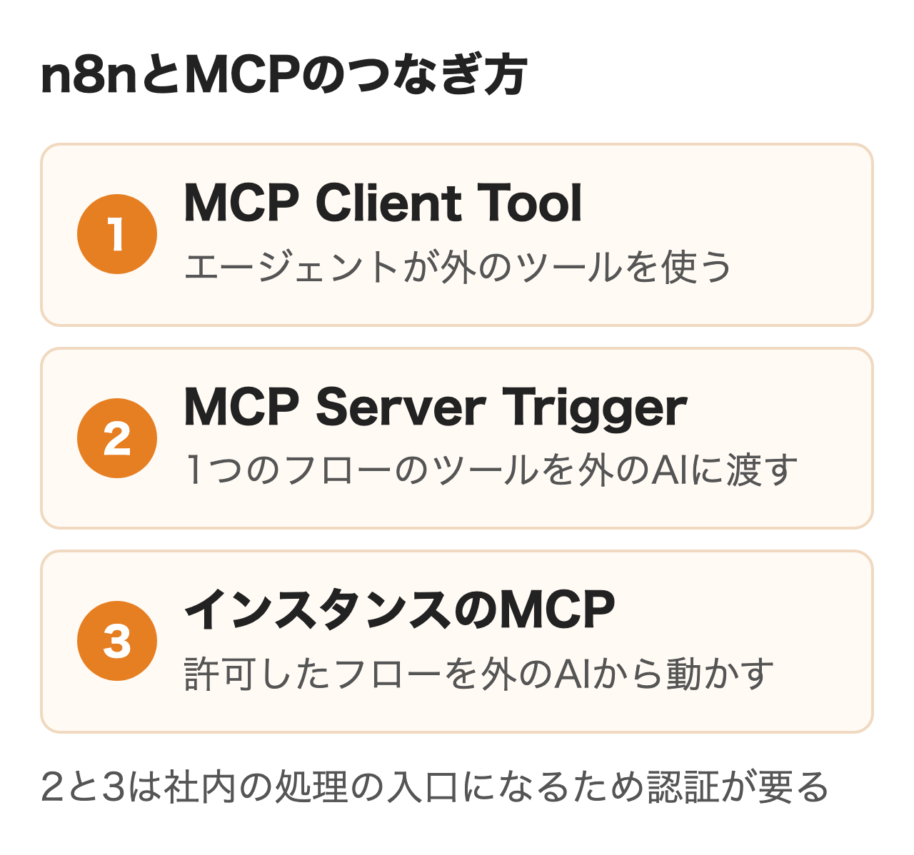
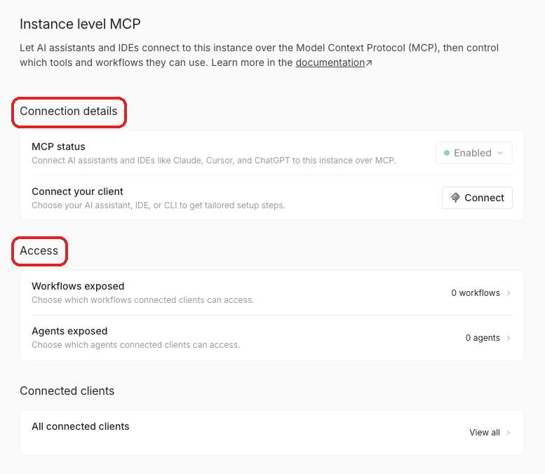
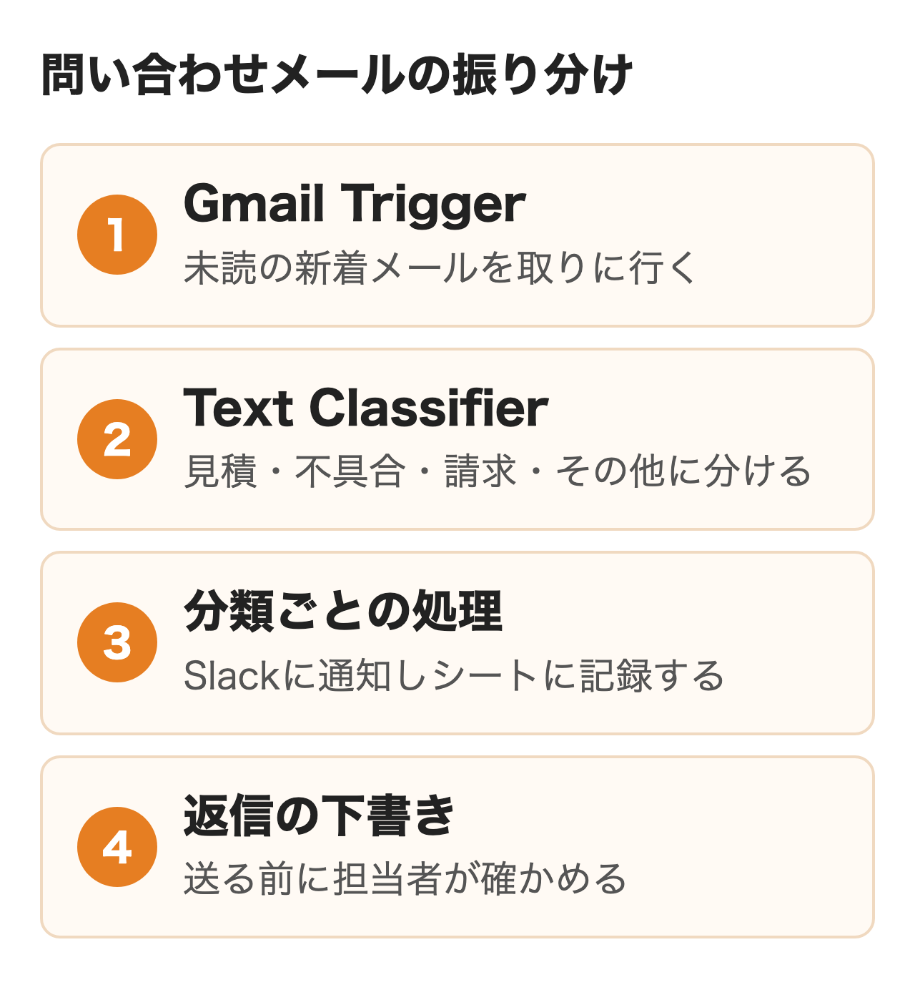
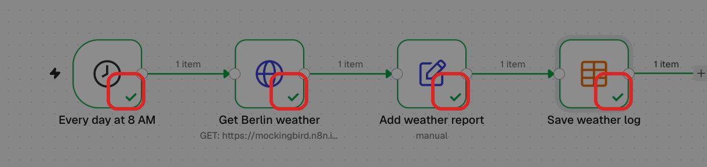

n8n（エヌエイトエヌ）は、アプリやAIのモデルをノードでつないで業務を自動化するワークフローの基盤です。公式サイトは500を超える連携先と、MCPでAIエージェントとつながることを掲げています。

社内の自動化やAIエージェントの候補にn8nが挙がると、担当者は何ができるか・どこに置くか・何から作るかを決める必要があります。この記事は2026年11月5日に読んだ公式のドキュメントとライセンスをもとに、その3つを順に扱います。n8nの画面での操作は試していません。

:::takeaways
- **n8nはトリガーとノードをつないで動かす自動化の基盤**で、AIを使う所だけAIのノードに置き換えられる
- **データを社外に出せないならセルフホスト、保守する人がいないならクラウド**。無料のセルフホストは複数人での共有ができない
- **AI AgentノードとMCPで、社内のワークフローをChatGPTやClaudeから呼ぶ形まで組める**。送信や書き換えの前には人の承認を挟める
:::

## n8nとはどんなツールか

読み方は公式の表記どおりエヌエイトエヌで、node（ノード）とautomation（自動化）を合わせたnodemationを縮めた名前として紹介されています。開発元はドイツのn8n社です。

n8nのワークフローは3つの部品でできています。

| 部品 | 役割 | 例 |
|---|---|---|
| トリガー | ワークフローが動くきっかけ | 毎朝8時、メールの受信、フォームの送信、Webhook |
| ノード | 1つずつの処理 | メールを読む、AIで分類する、Slackに送る、シートに書く |
| ワークフロー | ノードを線でつないだ流れ全体 | 受信したメールを分類して担当に知らせる |

<figure class="post-figure"></figure>

前のノードの出力が次のノードの入力として渡るため、画面の線を追えば処理の順番が分かります。**SlackやGmailの認証情報は一度登録すれば、ほかのワークフローでも選ぶだけで使い回せます。** 細かい加工はJavaScriptやPythonでも書けて、ノーコードとコードの中間の位置づけです。

公式サイトのトップは連携を「500以上のネイティブ連携、HTTPで任意のAPI、MCPで任意のエージェント」と説明しています。専用のノードが無いサービスでも、APIがあればHTTP Requestノードでつなげます。GitHubのスターは約20万9千です。

ソースは公開されていますが、n8nは自らをオープンソースと呼んでいません。ライセンスは2022年にn8n社が作ったSustainable Use Licenseで、使い方を自社の内部の業務か非商用に限るためです。**社内の業務に使うのは無料で認められていて、顧客が自分でワークフローを作れる形で提供するには別の契約が要ります。** 線引きの表と料金は「[n8nの料金](/media/n8n-pricing/)」にまとめました。

## n8nでできること

n8nで組まれる処理は2つに分かれます。決まった手順を流すだけの自動化と、途中にAIのノードを挟んで判断を任せる処理です。

決まった手順の例は次のようなものです。

- フォームに入力があったら顧客管理に登録し、営業のSlackに知らせる
- 受信したメールの内容をスプレッドシートに書き写す
- 毎朝の売上の数字を集めて報告をメールで送る
- 設備やサーバーの異常値を受け取り、担当者に知らせる

AIを使う処理には専用のノードがあります。ドキュメントのノードの一覧から、会社の業務で使いやすいものを抜き出しました。

| ノード | すること | 使いどころ |
|---|---|---|
| Basic LLM Chain | モデルに1回だけ処理させる | 要約、返信の下書き |
| Information Extractor | 文章から項目を抜き出す | メールから会社名・期限・金額を取る |
| Text Classifier | 決めたカテゴリに分ける | 問い合わせを見積・不具合・その他に分ける |
| Summarization Chain | 長い文書を要約する | 議事録や報告書の要点 |
| AI Agent | ツールを選んで使いながら目的を果たす | 複数のシステムを見て答える一次対応 |

**毎回同じ基準で分ければよい処理はText ClassifierやInformation Extractorで足り、AI Agentが要るのは呼ぶ先が状況で変わる処理だけです。** 分類で済む所にエージェントを使うと、結果が安定しにくくなります。

国内では京セラコミュニケーションシステムが2025年10月から社内に入れた例を開発者向けのブログに公開しています。問い合わせが届くとDifyのナレッジで回答案を作って通知し、人が確かめて返信する流れで、1件平均1時間の対応が約20分になったそうです。メールから案件・期限・金額を抜き出してシートに書く仕組みは11種類の業務に広げ、合わせて月5時間以上を減らしたと書かれています。エクサウィザーズは広告バナー15枚に約15時間かかっていた作業が約10分になった社内の例を挙げています。どちらも各社の公開記事の数字です。

## n8nとZapier・Difyなどの違い

自動化の候補に並ぶ製品とは、数える単位と置き場所が違います。

| 製品 | 料金の数え方 | 動かす場所 | 向く用途 |
|---|---|---|---|
| n8n | ワークフロー1回の実行（ステップは数えない） | n8nのクラウドか自社のサーバー | システム間の連携とAIエージェント |
| Zapier | 成功したステップごとのタスク | Zapierのクラウド | SaaSどうしを手早くつなぐ |
| Power Automate | ユーザーごとかボットごとの月額 | Microsoftのクラウド（PC操作の自動化もある） | Microsoft 365の中の業務 |
| Dify | ワークスペースの月額とクレジット | Difyのクラウドか自社のサーバー | チャットボットや社内文書を読むAIアプリ |

社内の業務がMicrosoft 365で回っているなら、TeamsやOutlookとの近さでPower Automateが先に候補になります。**データを社内に置いたまま、複数のシステムをまたぐ処理やAIエージェントを組みたいなら、n8nが向きます。**

Difyとn8nは取り合う関係より、組み合わせて使われることが多い製品です。前の節の京セラコミュニケーションシステムの例でも、回答案はDifyのナレッジで作り、問い合わせの登録やナレッジの更新はn8nが受け持っていました。Difyの費用は「[Difyの料金](/media/dify-pricing/)」で扱っています。

## クラウドかセルフホストか

n8nの使い始めで最初に決めるのが、n8n社のクラウドを契約するか、自社のサーバーに置くかです。公式の選び方のページはすぐ始めたい・技術者がいない・保守をしたくない場合はクラウド、環境を全部自分で管理したい場合はセルフホストを勧めています。本番の運用はどちらでもできるとしています。

<figure class="post-figure"></figure>

| 決めること | クラウドが向く | セルフホストが向く |
|---|---|---|
| データの置き場所 | n8n社のサーバー（EUのフランクフルト）でよい | 社外に出せない、社内のネットワークの中で動かしたい |
| 保守 | 更新やバックアップを任せたい | 更新・バックアップ・障害対応を担う人がいる |
| 複数人での編集 | 共有できるプロジェクトがある | 共有は有料のBusiness以上 |
| 費用 | 月の実行回数で決まる | ライセンスは無料、サーバーと人手は自社 |

**無料のセルフホスト（Community版）はほぼ全部の機能が使えますが、ワークフローと認証情報の共有、プロジェクト、SSO、Gitでの版の管理は有料の版に限られます。** 1〜2人が作って結果を全社で使う形なら無料で回せても、部署ごとに何人もが直す運用には向きません。

クラウドは14日間の無料試用から始められます。セルフホストは公式のドキュメントにある1行の設定（`curl -fsSL https://get.n8n.io | sh`）でDockerの上に立ち上がり、本番はDocker Composeでデータベースと一緒に組む形が勧められています。npmでのインストールはn8n 3.0から非推奨です。起動したばかりのタイムゾーンはUTCのことがあるため、毎朝8時に動かすつもりのワークフローが日本時間の17時に動いたという報告もあります。最初にAsia/Tokyoを指定しておくと防げます。

セルフホストで自社に残る仕事は、更新・バックアップ・外から届く入口の守りです。n8nは年に1〜2回のメジャーな版を出す方針で、2.0のときは古い1.xの修正が3か月で終わりました。2.0はCodeノードを隔離して動かし、任意のコマンドを実行するノードを初めから止めるなど、守りを固めた版です。管理画面とドキュメントは英語が中心で、公式に日本語へ切り替える設定はありません。費用の比べ方は「[n8nの料金](/media/n8n-pricing/)」のセルフホストの節にあります。

## AI AgentノードとMCPで作れるもの

n8nでAIエージェントを作るときの中心がAI Agentノードです。ドキュメントによると、チャットモデルと1つ以上のツールをつなぐと、どのツールを呼ぶかをエージェントが決めます。

- チャットモデル：OpenAI・Anthropic・Google Gemini・Azure・AWS Bedrockなどから選ぶ
- ツール：Web検索、計算、社内のデータベース、作ってあるワークフロー（最低1つ）
- メモリ：チャットで前のやり取りを覚えさせるときにつなぐ

**作ってあるワークフローをそのままエージェントのツールに渡せることが、n8nらしい使い方です。** 在庫を調べるフローや見積書を作るフローを用意しておけば、エージェントは問い合わせの中身を読んでどれを呼ぶかを決めます。エージェントを別のエージェントのツールにして、受付から専門の担当に振り分ける形も組める設計です。

任せる範囲に上限を設けたいときは、AI Agentのツールごとに人の承認を付けると、エージェントがそのツールを使う直前にワークフローが止まり、担当者が承認すれば実行、却下すれば取り消しになります。承認の依頼はSlack・Microsoft Teams・Gmail・Outlook・n8nのチャットなどに届けられます。**メールの送信やデータの書き換え・削除のように戻せない操作には承認を付け、読む・分類する・下書きするまでをAIに任せる組み方**が始めやすい形です。

MCPはAIと外部のツールをつなぐ共通の決まりで、n8nとのつなぎ方は3通りあります。

<figure class="post-figure"></figure>

| つなぎ方 | 向き | できること |
|---|---|---|
| MCP Client Tool | n8nが外のMCPを使う | 外部のMCPサーバーのツールをエージェントに渡す。渡すツールは全部・選んだものだけ・指定したもの以外から選べる |
| MCP Server Trigger | 外のAIがn8nを使う | 1つのワークフローの中のツールを、テスト用と本番用のURLで外に出す |
| インスタンスのMCP | 外のAIがn8nを使う | 許可したワークフローを、Claude・ChatGPT・Claude Code・Cursorなどから探して動かす |

3つ目のインスタンスのMCPは、設定のInstance-level MCPでオーナーか管理者がオンにし、ワークフローを1本ずつ許可して使います。つなぎ方はOAuthかAPIキーです。**つないだAIはどれも、許可したワークフローを全部見られるため、AIごとに見せるフローを分けることはできません。** 社外の人が使うAIをつなぐ前に、許可するフローを絞ることが先です。2.13.0からはつないだAIにワークフローを作らせたり直させたりもできます。

<figure class="post-figure"><figcaption>n8n Docsの Instance-level MCP の画面（2026年11月5日）</figcaption></figure>

MCP Server Triggerの認証は、なし・n8nのユーザー認証・Bearer・ヘッダーから選びます。**社内の処理の入口になるURLなので、認証なしで公開しないことが前提です。** 負荷分散のためにWebhookを受けるサーバーを複数台にしている場合、MCPの通信を1台に寄せないと接続が頻繁に切れるとドキュメントに注意書きがあります。

## 最初のワークフローの作り方

入力と出力がはっきりしていて止まっても業務が止まらない処理が、最初の1本に向いています。ここでは問い合わせ窓口のGmailに届くメールを分類し、担当に知らせる流れを例に、ドキュメントのノードの説明から手順を組みました。

<figure class="post-figure"></figure>

### ① 作る前に入力と出力を書く

どのメールを（入力）、どう分けて（処理）、どこに知らせるか（出力）を1行ずつ書きます。京セラコミュニケーションシステムは社内への聞き取りでこの3つを書いてもらい、そのままノードの設計に移したと紹介していました。分類のカテゴリと人が確かめる場所も、この時点で決めておくのがおすすめです。

### ② ワークフローを作ってトリガーを置く

クラウドの試用か自社のn8nにログインし、新しいワークフローを作ります。最初のステップにGmail Triggerを選び、Googleのアカウントを認証情報として登録する流れです。このトリガーは決めた間隔で新着を取りに行き、既定では未読のメールだけを対象に、1回に10件（最大50件）まで取ります。差出人やGmailの検索条件、ラベルで絞り込めるため、窓口のアドレス宛てだけに絞っておくと誤って拾うメールが減ります。Outlookを使う会社ならMicrosoft Outlook Triggerが同じ役割です。

### ③ Text Classifierで分ける

次にText Classifierをつなぎ、チャットモデルのノードをぶら下げます。カテゴリには見積依頼・不具合・請求・その他のように名前と説明を書き、説明で判断の基準をモデルに伝えます。**どのカテゴリにも当たらないメールは既定では捨てられるため、その他の分岐に出す設定に変えておきます。**

<figure class="post-figure"><figcaption>n8n Docsの最初のワークフローの画面（2026年11月5日）</figcaption></figure>

### ④ 分類ごとの処理をつなぐ

分岐ごとにSlackのノードで担当のチャンネルに知らせ、Google Sheetsのノードで記録を残します。返信の下書きまで作るならBasic LLM Chainで下書きを作り、Gmailの下書きとして置くところで止めます。送るのは担当者が中身を確かめてからです。

### ⑤ 試してから公開する

ノードごとにExecute stepで動かし、左の入力と右の出力を画面で確かめます。全体はExecuteで通して試し、問題がなければPublishで本番に出します。**2.0からは保存と公開が分かれ、保存しただけでは本番の動きは変わりません。** 公開した後の動きは実行の一覧でメールごとに追える作りです。

止まったときの知らせ先も、公開の前に決めておく必要があります。Error Triggerで始まるワークフローを1本作っておくと、失敗した実行が担当に届きます。文章で頼むとワークフローを組むn8n Assistantもあり、クラウドのStarterとPro、セルフホストの無料版とBusinessで使えます。月に何回動くかの見積もりは「[n8nの料金](/media/n8n-pricing/)」の実行回数の節を見てください。

## n8nを社内に入れるときの進め方

京セラコミュニケーションシステムの記事では、2025年7月に準備を始め、10月に社内で使い始めています。段取りは次の4つでした。

| 段階 | 期間 | 中身 |
|---|---|---|
| 比較と需要の調査 | 約1か月 | Zapier・Make・Workatoなどと比べ、社内アンケートで自動化したい業務を集める |
| セキュリティのリスクの整理 | 約1か月半 | IT部門と接続の環境を決め、トリガーとアクションごとのリスクを洗い出す |
| 環境の構築 | 約2か月 | AWSの構成、監視、手順書、バックアップ |
| 運用の体制づくり | 約1か月 | 異常時の対応、利用ガイド、更新の手順 |

**セルフホストで全社に開くなら、環境の構築より前のセキュリティの整理に1か月以上を見ておくと、計画と実際がずれにくくなります。** 管理画面とWebhookの入口を分け、外から届く範囲を絞る設計もこの段階で決まります。

外部のAPIにつなぐたびに社内のセキュリティの申請が要る会社では、ワークフローを作ってもつながらない期間が生まれます。エクサウィザーズは使う予定のAPIの申請を設計と並べて早めに進めることを勧めていました。

クラウドで小さく試す場合も、最初の1本を2〜4週間動かして実行回数と止まった回数を数えると、プランを選ぶ材料がそろいます。設計から運用までを社外に頼む場合は、nitoの[AIエージェント構築支援](/ai-agent/)でも、n8nを含めた社内の自動化の作り方から相談を受けています。

## まとめ

- **まず試したい**：クラウドの14日間の試用で、問い合わせメールの振り分けのような1本を作る
- **社内のデータを外に出せない**：セルフホストにして、更新と守りの担当を先に決める
- **何人もで同じワークフローを直す**：無料版では共有できないため、クラウドか有料の版を前提に見積もる
- **ChatGPTやClaudeから社内の処理を呼びたい**：インスタンスのMCPで、許可するワークフローを絞ってからつなぐ
- **Microsoft 365の中で完結する**：Power Automateと並べて比べる

## よくある質問

### n8nの読み方は？

エヌエイトエヌです。nodeとautomationを合わせたnodemationを縮めた名前とされています。

### n8nは無料で使えますか？

自社のサーバーで動かすCommunity版は無料です。n8n社のクラウドは14日間の無料試用のあと有料のプランになり、無料のプランはありません。

### n8nはオープンソースですか？

ソースは公開されていますが、使い方を制限するSustainable Use Licenseのため、n8n社は自らをオープンソースと呼んでいません。社内の業務に使う分は無料です。

### n8nは日本語に対応していますか？

管理画面とドキュメントは英語が中心で、公式に日本語へ切り替える設定はありません。日本語のメールやチャットの中身を、ワークフローの中で扱うことに問題はありません。

### n8nでAIエージェントは作れますか？

作れます。AI Agentノードにチャットモデルと1つ以上のツールをつなぐと、エージェントがどのツールを使うかを決めます。作ってあるワークフローもツールとして渡せる仕組みです。

### n8nはMCPに対応していますか？

対応しています。外部のMCPサーバーを使うMCP Client Tool、1つのワークフローをMCPサーバーにするMCP Server Trigger、許可したワークフローを外のAIから動かすインスタンスのMCPの3通りです。

### n8nとDifyはどちらを使えばよいですか？

社内文書を読むチャットボットのようにAIアプリが主ならDify、複数のシステムをまたぐ処理を動かすならn8nが向きます。回答をDifyで作り、登録や通知をn8nが受け持つ組み合わせの例もあります。

### n8nを使うのにプログラミングの知識は要りますか？

ノードを置いてつなぐ基本の操作に、コードは要りません。APIの応答の加工や細かい条件にはJavaScriptかPythonを書く場面があり、セルフホストではDockerとサーバーの知識が要ります。

## 出典

- n8n「[n8n.io](https://n8n.io/)」「[Introducing n8n 2.0](https://blog.n8n.io/introducing-n8n-2-0/)」
- n8n Docs「[Choose how to use n8n](https://docs.n8n.io/choose-how-to-use-n8n)」「[Build your first workflow](https://docs.n8n.io/try-it-out/quickstart/)」「[Host n8n](https://docs.n8n.io/hosting/)」
- n8n Docs「[AI Agent](https://docs.n8n.io/integrations/builtin/cluster-nodes/root-nodes/n8n-nodes-langchain.agent/)」「[Text Classifier](https://docs.n8n.io/integrations/builtin/cluster-nodes/root-nodes/n8n-nodes-langchain.text-classifier/)」「[Gmail Trigger](https://docs.n8n.io/integrations/builtin/trigger-nodes/n8n-nodes-base.gmailtrigger/)」「[Human-in-the-loop for tools](https://docs.n8n.io/advanced-ai/human-in-the-loop-tools/)」
- n8n Docs「[MCP Client Tool](https://docs.n8n.io/integrations/builtin/cluster-nodes/sub-nodes/n8n-nodes-langchain.toolmcp/)」「[MCP Server Trigger](https://docs.n8n.io/integrations/builtin/core-nodes/n8n-nodes-langchain.mcptrigger/)」「[Connect to n8n MCP server](https://docs.n8n.io/advanced-ai/accessing-n8n-mcp-server/)」
- n8n Docs「[Community license](https://docs.n8n.io/sustainable-use-license/)」
- Microsoft「[Power Automate の価格](https://www.microsoft.com/ja-jp/power-platform/products/power-automate/pricing)」
- 京セラコミュニケーションシステム「[業務フロー自動化ツール「n8n」社内導入の取り組みについて](https://qiita.com/kccs_izumi-egashira/items/020726a7b96662f6c1b2)」（Qiita、2026年3月6日）
- エクサウィザーズ「[n8nの使い方｜導入から自動化ワークフロー作成まで6ステップ](https://exawizards.com/column/article/n8n-how-to/)」（AI新聞、2026年8月23日更新）
