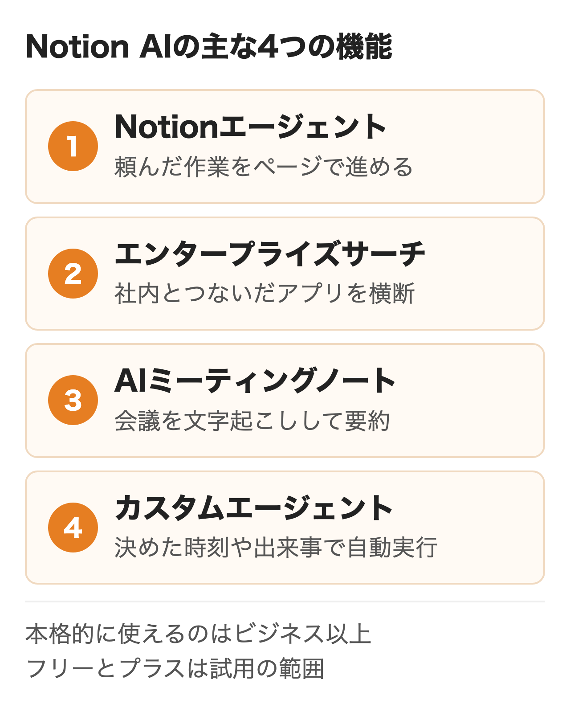
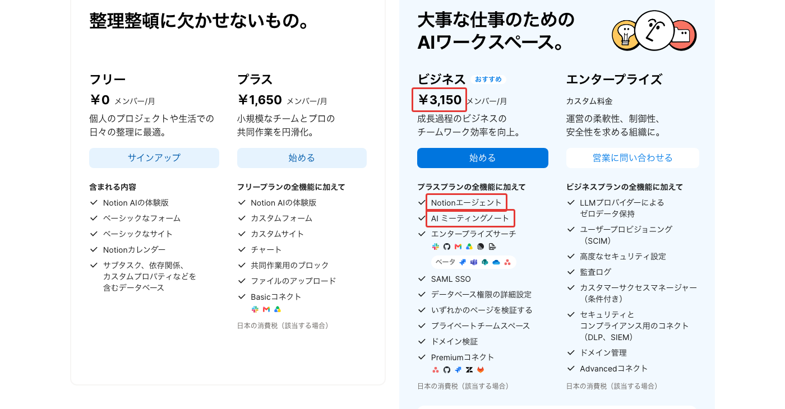
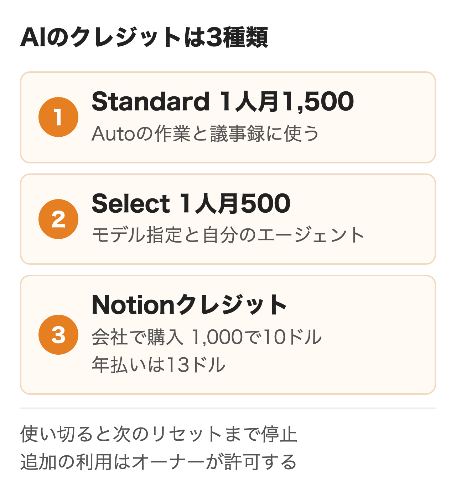
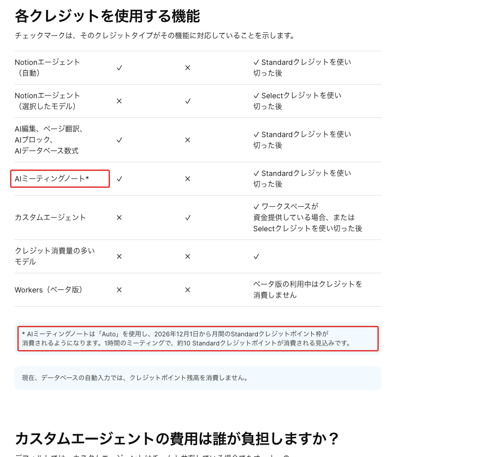
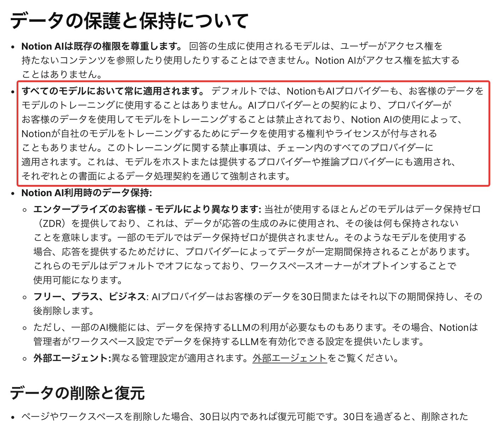
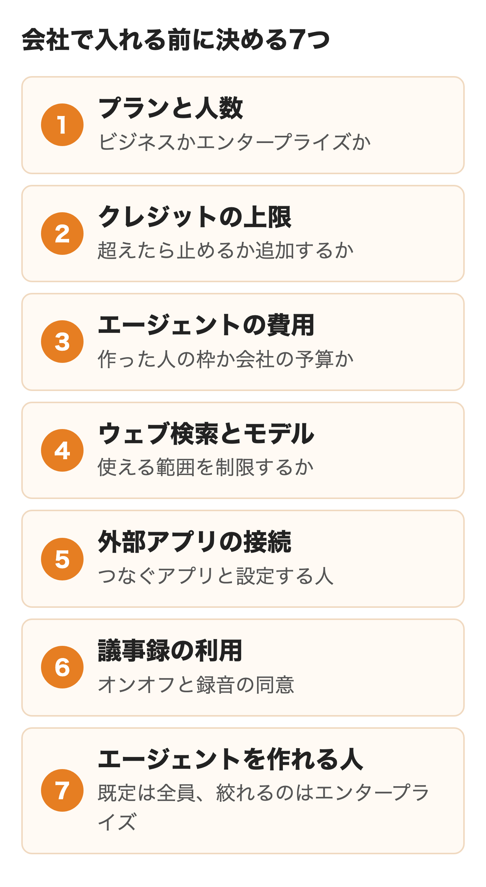

Notion AIは、Notionのページやデータベースの上で文章作成・検索・議事録・作業の代行までを行うAIです。本格的に使えるのはビジネスプラン（年払いで1人月3,150円）とエンタープライズプランで、フリーとプラスは回数に限りのある試用にとどまります。

会社で入れるか決める担当者に向けて、できること、料金とクレジットの数え方、無料で試せる範囲、データの扱い、導入前に決めることを公式の料金ページとヘルプで整理しました。有料プランでの操作は試していません。

:::takeaways
- **Notion AIはビジネスとエンタープライズに含まれる**。フリーとプラスは試用の回数を使い切ると止まる
- **ビジネスでも使い放題ではない**。1人に毎月Standard 1,500とSelect 500のクレジットが付き、超えた分は会社が買うNotionクレジット
- **既定では顧客データは学習に使われない**。AIの提供元の保持はビジネスまで30日、エンタープライズはゼロ保持（一部のモデルを除く）
:::

## Notion AIとは

Notion AIはNotionに組み込まれたAIの機能をまとめた呼び名です。別のアプリを開かずに、いま開いているページや社内のデータベースを材料にして答えを出し、ページの作成や編集まで進めます。

裏で動くモデルは1つではありません。OpenAIのGPT、AnthropicのClaude、GoogleのGeminiなどを使い分けており、既定の「Auto」ではNotionが作業ごとにモデルを選びます。**利用者はモデルを選ばなくても使え、選びたい人だけが自分で指定する**仕組みです。

公式ヘルプはNotion AIを使えるのはビジネスとエンタープライズのプランだと明記しています。フリーとプラスでは限られた数の無料の回答で試せるだけで、議事録やエンタープライズサーチのような会社向けの機能はビジネス以上に入っています。

<figure class="post-figure"></figure>

## Notion AIでできること

会社の仕事に直結するのは、作業の代行・社内の検索・議事録・自動で動くエージェントの4つです。Notionエージェントとエンタープライズサーチは、使う人が見られるページだけを材料にします。カスタムエージェントは使う人ではなくエージェントに許可したページとアプリを読みます。そのため、Slackの非公開チャンネルに入っていない人でも、エージェントを使える人ならその出力を見られる扱いです。

### Notionエージェント

画面下の顔のアイコンから開くチャットで、頼んだ作業をページやデータベースの上で進めます。「この議事録から対応事項を出して担当者ごとのタスクにして」のように複数の手順にまたがる依頼も受け、PDF・CSV・Excel・Word・PowerPointのファイルを読んで、表やスライドを作って返すこともできます。

**できないこともヘルプにはっきり書かれています。** ページの共有や権限の変更、コメントの作成、データベースのオートメーションの新規作成、AIミーティングノートの開始、ワークスペースの設定の管理はエージェントからはできません。

### エンタープライズサーチとAIコネクター

ホームの検索欄に質問すると、Notionのワークスペースに加えて、つないだアプリやウェブを探して出典つきで答えます。つなげるのはSlack、Googleドライブ、Gmail、Microsoft Teams、SharePointとOneDrive、GitHub、Jira（ベータ）などです。

**取り込める過去の情報は接続した日から1年前までが目安**です。取り込みには最大36時間かかることがあり、接続を外すとデータは1日以内に削除されます。

:::linkcard
url: /media/mcp-guide/
title: MCPとは？仕組みとMCPサーバー・会社で使うときに管理者が決めること
desc: AIとほかのサービスをつなぐMCPの仕組みと、会社で管理者が決めることを解説しています。
:::

### AIミーティングノート（議事録）

会議を文字起こしして要約し、決定事項と対応事項を拾います。Notionのデスクトップアプリで/meetと打つか、Notionカレンダーの予定から始める形です。対応言語に日本語が入っており、要約には約1分（300文字）以上の文字起こしが要ります。

使い方で差が出るのは音の取り方です。**デスクトップアプリはパソコンの音声とマイクの両方を取れますが、ブラウザとスマホはマイクの音だけ**なので、ヘッドフォンでオンライン会議に出ると相手の声が入りません。1人あたり1日10時間までという上限もあります。

### カスタムエージェント

決めた時刻や出来事をきっかけに、人が呼ばなくても動くエージェントです。毎週月曜に進捗をまとめる、データベースに依頼が入ったら担当を割り振る、Slackの質問に社内の資料をもとに答える、といった定型の仕事を任せます。

**読めるのは作った人が明示的に許可したページとアプリだけ**で、既定ではワークスペース全体には触れません。実行の記録と設定の履歴が残るため、何をしたかを後から確かめられます。

| 機能 | できること | 対象プラン |
|---|---|---|
| AIで編集・AIブロック | 下書き・要約・言い換え・翻訳 | フリーとプラスは試用、ビジネス以上 |
| データベースの自動入力 | 要約やタグをプロパティに入れる | 同上 |
| Notionエージェント | 作業の代行・ファイルの作成 | 同上 |
| エンタープライズサーチ | 社内とアプリの横断検索 | ビジネス以上 |
| AIミーティングノート | 文字起こし・要約・対応事項 | ビジネス以上 |
| カスタムエージェント | 時刻や出来事で自動実行 | ビジネス以上（クレジットが必要） |

## Notion AIの料金とプラン

料金はメンバー1人ごとにかかり、AIの機能はビジネスとエンタープライズに含まれます。日本の料金ページの円の額には「日本の消費税（該当する場合）」と添えられています。売上税のヘルプでは日本の個人と企業には消費税を請求するという案内です。

| プラン | 年払い（月あたり） | 月払い | Notion AI |
|---|---|---|---|
| フリー | 0円 | 0円 | 試用のみ |
| プラス | 1,650円 | 2,000円 | 試用のみ |
| ビジネス | 3,150円 | 3,800円 | 含まれる |
| エンタープライズ | 営業に問い合わせ | 営業に問い合わせ | 含まれる・ゼロ保持 |

<figure class="post-figure"><figcaption>Notion 料金プラン（2026年11月11日）</figcaption></figure>

**ビジネスにしても使い放題になるわけではありません。** 1人に毎月Standardクレジット1,500とSelectクレジット500が付き、どちらも翌月に繰り越せず、ほかのメンバーにも移せません。Autoに任せる作業と議事録はStandard、自分でモデルを選ぶ作業と自分のカスタムエージェントはSelectから減ります。

使い切ると、その種類のクレジットを使う機能は次のリセットまで止まります。止めずに続けたいときは会社でNotionクレジットを買い、オーナーがメンバーごとの上限を決めます。Notionクレジットは月間なら1,000あたり10ドル、年間なら1,000あたり13ドルで、年間の方が高い代わりに契約期間のどこでも使える仕組みです。どちらを買えるかはプランの払い方で決まり、製品内で買う場合は月払いのプランが月間、年払いのプランが年間のクレジットです。年払いの3,150円で契約した会社は、1,000あたり13ドルで見積もることになります。

<figure class="post-figure"></figure>

減り方の目安もヘルプにあります。Autoで処理した場合、メールの推敲のような単純な作業で約5、作業の進捗の追跡で約10、データベースの設計のような複雑な作業で約25です。最上位のモデルを自分で選ぶと同じ作業が約50〜150になるため、**全社に配るならAutoのまま使うのが費用を抑える近道**になります。

議事録には近く変更があります。**AIミーティングノートは2026年12月1日からStandardクレジットを使い始め、1時間の会議で約10を見込む**とヘルプに書かれています。毎日会議を記録する部署では、月の枠のうち議事録で減る分を見積もっておくと安心です。

<figure class="post-figure"><figcaption>Notion ヘルプ「Standard、Select、Notionクレジット：対象機能」（2026年11月11日）</figcaption></figure>

### カスタムエージェントの費用

カスタムエージェントの費用の書き方は公式のページで割れています。料金ページは「無料でお試しいただけます。その後は月額1,000 Notionクレジットあたり$10」、Notion AIの製品ページには「2026年5月3日まで無料」という以前の案内が残っていますが、この期間は終了済みです。今の仕組みは2026年10月19日の発表で決まり、既存の契約は11月2日に移りました。公式ブログはプランに含まれるSelectクレジットを使えば先に支払わずにカスタムエージェントを試せると説明しています。ヘルプはさらに細かく、**既定では共有していても作った人のSelectクレジットから払い、オーナーが切り替えればワークスペースの予算から払う**としています（2026年11月2日より前に作ったエージェントはワークスペースのNotionクレジットのまま）。

1回の実行の目安は社内の質問に答えるエージェントで約0.03〜0.11ドル、週次の報告を下書きするエージェントで約0.08〜0.18ドルです。報告のエージェントを月60回動かすと約4.80〜10.80ドルになる計算がヘルプに載っています。これはNotionクレジット1,000あたり10ドルでの計算で、年払いのプランで年間のクレジットを買う場合は13ドルなので、その分高く見積もるのが安全です。

## Notion AIは無料でどこまで使えるか

フリーとプラスでも、文章の作成・編集・AIブロック・自動入力・質問を試せます。1回の操作で1回答と数え、「やり直す」も1回に入ります。回数を使い切ると、続けるにはビジネスかエンタープライズへの切り替えが必要です。**公式のヘルプに無料の回数の数字は書かれておらず、フリーからプラスに上げても回数は戻りません。**

会社として本番に近い形で試すなら、ビジネスプランの30日トライアルが向いています。AIミーティングノート、リサーチモード、AIコネクターまで使え、対象はプロフェッショナルドメインを使用しており、すでにビジネスプランやエンタープライズプランを利用していないチームです。プラスプランのまま始めることも可能です。個人や教育機関のドメインは対象外で、始めるのはWeb版かデスクトップ版からになります。

注意したいのは終わり方です。**支払い情報を入れてトライアルを始めると、30日後に自動でビジネスプランに切り替わります。** 続けないなら期間内に取り消し、続けるかの判断日を先に決めておくことです。体験版ではモデルの管理の設定が使えないため、管理まわりの確認は契約後に回ります。

## Notion AIの使い方

呼び出し方は場面で変わります。

- **書いている途中**: 空の行でスペースキー、または文章を選んで「AIで編集」
- **ページに結果を置く**: /AIブロックと打って、要約や要点の出力を頼む
- **チャットで頼む**: 画面下の顔のアイコン。ショートカットは Shift と cmd（Windows は ctrl）と J
- **社内を探す**: ホームの検索欄に質問を入れる
- **議事録**: デスクトップアプリで /meet、または予定から開始

答えの質を上げるには材料を指定するのがいちばん確実です。チャットで@を付けてページや人を指定するか、ページ内のブロックを選んでから頼むと、その部分を中心に答えます。役割や出力の形（箇条書き・200字以内など）を添えるのは、ほかの生成AIと同じです。

部署ごとに使い方をそろえたいときは、エージェントの「指示」にNotionのページを指定します。言葉づかいや参照してほしいページを書いておけば、毎回のプロンプトに同じことを書かずに済み、よく使う依頼は「スキル」として登録できます。

## Notion AIのデータは学習に使われるか

**NotionもAIの提供元も既定では顧客データをモデルの学習に使いません。** 提供元とは契約で学習を禁じており、その義務は途中で処理を受け持つ事業者にも及ぶとセキュリティのヘルプに書かれています。設定には「Notion AIの改善のためにデータを共有」があり、オーナーがオンにすると、ワークスペースのデータがNotion AIの改善のためにNotionと共有される設定です。

フィードバックの扱いは公式の中で書き方が分かれます。ヘルプは親指のアイコンで送った評価は学習に使わないとし、Notion AIの補足規約は評価の送信か許可があればモデルの改善に使うことがあるとしている、という違いです。機密の多い会社では評価のボタンを使うかも社内のルールに入れておくと迷いません。

| 項目 | フリー・プラス・ビジネス | エンタープライズ |
|---|---|---|
| AIの提供元での保持 | 30日以下で削除 | ほとんどのモデルでゼロ保持 |
| ゼロ保持でないモデル | — | 既定でオフ、オーナーが選んで有効化 |
| 議事録の文字起こしの自動削除 | 手動で削除 | 削除の予定を設定できる |
| 監査ログ・SCIM | なし | あり |

<figure class="post-figure"><figcaption>Notion ヘルプ「Notion AIのセキュリティとプライバシー対策」（2026年11月11日）</figcaption></figure>

一部のモデルは例外です。Claude Fable 5を使う場合、Anthropicが安全のためにプロンプトと応答を一定期間保存することがあり、そのため管理者がオンにするまで使えません。議事録の音声は文字起こしの事業者（OpenAI・Anthropicなど）に送られますが保存はされず、ブラウザとデスクトップでは処理に失敗したときだけNotionが最大3日保持します。モバイルアプリは毎回音声をNotionのサーバーに上げ、成功した時点で直ちに削除する仕様です。

## 会社で入れる前に決めること

上で見た料金・クレジット・保持の条件は、どれも管理者の設定と契約で変わります。全社に配る前に、次の7つを担当者の間で決めておくと、使い始めてから止まったり請求が膨らんだりするのを防げます。

<figure class="post-figure"></figure>

| 決めること | 設定や確認の場所 | 対象 |
|---|---|---|
| プランと人数 | ビジネスかエンタープライズか。100人以下は設定から、100人超は営業経由 | 全社 |
| クレジットの上限 | 設定の「Notion AI」の「クレジットポイント」。Notionクレジットでの継続は既定でオフ | オーナー |
| エージェントの費用 | エージェントのクレジットの元を「ワークスペース予算」に | オーナー |
| ウェブ検索とモデル | 「Notion AI」の設定でウェブ検索とモデル・提供元を制限 | オーナー |
| 外部アプリの接続 | ワークスペースのオーナーかつ相手のアプリの管理者が設定 | オーナー |
| 議事録の利用 | 「ミーティングのメモ」で機能のオンオフと自動の同意メッセージ | オーナー |
| エージェントを作れる人 | 既定は全員。絞れるのはエンタープライズ | 管理者 |

**配る前に済ませておきたいのが権限の整理です。** Notion AIは見られるページしか使いませんが、裏返せば共有の設定が甘いページは誰の質問にも材料として使われます。人事や業績のページがチームスペースに置かれたままになっていないか、先に見直しておくと安心です。カスタムエージェントに許可するページも同じ目で見直します。

議事録は同意の取り方も決めておきます。ヘルプは録音と文字起こしの前に参加者全員の同意を取ることを勧めており、オーナーは開始時に自動で同意のメッセージを流す設定を全員に向けてオンにできます。社外の人が入る商談で使うかは、法務と相談して決める項目です。

自社のNotionに社内の文書がそろっていれば、カスタムエージェントで問い合わせの一次回答や定型の報告まで任せられます。どの業務から任せるかの考え方は[社内チャットボットの選び方](/media/internal-chatbot/)でも扱いました。

## ChatGPTやCopilotとの違い

大きな違いはAIが働く場所にあります。Notion AIはNotionの中のページとデータベースを材料にし、結果もNotionのページとして残る形です。ChatGPTの法人プランは会話から始めて社内のツールにつなぐ形、Microsoft 365 CopilotはWordやTeamsの中、Google WorkspaceのGeminiはGmailやドキュメントの中で働きます。

**どれを主に配るかは社員が毎日どこで文書を書いているかで決まります。** 社内の資料と議事録がNotionにあるならNotion AIが近く、Microsoft 365やGoogle Workspaceが中心なら、その基盤のAIを先に検討する方が自然です。ビジネスとエンタープライズでは、ChatGPT Plus・Pro・Goの個人の契約をNotionエージェントにつないで使う道も用意されています。

:::linkcard
url: /media/chatgpt-enterprise/
title: ChatGPT Enterpriseとは？Businessとの違い・料金・何人から
desc: ChatGPTの法人プランの違いと管理機能、申し込みの手順を解説しています。
:::

## 使う前に知っておきたい注意点

- **答えを確かめる**: 議事録は文字起こし自体に、話していない言葉や聞き違いが入ることがある。数字と担当者は参加者で確認する
- **オフラインでは使えない**: 議事録も含めてインターネットの接続が前提
- **スマホでの制限**: カスタムエージェントはスマホで作れず、共有されたエージェントも使えない
- **アプリストアの支払い**: App StoreやGoogle Playで払う契約ではNotionクレジットを買えない
- **使い方の制限**: 利用状況によってAIの機能を一時的に制限することがあると公式に書かれている

## まとめ

- **部署で試すだけなら**、ビジネスの30日トライアルで議事録と検索を使い、支払い情報の自動更新に注意する
- **全社に配るなら**、ビジネスで始め、Autoを既定にしてクレジットの上限とエージェントの費用の元を先に決める
- **機密の多い会社や100人を超える会社は**、ゼロ保持・監査ログ・作れる人の制限があるエンタープライズを営業に相談する
- **議事録を主に使うなら**、12月1日からのクレジットの消費と同意のメッセージの設定を入れる前に確認する

## よくある質問

### Notion AIは無料で使えますか？

フリープランとプラスプランでも、限られた数の無料の回答で試せます。回数の数字は公式に書かれておらず、使い切ると続けるにはビジネスかエンタープライズが必要です。会社で試すならビジネスの30日トライアルも使えます。

### Notion AIはプラスプランで使えますか？

プラスでは試用の範囲だけです。フリーからプラスに上げても、無料の回数は戻りません。議事録やエンタープライズサーチはビジネス以上の機能です。

### Notion AIのビジネスプランはAIが無制限ですか？

無制限ではありません。1人に毎月Standardクレジット1,500とSelectクレジット500が付き、使い切ると次のリセットまで止まります。続けるには会社で買うNotionクレジットをオーナーが許可します。

### Notion AIの議事録は日本語に対応していますか？

対応しています。AIミーティングノートの対応言語に日本語が入っています。話し手の名前を付ける機能は英語だけです。

### Notion AIに入れたデータは学習に使われますか？

既定では学習に使われません。AIの提供元とも契約で学習を禁じています。例外として確かめたいのは2つで、オーナーがこの設定をオンにした場合と、親指のアイコンで評価を送った場合です。評価はヘルプでは学習に使わないとされ、補足規約ではモデルの改善に使うことがあるとされていて、書き方が分かれています。

### Notion AIで使えるモデルは何ですか？

OpenAIのGPT、AnthropicのClaude、GoogleのGemini、xAIのGrokなどです。既定のAutoでは作業ごとにNotionが選びます。クレジットを多く使うモデルは、オーナーが有効にするまで使えません。

### Notion AIのアドオンはまだ買えますか？

以前はプランにAIのアドオンを足す形でしたが、今の料金ページにアドオンの欄はなく、AIはビジネスとエンタープライズに含まれています。

### カスタムエージェントの費用は誰が払いますか？

既定の設定では共有していても作った人のSelectクレジットから払います。ワークスペースのオーナーが切り替えると、会社のNotionクレジットの予算から払う形になり、エージェントごとに上限も決められます。

## 出典

情報はいずれも2026年11月11日に公式のページで確認しました。円の料金は日本向けの料金ページの表示で、「日本の消費税（該当する場合）」と添えられています。Notionクレジットとエージェントの費用は公式の米ドル表示です。月払いの円の額は料金ページの月払いの表示によります。

- [Notion 料金プラン](https://www.notion.com/ja/pricing)
- [Notion AIとは？よくあるご質問（Notion ヘルプ）](https://www.notion.com/ja/help/notion-ai-faqs)
- [フリープランとプラスプランでNotion AIを試す（Notion ヘルプ）](https://www.notion.com/ja/help/complimentary-ai-responses)
- [プランの変更（Notion ヘルプ）](https://www.notion.com/ja/help/upgrade-or-downgrade-your-plan)
- [有料プランのトライアル（Notion ヘルプ）](https://www.notion.com/ja/help/paid-plan-trials)
- [Standard、Select、Notionクレジット：対象機能（Notion ヘルプ）](https://www.notion.com/ja/help/standard-select-and-notion-credits-eligible-features)
- [AIクレジットを管理する（Notion ヘルプ）](https://www.notion.com/ja/help/manage-your-ai-credits)
- [Notionクレジットとは？（Notion ヘルプ）](https://www.notion.com/ja/help/what-are-notion-credits)
- [カスタムエージェントの料金について理解する（Notion ヘルプ）](https://www.notion.com/ja/help/buy-and-track-notion-credits-for-custom-agents)
- [カスタムエージェントのAIクレジットの仕組み（Notion ヘルプ）](https://www.notion.com/ja/help/how-ai-credits-work-for-custom-agents)
- [カスタムエージェントとは？（Notion ヘルプ）](https://www.notion.com/ja/help/custom-agents)
- [Notionエージェント（Notion ヘルプ）](https://www.notion.com/ja/help/notion-agent)
- [エンタープライズサーチ（Notion ヘルプ）](https://www.notion.com/ja/help/enterprise-search)
- [Notion AIコネクター（Notion ヘルプ）](https://www.notion.com/ja/help/notion-ai-connectors)
- [NotionでAI ミーティングノートを記録する（Notion ヘルプ）](https://www.notion.com/ja/help/ai-meeting-notes)
- [Notion AIのセキュリティとプライバシー対策（Notion ヘルプ）](https://www.notion.com/ja/help/notion-ai-security-practices)
- [AIモデルとメンバーのクレジットポイント消費を管理する（Notion ヘルプ）](https://www.notion.com/ja/help/manage-ai-models-and-member-credit-spend)
- [NotionエージェントでChatGPTプランを使用する（Notion ヘルプ）](https://www.notion.com/ja/help/use-your-chatgpt-plan-with-notion-agent)
- [Notion AI（製品ページ）](https://www.notion.com/ja/product/ai)
- [Notion AI, now more for less（Notion ブログ）](https://www.notion.com/blog/notion-ai-more-for-less)
- [売上税（Notion ヘルプ）](https://www.notion.com/ja/help/sales-tax)
- [Notion AI and Notion Credit Supplementary Terms](https://notion.notion.site/Notion-AI-and-Notion-Credit-Supplementary-Terms-fa9034c8b5a04818a6baf3eac2adddbb)
