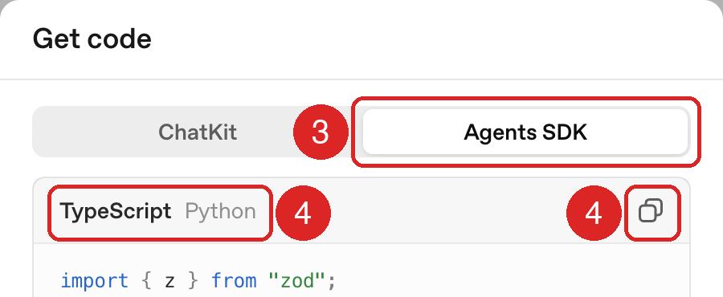
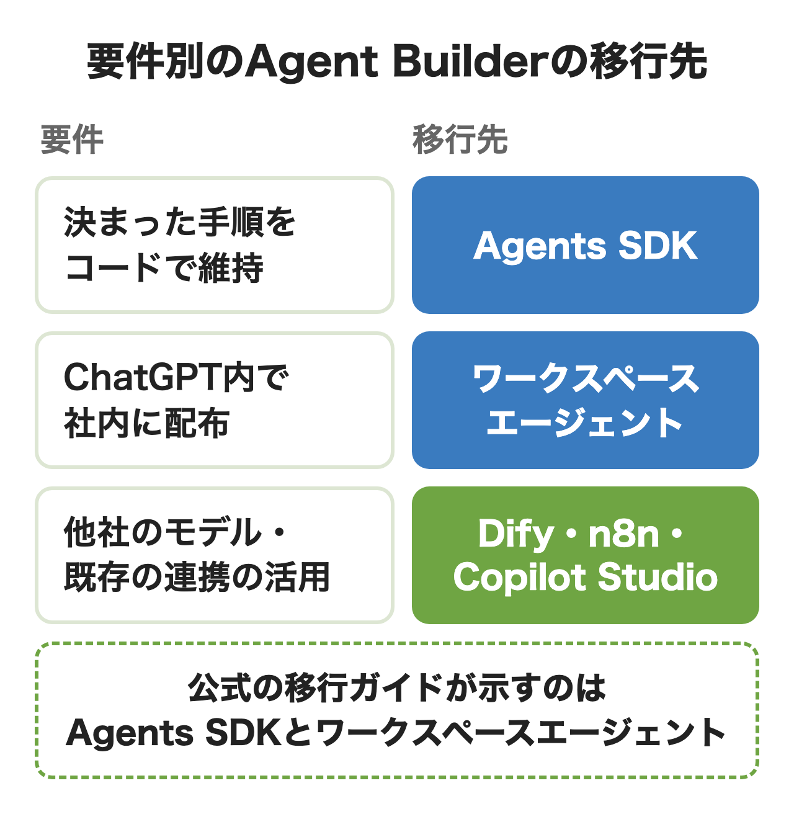

OpenAIは2026年6月3日、画面でAIエージェントの流れを組むAgent Builderを2026年11月30日に終了すると告知しました。すでに使っている場合も、移行の期間中に使える残りは1か月を切っています。

社内でAgent Builderを試したか導入の候補に挙げている担当の方に向けて、何ができる道具だったのかと料金、作ったワークフローの移し先、会社で使うときに決めることを公式ドキュメントで確かめた範囲でまとめました。画面での作成と移行は試していません。

:::takeaways
- **Agent Builderは2026年11月30日に終了する予定で、同じ日にEvalsと再利用プロンプトも終わる**。チャット画面の部品のChatKitは残る
- **ツールの利用料は無く、払うのはワークフローを動かしたときのAPIの代金だけ**。新しく入れる理由は今は薄い
- **作ったものはコードとして書き出し、Agents SDKかChatGPTのワークスペースエージェントに移す**。どちらも中身がそのまま移る保証は無い
:::

## OpenAI Agent Builderとは

Agent Builderは、OpenAIの開発者向けの画面（OpenAI Platform）で、AIエージェントの処理の流れを部品をつないで組む道具です。テンプレートから部品（ノード）を置いて入出力を決め、実際のデータで試してから、自社のサイトに埋め込むかコードとして書き出します。

**コードを書かずに組める点が売りで、Difyやn8nのようなノーコードの道具と同じ場所を狙っていました。** 2025年10月6日の開発者向けイベント（DevDay 2025）で、エージェント開発の道具一式であるAgentKitの一部として発表されました。

### AgentKitの中での位置

AgentKitは3つの部品でできていました。

| 部品 | 役割 | 発表時の提供状況 |
|---|---|---|
| Agent Builder | 画面でワークフローを組み、版を管理する | ベータ |
| ChatKit | 作ったエージェントを自社のサイトやアプリにチャット画面として埋め込む | 全開発者に一般提供 |
| Connector Registry | Google Drive・SharePoint・Teamsなどへの接続を管理者がまとめて管理する | 一部のAPI・ChatGPT Enterprise・Eduにベータ |

### 2026年11月30日に終わるもの

OpenAIの廃止予定のページには、2026年6月3日に3つの機能の終了がまとめて載りました。

| 機能 | 告知 | 終了 | 案内されている移し先 |
|---|---|---|---|
| Agent Builder | 2026年6月3日 | 2026年11月30日 | Agents SDKかChatGPTのワークスペースエージェント |
| Evals（評価の画面とAPI） | 2026年6月3日 | 10月31日に読み取り専用、11月30日に終了 | Promptfoo |
| 再利用プロンプト | 2026年6月3日 | 2026年11月30日 | アプリのコードに移す |

AgentKitの発表記事の冒頭にも、2026年6月3日付けで「11月30日以降はOpenAIのプラットフォームで使えなくなる。コードで続けるならAgents SDK、言葉の指示に向いた用途ならChatGPTのワークスペースエージェントを勧める」という追記が入りました。**Agent Builderで評価に使っていたトレースの採点もEvalsの一部なので、11月30日に一緒に使えなくなります。**

## Agent Builderでできること

ワークフローはStartから始まりEndで終わり、その間にノードを線でつないで作る形でした。線には型があり、前のノードが出すデータと次のノードが受け取るデータが合っているかを画面で確かめられます。

| 分類 | ノード | 使い道 |
|---|---|---|
| 基本 | Start・Agent・End・Note | 入力の受け取り、モデルへの指示とツールの設定、出力の形、メモ |
| ツール | File search・Guardrails・MCP | 上げた文書の検索、個人情報や不正な入力の検出、外部サービスの呼び出し |
| 制御 | If/else・While・User approval | 条件分岐、繰り返し、人の承認を待つ |
| データ | Transform・Set state | データの形の変換、ワークフロー全体で使う変数 |

条件分岐や繰り返しの条件はCEL（Common Expression Language）という短い式で書くため、**画面で組めるとはいえ、変数と式を扱えないと分岐のあるワークフローは作れません。**

作られていた例には社内文書を検索して答えるFAQの窓口、問い合わせを分類して担当のエージェントに振り分ける仕組み、Web検索で調べてまとめる調査役、2つの文書を比べる仕組みがあります。発表の記事ではLINEヤフー（LY Corporation）が作業アシスタントのエージェントを2時間足らずで作った例が紹介されていました。

## OpenAI Agent Builderの使い方と書き出し

### 使い始める前の準備

Agent BuilderはChatGPTではなく、APIを使うためのOpenAI Platformの中にあります。使うにはAPIのアカウントに支払い方法を登録してクレジットを買うか、ChatGPTのPro・Businessに付くAPIの無料クレジットを使うかのどちらかです。プレビューや公開の操作で組織の認証のエラーが出た場合は、Platformの設定で組織の本人確認（Verify organization）を済ませます。

### 作って試して公開する

Platformの[Agent Builder](https://platform.openai.com/agent-builder)を開き、Createから空のキャンバスかテンプレートを選ぶところから始まりました。ノードを置いたら右上のPreviewで実際に入力し、各ノードの動きを見ます。

作業は自動で保存され、Publishを押すとその時点の内容が新しい版として固定され、ワークフローのIDが発行されます。このIDをChatKitに渡すと、自社のサイトにチャット画面として埋め込めました。

### Codeから書き出す

終了に備えて今やっておくのは書き出しです。公式の移行ガイドの手順は次のとおりです。

1. [Agent Builder](https://platform.openai.com/agent-builder)で対象のワークフローを開く
2. 上のメニューのCodeを選ぶ
3. 出てきた画面でAgents SDKを選ぶ
4. TypeScriptかPythonを選び、出てきたコードを全部コピーする

<figure class="post-figure"><figcaption>OpenAI「Migrate from Agent Builder」</figcaption></figure>

**書き出しは11月30日までしかできないため、使っていなくても一度作ったワークフローは控えておくのが安全です。** この書き出しはワークフローの図をそのまま変換するものではなく、すべての動きが変わらず移る保証も無いとガイドは断っています。

## OpenAI Agent Builderの料金

**Agent Builderそのものに利用料は無く、ワークフローを動かしたときに使ったモデルとツールの分だけAPIの料金がかかります。** プレビューで実際にモデルを呼んだ分も課金の対象です。ファイル検索を使うなら、上げた文書の保存とその検索の呼び出しにも料金が付く仕組みです。

2026年10月28日からは、ChatGPTのProかBusinessを契約していれば、毎月のAPIの無料クレジット（ワークスペースで月500ドルまで）を自分のAPIの組織に付けられ、ワークフローを動かした分に充てられます。Plusは対象外です。

モデルごとの単価と月額の試算、使いすぎを止める上限の設定は[OpenAI APIの料金](/media/openai-api-pricing/)で扱っています。

移し先では費用の形も別物です。Agents SDKはコードの道具なので、払うのはAPIの代金と自社で動かすサーバー代です。ワークスペースエージェントはChatGPT Business以上の契約が前提で、発表では2026年5月6日まで無料とされ、今はクレジット制です。GPT-5.6で1回動かすと、目安は5〜25クレジットです（ChatGPTのレートカード）。

## 移行先の選び方

<figure class="post-figure"></figure>

公式の移行ガイドが示す道は2つです。

### Agents SDKで続ける

書き出したTypeScriptかPythonのコードを自社のアプリに入れ、Agents SDKを入れて動かす道です。**条件分岐の順番や出力の形をきっちり守らせたいワークフローは、こちらが向いています。** ガイドにも、決まった処理が中心のワークフローはワークスペースエージェントに忠実には移らないことがあると書かれています。その代わり実行環境・ツール・認証・権限・公開の設定は自分たちで確かめる必要があり、開発の手が要ります。

ChatKitで社外向けのチャットを出していた場合は、ChatKitを自社のサーバーにつなぐ形（ChatKitのガイドでいうadvanced integration）に切り替えるのが公式の案内です。

### ワークスペースエージェントに作り直す

ワークスペースエージェントは、ChatGPTの中で業務を言葉で説明して作り、チームで共有する機能です。2026年4月22日に始まり、Codexを土台にクラウドで動くため、手を離している間もスケジュールどおりに動いたり、Slackのチャンネルで依頼に答えたりできるのが特徴です。

移す作業にはChatGPT Business・Enterprise・Eduのワークスペースと、エージェントを作る権限が要ります。ChatGPTでエージェントの作成を開き、書き出したコードを貼って「このワークフローをエージェントに変換して」と頼み、作り手の画面が直す必要があると示した所を見直します。そのうえで次の点を確かめてから作成を押します。

- 生成された指示と持たせた機能
- つなぐアプリ・ツール・スキル・認証と接続の権限
- 元のワークフローに入れていた代表的な入力をPreviewで試し、結果を比べる

**個人向けのPlusやProではワークスペースエージェントは使えません。** ChatGPTの料金表で、無料版からProまですべて対象外になっています。

## 会社で使うときに決めること

### 誰が作れて誰に配れるか

移し先のワークスペースエージェントでは、管理者が役割ごとに4つを分けて許可できる作りです。

| 管理者が許可するもの | できるようになること |
|---|---|
| エージェントを使う | 社内のエージェントを探して動かす |
| エージェントを作る | 作る・直す・複製する |
| ディレクトリに公開する | 組織の一覧に載せて全員に見せる |
| エージェント所有の接続で公開する | 作った人の接続を使うエージェントを公開する |

Enterpriseでは最初はオフになっていて、管理者が有効にしてから使えます。共有先は自分だけ・組織内のリンク・組織の一覧の3段階です。**4つ目の許可を出すと他の社員が作り手の権限でデータを読んだり操作したりできるため、ヘルプも理解している人にだけ渡すよう求めています。**

### データの扱い

2023年3月1日以降、OpenAIのAPIに送ったデータは本人が共有に同意しない限りモデルの学習に使われていません。一方で不正利用の監視のためのログは既定で最大30日残り、これを残さない設定（Zero Data Retention）は事前の承認が要ります。ChatKitの会話のスレッドは、消すまで保存される扱いです。

ワークスペースエージェントがアプリにつなぐときは、使う人それぞれのアカウントで認証する方法と、エージェントが持つ共有の接続を使う方法を選べます。共有の接続には個人のアカウントでなくサービス用のアカウントを使い、権限を必要な範囲に絞るよう案内されています。

### 誤った操作を止める仕組み

OpenAIの安全のガイドは、外から入った文章が指示を書き換えるプロンプトインジェクションと、意図しない情報の持ち出しを主なリスクに挙げ、次の7つの対策を示しています。

- 信頼できない入力を開発者向けの指示に混ぜない
- ノード間の受け渡しを決まった形（選択肢や固定のJSON）にする
- 方針と例を指示に書いて迷う場面を減らす
- 指示に従いやすいGPT-5かGPT-5-miniを使う
- 外部ツールの読み書きには毎回人の承認を挟む
- Guardrailsで個人情報を伏せ、不正な入力を見つける
- 実行の記録を採点して評価を回す

ただしGPT-5とGPT-5-miniは2026年12月11日にAPIから外れる予定です。廃止予定のページは後継にGPT-5.6 Sol・GPT-5.6 Terraを挙げています。評価に使うEvalsも11月30日に終わるため、移し先ではPromptfooなど別の道具での評価が必要です。

これらを組み合わせてもリスクは大きく減るだけで、無くなりはしないというのがガイドの立場です。ワークスペースエージェントでも、アプリへの書き込みは既定で毎回確認が出る設定で、送信先のドメインを限るような制約もかけられます。**メール送信やデータの削除のような取り返しのつかない操作は、どの道具でも承認を外さないのが基本です。**

## Dify・n8n・Copilot Studioとの使い分け

| 道具 | 向いている使い方 | 料金の決まり方 | 動く場所 |
|---|---|---|---|
| Agents SDK | 決まった手順を自社のアプリで動かす | APIの代金とサーバー代 | 自社の環境 |
| ワークスペースエージェント | 社内の定型業務をChatGPTやSlackで共有する | ChatGPTの契約とクレジット | OpenAIのクラウド |
| Dify | 社内チャットボットやRAGを画面で組む | ワークスペースごとの月額とモデル代。セルフホストは無料版あり | クラウドか自社のサーバー |
| n8n | 業務システムどうしの自動化にAIを挟む | 実行回数で決まる月額とモデル代。セルフホストは無料版あり | クラウドか自社のサーバー |
| Copilot Studio | Microsoft 365とTeamsの中で使う | クレジットのパックか従量課金 | Microsoftのクラウド |

**OpenAIのモデルだけで組み、決まった手順を守らせたいならAgents SDK、ChatGPTのBusiness以上を契約していて、使う人が自分でエージェントを作るならワークスペースエージェントが近い候補です。** 他社のモデルも使いたい、業務システムとの連携が多い、データを自社のサーバーに置きたい場合はDifyかn8nが候補です。Microsoft 365が中心の会社はCopilot Studioが第一の候補でしょう。料金の詳細は[Difyの料金](/media/dify-pricing/)・[n8nの料金](/media/n8n-pricing/)・[Copilot Studioの料金](/media/copilot-studio/)にまとめています。

移行と同時に社内のエージェントの作り方そのものを見直す場合は、nitoの[AIエージェント構築支援](/ai-agent/)でも設計から運用まで相談を受けています。

## まとめ

- **Agent Builderで作ったワークフローがある場合**は、11月30日までにCodeからAgents SDKのコードを書き出し、移し先を決める
- **社外向けのチャットをChatKitで出している場合**は、自社のサーバーにつなぐ形への切り替えを先に進める
- **これから社内にエージェントを入れる場合**は、Agent Builderは選ばず、ワークスペースエージェント・Agents SDK・Dify・n8n・Copilot Studioから選ぶ
- **ワークスペースエージェントを使う場合**は、作る・公開する・共有の接続を使う権限を誰に渡すかを先に決める

## よくある質問

### OpenAI Agent Builderはいつ終わりますか？

2026年11月30日に終了する予定です。OpenAIが2026年6月3日に告知しました。

### OpenAI Agent Builderは無料で使えますか？

Agent Builder自体の利用料はかかりません。ワークフローを動かすと、使ったモデルとツールの分のAPI料金がかかり、プレビューで実行した分も対象です。2026年10月28日からは、ChatGPTのProかBusinessを契約していればAPIの無料クレジットを充てられます。

### Agent BuilderはPlusで使えますか？

Plusの契約には含まれません。Agent BuilderはChatGPTではなく、APIを使うためのOpenAI Platformの機能で、使うにはAPIのアカウントに支払い方法を登録してクレジットを買います（PlusはAPIの無料クレジットの対象外です）。移し先のワークスペースエージェントもBusiness・Enterprise・Eduが対象です。

### Agent Builderで作ったものはどうなりますか？

終了後はAgent Builderの画面で開けなくなる予定です。11月30日までにCodeからAgents SDKのコードを書き出せば、自社のアプリで動かすか、ChatGPTのワークスペースエージェントに作り直す材料にできます。

### 終了後もChatKitは使えますか？

ChatKitは終了の対象に入っていません。ただしAgent Builderのワークフローにつなぐ形は移行期間だけのもので、続けるには自社のサーバーにつなぐ形に切り替えます。

## 出典

2026年11月6日に取得した公式ページです。

- OpenAI API Docs「[Agent Builder](https://developers.openai.com/api/docs/guides/agent-builder)」「[Migrate from Agent Builder](https://developers.openai.com/api/docs/guides/agent-builder/migrate-from-agent-builder)」「[Safety in building agents](https://developers.openai.com/api/docs/guides/agent-builder-safety)」
- OpenAI API Docs「[Deprecations](https://developers.openai.com/api/docs/deprecations)」「[Changelog](https://developers.openai.com/api/docs/changelog)」
- OpenAI API Docs「[ChatKit](https://developers.openai.com/api/docs/guides/chatkit)」「[Agents](https://developers.openai.com/api/docs/guides/agents)」「[Data controls in the OpenAI platform](https://developers.openai.com/api/docs/guides/your-data)」
- OpenAI「[Introducing AgentKit](https://openai.com/index/introducing-agentkit/)」（2025年10月6日、2026年6月3日追記）
- OpenAI「[ChatGPT にワークスペースエージェントが登場](https://openai.com/ja-JP/index/introducing-workspace-agents-in-chatgpt/)」（2026年4月22日）
- OpenAI Help Center「[ChatGPT Workspace Agents for Enterprise and Business](https://help.openai.com/en/articles/20001143-chatgpt-workspace-agents-for-enterprise-and-business)」
- ChatGPT「[料金](https://chatgpt.com/ja-JP/pricing)」
